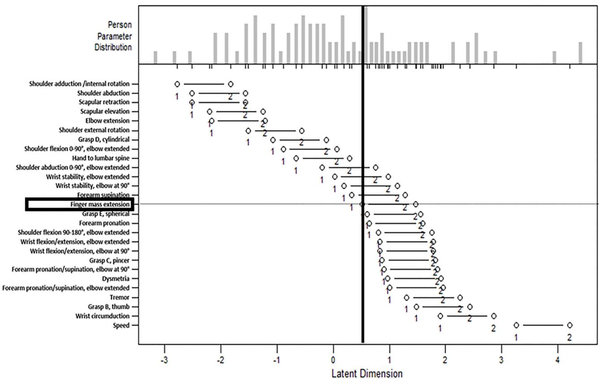

# 中重度上肢功能障碍慢性脑卒中患者的 Fugl-Meyer 上肢评估量表项目难度研究

Nanako Hijikata1, Michiyuki Kawakami1\*, Ryota Ishii2, Keita Tsuzuki1, Takuya Nakamura1, Kohei Okuyama1 and Meigen Liu1

1 Department of Rehabilitation Medicine, Keio University School of Medicine. Tokyo, Japan（庆应义塾大学医学院康复医学系，日本东京）。 ² Biostatistics Unit, Clinical and Translational Research Center, Keio University Hospital, Tokyo, Japan（庆应义塾大学医院临床与转化研究中心生物统计组，日本东京）

OPEN ACCESS

Edited by: Nam-Jong Paik, Seoul National University, South Korea

Reviewed by: Kathryn S. Hayward, The University of Melbourne, Australia Janne Marieke Veerbeek, University of Zurich, Switzerland

\*Correspondence: Michiyuki Kawakami michivukikawakami@hotmail.com

Specialty section: This article was submitted to Neurorehabilitation, a section of the journal Frontiers in Neurology

Received: 30 June 2020 Accepted: 05 October 2020 Published: 16 November 2020

Hijikata N, Kawakami M, Ishii R, Tsuzuki K. Nakamura T. Okuvama K and Liu M (2020) Item Difficulty of Fugl-Meyer Assessment for Upper Extremity in Persons With Chronic Stroke With Moderate-to-Severe Upper Limb Impairment. Front. Neurol. 11:577855. doi: 10.3389/fneur.2020.577855

背景与目的：旨在了解严重慢性脑卒中患者哪些上肢动作存在困难的研究较为有限。本研究的目的在于通过 Rasch 分析在伴有中重度功能障碍的慢性脑卒中患者中检验 Fugl-Meyer 上肢评估量表（Fugl-Meyer Assessment for Upper Extremity, FMA-UE）的结构，并确定其项目难度等级体系。

方法：本研究是对既往随机对照试验或临床试验数据的二次分析。受试者为 101 例伴有中重度偏瘫的慢性脑卒中患者（脑卒中发病时间，$1 3 7 5 . 3 \pm 1 1 5 7 . 9$ 天；33 项 FMA-UE 得分，$3 1 . 1 \pm 1 2 . 8 )$ 。采用主成分分析和内拟合统计量（infit statistics）评估单维性。采用评定量表模型进行 Rasch 分析，并确定项目难度。

结果：剔除了 6 个不拟合项目。结果表明，27 项 FMA-UE 具有单维性。Rasch 分析显示，在协同运动（synergies）模式内完成的动作属于最容易的项目。肩部和肘部动作属于最容易的项目，而前臂和腕部动作则属于中等至最困难的项目。手部项目则跨越了不同的难度等级。

讨论与结论：FMA-UE 是评估伴有中重度障碍的慢性脑卒中患者上肢运动功能的有效评估工具。结果表明，项目难度与 Fugl-Meyer 提出的逐步恢复过程相一致。本研究明确了中重度慢性偏瘫患者难以完成的动作，这将有助于未来研究利用动作难度指标对各项运动进行比较。

关键词：脑卒中（stroke），偏瘫（hemiparesis），评估（assessment），Rasch，上肢（upper limb）

## 引言

随着技术的进步，上肢严重的慢性运动障碍现已成为脑卒中康复的主要目标之一 (1)。尽管过去认为脑卒中患者在慢性期的运动恢复会进入平台期，但研究表明在进行重复性任务训练或强制性诱导运动疗法后，运动功能仍可取得显著改善 (2–5)。这些训练方案是基于运动学习理论开发的 (6–8)，该理论被定义为通过重复使新习得运动行为的速度和准确性得到提高 (9)。通过重复选定的行为，患者最终习得高度定型的运动技能，并且该过程会导致运动皮质中神经元集群的扩展 (10)。机器人技术和神经肌肉电刺激等技术辅助干预措施为伴有严重运动障碍的脑卒中患者提供了重复运动训练的机会。然而，相互矛盾的报道 (1, 4, 11) 表明，对于近端与远端、或单关节与多关节干预方法的有效性，目前尚未达成共识。缺乏关于预测运动恢复或干预反应的关键动作的研究，可能是导致这一现状的原因。重要的是，目前尚无研究评估重度慢性脑卒中患者难以完成哪些上肢动作。阐明这些问题将有助于在制定康复策略时明确优先干预重点。

Fugl-Meyer评估量表（Fugl-Meyer Assessment, FMA）(12)是评估卒中后偏瘫运动功能的金标准(13, 14)。上肢Fugl-Meyer评估量表（Fugl-Meyer Assessment for Upper Extremity, FMA-UE）具有良好的信度(15–20)、效度(15–17, 20)和反应度(15, 16, 19, 20)等心理测量学特性。每个条目均包含反映卒中后偏瘫运动功能的动作，涵盖从近端到远端的关节。确定FMA-UE的条目难度不仅有助于准确评估上肢瘫痪，还可应用于康复实践。Woodbury等人使用Rasch分析（Rasch analysis）分析了FMA-UE的结构，并报告了条目难度层级(21, 22)。然而，其目标人群大多为伴有轻度至中度运动功能障碍的急性期卒中患者。因此，有必要检验该条目难度层级在重度慢性期卒中患者中是否相同。相应地，本研究的目的是在伴有中度至重度上肢运动功能障碍的慢性期卒中患者中，使用Rasch分析检验FMA-UE的结构，并确定其条目难度层级。

## 材料与方法

## 研究设计

本研究是对以往随机对照试验或临床试验数据的二次分析(23–26)。各研究的概要（包括伦理审批和临床试验注册号）均作为补充材料提供。在本研究中，纳入了2017年4月至2019年6月期间在庆应义塾大学医院（Keio University Hospital）参与这些试验的所有患者。对于在研究期间多次住院的参与者，采用首次入院时进行的评估，排除第二次及后续住院的数据。一名对干预措施设盲的作者从参与者的病历中提取了数据。

本研究已获得机构伦理审查委员会的批准（20190144）。研究概要已在公开网站上发布，并确保了参与者拒绝参与的权利。

## FMA-UE

FMA-UE 被用作临床试验中的疗效评价指标。FMA-UE 包含 30 个评估运动功能的项目和 3 个评估反射功能的项目。根据最符合任务表现的情况进行评分，从“0，不能执行”、“1，部分完成”到“2，完全完成”（总分范围：0–66）。根据 Platz 等人 (27) 制定的标准化指南，FMA-UE 由经过培训的康复科医生在治疗/干预前后进行评定。本研究使用了治疗/干预前的数据。评估人员的培训流程如下：要求他们 (a) 复习 Platz 等人 (27) 制定的标准化指南；(b) 观看 See 等人 (19) 制作的培训视频（ArmFM\_TrainingVideo）；(c) 观看受试者 1 的视频（ArmFM\_TestSubject1）(19) 并对患者进行评分；(d) 查看标准答案（ArmFM\_AnswerKey\_Subject1）(19)；(e) 对受试者 2 重复步骤 (c) 和 (d)；(f) 观看具有 10 年以上经验的主治康复科医生的评估过程，并同时对患者进行评分；(g) 比较两份评分并记录评分差异；(h) 重复步骤 (f) 和 (g)，直到评分差异 < 2（低于 MDC [3.2 分] (19)，在此阈值以下的分值可被视为测量误差）；以及 (i) 使用 FMA-UE 对患者进行评估并接受主治康复科医生的反馈（至少 3 次）。

## 参与者

参与者为 101 名慢性脑卒中患者（脑卒中发病后时间为 1375.3 ± 1157.9 天）。参与者的人口统计学特征见 Table 1。采用脑卒中损伤评价集（Stroke Impairment Assessment Set, SIAS）(28) 评估患侧上肢的运动和感觉障碍。采用改良 Ashworth 量表（Modified Ashworth Scale, MAS）(29) 测量被动运动阻力。采用包含 33 个项目的 FMA-UE 评估瘫痪侧上肢运动障碍的严重程度。在本研究中，根据既往研究 (1)，FMA-UE >45 定义为轻度，≥30 且 ≤45 定义为中度，<30 定义为重度。大多数参与者（85%）被归类为中度或重度，而少数（15%）被归类为轻度。由于以往的研究 (21) 中也纳入了类似比例的不同严重程度患者，因此决定在后续分析中纳入轻度受累的患者。

参与者接受了混合辅助神经肌肉动态刺激（hybrid assistive neuromuscular dynamic stimulation, HANDS）疗法 (23)，或参与了其他随机对照试验或临床试验 (24–26)。该人群的共同特征如下：脑卒中发病时间大于 180 天；能够在有/无手杖和/或矫形器辅助下独立行走；且瘫痪侧上肢无明显疼痛或明显的挛缩。详细的纳入/排除标准见补充材料（Supplementary Material）。

TABLE 1 | 参与者的人口统计学特征。

<table><tr><td></td><td>N = 101</td></tr><tr><td>年龄（岁）</td><td>54.8 ± 13.5a</td></tr><tr><td>性别</td><td></td></tr><tr><td>男性</td><td>62 (61.4)b</td></tr><tr><td>女性</td><td>39 (38.6)b</td></tr><tr><td>卒中后病程（天）</td><td>1375.3 ± 1157.9a</td></tr><tr><td>范围（天）</td><td>201–6,202</td></tr><tr><td>受累侧</td><td></td></tr><tr><td>右侧</td><td>59 (58.4)b</td></tr><tr><td>左侧</td><td>42 (41.6)b</td></tr><tr><td>受累侧是否为利手？</td><td></td></tr><tr><td>是</td><td>44 (43.6)b</td></tr><tr><td>否</td><td>57 (56.4)b</td></tr><tr><td>卒中类型</td><td></td></tr><tr><td>缺血性</td><td>42 (41.6)b</td></tr><tr><td>出血性</td><td>57 (56.4)b</td></tr><tr><td>其他</td><td>2 (2.0)b</td></tr><tr><td>卒中部位</td><td></td></tr><tr><td>右半球</td><td>43 (42.6)b</td></tr><tr><td>左半球</td><td>56 (55.4)b</td></tr><tr><td>脑干</td><td>2 (2.0)b</td></tr><tr><td>33项 FMA-UE</td><td>29 [21–38]c</td></tr><tr><td>严重程度*</td><td></td></tr><tr><td>重度</td><td>53 (52.5)b</td></tr><tr><td>中度</td><td>32 (31.7)b</td></tr><tr><td>轻度</td><td>16 (15.8)b</td></tr><tr><td>卒中损伤评估集（SIAS）</td><td></td></tr><tr><td>膝-口测试</td><td>4, n = 11; 3, n = 74; 2, n = 16</td></tr><tr><td>手指测试</td><td>≥2, n = 15; 1c, n = 20; 1b, n = 12; 1a, n = 54</td></tr><tr><td>轻触觉</td><td>3, n = 46; 2, n = 27; 1, n = 23; 0, n = 3</td></tr><tr><td>位置觉</td><td>3, n = 62; 2, n = 5; 1, n = 22; 0, n = 10</td></tr><tr><td>改良 Ashworth 量表**</td><td>1 (1,2)c</td></tr><tr><td>肘部</td><td>≥1, n = 76 (75.2)b</td></tr><tr><td>腕部</td><td>≥1, n = 79 (78.2)b</td></tr></table>

\*严重程度使用 33 项 FMA-UE（范围，0–66）定义：重度，<30；中度，≥30，≤45；轻度，>45  
\*\*评分 1+ 转换为 2，评分 2 和 3 分别转换为 3 和 4。  
a均数 ± 标准差，bn (%)，c中位数 [四分位距]。

## 统计分析

## 得分分布与局部独立性

在进行 Rasch 分析之前，对每个条目的得分分布进行了概览，并剔除了所有受试者得分均相同的条目。随后，对各条目进行筛选，以确定它们是否违反 Rasch 分析的两项基本假设：局部独立性（local independence）和单维性（unidimensionality）。局部独立性意味着被测量的某个条目独立于任何其他条目的表现（及得分）。也就是说，某一条目的特定表现绝不应导致任何其他条目的得分。单维性意味着测量量表的每个条目仅测量一个构念，在本文语境下即偏瘫上肢的运动功能。

## 维度性

为评估维度，使用了主成分分析（PCA）和内拟合（infit）统计量。这些统计方法常用于检验上肢结局指标的维度（30）。对于 PCA，如果一个测量量表仅能测量单一构念（在本研究中为上肢运动功能），那么第一个因子所解释的方差（即特征值）将非常大。在本研究中，提取了特征值 > 1 的因子。第一个因子所解释的总方差百分比假定为 20–40%（31）。在本研究中，40% 被认为是可接受的。确定了因子载荷，即每个条目与因子相关的程度（即在因子上的载荷）。

通过 Rasch 分析计算出的拟合统计量，是检验条目偏离单维性假设程度的最常用指标之一（31）。拟合统计量获得的值是残差的均方（MnSq），即条目的观测得分与模型预测的期望值之间的差异。较高的 MnSq 值表明该条目不符合模型。内拟合统计量比外拟合（outfit）统计量对异常值更不敏感。在本研究中，内拟合 MnSq 值 < 1.7 被认为是可接受的（31）。

## Rasch 分析与条目难度层级

在移除不拟合条目后，使用评分量表模型（rating scale model）进行了另一次 Rasch 分析（32）。评分量表模型是原始二分类 Rasch 模型的扩展模型，可应用于具有多级评分选项的测量量表（例如 FMA-UE 的 3 分制量表）（30）。该分析用于确定以 logit 校准的条目难度层级。

使用 R 软件（R Foundation for Statistical Computing, Vienna, Austria）进行统计分析。

## 结果

## 得分分布与局部独立性

在对各条目的得分分布进行概览后，删除了以下四个条目：“二头肌反射”、“三头肌反射”、“屈肘”和“手指总屈曲”。对于这些条目，所有参与者的得分相同或相似（即所有参与者在两个反射条目上均获得最高分；对于其他条目，大多数参与者获得最高分，且无人得零分），因此这四个条目无法在评分量表模型中进行处理。此外，“正常反射”条目也被移除，因为该条目仅在前面三个条目均获得最高可能得分时才进行评估，从而干扰了局部独立性。对于其余条目，假定保持了局部独立性。因此，在进行 PCA 和内拟合统计之前，共移除了五个条目。

TABLE 2 | 28 项 Fugl-Meyer 上肢评估的内拟合/外拟合统计量†。

<table><tr><td></td><td>Infit MnSq</td><td>Outfit MnSq</td></tr><tr><td>肩胛骨后缩</td><td>0.68</td><td>0.77</td></tr><tr><td>肩胛骨上提</td><td>0.94</td><td>1.97</td></tr><tr><td>肩外展</td><td>0.70</td><td>1.95</td></tr><tr><td>肩外旋</td><td>1.06</td><td>1.43</td></tr><tr><td>前臂旋后</td><td>1.24</td><td>1.63</td></tr><tr><td>肩内收/内旋</td><td>0.75</td><td>1.13</td></tr><tr><td>肘伸展</td><td>1.05</td><td>1.26</td></tr><tr><td>前臂旋前</td><td>0.77</td><td>1.05</td></tr><tr><td>手触腰椎</td><td>0.65</td><td>0.56</td></tr><tr><td>肩屈曲 0–90°，伸肘</td><td>0.91</td><td>0.81</td></tr><tr><td>前臂旋前/旋后，屈肘 90°</td><td>0.56</td><td>0.49</td></tr><tr><td>肩外展 0–90°，伸肘</td><td>0.70</td><td>0.68</td></tr><tr><td>肩屈曲 90–180°，伸肘</td><td>0.93</td><td>0.77</td></tr><tr><td>前臂旋前/旋后，伸肘</td><td>0.49</td><td>0.40</td></tr><tr><td>腕部稳定性，屈肘 90°</td><td>1.14</td><td>0.95</td></tr><tr><td>腕屈曲/伸展，屈肘 90°</td><td>0.68</td><td>0.55</td></tr><tr><td>腕部稳定性，伸肘</td><td>1.21</td><td>1.09</td></tr><tr><td>腕屈曲/伸展，伸肘</td><td>0.74</td><td>0.57</td></tr><tr><td>腕环转</td><td>0.70</td><td>0.41</td></tr><tr><td>手指整体伸展</td><td>0.82</td><td>0.74</td></tr><tr><td>抓握 A，钩状抓握</td><td>1.77</td><td>2.06</td></tr><tr><td>抓握 B，侧捏（拇指）</td><td>1.19</td><td>1.71</td></tr><tr><td>抓握 C，对捏</td><td>1.17</td><td>1.15</td></tr><tr><td>抓握 D，圆柱状抓握</td><td>1.48</td><td>1.38</td></tr><tr><td>抓握 E，球状抓握</td><td>0.85</td><td>0.75</td></tr><tr><td>震颤</td><td>1.09</td><td>0.87</td></tr><tr><td>辨距不良</td><td>1.25</td><td>0.94</td></tr><tr><td>速度</td><td>0.99</td><td>0.64</td></tr></table>

MnSq，残差均方（mean squares of residuals），代表项目的观测得分与模型预测的期望值之间的差异  
† 二头肌/三头肌反射、肘屈曲和手指整体屈曲被剔除，因为所有参与者的得分均为 1 或 2。为确保局部独立性，正常反射亦被剔除。

## 维度（Dimensionality）

PCA（主成分分析）识别出 5 个特征值 > 1 的因子。第一个因子占总方差的 40.0%，其他四个因子分别占方差的 13.4%、7.1%、4.9% 和 3.8%。将这些结果与以往研究 (21, 22) 进行比较后，得出保持了单维性的结论。内拟合（infit）统计量显示，“钩状抓握”（hook grasp）项目超出了可接受范围（Table 2）。超出可接受范围的内拟合统计量使该项目成为待删除项，随后对该项目的外拟合（outfit）统计量和因子载荷进行了审查。该项目显示出异常高的外拟合统计量（outfit MnSq，2.06；Table 2）(31)。此外，其因子载荷值不高（r = 0.46）。这些发现表明“钩状抓握”项目拟合不良，因此在后续分析中删除了该项目。删除该项目后，赤池信息准则（Akaike Information Criterion）降低了 143.8，这表明拟合优度得到了改善。最后，对 27 项 FMA-UE 进行了 Rasch 分析。

TABLE 3 | 27 项 Fugl-Meyer 上肢评估（Fugl-Meyer Assessment for Upper Extremity）的 Rasch 项目难度及内拟合/外拟合统计量†。

<table><tr><td></td><td>测量值*</td><td>误差</td><td>Infit MnSq</td><td>Outfit MnSq</td></tr><tr><td>肩内收/内旋</td><td>-1.84</td><td>0.15</td><td>0.77</td><td>1.15</td></tr><tr><td>肩外展</td><td>-1.66</td><td>0.14</td><td>0.72</td><td>1.98</td></tr><tr><td>肩胛骨回缩</td><td>-1.66</td><td>0.14</td><td>0.67</td><td>0.73</td></tr><tr><td>肩胛骨上提</td><td>-1.46</td><td>0.13</td><td>0.95</td><td>1.98</td></tr><tr><td>肘伸展</td><td>-1.43</td><td>0.13</td><td>1.08</td><td>1.27</td></tr><tr><td>肩外旋</td><td>-1.00</td><td>0.11</td><td>1.06</td><td>1.44</td></tr><tr><td>抓握 D，圆柱状抓握</td><td>-0.71</td><td>0.11</td><td>1.54</td><td>1.46</td></tr><tr><td>肩屈曲 0–90°，肘伸展</td><td>-0.59</td><td>0.11</td><td>0.92</td><td>0.82</td></tr><tr><td>手置于腰椎</td><td>-0.44</td><td>0.11</td><td>0.66</td><td>0.57</td></tr><tr><td>肩外展 0–90°，肘伸展</td><td>-0.13</td><td>0.11</td><td>0.72</td><td>0.69</td></tr><tr><td>腕稳定性，肘伸展</td><td>0.02</td><td>0.11</td><td>1.24</td><td>1.12</td></tr><tr><td>腕稳定性，肘屈曲 90°</td><td>0.13</td><td>0.11</td><td>1.19</td><td>0.98</td></tr><tr><td>前臂旋后</td><td>0.22</td><td>0.11</td><td>1.28</td><td>1.69</td></tr><tr><td>手指充分伸展</td><td>0.34</td><td>0.11</td><td>0.87</td><td>0.83</td></tr><tr><td>抓握 E，球形抓握</td><td>0.40</td><td>0.12</td><td>0.89</td><td>0.79</td></tr><tr><td>前臂旋前</td><td>0.42</td><td>0.12</td><td>0.82</td><td>1.10</td></tr><tr><td>肩屈曲 90–180°，肘伸展</td><td>0.53</td><td>0.12</td><td>0.91</td><td>0.75</td></tr><tr><td>腕屈/伸，肘伸展</td><td>0.55</td><td>0.12</td><td>0.76</td><td>0.58</td></tr><tr><td>腕屈/伸，肘屈曲 90°</td><td>0.55</td><td>0.12</td><td>0.70</td><td>0.55</td></tr><tr><td>抓握 C，捏握</td><td>0.57</td><td>0.12</td><td>1.22</td><td>1.19</td></tr><tr><td>前臂旋前/旋后，肘屈曲 90°</td><td>0.60</td><td>0.12</td><td>0.58</td><td>0.51</td></tr><tr><td>辨距不良</td><td>0.64</td><td>0.12</td><td>1.25</td><td>0.93</td></tr><tr><td>前臂旋前/旋后，肘伸展</td><td>0.67</td><td>0.12</td><td>0.50</td><td>0.40</td></tr><tr><td>震颤</td><td>0.87</td><td>0.13</td><td>1.11</td><td>0.87</td></tr><tr><td>抓握 B，拇指抓握</td><td>0.98</td><td>0.14</td><td>1.25</td><td>1.84</td></tr><tr><td>腕环转</td><td>1.26</td><td>0.15</td><td>0.75</td><td>0.45</td></tr><tr><td>速度</td><td>2.16</td><td>0.23</td><td>1.04</td><td>0.68</td></tr></table>

各个项目按通过 logit 校准的难度顺序排列，较高的 logit 值代表较高的项目难度。  
† 排除了三项反射、屈肘、手指集体屈曲和钩状抓握。\*项目难度测量值基于表示从无能力过渡到初步能力的 logit 值；数值经过调整，使得均值为 0，标准差为 1。

## Rasch 分析与项目难度等级体系

Rasch 分析的结果如 Table 3 所示。通过 logit 校准的项目难度测量值经过了调整（即归一化），使得均值为 0，标准差（SD）为 1。误差值为项目难度测量值的标准误，是通过将原始误差值除以原始量表中项目难度测量值的 SD 获得的。

  
FIGURE 1 | 人员-项目图（person-item map）。人员-项目图的上半部分绘制了人员能力，下半部分绘制了项目难度。下半部分的横轴是项目难度参数（通过 logit 校准；数值未归一化），较高的 logit 值代表较高的项目难度。上半部分的横轴是人员能力参数，采用与下半部分项目难度参数相同的量表。左侧白点表示项目难度测量值。如果参与者的能力位于左侧白点的左侧，则项目得分可能为 0；如果参与者的能力位于两个白点之间，则得分为 1；如果参与者的能力位于右侧白点的右侧，则得分为 2。“手指集体伸展”项目被高亮显示，垂直线划分了参与者，这表明超过一半的参与者无法伸展手指。

## 协同运动与协调性随意运动

在屈肌/伸肌协同运动范围内完成的动作局限于最容易的项目中。相反，所有协调/速度项目都处于最困难的水平。协同运动之外次容易的项目是“肘部伸展时肩关节前屈至 90◦”。

## 肩/肘/前臂

对于各关节运动，除“肘伸展时肩屈 90–180°”外，所有肩部和肘部运动均属于最容易的项目。前臂运动属于中等难度项目，且诸如前臂旋前/旋后等交替运动比稳定运动更困难。

## 腕

腕部运动属于中等至最困难的项目。无论肘关节处于何种位置，其难度均按稳定性、交替运动到环转运动依次增加。

## 手

手指运动跨越了不同的难度等级。“手指集体伸展”总体处于中等难度。各项抓握的难度按“圆柱状抓握（最容易）”、“球状抓握”、“捏握”到“拇指内收（最困难）”依次增加。

人物-项目图（person-item map）如图 Figure 1 所示。被试能力以直方图形式绘制在上半部分，项目难度绘制在下半部分。下半部分的横轴为项目难度参数（使用 logits 进行标定；数值未经归一化），较高的 logit 值代表较高的项目难度。上半部分的横轴为被试能力参数，采用与下半部分项目难度参数相同的量表。左侧的白点描绘了项目难度测量值，基于表示从“无能力”过渡到“初具能力”的 logit 值。如果被试的能力处于左侧白点的左边，则项目得分可能为 0；如果被试的能力介于两个白点之间，则得分为 1；如果被试的能力处于右侧白点的右边，则得分为 2。Figure 1 直观展示了能够完成各项上肢动作的人群分布。例如，图中突出了“手指整体伸展（finger mass extension）”这一项目，垂线将参与者划分开来；该图表明超过一半的参与者无法伸展手指。

## 讨论

在本研究中，使用 Rasch 分析确定了伴有中度至重度上肢运动障碍的慢性脑卒中患者的 FMA-UE（Fugl-Meyer 上肢运动功能评估，Fugl-Meyer Assessment-Upper Extremity）难度等级。Rasch 分析具有一些优势，例如等距量表、项目难度等级和单维性 (30)。Rasch 分析能够确定项目难度等级，并使用等距量表将个体的能力与项目难度进行比较，这有助于针对个体能力设定适当的康复目标。例如，Woodbury 等人利用 Rasch 分析生成了 FMA-UE keyform 恢复图谱，从而将标准化测量量表转化为用于制定治疗计划的工具，以提供具有最佳挑战性的任务，并根据个体的能力逐步提高任务难度 (33)。然而，使用 Rasch 分析获得的测量量表项目难度等级在不同目标人群中会发生变化 (30)。本研究中的参与者与 Woodbury 等人研究中的参与者存在若干不同特征 (21)：其一是慢性程度（脑卒中发病后的时间，1375.3 ± 1157.9 对比 16.9 ± 31.2 天），其二是运动障碍的严重程度。本研究使用了 33 项 FMA-UE，结果显示大多数（85%）参与者为中度至重度功能障碍患者。相比之下，Woodbury 等人 (21) 使用 Orpington 预后量表（Orpington prognostic scale）来定义脑卒中的严重程度，并指出参与者主要为轻度至中度功能障碍患者，其中重度功能障碍患者仅占 10%。尽管由于两项研究中对严重程度的定义不同而无法进行直接比较，但有一项发现表明，本研究中的参与者比以往研究中的参与者具有更严重的上肢运动障碍 (21)；本研究显示超过一半的参与者无法完成手指伸展，而该动作对于 Woodbury 等人研究中的参与者而言较为容易 (21)。因此，本研究是在假设伴有中度至重度功能障碍的慢性脑卒中患者的 FMA-UE 项目难度等级与以往研究 (22) 不同的前提下进行的。

## 维度

单维性作为 Rasch 分析的假设之一，也可表明测量量表的结构效度；即仅测量一个构念，在本文中即为上肢运动功能。本研究的 PCA 和内拟合统计结果表明，包含 27 个项目的 FMA-UE 具有单维性。PCA 结果显示，与 Woodbury 等人 (21) 报告的结果相比，第一因子解释的方差百分比较低。脑卒中后偏瘫随着时间的推移，与痉挛加重、肌肉僵硬度增加（及顺应性降低）、软组织挛缩、肌力减退以及不良协同模式形成相关 (34–36)。此外，据报道，瘫痪程度更严重的患者发生痉挛的风险更高 (37)。事实上，本研究中 MAS ≥1 的受试者比例高于 Wissel 等人 (38) 先前的报告。同样，在中度至重度脑卒中损伤患者中，往往更容易观察到异常的上肢协同运动和代偿运动 (39, 40)。这些改变可能使得 FMA-UE 的结构具有更大的变异性。

在本研究中，“钩状抓握”被确定为不拟合项，且该项目在脑卒中后 6 个月的受试者中也表现出不稳定性 (22)。FMA-UE 项目是基于 Brunnstrom 运动评定建立的。Brunnstrom (41) 将钩状抓握描述为“握住放入手中的手提包提手”，这一动作可在屈肌协同模式下完成；而 Fugl-Meyer (12) 则将该动作定义为“伸展第 II-V 指的掌指关节，同时屈曲近端和远端指间关节”，这需要伸肌和屈肌各自独立收缩。这种修改可能使该任务与最初设想的偏瘫手动作有所不同，从而导致该项目偏离了其他项目所测量的构念。然而，正如先前的研究所指出的 (22)，由于尚无运动控制理论支持，钩状抓握是否能反映偏瘫侧上肢的运动功能仍存在争议。

## 项目难度层级

除了在 Woodbury et al. (21) 的研究中同样被移除的 3 个反射项目外，本研究还略去了“屈肘”和“手指整体屈曲”。在本研究中，几乎所有受试者在这些项目上都获得了最高可能得分，这表明反射和协同运动是最容易的项目。本研究结果与 Fugl-Meyer 的原始文献 (12) 中提出的阶梯式恢复过程一致。然而，Woodbury et al. 的研究显示，项目难度顺序并未遵循预期的阶梯式序列，协同运动和各关节运动跨越了整个难度层级 (21, 22)。正如 Woodbury et al. 所指出的，伴有轻度至中度功能缺损的急性期脑卒中患者的项目难度层级是根据动作固有的任务特异性需求排列的 (21)。相比之下，本研究结果表明，伴有中度至重度功能缺损的慢性期脑卒中患者的项目难度能够反映协同运动，正如 Fugl-Meyer 最初所描述的那样 (12)。本研究中抓握动作的难度层级显示，使用全手的粗大动作（例如圆柱状抓握和球形抓握）较为容易，而使用手指的协调动作（例如捏握和拇指动作）则较为困难，无论脑卒中病程长短，这些结果均与以往的研究一致 (21, 42)。在本研究中，手指整体伸展的难度介于圆柱状抓握和球形抓握之间。这些发现表明，抓握物体所需的空间越大，动作难度就越高，因为这需要伸展手指的能力。

最后，本研究确定了中重度慢性上肢轻瘫患者感到困难的动作。尽管以往有少数研究报道了预测重度慢性卒中患者运动功能恢复或干预反应的关键动作 (43, 44)，但旨在了解这些动作与其他动作相比有多大难度的研究仍较为有限。本研究填补了以往研究之间的空白，并能够通过动作难度指标对轻瘫上肢的各项动作进行比较。例如，“肘关节伸展位肩屈曲至 90◦”（shoulder flexion to 90◦ with elbow extended）曾被报道为一项关键动作 (43)。在本研究中，该项目是仅次于协同运动的最容易的项目之一，它可能是卒中康复以及技术辅助/机器人疗法的候选初始靶点。我们并不假定这是一种有效的方法，这还需要在临床试验中做进一步的研究。因此，本研究结果为针对中重度慢性卒中患者的康复提供了重要的基础知识。这些知识可能有助于选择治疗靶点，在这种情况下，使用 27 项 FMA-UE 可能会带来益处。根据这些结果为中重度慢性卒中患者绘制关键形式康复图谱（keyform recovery maps）也是可能的，但需要在严重程度范围更广的人群中开展进一步研究，以确认在不同上肢功能之外，这种难度层级能在多大程度上得以保持。

本研究存在若干局限性。首先，FMA-UE（Fugl-Meyer 上肢运动功能评估量表）的严重程度分界值尚未统一，文献中已有各种不同分界值的报道 (45, 46)。本研究围绕中重度慢性脑卒中患者的神经康复展开设计，因此采用了该领域最新综述中的分界值，在使用这些结果时应保持谨慎。研究中还使用 MAS（改良 Ashworth 量表）评估了被动运动阻力，未来的研究可纳入更具特异性的痉挛测量指标（如 Tardieu 量表）来解释这一结果 (47)。其次，尽管 FMA-UE 包含多关节运动，但并未评估所有的动作组合。动作难度会随着近端关节位置的改变而变化，因此在解释本研究结果时需审慎对待。第三，受试者均招募自单一中心，源自该机构的患者特征会影响结果的推广性。例如，本研究排除了患侧上肢有明显挛缩的患者，因此临床医生在将这些结果应用于严重挛缩患者时应格外谨慎，尽管该人群通常不太适合接受上肢运动康复。此外，与本样本受试者能力相匹配的项目难度估计相当准确，但对于这些受试者而言过易或过难的项目估计准确度则相对较低；因此，本研究的结果不能直接套用于功能障碍最严重或最轻微的患者。

## 结论

FMA-UE 是针对患有中度

## 参考文献

1. Coscia M, Wessel MJ, Chaudary U, Millán JDR, Micera S, Guggisberg A, et al. Neurotechnology-aided interventions for upper limb motor rehabilitation in severe chronic stroke Brain (2019) 142:2182-97 doi: 10.1093/brain/awz181

至重度功能障碍的慢性脑卒中患者上肢运动功能的有效评估工具。本研究结果表明，项目难度与 Fugl-Meyer 提出的逐步恢复过程相一致。本研究明确了中重度慢性轻偏瘫患者难以完成的上肢运动，这将有助于未来的研究基于动作难度指标对各项运动进行比较。

## 数据可用性声明

本研究所分析的数据受以下许可/限制约束：匿名数据集由研究人员按照伦理委员会的审批要求妥善保存。如需申请调阅这些数据集，请联系 Michiyuki Kawakami，邮箱：michiyukikawakami@hotmail.com。

## 伦理声明

本研究已获得机构伦理审查委员会的批准（20190144）。研究大纲已在公共网站上公布，并充分保障了受试者拒绝参与的权利。

## 作者贡献

NH 和 MK 参与了研究构思与设计、数据采集与分析、数据解释以及初稿撰写。RI 参与了研究设计、数据采集与分析、数据解释以及初稿撰写。KT 和 TN 参与了数据解释和数据采集。KO 和 ML 参与了数据解释以及论文修改。所有作者均对本文做出了贡献，并批准了提交的版本。

## 资助

本研究得到了 JSPS KAKENHI（资助号：JP18H03135 和 19K19886）的部分资助。

## 致谢

作者衷心感谢 Hiroha Kaku 女士在数据采集方面提供的帮助。

## 补充材料

本文的补充材料可在以下网址在线获取：https://www.frontiersin.org/articles/10.3389/fneur. 2020.577855/full#supplementary-material

2. Page SJ, Gater DR, Bach-Y-Rita P. Reconsidering the motor recovery plateau in stroke rehabilitation. Arch Phys Med Rehabil. (2004) 85:1377–81. doi: 10.1016/i.apmr.2003.12.031

3. McCabe J, Monkiewicz M, Holcomb J, Pundik S, Daly JJ. Comparison of robotics, functional electrical stimulation, and motor learning method

for treatment of persistent upper extremity dysfunction after stroke: a randomized controlled trial. Arch Phys Med Rehabil. (2015) 96:981–90. doi: 10.1016/j.apmr.2014.10.022

4. Daly JJ, McCabe JP, Holcomb J, Monkiewicz M, Gansen J, Pundik S. Long-dose intensive therapy is necessary for strong, clinically significant, upper limb functional gains and retained gains in severe/moderate chronic stroke. Neurorehabil Neural Repair. (2019) 33:523–37. doi: 10.1177/1545968319846120

5. Barker RN, Brauer SG, Carson RG. Training of reaching in stroke survivors with severe and chronic upper limb paresis using a novel nonrobotic device: a randomized clinical trial. Stroke. (2008) 39:1800–7. doi: 10161/STROKEAHA.107.498485

6. Pollock A, Farmer SE, Brady MC, Langhorne P, Mead GE, Mehrholz J, et al. Interventions for improving upper limb function after stroke. Cochrane Database Syst. (2014) 11:CD010820. doi: 10.1002/14651858.CD010820.pub2

7. Taub E. Uswatte G. Elbert T. New treatments in neurorehabilitation founded on basic research. Nat Rev Neurosci. (2002) 3:228. doi: 10.1038/nrn754

8. Timmermans AA, Spooren AI, Kingma H, Seelen HA. Influence of task-oriented training content on skilled arm-hand performance in stroke: a systematic review. Neurorehabil Neural Repair. (2010) 24:858–70. doi: 10.1177/1545968310368963

9. Makino H, Hwang EJ, Hedrick NG, Komiyama T. Circuit mechanisms of sensorimotor learning. Neuron. (2016) 92:705–21. doi: 10.1016/j.neuron.2016.10.029

10. Plautz EJ, Milliken GW, Nudo RJ. Efects of repetitive motor training on movement representations in adult squirrel monkeys: role of use versus learning. Neurobiol Learn Mem. (2000) 74:27–55. doi: 10.1006/nlme.1999.3934

11. Rong W, Li W, Pang M, Hu J, Wei X, Yang B, et al. A neuromuscular electrical stimulation (NMES) and robot hybrid system for multi-joint coordinated upper limb rehabilitation after stroke. J Neuroeng Rehabil. (2017) 14:34. doi: 10.1186/s12984-017-0245-y

12. Fugl-Meyer AR, Jääskö L, Leyman I, Olsson S, Steglind S. The post-stroke hemiplegic patient, 1. A method for evaluation of physical performance. Scand J Rehabil Med. (1975) 7:13–31.

13. Baker K, Cano SJ, Playford ED. Outcome measurement in stroke: a scale selection strategy. Stroke. (2011) 42:1787–94. doi: 10.1161/STROKEAHA.110.608505

14. Kwakkel G, Lannin NA, Borschmann K, English C, Ali M, Churilov L, et al. Standardized measurement of sensorimotor recovery in stroke trials: consensus-based core recommendations from the Stroke Recovery and rehabilitation roundtable. Int J Stroke. (2017) 12:451–61. doi: 10.1177/1747493017711813

15. Gladstone DJ, Danells CJ, Black SE. The fugl-meyer assessment of motor recovery after stroke: a critical review of its measuremen properties. Neurorehabil Neural Repair. (2002) 16:232–40. doi: 10.1177/154596802401105171

16. Lin JH, Hsu MJ, Sheu CF, Wu TS, Lin RT, Chen CH, et al. Psychometric comparisons of 4 measures for assessing upper-extremity function in people with stroke. Phys Ther. (2009) 89:840–50. doi: 10.2522/ptj.200 80285

17. Platz T, Pinkowski C, van Wijck F, Kim IH, di Bella P, Johnson G. Reliability and validity of arm function assessment with standardized guidelines for the Fugl-meyer test, action research arm test and box and block test: a multicentre study. Clin Rehabil. (2005) 19:404–11. doi: 10.1191/0269215505cr832oa

18. Sullivan KJ, Tilson JK, Cen SY, Rose DK, Hershberg J, Correa A, et al. Fugl-Meyer assessment ofsensorimotor function after stroke: standardized training procedure for clinical practice and clinical trials. Stroke. (2011) 42:427–32. doi: 10.1161/STROKEAHA.110.592766

19. See J, Dodakian L, Chou C, Chan V, McKenzie A, Reinkensmeyer DJ, et al. A standardized approach to the Fugl-Meyer assessment and its implications for clinical trials. Neurorehabil Neural Repair. (2013) 27:732–41. doi: 10.1177/1545968313491000

20. Amano S, Umeji A, Uchita A, Hashimoto Y, Takebayashi T, Takahashi K, et al. Clinimetric properties of the Fugl-Meyer assessment with adapted guidelines for the assessment of arm function in hemiparetic patients after stroke. Top Stroke Rehabil, (2018) 25:500–8. doi: 10.1080/10749357.2018.1484987

21. Woodbury ML, Velozo CA, Richards LG, Duncan PW, Studenski S, Lai SM. Dimensionality and construct validity of the fugl-meyer assessment of the upper extremity. Arch Phys Med Rehabil. (2007) 88:715–23. doi: 10.1016/j.apmr.2007.02.036

22. Woodbury ML, Velozo CA, Richards LG, Duncan PW, Studenski S, Lai SM. Longitudinal stability of the fugl-meyer assessment of the upper extremity. Arch Phys Med Rehabil. (2008) 89:1563–9. doi: 10.1016/j.apmr.2007.12.041

23. Fujiwara T, Kasashima Y, Honaga K, Muraoka Y, Tsuji T, Osu R, et al. Motor improvement and corticospinal modulation induced by hybrid assistive neuromuscular dynamic stimulation (HANDS) therapy in patients with chronic stroke. Neurorehabil Neural Repair. (2009) 23:125–32. doi: 10.1177/1545968308321777

24. Okuyama K, Ogura M, Kawakami M, Tsujimoto K, Okada K, Miwa K, et al. Efect of the combination of motor imagery and electrical stimulation on upper extremity motor function in patients with chronic stroke: preliminary results. Ther Adv Neurol Disord. (2018) 11:1–10. doi: 10.1177/1756286418804785

25. Mizuno K, Abe T, Ushiba J, Kawakami M, Ohwa T, Hagimura K, et al. Evaluating the efectiveness and safety of the electroencephalogram-based brain-machine interface rehabilitation system for patients with severe hemiparetic stroke: protocol for a randomized controlled trial (BEST-BRAIN Trial). JMIR Res Protoc. (2018) 7:e12339. doi: 10.2196/12339

26. University Hospital Medical Information Network (大学医院医疗信息网络). UMIN-Clinical Trial Registry. 访问网址: https://upload.umin.ac.jp/cgi-open-bin/ctr\_e/ ctr\_view.cgi?recptno=R000028109 (访问于 2020年6月30日)

27. Platz T. ARM, Arm Rehabilitation Measurement: Manual for Performance and Scoring of the Fugl-Meyer Test (Arm Section), Action Research Arm Test, and the Box-and-Block Test. Baden-Baden: Deutscher Wissenschafts Verlag (2005).

28. Chino N, Sonoda S, Domen K, Saitoh E, Kimura A. Stroke impairment assessment set (SIAS). In: Chino N. Melvin JL, editors. Functiona Evaluation of Stroke Patients. Tokyo: Springer-Verlag (1995). p. 19–31. doi: 10.1007/978-4-431-68461-9\_3

29. Bohannon RW, Smith MB. Interrater reliability of a modified ashworth scale of muscle spasticity. Phys Ther. (1987) 67:206–7. doi: 10.1093/ptj/67.2.206

30. Hong I, Bonilha HS. Psychometric properties of upper extremity outcome measures validated by rasch analysis: a systematic review. Int J Rehabil Res. (2017) 40:1–10. doi: 10.1097/MRR.0000000000000202

31. Streiner DL, Norman GR, Cairney J. Health Measurement Scales: A Practical Guide to Their Development and Use. Oxford: Oxford University Press (2015). doi: 10.1093/med/9780199685219.003.0001

32. Andrich D. A rating formulation for ordered response categories. Psychometrika. (1978) 43:561–73. doi: 10.1007/BF02293814

33. Woodbury ML, Anderson K, Finetto C, Fortune A, Dellenbach B, Grattan E, et al. Matching task dificulty to patient ability during task practice improves upper extremity motor skill after stroke: a proof-of-concept study. Arch Phy Med Rehabil. (2016) 97:1863–71. doi: 10.1016/j.apmr.2016.03.022

34. Brainin M, Norrving B, Sunnerhagen KS, Goldstein LB, Cramer SC, Donnan GA, et al. Poststroke chronic disease management: towards improved identification and interventions for poststroke spasticity-related complications. Int J Stroke. (2011) 6:42–6. doi: 10.1111/j.1747-4949.2010.00539.x

35. Gracies JM. Pathophysiology of Spastic Paresis. I: paresis and soft tissue changes. Muscle Nerve. (2005) 31:535–1. doi: 10.1002/mus.20284

36. McMorland AJ, Runnalls KD, Byblow WD. A neuroanatomical framework for upper limb synergies after stroke. Front Hum Neurosci. (2015) 9:82. doi: 10.3389/fnhum.2015.00082

37. Urban PP, Wolf T, Uebele M, Marx JJ, Vogt T, Stoeter P, et al. Occurrence and clinical predictors of spasticity after ischemic stroke. Stroke. (2010) 41:2016–20. doi: 10.1161/STROKEAHA.110.581991

38. Wissel J, Manack A, Brainin M. Toward an epidemiology of poststroke spasticity. Neurology. (2013) 80:S13–9. doi: 10.1212/WNL.0b013e3182762448

39. Roh J, Rymer WZ, Perreault EJ, Yoo SB, Beer RF. Alterations in upper limb muscle synergy structure in chronic stroke survivors. J Neurophysiol. (2013) 109:768–81. doi: 10.1152/jn.00670.2012

40. Cirstea MC, Levin MF. Compensatory strategies for reaching in stroke. Brain. (2000) 123:940–53. doi: 10.1093/brain/123.5.940

41. Brunnstrom S. Motor testing procedures in hemiplegia: based on sequential recovery stages. Phys Ther. (1966) 46:357–75. doi: 10.1093/ptj/46.4.357

42. Persch AC, Gugiu PC, Velozo CA, Page SJ. Rasch analysis of the wrist and hand fugl-meyer: dimensionality and item-level characteristics. J

Neurol Phys Ther. (2015) 39:185–92. doi: 10.1097/NPT.00000000000 00096

43. McPherson JG, Chen A, Ellis MD, Yao J, Heckman CJ, Dewald JPA. Progressive recruitment of contralesional cortico-reticulospinal pathways drives motor impairment post stroke. J Physiol. (2018) 596:1211–25. doi: 10.1113/JP274968

44. Lang CE, Wagner JM, Edwards DF, Sahrmann SA, Dromerick AW, Lang CE, et al. Recovery of grasp versus reach in people with hemiparesis poststroke. Neurorehabil Neural Repair. (2006) 20:444–54. doi: 10.1177/1545968306289299

45. Woodbury ML, Velozo CA, Richards LG, Duncan PW. Rasch analysis staging methodology to classify upper extremity movement impairment after stroke. Arch Phys Med Rehabil. (2013) 94:1527–33. doi: 10.1016/j.apmr.2013.03.007

46. Dobkin BH, Carmichael ST. The specific requirements of neural repair trials for stroke. Neurorehabil Neural Repair. (2016) 30:470–8. doi: 10.1177/1545968315604400

47. Sunnerhagen KS, Olver J, Francisco GE. Assessing and treating functional impairment in poststroke spasticity.

Neurology. (2013) 80:S35–44. doi: 10.1212/WNL.0b013e31827 64aa2

利益冲突：MK 和 ML 是初创公司 Connect Inc. 的创始科学家，该公司致力于促进大学研究成果的社会转化。KO 受雇于 Connect Inc.。

其余作者声明，本研究是在不存在任何可能被解释为潜在利益冲突的商业或财务关系的情况下进行的。

Copyright © 2020 Hijikata, Kawakami, Ishii, Tsuzuki, Nakamura, Okuyama and Liu. 这是一篇采用知识共享署名许可协议（Creative Commons Attribution License, CC BY）分发的开放获取文章。在遵守公认学术规范的前提下，只要注明原作者和版权所有者，并引用本期刊上的原始出版物，即允许在其他论坛中使用、分发或复制。严禁任何不符合这些条款的使用、分发或复制。