# A clinically feasible kinematic assessment method of upper extremity motor function impairment after stroke

Ali Ozturk a,⇑, Ahmet Tartar b, Burcu Ersoz Huseyinsinoglu c, Ahmet H. Ertas d

a Engineering Faculty, Department of Mechatronics Engineering, Karabuk University, Turkey

b Engineering Faculty, Department of Biomedical Engineering, Inonu University, Turkey

c Faculty of Health Sciences, Division of Physiotherapy and Rehabilitation, Istanbul University, Turkey

d Engineering Faculty, Department of Biomedical Engineering, Karabuk University, Turkey

## a r t i c l e i n f o

Article history: Received 12 October 2015 Accepted 3 November 2015 Available online 2 December 2015

Keywords: Stroke Rehabilitation Reaching Kinematic Inter-joint coordination Kinect

## a b s t r a c t

The development of feasible kinematic assessment methods of upper extremity motor function impairment after stroke is clinically extremely important in physiotherapy and rehabilitation engineering. Microsoft Kinect has a potential of a low-cost and compact solution for clinical based assessment of the upper limb motor function after stroke. However, the reliability of Microsoft Kinect in the upper limb motor function assessment has not been well established. Therefore, there is a hesitation in usage of Microsoft Kinect for clinical applications. It is expected that any measurement procedure has the capability to differentiate between pathological and normal performance. On the other hand, the identification of the kinematic metrics that best evaluate impairment of upper-extremity motor function is a key problem of any measurement protocol. Primary objective of our study is, by differentiating pathological performance from the healthy performance and identifying the kinematic metrics that best evaluate the impairment, to demonstrate the robustness/usability of Microsoft Kinect in kinematic analysis of motor performance of stroke patients. We compared the kinematic metrics of the forward reaching movement obtained data recorded from Microsoft Kinect between three stroke patients and two healthy subjects based on the Principal Component Analysis (PCA). In the study, we have defined a new inter-joint coordination index (IJCI) based on PCA to capture inter-joint coordination dynamic of reaching movement in addition to other metrics those have been previously defined and used in literature to quantify upper limb impairment. We observed that the IJCI has significant importance to detect impairment of upper-extremity motor function during a forward reaching task and to discriminate stroke patients from healthy controls.

We hope that this paper will promote the acceptance of objective kinematic analysis into routine rehabilitation practices.

 2015 Elsevier Ltd. All rights reserved.

## 1. Introduction

The most commonly used clinical measurements about motor function of hemiparetic upper extremity such as Wolf Motor Function Test (WMFT) can be considered subjective, as they depend on the evaluation of the data extracted by physician observations. They are not sensitive enough to detect the slow improvement signs on the complex upper extremity motor function. Also they cannot explain the underlying biomechanical characteristic of the motor function deficits [1]. Moreover, they mainly focus on the realization of the given functional task and have not the capability to detect improvement in how the task is performed [2].

The kinematic analysis, which is realized by using the motion tracking technologies and thereby minimize the observation errors of the physicians, make possible an objective, specific and evidence-based assessment of the motor functions of the upper extremity by providing objective and quantitative parameters. Kinematic analysis is an effort to reach an objective assessment based on the 3D (three-dimensional) positional data of some segment of subjects captured by a motion capture system during execution of a given task. Kinematic analysis of upper extremity motor function depends on four major factors: Motion capture systems with the 3D positional data of some segments of the subjects collected, Movement Category that subjects are asked to realize, Kinematic Metrics extracted from 3D positional data, and Interpretation ofthe kinematic metrics.

Visual marker based sensors (opto-electronic system based on active or passive markers) [3], robotic devices [4], electromagnetic sensors, and initial sensors [5] have been used as a motion capture system on kinematic analysis of neurological disorders related to movement impairment. Each motion tracking technology comes with its own positive and negative characteristics [6]. Accuracy, reliability, compactness and cost of the sensors are very important in terms of the acceptance of the kinematic analysis into routine rehabilitation treatment and flexibility of implementation in clinic and home environments. Indeed. there is an increased need for the home based rehabilitation schemes and clinically feasible methods for assessing the upper limb motor function to lift burden on health care services and expense in the national health service [7]. Visual marker based sensors are the most widely used technologies as a golden standard in the kinematic analysis because of their high accuracy and reliability. However, because of the difficulty in transportation, calibration and marker-placement, required large set-up volume and high cost of the visual marker based sensors make implementation of the kinematics analysis limited to research laboratories. Because of its cheap cost, compactness and marker-free skeleton tracking capability; Kinect has been increasingly drawing attention of the rehabilitation community since it first released in 2010 by Microsoft. Kinect has been used in elderly care and rehabilitation of neurological disorders. In literature, several researchers have investigated the neurological disorders related diagnostic potential of the data obtained from the comparison between Kinect and the visual marker based sensors [8,9]. Chang et al. only showed that profiles of elbow and shoulder angles obtained from Kinect and Opti-Track are closed enough when Kinect is placed in front of the subjects [10]. Clark et al. showed that the Microsoft Kinect provides anatomical landmark displacement and trunk angle data which possesses excellent concurrent validity when compared to data obtained from a visual marker based motion tracking system (VICON). Also it was suggested that the Microsoft Kinect can be used in clinical applications for a wide range of patient population [11]. Olesh et al. showed that joint angles of the upper limb obtained by both Kinect and a visual marker based sensors were correlated [12]. The results of the previous studies are promising that the Kinect can provide reliable tools to assess objectively upper limb motor function after stroke. Therefore, we don’t need to compare data obtained by Microsoft Kinect with data obtained by a visual marker based motion tracking system.

One important problem that should be resolved is the identification of the kinematic metrics that best evaluate impairment of upper-extremity motor function and interpretation of the metrics in terms of the treatment efficacy in person with stroke [13]. Currently there is a paucity of kinematic metrics with regard to upper extremity [14]. However, information on how to interpret the complex data is still missing [15]. Each of the metrics evaluate a specific characteristic of upper extremity movements. Therefore, selection of metrics depends on what kind of movement category that subjects are asked to realize. Movement categories in kinematic analysis are reaching movements (point to point reaching), path drawing and activities of daily living (ADL). However, most stroke survivors are far from to realize any ADL such as handling a glass due to impairment in prehensile function in their hand [16]. Upper-extremity point to point reaching movement related kinematic metrics can be classified into two categories; end-point (hand) kinematic metrics and joint kinematic metrics [17]. End-point kinematic metrics is widely calculated by 3D Cartesian coordinates of only one marker on the wrist. While peak velocity, movement smoothness, movement straightness of the wrist displacement belongs to end-point kinematics, inter-joint coordination and joint range of motion belongs to joint kinematics. Trunk displacement has also been used to quantify compensatory strategies may also be considered within joint kinematics. End-point kinematics can be considered as a motor performance and joint kinematics and trunk movements can be considered as a movement quality [18]. Subramanian et al. [18] stated that trunk displacement was the only variable that distinguish between different level of impairment in stroke patients for reachto-grasp task and suggested that movement quality variables are more sensitive in identifving upper limb deficits van Dokkum et al. [19] argued that motor performance kinematics (movement time, trajectory length. directness smoothness, mean and maximum velocity of the hand) were sensitive to change over time and distinguish movements of paretic, nonparetic and healthy limbs for reachto-grasp movement task. Murphy et al. [13] claimed that the number of movement units (movement smoothness), total movement time, velocity, and peak angular velocity of elbow discriminated best between healthy subjects and those with stroke as well as between those with moderate versus mild arm impairment during reaching and drinking from a glass. Hence, it is well understood that response of the metrics vary between trials and it may depend on demographic properties of the stroke population and functional task that subjects are asked to realize during measurement. It is also worth emphasizing that all aforementioned studies on kinematic analysis of upper limb movement deficits of stroke patients utilized a visual marker based sensor which may not well suit in clinical or home environment.

The reaching movements in stroke patients are characterized with a pathological synergy that show itself disruption in a gross extensor movement that called the extensor synergy (shoulder extension and adduction combined with elbow extension) or a gross flexor movement that called flexor synergy (shoulder flexion and abduction combined with elbow flexion) [20]. However, many studies reported on kinematic analysis of upper limp movement deficits in stroke patients do not include any metric to quantify inter-joint dynamics. Cirstea et al. [21] described a technique based on phase plots (movement velocity as a function of displacement) and relative phase relationship between joints. However, the technique does not have a single index. Instead, the technique (The Temporal Coordination (TC) Index) composed of four segment of movement and incorporates amplitudes and duration digits for each segment. Therefore, we consider that the TC index is computationally intensive and not easy to interpret. Moreover, phase plots is sensitive to filtering raw data especially recorded from a single Kinect in 30 fps (frame per seconds). One other alternative method to quantify inter-joint coordination is the Principal Component Analysis (PCA), more specifically the eigenvalues of the covariance matrix [22,23]. Using the eigenvalues of the PCA, it is possible to quantify inter-joint coordination in a more compact manner than The Temporal Coordination (TC) Index.

Primary objective of this study is to demonstrate the robustness/reliability of Microsoft Kinect in kinematic analysis of upper limb movement deficits of stroke patients in clinical applications. The differentiating pathological performance of stroke patients from that healthy subjects and the identification of the kinematic metrics that best evaluate impairment of upper-extremity motor function are very important characteristics for any assessment methodology based on the kinematic analysis. By showing that the kinematic analysis with Microsoft Kinect has these characteristics, we demonstrated that Microsoft Kinect is a highly reliable and easily applicable motion capture system for kinematic analysis of stroke patients in clinics.

## 2. Materials and methods

## 2.1. Subjects

Three stroke patients and two healthy undergraduate students took part in this study. All subjects signed an informed consent. The study was approved by Istanbul University Institutional Review Board (2014/854-1166) and performed in accordance with the Helsinki Declaration.

The upper limb impairment was assessed by 15 functional task of the Wolf Motor Function Test (WMFT) [24]. The WMFT is scored based on time and functionality scale. According to manual, the functionality scores and timing measurements are obtained by a physiotherapist with a stopwatch. Total score of the 15 functional task of the

Demographic data and clinical scores for participants with stroke (M male, F female, P1-2-3 are patient 1-2-3, maximum Score of WMFT is 75, lower scores are indicative of lower functioning level).

<table><tr><td>Patients</td><td>Sex</td><td>Age (years)</td><td>Duration (months)</td><td>WMFT score</td></tr><tr><td>P1</td><td>M</td><td>55</td><td>11</td><td>25</td></tr><tr><td>P2</td><td>M</td><td>61</td><td>4</td><td>35</td></tr><tr><td>P3</td><td>F</td><td>61</td><td>4</td><td>71</td></tr></table>

WMFT for each stroke patient are given in Table 1. Hemiparetic side of the all patients are left.

## 2.2. Experimental procedure

Seated subjects were asked to perform natural, selfpaced reaching movement from neutral position to nonspecified location on the table as seen in Fig. 1. They were just asked to locate their hand by extending their elbow angle as much as possible. All patients performed the reaching task with their hemi-paretic arm and all normal subjects with their right arm. All subjects repeated the reaching movement three times.

## 2.3. Sensor and pre-processing

Microsoft Kinect was used as a motion tracking technology in this paper. Microsoft Kinect v1, released in 2010, was designed to enable users to interact with the game by the means of a natural user interface using gesture which make unnecessary to touch a game controller. However, it was rapidly ‘hacked’ and extensively used in various applications ranging from medical field to robotics due to its low-cost but high-tech depth sensor technology. The Kinect incorporates a depth sensor, a color camera (RGB camera) and a four-microphone array [25]. Extraction of 3D positional data of some point on skeleton relies on the depth sensor on Kinect. The depth sensor consists of an infrared (IR) projector and an IR camera. The depth sensor is capable of creating images like a RGB camera, but instead of color, each pixel value corresponds to the distance to the point. The basic working principal of the depth sensor, namely structured light technique, is to send out an infrared light pattern with its IR projector and estimate depth from the reflection of the light with its IR camera [26]. Kinect v2 which is improved version of Kinect v1, commercially released in 2014, is providing the high resolution depth, the color images at 30 fps and the body tracking capability (see Table 2). The depth sensor of Kinect v2 is working based on TOF (time of flight) principal [27–29]. Kinect v2 with Microsoft Kinect SDK (Software Development Kit) 2.0 provides the real time 3D positional coordinates of 25 joints on the body (see Fig. 2). In our study, Microsoft Kinect v2 with SDK 2.0 was utilized.

Every motion capture sensors used in kinematic analysis of human movement generates a measurement error that show itself in the form of noise in recorded kinematic signals. The noise in the recorded raw data badly effects the kinematic analysis of upper extremity motor function. Therefore, the raw signal recorded should be filtered prior to kinematic analysis. Singular spectrum analysis (SSA)

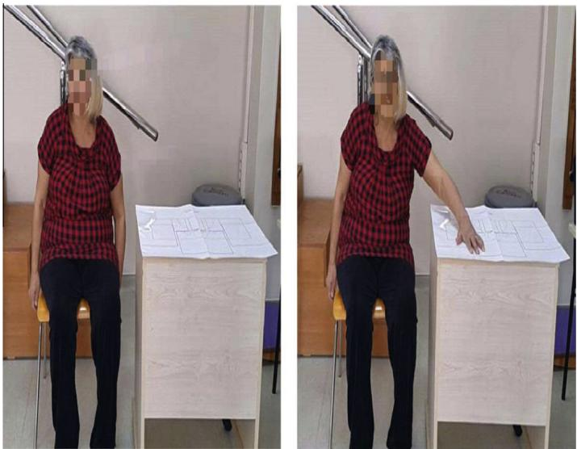  
Fig. 1. Experimental set-up.

Table 2  
Specifications of Kinect v1 and v2.

<table><tr><td>Feature</td><td>Kinect v1</td><td>Kinect v2</td></tr><tr><td>Color camera</td><td>640 × 480@30 fps</td><td>1920 × 1080@30 fps</td></tr><tr><td>Depth camera</td><td>320 × 240</td><td>512 × 424</td></tr><tr><td>Horizontal view</td><td>57°</td><td>70°</td></tr><tr><td>Vertical view</td><td>43°</td><td>60°</td></tr><tr><td>Skeleton joints</td><td>20 joints</td><td>25 joints</td></tr><tr><td>Full skeleton tracked</td><td>2</td><td>6</td></tr></table>

was utilized as a filtering technique in this work. On smoothing the raw kinematic signals, the performance of SSA is superior over the filtering techniques such as digital Butterworth filters, splines, discrete wavelet transform and the Wigner function found in the literature [31].

The objective of SSA is to decompose the original series into the sum of a small number of independent elements such as a slowly fluctuating trend, oscillatory elements and a structureless noise [32]. A short description of SSA algorithm is included here. Consider the length N time series $Y = ( y _ { 0 } , y _ { 1 } , \dots , y _ { N - 1 } )$ representing the noisy signal.

Step 1 (Embedding): First step is producing a Henkel matrix from the time series by sliding a window that is shorter than the length of the original signal. Windowing produces the multi-dimensional series $X _ { 1 } , \ldots , X _ { k }$ with vectors $X _ { i } = ( y _ { i } , \ldots , y _ { i + L - 1 } ) ^ { T }$ , where $K = N - L + 1$ . The result of this step is Henkel matrix or so-called trajectory matrix $\mathbf { X } = [ X _ { 1 } , \ldots , X _ { K } ]$

Step 2 (SVD ofthe Matrix $X X ^ { T } ) ;$ : Compute the eigenvalues and eigenvectors of the matrix $\mathsf { X X } ^ { T }$ so that $\lambda _ { 1 } \geqslant \lambda _ { 2 } \geqslant \dots \lambda _ { L } \geqslant 0$ are the eigenvalues in descending order and $U _ { 1 } , U _ { 2 } , \dots , U _ { L }$ are the corresponding eigenvectors of $X X ^ { T }$ . Then, the Henkel matrix X can be written in the form of $X = E _ { 1 } + E _ { 2 } + \cdots + E _ { L } $ , where $E _ { i } = \sqrt { \lambda _ { i } } U _ { i } V _ { i } ^ { T }$ and $V _ { i } = X ^ { T } U _ { i } / \sqrt { \lambda _ { i } }$ fififi. The norm of elementary matrix E equals $\sqrt { \lambda _ { i } } .$ fififiTherefore, the contribution of the elementary matrix fififificorresponds to larger eigenvalues contributes to norm of

X much higher than smaller, and it is likely that the elementary matrix corresponds to smaller eigenvalues represent noise in the signals.

Step 3 (Grouping): Grouping is the summation of first r elementary matrices that correspond to larger eigenvalues. Then, an approximation matrix ${ \overline { { X } } } = X _ { 1 } + \cdots + X _ { i }$ to the trajectory matrix X is obtained.

Step 4 (Reconstruction): Approximated time series of the original time series Y that representing the noisy signal is recovered by taking the average of the diagonals of the approximated matrix X.

SSA algorithm depends on two parameters: the window length L and the number of the largest eigenvalues r computed from an approximation of the trajectory matrix. The week point of SSA algorithm is that there is no general rule to select them. The selection of the parameters depends on the expectation from the signal. In our case, we attempted to quantify the reaching movement towards a table. The movement speed of the wrist (or hand) that prior (while hand is waiting to start to reaching movement) and after the movement (when hand is located on the table) should be approximately zero. The speed during reaching movement should be well bell-shaped. The trajectory matrix was generated by sliding a window of 15 elements in length. The window length is decided by trials. First eigenvalue was 99:96% of the sum of the all eigenvalue (see Fig. 3). Therefore, the signal reconstructed by using only one single elementary signal that corresponds to the largest eigenvalue (r = 1). Fig. 4 shows the results of the SSA algorithm. As it is expected, speed is approximately zero during waiting for and after the reaching motion. In addition, the speed of a healthy subject is well bell shaped during reaching movement.

## 2.4. Recording methods and data analysis

Microsoft Kinect v2 with SDK 2.0 provides the real time 3D positional coordinates of 25 joints on the body. We have only recorded the 3D positional data of 8 joints: spine shoulder, spine mid, shoulder left/right, elbow left/right and wrist left/right on the visual studio environment during the reaching movement of each subject. Post processing is carried out in MATLAB (MathWorks, Inc.). In the study, recorded 3D positional coordinates of all joints were smoothed by using singular spectrum analysis (SSA).

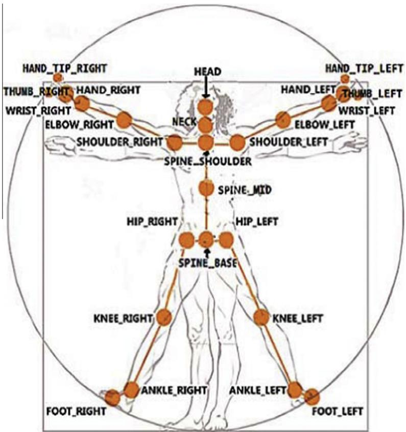  
Fig. 2. Skeleton positions of those 3D coordinates can be obtained from Kinect v2. (Illustration adopted from [30].)

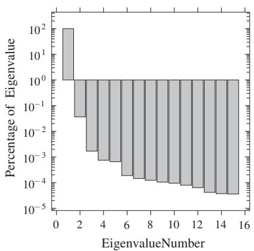  
Fig. 3. Eigenvalue spectrum (in logarithmic scale) obtained with a window length L = 15.

Kinematic metrics were defined either in the endpoint/ task space (end-point kinematics or movement performance kinematics) or in the joint space (joint kinematics or movement quality metrics) of the upper limb. Speed profiles were considered to relate to effectiveness of motor control [19]. A healthy point-point reaching movement has smooth well bell shaped speed profile of the end-point. To quantify the smoothness of the end-point speed, various metrics have been used so far such as the normalized mean absolute jerk, the number of peaks in the speed profile, and the normalized mean speed [33,34]. In this study the spectral arc-length metric based on the Fourier magnitude spectrum was used to quantify smoothness of the endpoint during point-point reaching movement. Balasubramanian et al. [35] tested and compared the spectral arc-length metric with other smoothness metric and concluded that it is superior to others in sensitivity to modifications of motor behavior and robustness to measurement noise.

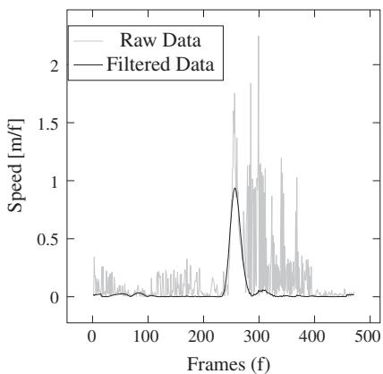  
Fig. 4. Results of SSA with L = 15 and r = 1.

Other metrics defined in the task space were the maximum speed of the endpoint and the endpoint straightness estimated using the Index of Curvature (IC) defined as the ratio of the path length and the line-of-sight distance between the initial to the final endpoint position [36]. During a reaching movement in stroke patients, motor compensations can include the excessive trunk displacement and disrupted inter-joint coordination between shoulder and elbow angles [37]. To quantify the motor compensation, the trunk displacement during reaching movement and inter-joint coordination between shoulder flexion/ extension and elbow flexion/extension was examined. Inter-joint coordination was evaluated by Temporal Coordination (TC) Index [21] and Principal Component Analysis (PCA) [22]. In this study, PCA was used to measure the inter-joint coordination of the upper limb.

To construct the kinematic metrics in the end point space, we calculated the Euclidean norm of the Cartesian coordinates of the recorded wrist points: $W _ { i } =$ ${ \sqrt { x _ { i } ^ { 2 } + y _ { i } ^ { 2 } + z _ { i } ^ { 2 } } } , i = 1 \cdots n$ where $( x _ { i } , y _ { i } , z _ { i } )$ is the Cartesian 3D coordinates of the wrist recorded from Kinect and n is total number of recorded frame. Differentiation of $W _ { i }$ frame by frame is the velocity and the absolute value of the velocity is the speed. Movement onsets and offsets were determined as the frames at which the speed surpassed or fell below 10% of the maximal peak speed of the wrist. The Index of Curvature (IC) was also defined by using $W _ { i } .$ . Trunk displacement was calculated from 3D coordinates of the spine shoulder.

In order to define the shoulder flexion/extension angle, a frontal plane was created by using 3D coordinates of the spine-mid $( S _ { M } ) _ { 1 }$ , spine-shoulder (S ) and shoulder right/left (S) (see Fig. 5). Then, the shoulder flexion/extension was defined as the angle between the vector directed from the shoulder left/right to elbow left/right (E) and the frontal plane. Three points in the 3D space defines a plane. Therefore, by using 3D coordinates of the spine-mid $( S _ { M } ) .$ spine-shoulder (S ) and shoulder right/left (S), normal to the frontal plane is ${ \vec { n } } = { \overrightarrow { S _ { S } S } } \times { \overrightarrow { S _ { S } S } } _ { M } ,$ , where stands for  cross product. Then, the shoulder flexion/extension angle was calculated by the following equation;

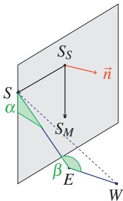  
Fig. 5. a and b are shoulder and elbow flexion/extension angles respectively. 3D coordinate of shoulder (S), spine-shoulder $( S _ { S } ) _  \}$ spine-mid $( S _ { M } ) _ { * }$ elbow (E) and wrist (W) are used to calculate shoulder and elbow flexion extension angles. \~n is normal vector of the frontal plane.

$$
\alpha = \arcsin \left(\frac {| \langle \vec {n} , \vec {S E} \rangle |}{| | \vec {n} | | | | \vec {S E} | |}\right)\tag{1}
$$

The elbow flexion/extension was calculated by means of law of cosines in the triangle created by 3D coordinates of wrist (W), elbow (E) and shoulder (S) (see Fig. 5);

$$
\beta = \arcsin \left(\frac {\| E \vec {W} \| ^ {2} + \| \vec {S E} \| ^ {2} - \| S \vec {W} \| ^ {2}}{2 \| E \vec {W} \| \| \vec {S E} \|}\right)\tag{2}
$$

## 2.5. Principal Component Analysis (PCA)

Principal Component Analysis (PCA) transforms a number of possibly correlated variables into a smaller number of variables called principal components which are uncorrelated and ordered so that the first few preserve most of the variation in all of the original variables [38]. Central idea of PCA is that the variables in the transformed data should be as uncorrelated as possible. PCA makes easier to spot trends and patterns present in the data [39].

A brief technical details of PCA was included here. Let X an m n matrix where the n columns are the samples and m rows are the variables. To ensure the zero mean across the each row, the row average is subtracted from each entry. The covariance matrix $\begin{array} { r } { C _ { X } = ( 1 / ( n - 1 ) ) X X ^ { T } } \end{array}$ is constructed. Then, singular value decomposition (SVD) is applied to covariance matrix, $\boldsymbol { C _ { X } } = \boldsymbol { U } \boldsymbol { \Sigma } \boldsymbol { V } ^ { T }$ . Finally, the original data set X is transformed to a new data set $\boldsymbol { Y } = \boldsymbol { V } ^ { T } \boldsymbol { X } .$ . It turns out that for $k = 1 \cdots m ,$ , kth PC is given by $y _ { k } = \alpha _ { k } ^ { T } X$ where $\alpha _ { k }$ is an eigenvector of $C _ { X }$ corresponding to its kth largest eigenvalue of $\lambda _ { k } .$ . Furthermore, variance of $y _ { k }$ is equal to $\lambda _ { k } .$ . Goal of the PCA is reducing data dimensionality by maximizing variance in a few principal components. Principal components correspond to largest eigenvalues explain the largest variance present in the original data and thereby is a nice representation of the original data set.

## 2.6. Inter-joint coordination index (IJCI)

Inter-joint coordination index was evaluated based on PCA. Joint angles were standardized so that they have zero mean and unit variance (standard score or z-score). Let $S = \left( s _ { 1 } , \ldots , s _ { n } \right) ^ { T }$ and $\boldsymbol { E } = ( e _ { 1 } , \ldots , e _ { n } ) ^ { T }$ are the standard score of the shoulder and elbow angles, respectively. Then, based on $n \times 2$ matrix $X = [ S E ]$ where 2 columns are the observation (joint angles) and the n rows are the variables (frames), PCA was carried out. The largest eigenvalues explaining greatest variances in the dataset were used to evaluate the inter-joint coordination.

## 3. Results

The development of feasible kinematic assessment methods of upper extremity motor function impairment after stroke is clinically extremely important in physiotherapy and rehabilitation engineering.

In healthy and patient subjects, the wrist speed (the hand speed) profiles were smooth and bell shaped (see Fig. 6). Therefore, the smoothness metric (spectral arclength metric) and Index of Curvature were close each other in each patient and healthy group (see Table 3). Previous studies reported that in patient subjects, end-point (hand) speed profiles were not smooth such that the speed profiles have several peaks. This case is the evidence of that their hand changed direction before realizing the reaching task and the task is realized by a series of small consecutive movement [13,19,21]. In the study, our results contradicted with previous studies. We assumed that the differences in the smoothness and Index of Curvature between studies are related to the different movement tasks that subjects are asked to realize. In this work, we did not specify a point to reach, instead subjects were asked to locate their hand at any position on the desk. Maximum speed was lower in each patient subject in comparison with each healthy subject (see Fig. 6 and Table 3). Trunk displacement was greater in patients in comparison with the each healthy subject (see Table 3). The shoulder angle monotonically increased in both healthy and patient subjects (Fig. 6). However, actual differences were seen in elbow angle profiles. Elbow movement was more complex than the shoulder movement and composed of an initial movement into flexion and then extension. Elbow extension after the flexion was not completed in patient subjects as it was completed in healthy subjects (see Fig. 6). This incomplete flexion movement was an indicator to disruption in inter-joint coordination. Inter-joint coordination index was greater in all patients in comparison with the each healthy patients. High inter-joint coordination index means that the high variance (between standard score of shoulder and elbow angles) indicates disrupted interjoint coordination. A small eigenvalue (or variance) means that the standard score ofjoint angles tend to be very close to each other, while a high eigenvalue means that the standard score of joint angles are very spread out from each other (see Fig. 7).

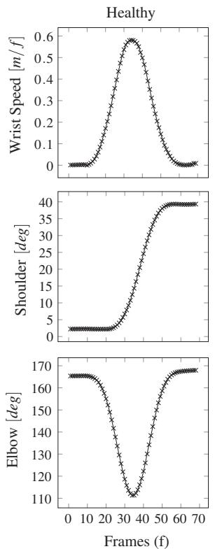

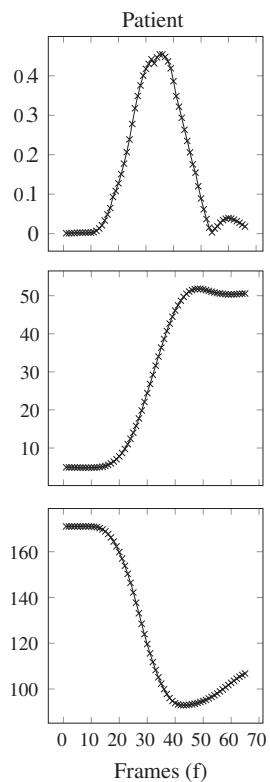  
Fig. 6. First and second column of matrix of figures belong to a healthy and patient (P1) subjects respectively. First, second and third rows shows wrist speed, shoulder flexion/extension and elbow flexion/extension angles, respectively.

Kinematics metrics averaged over each repetition of movement are given. SA: Spectral Arc-length, MS: Maximum Speed, IC: Index of Curvature, TD: Trunk Displacement, IJCI: Inter-joint coordination index. H1 and H2 are healthy subjects and P1, P2, and P3 are stroke patients.

<table><tr><td>Metrics</td><td>H1</td><td>H2</td><td>P1</td><td>P2</td><td>P3</td></tr><tr><td>SA</td><td>-2.90</td><td>-2.95</td><td>-2.95</td><td>-2.88</td><td>-2.95</td></tr><tr><td>MS</td><td>0.66</td><td>0.62</td><td>0.43</td><td>0.56</td><td>0.40</td></tr><tr><td>IC</td><td>1.04</td><td>1.05</td><td>1.04</td><td>1.12</td><td>1.08</td></tr><tr><td>TD</td><td>0.02</td><td>0.02</td><td>0.19</td><td>0.29</td><td>0.14</td></tr><tr><td>IJCI</td><td>5.61</td><td>7.10</td><td>11.40</td><td>11.41</td><td>10.18</td></tr></table>

Kinematic dataset was examined quantitatively with Principal Component Analysis (PCA). Correlation matrix was explored to see that kinematic metrics and subjects clustered together in a meaningful way. The 5 metrics of 3 iterations of the movements from 2 healthy subjects and 3 patients constitute a 5 15 data matrix. PCA was then applied to this matrix. From the results, we can see that the first eigenvalue explains more than 91% of the total variance present in the data matrix (see Fig. 10). From observation of the first principle component, PC1, shown in Fig. 8, it was obvious that the healthy subjects were clustered on the positive end of PC1 and healthy subjects were clustered on the negative end of PC1. Furthermore, based on Fig. 9, which examines the inter-variable dependence, we can see that the primary difference between the movement patterns of stroke and healthy subjects appears as disruptions in the inter-joint coordination parameter.

Fig. 11 showed that WMFT scores versus kinematic metric scores projected on the first principal component (PC1). First and second patient (P1 and P2) with WMFT scores 25 and 35 have approximately same scores, while third patient (P3) with WMFT score 71 has substantially different score from others.

## 4. Discussion and conclusions

Detection of the improvement level of the upper extremity motor function impairment is quantitatively quite necessary. For this purpose, the determination of parameters/features that define the improvement level in the best way is highly important. It is expected that any measurement procedure has the capability to differentiate between pathological and normal performances [40]. This case was performed in our study.

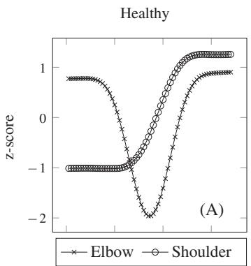

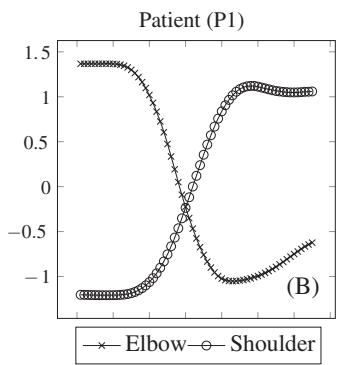  
Fig. 7. Z-score (or standard score) of shoulder flexion/extension and elbow flexion/extension angles.

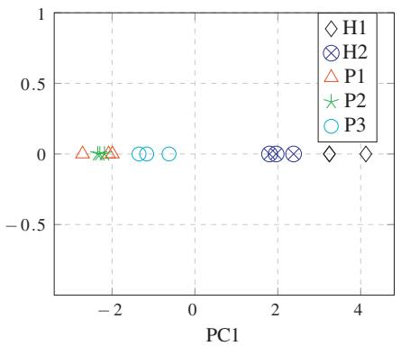  
Fig. 8. Projections onto first principal component (First Principal Component (PC1)). H1 and H2 are healthy subjects and P1, P2, and P3 are stroke patients.

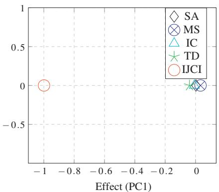  
Fig. 9. The influence of each of the original variables (kinematic metrics) upon the first principal component (PC1). SA: Spectral Arc-length, MS: Maximum Speed, IC: Index of Curvature, TD: Trunk Displacement, IJCI: Inter-joint coordination index.

The result of the present paper demonstrated that: (i) The kinematic analysis realized with Microsoft’s Kinect v2 is applicable in clinical setting and is able to differentiate the motor performance of stroke survivors from that healthy controls. (ii) The inter-joint coordination index (IJCI) has significant importance to detect the motor performance of stroke patients from healthy subjects during a forward reaching task.

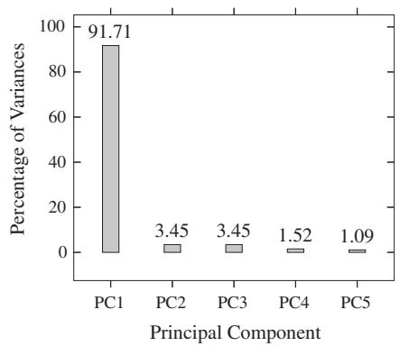  
Fig. 10. Screeplot of percentage variance explained by each principal component (PC). Variance of a principal component is identical to corresponding eigenvalue.

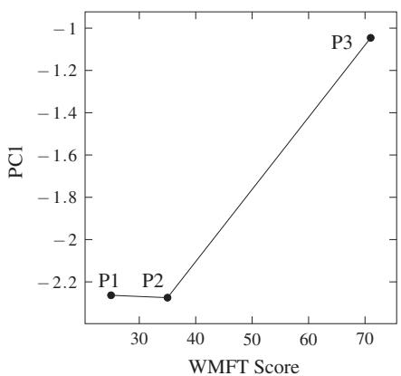  
Fig. 11. WMFT score versus kinematic metric scores projected on first principal component (PC1). Three PC1 scores corresponds to three repetition of movement of each patient are averaged.

Result of the present study revealed that the pathology in motor performance during the forward reaching mainly appeared in joint space, not in the end-space. It is clear that the quantification of the inter-joint coordination will play an important role in clinical applications for physiotherapy physicians. However, the most kinematic measurement protocol reported do not include a metric to quantify inter-joint coordination. Cirstea et al. [21] described a technique based on phase plots (movement velocity as a function of displacement) and relative phase relationship between joints. However, the technique does not have a single index. Instead, The Temporal Coordination (TC) Index technique composed of four segment of movement and incorporates amplitudes and duration digits for each segment. However, TC index is computationally intensive and not easy to interpret. Also, TCI requires to draw the velocity–angle diagrams. As a result of that, the index is sensitive to smoothing technique and may require more computational effort to capture inter-joint disruption of stroke patients with Microsoft Kinect v2. In the present study, we proposed a more compact and simple method based on PCA to quantify the inter-joint coordination by using only a single parameter. We assumed that indiscriminative property of the metrics defined in end-point space was due to the motor performance task. In the study, the subjects are asked to locate their hand at any position on the desk. For the point to point reaching or goal oriented task, all the parameters/features such as trunk displacement, maximum speed and inter-jont coordination index can also play an important role for the upper extremity motor function performance measurements. In the study, we define an inter-joint coordination index (IJCI) as the maximum variance of PCA of shoulder and elbow extension/flexion angles. We showed that the IJCI has extremely significant effect on differentiating the pathological performance of stroke patients from that healthy subjects.

One of the major purpose of stroke rehabilitation is to restore the functional independence for ADL. Because reaching is a crucial motor function to realize many tasks of daily living, many stroke patients cannot regain their independence in ADL even in chronic stage [41]. Therefore, the restoration of the upper extremity motor function is a major objective for the stroke survivors [42]. First stage in rehabilitation of stroke survivors is assessment, which requires identification, measurement and recording of the impairment, patients’ requirements, disability, handicap and medical problem [43]. Identification of the impairments limiting normal movement is a key factor for the evaluation of the effected upper extremity. Results derived from motor impairment assessment lead to the clinician to the development of treatment plans and make contribution to progress in rehabilitation [44].

In the kinematic movement analysis of stroke patients, visual marker based sensors were most popularly used technologies as a golden standard because of their high accuracy and reliability. Therefore, the measurement procedures and kinematic metrics used in kinematic analysis of stroke patients has been widely designed and constructed in accordance with visual marker based sensors. While the clinicians were encouraged to assess the functional status of their patients, some reports pointed out that they did not routinely do so [45]. If the suitable methodology is adopted, Microsoft Kinect will also be alternatively used in kinematic analysis of stroke survivors in clinical applications.

From the measurements of the parameters in Table 3, the Maximum Speed (MS) parameters for healthy and patient subjects had the mean values of 0.64 and 0.48, respectively. The small difference between the values indicated that the parameter value would change very little on the progress of the improvement level of patient. The values of Index of Curvature (IC) and Spectral Arc-length (SA) were quite close to each other for patient and healthy individuals. This case was due to the specific reaching movement examined in the study. Because every patient may live the different physical difficulties from one another performing the daily activities. These parameters were thought to be an distinguishing feature between healthy and patient subjects in the performance measurement of a different task the Trunk Displacement (TD) parameter had 0.02 the mean value for healthy subjects and in the range of (0.14–0.29) for patient individuals. The parameter was highly significant on the monitoring of the improvement level for patients having an upper extremity motor function impairment. In routine clinical practices, the decreasing value of the parameter will show an increase at the improvement level for the patients. The inter-joint coordination index (IJCI) parameter was qualified to be an alternative in the literature. It was one of the most important features obtained in the work. The mean values of IJCI for healthy and patient subjects were obtained as 6.36 and 11.00, respectively. The IJCI values of patients were quite close to each other and so far from the mean of the healthy individuals. This parameter, as shown in Fig. 9, was performed as a classifier between healthy and patient subjects. Also, the improvement level of the patient will be proportional with the decrease of the parameter value.

In the study, the parameters proposed present an extremely important opportunity to detect the improvement levels of patient and healthy individuals on the kinematic assessment of upper extremity motor function. We believe in that the present study will promote the acceptance of the kinematic analysis into routine clinical programs by lifting barriers for use of the assessment methods and facilitate the rehabilitation of the stroke survivors.

## References

[1] A. Ozturk, A. Tartar, B. Ersoz Huseyinsinoglu, Kinematic analysis of upper extremity motor function after stroke, in: TIPTEKNO (Tıp Teknolojileri Ulusal Kongresi), 25–27 September, 2014, Kapadokya.

[2] I. Aprile, M. Rabuffetti, L. Padua, E. Di Sipio, M. Ferrarin, Kinematic analysis of the upper limb motor strategies in stroke patients as a tool towards advanced neurorehabilitation strategis: a preliminary study, BioMed, Res, Int. 2014 (2014) 1–10

[3] S.W. Park, H.S. Park, J.H. Kim, Hojjat Adeli, 3D displacement measurement model for health monitoring of structures using a motion capture system. Measurement 59 (2015) 352-362.

[4] M. Casadio, P. Morasso, A.N. Ide, V. Sanguineti, P. Giannoni, Measuring functional recovery of hemiparetic subjects during gentle robot therapy, Measurement 42 (8) (2009) 1176–1187.

[5] P. Daponte, L.D. Vito, M. Riccio, C. Sementa, Design and validation of a motion-tracking system for RoM measurements in home rehabilitation, Measurement 55 (2014) 82–96.

[6] G. Welch. E. Foxlin, Motion tracking: no silver bullet. but a respectable arsenal, IEEE Comput. Graph. Appl. Mag. 22 (6) (2002) 24–38.

[7] H. Zhou, H. Hu, Human motion tracking for rehabilitation – a survey, Biomed. Signal Process. Contr. 3 (2008) 1–18.

[8] D. Webster, O. Celik, Experimental evaluation of Microsoft Kinect’s accuracy and capture rate for stroke rehabilitation applications, in: Haptics Symposium (HAPTICS), 2014 IEEE, 23–26 February, 2014, pp. 455, 460.

[9] D. Webster, O. Celik, Systematic review of Kinect applications in elderly care and stroke rehabilitation, J. Neureng. Rehabil. 11 (108) (2014).

[10] C.Y. Chang, B. Lange, M. Zhang, S. Koenig, P. Requejo, N. Somboon, A. A. Sawchuk, A.A. Rizzo,Towards pervasive physical rehabilitation using Microsoft Kinect, in: 2012 6th International Conference on Pervasive Computing Technologies for Healthcare (PervasiveHealth), 21–24 May, 2012, pp. 159, 162.

[11] R.A. Clark, Y.H. Pua, C. Ritchie, K.E. Webster, L. Denehy, A.L. Bryant, Validity of the Microsoft Kinect for assessment of postural control, Gait Posture 36 (3) (2012) 372–377.

[12] E.V. Olesh, S. Yakovenko, V. Gritsenko, Automated assessment of upper extremity movement impairment due to stroke, PLoS One 9 (8) (2014).

[13] M.A. Murphy, C. Willen, K.S. Sunnerhagen, Kinematic variables quantifying upper-extremity performance after stroke during reaching and drinking from a glass, Neurorehabil. Neural Repair 25 (1) (2011) 71–80.

[14] T.S. Patterson, M.D. Bishop, T.E. McGuirk, A. Sethi, L.G. Richards, Reliability of upper extremity kinematics while performing different tasks in individuals with stroke, J. Motor Behav. 43 (2) (2011).

[15] E. Jaspers, H. Feys, H. Bruyninckx, K. Klingels, G. Molenaers, K. Desloovere. The Arm Profile score: a new summary index to assess upper limb movement pathology, Gait Posture 34 (2011).

[16] D.A. Nowak, The impact of stroke on the performance of grasping: usefulness of kinetic and kinematic motion analysis, Neurosci. Biobehay, Rey, 32 (8) (2008) 1439–1450.

[17] A. de los Reyes-Gusman, I. Dimbwadyo-Terrer, F. Trincado-Alonso, F. Monasterio-Huelin, D. Torricelli, A. Gil-Aqudo, Quantitative assessment based on kinematic measures of functional impairments during upper extremity movements: a review, Clin. Biomech. (Bristol, Avon) 29 (7) (2014).

[18] S.K. Subramanian, J. Yamanaka, G. Chilingaryan, M.F. Levin, Validity of movement pattern kinematics as measures of arm motor impairment poststroke, Stroke 21 (10) (2010) 2302–2308.

[19] L. van Dokkum, I. Hauret, D. Mottet, J. Froger, J. Metrot, I. Laffont, The contribution of kinematics in the assessment of upper limb motor recovery early after stroke, Neurorehabil. Neural Repair 28 (1) (2014) 4–12.

[20] M.C. Cirstea, M.F. Levin, Compensatory strategies for reaching in stroke, Brain 123 (2000) 940–953.

[21] M.C. Cirstea, A.B. Mitnitski, A.G. Feldman, M.F. Levin, Interjoint coordination dynamics during reaching in stroke, Exp. Brain Res. 151 (3) (2003) 289–300.

[22] A. Forner-Cordero, O. Levin, Y. Li, S.P. Swinnen, Principal component analysis of complex multjioint coordinative movements Biol Cybern. 93 (1) (2005) 63–78.

[23] D.S. Reisman, J.P. Sccholz, Aspects of joint coordination are preserve during pointing in persons with post-stroke hemiparesis, Brain 126 (2003) 2510–2527

[24] T.M. Hodics, K. Nakatsuka, B. Upreti, A. Alex, P.S. Smith, J.C. Pezzula, Wolf motor function test for characterizing moderate to severe hemiparesis in stroke patients, Arch. Phys. Med. Rehabil. 93 (11) (2012)1963-1967.

[25] Z. Zhang, Microsoft Kinect sensor and its effect, IEEE MultiMedia Mag. 19 (2) (2012) 4–10.

[26] M.R. Andersen, T. Jensen, P. Lisouski, A.K. Mortensen, M.K. Hansen, T. Gregersen, P. Arendt, Kinect Depth Sensor evaluation for Computer Vision Applications, Technical Report ECE-TR-6, Aarhus University, February 2012.

[27] C. Amon, F. Fuhrmann, F. Graf, Evaluation of the spatial resolution accuracy of the face tracking system for kinect for windows V1 and V2, in: 6th Congress of Alps-Adria Acoustics Association, 16–17 October, 2014, Graz, Austria.

[28] T. Butkiewicz, Low-cost coastal mapping using Kinect v2 time-offlight cameras, in: Oceans – St. John’s, 14–19 September, 2014, pp. 1–9.

[29] L. Chen, H. Wei, J. Ferryman, A survey of human motion analysis using depth imagery, Pattern Recogn. Lett. 34 (15) (2013) 1995– 2006.

[30] Microsoft: Joint Type Enumaration. <https://msdn.microsoft.com/ en-us/library/microsoft.kinect.jointtype.aspx> (access time: 16- September-2015).

[31] F.J. Alonso, J.M. Castillo, P. Pintado, Application of singular spectrum analysis to the smoothing of raw kinematic signals, J. Biomech. 38 (5) (2005) 1085–1092.

[32] H. Hassani, Singular spectrum analysis: methodology and comparison, J. Data Sci. 5 (2) (2007) 239–257.

[33] T. Flash, N. Hogan, The coordination of arm movements: an experimentally confirmed mathematical model, J. Neurosci. 5 (7) (1985) 1688–1703.

[34] N. Hogan, D. Sternad, Sensitivity of smoothness measures to movement duration, amplitude, and arrest, J. Motor Behav. 41 (6) (2009) 529–534.

[35] S. Balasubramanian, A. Melendez-Calderon, E. Burdet, A robust and sensitive metric for quantifving movement smoothness. IEEE Trans. Biomed. Eng. 59 (8) (2012) 2116–2136.

[36] D.G. Liebermann, S. Berman, P.L. Weiss, M.F. Levin, Kinematics of reaching movements in a 2-D virtual environment in adults with and without stroke, IEEE Trans. Neural Syst. Rehabil. Eng. 20 (6) (2012) 778–787.

[37] M.F. Levin, J.A. Kleim, S.L. Wolf, What do motor recovery and compensation mean in patients following stroke?, Neurorehabil Neural Repair 23 (4) (2009) 313–319.

[38] I.T. Jolliffe, Principal Component Analysis, Springer, 2002. p. 5.

[39] M. Richardson, Principal Component Analysis, University of Oxford, 2009 (Special topic).

[40] E. Jaspers, K. Desloovere, H. Bruyninckx, K. Klingels, G. Molenaers, E. Aertbelien, L. Van Gestel, H. Feys, Three-dimensional upper limb movement characteristics in children with hemiplegic cerebral palsy and typically developing children, Res. Dev. Diisabil. 32 (6) (2011) 2283–2294.

[41] S.M. Lai, S. Studenski, P.W. Duncan, S. Perera, Persisting consequences of stroke measured by the stroke impact scale, Stroke 33 (7) (2002) 1840–1844

[42] J. Higgins, N.E. Mayo, J. Desrosiers, N.M. Salbach, S. Ahmed, Upperlimb function and recovery in the acute phase poststroke, J. Rehabil. Res, Dev, 42 (1) (2005) 65–76

[43] K.P.S. Nair, A.B. Taly, Stroke rehabilitation: traditional and modern approaches, Neurol. India 50 (Suppl. 1) (2002) S85–S93.

[44] C.E. Lang, M.D. Bland, R.R. Bailey, S.Y. Schaefer, R.L. Birkenmaier, Assessment of upper extremity impairment, function and activity following stroke: foundation for clinical decision making, J. Hand Ther. 26 (2) (2013) 104–115.

[45] R.P. Van Peppen, F.J. Maissan, F.R. Genderen, R. Van Dolder, N.L. Meeteren. Outcome measures in physiotherapy management of patients with stroke: a survey into self-reported use, and barriers to and facilitators for use, Physiother. Res, Int. 13 (4) (2008) 255–270