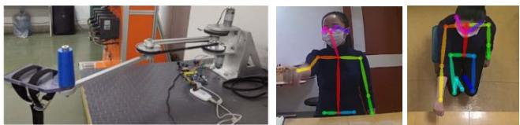
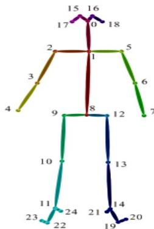
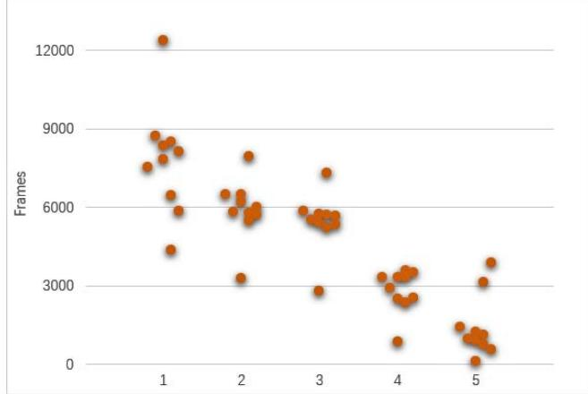

# Vision-based Automatic Detection of Compensatory Postures of after-Stroke Patients During Upperextremity Robot-assisted Rehabilitation: A Pilot Study in Reaching Movement

Yan Fu School of Mechanical Science and Engineering Huazhong University of Science and Technology Wuhan,China laura\_fy@mail.hust.edu.cn

Yan Zhao Department of Rehabilitation Medicine Hubei Provincial Hospital of Traditional Chinese Medicine Wuhan,China zhaoyan@hbhtcm.com

Xiaoyi Wang School of Mechanical Science and Engineering Huazhong University of Science and Technology Wuhan,China wang\_xiaoyi111@sina.com

Zeqiang Zhu School of Mechanical Science and Engineering Huazhong University of Science and Technology Wuhan,China 1094096988@qq.com

Yong Ding Department of Rehabilitation Medicine Hubei Provincial Hospital of Traditional Chinese Medicine Wuhan, China 389356558@qq.com

Jie Tan School of Mechanical Science and Engineering Huazhong University of Science and Technology Wuhan,China tanjie\_wh@163.com

Weiya Chen School of Civil Engineering and Mechanics Huazhong University of Science and Technology Wuhan,China weiya\_chen@hust.edu.cn

Abstract—Objectives: Compensations are commonly employed by stroke patients during robot-assisted rehabilitation, leading to suboptimal recovery outcomes. This study investigated the feasibility of vision-based detection on compensatory postures in stroke patients by using kinematic data and machine learning algorithms. Methods: Ten stroke survivors did a scripted reaching movement using the affected side with an end-effector robot assistance while three dimensional(3D) trajectories of upper body joint positions were recorded based on a vision-based tracking system. Algorithms: A set of discriminating features which correlated with various compensatory postures were extracted based on the kinematic data. Two multi-label classifiers were trained to identify and categorize the postures of the participants. Results: The most obvious compensatory postures in the scripted reaching movement are forward trunk displacement and trunk rotation, followed by shoulder elevation, and less insufficient elbow extension. The two multi-label classifiers trained achieved a fair compensation detection performance: Multi-Label k-Nearest Neighbor (ML-KNN) classifier (Hamming loss: 0.16, Macroaverage: 0.642, Micro-average: 0.85), Multi-Label Decision Tree (ML-DT) classifier (Hamming loss: 0.15, Macro-average: 0.654, Micro-average:0.85). Conclusions: It is feasible to realize automatic detection of compensatory postures during the upperlimb robot-assisted rehabilitation based on the low-cost vision system. It is expected to complement real time compensatory postures recognition of clinical faculty and be integrated into a rehabilitation robot system to reduce compensations in stroke patients.

Keywords—compensatory postures detection, upper limb, reaching movement, end-effector rehabilitation robot, post-stroke

## I. INTRODUCTION

Stroke is one of the leading causes of disability worldwide [1]. Up to 85% of stroke survivors suffer from hemiparesis, affecting one upper limb [2]. Post-stroke upper limb rehabilitation can effectively help stroke survivors restore upper limb function. Compared to traditional therapist-based rehabilitation, robot-assisted therapy can provide flexible rehabilitation package and get in-time feedback while saving a large amount of therapist labor. Despite these advantages and promising clinical efficacy [3], a major consideration regarding the use of robot-assisted therapy is whether users can perform therapy exercises correctly with minimal or even no supervision from clinicians [4]. When left less supervised or unsupervised, users often compensate for limitations in affected muscles and joints by recruiting unaffected muscles and joints during therapy [5]. Such compensations impede rehabilitation process in the long term and may lead to new orthopedic problems [6].

In order to make full use of robot-assisted therapy, measures should be taken during the patient's rehabilitation training to detect and correct compensations in real time. Upper limb rehabilitation exoskeleton provides a solution by controlling joint movements [7]. However, for other robotic systems without joint constraints, additional methods that are independent of the robotic systems are required. Some robotic systems use straps to keep users on the chair to reduce trunk compensation, which may cause discomfort and may pose a security hazard. Furthermore, sensor technology-based compensations monitoring methods are developed and augmented feedback strategies are provided to correct compensations. Benavides assessed compensatory motions in a bimanual reaching task by analyzing kinematic metrics including anterior trunk displacement, completion time, symmetry and straightness of the hands’ movements captured by Kinect v1 [8]. Ying explored the accuracy of two classifiers based on the features of human skeletal joint positions captured by Kinect v2 to classify three common compensatory postures: shoulder elevation, trunk rotation and lean forward [9]. Bulmaro proved that real-time visual and force feedback were two promising modes that could be used to reduce trunk compensation in stroke survivors in reaching tasks [10]. However, these studies have only involved detection and correction of partial compensatory postures in the upper limb robot-assisted rehabilitation training, and some detection methods are not intuitive, which limit their further application to correct compensations. On the other hand, compared with the Kinect used in these studies, RGB camera is a lower cost and promising device that can also meet the measurement requirements in the mentioned scenarios [11], [12].

This paper aims to establish a cost and usability efficient method for a more comprehensive automatic detection of compensatory postures that may occur during upper limb robotassisted rehabilitation training. Two RGB cameras together with OpenPose software were used to capture live video and track major skeletal joint positions as each human subject performed a scripted reaching movement using an end-effector robot. Two multi-label classifiers were trained to detect and classify the compensatory postures observed in stroke survivors. The system established in this paper will not only be helpful to clinicians to better judge the true recovery status of patients, but also when the compensation suppression module is introduced in the robotic system accordingly, patients could perform safer and more effective upper limb robot-assisted rehabilitation training with little or no guidance of clinicians.

## II. METHODS

## A. Participants

Ten stroke survivors(three women and seven men, aged 59.4 f5.44 years, 8.3f2.58 months after stroke, 38.7f5.95 scores on Fugl-Meyer Assessment Upper Extremity (FMAUE), III to IV stages on Brunstrom) were involved in this study. All the participants were right-handed; two had left hemiplegia and eight had right hemiplegia. All patients were hospitalized in the Hubei Provincial Hospital of Traditional Chinese Medicine and volunteered to participate after being informed of the purpose of the study, which had been approved by the local Ethics Committee. The inclusion criteria were: stroke survivors in subacute (between 1 to 6 months post stroke) or chronic (over 6 months post stroke) stage of recovery; stages III to VI on Brunnstrom, scores 9 to 66 on FMAUE; physically and cognitively able to participate in upper limb exercises for about 15 minutes, and the entire participation time is 15 to 30 minutes.

## B. Experimental Setup

The rehabilitation robot used in Fig. 1(Left) was a desktop, 2-degree of freedom(DOF) end-effector robot, which can provide upper limb movement therapy in assisted and resistance modes. Participants sat in front of the table and maneuvered the end-effector of the robot horizontally. One RGB camera was placed about 90cm behind the robot and 75 cm above the tabletop, facing the participant in a slightly inclined direction. Another RGB camera was placed about 150cm above the tabletop, overlooking the participant. The layout of the cameras ensured that the joint positions of stroke patients could be clearly captured by OpenPose as shown in Fig. 1(Middle and Right).

## C. Data Collection

Participants sat in an immovable chair. The backrest was adjusted so that the participant’s torso was at a 90° angle to the thigh and the chair supported at least 75% of the thigh. The rehabilitation robot was placed above the table in front of the participant, and was aligned with participant’s sagittal plane, at a distance to ensure that the workspace of the robot was large enough to complete the scripted motion.

At the beginning of the experiment, participants were asked to have their trunk against the backrest and the system was calibrated by requiring participants to fully extend their unaffected arm in two directions: 45° toward the unaffected side, and 45° across the body toward the affected side. Two cardboard cones were then placed in the two directions at the 90% of the fully extended arm distance. The locations of the cardboard cones were chosen to ensure that participants can reach the cones with their unaffected arms without using any trunk compensation. According to the symmetry of human body structure, the positions of the two cones were then exchanged and placed in symmetrical positions with the sagittal plane of the human body as the plane of symmetry to adapt to the training needs of the affected side.

After the system calibration, participants were asked to fix their contralateral hands with a strap on the end effector, which was the starting position. Then they were asked to complete a scripted reaching motion, which was moving the end-effector from the starting position to reach and touch the left cone, then backed to the starting position, then to reach and touch the right cone and then backed to the starting position again. The motion was performed with the hemiplegic side of the participants at a comfortable pace, 5 times in total.

## D. Data Preprocessing

One RGB camera together with OpenPose could track the two-dimensional(2D) space (x-y) coordinates of the joint positions in the camera coordinate frame. To obtain the 3D space coordinates of the joint positions and make them invariant to sensors’ placement and orientation, we transformed the 2D coordinates into a world frame and used two sets of 2D joint position coordinates obtained by two cameras at the same time to carry out 3D reconstruction.

The world frame was defined as follows: taking the center position on the plane of the rehabilitation training chair as the origin ࣩ, the ऊ axis was vertical to the ground, the उ axis was horizontal to the right, and the ई axis was perpendicular to the उࣩऊ plane. The two cameras were first calibrated using the Zhang Youzheng calibration method in the defined world frame and the internal and external parameters which related to the rotation and translation of coordinate systems, and distortion parameters were obtained. Based on these parameters and the 2D space coordinates of joint positions on two images acquired at the same time, the least square method was used to reconstruct each joint position in 3D, and the optimal 3D coordinates of each joint position in the world coordinate system were thus obtained.

  
Fig. 1. (Left)The upper limb rehabilitaion robot. (Middle and Right) The color images with tracked skeleton overlaid in two directions.

## III. ALGORITHMS

In early clinical observations, compensations in the upper limb was qualitatively described and classified as pathological synergies, including the flexor synergy (shoulder flexion, shoulder abduction, elbow flexion, forearm supination) and the extensor synergy (shoulder extension, shoulder adduction, elbow extension, forearm pronation) [13]. Another clinically observed typical compensatory movement strategy during upper limb movement is trunk compensation [14], which is used by stroke survivors to compensate for the lack or reduction of elbow extension and shoulder flexion.

Levin M developed the Reaching Performance Scale to identify and quantify the movement patterns and compensations of stroke patients with upper extremity hemiplegia in the reachto-grasp tasks. The scale identified and quantified the compensation movements in the transport phase of reaching in the following four aspects: trunk displacement, movement smoothness, shoulder movements and elbow movements [15].

Based on the clinical research conclusions and the Reaching Performance Scale, two multi-label classifiers were trained to categorize the following compensatory postures in this study: forward trunk displacement, trunk rotation, shoulder elevation and insufficient elbow extension.

## A. Annotation

Two expert raters with a clinical background visually inspected each frame in the recorded video, and labeled the type of compensatory postures in each frame. The compensatory postures were classified and labelled as 1. No Compensation, 2. Forward Trunk Displacement, 3. Trunk Rotation, 4. Shoulder Elevation, 5. Insufficient Elbow Extension. For example, if a frame showed no compensatory postures, the frame was labelled with 1. If a frame showed multiple compensatory postures, they were labelled concurrently.

## B. Features

The OpenPose tracking joint positions are shown in Fig. 2. According to the compensatory postures to be detected, we were only interested in the upper limb and trunk movements, so only the number 1,2,3,4,5,6,7,8 skeletal points were chosen to extract features. The features consisted of the trunk flexion angle, trunk rotation angle, shoulder flexion angle and horizontal abduction adduction angle of the hemiplegic side, and elbow extension angle of the hemiplegic side. A five degrees of freedom upper body kinematics model was established. The Euler angles of shoulder, elbow and trunk were calculated based on the kinematics model and the 3D coordinates of the chosen skeletal points. These Euler angles were then mapped to the abduction/adduction, flexion/extension and rotation angles of upper body joints as the extracted features.

## C. Multi-label Classifier

Participants performed continuous rehabilitation training in the experiment. During the training process, multiple compensatory movements might occur at the same time, which meant that a frame might be simultaneously labeled as multiple compensatory postures in the annotation process. Therefore, the multi-label classification method was used to classify postures of the subjects. The experiments were performed using two different algorithm-modified multi-label classifiers. They were a Multi-Label k-Nearest Neighbor (ML-KNN) classifier and a Multi-Label Decision Tree (ML-DT) classifier. Both classifiers don’t consider the correlation between labels and belong to the first-order strategy.

The ML-KNN uses the idea of KNN to find K nearest neighbor samples, and uses Bayesian conditional probability to calculate the probability of the current label being 1 and 0. The label with the highest probability is the final label of the sample. When categorizing compensatory postures, for each new sample, the k samples with the largest similarity to it in the feature space could be obtained first, then the label set of these samples could be obtained, finally the label set of new samples could be determined by the maximum posterior probability criterion.

The ML-DT draws on the idea of a decision tree to filter features based on information gain to generate a classifier. In this multi-label scenario, first, the information gain of each feature in the feature set could be calculated, and the feature with the largest information gain could be selected to divide the sample into a left and a right subset, then recursion could be performed until the stopping condition was met. For unknown samples, a matching path could be found by traversing each path saved in the training set, and then the unknown sample labels could be generated by calculating and comparing the probabilities that the labels in the leaf path sample subset of the matching path were 0 and 1.

## IV. RESULTS AND DISCUSSION

Two raters visually examined a total of 128621 frames of ten participants, excluding 4116 frames where skeletal tracking failed. The labels distributions are shown in Fig. 3. All ten participants showed some compensatory behaviors during the experiment. In the training content designed in this experiment, two obvious compensatory postures were forward trunk displacement and trunk rotation, followed by shoulder elevation, and less insufficient elbow extension.

  
Fig. 2. The OpenPose tracking joint positions.

All frames were divided into a training set (90034 frames) and a test set (38587 frames) according to a 7:3 ratio, and were trained and tested on the ML-KNN classifier and the ML-DT classifier, respectively. Details of the classification results are in Table I and Table II.

Results demonstrated that the multi-label classification based on the OpenPose tracking skeleton information can discriminate certain compensatory postures that occurred in upper limb reaching motions by stroke patients with the assistance of end-effector robots. Using the ML-KNN classifier, insufficient elbow extension compensatory postures were detected with the best performance(F1=0.73), followed by trunk rotation(F1=0.66) and forward trunk displacement(F1=0.62) compensatory postures. Shoulder elevation compensatory postures were not well detected (F1=0.53). There was a little difference when using the ML-DT classifier, the detection performance of forward trunk displacement compensatory postures(F1=0.68) were better than that of the trunk rotation compensatory postures(F1=0.60), while the detection performance of insufficient elbow extension compensatory postures(F1=0.8) were still the best and shoulder elevation compensatory postures were still the worst(F1=0.50). On the whole, the performance of ML-DT was slightly better than ML-KNN.

Although both classifiers could realize the detection of compensatory postures, according to the Hamming loss and the Macro-average, the performance of the two classifiers was not very desirable, and there may be several reasons. First, the experimental data set was limited, only 10 stroke patients rehabilitation training data were collected, and the average training time of the patients set in the experiment was 7.5 minutes, which was far lower than the daily training intensity. Moreover, it may be related to the selection and calculation of the feature set. Only the motion angles of some body parts related to compensatory postures were selected as features, and the influence of changes in other related upper body joints on the compensation detection was not considered. At the same time, the calculation of the feature set was based on the 3D coordinates of joint positions, which were obtained from the 3D reconstruction of the OpenPose tracking information. The errors caused by the 3D reconstruction might affect the accurate calculation of feature set. Furthermore, labeling error might affect the performance of the classifiers. Manual labeling was used in the experiment. Due to visual bias and subjective judgement of the raters, there would be a certain degree of deviation in labeling. Finally, the two multi-label classification methods selected in this experiment belonged to the first-order strategy, that is, the two methods didn’t consider the correlation between the labels in the classification process. In the experiment, we found that the compensatory movements of stroke patients often didn’t appear in a single form in the training, multiple compensatory postures often accompanied, the use of high-order strategy classification algorithms might improve the detection performance.

  
Fig. 3. The label distributions. (1: no compensation; 2: forward trunk displacement; 3: trunk rotation; 4: shoulder elevation; 5: insufficient elbow extension.)

TABLE I. CLASSIFICATION RESULTS USING ML-KNN AND ML-DT

<table><tr><td>Classifier</td><td>Posture</td><td>Precision</td><td>Recall</td><td>F1-score</td><td>Frames</td></tr><tr><td rowspan="5">ML-KNN</td><td>1</td><td>0.66</td><td>0.68</td><td>0.73</td><td>78148</td></tr><tr><td>2</td><td>0.70</td><td>0.55</td><td>0.69</td><td>59228</td></tr><tr><td>3</td><td>0.63</td><td>0.70</td><td>0.67</td><td>54560</td></tr><tr><td>4</td><td>0.49</td><td>0.58</td><td>0.53</td><td>28345</td></tr><tr><td>5</td><td>0.69</td><td>0.78</td><td>0.73</td><td>14123</td></tr><tr><td rowspan="5">ML-DT</td><td>1</td><td>0.68</td><td>0.70</td><td>0.69</td><td>78148</td></tr><tr><td>2</td><td>0.67</td><td>0.70</td><td>0.68</td><td>59228</td></tr><tr><td>3</td><td>0.56</td><td>0.65</td><td>0.60</td><td>54560</td></tr><tr><td>4</td><td>0.46</td><td>0.55</td><td>0.50</td><td>28345</td></tr><tr><td>5</td><td>0.74</td><td>0.87</td><td>0.80</td><td>14123</td></tr></table>

a. 1: no compensation; 2: forward trunk displacement; 3: trunk rotation; 4: shoulder elevation; 5: insufficient elbow extension.

TABLE II. TOTAL PERFORMANCE OF ML-KNN AND ML-DT

<table><tr><td>Classifier</td><td>Hamming loss</td><td>Macro-average</td><td>Micro-average</td></tr><tr><td>ML-KNN</td><td>0.16</td><td>0.642</td><td>0.85</td></tr><tr><td>ML-DT</td><td>0.15</td><td>0.654</td><td>0.85</td></tr></table>

## V. CONCLUSIONS

Based on the joint position information of stroke patients captured by RGB camera and OpenPose, it is feasible to realize automatic detection of compensatory postures during the upperlimb robot-assisted reaching training. Although the two machine learning algorithms tried in this paper have not achieved very desirable results, we gave possible explanations for the undesirable performance. In future research, we recommend expanding the training and testing data set, increasing the number of participants, and capturing rehabilitation training videos that are consistent with the daily routine training intensity of stroke patients for compensatory posture detection. Besides, the feature set should be improved, in addition to the body parts directly related to compensation, the influence of other upper body joints motion on compensation posture detection should be considered, or deep learning algorithm should be used to automatically extract features. Further, the correlations between labels should be considered, a multi-label classification algorithm of higher order strategy should be selected. Last but not least, the annotation method can be improved, and machine learning algorithms can be used to reduce the labor intensity of raters and improve the accuracy of labeling. The results of our study help to complement real time compensation posture detection of clinical faculty and promote a more comprehensive real-time detection and correction of compensation in the robotassisted upper limb rehabilitation training.

## ACKNOWLEDGMENT

This study is supported by China Natural Science Foundation (No:71771098) and National Key Lab Research Foundation (18079030602). Special thanks are given to the clinicians of Hubei Provincial Hospital of traditional Chinese medicine for their efforts in this research.

## REFERENCES

[1] Elsner B, Kugler J, Pohl M, and Mehrholz J, Transcranial direct current stimulation (tDCS) for improving function and activities of daily living in patients after stroke[J]. Cochrane database of systematic reviews (Online), 2013, 11(11):CD009645.

[2] Liu H, Song L, and Zhang T, Mental Practice Combined with Physical Practice to Enhance Hand Recovery in Stroke Patients[J]. Behavioural Neurology, 2014: 876416-876416.

[3] Kahn P, Huq R, Hoey J, Goetschalckx R, and Mihailidis A, The development of an adaptive upper-limb stroke rehabilitation robotic system[J]. Journal of Neuroengineering & Rehabilitation, 2011, 8(1):33- 33.

[4] Lu E C, Wang R H, Huq R, Gardner D, and Karam P, Development of a robotic device for upper limb stroke rehabilitation: A user-centered design approach[J]. Paladyn, 2011, 2(4): 176-184.

[5] Cai S, Li G, Zhang X, Huang S, and Zheng H, Detecting compensatory movements of stroke survivors using pressure distribution data and machine learning algorithms[J]. Journal of NeuroEngineering and Rehabilitation, 2019, 16(1).

[6] Cai S, Li G, Su E, Wei X, and Huang S, Real-time detection of compensatory patterns in patients with stroke to reduce compensation during robotic rehabilitation therapy.[J]. IEEE Journal of Biomedical and Health Informatics, 2020: 1-1.

[7] Naqash R, Jie Z, Wei M, Quan L, Sheng Q, and Hui L, Upper limb rehabilitation using robotic exoskeleton systems: a systematic review[J]. International Journal of Intelligent Robotics and Applications, 2018.

[8] Bulmaro Adolfo Valdés Benavides, Reducing compensatory movements in stroke therapy through the use of robotic devices and augmented feedback[C]// Eighth Annual G.F. Strong Rehabilitation Centre Rehabilitation Research Day. 2017.

[9] Zhi Y X, Lukasik M, Li M H, Dolatabadi E, and Wang R H, Automatic Detection of Compensation During Robotic Stroke Rehabilitation Therapy[J]. IEEE Journal of Translational Engineering in Health and Medicine, 2018: 1-7.

[10] Valdes B A, Schneider A, and Der Loos H F, Reducing Trunk Compensation in Stroke Survivors: A Randomized Crossover Trial Comparing Visual and Force Feedback Modalities[J]. Archives of Physical Medicine and Rehabilitation, 2017, 98(10): 1932-1940.

[11] Ashraf A B, and Taati B, Automated Video Analysis of Handwashing Behavior as a Potential Marker of Cognitive Health in Older Adults[J]. IEEE Journal of Biomedical and Health Informatics, 2016, 20(2): 682- 690.

[12] Qiao S, Wang Y, and Li J, Real-time human gesture grading based on OpenPose[C]. international congress on image and signal processing, 2017: 1-6.

[13] Cirstea M C, and Levin M F, Compensatory strategies for reaching in stroke.[J]. Brain, 2000, 123(5): 940-953.

[14] Michaelsen S M, Jacobs S, Robybrami A, and Levin M F, Compensation for distal impairments of grasping in adults with hemiparesis.[J]. Experimental Brain Research, 2004, 157(2): 162-173.

[15] Levin M F, Desrosiers J, Beauchemin D, and Rochette A, Development and validation of a scale for rating motor compensations used for reaching in patients with hemiparesis: the reaching performance scale.[J]. Physical Therapy, 2004, 84(1): 8-22.