# 常规临床上肢评估中的无标记动作捕捉：超越序数评分的有效性与见解

Tim Unger1,2,\*, Olivier Lambercy2, Roger Gassert2, Andreas R. Luft3,4, R. James Cotton5, and Chris Easthope Awai

1Data Analytics & Rehabilitation Technology (DART), Lake Lucerne Institute, Vitznau, Switzerland

2Rehabilitation Engineering Laboratory, ETH Zurich, Zurich, Switzerland

3Lake Lucerne Institute, Vitznau, Switzerland

4cereneo, Vitznau, Switzerland

5Shirley Ryan AbilityLab, Department of Physical Medicine and Rehabilitation, Northwestern University, Chicago, IL, USA

tim.unger@llui.org

## 摘要

动作研究手臂测试（Action Research Arm Test, ARAT）是神经康复中广泛应用的上肢结局指标，但其序数评分具有主观性，且灵敏度和特异度有限。我们评估了将基于人工智能（AI）的无标记动作捕捉（Markerless Motion Capture, MMC）嵌入常规临床 ARAT 评估中，是否能够准确重建上肢运动，并生成包含超越序数评分且具有临床意义信息的有效、客观运动学指标。在来自 20 名混合神经系统疾病患者的 47 次评估（共 1,174 项 ARAT 任务）中，生物力学重建在不同损伤程度下均表现出高准确性和稳健性，运动学指标也呈现出作为结构有效度量所预期的区分模式。在纵向案例研究中，这些指标补充了序数评分所缺乏的特异度和灵敏度：维度分解揭示了相同 ARAT 分数增益背后患者特异性的康复特征（特异度），且在 ARAT 达到饱和后仍能继续检测到运动学的改善（灵敏度）。因此，临床常规中的 MMC 能够提供有效、客观、灵敏且特异的运动学测量，对序数评分形成有力补充。

## 引言

中风和帕金森病等神经系统疾病影响着全球数以亿计的人口，已成为导致运动功能障碍的主要原因之一 [1]。每年有超过 1200 万人罹患中风 [2]，且约半数存活者在康复后仍存在上肢功能障碍 [3]，这往往会长期限制其独立生活能力 [1]。随着社会老龄化，受累人群数量预计还将增加，从而进一步加重医疗保健系统的负担 [2]，亟需更有效、更高效的康复策略 [4, 5]。精准神经康复（precision neurorehabilitation）被提出作为满足这一需求的框架：它是一个闭环系统，在此闭环中，干预措施会根据测得的患者反应持续调整，并对结局进行重新评估以指导下一步决策。实现该框架取决于构成闭环的测量质量，然而常规临床实践中可用的结局评估在很大程度上仍为主观的人工评分评估，只能对功能状态进行粗略表征。因此，能够客观、灵敏且特异地捕捉功能状态的结局指标，既是实现精准神经康复的先决条件，也是开发用于评估新型干预措施的改进型康复替代生物标志物的前提。

在运动康复领域，目前在临床常规中客观测量运动尚不可行，因此疗效评估依赖于治疗师观察患者执行标准化任务，并根据其视觉感知在序数量表上进行评分。动作研究手臂测试（Action Research Arm Test, ARAT）是神经康复中评估患者上肢功能最常用的评估方法之一 [6]。该测试包含 19 个项目，用于评估患者在抓放任务（抓握、握持、捏取）和粗大动作任务中的上肢功能表现，每项均采用四级序数量表进行评分：0 分表示无法执行任务的任何部分，1 分表示部分完成，2 分表示完成任务但耗时更长或存在困难，3 分表示运动表现正常 [6]。ARAT 的序数量表带来了一些相互关联的局限性 [7, 4, 8]。首先是主观性 [6, 9]：区分 2 分和 3 分依赖于临床医生对运动是否“正常”的判断，这种判定本质上是主观的，容易受到评分者间变异性的影响，尤其是在运动质量处于临界状态的功能边界处。尽管各神经康复临床机构一直在努力统一评分标准 [10, 11, 12, 13]，但评估者之间和中心之间的差异仍然存在，而且可靠的评分本身需要培训并经历一个学习曲线。其次是敏感性 [14]：与许多临床序数量表一样，ARAT 存在地板效应和天花板效应，这意味着处于表现极值区间的患者无法被该量表进一步区分，而且运动质量或速度的有意义改善可能完全不会引起序数评分的变化。第三是特异性 [7]：序数评分无法传达评定特定分数的具体原因。两名患者在特定任务上均获得 2 分可能源于完全不同的原因（一名患者受限于关节活动度不足，另一名则表现为动作缓慢费力），然而 ARAT 无法区分这些截然不同的运动质量特征，从而限制了其在制定治疗方案和监测疗效方面的价值。

上肢运动的运动学分析为解决这些局限性提供了一条行之有效的途径，能够提供连续且独立于观察者的运动质量测量。基于标记点的光学运动捕捉（OMC）已清楚地证明了这一潜力：从仪器化饮水任务中提取的运动学指标能够以高灵敏度和效度量化脑卒中患者的上肢运动质量 [15, 16]。然而，OMC 巨大的时间成本、技术复杂性和高昂费用使其难以融入临床常规，将其应用局限于偶尔开展的实验室评估，而非一体化的康复监测。因此，需要一种既准确又对临床工作流程干扰极小的实用运动学测量解决方案来弥合这一差距。

无标记运动捕捉（MMC）作为一种新兴技术，在日益壮大的科研与商业工具生态系统的支持下，利用基于人工智能的计算机视觉技术从多相机红绿蓝（RGB）视频中获取全身运动学数据 [17, 18, 19, 20, 21, 22]。与主动或被动式标记系统追踪附着于身体的物理标记点不同，它利用姿态估计直接在图像中检测解剖学标志点，从而完全无需在体表佩戴任何仪器。在与基于标记点的光学运动捕捉进行对照的实验室验证中，该方法展现出了高精度 [23]，且对临床工作流程的干扰极小 [24]。尽管先前的这些贡献证实了 MMC 能够在受控实验室条件下实现准确重建并无缝整合到临床工作流程中，但本研究更进一步：旨在评估在常规临床诊疗期间采集的运动学指标本身是否有效且具有临床指导价值。

在此背景下评估基于 MMC 的运动学需要采取一种循序渐进的策略：从底层的重建出发，逐步递进到从中衍生的指标，最终落实到这些指标所具备的临床价值。其出发点是运动学重建本身：在任何指标能够被采信之前，所重建的关节轨迹在临床环境中必须具备足够的精度，且这种精度必须在患者不同程度的功能障碍范围内均能保持，而不是在运动功能最差的情况下发生劣化。

一旦建立了准确的信号，核心问题就在于从中提取的指标能否有效捕捉上肢功能构念（construct）。这在方法学上并非易事，因为在常规临床实践中并不存在上肢功能的连续测量金标准：验证必须对照序义量表系统来进行，而正是该系统的局限性催生了本项研究。这种表面上的循环论证可以通过以下方式转化为优势：不仅探究运动学指标是否与 ARAT（动作研究手臂测试，Action Research Arm Test）相一致，更要探讨它们是否以有效测量所应有的方式相一致。一个真正捕捉到上肢功能的指标，在临床界限稳健的评分组之间应表现出较强的区分度，而在序义量表本身不可靠的区域区分度则应较小。观察到这种差异化模式将提供单纯的一致性分析所无法提供的构念效度证据，这正是因为它反映的是底层的功能构念，而非序义临床量表本身。

在这种横断面意义上被确立为有效的指标，随后可以进一步进行纵向检验，一方面确认其效度在患者随时间恢复的过程中依然成立，另一方面展现其在序义评分之外所能提供的临床附加价值：持续追踪康复进程的能力、揭示驱动特定变化的具体运动特征的能力，以及在临床量表达到天花板效应（饱和）后仍对改善保持敏感的能力。综合这些层面的证据，将确立基于 MMC（无标记动作捕捉，Markerless Motion Capture）的运动学分析能否作为序义评分的有效且富含临床信息的补充手段。

本研究旨在评估基于人工智能（AI）的无标记动作捕捉在常规神经康复上肢评估中的有效性及附加临床价值，具体通过量化底层运动学重建的准确性、在群体和纵向层面上所提取指标的构念效度，以及这些指标在序义评分之外所承载的临床信息来实现。

因此，我们检验以下假设（Table 1）：

H1（重建准确性与稳健性）。基于自设三摄像头装置（参见 Supplementary Figure 6）的生物力学重建能够生成具有足够指标提取准确度的运动学时间序列（队列水平的平均重投影误差处于 10–20 像素 (px) 范围内，该范围此前已被确立为此重建算法在临床应用中可接受的水平，略高于 5–10 px 的实验室标准 [23]），且重建质量在不同程度的临床损伤范围内均保持稳定（ARAT 评分分组对重投影误差的影响 $\eta _ { H } ^ { 2 } < 0 . 0 6 ,$ ，即常规的小效应量阈值）。

H2（群体水平的构念效度）。由 MMC 衍生的运动学指标能够捕捉到预期的运动质量构念，其证据在于：在大多数分析组中，第 1 层级（评分 0/1 对比评分 2/3）的组合特征区分度达到受试者工作特征曲线下面积 $( \mathrm { A U C } ) \ge 0 . 8 5$（常规的“极佳区分度”阈值 [25]）；而第 2 层级（评分 2 对比评分 3）的区分度虽保持在随机水平之上（$( \mathrm { A U C } > 0 . 5 ,$ ，并在可行情况下超过 0.7 的常规“可接受区分度”阈值 [25]），但在各分析组中均一致低于第 1 层级。这一模式符合有效构念测量的预期特征，即追踪潜在的功能变化而非充满噪声的量表评分。

H3a（纵向构念效度）。在未达到天花板效应的恢复期间，整合了所有运动学指标的总体运动学复合评分 $S _ { \mathrm { o v e r a l l } } .$ 在采用的最小临床重要差异（归一化复合量表上的平均绝对偏差 MAD < 15 个百分点 (pp)，即一个最小临床重要差异 (MCID) [4]）范围内追踪临床 ARAT 轨迹；该评估按各分析组分别进行，并在满足该标准的每个分析组中确立纵向构念效度。指标的计算见 Figure 1 说明。

H3b（特异性：超越序数评分的领域级恢复特征）。在 H3a 确立的纵向效度基础上，将评分分解为关节活动度（ROM）、速度和代偿等领域评分 $( S _ { \mathrm { R O M } } , S _ { \mathrm { V e l } } , S _ { \mathrm { C o m p } } )$，能够揭示序数评分无法呈现的患者特异性恢复特征（若存在）。案例研究通过两位患者在抓握（Grasp）分析组中观察到的对比，展示了这一附加的临床价值。

H3c（超越临床天花板效应的反应度）。在 H3a 确立的效度基础上，当临床评分在 ARAT 天花板处进入平台期后，在达到天花板后的时间窗内，至少有一个领域级的复合评分变化幅度继续超过采用的 MCID（在归一化复合量表上 $( \geq 1 5$ pp，即一个 MCID [4]），从而证明了在序数评分饱和时的测量反应度。

H1 和 H2 在队列水平进行检验，构成主要假设。H3a–H3c 通过两个纵向案例研究进行评估，属于探索性假设，旨在阐明运动学指标的附加临床价值，并为未来的队列水平研究提供依据。H3b 和 H3c 均建立在 H3a 之上：正是 H3a 中确立的纵向效度，使得领域差异（H3b）和天花板后变化（H3c）能够被解读为真实的恢复而非测量噪声；在其他方面，H3b 和 H3c 则是已验证测量工具的相互独立的属性。

共同证明这些特性将确立基于人工智能（AI）的无标记动作捕捉在未作改动的神经康复常规流程中，作为对序数评分的一种有效且具有临床意义的补充，从而为在标准临床实践中对上肢康复进行连续、多维度且独立于观察者的表征开辟道路。

表 1. 评估框架。每个假说都提供了不同层级的证据，从基于 AI 的无标记动作捕捉算法在底层运动学重建的准确性（H1）开始，经过运动学指标在群体层面（H2）和纵向层面（H3a）的构念效度，直至运动学指标超越序数评分的额外临床价值（H3b、H3c）。阈值符号：$\eta _ { H } ^ { 2 } .$，Kruskal–Wallis 效应量（小效应阈值 0.06）；AUC，ROC 曲线下面积（“优秀” $\ ' \geq 0 . 8 5$ $\mathrm { \ddot { ~ } a c c e p t a b l e ~ \dot { ~ } } \geq 0 . 7 \ [ 2 5 ] )$；MCID，最小临床重要差异（复合量表上的 15 pp），采用由共识建议转化的近似阈值 [4]。操作性定义见“方法”部分。

<table><tr><td></td><td>主张</td><td>证据类型 / 方法</td><td>层级</td><td>数据</td><td>阈值</td></tr><tr><td>H1</td><td>重建准确性与鲁棒性</td><td>重投影误差对比既定范围；跨评分组的稳定性</td><td>试验级（前提条件）</td><td>队列（1,174 次试验）</td><td> $\overline{\text{error}} \in [10,20]$  px 且  $\eta_{H}^{2} < 0.06$ </td></tr><tr><td>H2</td><td>构念效度（群体）</td><td>已知群体辨别力（第一级较强，第二级减弱）</td><td>群体（横断面）</td><td>队列（ $n = 20$ ）</td><td>第一级 AUC  $\geq 0.85$ （大多数）； $0.5 < \text{第二级} < \text{第一级}$ </td></tr><tr><td>H3a</td><td>纵向构念效度</td><td> $S_{\text{overall}}$  与临床变化一致（MAD）</td><td>纵向（患者内）</td><td>案例研究（ $n = 2$ ）</td><td>MAD( $S_{\text{overall}}$ )  $< \text{MCID}$ ，按分析组</td></tr><tr><td>H3b</td><td>特异性（额外价值）</td><td>存在时的领域级康复画像</td><td>纵向</td><td>案例研究（ $n = 2$ ）</td><td>报告呈现，非通过性标准</td></tr><tr><td>H3c</td><td>超越天花板效应的响应度（额外价值）</td><td>达到临床天花板后的领域变化</td><td>纵向</td><td>案例研究（ $n=1$ ）</td><td> $\geq 1$  个领域  $\Delta S_{\text{domain}} > \text{MCID}$ （达到天花板后）</td></tr></table>

## 方法

## 参与者与数据采集

数据收集自瑞士神经康复诊所 cereneo 的常规 ARAT 评估过程中的 20 名参与者（10 名中风、6 名帕金森病、4 名其他神经系统疾病患者），共获得 47 次评估和 1,304 个原始 ARAT 任务（试验）（在排除离群值后保留了 1,174 个）。评估桌周围临时架设了三台网络摄像头（Logitech Brio 4K：1280 × 720 px，60 Hz）（见 Supplementary Figure 6），同时治疗师使用平板电脑应用程序实时标记每个单项试验的开始与结束并给出临床 ARAT 评分。所有参与者均签署了知情同意书以将其数据用于科学研究；伦理审批获得了当地伦理委员会（EKNZ，2024-00196）的批准。

## 运动学重建与预处理

使用可微分生物力学算法 [17] 重建上肢运动学，该算法此前已在中风患者的上肢重建中对照金标准 OMC 进行了验证 [23]。所得的关节角、角速度、手腕和躯干位置时间序列使用截止频率为 5 Hz 的零相位四阶巴特沃斯（Butterworth）低通滤波器进行滤波，以在保留具有生理相关性的运动动力学特征的同时去除高频噪声。如果任何衍生指标超出其对应 ARAT 评分组的四分位距的三倍（IQR × 3.0），则排除该试验。

## 运动学重建的数据质量

重建质量通过平均重投影误差进行量化，该指标常被用作无标记动作捕捉系统中重建质量的内部度量标准 [17, 23]。它被定义为每个相机视角中检测到的 2D 关键点与相应重建的 3D 关节位置重投影回该视角之间的像素（px）欧氏距离。对于每个试验，重投影误差在所有关键点、相机视角和帧之间进行平均，以得出单一的试验级质量指标，较低的值表示生物力学重建与观测到的图像数据之间具有更好的一致性。

为了评估 H1，我们为充分且稳健的重建定义了两个标准。首先，在充分性方面，队列层面的平均重投影误差必须落在先前为该重建算法在临床应用中确定的 10–20 px 可接受范围内，略高于 5–10 px 的实验室基线 [23]；处于该范围内的数值表明重建质量与受控的常规临床环境相当，而显著偏大的误差则表明质量不足。其次，在跨损伤程度的稳健性方面，重建质量必须在整个临床能力范围内保持稳定，即重投影误差不会系统性地依赖于 ARAT 得分；随着损伤加重而出现的误差大幅、系统性增加将表明存在依赖于功能表现的重建偏差，从而否定该标准。使用 Kruskal–Wallis 检验在四个 ARAT 得分组之间对重投影误差进行比较，以 $\eta _ { H } ^ { 2 }$ 作为效应量，并将可忽略至较小的效应 $( \eta _ { H } ^ { 2 } < 0 . 0 6 )$ 视为符合稳健性；采用经 Holm 校正的 Dunn 事后检验和秩双列相关 r 来表征各组间的差异。如果充分性和稳健性标准均得到满足，则认为 H1 得到支持。

## 运动学指标

## 指标选择

目前，在神经系统疾病人群中具有确立的测量学证据的运动质量指标集仅存在于饮水任务中 [15, 16]，但对于 ARAT 尚不存在同等的循证指标集。因此，我们借鉴了更广泛的上肢运动学文献，这些文献已汇聚于一个由关节角度、关节与末端执行器（手部）峰值速度以及作为代偿指标的躯干位移构成的通用时间序列基底 [26, 4]，以此构建了一个通用指标集，旨在表征所有七个 ARAT 分析组的整体运动质量，而非针对其中任何特定组进行优化。

在试验（trial）层面提取了十项运动学指标。指导原则是保留那些无需进行运动阶段分割即可从单次试验中稳健计算出的指标，从而直接从运动学时间序列中获得表征上肢运动的稳定估计值。这种试验层面的方法避免了由自动阶段分类引入的任何额外误差，因为该误差会向所有下游指标传递不确定性。这些指标来源于文献中最一致用于表征上肢运动的运动学时间序列：末端执行器速度、肘关节角度和角速度、肩关节屈曲角度和角速度、肩关节外展以及躯干位移 [15, 23]。从这些基础时间序列中，计算出作为峰值和活动范围的稳定试验层面汇总指标，以捕捉每次试验期间运动的幅度和范围。平滑度指标被排除在外，因为与实验室环境相比，临床环境中较少的摄像机数量更容易引入运动学抖动，使平滑度指标受到影响。所有指标均列于 Figure 1（原始指标）中。

## 任务分组

分析涵盖了全部 19 项 ARAT（动作研究手臂测试）任务，双侧进行共产生 38 个任务实例。鉴于不基于单次重复来评估运动是良好的临床实践规范 [27]，只要各单个任务共享相同的粗大运动模式，其运动学指标和临床评分就会在各自的 ARAT 亚组内取平均值。这最终形成了 7 个分析组（见 Table 2）。这种平均化的次要益处在于，每个分析组的临床评分变成了 $[0, 3]$ 上的连续量，而非单个任务的离散序数值 0–3，从而提供了更精细的分辨率，在后续分析中能更自然地与运动学复合评分的连续特性相契合。

Table 2. 本研究所使用的标准 ARAT 任务分组和分析组。共享相同粗大运动模式的任务被合并用于分析；具有独特运动模式的任务则单独进行分析。

<table><tr><td>ARAT 亚测试</td><td>任务</td><td>分析组</td></tr><tr><td>抓握 (Grasp)</td><td>10 cm 木块7.5 cm 木块5 cm 木块2.5 cm 木块石头7.5 cm 球</td><td>抓握（合并）</td></tr><tr><td rowspan="2">握持 (Grip)</td><td>倒水</td><td>倒水（单独）</td></tr><tr><td>2.25 cm 管1 cm 管垫圈</td><td>握持（合并）</td></tr><tr><td>捏取 (Pinch)</td><td>6 mm 球（食指）6 mm 球（中指）6 mm 球（无名指）1.5 cm 球（食指）1.5 cm 球（中指）1.5 cm 球（无名指）</td><td>捏取（合并）</td></tr><tr><td>粗大运动 (Gross Movement)</td><td>手放头后手放嘴部手放头顶</td><td>手放头后（单独）手放嘴部（单独）手放头顶（单独）</td></tr></table>

## 复合指标

为了提高临床可解释性，运动学指标被汇总为复合评分，用以总结三个领域（关节活动度 Range-of-Motion、速度 Velocity、代偿 Compensation；见 Figure 1）的运动表现。将运动质量与正常运动表现基准进行对照，是解释上肢运动学指标的通用方法 [15]。由于缺乏单独的健全人对照队列，我们使用评分为 3（临床正常）的评估会话来近似该参考基准。鉴于评分 3 带有本研究所记录的评分主观性，我们将正常阈值锚定在评分 3 的第 75 百分位数（Q75）而非中位数，这是一种对该主观性具有鲁棒性的更保守的选择。

复合评分在这一锚定标度上呈现：100 % 对应于评分 3 会话的各指标 Q75，0 % 对应于每个任务的队列最小值。数值未做截断处理，可能超过 100 %，表示运动表现超过了正常阈值。对于数值越高代表表现越差的指标（躯干位移、肩外展），采用 Q25 代替 Q75 作为 100 % 的锚点，从而确保评分越高始终代表功能越好。当一个运动学变量由多个指标表示时（例如肩屈曲的峰值和 ROM），将这些指标平均为一个单一变量评分，以便每个变量在其所属领域内具有相等的权重贡献（见 Figure 1）。

领域评分计算为其组成变量评分的未加权平均值：S（肩屈曲、肘伸展）、$S _ { \mathrm { V e l } }$（末端执行器、肩屈曲、肘伸展）以及 $S _ { \mathrm { C o m p } }$（躯干位移、肩外展）。总体评分 $( S _ { \mathrm { o v e r a l l } } )$ 为这三个领域评分的未加权平均值。复合评分水平以百分比（%）报告，而变化量和 MCID 阈值则以百分点（pp）报告。

## 数据分析

## 群体层面的构念效度 (H2)

群体水平的结构效度（Construct validity）通过独立应用于各 ARAT 分析组（Table 2）的两层已知组别判别分析（known-groups discrimination analysis）[28] 进行评估。第一层（Tier 1）比较了 0/1 分（任务无法完成）与 2/3 分（任务已完成）的试验，代表了预期具有较强判别力的临床稳健边界。第二层（Tier 2）比较了 2 分（勉强完成或耗时异常）与 3 分（正常完成）的试验，旨在探究 ARAT 量表中评估者间变异性最大且更为主观的上限边界；在此处，判别力的减弱本身将支持结构效度，表明这些指标追踪的是潜在的功能构念，而非仅仅是临床的序数分级量表。每项指标的组间差异采用 Mann–Whitney U 检验进行评估，以秩双列相关 $r$ 作为效应量度量，显著性阈值设为 $p < . 0 5 , p < . 0 1$ 和 $p < . 0 0 1$ 。判别能力进一步通过带有 5 折分层交叉验证的逻辑回归进行量化，性能以 AUC 报告。为评估不同运动领域的相对贡献，对四个特征集进行了独立比较：仅 ROM（4 项指标）、仅速度（Velocity-only，3 项指标）、仅代偿（Compensation-only，3 项指标）以及全部 10 项指标的组合。如果第一层组合特征的 AUC 在大多数分析组中达到常规的“优秀判别力”阈值 0.85 [25]，且第二层组合特征的 AUC 保持在随机水平之上 $( \mathrm { A U C } > 0 . 5 )$ 同时在各分析组中均一致低于第一层，则认为 H2 得到支持。

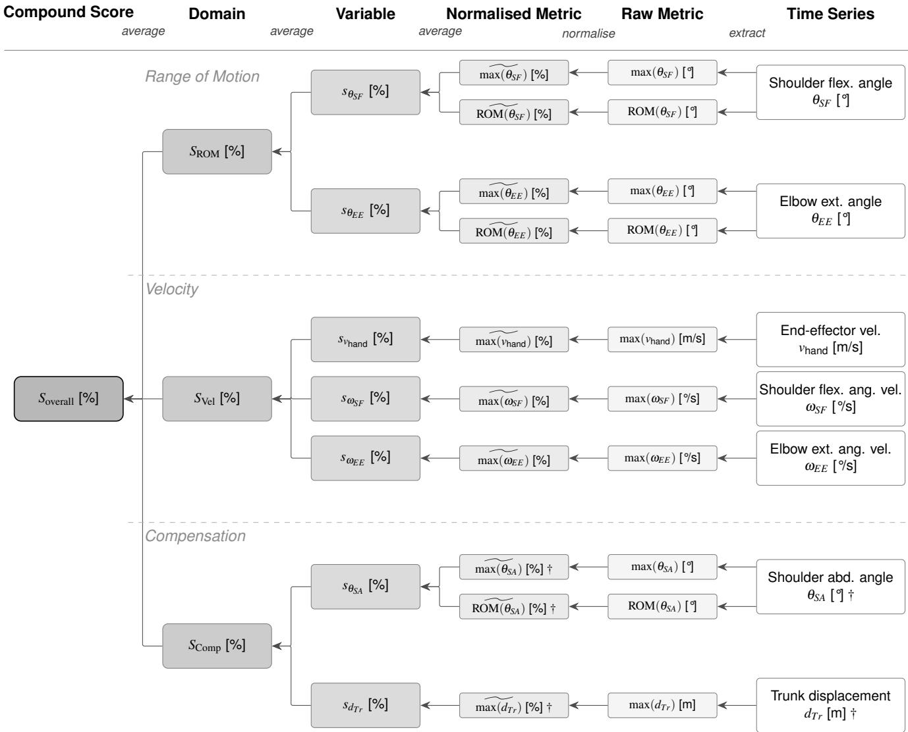  
Figure 1. 基于运动学指标的复合评分分层构建过程。从右向左阅读：七个运动学时间序列（右侧）由十个原始指标（最大值或关节活动度，ROM）进行总结。每个原始指标均被归一化为一个以 Q75 为锚点的百分比刻度，其中 100% 对应于评分为 3 分（临床正常）队列会话中各指标的第 75 百分位数（Q75），0% 对应于各任务的队列最小值，从而得出归一化指标 me；数值未做截断，可超过 100% 以表示表现超出正常表现阈值。标有 † 的指标为代偿指标，其原始值越高表示功能越差；对于这些指标，归一化进行了反转（使用 Q25 代替 Q75 作为 100% 锚点），以确保所有指标归一化后的较高值均一致地反映更好的功能。归一化指标在每个时间序列内取平均值以得出七个变量评分；变量评分在三个领域（关节活动度、速度、代偿）内分别取平均值；三个领域的评分再取平均值以得出总体复合评分。所有聚合评分均以相同的以 Q75 为锚点的百分比刻度表示。背景阴影随着聚合程度的增加而加深，从原始输入（白色）到总体复合评分。符号：θ 关节角；关节角速度；v 线速度；d 线位移；下标表示关节（SF：肩屈曲；EE：肘伸展；SA：肩外展；Tr：躯干）。

## 纵向案例研究 (H3)

选取了记录会话次数最多的两名参与者，以说明运动学指标的纵向表现，并在抓握（Grasp）分析组上进行了详细检验：P10，随访了 4 次会话，均低于临床 ARAT 天花板效应（天花板下窗口期）；P20，在约 4 个月内随访了 9 次会话，在第 3 次会话达到临床天花板并在此后保持该水平（天花板下窗口期：会话 1–3；天花板后窗口期：会话 3–9）。针对每位参与者，绘制了各分析组的临床 ARAT 评分以及运动学复合评分 $( S _ { \mathrm { o v e r a l l } } , S _ { \mathrm { R O M } } , S _ { \mathrm { V e l } } , S _ { \mathrm { C o m p } } )$ 随会话变化的曲线，并同时绘制了个别指标的轨迹。鉴于每个天花板下窗口期的会话次数较少（3–4 次），在这样的样本量 $n$ 下推断性趋势检验意义不大；因此，我们对纵向一致性进行了描述性表征，并以采用的 MCID（复合刻度上为 15 个百分点，pp）为基准，该阈值转化自卒中后上肢运动质量运动学测量的共识建议 [4]。由于该阈值是引用的而非针对本测量方法及队列估算的，因此它是一个近似基准；目前没有可用的重测数据来直接估算基于测量误差的阈值。

天花板效应前一致性与特异性（H3a、H3b）。对于每个分析组，临床动作研究臂测试（ARAT）平均评分在天花板效应前时间窗内被重新缩放至统一的 0–100 轴，而运动学复合评分（已在上述定义的归一化尺度上表示）则直接使用。随后在这一通用的百分点轴上计算临床轨迹及各运动学轨迹的逐次随访变化向量。临床变化向量与各运动学变化向量之间的平均绝对偏差（MAD）被报告为纵向一致性指标，较小的 MAD 表示对临床轨迹的追踪更紧密，而较大的 MAD 则表示在幅度或方向上存在偏离。$S _ { \mathrm { o v e r a l l } }$ MAD 被用作效度标准，此外还报告了领域复合 MAD，以在存在患者特异性康复概况时加以说明。H3a 按分析组进行评估：将每个分析组的 $S _ { \mathrm { o v e r a l l } } \mathrm { M A D }$ 分别与最小临床重要差异（MCID，15 pp）进行比较，低于 MCID 的分析组确立了纵向结构效度，而超出部分预计与横断面确定的指标-任务不匹配（H2）相吻合。在存在患者特异性康复概况的情况下，领域 MAD 的分歧则阐明了经检验的复合指标所带来的、可解释的额外临床价值（H3b）。

天花板效应后响应性（H3c）。对于受试者 P20，单独分析了天花板效应后时间窗（临床 ARAT 评分已达到并保持在最高值 3 的随访期）。在具有不同参照标准的两个层面上计算了变化。对于原始单个运动学指标，∆% 表示为该指标全队列范围的百分比 $( \Delta \% = 1 0 0 \times \mathrm { ( l a s t - f i r s t ) }$ /cohort range)。对于复合评分和领域评分，∆ 在归一化尺度上以百分点（pp）报告，可解释为向各项指标的正常运动表现阈值缩小的差距（当为负值时，则为扩大的差距）。若在天花板效应后时间窗内至少有一个领域复合评分变化 $\geq 1 5 \mathrm { p p }$（一个 MCID），则认为 H3c 得到支持。

## 结果

## 数据集

来自20名参与者的47次评估会话共记录了1304项ARAT任务（试验）。参与者特征汇总于补充表 7（Supplementary Table 7）中；该队列包括15名男性和5名女性（平均年龄71.2岁，标准差（SD）9.9，范围55–90岁），诊断包括脑卒中（n=10）、帕金森病（n=6）和其他神经系统疾病（n=4）。13名参与者参与了不止一次会话，其中监测时间最长的两名参与者分别随访了约四个月（9次会话）和九周（4次会话）（每位参与者的会话分布见补充图 7（Supplementary Figure 7））。经过基于评分感知的四分位距（IQR）异常值检测后，排除了130次试验（10.0%），留下1174次试验用于分析。

## 运动学重建的数据质量（H1）

在所有分析的试验中，生物力学重建的平均重投影误差为 $1 2 . 5 \pm 3 . 0 \mathrm { p x }$（中位数 12.1 px，IQR 10.5–14.0 px）。这处于此前为该重建算法在临床使用中确定的 10–20 px 可接受范围内，略高于 5–10 px 的实验室标准 [23]，正如预期的那样，这是由于临床环境中固有的精简三摄像机配置和更频繁的遮挡所致。因此，满足了 H1 的充分性标准。

在四个 ARAT 评分组中（所有试验按其临床 ARAT 评分 0–3 分类汇总，每次试验提供一个平均重投影误差值），重投影误差基本保持稳定（Table 3，Figure 2）。四个评分组之间的重投影误差中位数最多相差 2.5 px（0分组为 13.9 px 对比 1分组为 11.4 px，为最大的两两差异），相对于整体误差分布（所有试验的 IQR 为 3.5 px）而言差异很小。Kruskal–Wallis 检验显示各评分组之间存在统计学上的显著差异 $( H ( 3 ) = 9 . 8 5 , p = . 0 2 0 )$ ，但相关的效应量微不足道 $( \eta _ { H } ^ { 2 } = 0 . 0 0 5 3 )$

这表明评分组基本上没有解释重建质量的方差，满足了稳健性标准 $( \eta _ { H } ^ { 2 } < 0 . 0 6 )$ 。经 Holm 校正的两两 Dunn 检验显示，校正后任何评分组之间均无显著差异（所有 $p _ { \mathrm { H o l m } } > . 0 5 )$ ，效应量从微不足道到较小不等 $( | r | \le 0 . 2 6 )$ 。最大（尽管不显著）的差异出现在 0分试验中，其显示出略高于 1–3分的中位数误差（13.9 px 对比 11.4–12.3 px），这与在损伤最严重的表现中所预期的更大运动变异性和更频繁的遮挡相一致。

在满足充分性（12.5 px 在 10–20 px 的可接受范围内）和鲁棒性 $( \eta _ { H } ^ { 2 } = 0 . 0 0 5 3 < 0 . 0 6 )$ 标准的情况下，H1 得到支持：在常规、减少相机数量的临床环境中，可以在整个临床能力范围内实现充分且一致的运动学重建。

Table 3. 所有 1304 次试验（异常值剔除前）中按 ARAT 评分组划分的 MMC 重投影误差。组级描述性统计（中位数、四分位距）、Kruskal–Wallis 综合检验以及经 Holm 校正的事后两两 Dunn 检验。r 表示作为两两效应量的秩-双列相关（rank-biserial correlation）。效应量标签遵循常规阈值：$\eta _ { H } ^ { 2 } < 0 . 0 1$ 微不足道（negligible），0.01–0.06 小（small），0.06–0.14 中等（medium），> 0.14 大（large）；$| r | < 0 . 1 0$ 微不足道，0.10–0.30 小，0.30–0.50 中等，$\ge 0 . 5 0$ 大。显著性：∗ p < .05，∗∗ p < .01，∗∗∗ p < .001，n.s. = 不显著（not significant）。  
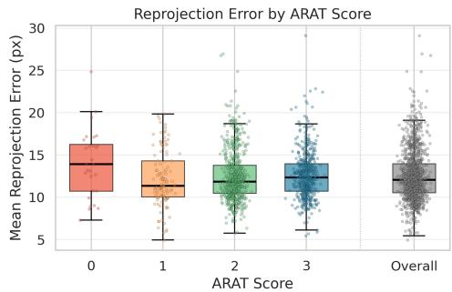

<table><tr><td colspan="6">组描述性统计</td></tr><tr><td>评分</td><td>n</td><td>中位数 (px)</td><td>IQR (px)</td><td>均值 (px)</td><td>SD (px)</td></tr><tr><td>0</td><td>28</td><td>13.90</td><td>[10.73, 16.27]</td><td>14.04</td><td>3.97</td></tr><tr><td>1</td><td>113</td><td>11.36</td><td>[10.05, 14.32]</td><td>12.16</td><td>3.32</td></tr><tr><td>2</td><td>650</td><td>11.84</td><td>[10.47, 13.79]</td><td>12.47</td><td>3.00</td></tr><tr><td>3</td><td>513</td><td>12.32</td><td>[10.74, 13.96]</td><td>12.61</td><td>2.82</td></tr><tr><td colspan="6">Kruskal-Wallis: H(3)=9.85, p=0.020 $\eta_{H}^{2}=0.0053$ （微不足道）</td></tr></table>

<table><tr><td colspan="5">两两比较（Dunn 检验，Holm 校正）</td></tr><tr><td>组对</td><td> $\Delta_{\text{med}}$ (px)</td><td>r</td><td>|r|</td><td> $p_{\text{Holm}}$ </td></tr><tr><td>0 vs 1</td><td>-2.55</td><td>-0.257</td><td>小</td><td>0.059</td></tr><tr><td>0 vs 2</td><td>-2.07</td><td>-0.249</td><td>小</td><td>0.096</td></tr><tr><td>0 vs 3</td><td>-1.58</td><td>-0.229</td><td>小</td><td>0.236</td></tr><tr><td>1 vs 2</td><td>+0.48</td><td>+0.061</td><td>微不足道</td><td>0.365</td></tr><tr><td>1 vs 3</td><td>+0.97</td><td>+0.107</td><td>小</td><td>0.236</td></tr><tr><td>2 vs 3</td><td>+0.49</td><td>+0.062</td><td>微不足道</td><td>0.236</td></tr></table>

Figure 2. 按临床 ARAT 评分（0–3）及汇总全部 1304 次试验（右）的每次试验平均重投影误差（像素）。分布高度重叠证实了重建质量并未系统性地依赖于患者的损伤水平（$( \eta _ { H } ^ { \bar { 2 } } { = } 0 . 0 0 5 3 { < } 0 . 0 6$ ；Table 3）。

## 群体水平的结构效度（H2）

我们通过两层已知群体判别（known-groups discrimination）评估了结构效度（construct validity）。第 1 层（评分 0/1 与评分 2/3）探究了已完成任务与未完成任务之间的明确界限，在此处预期具有较强的判别力；第 2 层（评分 2 与评分 3）探究了不同质量完成情况之间更为主观的界限，在此处低于第 1 层的判别力本身将支持效度。

## Tier 1: Score 0/1 vs. Score 2/3 Discrimination

在七个分析组中的六个组中，第 1 层对评分 0/1 与评分 2/3 试验的判别均表现强劲，组合特征 AUC 范围为 0.91 至 1.00（Table 4；Figure 3 展示了 Grasp 分析组中所有试验的基础指标分布），这表明基于 MMC 提取的运动学指标能够可靠地捕捉任务完成与未完成之间的根本差异。

对于抓取并放置任务（Grasp、Grip、Pinch），组合特征判别接近完美（$( \mathrm { A U C } 0 . 9 6 - > 0 . 9 9 .$ 见 Table 4）。最一致的单项判别指标是肘关节伸展指标（ROM $r = 0 . 7 7 - 0 . 9 3$ 和峰值速度 $r = 0 . 8 2 – 0 . 9 3 )$ ），反映了将物体运送至目标需要手臂近乎完全伸展的要求。评分 2/3 试验还表现出显著高于评分 0/1 试验的末端执行器和关节速度（见 Supplementary Table 5）。单独的 ROM 指标判别力很强（仅 ROM 的 AUC ≥ 0.95），仅速度指标的判别力略低（0.90–0.94）；在每种情况下，结合这两个领域均获得了最高的判别力 $( \mathrm { A U C } \geq 0 . 9 6 )$ 。

粗大运动任务（Hand Behind Head、Hand on Top of Head、Hand to Mouth）同样实现了较高的组合特征判别（AUC 0.91–1.00；各组指标分布见 Supplementary Figure 8, 9），其中主导的单一领域因任务而异（Hand to Mouth 为 ROM，Hand Behind Head 为速度，Hand on Top of Head 为代偿），且组合特征集在所有情况下均达到或超过了最佳单一领域。Hand to Mouth 在所有分析组中表现出最强的判别力 $( \mathrm { A U C } = 1 . 0 0 )$ ，其中评分 0/1 试验以更高的肩关节屈曲为特征。

躯干位移是所有抓取并放置任务以及粗大运动任务中的显著判别指标，评分 0/1 试验表现出更大的躯干代偿。作为一个独立的领域，代偿指标在所有分析组中对评分 0/1 与评分 2/3 试验的判别均远高于机会水平（仅代偿 AUC 0.72–0.97）；对于 Grip（仅代偿 AUC

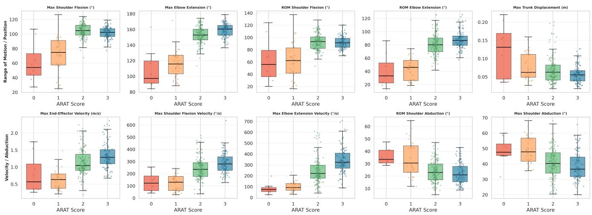  
Figure 3. Grasp 分析组中所有试验的运动学指标在临床 ARAT 评分（0–3）上的分布。单次试验显示为抖动点。已剔除离群值（IQR × 3.0）。

0.96）和手触口（Hand to Mouth，0.97）中，代偿几乎与 ROM 相当；而在手置头顶（Hand on Top of Head）任务中，代偿是表现最强的单一领域（0.87 对比 ROM 0.84、速度 0.86），这表明仅躯干和肩部的代偿性募集就蕴含了关于任务能否完成的大量信息。

倒水（Water Pouring）任务是一个例外，其表现逊于其他任务（组合特征 AUC 0.75），这归因于指标与任务的不匹配，而非重建失败：当前的指标集和指标类别划分（ROM、VEL、COMP）主要针对伸展与搬运运动进行了优化。此类针对单个任务的构念效度限制制约了 H2 的泛化性，但并不影响指标集与任务高度匹配的其他分析组。

综上所述，第 1 层级（Tier 1）区分度在七个分析组中的六个均超过了 AUC ≥ 0.85 的“极佳区分度”阈值 [25]（AUC 0.91–1.00），支持了在 0/1 分与 2/3 分边界处的 H2。

## Tier 2：2 分与 3 分的区分

正如预期的那样，在所有分析组中，2 分与 3 分试验之间的 Tier 2 区分度均明显低于 Tier 1（组合特征 AUC 0.70–0.84；Table 4），反映出两组之间存在合理的重叠。与 Tier 1 相比，速度指标对 Tier 2 的区分贡献更强，有时能取得比单纯 ROM 更高的区分能力，例如在抓取（Grasp）组中（仅速度：0.75 对比 仅 ROM：0.70）。这反映出与 2 分相比，3 分试验的整体动作执行速度更快（见 Supplementary Table 5）。

对于取放任务（pick-and-place tasks，AUC 0.77–0.84），最大肘关节伸展速度表现出最强的单项区分能力。躯干位移仍然是抓握（Grip）和捏合（Pinch）的显著区分指标，但对抓取（Grasp）则不显著。与取放任务相比，粗大动作任务（Gross motor tasks）的 Tier 2 区分度略低（AUC 0.70–0.82），这与其在 Tier 1 中的较低表现一致；速度指标在粗大动作任务中同样占据主导地位。在倒水任务中，速度指标此时主导了区分（AUC 0.83），扭转了在 Tier 1 中观察到的模式。

速度指标在 Tier 2 中是比 Tier 1 更具主导性的领域，这表明一旦任务完成，运动速度便能显著区分动作表现质量。代偿指标在得分 2 与得分 3 的分界处是最弱的独立领域（在大多数任务中仅代偿指标的 AUC 为 0.59–0.68）。这很可能反映了当前通用代偿指标（躯干位移、肩外展）对区分良好与正常完成之间更为细微的代偿差异敏感性有限，而非该分界处缺乏代偿信息 [29, 30, 31]；该指标集针对各个任务的适用性将在“讨论”（Discussion）中进一步阐述。手触嘴（Hand to Mouth）是一个显著的例外，其中代偿仍是最强的单一领域（AUC 0.73），这是由在更慢、更费力的完成动作中持续存在的肩外展和躯干位移所驱动的，也是代偿指标能够区分得分 2 与得分 3 完成动作的唯一分析组。

Tier 2 的区分度（AUC 0.70–0.84）在所有七个分析组中均高于随机猜测水平，并始终达到常规的 0.7“可接受区分度”阈值 [25]，同时在所有任务组中始终低于 Tier 1，这种差异模式正是一个追踪潜在功能而非顺序量表的有效构念测量所预期的。综合来看，Tier 1 和 Tier 2 的结果支持了 H2。

Table 4. 所有七个任务组的已知群体构念效度。上方：拾放任务（Grasp、Grip、Pinch）；下方：粗大运动与倒水任务（Water Pouring、Hand Behind Head、Hand on Top of Head、Hand to Mouth）。来自 Mann–Whitney U 检验的秩二列相关系数 r。LR AUC = 使用指定特征子集的逻辑回归 ROC 曲线下面积。∗ p < .05, ∗∗ p < .01, ∗∗∗ p < .001。  
拾放任务（Pick-and-place tasks）

<table><tr><td rowspan="2">指标</td><td colspan="2">抓握（Grasp）</td><td colspan="2">握持（Grip）</td><td colspan="2">捏取（Pinch）</td></tr><tr><td>Tier 1(42 vs 248)</td><td>Tier 2(140 vs 108)</td><td>Tier 1(12 vs 249)</td><td>Tier 2(110 vs 139)</td><td>Tier 1(44 vs 271)</td><td>Tier 2(194 vs 77)</td></tr><tr><td> $\max(\theta_{SF})$ [°]</td><td>0.79***</td><td>-0.20**</td><td>0.62***</td><td>-0.31***</td><td>0.73***</td><td>-0.34***</td></tr><tr><td> $\max(\theta_{EE})$ [°]</td><td>0.89***</td><td>0.33***</td><td>0.95***</td><td>0.25***</td><td>0.93***</td><td>-0.01</td></tr><tr><td> $ROM(\theta_{SF})$ [°]</td><td>0.61***</td><td>-0.03</td><td>0.38*</td><td>-0.02</td><td>0.44***</td><td>0.11</td></tr><tr><td> $ROM(\theta_{EE})$ [°]</td><td>0.88***</td><td>0.28***</td><td>0.93***</td><td>0.15*</td><td>0.77***</td><td>0.08</td></tr><tr><td> $\max(d_{Tr})$ [m]</td><td>-0.23*</td><td>-0.17*</td><td>-0.88***</td><td>-0.23**</td><td>-0.62***</td><td>-0.31***</td></tr><tr><td> $\max(v_{hand})$ [m/s]</td><td>0.74***</td><td>0.30***</td><td>0.61***</td><td>0.37***</td><td>0.63***</td><td>0.26***</td></tr><tr><td> $\max(\omega_{SF})$ [°/s]</td><td>0.77***</td><td>0.28***</td><td>0.53**</td><td>0.37***</td><td>0.58***</td><td>0.25**</td></tr><tr><td> $\max(\omega_{EE})$ [°/s]</td><td>0.89***</td><td>0.52***</td><td>0.93***</td><td>0.45***</td><td>0.82***</td><td>0.33***</td></tr><tr><td> $ROM(\theta_{SA})$ [°]</td><td>-0.50***</td><td>-0.10</td><td>-0.52**</td><td>-0.14</td><td>-0.27**</td><td>-0.04</td></tr><tr><td> $\max(\theta_{SA})$ [°]</td><td>-0.50***</td><td>-0.14</td><td>-0.66***</td><td>-0.25***</td><td>-0.25**</td><td>-0.05</td></tr><tr><td>LR AUC（仅速度）</td><td>0.94</td><td>0.75</td><td>0.94</td><td>0.72</td><td>0.90</td><td>0.62</td></tr><tr><td>LR AUC（仅 ROM）</td><td>0.95</td><td>0.70</td><td>0.97</td><td>0.77</td><td>0.96</td><td>0.70</td></tr><tr><td>LR AUC（代偿）</td><td>0.76</td><td>0.61</td><td>0.96</td><td>0.63</td><td>0.82</td><td>0.62</td></tr><tr><td>LR AUC（全部）</td><td>0.96</td><td>0.78</td><td>&gt;0.99</td><td>0.84</td><td>0.99</td><td>0.77</td></tr></table>

粗大运动与倾倒任务

<table><tr><td rowspan="2">指标</td><td colspan="2">倒水 (Water Pouring)</td><td colspan="2">手放脑后 (Hand Behind Head)</td><td colspan="2">手放头顶 (Hand on Top of Head)</td><td colspan="2">手送至口 (Hand to Mouth)</td></tr><tr><td>Tier 1(5 vs 70)</td><td>Tier 2(44 vs 26)</td><td>Tier 1(12 vs 58)</td><td>Tier 2(43 vs 15)</td><td>Tier 1(8 vs 71)</td><td>Tier 2(35 vs 36)</td><td>Tier 1(3 vs 81)</td><td>Tier 2(20 vs 61)</td></tr><tr><td> $\max(\theta_{SF})$ [°]</td><td>0.65*</td><td>0.06</td><td>0.81***</td><td>-0.01</td><td>0.77***</td><td>0.30*</td><td>-1.00***</td><td>-0.04</td></tr><tr><td> $\max(\theta_{EE})$ [°]</td><td>-0.19</td><td>0.15</td><td>-0.25</td><td>-0.47**</td><td>-0.21</td><td>-0.21</td><td>0.04</td><td>-0.12</td></tr><tr><td> $ROM(\theta_{SF})$ [°]</td><td>0.34</td><td>0.13</td><td>0.71***</td><td>0.06</td><td>0.64**</td><td>0.23</td><td>-0.97***</td><td>-0.08</td></tr><tr><td> $ROM(\theta_{EE})$ [°]</td><td>-0.42</td><td>-0.18</td><td>-0.14</td><td>-0.30</td><td>-0.36</td><td>-0.26</td><td>0.04</td><td>-0.12</td></tr><tr><td> $\max(d_{Tr})$ [m]</td><td>-0.55*</td><td>0.14</td><td>-0.67***</td><td>-0.08</td><td>-0.81***</td><td>-0.29*</td><td>-0.96***</td><td>-0.47**</td></tr><tr><td> $\max(v_{hand})$ [m/s]</td><td>-0.31</td><td>0.55***</td><td>0.86***</td><td>0.40*</td><td>0.78***</td><td>0.61***</td><td>0.64</td><td>0.47**</td></tr><tr><td> $\max(\omega_{SF})$ [°/s]</td><td>0.03</td><td>0.61***</td><td>0.80***</td><td>0.39*</td><td>0.72***</td><td>0.46***</td><td>-0.18</td><td>0.30*</td></tr><tr><td> $\max(\omega_{EE})$ [°/s]</td><td>-0.40</td><td>0.24</td><td>0.55**</td><td>0.15</td><td>0.37</td><td>0.35*</td><td>0.69*</td><td>0.47**</td></tr><tr><td> $ROM(\theta_{SA})$ [°]</td><td>-0.66*</td><td>-0.34*</td><td>-0.16</td><td>-0.18</td><td>-0.38</td><td>-0.10</td><td>-0.64</td><td>0.12</td></tr><tr><td> $\max(\theta_{SA})$ [°]</td><td>-0.09</td><td>-0.10</td><td>-0.15</td><td>0.04</td><td>-0.41</td><td>-0.04</td><td>-0.98***</td><td>-0.39**</td></tr><tr><td>LR AUC（仅速度）</td><td>0.69</td><td>0.83</td><td>0.92</td><td>0.66</td><td>0.86</td><td>0.75</td><td>0.86</td><td>0.72</td></tr><tr><td>LR AUC（仅 ROM）</td><td>0.92</td><td>0.64</td><td>0.91</td><td>0.69</td><td>0.84</td><td>0.61</td><td>0.98</td><td>0.57</td></tr><tr><td>LR AUC（代偿）</td><td>0.75</td><td>0.60</td><td>0.72</td><td>0.68</td><td>0.87</td><td>0.59</td><td>0.97</td><td>0.73</td></tr><tr><td>LR AUC（全部）</td><td>0.75</td><td>0.83</td><td>0.97</td><td>0.70</td><td>0.91</td><td>0.73</td><td>1.00</td><td>0.82</td></tr></table>

## 探索性纵向案例研究 (H3)

我们在两名受试者中展示了纵向行为特征：P10（四次处于天花板之下的评估周期）和 P20（九次评估周期，在第 3 次达到临床天花板），各周期的轨迹如图 4 和图 5 所示。正如在“方法”（Methods）中所详述的，纵向变化以临床变化向量与运动学变化向量之间的平均绝对偏差（MAD）进行描述性报告，并以采用的 MCID（15 pp）作为基准。我们评估了排除“倒水”（Water Pouring）后保留的六个分析组的纵向一致性（MAD），并在“抓握”（Grasp）分析组上详细展示了康复特征的对比。

由于在 Tier 1 中讨论的指标-任务不匹配问题，“倒水”被排除在下文的纵向个案研究分析之外。其余六个分析组（Grasp、Grip、Pinch、Hand Behind Head、Hand on Top of Head、Hand to Mouth）予以保留。

P10 — Grasp [缺血性中风（ICD I63.1），右侧（患侧）]  
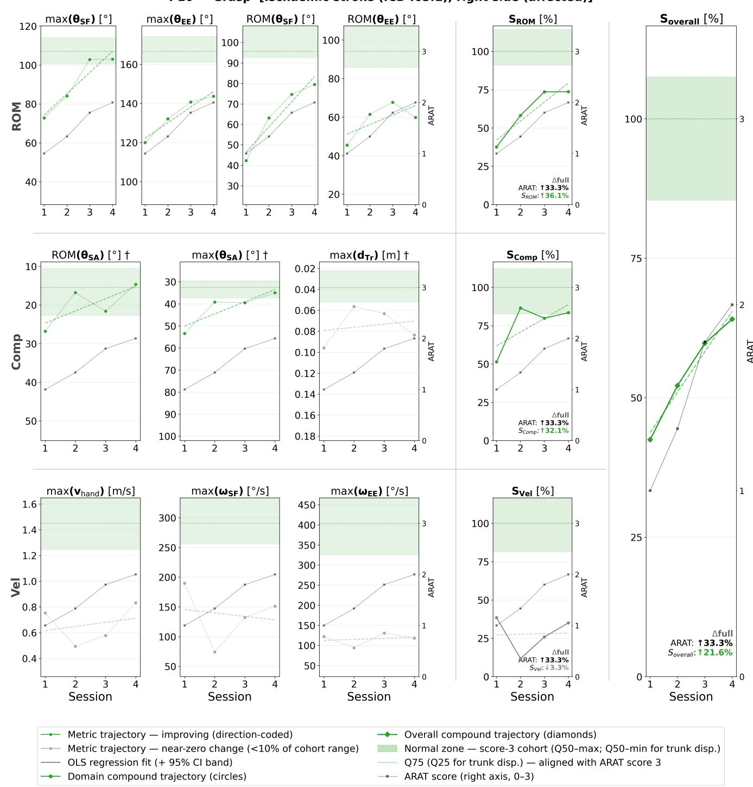

Figure 4. P10 患侧（缺血性中风）在四次 ARAT 评估周期中的纵向运动学监测，Grasp 分析组。面板网格：各行为三个运动学领域（ROM、Compensation、Velocity），每个领域均包含其原始指标、领域复合评分 $( S _ { \mathrm { R O M } } , S _ { \mathrm { C o m p } } , S _ { \mathrm { V e l } } )$，最右侧为总体复合评分 $( S _ { \mathrm { o v e r a l l } } )$。复合指标面板以归一化的 0–100 % 标度显示（100 % = 得分为 3 分的周期的单项指标 Q75，带 † 标记的反向代偿指标为 Q25；参见 Figure 1）；数值未作截断，可能超过 100 %。原始指标面板显示绝对单位。患者在 Grasp 分析组任务中的平均临床 ARAT 评分（0–3）叠加在副坐标轴上（黑色方块）。参考带：绿色阴影标记正常运动表现区域（3 分周期的 Q50 至最大值；反向指标为 Q50 至最小值）；虚线标记 Q75，与 ARAT 评分 3 分对齐。注释：每个复合指标面板报告了 ARAT 和复合指标从首次到最后一次评估周期的变化（pp） $\Delta _ { \mathrm { f u l l } }$；绿色表示 ≥ 15 pp（MCID），红色表示 ≤ −15 pp，其他为灰色。P10 全程均处于临床天花板之下，因此整个时间窗口完全处于天花板之下（sub-ceiling）。

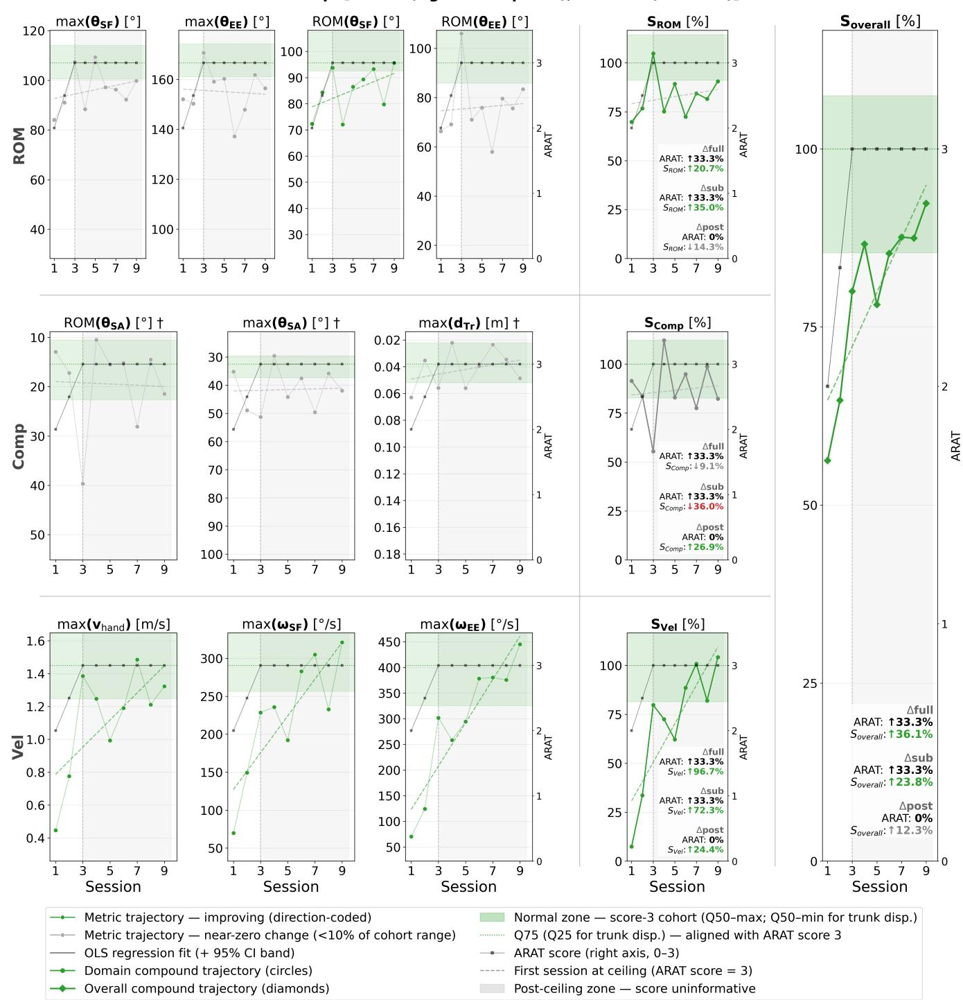  
Figure 5. 在约四个月内的九次 ARAT 会话中对 P20 患侧（中风，右半球）进行的纵向运动学监测，抓握（Grasp）分析组。面板网格、标度、参考带以及叠加的平均临床 ARAT 评分同 Figure 4。垂直虚线标记了首次达到并保持临床天花板效应的会话；灰色背景标记了天花板后区域。注释：每个复合指标面板报告了 ARAT 和复合指标的三种变化量（pp）：$\Delta _ { \mathrm { f u l l } }$（从初次到末次）、$\Delta _ { \mathrm { s u b } }$（天花板前，到首次达到天花板的会话）和 $\Delta _ { \mathrm { p o s t } }$（天花板后，从该会话到末次）；根据构造，$\Delta _ { \mathrm { A R A T , p o s t } } = 0 .$。配色同 Figure 4。

## 天花板前：总体一致性与患者特异性领域分歧（H3a, H3b）

纵向个案研究提供了两种相关的证据形式。首先，在两名患者的天花板前会话中，总体运动学复合评分 $( S _ { \mathrm { o v e r a l l } } )$ 紧密跟踪了临床 ARAT 评分，这表明总体运动学总结捕捉到了与临床评分相同的功能变化（纵向结构效度）。其次，在这种一致的总体吻合之下，各领域复合评分（关节活动度 SROM、速度 $S _ { \mathrm { V e l } }$ 和代偿 $S _ { \mathrm { C o m p } } )$ 以具有患者特异性的方式偏离了临床轨迹，揭示了运动的哪些方面实际上推动了每位患者的改善，而这些信息是总体评分和序数 ARAT 必然会压缩忽略掉的。这两项发现只有结合在一起才具有意义：总体一致性验证了该指标的有效性，而正是这种验证使得领域分歧能够被解读为真实的康复特征，而非测量不一致。每个分析组的 $S _ { \mathrm { o v e r a l l } }$ MAD 低于 MCID 被视为该分析组具有纵向结构效度的证据。

我们在抓握（Grasp）分析组上详细阐述了这一模式，并在 Supplementary Table 6 中总结了其余五个分析组的情况。对于 Grasp，$S _ { \mathrm { o v e r a l l } }$ 对两名患者的临床 ARAT 轨迹均保持了紧密追踪（P10 的 $\mathrm { M A D } S _ { \mathrm { o v e r a l l } } =$ 5.6 pp，P20 为 5.9 pp，均远在 15 pp 的 MCID 范围之内），从而支持了纵向结构效度。在重新缩放的 0–100 坐标轴上，面对两名患者均为 +33.3 pp 的临床 ARAT 变化，$S _ { \mathrm { o v e r a l l } }$ 本身在四个未达天花板（sub-ceiling）的测试会话中，P10 上升了 $\Delta S _ { \mathrm { o v e r a l l } } = + 2 1 . 6 \mathrm { p p }$，P20 上升了 +23.8 pp。在这种一致性之下，两名患者表现出在机制上截然相反的各领域特征。P10 的改善是由关节活动度（range of motion, ROM）的提升（$\Delta S _ { \mathrm { R O M } } = + 3 6 . 1 \mathrm { p p } ; \mathrm { M A D } =$ 5.4 pp）和代偿运动的减少（$\Delta S _ { \mathrm { C o m p } } = + 3 2 . 1 \mathrm { p p } ; \mathrm { M A D } = 6 . 8$ pp，主要是通过减少肩外展，从首次到末次会话 $\Delta \ge 1 8$）所驱动，而速度基本保持平稳（$\Delta S _ { \mathrm { V e l } } = - 3 . 3 \mathrm { p p } ; \mathrm { M A D } = 2 8 . 4 \mathrm { p p }$），这是一种由关节活动度驱动且不含速度成分的康复过程。P20 在同一任务中则表现出相反的特征：速度大幅上升（$\Delta S _ { \mathrm { V e l } } = + 7 2 . 3 \mathrm { p p } ; \mathrm { M A D } = 1 6 . 2 \mathrm { p p }$），而代偿行为却出现分化恶化（$\Delta S _ { \mathrm { C o m p } } = - 3 6 . 0 \mathrm { p p ; M A D = 3 1 . 3 p p ) }$），这是一种由更快、更有力的动作执行所驱动的康复，但在该时间窗内代偿情况有所加剧。

这种总体上保持一致但在患者特异性领域存在分化的相同模式，在其余五个分析组中同样成立（Supplementary Table 6）。按分析组进行评估时，P20 在所有六个分析组中的 $S _ { \mathrm { o v e r a l l } }$ MAD 均低于 MCID（范围 5.9–13.6 pp），而 P10 则在六个分析组中的三个低于 MCID（Grasp、Hand to Mouth、Pinch；范围 5.6–8.5 pp）。P10 超出阈值的三个任务（Grip 18.2 pp；Hand Behind Head 17.4 pp；Hand on Top of Head 18.1 pp）恰好属于已知通用指标集覆盖不足的分析组：Grip 缺少手指运动学指标，而两个过顶任务中指标集主要针对伸手与搬运（reach-and-transport）而非过顶定位进行优化，这与 Tier 1 中倒水（Water Pouring）任务所提示的指标-任务不匹配相对应。因此，这些超出阈值的情况反映的是在横断面分析中已识别出的相同任务-指标不匹配，而非纵向效度的失效，并且不会影响作为康复对比基础的 Grasp 分析组结果。

这些案例研究与 H3a 和 H3b 一致：在指标集与任务相匹配的分析组中（P20 为全部六组；P10 为抓握 [Grasp]、手到口 [Hand to Mouth] 和捏取 [Pinch]），两名患者均满足了按分析组划分的有效性标准（$S _ { \mathrm { o v e r a l l } }$ 的 MAD 低于 MCID，H3a）。在这一经过验证的框架内，患者特异性的领域差异（H3b）——最直观地体现在抓握任务中关节活动度（ROM）与代偿同速度之间截然相反的恢复曲线上——揭示了 $S _ { \mathrm { o v e r a l l } }$ 和序数 ARAT 必然压缩忽略的恢复特征：在指标集与任务匹配的情况下，$S _ { \mathrm { o v e r a l l } }$ 确认了临床量表所测量的结果，而当存在患者特异性特征时，领域复合指标则对此做出了解释。作为来自两名患者的探索性证据，这些结果为针对这一关联发现开展队列层面的研究提供了依据。

## 天花板效应之后：临床量表饱和后的持续运动学恢复（H3c）

在第 3 次评估中 P20 首次在抓握分析组达到最高临床 ARAT 平均分 3 分之后，该临床评分在随后的所有评估中均维持在天花板水平，无法再提供关于恢复的进一步信息。然而，运动学指标在剩余的 6 次评估中仍在持续变化（见 Figure 5）。在归一化复合量表上，$S _ { \mathrm { o v e r a l l } }$ 在天花板效应之后的观察期内进一步上升了 $\Delta S _ { \mathrm { o v e r a l l } } = + 1 2 . 3$ pp。速度指标表现出最强的天花板后变化：SVel 在天花板后观察期内增加了 $\Delta S _ { \mathrm { V e l } } = + 2 4 . 4$ pp，超过了 15 pp 的 MCID。ROM 指标显示出较小的积极变化（肩屈曲 ROM：+27.8 % 队列范围，原始指标），躯干位移轻微减少（−8.5 % 队列范围，原始指标）。P20 直到达到临床评分天花板数次评估之后，才超过速度复合指标的正常运动表现阈值，这表明针对单项指标正常运动表现的运动学正常化直到监测接近尾声时才实现，而这一差异在序数临床量表上完全无法体现。因此，在这一单例天花板后案例中，运动学测量在序数量表饱和后依然检测到了具有临床意义的变化，这与 H3c 一致。

## 讨论

有效且高效的神经康复需要由实际测量结果来引导治疗，而精准神经康复已被提出作为实现这一目标的框架 [32]。然而，其核心瓶颈在于测量 [4]。本研究评估了在神经康复诊所的常规 ARAT 评估中使用的基于 AI 的无标记动作捕捉技术，是否能够准确且稳健地重建上肢运动，并产生超越序数评分（ordinal score）的、有效且具有临床信息价值的运动学指标，从而有助于在大规模应用中闭合这一测量闭环。

我们通过四个假设对此进行了探讨，涵盖重建精度（H1）、横断面构念效度（H2），以及在两个探索性案例研究中的纵向效度、特异性和超越天花板效应的反应度（H3a–H3c）。所有假设在其预设阈值内均得到了支持：H1 和 H2 在队列水平上成立，纵向标准（H3a）在 P20 的全部六个分析组以及 P10 的六个分析组中的三个成立。我们依次对各项进行讨论，随后探讨本研究呈现的局限性与未来方向。

重建精度是后续所有论断的前提条件，且在最容易失效的情况下依然得到了保证：尽管在常规评估中采用的是临时的三摄像机布局，但重投影误差仍保持在可接受的临床使用范围内，且并未随损伤程度加重而恶化，这使得底层信号足够可靠，可用于构建评估指标。

对照临床评分验证运动学测量的方法，因 Schwarz 等人 [26] 指出的障碍而变得复杂：运动学指标提供的是互补而非冗余的信息，因此与序数量表的经典聚合相关性检验无法作为评判标准。已知群组法（known-groups approach）[28] 避开了这一问题，它不再探究指标是否与 ARAT 完全一致，而是探究它们是否以有效测量应有的方式相符合。事实确实如此：在临床分界明确稳健之处（第 1 层：完成 vs. 未完成），区分度较强；而在主观性较强之处（第 2 层：完成质量），区分度则有所减弱。这种差异化模式而非一律的高度一致，正是连续测量有效追踪潜在构念的标志性特征，并可推广至任何必须对照含噪声的序数参考标准来验证连续测量指标的应用场景。

纵向案例研究最直接地推动了超越序数评分的临床应用。在抓握分析组中，总体复合指标在两名患者中均与临床 ARAT 密切吻合，而其领域分解则揭示了在机制上截然相反的康复特征：两人的 ARAT 得分增长相同，但一人是通过活动范围的增加和代偿的减少实现康复，另一人则是通过更快的执行速度实现康复。整体一致性与领域分解只有结合起来才具有可解释性：整体一致性证实了复合指标追踪的是与 ARAT 相同的信号，这使得领域分解能够被解读为康复特征而非测量噪声。因此，相同的临床改善是由不同的运动模式驱动的，这直接解决了 ARAT 的第三个局限性。至关重要的是，运动学测量在突破临床天花板效应后依然保持敏感：在 P20 中，该复合指标在已饱和的 ARAT 无法记录的天花板后时间窗口内，捕捉到了持续的、由速度驱动的康复，并解析了其特征——不仅反映了总体改善仍在继续，还明确指出了是在哪个领域。

几项局限性限制了这些结果，但既然测量基础架构已被证明是可行的，每项局限性都有明确的后续推进路径。纵向证据仅基于两项个案研究，这启发了但尚未在队列水平上确立这种偶联发现；采用结构化评估方案的前瞻性队列研究是自然的下一步。此处采用的最小临床重要差异（MCID）是根据共识建议 [4] 转化的近似值，而非针对本度量方法和队列专门估算得出；更大的队列将允许直接建立针对特定动作的截断值以及针对特定度量指标的可靠性边界，基于患者感知变化的效标锚定估算方法为此提供了一个参考范式 [33]。ARAT（动作研究手臂测试）评分也由主治治疗师评定，且缺乏平行的评估者间信度数据，导致临床主观性对 Tier 2 衰减的贡献仍未被量化。最后一个综合性的局限性在于，所增加的见解取决于每个指标的领域归属（domain assignment）在当前任务中是否成立：由于在整个 ARAT 测试套件中，每个特征都被分配到了单一领域，相同的特征在不同任务中可能代表不同的含义，只要这种分配失效，问题就会显现出来。在横断面分析中，倒水任务（Water Pouring）显示出最低的 Tier 1 区分度（组合特征 AUC 为 0.75），因为被归为伸手与搬运（reach-and-transport）代偿的肩外展，反而可能是一种合理的倒水策略；在纵向分析中，同样的不匹配导致倒水任务被排除，并引发了 P10 的三次 MAD 超标（抓握任务 [Grip] 缺乏手指运动学数据；两项过顶任务被归属于伸手与搬运，而非过顶定位）。当某个指标的领域归属与任务的实际恢复过程耦合较为松散时，复合指标追踪临床轨迹的准确度就会降低；原则性的应对方法是暴露出这些情况，而不是报告误导性的一致性。这并非准确性方面的局限，而是表征层面的局限：目前手工构建、领域归属的指标只是一种特意泛化的初步表征，而非定论。

除了扩展手工设计的指标集之外，更根本的测量层面方向自然随之而来，并通过本文所展示的常规化采集变得切实可行。通过整个动作相对于健全参考基准的偏差进行评分，而不是将其简化为预先选定的标量，可以规避针对每项任务分配指标的问题，因为参考基准本身就编码了每项任务健康执行的标准形态；这在步态分析中已是成熟的做法，例如步态偏差指数（Gait Deviation Index）用于量化相对于健全参考集的偏差 [34]，并且也开始在上肢领域进行探索 [35]。此外，由于底层重建产生的是完整的生物力学轨迹而非孤立的指标，这些数据可以直接供新兴的动作基础模型（movement foundation models）使用，这些模型学习人类动作的共享结构，并且无需特定任务的特征工程即可回答包括结果评分在内的临床问题 [36]。实现这些数据驱动的方向需要人群规模的健全人群和患者数据，并将用实测的健全参考基准替代目前评分为 3 的正常运动表现代理指标；本文所展示的常规、低负担的数据采集是生成如此海量数据的一种途径。与此同时，底层追踪可以沿着硬件维度进行拓展：回归到实验室验证中使用的五相机配置，将支持可靠的手指运动学并减少遮挡带来的伪影 [37, 38]，而在另一个极端，单相机重建 [39, 40, 41] 可以进一步降低部署门槛，朝向泛在的室内测量发展。

## 结论

本研究结果代表了对新测量领域的首次探索，在该领域中，通过被动式相机仪器在常规临床评估期间实现全运动学重建成为可能。在常规评估期间进行被动式连续运动学测量开启了一种新的运动评估模式：不依赖观察者、多维度、超越临床天花板效应的敏感度，能够揭示等级评分法无法展现的康复轨迹，并能够生成将现代数据驱动方法引入常规实践所需的大规模连续结构化数据，从而实现精准上肢运动神经康复的闭环。

## 参考文献

1. GBD 2021 Nervous System Disorders Collaborators, “Global, regional, and national burden of disorders affecting the nervous system, 1990-2021: a systematic analysis for the Global Burden of Disease Study 2021,” The Lancet. Neurology, vol. 23, no. 4, pp. 344–381, Apr. 2024.

2. V. L. Feigin, M. Brainin, B. Norrving, S. O. Martins, J. Pandian, P. Lindsay, M. F Grupper, and I. Rautalin, “World Stroke Organization: Global Stroke Fact Sheet 2025,” International Journal ofStroke, vol. 20, no. 2, pp. 132–144, Feb. 2025. [Online]. Available: https://doi.org/10.1177/17474930241308142

3. H. Nakayama, H. S. Jørgensen, H. O. Raaschou, and T. S. Olsen, “Recovery of upper extremity function in stroke patients: The Copenhagen stroke study”（中风患者上肢功能的恢复：哥本哈根中风研究）, *Archives of Physical Medicine and Rehabilitation*, vol. 75, no. 4, 1994.

4. G. Kwakkel, E. Van Wegen, J. Burridge, C. Winstein, L. van Dokkum, M. Alt Murphy, M. Levin, and J. Krakauer, “Standardized measurement of quality of upper limb movement after stroke: Consensus-based core recommendations from the Second Stroke Recovery and Rehabilitation Roundtable”（中风后上肢运动质量的标准化测量：第二届中风康复与复健圆桌会议基于共识的核心建议）, *International Journal of Stroke*, vol. 14, no. 8, pp. 783–791, Oct. 2019. [Online]. Available: https://doi.org/10.1177/1747493019873519

5. G. Kwakkel, N. A. Lannin, K. Borschmann, C. English, M. Ali, L. Churilov, G. Saposnik, C. Winstein, E. E. van Wegen, S. L. Wolf, J. W. Krakauer, and J. Bernhardt, “Standardized measurement of sensorimotor recovery in stroke trials: Consensus-based core recommendations from the Stroke Recovery and Rehabilitation Roundtable”（中风试验中感觉运动恢复的标准化测量：中风康复与复健圆桌会议基于共识的核心建议）, *International Journal of Stroke*, vol. 12, no. 5, pp. 451–461, Jul. 2017. [Online]. Available: https://doi.org/10.1177/1747493017711813

6. J. H. van der Lee, “Action Research Arm Test (ARAT)”（动作研究手臂测验）, in *Occupational Therapy Assessments for Older Adults*, ser. Occupational Therapy Assessments for Older Adults: 100 Instruments for Measuring Occupational Performance. Taylor and Francis, Jan. 2024, pp. 213–214. [Online]. Available: https://www.scopus.com/pages/publications/85199034662

7. M. Demers and M. F. Levin, “Do Activity Level Outcome Measures Commonly Used in Neurological Practice Assess Upper-Limb Movement Quality?”（神经科实践中常用的活动水平结局评估工具是否能评估上肢运动质量？）, *Neurorehabilitation and Neural Repair*, vol. 31, no. 7, pp. 623–637, Jul. 2017.

8. S. Pike, N. A. Lannin, K. Wales, and A. Cusick, “A systematic review of the psychometric properties of the Action Research Arm Test in neurorehabilitation”（动作研究手臂测验在神经康复中心理测量学特性的系统综述）, *Australian Occupational Therapy Journal*, vol. 65, no. 5, pp. 449–471, 2018, \_eprint: https://onlinelibrary.wiley.com/doi/pdf/10.1111/1440-1630.12527. [Online]. Available: https://onlinelibrary.wiley.com/doi/abs/10.1111/1440-1630.12527

9. A. Nordin, M. Alt Murphy, and A. Danielsson, “Intra-rater and inter-rater reliability at the item level of the Action Research Arm Test for patients with stroke”（中风患者动作研究手臂测验条目层面的评分者内部及评分者间信度）, *Journal of Rehabilitation Medicine*, vol. 46, no. 8, pp. 738–745, Sep. 2014.

10. G. B. Prange-Lasonder, M. A. Murphy, I. Lamers, A. M. Hughes, J. H. Buurke, P. Feys, T. Keller, V. Klamroth-Marganska, I. M. Tarkka, A. Timmermans, and J. H. Burridge, “European evidence-based recommendations for clinical assessment of upper limb in neurorehabilitation (CAULIN): data synthesis from systematic reviews, clinical practice guidelines and expert consensus”（神经康复中上肢临床评估的欧洲循证建议 (CAULIN)：来自系统综述、临床实践指南和专家共识的数据综合）, *Journal of NeuroEngineering and Rehabilitation*, vol. 18, no. 1, Dec. 2021.

11. N. Yozbatiran, L. Der-Yeghiaian, and S. C. Cramer, “A Standardized Approach to Performing the Action Research Arm Test,” Neurorehabilitation and Neural Repair, vol. 22, no. 1, pp. 78–90, Jan. 2008. [Online]. Available: https://doi.org/10.1177/1545968307305353

12. J. Burridge, M. Alt Murphy, J. Buurke, P. Feys, T. Keller, V. Klamroth-Marganska, I. Lamers, L. McNicholas, G. Prange, I. Tarkka, A. Timmermans, and A.-M. Hughes, “A Systematic Review of International Clinical Guidelines for Rehabilitation of People With Neurological Conditions: What Recommendations Are Mad for Upper Limb Assessment?” Frontiers in Neurology, vol. 10, p. 567, Jun. 2019. [Online]. Available: https://www.frontiersin.org/article/10.3389/fneur.2019.00567/full

13. J. Hervé-Colas, S. P. Newton, S. T. Engelter, K. S. Hayward, J. P. O. Held, N. Intering, G. Kwakkel, J. Pohl, D. S. Reisman, A. Schwarz, K. S. Sunnerhagen, J. M. Veerbeek, K. Wiesner, S. B. Zandvliet, and M. Alt Murphy, “Standardized International Manual of the Fugl-Meyer Assessment of Motor Function After Stroke,” Neurorehabilitation and Neural Repair, vol. 40, no. 4, pp. 306–319, Apr. 2026.

14. N. Wilson, D. Howel, H. Bosomworth, L. Shaw, and H. Rodgers, “Analysing the Action Research Arm Test (ARAT): a cautionary tale from the RATULS trial,” International Journal ofRehabilitation Research. Internationale Zeitschrift Fur Rehabilitationsforschung. Revue Internationale De Recherches De Readaptation, vol. 44, no. 2, pp. 166–169, Jun. 2021. [Online]. Available: https://pmc.ncbi.nlm.nih.gov/articles/PMC8104013/

15. M. Alt Murphy, S. Murphy, H. C. Persson, U.-B. Bergström, and K. S. Sunnerhagen, “Kinematic Analysis Using 3D Motion Capture of Drinking Task in People With and Without Upper-extremity Impairments,” Journal ofVisualized Experiments : JoVE, no. 133, p. 57228, Mar. 2018. [Online]. Available: https://pmc.ncbi.nlm.nih.gov/articles/PMC5933268/

16. M. A. Murphy, C. Willén, and K. S. Sunnerhagen, “Responsiveness of upper extremity kinematic measures and clinical improvement during the first three months after stroke,” Neurorehabilitation and Neural Repair, vol. 27, no. 9, pp. 844–853, Nov. 2013.

17. R. J. Cotton, “Differentiable Biomechanics Unlocks Opportunities for Markerless Motion Capture,” in 2025 International Conference On Rehabilitation Robotics (ICORR), May 2025, pp. 44–51, iSSN: 1945-7901. [Online]. Available: https://ieeexplore.ieee.org/document/11063174

18. D. Pagnon, M. Domalain, and L. Reveret, “Pose2Sim: An End-to-End Workflow for 3D Markerless Sports Kinemat ics—Part 2: Accuracy,” Sensors, vol. 22, no. 7, Apr. 2022.

19. S. D’Souza, T. Siebert, and V. Fohanno, “A comparison of lower body gait kinematics and kinetics between Theia3D markerless and marker-based models in healthy subjects and clinical patients,” Scientific Reports, vol. 14, no. 1, p. 29154, Nov. 2024. [Online]. Available: https://www.nature.com/articles/s41598-024-80499-8

20. J. Matthis，“FreeMoCap - Free Motion Capture for Everyone”，2026。[在线]. 可访问：https://freemocap.org

21. S. D. Uhlrich, A. Falisse, L. Kidzinski, J. Muccini, M. Ko, A. S. Chaudhari, J. L. Hicks, 和 S. L. Delp，“OpenCap: Human movement dynamics from smartphone videos”，PLOS Computational Biology，第 19 卷第 10 期，第 e1011462 页，2023年10月。[在线]. 可访问：https://journals.plos.org/ploscompbiol/article?id=10.1371/journal.pcbi.1011462

22. H. Cuevas-Velasquez, A. Yiannakidis, S. Shin, G. Becherini, M. Höschle, J. Tesch, T. Obersat, T. Alexiadis, E. Halilaj, 和 M. J. Black，“MAMMA: Markerless & Automatic Multi-Person Motion Action Capture”，2026年4月，arXiv:2506.13040 [cs.CV]。[在线]. 可访问：http://arxiv.org/abs/2506.13040

23. T. Unger, A. S. Moslehian, J. Peiffer, J. Ullrich, R. Gassert, O. Lambercy, R. J. Cotton, 和 C. A. Easthope，“Differentiable Biomechanics for Markerless Motion Capture in Upper Limb Stroke Rehabilitation: A Comparison With Optical Motion Capture”，IEEE Transactions on Medical Robotics and Bionics，第 1–1 页，2025。[在线]. 可访问：https://ieeexplore.ieee.org/abstract/document/11151697

24. T. Unger, X. Yao, A. Schmitt, L. Cebulla, 和 C. Easthope Awai，“Towards routine biomechanical data collection in stroke rehabilitation: a usability comparison of IMU and markerless motion capture systems for functional upper-limb assessments”，Journal of NeuroEngineering and Rehabilitation，2026年7月。[在线]. 可访问：https://doi.org/10.1186/s12984-026-02075-7

25. D. W. Hosmer, S. Lemeshow, 和 R. X. Sturdivant，Applied logistic regression（《应用逻辑回归》），第 3 版，Wiley 概率与统计系列丛书。霍博肯，新泽西州：Wiley，2013。

26. A. Schwarz, C. M. Kanzler, O. Lambercy, A. R. Luft, 和 J. M. Veerbeek，“Systematic Review on Kinematic Assessments of Upper Limb Movements After Stroke”，Stroke，第 50 卷第 3 期，第 718–727 页，2019年3月。

27. G. E. Frykberg, H. Grip, 和 M. A. Murphy，“How many trials are needed in kinematic analysis of reach-to-grasp?—A study of the drinking task in persons with stroke and non-disabled controls”，Journal of NeuroEngineering and Rehabilitation，第 18 卷第 1 期，第 101 页，2021年12月。

28. H. C. W. de Vet, C. B. Terwee, L. B. Mokkink, 和 D. L. Knol，Measurement in Medicine: A Practical Guide（《医学测量：实用指南》），生物统计学与流行病学实用指南系列丛书。剑桥：Cambridge University Press，2011。[在线]. 可访问：https://www.cambridge.org/core/books/measurement-in-medicine/8BD913A1DA0ECCBA951AC4C1F719BCC5

29. T. Unger, B. Kühnis, L. Sauerzopf, M. R. R. Spiess, A. de Spindler, A. R. R. Luft, C. Easthope Awai, J. G. G. Schönhammer, 和 E. Gavagnin，“Using deep learning to detect upper limb compensation in individuals post-stroke using consumer-grade webcams—A feasibility study”，Frontiers in Medicine，第 12 卷，2025年11月。[在线]. 可访问：https://www.frontiersin.org/journals/medicine/articles/10.3389/fmed.2025.1645369/full

30. L. Sauerzopf, C. G. C. Panduro, A. R. Luft, B. Kühnis, E. Gavagnin, T. Unger, C. E. Awai, J. G. Schönhammer, J. Degenfellner, and M. R. Spiess, “Evaluating inter- and intra-rater reliability in assessing upper limb compensatory movements post-stroke: creating a ground truth through video analysis?”（评估中风后上肢代偿运动评估的评定者间与评定者内部信度：通过视频分析构建真实基准？）, Journal ofNeuroEngineering and Rehabilitation, vol. 21, no. 1, p. 217, Dec. 2024. [Online]. Available: https://doi.org/10.1186/s12984-024-01506-7

31. J. Pohl, L. Mayrhuber, O. Lambercy, and C. E. Awai, “From Metrics to Meaning in Neurological Rehabilitation: Clinicians Perspectives on Digital Metrics of Upper Limb Functioning—A Focus Group Study,”（从神经康复的指标到意义：临床医生对上肢功能数字指标的看法——一项焦点小组研究）, JMIR Rehabilitation and Assistive Technologies, vol. 13, no. 1, p. e87339, Jun. 2026. [Online]. Available: https://rehab.jmir.org/2026/1/e87339

32. C. Adans-Dester, N. Hankov, A. O’Brien, G. Vergara-Diaz, R. Black-Schaffer, R. Zafonte, J. Dy, S. I. Lee, and P. Bonato, “Enabling precision rehabilitation interventions using wearable sensors and machine learning to track motor recovery,”（利用可穿戴传感器和机器学习追踪运动康复以实现精准康复干预）, npj Digital Medicine, vol. 3, no. 1, p. 121, Sep. 2020. [Online]. Available: https://www.nature.com/articles/s41746-020-00328-w

33. J. Pohl, G. Verheyden, J. P. O. Held, A. R. Luft, C. Easthope Awai, and J. M. Veerbeek, “Construct validity and responsiveness of clinical upper limb measures and sensor-based arm use within the first year after stroke: a longitudinal cohort study,”（中风后第一年内临床上肢测量指标与基于传感器的手臂使用的构念效度与反应度：一项纵向队列研究）, Journal of NeuroEngineering and Rehabilitation, vol. 22, no. 1, p. 14, Jan. 2025. [Online]. Available: https://jneuroengrehab.biomedcentral.com/articles/10.1186/s12984-024-01512-9

34. M. H. Schwartz and A. Rozumalski, “The Gait Deviation Index: a new comprehensive index of gait pathology,”（步态偏差指数：一种新型步态病理学综合指数）, Gait & Posture, vol. 28, no. 3, pp. 351–357, Oct. 2008.

35. K. F. Zaidi and M. Harris-Love, “Upper extremity kinematics: development of a quantitative measure of impairment severity and dissimilarity after stroke,”（上肢运动学：中风后损伤严重程度与差异性定量测量方法的开发）, PeerJ, vol. 11, p. e16374, Dec. 2023. [Online]. Available: https://peerj.com/articles/16374

36. R. Yang, A. Kennedy, and R. J. Cotton, “BiomechGPT: Towards a Biomechanically Fluent Multimodal Foundation Model for Clinically Relevant Motion Tasks,”（BiomechGPT：迈向面向临床相关运动任务且具备生物力学流畅性的多模态基座模型）, May 2025, arXiv:2505.18465 [cs]. [Online]. Available: http://arxiv.org/abs/2505.18465

37. V. Maggioni, C. Azevedo-Coste, S. Durand, and F. Bailly, “Optimisation and Comparison of Markerless and Marker-Based Motion Capture Methods for Hand and Finger Movement Analysis,”（用于手部和手指运动分析的无标记与基于标记运动捕捉方法的优化与比较）, Sensors (Basel, Switzerland), vol. 25, no. 4, p. 1079, Feb. 2025. [Online]. Available: https://pmc.ncbi.nlm.nih.gov/articles/PMC11858933/

38. P. Firouzabadi, W. Murray, A. R. Sobinov, J. Peiffer, K. Shah, L. E. Miller, and R. J. Cotton, “Biomechanical Arm and Hand Tracking with Multiview Markerless Motion Capture,”（基于多视角无标记运动捕捉的生物力学手臂与手部追踪）, in 2024 10th IEEE RAS/EMBS International Conferencefor Biomedical Robotics and Biomechatronics (BioRob). Heidelberg, Germany: IEEE, Sep. 2024, pp. 1641–1648. [Online]. Available: https://ieeexplore.ieee.org/document/10719940/

39. S. Donahue, J. D. Peiffer, R. T. Richardson, Y. Zhong, S. Q. Y. Tan, B. L. Marteau, S. A. Russo, M. D. Wang, R. J. Cotton, and R. Chafetz, “Monocular Markerless Motion Capture Enables Quantitative Assessment of Upper Extremity Reachable Workspace,” Sensors, vol. 26, no. 11, p. 3421, Jan. 2026. [Online]. Available: https://www.mdpi.com/1424-8220/26/11/3421

40. X. Yang, D. Kukreja, D. Pinkus, A. Sagar, T. Fan, J. Park, S. Shin, J. Cao, J. Liu, N. Ugrinovic, M. Feiszli, J. Malik P. Dollar, and K. Kitani, “SAM 3D Body: Robust Full-Body Human Mesh Recovery,” Feb. 2026, arXiv:2602.15989 [cs.CV]. [Online]. Available: http://arxiv.org/abs/2602.15989

41. R. J. Cotton, P. Firouzabadi, and W. Murray, “Monocular Biomechanical Tracking of Fingers with Inverse Kinematics to Foundation Models,” May 2026. [Online]. Available: http://arxiv.org/abs/2605.09258

## 致谢

我们感谢所有参与本研究的受试者。本研究由 P & K 基金会的慷慨资助得以开展。

## 作者贡献声明

T.U. 构思并设计了本研究，开发了分析流程，进行了数据分析，解释了结果，并起草了手稿。C.E.A. 指导了该项目，参与了研究的构思与设计，并修改了手稿。R.J.C. 在无标记动作捕捉和生物力学重建方法上提供了技术指导，并修改了手稿。A.R.L. 提供了临床监督以及数据采集临床现场的使用权限，并修改了手稿。O.L. 和 R.G. 为该工作的科学框架和方法论方向做出了贡献，并修改了手稿。所有作者都审阅并批准了提交的版本。

## 补充信息

利益冲突 作者声明不存在利益冲突。

伦理批准 本研究已获得州伦理委员会（EKNZ，2024-00196）的批准。所有参与者均对将其数据用于研究目的签署了知情同意书。

数据可用性 本研究所生成和分析的数据集包含潜在的可识别临床及视频衍生数据，因此受数据保护和参与者隐私限制，不予公开。在符合适用数据保护法规和伦理批准的前提下，可共享的去标识化数据可在合理要求下由通讯作者提供。

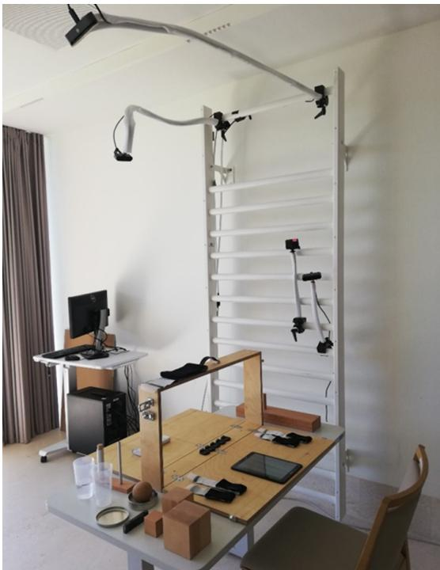  
Figure 6. ARAT 评估台周围的临时相机设置。

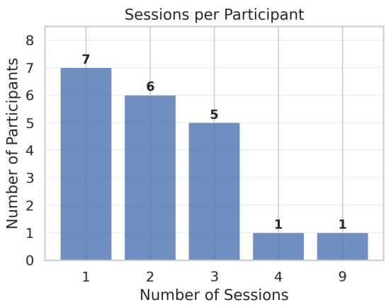  
Figure 7. 每位参与者的测试次数

Table 5. 所有七个任务组的人群描述性统计。上部：抓取与放置任务（抓握 [Grasp]、握持 [Grip]、捏取 [Pinch]）；下部：粗大动作与倒水任务（倒水 [Water Pouring]、手放脑后 [Hand Behind Head]、手放头顶 [Hand on Top of Head]、手送至嘴 [Hand to Mouth]）。原始运动学指标行以原始单位（度、m、m/s）显示跨试验的中位数；复合得分行显示在以 Q75 为锚点的 0–100% 尺度上的中位数及四分位距 $[ Q _ { 2 5 } , Q _ { 7 5 } ]$，其中 100% 对应于 3 分队列（Score 3 cohort）会话中各指标的第 75 百分位数，且数值在上限处不进行截断（即当表现超过正常表现阈值时，复合得分可能超过 100%）。反向代偿指标（躯干位移和肩外展）使用 Q25 作为 100% 锚点，从而使较高的归一化值始终指示更好的功能。  
抓取与放置任务

<table><tr><td rowspan="2">指标</td><td colspan="4">抓握</td><td colspan="4">握持</td><td colspan="4">捏取</td></tr><tr><td>S0(8)</td><td>S1(34)</td><td>S2(140)</td><td>S3(108)</td><td>S0(4)</td><td>S1(8)</td><td>S2(110)</td><td>S3(139)</td><td>S0(10)</td><td>S1(34)</td><td>S2(194)</td><td>S3(77)</td></tr><tr><td> $\max(\theta_{SF})[^{\circ}]$ </td><td>53.9</td><td>74.8</td><td>104.8</td><td>102.2</td><td>55.4</td><td>62.5</td><td>81.3</td><td>73.3</td><td>34.4</td><td>88.9</td><td>109.3</td><td>101.3</td></tr><tr><td> $\max(\theta_{EE})[^{\circ}]$ </td><td>97.4</td><td>115.7</td><td>152.9</td><td>160.4</td><td>100.9</td><td>111.9</td><td>139.2</td><td>144.6</td><td>99.7</td><td>117.9</td><td>153.4</td><td>152.8</td></tr><tr><td> $\max(\theta_{SA})[^{\circ}]$ </td><td>47.6</td><td>47.8</td><td>40.3</td><td>36.6</td><td>48.1</td><td>45.3</td><td>36.9</td><td>33.7</td><td>32.9</td><td>47.0</td><td>42.1</td><td>41.0</td></tr><tr><td> $ROM(\theta_{SF})[^{\circ}]$ </td><td>56.0</td><td>62.4</td><td>93.3</td><td>91.3</td><td>45.2</td><td>60.7</td><td>65.4</td><td>64.6</td><td>34.9</td><td>56.9</td><td>92.1</td><td>93.8</td></tr><tr><td> $ROM(\theta_{EE})[^{\circ}]$ </td><td>33.2</td><td>45.9</td><td>80.1</td><td>86.8</td><td>40.9</td><td>49.0</td><td>71.6</td><td>75.1</td><td>29.8</td><td>55.8</td><td>83.1</td><td>83.3</td></tr><tr><td> $ROM(\theta_{SA})[^{\circ}]$ </td><td>33.5</td><td>30.5</td><td>22.9</td><td>21.1</td><td>29.7</td><td>28.5</td><td>20.8</td><td>17.6</td><td>21.3</td><td>29.0</td><td>24.1</td><td>21.9</td></tr><tr><td> $\max(d_{Tr})[m]$ </td><td>0.131</td><td>0.062</td><td>0.063</td><td>0.055</td><td>0.137</td><td>0.163</td><td>0.063</td><td>0.054</td><td>0.096</td><td>0.114</td><td>0.062</td><td>0.048</td></tr><tr><td> $\max(v_{hand})[m/s]$ </td><td>0.569</td><td>0.635</td><td>1.05</td><td>1.29</td><td>0.388</td><td>0.596</td><td>0.652</td><td>0.836</td><td>0.362</td><td>0.733</td><td>0.969</td><td>1.18</td></tr><tr><td> $\max(\omega_{SF})[^{\circ}/s]$ </td><td>121.9</td><td>130.5</td><td>236.2</td><td>280.2</td><td>105.0</td><td>100.2</td><td>141.7</td><td>175.9</td><td>150.8</td><td>154.5</td><td>209.1</td><td>255.9</td></tr><tr><td> $\max(\omega_{EE})[^{\circ}/s]$ </td><td>73.9</td><td>91.8</td><td>222.0</td><td>324.8</td><td>65.8</td><td>84.0</td><td>170.8</td><td>223.6</td><td>55.4</td><td>108.8</td><td>220.7</td><td>288.2</td></tr><tr><td> $S_{ROM} [%]$ </td><td>34</td><td>50</td><td>89</td><td>92</td><td>32</td><td>45</td><td>86</td><td>85</td><td>24</td><td>59</td><td>92</td><td>93</td></tr><tr><td>IQR</td><td>[19, 48]</td><td>[27, 67]</td><td>[82, 97]</td><td>[87, 100]</td><td>[17, 47]</td><td>[39, 52]</td><td>[71, 100]</td><td>[75, 97]</td><td>[18, 69]</td><td>[30, 80]</td><td>[85, 100]</td><td>[85, 98]</td></tr><tr><td> $S_{Vel} [%]$ </td><td>24</td><td>32</td><td>62</td><td>81</td><td>25</td><td>38</td><td>55</td><td>74</td><td>26</td><td>40</td><td>66</td><td>84</td></tr><tr><td>IQR</td><td>[10, 43]</td><td>[13, 38]</td><td>[50, 84]</td><td>[68, 97]</td><td>[19, 33]</td><td>[21, 46]</td><td>[43, 70]</td><td>[60, 102]</td><td>[14, 39]</td><td>[25, 56]</td><td>[49, 87]</td><td>[63, 100]</td></tr><tr><td> $S_{Comp} [%]$ </td><td>63</td><td>64</td><td>81</td><td>87</td><td>52</td><td>52</td><td>80</td><td>89</td><td>84</td><td>63</td><td>81</td><td>85</td></tr><tr><td>IQR</td><td>[39, 71]</td><td>[53, 81]</td><td>[70, 91]</td><td>[78, 97]</td><td>[32, 63]</td><td>[40, 61]</td><td>[68, 92]</td><td>[79, 96]</td><td>[66, 96]</td><td>[53, 70]</td><td>[71, 90]</td><td>[74, 95]</td></tr><tr><td> $S_{overall} [%]$ </td><td>33</td><td>46</td><td>78</td><td>85</td><td>34</td><td>44</td><td>75</td><td>83</td><td>46</td><td>55</td><td>79</td><td>88</td></tr><tr><td>IQR</td><td>[32, 43]</td><td>[34, 56]</td><td>[72, 84]</td><td>[80, 94]</td><td>[30, 38]</td><td>[36, 48]</td><td>[67, 82]</td><td>[74, 94]</td><td>[40, 57]</td><td>[39, 63]</td><td>[74, 88]</td><td>[81, 95]</td></tr></table>

粗大动作与倾倒任务

<table><tr><td rowspan="2">指标</td><td colspan="4">Water</td><td colspan="4">HBH</td><td colspan="4">HOH</td><td colspan="4">HTM</td></tr><tr><td>S0(1)</td><td>S1(4)</td><td>S2(44)</td><td>S3(26)</td><td>S0(0)</td><td>S1(12)</td><td>S2(43)</td><td>S3(15)</td><td>S0(0)</td><td>S1(8)</td><td>S2(35)</td><td>S3(36)</td><td>S0(0)</td><td>S1(3)</td><td>S2(20)</td><td>S3(61)</td></tr><tr><td> $\max(\theta_{SF})$ [°]</td><td>-</td><td>45.3</td><td>64.1</td><td>67.7</td><td>-</td><td>78.6</td><td>125.6</td><td>126.4</td><td>-</td><td>99.9</td><td>118.3</td><td>129.5</td><td>-</td><td>75.9</td><td>51.6</td><td>50.9</td></tr><tr><td> $\max(\theta_{EE})$ [°]</td><td>-</td><td>105.1</td><td>93.8</td><td>97.4</td><td>-</td><td>135.8</td><td>132.0</td><td>117.6</td><td>-</td><td>148.6</td><td>134.3</td><td>129.7</td><td>-</td><td>131.5</td><td>143.1</td><td>137.3</td></tr><tr><td> $\max(\theta_{SA})$ [°]</td><td>-</td><td>32.2</td><td>34.0</td><td>30.7</td><td>-</td><td>48.9</td><td>46.9</td><td>46.3</td><td>-</td><td>55.8</td><td>46.2</td><td>45.7</td><td>-</td><td>41.7</td><td>21.5</td><td>18.2</td></tr><tr><td> $ROM(\theta_{SF})$ [°]</td><td>-</td><td>44.6</td><td>52.7</td><td>58.3</td><td>-</td><td>72.0</td><td>120.2</td><td>124.1</td><td>-</td><td>95.1</td><td>114.3</td><td>120.5</td><td>-</td><td>78.9</td><td>36.2</td><td>33.9</td></tr><tr><td> $ROM(\theta_{EE})$ [°]</td><td>-</td><td>30.9</td><td>18.8</td><td>16.1</td><td>-</td><td>101.4</td><td>92.8</td><td>83.8</td><td>-</td><td>91.0</td><td>84.0</td><td>75.0</td><td>-</td><td>95.7</td><td>102.9</td><td>94.3</td></tr><tr><td> $ROM(\theta_{SA})$ [°]</td><td>-</td><td>22.6</td><td>15.0</td><td>11.0</td><td>-</td><td>41.0</td><td>34.2</td><td>30.9</td><td>-</td><td>48.2</td><td>33.3</td><td>30.5</td><td>-</td><td>32.4</td><td>19.1</td><td>22.2</td></tr><tr><td> $\max(d_{Tr})$ [m]</td><td>-</td><td>0.060</td><td>0.044</td><td>0.049</td><td>-</td><td>0.050</td><td>0.030</td><td>0.028</td><td>-</td><td>0.044</td><td>0.028</td><td>0.026</td><td>-</td><td>0.046</td><td>0.024</td><td>0.017</td></tr><tr><td> $\max(v_{hand})$ [m/s]</td><td>-</td><td>0.609</td><td>0.463</td><td>0.591</td><td>-</td><td>1.06</td><td>1.93</td><td>2.45</td><td>-</td><td>1.20</td><td>1.81</td><td>2.45</td><td>-</td><td>1.06</td><td>1.15</td><td>1.69</td></tr><tr><td> $\max(\omega_{SF})$ [°/s]</td><td>-</td><td>117.7</td><td>99.9</td><td>126.0</td><td>-</td><td>212.4</td><td>365.6</td><td>459.7</td><td>-</td><td>211.6</td><td>334.0</td><td>398.4</td><td>-</td><td>135.8</td><td>94.7</td><td>142.6</td></tr><tr><td> $\max(\omega_{EE})$ [°/s]</td><td>-</td><td>134.2</td><td>47.4</td><td>58.7</td><td>-</td><td>210.8</td><td>285.5</td><td>286.5</td><td>-</td><td>170.2</td><td>217.1</td><td>305.0</td><td>-</td><td>197.2</td><td>229.7</td><td>314.5</td></tr><tr><td> $S_{ROM}$ [%]</td><td>-</td><td>86</td><td>74</td><td>80</td><td>-</td><td>89</td><td>103</td><td>84</td><td>-</td><td>73</td><td>85</td><td>77</td><td>-</td><td>135</td><td>85</td><td>76</td></tr><tr><td>IQR</td><td>-</td><td>[51, 119]</td><td>[59, 104]</td><td>[63, 91]</td><td>-</td><td>[42, 105]</td><td>[87, 118]</td><td>[77, 95]</td><td>-</td><td>[63, 102]</td><td>[69, 106]</td><td>[71, 93]</td><td>-</td><td>[131, 167]</td><td>[74, 99]</td><td>[65, 89]</td></tr><tr><td> $S_{Vel}$ [%]</td><td>-</td><td>125</td><td>53</td><td>85</td><td>-</td><td>37</td><td>73</td><td>81</td><td>-</td><td>36</td><td>58</td><td>81</td><td>-</td><td>41</td><td>46</td><td>78</td></tr><tr><td>IQR</td><td>-</td><td>[92, 135]</td><td>[42, 73]</td><td>[70, 98]</td><td>-</td><td>[27, 49]</td><td>[51, 87]</td><td>[77, 95]</td><td>-</td><td>[28, 46]</td><td>[31, 76]</td><td>[66, 93]</td><td>-</td><td>[39, 57]</td><td>[26, 77]</td><td>[62, 102]</td></tr><tr><td> $S_{Comp}$ [%]</td><td>-</td><td>77</td><td>87</td><td>94</td><td>-</td><td>76</td><td>97</td><td>97</td><td>-</td><td>60</td><td>83</td><td>87</td><td>-</td><td>53</td><td>86</td><td>90</td></tr><tr><td>IQR</td><td>-</td><td>[63, 85]</td><td>[71, 97]</td><td>[80, 100]</td><td>-</td><td>[63, 97]</td><td>[81, 105]</td><td>[91, 99]</td><td>-</td><td>[49, 64]</td><td>[71, 95]</td><td>[79, 98]</td><td>-</td><td>[27, 58]</td><td>[74, 95]</td><td>[85, 98]</td></tr><tr><td> $S_{overall}$ [%]</td><td>-</td><td>92</td><td>74</td><td>84</td><td>-</td><td>70</td><td>88</td><td>87</td><td>-</td><td>52</td><td>73</td><td>84</td><td>-</td><td>77</td><td>74</td><td>82</td></tr><tr><td>IQR</td><td>-</td><td>[73, 105]</td><td>[64, 84]</td><td>[76, 94]</td><td>-</td><td>[59, 74]</td><td>[83, 93]</td><td>[83, 95]</td><td>-</td><td>[49, 71]</td><td>[62, 84]</td><td>[74, 89]</td><td>-</td><td>[76, 84]</td><td>[61, 81]</td><td>[75, 89]</td></tr></table>

Table 6. 在所有六个分析组（Analysis Groups）中，每个患者在亚上限窗口（sub-ceiling window）内临床 ARAT 评分与运动学复合评分的变化向量之间的平均绝对偏差（MAD，在共享的以 Q75 为锚点的 0–100 % 尺度上，以百分点表示）。在该尺度上，100 % 对应于评分为 3 分的队列会话中各项指标的第 75 百分位数，且数值在上限处不进行截断；代偿（Compensation）领域在归一化过程中进行了反转（使用 Q25 代替 Q75 作为 100% 锚点），从而使较高的数值始终表示较少的代偿动作。较小的 MAD 表示运动学复合评分与临床轨迹之间的一致性更高；较大的 MAD 表示在幅度或方向上存在分歧。$S _ { \mathrm { o v e r a l l } } = \mathrm { o v e r a l l }$ 复合评分；SROM、S 、SComp = 领域复合评分。参考阈值：$1 5 \% =$ 最小临床重要差异（MCID）[4]，在同一以 Q75 为锚点的尺度上以百分点（pp）表示。会话数 n 是每个任务组的亚上限会话数。

<table><tr><td>任务</td><td>会话</td><td>n</td><td> $S_{overall}$ (% pts)</td><td> $S_{ROM}$ (% pts)</td><td> $S_{Vel}$ (% pts)</td><td> $S_{Comp}$ (% pts)</td></tr><tr><td colspan="7">P10 — 缺血性脑卒中 (ICD I63.1)，右侧（患侧）</td></tr><tr><td>抓握 (Grasp)</td><td>1-4</td><td>4</td><td>5.6</td><td>5.4</td><td>28.4</td><td>6.8</td></tr><tr><td>握持 (Grip)</td><td>1-4</td><td>4</td><td>18.2</td><td>10.2</td><td>27.0</td><td>26.6</td></tr><tr><td>捏取 (Pinch)</td><td>1-4</td><td>4</td><td>8.5</td><td>6.2</td><td>12.5</td><td>11.1</td></tr><tr><td>手放脑后 (Hand Behind Head)</td><td>1-4</td><td>4</td><td>17.4</td><td>44.0</td><td>24.3</td><td>38.6</td></tr><tr><td>手放头顶 (Hand on Top of Head)</td><td>1-3</td><td>3</td><td>18.1</td><td>24.5</td><td>20.6</td><td>9.1</td></tr><tr><td>手放至嘴边 (Hand to Mouth)</td><td>1-3</td><td>3</td><td>7.1</td><td>8.1</td><td>10.9</td><td>13.3</td></tr><tr><td colspan="7">P20 — 脑卒中（右半球），左侧（患侧）</td></tr><tr><td>抓握 (Grasp)</td><td>1-3</td><td>3</td><td>5.9</td><td>3.8</td><td>16.2</td><td>31.3</td></tr><tr><td>握持 (Grip)</td><td>1-3</td><td>3</td><td>6.3</td><td>3.9</td><td>2.1</td><td>14.4</td></tr><tr><td>捏取 (Pinch)</td><td>1-3</td><td>3</td><td>12.1</td><td>13.4</td><td>4.0</td><td>21.8</td></tr><tr><td>手放脑后 (Hand Behind Head)</td><td>1-3</td><td>3</td><td>13.6</td><td>12.3</td><td>39.2</td><td>1.4</td></tr><tr><td>手放头顶 (Hand on Top of Head)</td><td>1-3</td><td>3</td><td>8.0</td><td>17.7</td><td>17.9</td><td>12.8</td></tr><tr><td>手放至嘴边 (Hand to Mouth)</td><td>1-3</td><td>3</td><td>7.2</td><td>22.5</td><td>10.6</td><td>15.3</td></tr></table>

<table><tr><td>特征</td><td>值</td></tr><tr><td>年龄（岁），均值 ± 标准差</td><td>71.2±9.9</td></tr><tr><td>年龄范围（岁）</td><td>55–90</td></tr><tr><td>性别：男</td><td>15 (75%)</td></tr><tr><td>身高（cm），均值 ± 标准差</td><td>174.1±6.5</td></tr><tr><td>体重（kg），均值 ± 标准差</td><td>74.9±12.5</td></tr><tr><td>诊断：脑卒中</td><td>10 (50%)</td></tr><tr><td>诊断：帕金森病</td><td>6 (30%)</td></tr><tr><td>诊断：其他</td><td>4 (20%)</td></tr></table>

表 7. 受试者特征（N=20）。

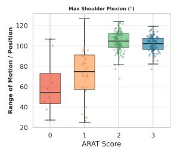

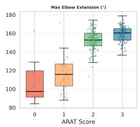

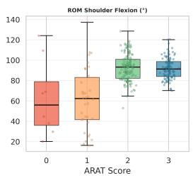

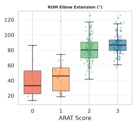

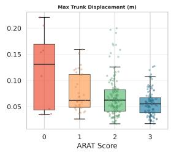

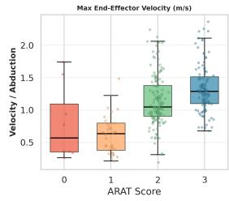

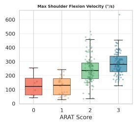

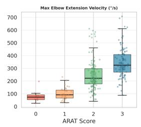

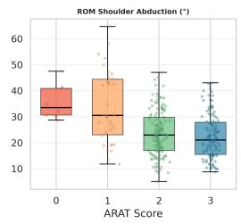

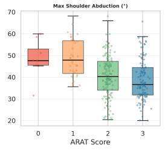

(a) 抓握  
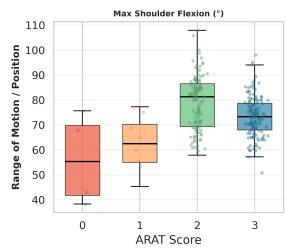

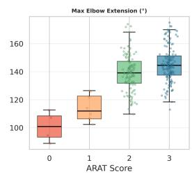

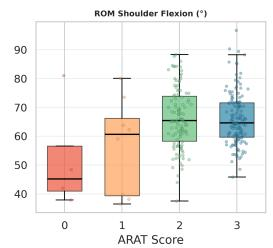

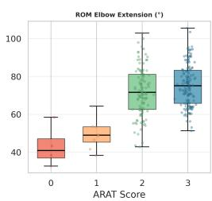

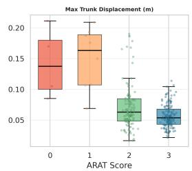

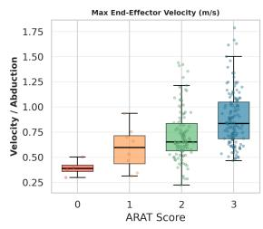

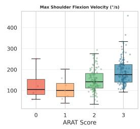

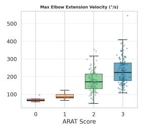

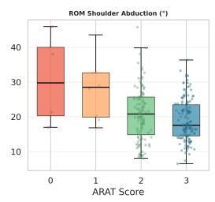  
(b) 握持

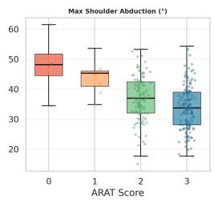

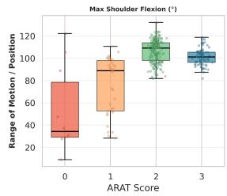

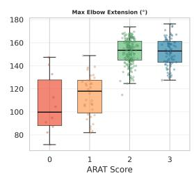

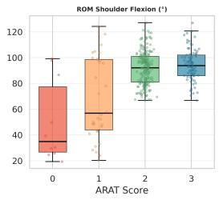

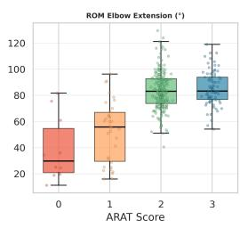

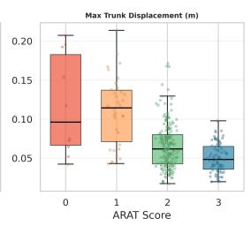

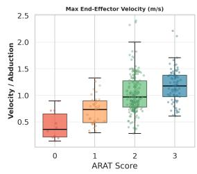

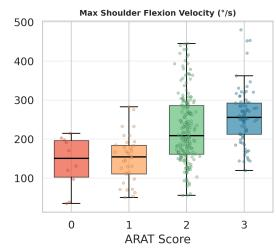

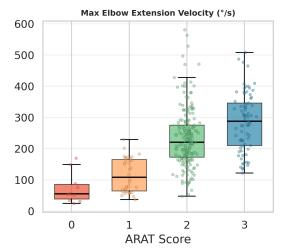  
(c) 捏取

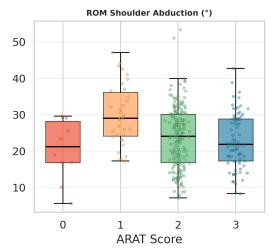

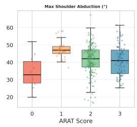  
Figure 8. 各分析组在抓放任务中运动学指标在临床 ARAT 评分（0–3）上的分布。单次试验显示为抖动散点。已剔除离群值（IQR × 3.0）。

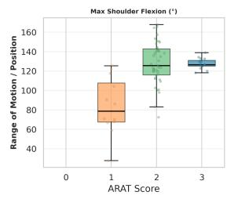

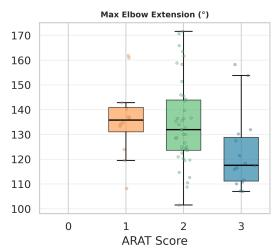

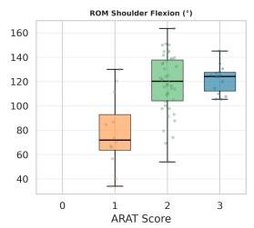

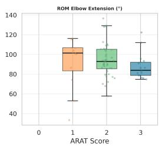

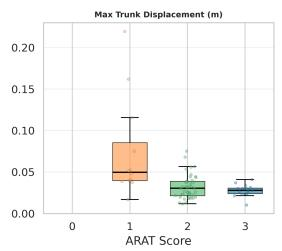

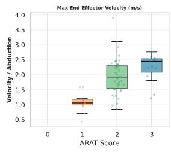

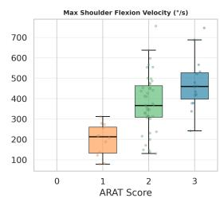

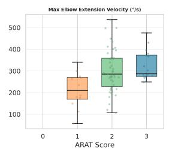

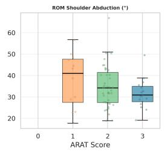

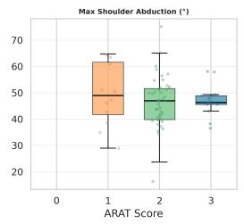

(a) 手放脑后  
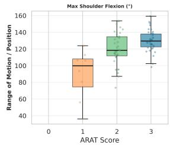

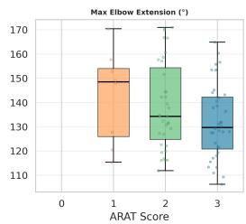

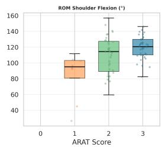

  
(b) 手放头顶

  
(c) 手送至口中

  
Figure 9. 各分析组粗大运动任务中运动学指标在临床 ARAT 评分（0–3）上的分布。单个试次显示为抖动散点。已剔除离群值（IQR × 3.0）。