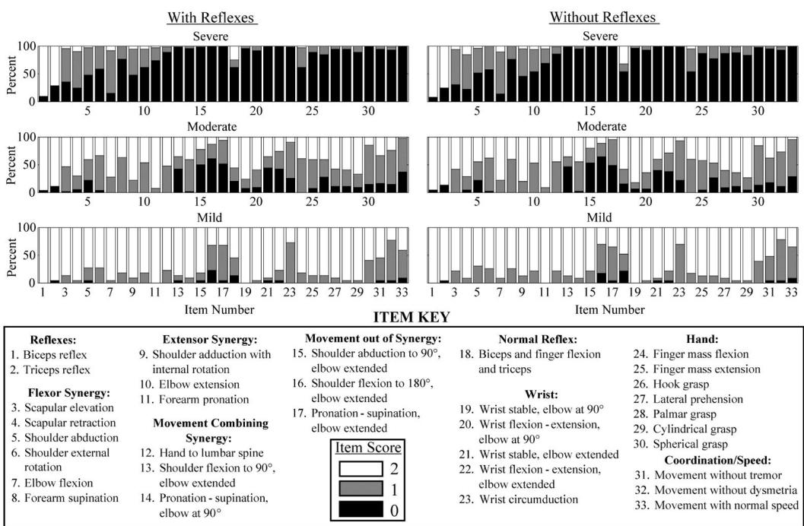
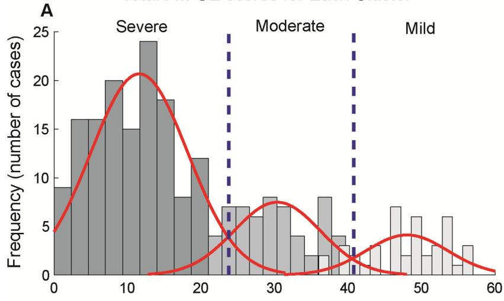
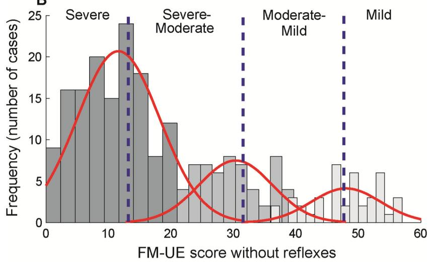
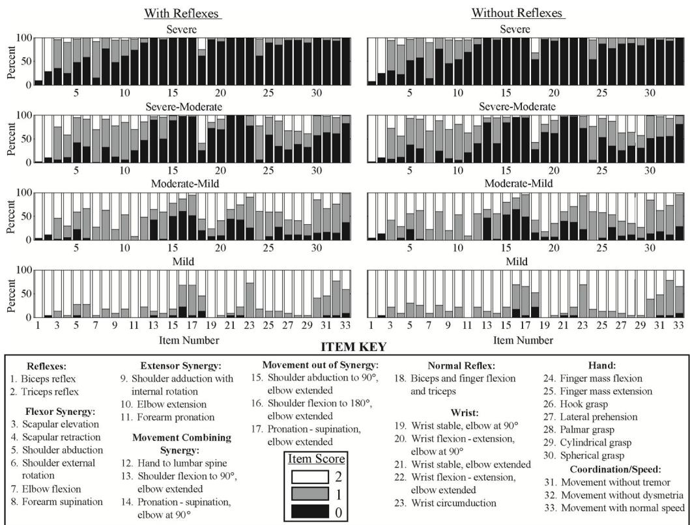

Published in final edited form as: . 2017 March ; 98(3): 456–462. doi:10.1016/j.apmr.2016.06.023.

# Determining Levels of Upper Extremity Movement Impairment by Applying Cluster Analysis to Upper Extremity Fugl-Meyer Assessment in Chronic Stroke

Elizabeth J Woytowicz, BS\*, Jeremy C Rietschel, PhD\*, Ronald N Goodman, PhD, Susan S. Conroy, DScPT, John D Sorkin, MD PhD, Jill Whitall, PhD, and Sandy McCombe Waller, PhD, PT, NCS

Departments of Physical Therapy & Rehabilitation Science (E.J.W., J.W., S.M.W.) and Medicine (J.D.S.), School of Medicine, University of Maryland at Baltimore. Maryland Exercise and Robotics Center of Excellence, Baltimore Veteran Affairs Medical Center (J.R., R.G., S.C. JW), Baltimore, Maryland, Faculty of Health Sciences, University of Southampton, UK (JW)

## Abstract

Objective—To quantitatively define levels of upper extremity movement impairment using cluster analysis of Fugl-Meyer upper extremity (FM-UE) with and without reflex items.

Design—Secondary analysis of FM-UE individual item scores compiled from baseline testing of 5 studies with consistent testing procedures.

Setting—University and VA research centers. Participants: Individuals (N=−247) with chronic stroke (>6 months post-stroke).

Interventions—Not applicable.

Main Outcome Measures—Cut-off scores defined by total FM-UE scores of clusters identified by two hierarchical cluster analyses run on full sample of FM-UE individual item scores (with/ without reflexes). Patterns of motor function defined by aggregate item scores of clusters.

Results—FM-UE scores ranged from 2–63 (mean=26.9±15.7) with reflex items and 0–57 (mean=22.1 ±15.3) without reflex items. Three clusters were identified. The distributions of the FM-UE scores revealed considerable overlap between the clusters, therefore four distinct stroke impairment levels were also derived.

Conclusions—For chronic stroke, the cluster analyses of the upper extremity FM support either a three or a four impairment level classification scheme.

## Keywords

Stroke; Rehabilitation; Upper Extremity; Cluster Analysis

Individuals with chronic stroke comprise a heterogeneous population with a wide range of upper extremity (UE) motor impairments. To facilitate planning treatment and evaluation of progress in a clinical, research, or community setting, stroke survivors require thorough assessment. While both research and clinical guidelines lack consensus of a primary outcome measure,2 the Fugl-Meyer Upper Extremity (FM-UE) Scale of Motor Impairment3 is the most commonly used assessment for measuring post-stroke impairment within the research context.4,5 The FM-UE score has been used as an inclusion criterion,6 as the basis for stratifying study subjects based on motor deficit severity,7 and as an outcome measure for clinical trials.8 To determine the optimal method to evaluate post-stroke impairment, recent studies have compared assessment tools, including the use of the FM-UE.9–11

The FM-UE has four subsections: (1) shoulder-arm, (2) wrist, (3) hand, and (4) coordination and speed designed to measure impairment from proximal to distal and synergistic to isolated voluntary movement.3,12,13 The four subsections are administered in ascending numerical order, an order which is believed to follow the sequence of recovery post stroke. The 33 items that constitute the FM-UE are scored on an ordinal scale of 0 (absent), 1 (partial impairment), and 2 (no impairment), resulting in a range of possible scores from zero to 66. Although the FM-UE is commonly used to measure recovery, the conceptual framework of recovery used to construct the FM-UE has been challenged.14 Additionally, the inclusion of the bicep, triceps and wrist reflex items in the score has been questioned.15

Comparisons of the FM-UE to other common UE clinical assessments such as the Wolf Motor Function Test and the Motor Assessment Scale have included discussions of the FM-UE’s utility for the assessment and stratification of UE impairments.10,11,16 For example, to avoid ceiling effects common to the FM-UE, it has been suggested that the test should be used for measuring baseline and changes in impairment only among patients with lower motor function.10,11,17 Furthermore, the utility of the FM-UE used alone to assess function has been questioned. Thompson-Butel and colleagues hold that a single instrument is not able to distinguish levels of post stroke impairment.10 A limitation of the analysis of Thompson-Butel et al. is that they used the FM-UE total score and did not perform an analysis of the 33-individual items that constitute the FM-UE.

We believe the ratings of the individual FM-UE elements convey information that is lost when one only considers the FM-UE total score. We are aware of only one study, conducted by Woodbury and colleagues, that defines cut-off scores using quantitative analysis of individual items of the FM-UE.16 In addition, prior to defining cut-off scores to define impairments levels, Woodbury and colleagues applied Principal Components Analysis to data obtained from a subacute stroke population with primarily mild-moderate impairments.15 They observed that all the items loaded highly on the first principal component except the three reflex items. Based on this solution they recommended that three reflex-items be excluded from future assessments. We expand on the studies of Woodbury et al15,16 by using a cluster analysis of the individual elements of the FM-UE to identify groups of subjects with chronic stroke who share a common level of deficit severity and a common residual motor pattern. Further, we derive the cut-off scores that identify distinct residual impairment levels and test to see if including the reflex scores adds to the discrimination between levels. The primary aims of our study were to use FM-UE individual items scores to (1) derive data-driven cut-off scores defining distinct levels of upper extremity movement impairment, (2) determine the commonalities and differences of residual motor patterns within and between the severity levels, and (3) determine if including vs. excluding reflexes in the FM score affects how these severity levels are characterized numerically and qualitatively.

## Methods

The data used in this report come from the baseline evaluation obtained during the course of five funded intervention studies for chronic stroke (see related papers18–22) conducted between 2000 and 2012 at University of Maryland School of Medicine and the Baltimore Veterans Affairs Medicine Center. All five studies used identical methodology for the collection of FM-UE data. A single physical therapist trained all four staff in the administration of the FM-UE. To insure inter-tester reliability each tester then scored two videotaped FM-UE assessments of individuals with stroke and achieved 100% agreement with the original test score prior to testing study participants. If a subject participated in more than one study, the data recorded from the earliest study were included in these analyses. University of Maryland Institutional Review Board approved all research procedures.

## Statistical Methods

We performed two hierarchical cluster analyses (IBM SPSS Statistics Version 20). The first analysis included all 33 FM-UE items; the second analysis excluded the three reflex items. In the analyses, the 33 or 30 FM-UE items were the independent (predictor) variables. The squared Euclidian distance was used as the distance metric and an average groups-linkage method was employed.24 The optimal number of clusters was determined by selecting the largest, most discrete change in squared Euclidian distance between the adjacent number of clusters (e.g. change in distance between 4 as compared to 3 clusters). A one-way ANOVA, with post-hoc comparisons conducted using Tukey’s HSD, was used to determine if clusters had significantly different mean FM-UE total scores.

FM-UE cut-off scores defining the optimal clusters were identified as follows. The subjects were ranked based on their total score and cluster membership was sequentially examined. Starting with the highest score, the FM-UE score (high-score) of the subject with the first instance of a change in cluster membership was identified (e.g. all previous subjects belonged to cluster 1 and then the score of the first subject in cluster 2 was observed). From this subject forward, we identified the FM-UE score (low-score) of the subject at which there was no longer any mixing between the previous and current cluster assignment (e.g. proceeding down the list all subjects were in cluster 2, none were in cluster 1). The cut-off score was defined as the mean of the high-score and low-score. This process was repeated to determine the cut-point between each adjacent cluster, thereby defining groups of subjects with similar severity of motor deficit.

The motor impairment characteristics within each group were defined by the pattern of the aggregate scores of the 33 (or 30 items) FM-UE items for the subjects included in the group. Within each group, the percentage of 0, 1, or 2 scores of each FM-UE item was calculated based on the frequency of scores for the item attained by the subjects assigned to the group. Patterns of motor impairment were characterized based on the aggregate score distribution of each individual item within a given impairment level. The aggregate scores produced by each analysis including and excluding the three reflex items were compared.

## Results

## Participants

We studied 247 individuals with chronic (>6 months post-stroke) upper extremity hemiparesis (113 women, 134 men; 134 left, 113 right hemiparesis). The subject’s mean age was 58.6±11.8 yrs., range 32–89. The subject’s mean FM-UE score computed using 33- items (including reflexes) was $2 6 . 9 { \pm } 1 5 . 7 $ and $2 2 . 1 { \pm } 1 5 . 3 $ with 30 items (without reflex).

## Cluster Analysis and Range of FM-UE scores within each cluster

Both the analysis with, and the analysis without reflexes, identified three clusters (Table 1; Fig. 1). After selecting cut-off values using the method of mean overlap score described above, the range of scores for the 3 clusters obtained using the three reflex items were 0–28, 29–42, and 43–66. For the analysis without reflexes the range of scores were similar 0–27, 28–41, and 42–60. The FM-UE scores within the three clusters correspond to severe , and  impairment levels.

Although analyses with and without reflexes resulted in clusters whose mean FM-UE total scores were significantly different one from the other (p<0.001), there was overlap in the FM-UE total scores between the clusters (Figure 1). There were 56 subjects, or 28 % (51 without reflexes 25%) whose FM-UE scores were shared between clusters one and two (severe and moderate) and 26 or 27% (30 without reflexes 30%) sharing scores between clusters two and three (moderate and mild). Because of the large degree of overlap (33% of all participants), we undertook an additional exercise to identify non-overlapping total FM cut-off scores that might be more clinically relevant. This was accomplished by dividing the three defined groups based on the original cluster analysis into four groups with cut-offs identified using the mean and ±3 standard deviations of the moderate cluster’s FM scores (see Figure 1). This method was chosen to identify four clusters based on the rationale that a) all overlap occurred at either end of the moderate cluster; b) three standard deviations from the mean of the moderate cluster included 99.5% of the distribution; c) cases observed outside more than three standard deviations are most likely to be outliers; and d) this method resulted in no overlap of the total scores between the four sets of individuals. For the analysis with reflexes, groups were: 0–15, 16–34, 35–53, and 54–66 FM score ranges. For the analysis without reflexes, groups were: 0–12, 13–30, 31–47, and 48–60. These groups can be described respectively as Severe, Severe-Moderate, Moderate-Mild and Mild.

## Motor patterns

We present a description of the motor patterns for the four-group analysis since (unlike the three group) this provides distinct patterns of residual function reached in the chronic stage. In Figure 2 each group is displayed using a series of histograms, which illustrated the pattern of response across each of the items. Of note, the bicep and elbow reflex items were not different between impairment levels (i.e. a score of 2 was observed for all levels), which indicated the majority of individuals in all impairment levels had intact reflexes. Regardless of whether reflexes were, or were not, included in the analysis, the motor patterns characterizing the four levels of impairment were as follows:

Severe—Individuals characterized as severe had profound impairment with no hand, wrist, or multi-joint movements and had limited to no movement from single joint extensor and flexor muscle synergies.

Severe-Moderate—Individuals characterized as severe-moderate had marked impairment with no movement out of synergy and limited movement from single joint extensor and flexor synergies, hand, wrist, or multi-joint movements.

Moderate-Mild—Individuals characterized as moderate-mild had moderate impairment with limited movements out of synergy and partial impairment of single joint extensor and flexor synergies, hand, wrist, and multi-joint movements.

Mild—Individuals characterized as mild had minimal impairment and were able to perform movements out of synergy with full movement of the arm.

## Principal Component Analysis

Although not our primary analysis, we performed a principal component analysis modeled after Woodbury & colleagues15 and observed highly comparable results. That is, all the items loaded highly on the first principal component with the exception of the three reflex items.

## Discussion

In a large sample of long-term stroke survivors, we used a hierarchical cluster analysis of individual FM-UE scores and derived first a three-group classification of total FM score cutoff points with large overlap and subsequently, a four-group classification system with no overlap of individuals. The significant overlap of the three-group total FM-UE scores is likely a result of the heterogeneity in which stroke patients present. Common, residual motor patterns were observed within the four-group system, that were more diffuse when using the three-group analysis. The analyses with and without reflexes revealed comparable motor impairment presentation for the majority of the FM-UE items and reflex item scores were not different between impairment levels.

## Division of impairment levels using cut-points

The benefit of using a cluster analysis to define impairment levels of the FM-UE assessment is that the cut-points are derived from an objective quantitative method. While a few studies have tried to define distinct FM-UE groups, the cut-off scores separating groups have been determined using subjective methods resulting in inconsistencies in classification that may not reflect functionally discrete groups. We, for example, previously19 subjectively categorized patients as severely impaired with a FM-UE total score less than 25, and moderate impairment between 26–50. Boissy and colleagues7 similarly subjectively divided stroke survivors into two FM-UE groups, with severe deficit defined by <44 and moderatenormal defined by scores > 44. Unfortunately, it is not plausible to compare our cut-points with Woodbury and colleagues16 because they used a different method of classification (item response theory $( \mathrm { I R T } ) ^ { 2 5 } )$ on a different population (sub-acute biased to moderate or mild impairments). However, it is interesting to note that their cut-point, based on their analysis without reflexes, separating mild from moderate (47±2) is more similar to our cut-point (47– 48) separating mild from moderate-mild based on our four group analysis than it is from our own three group analysis (41–42). Conversely, their cut-point for separating moderate from severe (19±2) is not near the cut-point for either our four-group system (12–13) or our threegroup system (27–28).

The fact that our population was biased to moderate to severely impaired individuals may have contributed to the differences with Woodbury16 as well as the stroke chronicity and methods employed. Deriving these cut-points at the chronic stage is an advantage in that it controls for the possibility that spontaneous recovery, observed during the first 6 months following stroke,26 would confound the identification of impairment levels. In addition, although commonly utilized,25 the IRT method employed by Woodbury and colleagues, was developed to assess the validity of test items in healthy populations and there are many remaining challenges for applying IRT methods to test clinical assessments.27 IRT may be constrained in its ability to determine cut points in a heterogeneous population such as individuals with stroke, due to the fact that the order of item difficulty is fixed across all individuals.27 Whereas, hierarchal cluster analysis may be a more appropriate quantitative method for deriving cut-points as it does not have this constraint.25 Instead, the identified impairment-level groups exhibit their own unique pattern of item difficulty.

## Residual motor patterns reveal common but not unique characteristics

Review of the individual item scores revealed common motor patterns within each severity level for our 4- and 3-group analyses (Figure 2; appendix). As expected there was an increase in individual item scores moving from the severe to the mild motor impairment group, indicating a progression from less to more residual motor function. Treatment options for these four groups would also follow a progression. In the severe group with little to no movement, treatment focus would be on general activation of the proximal muscles possibly leading to some stabilizing tasks of the paretic arm during bilateral tasks. In the severemoderate group with limited movement but not out of synergy, treatment focus would be on encouraging unilateral gross motor function of the paretic arm and stabilizing tasks of the paretic arm during bilateral tasks. In the moderate-mild group with more movement but only a few out of synergy, treatment would include a wider range of tasks including anti-gravity

unilateral and bilateral tasks and possibly consideration of the pre-morbid function of the paretic arm. The mild group could focus on recovery of manipulatory skills with the affected arm and work towards full range of motion in each plane.

However, while it is possible to describe general common characteristics of each group (see results), close inspection of the diagrams reveals several items that have a mixture of individuals with present, partial and absent scores in each of the impairment levels (as well as across the impairment levels). This kind of variability as well as the existence of the large overlap of group participants when we use the three-group classification, illustrates the complexity of classifying levels of stroke function/recovery. It suggests that there is not a linear progression of recovery as originally conceived in the construction of the Fugl-Meyer. The FM-UE measures motor recovery in terms of impairments but this does not accurately describe a patient’s actual ability to accomplish a task.28 Indeed, studies of stroke recovery have demonstrated multiple patterns of motor recovery that need not follow a fixed proximal to distal progression.29,30 Compensatory movements involving abnormal synergies can provide an alternative, functional, form of recovery.28 Thus it is not surprising that the total FM-UE score does not always predict functional recovery.

## Exclusion of reflex items is warranted

It has been suggested that the reflex components of the FM-UE score measure a different level of behavior than the voluntary movement items, and can be unreliable (i.e. not repeatable),31 confounding the interpretation of impairment.14,15 A comparison of our analyses with and without the reflex items suggests that the reflexes make, at most, almost no contribution to the division of subjects into either three or four levels of residual motor function. The item scores for biceps and triceps did not differ between severity groups. Normal reflex activity only distinguished two groups, severe and moderate vs. mild. Perhaps more importantly, the FM-UE total scores defining our three or four groups differed very little in the analyses that include vs. exclude the three reflex items. Taken together, our findings lend support to Woodbury’s suggestion that these FM-UE items can be excluded from the FM-UE evaluation.

## Future Directions

Due to the heterogeneous characteristics of the stroke population, motor impairment as defined by the FM-UE does not appear to account for all of the variability between patients. The present study was limited to the analysis of the upper extremity section and largely, but not exclusively, patients with a total FM-UE below which about 75% of our patients reside. Further analyses including a greater proportion of higher extremity FM scores may depict a more accurate description of severity levels. Also, while studies have used the FM to better describe patient populations, by itself this measure of motor impairment does not describe function. A potentially fruitful future direction would be to include data from variables representative of motor function such as from the Wolf Motor Function Test,17 in a more comprehensive cluster analysis. By including additional variables to account for this high variability it may be possible to better define groups of stroke patients based on common patterns found within the resulting clusters.

## Study Limitations

The main limitations of our study are that the population is biased towards the moderate to severe end of the FM-UE scores and also the fact that it only includes participants with chronic stroke. However, the FM-UE scores of the patient cohort included in our analysis did range from 2–60. Further, it is possible that a sub-acute population, even using the same quantitative approach as here, would result in different classification cut-points, as all individuals may not yet express the residual motor patterns.

## Conclusions

In conclusion, this analysis of the FM-UE assessment tool revealed two sets of classification schemes (severe, moderate and mild; and severe, severe-moderate, moderate–mild, and mild). While the three-group version was based on the original cluster analysis, the fourgroup version is the one we believe is more accurate for classification-purposes based on the reduction of overlap and the more distinctive motor patterns. However, either version could be used and, to our knowledge, these are the first quantitatively derived classification cutpoints for the chronic population. We also found that reflex items make no difference to the overall scores of the test, supporting previous recommendations for the exclusion of these items.

## Acknowledgments

Sources of Funding: NIH P60 AG12583 PI: Andrew Goldberg; National Institute on Disability and Rehabilitation Research IDS 2 (Whitall); H133G010111 PI: Jill Whitall; NIH R21 HD047756 PI: Jill Whitall; NIH P30 AG028747 PI: Andrew Goldberg CDP (McCombe Waller); NIH R21 HD052125 PI: Sandy McCombe-Waller; Department of Veterans Affairs Merit Award # B6935R PI: Christopher Bever; Baltimore VA Geriatrics Research, Education, and Clinical Center (GRECC).

We thank the individuals who participated in the various studies from which these data were obtained. We also thank Dr. Bever for contributing data from his grant.

## List of Abbreviations

UE Upper Extremity

FM-UE Fugl-Meyer Upper Extremity

## References

1. Woytowicz, EJ., Rietschel, J., Goodman, RN., Whitall, J., McCombe Waller, S. Cluster analysis of upper extremity Fugl-Meyer Assessment defines levels of motor impairment severity. Combined Sections Meeting Neurology Section Poster Presentations; San Diego, CA. 2013.

2. Ali M, English C, Bernhardt J, Sunnerhagen KS, Brady M. More outcomes than trials: a call for consistent data collection across stroke rehabilitation trials. Int J Stroke. 2013; 8(1):18–24. [PubMed: 23280265]

3. Fugl-Meyer AR, Jääskö L, Leyman I, Olsson S, Steglind S. The post-stroke hemiplegic patient. 1. a method for evaluation of physical performance. Scand J Rehabil Med. 1975; 7(1):13–31. [PubMed: 1135616]

4. van Wijck FMJ, Pandyan AD, Johnson GR, Barnes MP. Assessing Motor Deficits in Neurological Rehabilitation: Patterns of Instrument Usage. Neurorehabil Neural Repair. 2001; 15(1):23–30. [PubMed: 11527276]

5. Velstra I-M, Ballert CS, Cieza A. A systematic literature review of outcome measures for upper extremity function using the international classification of functioning, disability, and health as reference. PM R. 2011; 3(9):846–860. [PubMed: 21944302]

6. Gladstone DJ, Danells CJ, Armesto A, et al. Physiotherapy coupled with dextroamphetamine for rehabilitation after hemiparetic stroke: a randomized, double-blind, placebo-controlled trial. Stroke. 2006; 37(1):179–185. [PubMed: 16322487]

7. Boissy P, Bourbonnais D, Kaegi C, Gravel D, Arsenault BA. Characterization of global synkineses during hand grip in hemiparetic patients. Arch Phys Med Rehabil. 1997; 78(10):1117–1124. [PubMed: 9339163]

8. Michaelsen SM, Dannenbaum R, Levin MF. Task-specific training with trunk restraint on arm recovery in stroke: randomized control trial. Stroke. 2006; 37(1):186–192. [PubMed: 16339469]

9. Van Der Lee JH, Beckerman H, Lankhorst GJ, Bouter LM. The responsiveness of the Action Research Arm test and the Fugl-Meyer Assessment scale in chronic stroke patients. J Rehabil Med. 2001; 33(3):110–113. [PubMed: 11482350]

10. Thompson-Butel AG, Lin GG, Shiner CT, McNulty PA. Two common tests of dexterity can stratify upper limb motor function after stroke. Neurorehabil Neural Repair. 2014; 28(8):788–796. [PubMed: 24627336]

11. Thompson-Butel AG, Lin G, Shiner CT, McNulty PA. Comparison of three tools to measure improvements in upper-limb function with poststroke therapy. Neurorehabil Neural Repair. 2015; 29(4):341–348. [PubMed: 25209302]

12. Twitchell TE. The restoration of motor function following hemiplegia in man. Brain. 1951; 74(4): 443–480. [PubMed: 14895765]

13. Brunnstrom S. Motor testing procedures in hemiplegia: based on sequential recovery stages. Phys Ther. 1966; 46(4):357–375. [PubMed: 5907254]

14. Gladstone DJ, Danells CJ, Black SE. The Fugl-Meyer Assessment of Motor Recovery after Stroke: A Critical Review of Its Measurement Properties. Neurorehabil Neural Repair. 2002; 16(3):232– 240. [PubMed: 12234086]

15. Woodbury ML, Velozo CA, Richards LG, Duncan PW, Studenski S, Lai S-M. Dimensionality and construct validity of the Fugl-Meyer Assessment of the upper extremity. Arch Phys Med Rehabil. 2007; 88(6):715–723. [PubMed: 17532892]

16. Woodbury ML, Velozo CA, Richards LG, Duncan PW. Rasch analysis staging methodology to classify upper extremity movement impairment after stroke. Arch Phys Med Rehabil. 2013; 94(8): 1527–1533. [PubMed: 23529144]

17. Morris DM, Uswatte G, Crago JE, Cook EW, Taub E. The reliability of the wolf motor function test for assessing upper extremity function after stroke. Arch Phys Med Rehabil. 2001; 82(6):750– 755. [PubMed: 11387578]

18. Whitall J, Waller SM, Silver KHC, Macko RF. Repetitive Bilateral Arm Training With Rhythmic Auditory Cueing Improves Motor Function in Chronic Hemiparetic Stroke. Stroke. 2000; 31(10): 2390–2395. [PubMed: 11022069]

19. Luft AR, McCombe-Waller S, Whitall J, et al. Repetitive bilateral arm training and motor cortex activation in chronic stroke: a randomized controlled trial. JAMA. 2004; 292(15):1853–1861. [PubMed: 15494583]

20. Conroy SS, Whitall J, Dipietro L, et al. Effect of gravity on robot-assisted motor training after chronic stroke: a randomized trial. Arch Phys Med Rehabil. 2011; 92(11):1754–1761. [PubMed: 21849168]

21. Whitall J, Waller SM, Sorkin JD, et al. Bilateral and unilateral arm training improve motor function through differing neuroplastic mechanisms: a single-blinded randomized controlled trial. Neurorehabil Neural Repair. 2011; 25(2):118–129. [PubMed: 20930212]

22. McCombe Waller S, Whitall J, Jenkins T, et al. Sequencing bilateral and unilateral task-oriented training versus task oriented training alone to improve arm function in individuals with chronic stroke. BMC Neurol. 2014; 14(1):236. [PubMed: 25494635]

23. McCombe Waller S, Liu W, Whitall J. Temporal and spatial control following bilateral versus unilateral training. Hum Mov Sci. 2008; 27(5):749–758. [PubMed: 18639360]

24. Kaufman, L., Rousseeuw, PJ. Finding Groups in Data: An Introduction to Cluster Analysis. John Wiley & Sons; 2009.

25. Tao W, Haley SM, Coster WJ, Ni P, Jette AM. An exploratory analysis of functional staging using an item response theory approach. Arch Phys Med Rehabil. 2008; 89(6):1046–1053. [PubMed: 18503798]

26. Duncan PW, Lai SM, Keighley J. Defining post-stroke recovery: implications for design and interpretation of drug trials. Neuropharmacology. 2000; 39(5):835–841. [PubMed: 10699448]

27. Fayers PM. Applying item response theory and computer adaptive testing: the challenges for health outcomes assessment. Qual Life Res. 2007; 16(Suppl 1)(SUPPL 1):187–194. [PubMed: 17417722]

28. Levin MF, Kleim JA, Wolf SL. What do motor “recovery” and “compensation” mean in patients following stroke? Neurorehabil Neural Repair. 2009; 23(4):313–319. [PubMed: 19118128]

29. Welmer A-K, Holmqvist LW, Sommerfeld DK. Hemiplegic limb synergies in stroke patients. Am J Phys Med Rehabil. 2006; 85(2):112–119. [PubMed: 16428901]

30. Beebe JA, Lang CE. Absence of a proximal to distal gradient of motor deficits in the upper extremity early after stroke. Clin Neurophysiol. 2008; 119(9):2074–2085. [PubMed: 18571981]

31. Manschot S, van Passel L, Buskens E, Algra A, van Gijn J. Mayo and NINDS scales for assessment of tendon reflexes: between observer agreement and implications for communication. J Neurol Neurosurg Psychiatry. 1998; 64(2):253–255. [PubMed: 9489542]

## Appendix

  
Figure 3. Individual Item Scores of 3-Group Impairment Levels

Percentage of FM-UE scores of all individuals in each impairment level are displayed for each item as black, grey, and white for scores of 0, 1, and 2, respectively. Numbers 1–33 along the horizontal axis of each histogram correspond to each individual item of the assessment detailed in the item key at the bottom of the figure. Although the cluster analysis did not include the reflex items, the reflex item scores were included in the figure to describe the patients included in these groups based on all of their individual item scores

Total FM-UE scores for Each Cluster  

B  
  
Figure 1. Cluster FM-UE Distributions

Cluster 1, 2, and 3 are indicated from dark to light respectively. Red lines correspond to the normal distribution of each cluster. Vertical blue lines represent the FM-UE cut scores of the subsequently identified 3-group (A) and 4-group (B) division of impairment levels. As the characteristics of the distributions of the 3 clusters were used to determine the new cut points displayed in Figure 1.B, the original distributions of the 3 clusters were retained in Figure 1.B. in order to graphically depict this relationship between the clusters and new cut points.

  
Figure 2. Individual Item Scores of 4-Group Impairment Levels

Percentage of FM-UE scores of all individuals in each impairment level are displayed for each item as black, grey, and white for scores of 0, 1, and 2, respectively. Numbers 1–33 along the horizontal axis of each histogram correspond to each individual item of the assessment detailed in the item key at the bottom of the figure. Although the cluster analysis did not include the reflex items, the reflex item scores were included in the figure to describe the patients included in these groups based on all of their individual item scores

Table 1  
Characteristics of the clusters and the subsequently defined three groups

<table><tr><td>Analysis</td><td colspan="3">With Reflexes</td><td colspan="3">Without Reflexes</td></tr><tr><td>Cluster</td><td>1</td><td>2</td><td>3</td><td>1</td><td>2</td><td>3</td></tr><tr><td>Level of Impairment</td><td>Severe</td><td>Moderate</td><td>Mild</td><td>Severe</td><td>Moderate</td><td>Mild</td></tr><tr><td>Number of Subjects</td><td>151</td><td>49</td><td>47</td><td>147</td><td>59</td><td>41</td></tr><tr><td>Mean FM-UE (±SD)</td><td> $17 \pm 7.7$ </td><td> $35 \pm 6.4$ </td><td> $52 \pm 6.9$ </td><td> $12 \pm 7.2$ </td><td> $30 \pm 6.0$ </td><td> $48 \pm 5.9$ </td></tr><tr><td>Range FM-UE</td><td>2–36</td><td>22–47</td><td>38–63</td><td>0–35</td><td>21–49</td><td>36–57</td></tr><tr><td>Defined FM-UE Cut-off</td><td>0–28</td><td>29–42</td><td>43–66</td><td>0–27</td><td>28–41</td><td>42–60</td></tr><tr><td>Group Number of Subjects</td><td>148</td><td>52</td><td>47</td><td>165</td><td>47</td><td>35</td></tr><tr><td>Group FM-UE (±SD)</td><td> $16 \pm 6.8$ </td><td> $35 \pm 4.2$ </td><td> $52 \pm 6.0$ </td><td> $13 \pm 7.1$ </td><td> $34 \pm 3.9$ </td><td> $50 \pm 3.9$ </td></tr></table>