# 执行需要旋前与旋后的任务时受限的前臂运动由胸肱关节运动学进行代偿

Barry P. Pereira,1 Ashvin Thambyah,1,2 and Taeyong Lee1 1National University of Singapore（新加坡国立大学）; 2University of Auckland（奥克兰大学）

本研究探讨了在执行五项需要旋前和旋后的活动时，当前臂旋转受限时改变的胸肱关节运动学。在六名健康受试者身上，通过两种夹板分别模拟固定旋后位或固定中立位前臂；分析了前臂、肘关节和肩关节运动之间的三维耦合关系。在使用螺丝刀时，前臂旋转的正常活动范围为 $7 7 . 6 ^ { \circ } \ : ( S D = 3 0 . 8 ^ { \circ } )$，在固定旋后位下减少至 $1 1 . 3 ^ { \circ } \ : ( S D = 2 . 9 ^ { \circ } )$，在固定中立位下减少至 18.2° (SD = 6.2°)。这种来自固定旋后和固定中立前臂的限制在肩关节处得到了代偿，表现为以下总范围的显著增加：(1) 内收/外展分别增加 57.3° 和 62.8° (p $< . 0 0 1 )$，(2) 前屈-后伸分别增加 24.3° 和 18.2° (p < .05)，以及 (3) 内旋-外旋分别增加 37.1° 和 44.2° (p < .001)。转门把手活动中也展现出类似的结果。肘关节对前臂旋转没有显著贡献 (p = .14)，这被认为是由于肘关节轴线与前臂轴线正交且倾斜所致。对于开链活动，在固定旋后位前臂执行打电话和进食任务时，内收/外展 $( p < . 0 5 )$ 与内/外旋 $( p < . 0 5 )$ 均出现显著的耦合增加，且打电话任务的肩关节前屈也显著增加 $( p < . 0 5 )$。对于固定中立位前臂，仅在进食任务中观察到显著的代偿运动，表现为肩关节内收/外展和内旋-外旋增加 $( p < . 0 5 )$；在插卡任务中表现为肩关节内收/外展和前屈-后伸增加。前臂功能受限需要来自相邻关节的代偿运动来完成需要旋前和旋后的活动。本研究对旋前旋后受限的前臂中肩关节周围的代偿机制进行了量化。

关键词：日常生活活动, 代偿机制, 前臂生物力学, 前臂旋转受限, 肩关节运动学

由创伤、感染或病理引起的前臂疾患会导致功能障碍并影响整个上肢的协调性，通常会限制关节活动度（range of motion）（Anglin & Wyss, 2000; Boone & Azen, 1979; Graham et al., 1998; Grood & Suntay, 1983; Kapandji, 2001）。构建单骨前臂或前臂关节融合术的手术操作也会牺牲前臂的旋转功能，而固定在旋后位或中立位的夹板则确实会制动骨折的前臂。活动受限的前臂会通过上肢相邻关节运动学的增加来进行代偿（Carey et al., 2008; Morrey et al., 1981; Kapandji, 2001）。这是因为从胸廓延伸至掌骨的上肢关节间协调系统，允许上肢在执行任务时提供多个自由度（Crisco et al., 2007; Ishikawa et al., 2005; Van Andel et al., 2008）。多项研究强调了在上肢受限时来自相邻关节的代偿性运动学改变。在累及桡骨远端和下尺桡关节的骨折中，患者通常会出现创伤后前臂活动受限，并且被观察到利用代偿性运动学来执行各种日常生活活动（activities of daily living）（Cooney et al., 1980; Linscheid, 1992）。这在一项针对前臂旋转受损的偏瘫型脑瘫患者的研究中也得到了证实，患者会采用代偿性的躯干和肩部运动（Kreulen et al., 2007）。在一项关于尺桡骨融合症的病例综述中，提到了当使用肩部来完成需要旋前和旋后的活动时会导致肢体疲劳（Kasten et al., 2009）。他们告诫称，代偿前臂旋转可能会使肩部容易出现劳损过度（overuse），而这可能会造成更严重的致残。然而，目前关于肩关节活动度与前臂旋转之间代偿关系的提示性或量化数据仍十分有限，特别是在执行需要手部旋前和旋后的各种日常生活活动时。大多数关于前臂的研究仅关注前臂旋转的正常活动范围及其受限范围，而未将其与近端相邻关节的任何代偿运动联系起来（Anglin & Wyss, 2000; Boone & Azen, 1979; Nakamura et al., 1999; Safaee-Rad et al., 1990; Tay et al., 2008）。

因此，本研究调查了执行需要前臂强制旋转的各种单侧任务时的前臂运动范围，并确定了在前臂和手腕旋转受限时，肩部和肘部耦合运动学的代偿程度。我们进行这项研究的目的是模拟与创伤后前臂损伤相关的前臂旋转和手腕运动受限，因为我们希望建立一种评估指标来监测创伤后前臂损伤在康复期间的表现。我们担心相邻关节处可能存在的软组织损伤风险，因为肩部和肘部运动范围及使用率的预期增加可能会加重上肢的功能障碍（Carey et al., 2008; Cooney et al., 1980; Graham et al., 1998; Linscheid, 1992; Mell et al., 2005; Van Andel et al., 2008）。在远端，前臂的运动与手腕的运动紧密相连，这使得分离它们各自关节轴的运动学变得具有挑战性（Adams et al., 2003; Crisco et al., 2007; Ishikawa et al., 2005; Van Andel et al., 2008）。因此，我们选择限制手腕运动，以便专门研究近端相邻关节如何对受限的前臂旋转进行代偿。为了减少其他变异性，我们还限制了躯干可能产生的代偿贡献。

基于临床观察，我们检验的明确假设是：当前臂旋转范围受限时，执行需要旋前和旋后的单侧活动所丧失的运动会通过胸肱关节和肘关节运动的增加来代偿。目前尚不清楚的是代偿程度和使用情况，以及对这种改变后的运动学进行定量测量的方法。

## 方法

3名男性和3名女性（平均年龄23.8岁，SD 0.98）、无肌肉骨骼疾病史的受试者入选了本研究（IRB-05–128）。所有人均为右利手，并被要求使用右手执行各项任务。实验内容已向受试者进行了详细解释，其疑问均得到了满意解答。

受试者首先被要求在不限制前臂旋转的情况下进行五项单侧 ADL（日常生活活动）。具体如下：ADL-I：转动门把手。受试者从完全旋前位开始，通过顺时针（+）随后逆时针（–）转动门把手完成一个完整周期（范围：70 度）。ADL-II：使用螺丝刀。受试者从完全旋前位开始，顺时针（+）转动螺丝刀拧紧板上的螺丝，随后逆时针（–）转动，完成一个完整周期（范围：120 度）。ADL-III：接听电话。受试者拿起电话听筒并将听筒放到耳边，以此完成一个完整周期。ADL-IV：用勺子进食。受试者使用勺子从碗中舀取麦片，将勺子从碗移至嘴边（+），然后将勺子送回碗中（–），完成一个完整周期。ADL-V：从衬衫口袋中取出卡片并插入卡槽。受试者伸手进入衬衫口袋取出卡片，随后将其插入放置在受试者前方的读卡器中，完成一个完整周期。

由于手部握持固定物体，门把手和螺丝刀任务被视为闭链运动活动；接电话、用勺进食和插卡活动被视为开链运动活动。受试者坐在有靠背的椅子上，双脚着地。调整座椅高度，使每位受试者的手肘舒适地屈曲 90 度放置在桌面上，肩关节屈曲 0 度。包含门把手、螺丝和卡槽的装置安装在木板上，并放置在受试者正中线前方约 50 cm 处。在实验过程中，电话以及装有勺子的麦片碗也放置在相同位置。受试者被指示将手放在桌面上开始（前臂处于中立位），但他们在执行各项 ADL 时可以自由选择动作路径。对于每项任务，受试者被要求进行三次试验。在所有任务的正式试验之前，受试者均获准进行练习。受试者被告知要确保尽量减少身体晃动。所有受试者均接受了相同的指导，且未被告知如何代偿前臂功能的丧失。

通过佩戴前臂支具模拟受限的前臂旋转。由一名训练有素的手部治疗师（Hand Therapist）制作了两种标准热塑性夹板。一种将前臂限制在固定旋后位，另一种则将前臂旋转限制在固定中立位（Figure 1）。这些夹板允许肘关节屈曲，但限制了腕部的桡偏/尺偏以及屈伸。实验共对比了三个实验组。第一组为正常前臂组，受试者在不受限制的情况下完成五项单侧日常生活活动（ADLs）。随后，所有受试者均先佩戴固定旋后位夹板，后佩戴固定中立位夹板重复这些任务。所有受试者使用的是相同的两个夹板。

在本研究中，我们选择将前臂的运动学建模为桡骨和尺骨两个独立的分段，从而使我们能够测量桡骨相对于尺骨的关节运动。当我们需要研究前臂疾病，并需要明确桡骨与尺骨之间以及尺骨与肱骨之间的运动学关系时，这种建模方式将变得尤为重要。

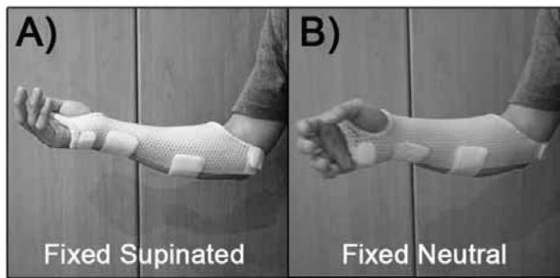  
Figure 1 — 用于在正常健康受试者身上模拟 (A) 固定旋后前臂和 (B) 固定中立位前臂的热塑性夹板。

使用 5 摄像机 Vicon 动作分析系统（型号为 VICON 460，Vicon Peak，Oxford，United Kingdom）观察每项活动的上肢运动学。在正常状态与佩戴任一夹板的状态之间进行了对比。上肢的方向是根据胸肱运动确定的，全局坐标系设在胸部（上躯干）。由于皮肤过度移动，肩胛骨的运动学（肩胛-胸壁运动）难以测量并被排除在外，这构成了本研究的一个局限性。放置在解剖学上明确的身体骨骼标志点上的 15 mm 球形逆反射标记点定义了上肢和躯干的各个分段（Table 1, Figure 2）。这些相同的标志点也被用于定义坐标

Table 1 骨骼标志点上的标记点放置及各分段的局部坐标系

<table><tr><td>骨骼/解剖标志点使用的标记物</td><td>局部坐标系</td></tr><tr><td>躯干（胸部）体段</td><td> $O_T$ ：原点与 IJ 重合</td></tr><tr><td>右肩峰 (AcrR)</td><td rowspan="2"> $Y_T$ ：连接 PX 与 T10 中点和 IJ 与 C7 中点的连线，指向上方</td></tr><tr><td>左肩峰 (AcrL)</td></tr><tr><td>第7颈椎棘突 (C7)</td><td rowspan="2"> $Z_T$ ：垂直于由 IJ、C7 以及 PX 与 T8 中点所构成平面的直线，指向右侧</td></tr><tr><td>颈静脉切迹 (IJ)</td></tr><tr><td>剑突 (PX)</td><td rowspan="2"> $X_T$ ：垂直于  $Z_T$ 轴和  $Y_T$ 轴的公垂线，指向前方</td></tr><tr><td>第8胸椎棘突 (T8)</td></tr><tr><td>肱骨体段</td><td> $O_H$ ：原点与 GH 重合</td></tr><tr><td>内上髁 (EM)</td><td> $Y_H$ ：连接 GH 与 EL 和 EM 中点的连线，指向 GH</td></tr><tr><td>外上髁 (EL)</td><td> $X_H$ ：垂直于由 EL、EM 和 GH 所构成平面的直线，指向前方</td></tr><tr><td>盂肱关节旋转中心 (GH)，取 AcrR 下方约 7 cm 处</td><td> $Z_H$ ：垂直于  $Y_H$ 轴和  $X_H$ 轴的公垂线，指向右侧</td></tr><tr><td>尺骨体段</td><td> $O_U$ ：原点与 US 重合</td></tr><tr><td>尺骨茎突 (US)</td><td> $Y_U$ ：连接 US 与 OLE0 的连线，指向 OLE0</td></tr><tr><td>鹰嘴突 (OLE0)</td><td> $Z_U$ ：在前臂处于中立位旋转时平行于连接 OLE0 和 OLE1 的直线，向外侧指向远离 RS 的方向</td></tr><tr><td>附着在 OLE0 上的杆状标记物 (OLE1)</td><td> $X_U$ ：垂直于  $Y_U$ 轴和  $Z_U$ 轴的公垂线</td></tr><tr><td>桡骨体段</td><td> $O_R$ ：原点与 RS 重合</td></tr><tr><td>桡骨茎突 (RS)</td><td> $Y_R$ ：连接 RS 与 RS1 的连线，指向 RS1</td></tr><tr><td>附着在 RS 上的杆状标记物 (RS0)</td><td> $X_R$ ：垂直于由 RS、RS0 和 RS1 所构成平面的直线，指向 RS0</td></tr><tr><td>沿桡骨在 RS 近端 5 cm 处 (RS1)</td><td> $Z_R$ ：垂直于  $Y_R$ 轴和  $X_R$ 轴的公垂线，指向外侧</td></tr><tr><td>手背体段</td><td> $O_D$ ：原点与 M2 和 M5 的中点重合</td></tr><tr><td>第2掌骨背侧远端 (M2)</td><td> $Y_D$ ：连接 M2 与 M5 中点以及 M3 的连线，指向 M3</td></tr><tr><td>第5掌骨背侧远端 (M5)</td><td> $Z_D$ ：垂直于由 M2、M5 和 M3 所构成平面的直线，指向外侧</td></tr><tr><td>第3掌骨背侧近端 (M3)</td><td> $X_D$ ：垂直于  $Y_D$ 轴和  $Z_D$ 轴的公垂线，指向拇指侧</td></tr></table>

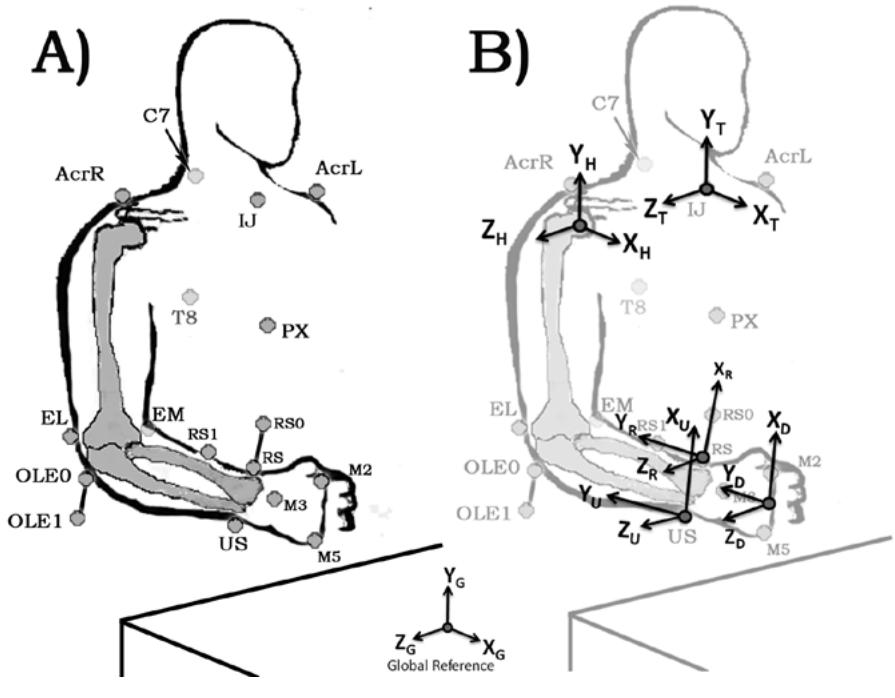  
Figure 2 — (A) 解剖标志点与标记点放置以及 (B) 胸廓、肱骨、尺骨、桡骨和手的局部坐标系示意图（图例见 Table 1）。

系统，在佩戴夹板时也是如此。佩戴夹板时必须移除部分光学标记点。这些标记点随后被重新贴上。骨性标志点的选择考虑到了尽量减少皮肤移动的需求（Anglin & Wyss, 2000；Wu et al., 2005）。对于肘关节，关节运动被描述为尺骨相对于肱骨的旋转。对于前臂运动，采用了桡骨相对于尺骨的旋转。对于腕关节运动，我们描述了由放置在手背侧的标记点所定义的手相对于桡骨的运动。我们应用浮动轴方程确定了胸肱关节、肘关节、前臂和腕关节旋转的关节坐标系（JCS）（Figure 3）。胸肱关节和前臂旋转的 JCS 与 ISB 建议（Wu et al., 2005）有所不同，以适应当实验室所使用的关节旋转的临床描述。关节坐标系由三个单位向量 $\mathbf { e } _ { 1 } , \mathbf { e } _ { 2 }$ 和 $\mathrm { e } _ { 3 }$ 描述。身体固结轴 $\mathrm { e } _ { 1 }$ 和 $\mathbf { e } _ { 3 }$ 分别描述跨各关节的固定骨段和活动骨段，而参考轴 ${ \bf e } _ { 1 } ^ { \mathrm { ~ r ~ } }$ 和 $\mathrm { e } _ { 3 } ^ { \mathrm { ~ r ~ } }$ 则描述各对应骨段上垂直于身体固结轴的轴线。参考轴 $\mathbf { e } _ { 1 } ^ { \mathrm { ~ r ~ } }$ 与近端骨段的长轴重合，而固结轴 $\mathrm { e } _ { 3 }$ 与远端骨段的长轴重合。特例情况包括：在胸肱关节旋转中，身体固结轴 $\mathrm { { \bf e } } _ { 1 }$ 与胸廓坐标系的 YT 轴重合；在前臂旋转中，远端骨段中的参考轴 $\mathbf { e } _ { 3 } ^ { \mathrm { ~ r ~ } }$ 与桡骨坐标系的 $\mathrm { X _ { R } \mathrm { - } a x i s }$ 重合。公共（浮动）轴 $\mathbf { e } _ { 2 }$ 同时垂直于两个身体固结轴，其方向和相对位置由下式给出：

$$
e _ {2} = \frac {e _ {3} \times e _ {1}}{| e _ {3} \times e _ {1} |}
$$

各关节的旋转幅度随后分别通过绕身体固结轴 $\mathrm { e } _ { 3 }$ 和 $\mathrm { e } _ { 1 }$ 的角度 α 和 $\gamma$ 进行测量，而角度 β 则是绕浮动轴 $\mathbf { e } _ { 2 }$ 的旋转。

我们选择不采用 ISB 针对各上肢关节 JCS 的推荐标准，以使每个正交旋转 α、β 和 γ 的描述与临床旋转描述保持一致（Figure 3）。

运动分析数据使用 Bodybuilder for Biomechanics 进行后处理，标记运动标记点，并以 50 Hz 估算体段间的相对角度。

对于每项活动，在 0.05 的显著性水平下，使用重复测量方差分析（ANOVA）比较三组（正常组、固定旋后组和固定中立位组）的平均总关节活动度。采用 Scheffé 事后检验确定各项活动与各组之间的差异。活动类型分为闭链活动（拧门把手、使用螺丝刀）或开链活动（打电话、进食和插卡）。绘制了角度–角度关系曲线，以展示前臂固定旋后与固定中立位之间肩部旋转的变化。这些图展示了执行任务时肩部运动与前臂旋转之间的关系。在比较各组之间的关系时，斜率越陡表明前臂每旋转一个单位度数，就需要更多的肩部旋转。

、 以及 e3 由角度 gamma (γ)、 beta (β) 和 alpha 坐标系定义，用于 (A) 胸肱旋转， (B) 肘部旋转， (C) 前臂旋转， 以及 (D) 腕关节 旋转。右侧

<table><tr><td rowspan="8">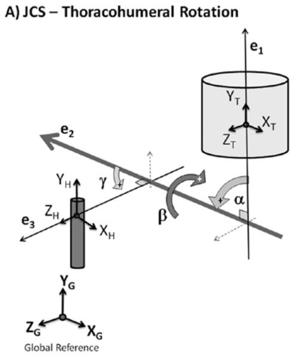</td><td rowspan="2">体固连轴e1: YTe3: ZH</td><td rowspan="2">B) JCS – 肘关节旋转</td><td>体固连轴</td></tr><tr><td>e1: ZHe3: YU</td></tr><tr><td>旋转角</td><td></td><td>参考轴</td></tr><tr><td>αs = e1 与 e2 之间的夹角（肩部前屈(+)/后伸(-)）</td><td></td><td>e1r: YHe3r: Zu</td></tr><tr><td>γs = e2 与 e3 之间的夹角（肱骨内旋(+)/外旋(-)）</td><td>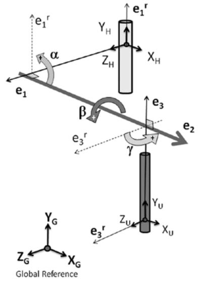</td><td>旋转角</td></tr><tr><td>βs = e1 与 e3 之间的夹角（肩部内收(+)/外展(-)，对应绕 e2 轴的反向旋转）</td><td></td><td>αE = e2 与 e1r 之间的夹角（肘部屈曲(+)/伸展(-)）</td></tr><tr><td></td><td></td><td>γE = e3r 与 e2 之间的夹角（尺骨内旋(+)/外旋(-)轴向旋转）</td></tr><tr><td></td><td></td><td>βE = e3 与 e1 之间的夹角（尺骨长轴之间的内翻(+)/外翻(-)角）</td></tr><tr><td rowspan="9">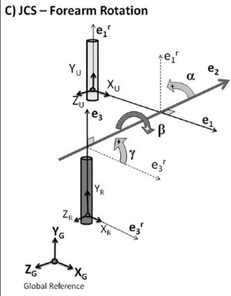</td><td>体固连轴</td><td></td><td>D) JCS – 腕关节旋转</td></tr><tr><td>e1: XUe3: YR</td><td></td><td>体固连轴</td></tr><tr><td>参考轴</td><td></td><td>e1: ZRe3: YD</td></tr><tr><td>e1r: YUe3: XR</td><td></td><td>参考轴</td></tr><tr><td>旋转角</td><td></td><td>e1r: YRe3r: ZD</td></tr><tr><td>αF = e2 与 e1r 之间的夹角（桡骨相对于尺骨的内收(+)/外展(-)）</td><td>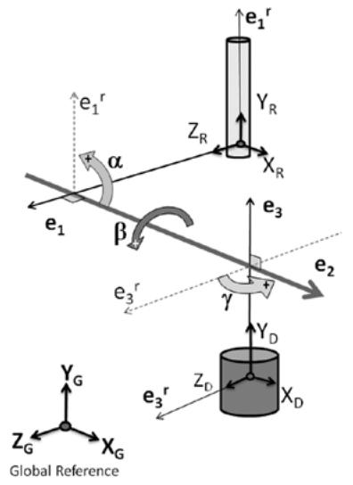</td><td>旋转角</td></tr><tr><td>γF = e3r 与 e2 之间的夹角（桡骨相对于尺骨的旋前(+)/旋后(-)）</td><td></td><td>αW = e2 与 e1r 之间的夹角（腕部屈曲(+)/伸展(-)）</td></tr><tr><td>βF = e3 与 e1 之间的夹角（桡骨相对于尺骨的矢状面旋转）</td><td></td><td>γW = e3r 与 e2 之间的夹角（手绕桡骨的内旋(+)/外旋(-)，可忽略不计）</td></tr><tr><td></td><td></td><td>βW = e3 与 e1 之间的夹角（腕部尺偏(+)/桡偏(-)）</td></tr></table>

## 结果

在佩戴夹板的状态下测量前臂静息位置，此时肘部处于 90 度屈曲位，肩部处于 0 度外展和 0 度屈曲位。对于旋后固定夹板，静息位置处于 36.7（SD，1.5）度的旋后位；而佩戴中立固定夹板时，静息位置处于 7.2（SD，0.8）度的轻微旋后位。

比较了两个前臂受限组与正常前臂在执行五项任务时，腕部、前臂和肩部各关节的平均总活动范围（Table 2）。

在本研究中，平均旋转活动度是桡骨相对于尺骨关节运动的一种度量。为了评估我们的数据是否与其他已发表的研究具有可比性，我们将执行拧门把手、打电话和进食任务时所需的无限制前臂平均活动度与以往发表的类似数据（Morrey et al., 1981）进行了对比，发现仅在进食活动中存在差异（Figure 4）。

拧螺丝刀任务被用作评估佩戴夹板后前臂活动度损失及胸肱代偿的参考。在不使用夹板的情况下，完成该任务所需的前臂旋转活动度为 77.6（标准差 SD，30.2）度。随后佩戴夹板时，完成相同任务的前臂旋转被显著限制，固定旋后位前臂的平均活动度为 11.3（SD，5.9）度 $( p < . 0 0 1 )$，固定中立位前臂的平均活动度为 18.2（SD，6.2）度 $( p < . 0 0 1 )$。

在开链运动中，夹板显著减小了腕关节屈伸的活动度（打电话任务，$p = . 0 0 1$；进食任务，$p = . 0 0 1$；插卡任务，$p$ $= . 0 3 )$。对于闭链运动，正常的腕关节屈伸活动度较小（拧门把手任务，$2 3 . 9 ^ { \circ } ;$；拧螺丝刀任务，25.7°），佩戴夹板后腕关节屈伸活动度未见显著变化（拧门把手任务，$p = . 3 1 ;$；拧螺丝刀任务，$p = . 1 2 )$。夹板固定前臂还导致腕关节桡偏-尺偏减小，但这种差异仅在打电话任务 $( p = . 0 0 1 )$ 和进食任务 $( p$ $< . 0 0 1 \rangle$ ) 中具有显著性。无论佩戴夹板与否，在执行所有五项活动时，肘关节的总活动度均无显著变化 $( p = . 1 4 )$（拧门把手，$p =$ .29；拧螺丝刀任务，$p = . 1 2 6 ;$ 打电话任务，$p = . 6 9 ;$ 进食任务，$p = . 3 2$；插卡任务，$p = . 5 5 )$。

在固定前臂位置与正常前臂之间，执行五项任务中每一项所需的肩关节活动度均记录到了显著变化 $( p < . 0 5 )$（Figure 5）。

对于闭链运动，两种受限前臂位置均表现出更大的肩关节内收-外展活动度（拧门把手任务，$p = . 0 1 ;$ 拧螺丝刀任务，$p < . 0 0 1 $。对于开链运动，固定旋后位前臂在打电话任务 $( p < . 0 5 )$ 和进食任务 $\left( p = . 0 3 \right) ;$ 中表现出显著更高的总内收-外展活动度；而固定中立位前臂在进食任务 $( p =$ .03) 和插卡任务 $( p = . 0 3 )$ 中表现出显著更高的总内收-外展活动度。

对于闭链活动，仅在螺丝刀任务中观察到更大的肩关节前后屈曲总活动度 $( p < . 0 5 )$，而在门把手任务中无显著变化 $( p = . 6 2 )$。在开链活动中，固定旋后位前臂仅在电话任务中表现出显著更大的前后屈曲活动度 $( p = . 0 4 )$；而固定中立位前臂仅在插卡任务中表现出肩关节屈曲活动度的显著变化 $( p = . 0 4 )$。

对于闭链活动，两种前臂受限状态在门把手任务 $( p < . 0 0 1 )$ 和螺丝刀任务 $( p < . 0 0 1 )$ 中均表现出更大的肩关节内外旋活动度。对于开链活动，仅固定旋后位前臂在电话任务 $( p < . 0 5 )$ 和进食任务 $( p < . 0 5 )$ 中表现出显著更高的内外旋活动度。固定中立位前臂在任何任务中均未表现出内外旋的显著变化。

在正常执行螺丝刀任务时，需要最大范围的旋前-旋后活动度，以及最小范围的腕关节和肘关节旋转。该任务被用于展示在两种前臂固定位置下肩关节运动的变化（Figure $6 ) .$。但这并不一定能代表其他四项任务，因为在执行这些任务时，每项任务都会涉及其他邻近关节及其各自的关节活动。

在螺丝刀任务（0–50%周期）中，为了用右手顺时针旋转螺丝刀 $( \mathrm { i . e . }$，即手部旋后），受试者在两种前臂固定位置下都必须首先通过肩关节外展和内旋来代偿以启动该任务。为了用右手逆时针旋转螺丝刀（即旋前）（50–100%周期），在上臂启动该任务前，肩关节处于外展、后伸（反向屈曲）和外旋的位置。

在佩戴固定前臂夹板进行旋后和旋前时，如果前臂固定在更偏旋后的位置，受试者必须使用更多的肩关节活动，正如角度-角度关系所示（Figure 7）。对于螺丝刀任务，角度-角度关系具有良好的线性相关性，决定系数 ${ \bf R } ^ { 2 }$ 大于 0.7，这使得斜率成为预测肩关节为代偿前臂旋转丧失而增加参与度的良好指标。为了使手部旋后，固定前臂位置需要肩关节增加内收（固定旋后位、固定中立位和正常状态的斜率分别为 10.66、6.03 和 –0.32）、增加后伸（分别为 –5.20、–2.75、0.22）以及增加外旋 $( - 5 . 3 8 , - 3 . 3 9 , 0 . 1 3 ,$ 分别）。

## 讨论

据称，完成大多数单侧任务活动所需的正常前臂总旋转范围在旋前 75 度至旋后 85 度之间 (Boone & Azen, 1979; Morrey et al., 1981)。当前臂活动度丧失时，会出现涉及其他关节的代偿性运动策略，从而使任务仍能继续完成。这种代偿可以来自远端腕关节的运动，也可以来自近端肘关节、肩关节以及躯干的运动 (Boone & Azen, 1979; Buckley et al., 1996; Carey et al., 2008; Kasten et al., 2009; Kreulen et al., 2007; Mell et al., 2005)。

Table 2 在正常前臂、固定旋后位前臂和固定中立位前臂状态下执行五项任务时，(A) 腕关节、(B) 前臂、(C) 肘关节和 (D) 肩关节的平均总活动范围（基于每项任务的三次试验，N = 6 名受试者）

<table><tr><td rowspan="3"></td><td colspan="5">活动</td></tr><tr><td>I</td><td>II</td><td>III</td><td>IV</td><td>V</td></tr><tr><td>门把手</td><td>螺丝刀</td><td>电话</td><td>进食</td><td>卡片</td></tr><tr><td>组别</td><td colspan="5">均值 (SD) 关节活动度 (度)</td></tr><tr><td colspan="6">A1. 腕关节——屈曲/伸展（未满足 Mauchly 球形度检验，p&lt;0.001）</td></tr><tr><td>正常</td><td>25.7 (20.3)</td><td>23.9 (8.9)</td><td>47.1 (20.4)</td><td>43.6 (18.4)</td><td>56.4 (27.6)</td></tr><tr><td>固定旋后</td><td>14.6 (10.7)</td><td>23.9 (20.6)</td><td>13.7 (5.1)#</td><td>18.8 (9.1)#</td><td>10.5 (4.0)#</td></tr><tr><td>固定中立位</td><td>14.6 (6.8)</td><td>10.4 (7.5)</td><td>22.8 (4.4)#</td><td>13.2 (3.9)#</td><td>23.4 (18.5)#</td></tr><tr><td colspan="6">A2. 腕关节——桡偏/尺偏（满足 Mauchly 球形度检验，p=0.36）</td></tr><tr><td>正常</td><td>20.1(11.4)</td><td>15.4 (3.7)</td><td>64.3 (15.0)</td><td>35.1 (15.7)</td><td>41.9 (16.5)</td></tr><tr><td>固定旋后</td><td>15.1 (7.7)</td><td>20.5 (11.2)</td><td>19.1 (13.7)#</td><td>20.9 (21.7)</td><td>10.1 (4.4)#</td></tr><tr><td>固定中立位</td><td>16.8 (6.0)</td><td>10.0 (3.7)</td><td>28.2(21.1)#</td><td>15.7 (6.9)</td><td>13.8 (4.2)#</td></tr><tr><td colspan="6">B1. 前臂——旋前/旋后（未满足 Mauchly 球形度检验，p=0.001）</td></tr><tr><td>正常</td><td>54.2 (24.5)</td><td>77.6 (30.8)</td><td>41.9 (5.6)</td><td>48.1 (11.9)</td><td>69.4 (18.8)</td></tr><tr><td>固定旋后</td><td>10.9 (5.1)#</td><td>11.3 (5.9)#</td><td>13.1 (3.6)#</td><td>8.5 (4.3)#</td><td>18.4 (8.2)#</td></tr><tr><td>固定中立位</td><td>15.8 (5.5)#</td><td>18.2 (6.2)#</td><td>15.2 (5.8)#</td><td>14.2 (5.2)#</td><td>15.6 (7.6)#</td></tr><tr><td colspan="6">C. 肘关节——屈曲/伸展（未满足 Mauchly 球形度检验，p=0.001）</td></tr><tr><td>正常</td><td>9.0 (3.6)</td><td>7.0 (2.5)</td><td>21.8 (11.9)</td><td>29.5 (21.9)</td><td>27.1 (8.6)</td></tr><tr><td>固定旋后</td><td>26.6 (28.3)</td><td>9.3 (5.8)</td><td>27.6 (17.6)</td><td>16.5 (9.8)</td><td>32.2 (13.8)</td></tr><tr><td>固定中立位</td><td>22.5 (14.7)</td><td>14.7 (8.6)</td><td>20.5 (12.6)</td><td>21.2 (7.2)</td><td>25.8 (5.3)</td></tr><tr><td colspan="6">D1. 肩关节——外展/内收（满足 Mauchly 球形度检验，p=0.20）</td></tr><tr><td>正常</td><td>48.5 (30.3)</td><td>31.3 (15.9)</td><td>11.0 (7.0)</td><td>11.8 (3.4)</td><td>27.8 (13.3)</td></tr><tr><td>固定旋后</td><td>101.0 (42.7)#</td><td>88.6 (30.0)#</td><td>40.3 (24.9)#</td><td>29.8 (16.0)#</td><td>53.8 (23.1)</td></tr><tr><td>固定中立位</td><td>104.5 (7.0)#</td><td>94.1 (8.7)#</td><td>34.6 (23.7)</td><td>29.3 (12.0)#</td><td>71.5 (33.4)#</td></tr><tr><td colspan="6">D2. 肩关节——前屈/后伸（满足 Mauchly 球形度检验，p=0.52）</td></tr><tr><td>正常</td><td>34.8 (25.1)</td><td>21.8 (11.0)</td><td>14.4 (4.4)</td><td>12.1 (6.2)</td><td>34.8 (21.1)</td></tr><tr><td>固定旋后</td><td>51.3 (39.2)</td><td>46.5 (28.4)</td><td>21.4 (4.3)#</td><td>17.2 (5.5)</td><td>61.8 (24.6)</td></tr><tr><td>固定中立位</td><td>46.6 (22.2)</td><td>49.0 (13.0)#</td><td>16.8 (4.1)</td><td>20.3 (5.7)</td><td>79.9 (34.1)#</td></tr><tr><td colspan="6">D3. 肩关节——内旋/外旋（满足 Mauchly 球形度检验，p=0.69）</td></tr><tr><td>正常</td><td>15.4 (7.1)</td><td>12.8 (6.8)</td><td>23.8 (10.3)</td><td>19.5 (7.2)</td><td>33.8 (8.2)</td></tr><tr><td>固定旋后</td><td>53.8 (17.1)#</td><td>49.9 (9.0)#</td><td>44.3 (12.8)#</td><td>32.7 (6.8)#</td><td>51.0 (25.4)</td></tr><tr><td>固定中立位</td><td>64.3 (13.9)#</td><td>57.0 (13.1)#</td><td>33.2 (16.7)</td><td>27.7 (11.1)</td><td>43.4 (14.2)</td></tr></table>

注。采用重复测量方差分析（Repeated-measures ANOVA）来确定正常、固定旋后和固定中立位前臂在执行这五项任务时，各关节运动之间的差异。使用莫奇利球形度检验（Mauchly’s sphericity test）来确定方差齐性。统计学意义：在各项任务中，与正常前臂相比，#p < 0.05（单因素方差分析，one-way ANOVA）。

本研究探讨了由于前臂和手腕活动度受限或限制而引起的肩关节和肘关节耦合运动的代偿机制。夹板限制了手腕的位置，使我们能够更好地理解近端相邻关节的贡献。由于我们只想评估肩部和肘部的代偿运动，因此我们特别指导受试者在执行这5项任务时避免任何躯干晃动。具体做法是指导他们将左臂固定在桌面上，同时背部紧靠椅背。以往关于经桡骨截肢假肢使用者代偿运动的研究发现，当躯干运动不受限制时，肩部的代偿运动学特征与正常受试者相比并无显著差异（Carey et al., 2008）。通过限制躯干运动，我们的设想是能够排除躯干运动的掩盖效应，专门聚焦于理解前臂活动度受限时肩部和肘部的代偿运动学。

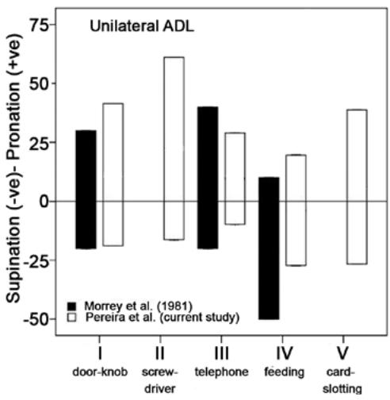  
Figure 4 — 执行5项任务时完整、未佩戴夹板的前臂所需的平均前臂旋转范围与 Morrey 等人（1981）先前发表的数据的对比。

本研究中测量的5项日常生活活动（ADL）任务的正常前臂旋转范围与 Morrey 等人（1981）的数据相比，在开门把手和打电话任务中没有差异。然而，在进食任务中获得的活动范围存在差异，其原因在于进食方式的不同：Morrey 的数据是基于用叉子进食，与我们在任务中使用勺子进食相比，用叉子进食需要更多的旋后（Morrey et al., 1981; Safaee-Rad et al., 1990）。此外，Morrey 的研究是使用角度计（goniometer）来测量关节角度和总活动度的。

在模拟前臂固定的旋转范围时，所使用的两种夹板允许肘关节自由屈伸，但在某种程度上限制了腕部运动，同时观察到一定程度的腕部活动。以往其他学者的研究发现，在腕部运动部分或完全受限的情况下，执行单侧手和腕部功能时的活动度未记录到功能性差异（Adams et al., 2003）。这可能支持了以下观点：限制腕部运动可能并未影响所观察到的胸肱和肘部代偿运动学表现。我们还限制了躯干的运动。然而，Carey et al. (2008) 的研究发现，当他们在研究中纳入躯干运动以确定经桡骨截肢假肢使用者在日常任务中的代偿运动时，在执行单侧手部功能时并未观察到肩部代偿的显著差异（Carey et al., 2008）。尽管这可能支持我们限制躯干运动的做法（我们的数据可能有助于上肢运动学模型的开发），但仍建议开展进一步研究对此进行重新评估。在临床上，鉴于我们可能制造了限制腕部和躯干运动这种非自然状态，我们确实提醒，所测量的胸肱代偿是否

A)  
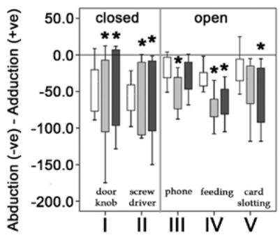

B)  
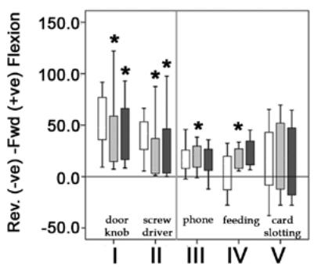

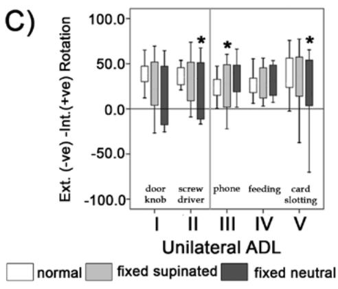  
Figure 5 — 执行 5 项任务时 (A) 肩关节外展-内收；(B) 肩关节后伸-前屈；以及 (C) 肩关节外旋-内旋（N = 6 名受试者）的关节活动度箱线图。数据对比了未佩戴任何夹板（白色柱），以及随后佩戴夹板模拟固定旋前前臂（浅灰色柱）和固定中立位前臂（深灰色柱）的情况。5 项日常生活活动（ADL）被分为闭链活动（I-门把手，II-螺丝刀）和开链活动（III-电话，IV-进食，V-插卡）。对于每项活动，与每项任务正常范围相比具有统计学显著性差异（ANOVA，Scheffé 事后检验，p < .05）的数据均用星号（\*）标出。

A)  
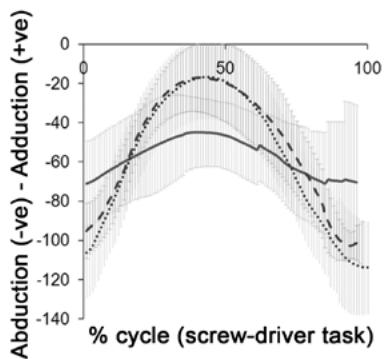

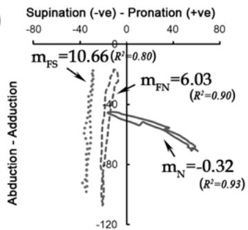  
A)

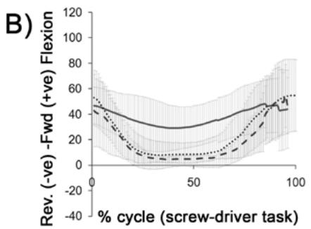

B)  
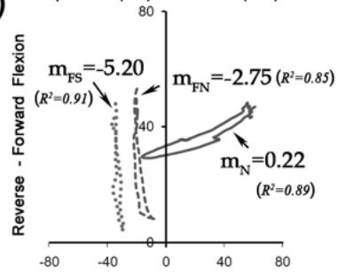

C)  
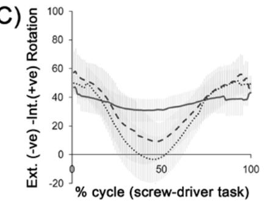

我们对所有受试者使用了同一种通用夹板，佩戴夹板时仍允许一定程度的腕关节活动。遗憾的是，我们没有测量该受试者队列中这种“允许的”腕关节活动范围，该范围可能因手部大小不同而有所差异。腕关节活动范围的这些差异使得尚不明确其是否影响了所测量的肘关节与胸肱关节的耦合运动学特征。尽管如此，从审查所执行的不同单侧任务来看，无论腕关节活动是否受到显著限制，均记录到了显著改变的胸肱运动学特征。

是由前臂旋转受限引起的，还是由于限制前臂、手腕以及躯干的综合作用所致。

C)  
Figure 6 — 右手使用螺丝刀完整周期内肩关节外展-内收、后伸-前屈及外旋-内旋的曲线特征。该活动首先在不佩戴任何夹板的情况下进行（粗线），随后分别佩戴模拟固定旋后（点线）和固定中立位前臂（虚线）的夹板进行。每条曲线代表 6 名受试者在整个活动周期内的平均值。须线代表各曲线上完整周期每个百分比点的标准差。注：0–50% 周期：顺时针旋转螺丝刀；50–100%：逆时针旋转螺丝刀。  
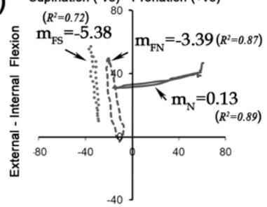  
Figure 7 — 完成螺丝刀任务所需的前臂旋转（旋后-旋前）与肩关节三个正交旋转轴——(A) 外展-内收、(B) 后伸-前屈及 (C) 肩关节外旋-内旋之间的典型角度-角度关系。注：m = 代表角度-角度关系图的回归线斜率，R2 = 决定系数；N = 正常（粗线），FS = 固定旋后（点线），FN = 固定中立位（虚线）。

在闭链与开链运动之间，开链运动中观察到更多的腕部运动，而在模拟的前臂受限状态下，这种运动受到了显著限制。对于闭链运动，在前臂未受限时腕部运动较少，而在前臂受限时腕部运动未出现显著变化。因此，闭链运动更不依赖腕部代偿，能够更好地反映前臂受限状态下肩部和肘部的代偿情况。此外，由于开链和闭链运动均未显示出肘部的显著参与，大部分代偿来自于涉及肩关节的运动。我们承认，本研究受限于样本量较小。腕部屈伸、旋前-旋后以及肘部屈伸未满足 Mauchly 球形度检验（Mauchly’s sphericity test），因此考虑了方差不齐。然而，桡偏-尺偏以及肩关节各运动满足了 Mauchly 检验，因此我们假定这些数据集满足方差齐性。

在肘部，记录到的较小活动度可能受限于任务类型，这些任务均是在坐在桌前且处于伸手可及的范围（40–50 cm）内完成的。佩戴夹板前后，肘部运动总体上没有差异。另一个可能的原因是，肘关节轴相对于前臂旋转轴呈正交方向。如果佩戴夹板，肘关节与改变后的旋转轴通常也呈正交。因此无论在哪种情况下，在需要旋前和旋后的单侧活动中，肘部的参与都极小，正如数据所示，各组之间的差异并不显著。

对于固定旋后前臂（Table 2，Figure 7），除插卡任务（受试者之间的总活动度变异较大）外，所有 ADL（日常生活活动）任务中肩部外展-内收和内旋-外旋的总活动范围均显著增加。前屈-后伸的总活动范围仅在接打电话任务中显著增加，而在所有其他任务中均无显著差异。对于固定中立位，在外展-内收和内旋-外旋中观察到了显著更高的总活动度，但这仅见于闭链运动（门把手和螺丝刀任务）。对于开链运动，外展-内收总活动度的增加仅见于进食任务和插卡任务。在固定旋后与固定中立位之间，各项任务均未见明确的显著差异，这表明力学机制的改变更多地与前臂功能的丧失有关，而非活动类型。

尽管使用夹板旨在将前臂限制在固定前臂位置（Table 2），但仍测量到了一定程度的前臂旋转（即桡骨绕尺骨的旋转）。如图 Figure 6 所示，肩关节运动变化相对于每个任务完整周期的关系，能够快速比较受限前臂的肩部旋转量（相对于不受限前臂旋转进行归一化）。为了建立用于比较三种前臂状态的指标，以使用螺丝刀任务为例，绘制了肩部运动与前臂运动之间的角-角关系（Figure 7）。角-角关系回归线的斜率 $m$ 衡量了每单位前臂旋转度数所对应的肩关节运动增加量，从而使我们能够将正常前臂组与功能障碍前臂组进行比较。在使用螺丝刀时，我们注意到在正常前臂中参与极少的外展-内收（m = –0.32）在受限前臂位置下增加了数倍（固定中立位 m = 6.03，固定旋后位 m = 10.66）。肩部的前屈-后伸（固定中立位 m = –2.75，固定旋后位 m = –5.20）以及内旋-外旋（固定中立位 $( m = - 3 . 3 9$，固定旋后位 $m = - 5 . 3 8$）也观察到了相同的情况，但程度相对较轻。这表明了一种趋势，即固定在更偏旋后位置的前臂需要更多的外展-内收、更多的前屈-后伸以及更多的内旋-外旋，以代偿前臂旋转功能的丧失。

一般而言，肩部内收、后伸以及肱骨外旋的组合增加可以代偿前臂旋后功能的丧失；而肩部外展、前屈以及肱骨内旋的组合增加则可以代偿前臂旋前功能的丧失。

在佩戴和未佩戴夹板的情况下，角-角关系中均记录到了一定程度的迟滞现象（hysteresis）。本研究尚未确定其产生原因，但我们推测可能的原因是：在执行动作时肱骨头相对于躯干发生了平移滑移；或者肱骨关节的真实运动中心与估计的肱骨头几何中心并不重合。固定旋后前臂的迟滞现象较少，这可能提示固定前臂位置的差异也可能会影响在角-角曲线中观察到的迟滞现象。鉴于这是一项初步研究，未来针对其他固定前臂位置（包括固定旋前前臂）开展进一步研究将具有重要意义。

为了理解代偿运动学对跨关节负荷传递的影响，早期的研究表明，“固定”或受损的前臂会导致旋前-旋后轴发生改变或受到影响（Graham et al., 1998; Kasten et al., 2009; Nakamura et al., 1999; Oka et al., 2006; Sauerbier et al., 2002）。在正常前臂中，旋前肌和旋后肌需要使桡骨绕尺骨旋转以实现运动并产生扭矩。在固定旋后或固定中立位前臂的情况下，肩部肌肉——所有三组肌肉（肩部的内收-外展肌、屈-伸肌以及内旋和外旋肌）现在都必须充当旋前肌和旋后肌的功能，由整个上肢来复制前臂的旋转（Kapandji, 2001; Kreulen et al., 2007）。然而，这组新的“旋前肌”和“旋后肌”现在还必须克服整个上肢的重量做功，且无法借助类似“尺骨”的结构向近端传递负荷。这些肌肉现在需要负责手部的旋前和旋后，这一事实表明手部的旋前-旋后轴已转变为一个更为全局的旋转轴。改变后的（螺旋）轴是虚构的，要求每个肩部肌肉都绕该虚构轴具有一个力臂，以产生手部旋前或旋后所需的扭矩。“全局”旋前-旋后轴发生改变的证据是肩关节活动的增加，这意味着整个上肢现在正绕着一个新的或改变后的轴旋转，以产生所需的力矩来代偿前臂旋转功能的丧失。这只能意味着肩部肌肉必须更用力地工作。Kasten et al. (2009) 在他们对桡尺骨联合（radioulnar synostosis，一种固定性前臂畸形）病例的研究中，支持了这种肩部肌肉使用增加的论点。他们报道了固定旋后的手在用于书写或弹钢琴时会变得笨拙，并且由于需要增加肩部外展和内旋来代偿前臂旋前，从而变得极易疲劳（Kasten et al., 2009）。

为代偿前臂旋转功能丧失而增加的关节活动度，也被推测会改变跨关节的力传递。尽管本研究未对此进行计算，但如果考虑前臂固定于旋后位并试图使手部旋前的情况，盂肱关节接触力很可能会随着外展角度的增大而增加。我们可以从 Poppen 和 Walker（1978）以及 Terrier 等人（2007）以往的研究中推断出这一点，这些研究记录了盂肱关节力随肩关节外展角度增大而增加的现象。我们还可以推断，当远端施加外部载荷时（即在负重携带的情况下），关节接触力会进一步增加（Poppen & Walker, 1978; Terrier et al., 2007）。这将支持以下论点，即前臂固定旋后时的肩部代偿运动学可能容易诱发其他损伤风险。

需要指出的是，本研究确实存在其他几项技术局限性。首先，研究上肢运动学及其功能的研究较少，且直到最近人们才开始关注建立上肢运动分析的标准。针对患有损伤或疾病的上肢进行体内（in-vivo）运动学研究的文献则更为匮乏 (Anglin & Wyss, 2000; Rau et al., 2000; Wu et al., 2005)。这导致难以找到对照数据，并促使我们通过在前臂使用夹板来在正常受试者身上模拟前臂旋转受限。另一个局限性在于所用的样本量较小，导致记录的测量数据存在一定的变异性。我们尚不确定这种变异性是由性别还是人体测量学差异引起的。在我们的队列中，受试者的前臂长度（从尺骨茎突远端到鹰嘴测量）在 28 至 30 mm 之间，这使得可以使用相同的夹板。性别差异可能会影响所测量的关节接触力和载荷传递，但由于本研究未涉及这些测量，且考虑到受试者队列具有相似的人体测量学指标，我们假设运动学测量结果未受性别差异的影响。我们本研究的目的是建立一种在模拟前臂旋转丧失情况下测量体内代偿性肩关节运动学的方法，并建立用于比较的基准。我们未来工作的意图是回顾诸如创伤后前臂骨折畸形愈合、桡骨远端骨折、桡尺骨骨融合等病例，据报道这些病例均会导致前臂旋转受限 (Cooney et al., 1980; Kasten et al., 2009; Linscheid, 1992)。本研究的实用价值在于使我们能够评估前臂损伤患者在进行需要前臂旋转的各种单侧日常生活活动时的表现，以及如何在恢复或修复的不同阶段比较和量化他们的进展。比较执行不同任务时关节活动度的变化，也可为预测肩部和肘部损伤风险提供一种工具 (Van Andel et al., 2008; Kasten et al., 2009)。在尝试为我们实验室环境建立体内运动学模型时，我们认为，如果要评估患有各类前臂疾病的患者，最近报道的将前臂视为单一刚体段的上肢运动分析标记点集是不够的。因此在本研究中，我们建立了一个额外的刚体段，以了解桡骨绕尺骨的旋转。我们认为这将使我们能够将该模型应用于诸如前臂骨折畸形愈合或涉及桡骨或尺骨不连续的疾病等病例 (Nakamura et al., 1999; Tay et al., 2008)。为了测量前臂旋转，我们也意识到与前臂远端相比，靠近前近端关节的皮肤绕纵轴的旋转较少；这可能会导致结果出现误差 (Cutti et al., 2006)。因此，我们在桡骨远端半部以及尺骨后近端鹰嘴处引入了额外的标记点。我们认为这是合理的，因为我们希望比较每位受试者在不同条件下完成这 5 项任务时的前臂表现。因此，数据是以正常前臂作为对照组进行呈现的 (Boone & Azen, 1979; Morrey et al., 1981; Safaee-Rad et al., 1990)。另一个挑战是测量肩关节的运动。在本文中，我们偏离了 ISB（国际生物力学学会）的建议，应用浮动轴计算来确定更具临床相关性的描述。采用外展-内收、后伸-前屈以及内旋-外旋，以便我们清楚地了解所涉及的肌群。我们在实验室中使用 Grood and Suntay 方程的目的还在于确定每个刚体段在关节处的平移（尽管这些数据未在本研究中呈现）。

综上所述，尽管存在这些局限性，且鉴于上肢是由涉及多个关节的相互连接的环节所组成的序列，本研究量化了当前臂旋转活动范围受限时，在执行需要前臂强制旋前/旋后的单侧任务过程中，肩部会被用于代偿功能。这会增加肩部的使用，并支持了评估上肢整体运动策略具有必要性这一论点，尤其是在规划康复治疗时（Kreulen et al., 2007）。

## 致谢

本研究由 National Medical Research Council（国家医学研究委员会）基金（NMRC/0832/2004）资助。我们衷心感谢 Jeffrey Chew、Chong Sook Yee 和 Grace Lee 在本工作开展期间提供的技术支持与协助等重要贡献。

## 参考文献

Adams, B.D., Grosland, N.M., Murphy, D.M., & McCullough, M. (2003). Impact of impaired wrist motion on hand and upper-extremity performance(1). The Journal of Hand Surgery, 28, 898–903. PubMed doi:10.1016/S0363- 5023(03)00424-6

Anglin, C., & Wyss, U.P. (2000). Review of arm motion analyses. Proceedings of the Institution of Mechanical Engineers. Part H, Journal of Engineering in Medicine, 214, 541–555. PubMed doi:10.1243/0954411001535570

Boone, D.C., & Azen, S.P. (1979). Normal range of motion of joints in male subjects. The Journal of bone and joint surgery (American), 61, 756–759. PubMed

Buckley, M.A., Yardley, A., Johnson, G.R., & Carus, D.A. (1996). Dynamics of the upper limb during performance of the tasks of everyday living–a review of the current knowledge base. Proceedings of the Institution of Mechanical Engineers. Part H, Journal of Engineering in Medicine, 210, 241–247. PubMed doi:10.1243/ PIME\_PROC\_1996\_210\_420\_02

Carey, S.L., Jason Highsmith, M., Maitland, M.E., & Dubey, R.V. (2008). Compensatory movements of transradial prosthesis users during common tasks. Clinical Biomechanics (Bristol, Avon), 23, 1128–1135. PubMed doi:10.1016/j. clinbiomech.2008.05.008

Cooney, W.P., Dobyns, J.H., & Linscheid, R.L. (1980). Complications of Colles’ fractures. The Journal of bone and joint surgery (American), 62, 613–619. PubMed

Crisco, J.J., Moore, D.C., Marai, G.E., Laidlaw, D.H., Akelman, E., Weiss, A.P.C., et al. (2007). Effects of distal radius malunion on distal radioulnar joint mechanics–an in vivo study. Journal of Orthopaedic Research, 25, 547–555. PubMed doi:10.1002/jor.20322

Cutti, A.G., Cappello, A., & Davalli, A. (2006). In vivo validation of a new technique that compensates for soft tissue artefact in the upper-arm: preliminary results. Clinical Biomechanics (Bristol, Avon), 21(Suppl. 1), S13–S19. PubMed doi:10.1016/j.clinbiomech.2005.09.018

Graham, T.J., Fischer, T.J., Hotchkiss, R.N., & Kleinman, W.B. (1998). Disorders of the forearm axis. Hand Clinics, 14, 305–316. PubMed

Grood, E.S., & Suntay, W.J. (1983). A joint coordinate system for the clinical description of three-dimensional motions: application to the knee. Journal of Biomechanical Engineering, 105, 136–144. PubMed doi:10.1115/1.3138397

Ishikawa, J.I., Iwasaki, N., & Minami, A. (2005). Influence of distal radioulnar joint subluxation on restricted forearm rotation after distal radius fracture. The Journal of Hand Surgery, 30, 1178–1184. PubMed doi:10.1016/j. jhsa.2005.07.008

Kapandji, A. (2001). Biomechanics of pronation and supination of the forearm. Hand Clinics, 17, 111–122. PubMed

Kasten, P., Rettig, O., Loew, M., Wolf, S., & Raiss, P. (2009). Three-dimensional motion analysis of compensatory movements in patients with radioulnar synostosis performing activities of daily living. Journal of Orthopaedic Science, 14, 307–312. PubMed doi:10.1007/s00776-009-1332-0

Kreulen, M., Smeulders, M.J.C., Veeger, H.E.J., & Hage, J.J. (2007). Movement patterns of the upper extremity and trunk associated with impaired forearm rotation in patients

with hemiplegic cerebral palsy compared to healthy controls. Gait & Posture, 25, 485–492. PubMed doi:10.1016/j. gaitpost.2006.05.015

Linscheid, R.L. (1992). Biomechanics of the distal radioulnar joint. Clinical Orthopaedics and Related Research, 46–55. PubMed

Mell, A.G., Childress, B.L., & Hughes, R.E. (2005). The effect of wearing a wrist splint on shoulder kinematics during object manipulation. Archives of Physical Medicine and Rehabilitation, 86, 1661–1664. PubMed doi:10.1016/j. apmr.2005.02.008

Morrey, B.F., Askew, L.J., & Chao, E.Y. (1981). A biomechanical study of normal functional elbow motion. The journal of bone and joint surgery (American), 63, 872–877. PubMed

Nakamura, T., Yabe, Y., Horiuchi, Y., & Yamazaki, N. (1999). In vivo motion analysis of forearm rotation utilizing magnetic resonance imaging. Clinical Biomechanics (Bristol, Avon), 14, 315–320. PubMed doi:10.1016/S0268- 0033(98)90091-2

Oka, K., Doi, K., Suzuki, K., Murase, T., Goto, A., Yoshikawa, H., et al. (2006). In vivo three-dimensional motion analysis of the forearm with radioulnar synostosis treated by the Kanaya procedure. Journal of Orthopaedic Research, 24, 1028–1035. PubMed doi:10.1002/jor.20136

Poppen, N.K., & Walker, P.S. (1978). Forces at the glenohumeral joint in abduction. Clinical Orthopaedics and Related Research, 135, 165–170. PubMed

Rau, G., Disselhorst-Klug, C., & Schmidt, R. (2000). Movement biomechanics goes upwards: from the leg to the arm. Journal of Biomechanics, 33, 1207–1216. PubMed doi:10.1016/S0021-9290(00)00062-2

Safaee-Rad, R., Shwedyk, E., Quanbury, A.O., & Cooper, J.E. (1990). Normal functional range of motion of upper limb joints during performance of three feeding activities. Archives of Physical Medicine and Rehabilitation, 71, 505–509. PubMed

Sauerbier, M., Fujita, M., Hahn, M.E., Neale, P.G., & Berger, R.A. (2002). The dynamic radioulnar convergence of the Darrach procedure and the ulnar head hemiresection interposition arthroplasty: a biomechanical study. Journal of Hand Surgery (Edinburgh, Lothian), 27, 307–316. PubMed doi:10.1054/jhsb.2002.0763

Tay, S.C., van Riet, R., Kazunari, T., Koff, M.F., Amrami, K.K., An, K.N., et al. (2008). A method for in-vivo kinematic analysis of the forearm. Journal of Biomechanics, 41, 56–62. PubMed doi:10.1016/j.jbiomech.2007.07.019

Terrier, A., Reist, A., Vogel, A., & Farron, A. (2007). Effect of supraspinatus deficiency on humerus translation and glenohumeral contact force during abduction. Clinical Biomechanics (Bristol, Avon), 22, 645–651. PubMed doi:10.1016/j.clinbiomech.2007.01.015

Van Andel, C.J., Wolterbeek, N., Doorenbosch, C.A.M., Veeger, D.H.E.J., & Harlaar, J. (2008). Complete 3D kinematics of upper extremity functional tasks. Gait & Posture, 27, 120–127. PubMed doi:10.1016/j.gaitpost.2007.03.002

Wu, G., van der Helm, F.C.T., Veeger, H.E.J.D., Makhsous, M., Van Roy, P., Anglin, C., Nagels, J., Karduna, A.R., McQuade, K., Wang, X., Werner, F.W., Buchholz, B., & International Society of Biomechanics. (2005). ISB recommendation on definitions of joint coordinate systems of various joints for the reporting of human joint motion–Part II: shoulder, elbow, wrist and hand. Journal of Biomechanics, 38, 981–992. PubMed doi:10.1016/j. jbiomech.2004.05.042