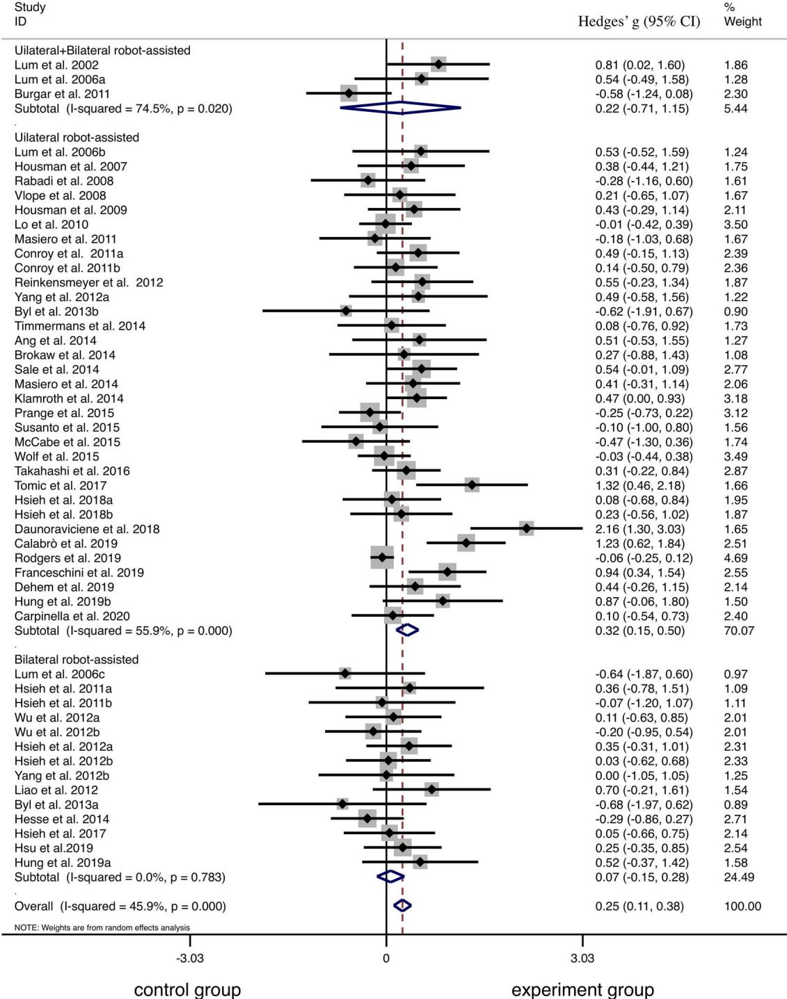
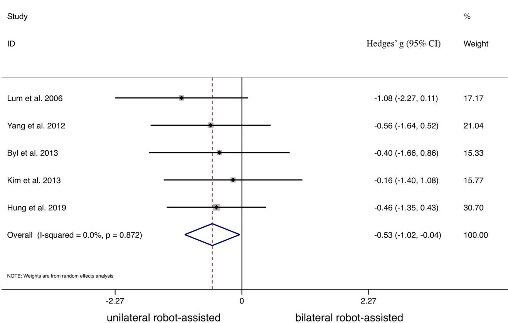
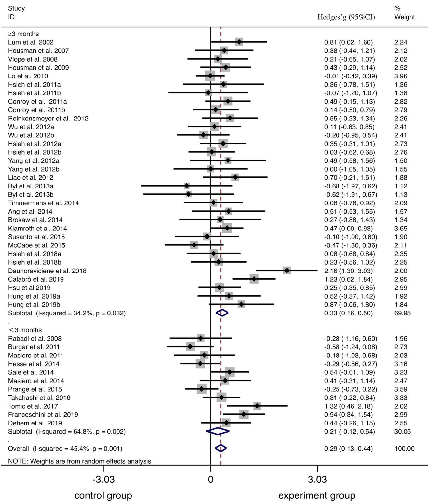
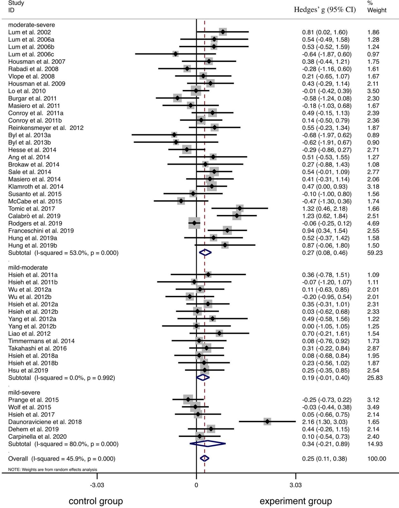
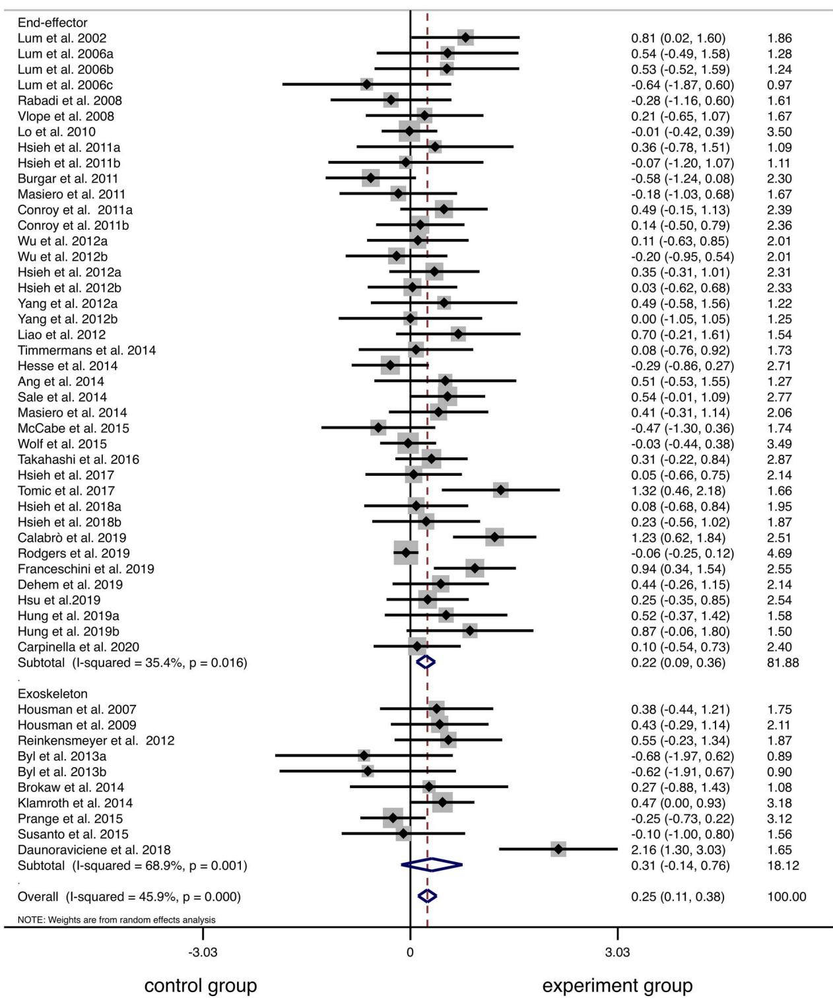
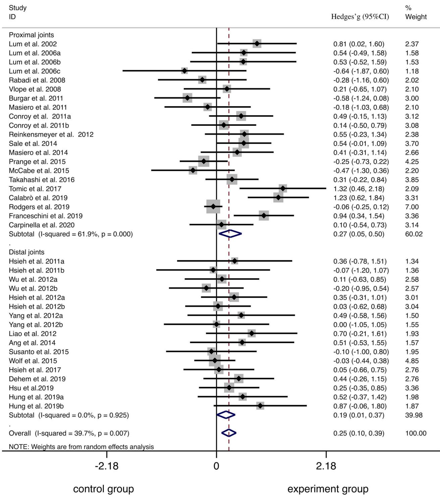

# 机器人辅助疗法改善脑卒中后上肢运动障碍：系统评价与Meta分析

Jingyi Wu, BSc1,2, Hao Cheng, BSc1,2,†, Jiaqi Zhang, MSc3,†, Shanli Yang, MD1,2, Sufang Cai, MSc1,2,∗

1福建中医药大学附属康复医院（Rehabilitation Hospital affiliated to Fujian University of Traditional Chinese Medicine），中国福建福州 2福建省康复技术重点实验室（Fujian Key Laboratory of Rehabilitation Technology），中国福建福州

3香港理工大学康复治疗科学系（Department of Rehabilitation Sciences, The Hong Kong Polytechnic University），中国香港特别行政区

\*所有来信请寄往：Cai女士（sufang\_kangfu01@163.com）或Zhang先生（jack-jq.zhang@connect.polyu.hk）

†H. Cheng 与 J. Zhang 对本项工作贡献相同。

## 摘要

方法。检索了 PubMed、Embase、Medline 和 Web of Science 数据库，检索时间自建库起至 2020 年 4 月 8 日。纳入旨在评估机器人辅助疗法（RT）对脑卒中后上肢运动障碍的疗效、并采用上肢 Fugl-Meyer 评定（FMA-UE）量表评分作为结局指标的随机对照试验。两位作者独立筛选文献、提取数据，并使用物理治疗证据数据库（PEDro）量表评估纳入研究的方法学质量。采用随机效应模型 meta 分析以合并各项研究的效应量。

结果。共纳入 41 项随机对照试验，包含 1916 例脑卒中患者。与剂量匹配的常规康复相比，RT 显著改善了脑卒中患者的上肢 Fugl-Meyer 评定量表评分，具有较小的效应量（Hedges $g = 0 . 2 5 ;$ 95% CI, 0.11-0.38; $I ^ { 2 } = 4 5 . 9 \% )$。亚组分析表明，单侧 RT 的疗效优于常规康复，而双侧 RT 则未显示出优势（Hedges α = 0.32: 95% Cl. 0.15-0.50; $I ^ { 2 } = 5 5 . 9 \% )$。在机器人设备类型方面，末端执行器设备（Hedges $g = 0 . 2 2 ;$ 95% CI, 0.09–0.36; I2 35.4%）的疗效优于常规康复，而外骨骼设备则未显示出优势。在脑卒中分期方面，组间差异（即 RT 对比常规康复）仅在亚急性晚期或慢性期脑卒中患者中具有显著性（Hedges $g = 0 . 3 3 ;$ 95% CI, 0.16-0.50; $I ^ { 2 } = 3 4 . 2 \% )$。

结论。对于伴有显著上肢偏瘫且自发恢复潜力有限的脑卒中患者，RT 在改善其上肢运动障碍方面可能优于常规康复。

关键词：脑卒中（Stroke）、上肢（Upper Extremity）、单侧/双侧机器人辅助疗法（Unilateral/Bilateral Robot-Assisted Therapy）、Meta分析（Meta-Analysis）、随机对照试验（Randomized Controlled Trial）

## 引言

卒中（Stroke）是成人发病型神经系统残疾最常见的原因之一。1根据 $2 0 1 6 , ^ { \dot { 2 } }$ 年全球疾病负担（Global Burden of Disease）研究，卒中是全球导致伤残调整生命年（disability-adjusted life-years）损失的主要原因之一。上肢偏瘫是卒中幸存者最常见且最持久的症状。3由治疗师实施的物理治疗（physical therapy）和作业治疗（occupational therapy）干预是卒中后上肢运动功能障碍的主流康复治疗方法。多种聚焦于上肢运动康复的方法，如强制性运动疗法（constraint-induced movement training）、任务导向性训练（task-oriented training）、心理练习（mental practice）和镜像疗法（mirror therapy），已在临床实践中得到广泛应用。3近几十年来，机器人辅助治疗（robot-assisted therapy, RT）已被开发为一种用于上肢偏瘫康复的方法。4RT 被定义为“一种可与设备配合使用以协助人类功能康复的电子计算机控制系统；这些系统可分为治疗性机器人和辅助性机器人。”5与传统的治疗师主导康复相比，RT 能够提供高强度、重复性且高度可复现的运动训练，以促进卒中后偏瘫上肢功能的恢复和神经可塑性。6,7

治疗性机器人大致可分为末端执行器型（end effector）和外骨骼型（exoskeleton）设备。末端执行器型设备是一种与环境相互作用并在单个点与个体相连的工具，而外骨骼型设备则在与关节轴相匹配的多个点与个体相连。8在临床实践中，RT 可仅用于偏瘫侧手臂或同时用于双臂，因此分别被称为单侧机器人辅助治疗（unilateral robot-assisted therapy, URT）或双侧机器人辅助治疗（bilateral robot-assisted therapy, BRT）。URT 旨在通过重复的主动或被动运动来训练偏瘫侧手臂。Turner 等人9报道，URT 与卒中患者病灶同侧初级运动皮层的激活相关，从而促进上肢运动功能障碍的恢复。BRT 旨在同时训练双臂，在机器人设备的辅助下，受损最严重的手臂模仿未受损或受损较轻的手臂进行同步运动。10尽管利用机器人设备开展双侧非对称运动的情况较少，但已有研究探讨了双侧非对称运动在卒中康复中的有效性。

一些研究人员假设，在改善偏瘫侧手臂功能方面，双臂训练优于单臂训练。事实上，一些功能性磁共振成像（fMRI）研究11,12表明，在激活病灶侧原发性运动皮质和辅助运动区方面，双臂训练的效果可能优于单臂训练，从而重新平衡由脑卒中引起的异常半球间胼胝体抑制。这种运动还能改善肢体间协调性，并增强半球内及半球间的耦联。在双侧康复理论的支持下，双侧机器人辅助训练（BRT）得以开发并应用于脑卒中患者的多项临床研究中。13–15

先前的系统评价探讨了机器人训练（RT）在上肢运动康复中的效果。Veerbeek 等人16于 2016 年开展的一项系统评价显示，RT 显著改善了上肢 Fugl-Meyer 评估（FMA-UE）评分，亚组分析表明机器人设备类型、脑卒中分期以及对照疗法类型可能会影响效应量。Mehrholz 等人17进行的一项 Cochrane 系统评价也得出了类似结果，该研究发现了高水平证据支持机电和 RT 在改善脑卒中患者偏瘫侧手臂功能（以 FMA-UE 评分评估）方面的效果。然而，这两项系统评价均未包含不同亚组之间的统计学比较。Zhang 等人18也在该主题上发表了另一篇 Meta 分析；然而，多样的结局测量指标可能导致其分析中存在高度异质性。鉴于该领域已发表了大量研究，现在有必要通过适当的统计学比较进行详细的亚组分析，以检验患者特征和干预方法对治疗效果的潜在影响。

因此，本综述的目的是回答以下问题：(1) 在短期（干预后即刻）或长期（随访）结局方面，与由治疗师主导的传统康复训练相比，RT 在改善脑卒中患者上肢运动损伤方面是否具有更优的效果？(2) BRT 与单侧机器人训练（URT）之间是否存在疗效差异？(3) 患者特征（如脑卒中分期或通过 FMA-UE 评分19,20测量的上肢运动损伤基线水平）是否会影响与治疗相关的效应量？最后，(4) 机器人设备类型（例如末端执行器或外骨骼）是否会影响与治疗相关的效应量？通过回答这些问题，本综述旨在为 RT 在脑卒中后上肢康复中的临床应用提供现有证据的全貌。

## 方法

## 数据来源与检索词

本系统评价是按照系统评价和荟萃分析优先报告条目（Preferred Reporting Items for Systematic Reviews and Meta-Analyses，PRISMA）指南进行的。21 两位作者（J.W. 与 H.C.）独立检索了 PubMed、Embase、Medline 和 Web of Science 数据库，以识别关于机器人疗法（RT）对脑卒中患者上肢运动功能障碍康复效果的随机对照试验（RCTs）。文献检索时间从各数据库建库起至 2020 年 4 月 8 日。在每个数据库中，检索均结合了以下关键词：“stroke OR hemiplegic OR paresis OR cerebrovascular disorder OR cerebrovascular accident” AND “upper limb OR upper extremity OR arm OR forearm OR hand OR shoulder OR elbow” AND “robot-assisted OR robotics OR exoskeleton OR robotic aided OR robot assisted OR robotic device” AND “randomized controlled trial OR controlled trial”。这些检索词在全文范围内进行检索。任何分歧均通过与第三位作者（J.Z.）讨论解决。详细的检索策略见 Supplementary Table 1。

## 研究选择

符合以下所有标准的研究被纳入本系统评价：(1) 设计为交叉或平行设计的 RCT 研究；(2) 受试者为被诊断为单侧半球脑卒中的成年人（年龄 18 岁以上）；(3) 采用机器人辅助设备进行干预的研究；(4) 包含至少 1 个对照组的研究，且对照组受试者接受由治疗师主导的剂量匹配的常规物理/作业治疗（试验组和对照组的治疗时间相等）；(5) 使用 FMA-UE（Fugl-Meyer评估量表上肢部分）评分评估偏瘫上肢功能障碍的研究，这是脑卒中后上肢运动功能障碍患者最常使用的主要结局指标。22 我们将感兴趣的结局指标限制为偏瘫上肢功能障碍，因为这可以减少亚组分析以及不同亚组之间统计比较中的潜在异质性。

符合以下任一标准的研究被排除在本系统评价之外：(1) 作为会议摘要、会议论文集或研究方案发表的研究；(2) 报告的数据不足以进行效应量计算的研究；(3) 两组均使用相似机器人设备进行干预的研究，但比较 BRT 与 $\mathrm { U R T } ,$ 或比较末端执行器与外骨骼设备的研究除外；(4) 将 RT 与其他干预方式（如功能性电刺激、经皮神经电刺激或无创脑刺激）相结合的研究；(5) 非英语发表的研究（如先前的研究23所示，英语语言限制并不会显著影响荟萃分析的结果）；以及 (6) 非 RCT 或单组前/后重复测量研究。

## 数据提取

在确定相关研究后，2 名作者（J.W. 和 H.C.）独立从每篇文章中提取了以下信息：(1) 第一作者和发表年份；(2) 受试者特征（例如年龄、卒中后病程和基线运动损伤程度）；(3) 两组的干预措施，包括机器人疗法（RT）涉及的身体部位（U 单侧手臂，B 双侧手臂）、RT 涉及的关节（即整个上肢、肩/肘，或前臂/腕/手）、机器人设备类型（即外骨骼或末端执行器式机器人设备）以及干预持续时间；以及 (4) 短期和长期结局数据，包括各组的均数（mean）和标准差（SD）。当无法获取 SD 时，则根据样本量、中位数、四分位距、24–27 95% CI、20,28 SE、29,30 以及相关系数 $( r ) . ^ { 1 3 - 1 5 , 3 1 - 4 1 }$ 进行估算。在计算评分变化的 SD 时，我们最初设定的 r 值为 0.8。随后，在计算中代入不同水平的 r（0.3 和 0.5）进行敏感性分析，以检验研究结果的稳健性。42 任何分歧均通过与第三位作者（J.Z.）讨论解决。

## 质量评估

纳入研究的方法学质量由 2 名作者使用物理治疗证据数据库（Physiotherapy Evidence Database, PEDro）量表独立评估。PEDro 量表的评价条目包括随机分配、分配隐藏、基线相似性、盲法程序、意向性分析、充分的随访、组间统计分析、数据变异度测量以及点估计。PEDro 评分大于或等于 6 分表示方法学质量良好。43 在每次主要荟萃分析之后，我们均会剔除 PEDro 评分小于 6 分的研究，以作为另一项敏感性分析来检验结果的稳健性。

## 数据合成与分析

荟萃分析使用 Stata 15.0 版软件（StataCorp LLC., College Station, TX, USA）进行，以及 Comprehensive

Meta-Analysis version 3.0 软件（Biostat, Englewood, NJ, USA）用于统计分析，包括元回归分析以及用于组间方差的 $\mathcal { Q }$ 检验。采用 Hedges $g$ 计算效应量，因其能够校正由小样本量研究所引起的潜在偏倚。鉴于纳入研究之间存在明显的临床和方法学异质性，进行了随机效应元分析。44 使用 Higgins $I ^ { 2 }$ 统计量检验研究间异质性。$I ^ { 2 }$ 为 25%-50% 的研究被认为具有低度异质性，而 $I ^ { 2 }$ 为 50% 至 75% 以及大于 75% 的研究分别被认为具有中度和高度异质性。45 采用漏斗图和 Egger 检验评估发表偏倚。亚组分析用于检验 RT 设计（即 URT 对比 BRT）、机器人设备类型（即末端执行器对比外骨骼）、脑卒中分期（即 <3 个月对比 ${ \ge } 3$ 个月，或 ${ < } 6$ 个月对比 ${ \ge } 6$ 个月）46 以及基线手臂偏瘫严重程度（即轻度受损：FMA-UE 评分 $> 5 0 ;$ 中度受损：FMA-UE 评分 18-50；重度受损：FMA-UE 评分 < 18）19,20 的调节效应。在亚组分析之后，我们进一步进行了基于方差分析的 Q 检验，以检验方差的组间部分。47 使用单变量元回归评估 RT 潜在的剂量依赖效应。在元回归中，我们将总训练时间、训练次数和每次训练的平均时间作为自变量，效应量作为因变量。由于剂量很可能是治疗效果的重要调节因素，在适当时，我们进一步将显著的剂量参数和分类变量纳入多变量元回归模型中。统计学阈值设定为 P < .05（双侧），但 Egger 检验使用的阈值为 $P < . 1$（双侧）。48

## 资助来源的作用

本工作由中央引导地方科技发展专项资金（项目编号：2018 L3009）和福建省科技厅科技平台建设项目（项目编号：2015Y2001–40）资助。该资助来源在本研究的设计、执行、分析、数据解释或决定提交研究结果方面未发挥任何作用。

## 结果

## 研究筛选

检索共获得 1018 篇文献。剔除重复项后，对 548 篇记录进行了筛选，其中 356 篇文献因以下原因被排除：研究不相关（n 233）；研究为综述或荟萃分析（n 29）；研究对象为婴儿、儿童或青少年（n 19）；技术性论文（n 64）；或研究仅招募健康个体 $( \mathbf { n } = 1 1 )$。对其余 192 篇文章进行了全文筛选，其中 151 篇因以下原因被剔除：RCT 在试验组和对照组中均应用了相似的 RT（n 17）；研究未设计为 RCT（n 44）；荟萃分析所报告的数据不足 $( \mathrm { n } ~ = ~ 7 ) ;$ 研究为会议摘要或研究方案（n 19）；研究未将 FMA-UE 评分作为结局指标 $( \mathrm { n } = 1 5 ) ;$ 研究将脑机接口引导/基于电子/肌电驱动的 RT 与单纯 RT 进行了比较 $( \mathbf { n } = 3 6 ) ;$ 或者研究未采用剂量匹配的常规康复作为对照，或在试验组和对照组中采用了不同的常规康复（n 13）。最终，共有涉及 1916 例脑卒中患者的 41 项研究符合纳入标准，并被纳入本系统评价。Supplementary Figure 1 展示了研究筛选的流程图，纳入研究的特征见 Supplementary Table 2。纳入研究的方法学质量见 Supplementary Table 3。

## 荟萃分析

在纳入的研究中，34 项研究比较了 RT 与 14,15,20,24,26–28, $^ { 3 0 - 4 1 , 4 9 - 6 2 }$ 的效果（除了 1 项研究中对照组的持续时间似乎长于 RT $\mathrm { g r o u p } ^ { 6 3 } )$。3 项研究设有 3 个组，即 BRT、URT 和剂量匹配的常规康复，因此我们将这些比较拆分为 2 个分析单元。13,25,64 2 项研究比较了序贯使用 BRT 和 URT 与剂量匹配常规康复的效果。29,65 1 项研究设有 4 个组，即联合 URT 与 BRT 组、URT 组、BRT 组以及剂量匹配的常规康复组，因此将这些比较拆分为 3 个分析单元。66 1 项研究直接比较了 BRT 与剂量匹配的 URT 的效果，且未设置常规康复对照。67

共纳入 17 项研究以评估干预后即刻的短期效应以及随访期（平均值 [SD] 22.0 [7.4] 周）的长期维持效应。当一项研究包含多个随访时间点时，选取最长的一个时间点，24,26,27,29,30,34,39–41,50,51,53–55,59, $^ { 6 5 , \breve { 6 6 } }$，另有 24 项研究仅评估了干预后即刻的短期效应。$1 3 - 1 5 , 2 0 , 2 5 , 2 8 , 3 1 - 3 3 , 3 5 - 3 8 ,$ $4 9 , 5 2 , 5 6 - 5 8 , { \overline { { 6 } } } 0 - 6 4 , 6 7 { \overline { { \begin{array} { l } { { \prime } } } \end{array} } }$ 在训练后即刻观察到统计学上的显著差异，结果支持 RT 优于传统康复（n 1906；Hedges $g = 0 . 2 5 ;$ 95% CI, 0.11–0.38; P < .001; I2 45.9%）（图 1），但在随访评估中未观察到显著差异（n 897；Hedges $g = 0 . 1 6 ; 9 5 \% \ \mathrm { C I } , - 0 . 0 \bar { 3 } \ \mathrm { t o } \ 0 . 3 4 ; P = . 0 9 2 ; \ I ^ { 2 } = 2 6 . 9 \%$（补充图 2）。在纳入的研究中，维持效应未发现发表偏倚的证据 $( P \ = \ . 3 1 )$，但根据 Egger 检验的结果，我们在干预后即刻发现了发表偏倚 $( P = . 0 4 )$（补充图 3 和 4）。

## 基于剂量参数的 Meta 回归

在基于剂量参数的 Meta 回归中，总训练时间、训练次数以及每次训练的平均时间与短期效应量（分别为 $( \bar { P } = . 1 2 7 , . 7 1 7 .$ 和 .079）及长期效应量（分别为 $( P = . 8 7 8 , . 9 7 8 ,$ 和 .093）均无显著相关性。

## 亚组 Meta 分析

本研究随后根据 RT 类型（即 URT、BRT 或 URT 与 BRT 联合）、卒中分期（以 3 个月或 6 个月为截断值）、基线运动障碍程度（即中至重度或轻至中度）、机器人设备类型（即末端执行器或外骨骼）以及训练部位（即近端或远端关节）分析了 5 个亚组。由于包含随访评估的研究数量有限，亚组分析是基于 RT 后即刻的效应进行的。

## URT/BRT 与传统康复的比较

总共有 33 个分析单元比较了 URT 与常规康复，14 个分析单元比较了 BRT 与常规康复，3 个分析单元比较了 URT 联合 BRT 与常规康复。结果表明，URT 优于常规康复 $( \mathrm { n } = 1 5 4 8 ;$ Hedges g 0.32; 95% CI, 0.15– $0 . 5 0 ; P \ < \ . 0 0 1 ; I ^ { 2 } \ = \ 5 5 . 9 \% ) . 1 ^ { 1 \times 3 } , 2 0 , 2 4 - 2 8 , 3 0 , 3 1 , 3 5 , 3 \dot { 6 } , 3 8 - 4 0 ,$ 49–64,66 当比较 BRT 与常规康复时，总体效应并不显著 $( \mathbf { n } = 3 1 2 ;$ Hedges $g ~ = ~ 0 . 0 7 ; ~ 9 5 \% ~ \mathrm { C I } , ~ - 0 . 1 5 ~ \mathrm { t o } ~ 0 . 2 8 ; ~ P ~ = ~ . 5 4 2 ;$ I2 0%)。13–15,25,32–34,37,41,64,66 URT 联合 BRT 同样不优于常规康复 $( \mathrm { n } = 8 0 ;$ Hedges g 0.22; 95% CI, 0.71 to 1.15; P .645; $I ^ { 2 } ~ = ~ 7 \breve { 4 } . 5 \% ) ~ ( \mathrm { F i g } . 1 ) . 2 ^ { 9 , 6 5 , 6 6 }$ 无论比较 2 个亚组（即 URT 和 BRT）$( Q = 2 . 4 6 ; P = . 1 2 )$ 还是 3 个亚组（即 URT、BRT 以及 URT 联合 BRT）(Q 2.48; P .29)，Q 检验均未检测到具有统计学意义的差异。

## URT 与 BRT 的比较

共有 5 项研究直接比较了 BRT 与 URT 的效果。13,25,64,66,67 结果显示，在改善 FMA-UE（上肢福格-梅尔评定量表）评分方面，URT 优于 BRT (n 68; Hedges $g = - 0 . 5 3 ; \ 9 5 \% \ \mathrm { C I } , \ - 1 . 0 2 \ \mathrm { t o } \ - 0 . 0 4 ; \ P = . 0 3 5 ; $ $I ^ { 2 } = 0 \% ) \ ( \mathrm { F i g . } \ 2 )$

## 脑卒中分期的影响

基于 35 项研究的亚组分析显示，在评估前发生脑卒中至少 3 个月的患者中，RT 显著改善了 FMA-UE 评分 (n 809; Hedges g 0.33; 95% CI, 0.16–0.50; P < .001; $\dot { I } ^ { 2 } = 3 4 . 2 \dot { \% } _ { 0 } ) ^ { 1 3 - \top } \dot { s } , 2 \ddot { 0 } , 2 5 , 2 7 , 3 0 , \dot { 3 } 2 , 3 3 , 3 6 , 3 \dot { 8 } , 4 1 , 4 9 - 5 2 , 5 4 - 5 7 , 5 9 , 6 3 - 6 \dot { \bar { S } }$，但在发生脑卒中不足 3 个月的患者中则无显著改善 (n 457; Hedges g 0.21; 95% CI, 0.12 to 0.54; $P = . 2 2 0 ; I ^ { 2 } = 6 4 . 8 ^ { \circ } \widetilde { \mathcal { J } _ { 0 } } ) \ ( \mathrm { { F i g . ~ } } 3 ) . 2 4 , 2 6 , 2 9 , 3 1 , 3 4 , 3 5 , 4 0 , 5 3 , 5 8 , 6 0 , 6 1$。同样，以 6 个月为截断值时，在评估前发生脑卒中至少 6 个月的患者中，RT 显著改善了 FMA-UE 评分 $( \mathrm { n } = 8 2 6 ; \mathrm { H e d g e s ~ } g = 0 . 2 6 ; 9 5 \% \mathrm { C I } , 0 . 1 2 \mathrm { - } 0 . 4 1 ; P < . 0 0 1 ;$ $\dot { I } ^ { 2 } ~ = ~ 2 . 3 ^ { \circ } \circ _ { 0 } 1 ^ { 1 3 } \overline { { { - } } } 1 5 . \check { 2 } 0 , 2 5 , 2 7 , 3 \dot { 0 } , 3 2 , 3 3 , 3 6 , \dot { 3 } 8 , 4 1 , 4 9 - 5 2 , 5 \dot { 6 } , 5 7 , 5 9 , 6 4 , 6 \dot { 5 }$，但在发生脑卒中不足 6 个月的患者中则无显著改善 (n 518; Hedges g 0.17; 95% CI, 0.08 to 0.42; $P = . 1 { \dot { 7 } } 7 ; ~ I ^ { 2 } = 5 3 . 2 { \dot { \% } } ) . 2 { \dot { 4 } } , 2 6 , 2 8 , 2 9 , 3 1 , 3 4 , 3 5 , 3 { \dot { 7 } } , 4 0 , 5 3 , 5 8 , 6 0 , 6 1 , 6 { \dot { 6 } }$。然而，无论是使用 3 个月 $( P ~ = ~ . 4 7 3 )$ 还是 6 个月 $( P ~ = ~ . 4 7 1 )$ 作为截断值，Q 检验均未检测到亚组之间存在统计学显著差异。

## 基线运动功能障碍程度的影响

我们发现，与对照组相比，RT 显著改善了中度至重度运动功能障碍患者的 FMA-UE 评分 $( \mathrm { n } = 1 2 9 5 ; \mathrm { H e d g e s } ~ g = \bar { 0 . 2 7 } ; 9 5 \%$ $\mathrm { C I } , \stackrel { \iota } { 0 . 0 8 } - 0 . 4 6 ; P = . 0 0 4 ; \iota ^ { 2 } = 5 3 . 0 \% \lambda ^ { 2 4 - 2 \bigsqcup } , 2 9 ^ { \infty } 3 1 , 3 4 - 3 \ 6 , 3 8 , 3 9 ,$ 49–57,59,61,64–66。然而，在轻度至中度运动功能障碍患者中，未发现组间（RT 对比对照组）存在显著差异 (n 316; Hedges $g = 0 . 1 9 ; \ 9 5 \% \ \mathrm { C I } , \ - 0 . 0 1 \ \mathrm { t o } \ { \bar { 0 . 4 } } 0 ; \ P = . 0 6 3 ; \ I ^ { 2 } = 0 { \bar { \% } } )$。

  
Figure 1. RT 与对照组、URT 与对照组、BRT 与对照组，以及 URT 和 BRT 联合与对照组之间 FMA-UE 评分短期变化的 Meta 分析。BRT = 双侧机器人辅助治疗；FMA-UE = 上肢福格-梅尔评定；RT = 机器人辅助治疗；URT = 单侧机器人辅助治疗

$( \mathrm { F i g . ~ } 4 ) . \AA ^ { 1 3 - 1 5 , 2 0 , 2 7 , 3 2 , 3 3 , 4 1 , 6 0 }$ 此外，Q 检验未检测到亚组之间存在统计学显著差异 $( Q = 0 . 2 4 ; P = . 8 8 9 )$。

## 机器人设备类型的影响

我们发现，在改善 FMA-UE 评分方面，末端执行器式机器人 $\mathbf { \Omega } ( \mathrm { n ~ = ~ } 1 6 0 5 ; ~ \mathrm { H e d g e s }$ $g = 0 . 2 2 ; \ 9 5 \% \ C \mathrm { I } , \ 0 . 0 9 { - } 0 . 3 6 ; \ P = . 0 0 1 ; \ I ^ { 2 } = 3 5 . 4 \%$ $\breve { 1 } 3 - 1 5 , 2 0 , 2 4 - 4 1 , 5 0 , 5 2 , 5 \dot { 3 } , 5 5 , 6 0 - 6 2 , 6 5 , 6 6$ 优于传统康复，而外骨骼式机器人 $( \mathrm { n } = 3 0 1 ; \mathrm { H e d g e s ~ } g = 0 . 3 1 ; 9 5 \% \mathrm { C I } , - 0 . 1 4 \mathrm { ~ t o ~ } 0 . 7 6 ;$

$P = . 1 7 1 ; I ^ { 2 } = 6 8 . 9 \% ) ^ { 4 9 , 5 1 , 5 4 , 5 6 - 5 9 , 6 3 , 6 4 }$ 则不然 $( \operatorname { F i g } . 5 )$。然而，Q 检验未检测到各亚组之间存在统计学显著差异 $( Q = 0 . 2 5 ; P = . 6 1 6 )$。

## 训练部位的影响

基于 30 项研究的亚组分析显示，肩/肘部机器人（n 1097；Hedges g 0.27；95% CI，

  
Figure 2. URT 与 BRT 之间 FMA-UE 评分变化的 Meta 分析。BRT 双侧机器人辅助治疗；FMA-UE 上肢福格-梅尔评定；URT 单侧机器人辅助治疗。

$0 . 0 5 \mathrm { - } 0 . 5 0 ; P = . 0 1 8 ; I ^ { 2 } = 6 1 . 9 \% ) ^ { 2 4 , 2 6 , 2 9 - 3 1 , 3 5 , 3 6 , 3 8 , 3 9 , 5 0 , }$ $5 3 , 5 4 , 5 8 , 6 0 \dot { - } 6 2 , 6 5 , 6 6$ 和前臂/腕/手部机器人（n 417；Hedges $g = 0 . 1 9 ; 9 5 \% \mathrm { C I } , 0 . 0 1 - 0 . 3 7 ; P = . 0 4 2 ; I ^ { 2 } = 0 . 0 \% ) -$ $1 3 \mathrm { - } 1 \stackrel {  } { 5 } , 2 5 , 2 8 , 3 2 , 3 3 , \stackrel {  } { 3 7 } , 4 0 , 4 1 , 5 \stackrel {  } { 5 } , 5 9$ 在改善 FMA-UE 评分方面均优于传统康复（Fig. 6）。然而，Q 检验未检测到亚组之间存在统计学显著差异 $( \mathcal { Q } = 0 . 1 0 ;$ P .755）。

## 敏感性分析

敏感性分析的结果见 Supplementary Table 4。当使用不同水平的相关系数来估计变化分值的 SD 时，除两项亚组分析（即 URT 与 BRT，以及近端关节与远端关节）的结果外，该分析的总体结果均保持稳健。基于通过 PEDro 量表评估的纳入研究的方法学质量，进行了额外的敏感性分析。当仅纳入高质量（PEDro 评分 6）研究时，分析的总体结果依然稳健。

## 讨论

本系统评价表明，通过 FMA-UE 评分评估，机器人疗法（RT）在改善上肢运动障碍方面优于传统康复。随后的亚组分析显示，单侧机器人训练（URT）优于传统康复（具有较小的效应量），而双侧机器人训练（BRT）则未表现出优效性。此外，基于 5 项直接比较研究的 Meta 分析，在改善上肢运动障碍方面，URT 似乎优于 BRT。与传统康复相比，末端执行器型机器人似乎比外骨骼机器人更有助于改善脑卒中后的上肢运动障碍。亚组分析还表明，当 RT 应用于脑卒中后自发性生物学恢复潜能有限的患者以及中度至重度上肢运动障碍患者时，其优势更为明显，尽管并非在所有的亚组比较中统计学差异都达到了显著性。

习得性废用是一种常见现象，由于脑卒中导致偏瘫侧上肢的运动受到抑制，从而导致在日常活动中无法使用偏瘫侧手臂。68 随着患侧大脑半球神经活动受到抑制，健侧半球发生过度激活，从而导致双侧大脑半球间的不对称；然而，这种现象可以通过适当的行为训练来克服。69 URT 可通过提供高强度、重复性的训练来解决习得性废用问题。偏瘫侧手臂的重复性和高强度运动可促进患侧运动皮质的重构，从而重新平衡由单侧脑卒中引起的双侧大脑半球不对称。70–72 本 Meta 分析的结果与该理论一致，表明 URT 是改善脑卒中患者上肢运动功能的有效干预手段。此外，关于脑卒中后双侧大脑半球相互作用恢复的理论表明，在上肢康复中，双侧手臂训练潜在地比单侧手臂训练更有效。其潜在机制可能包括激活同侧非交叉

  
Figure 3. 脑卒中不同阶段 RT 组与对照组之间 FMA-UE 评分变化的 Meta 分析。FMA-UE：Fugl-Meyer 上肢运动功能评估；RT：机器人辅助治疗。

皮质脊髓通路。在提高病灶侧运动皮质的兴奋性以及从病灶侧到健侧运动皮质的胼胝体间抑制方面，双臂训练可能优于单臂训练，从而有助于脑卒中患者半球间活动的重新平衡。11,12 然而，在我们的综述中，我们发现 BRT 的效果并不优于常规康复。这一结果的潜在原因可能是采用 BRT 的研究数量/分析单位数量有限（n 11/n 14）。此外，与 URT 相比，BRT 可以根据双臂的对称、异步和协同训练模式进行变化，这对神经功能的恢复至关重要。然而，所纳入的研究在 BRT 期间均采用了双侧同步运动。

  
Figure 4. 根据上肢运动障碍程度分层的 RT 组与对照组之间 FMA-UE 评分变化的 Meta 分析。FMA-UE：Fugl-Meyer 上肢运动功能评估；RT：机器人辅助治疗。

因此，BRT 是否能为伴有病灶同侧上肢功能障碍（发生于约三分之一的脑卒中幸存者中）的脑卒中患者带来获益尚不明确。73 仍需进一步的研究来探讨这些要点。

在疾病分期方面，本 Meta 分析的结果与 Zhang 等人118 先前的一项 Meta 分析一致，即在慢性期脑卒中患者中，与剂量匹配的常规康复相比，RT 显著改善了 FMA-UE 评分。自发生物学恢复在脑卒中后前 3 个月内最为显著，而在脑卒中后 6 个月基本上减退。不显著的结果可能是由于脑卒中早期患者存在强烈的自发生物学恢复。这可能导致无论提供何种类型的训练，上肢运动功能的改善程度都相近。因此，对于自发恢复潜力有限的卒中后患者，从 RT 中获得的益处可能多于常规康复。

  
Figure 5. 根据 RT 设备分层的 RT 组与对照组之间 FMA-UE 评分变化的 Meta 分析。FMA-UE：Fugl-Meyer 上肢运动功能评估；RT：机器人辅助治疗。

关于脑卒中患者上肢运动功能障碍的严重程度，在中度至重度上肢功能障碍的脑卒中患者中，与机器人辅助治疗（RT）相关的功能改善高于传统康复治疗。与无需机器人辅助即可完成大部分训练任务的轻度偏瘫患者相比，具有显著上肢偏瘫的患者可能从能够辅助其运动的 RT 中获益更多。

  
Figure 6. 根据训练重点划分的 RT 组与对照组之间 FMA-UE 评分变化的 Meta 分析。FMA-UE：上肢 Fugl-Meyer 评定量表（Fugl-Meyer assessment for upper extremity）；RT：机器人辅助治疗（robot-assisted therapy）。

我们还证实，与传统康复治疗相比，末端执行器机器人的应用可以在脑卒中后运动功能障碍的恢复方面取得更好的疗效。末端执行器机器人允许进行多关节协同，对手臂运动进行分段，并可能促进患肢重新学习正常的运动模式。74 然而，Lee 等人8近期进行的一项临床试验报道称，在采用末端执行器和外骨骼机器人进行训练后，FMA-UE 评分未发现交互效应。由于仅有 1 项研究可用于直接比较，因此无法进行 Meta 分析来确定哪种类型的机器人设备可能更具优势。未来仍需进一步研究来探讨这一点。

## 局限性

本研究也存在一定的局限性。首先，为了保持 Meta 分析和亚组比较的同质性，本 Meta 分析综述仅聚焦于 RT 对上肢运动功能障碍结局指标的影响。由于结局测量指标的异质性，日常生活活动能力等其他重要领域未在 Meta 分析中进行评估。其次，尽管本综述探讨了维持效应，但由于随访时长的差异，其结果应被视为初步结论。第三，在通过 Meta 回归和用于亚组间方差的 Q 检验进行的统计学检验中，所有调节变量均未达到显著性水平。尽管 Q 检验在计算中已考虑了各研究的权重，但某些亚组中研究数量较多的事实仍可能影响统计比较。此外，鉴于统计学上的不显著性，我们无法通过纳入所有显著的调节变量来进行进一步的多变量 Meta 回归。因此，应谨慎解读亚组分析的结果。亚组分析中数值较大的效应量可能有助于在设计未来关于脑卒中康复中 RT 的研究时确定调节变量。

## 结论

RT 是改善中风患者上肢运动障碍的有效干预手段。当应用于具有显著上肢偏瘫且自发生物学恢复潜力有限的中风患者时，RT 相比于传统方法的优势可能更为明显。此外，URT 可能优于 BRT。

## 作者贡献

概念/构思/研究设计：J. Wu, J. Zhang, S. Cai

论文撰写：J. Wu, J. Zhang

数据收集：J. Wu, H. Cheng

数据分析：J. Wu, H. Cheng, J. Zhang, S. Yang

资金获取：S. Yang

咨询指导（包括投稿前审阅手稿）：J. Zhang, S. Cai

## 资助信息

本项工作得到了中央引导地方科技发展专项资金（项目编号：2018 L3009）和福建省科技厅科技平台建设项目（项目编号：2015Y2001–40）的资助。

## 利益冲突声明

作者填写了国际医学期刊编辑委员会（ICMJE）潜在利益冲突披露表格，并声明不存在利益冲突。

## 参考文献

1. Lozano R, Naghavi M, Foreman K, et al. Global and regional mortality from 235 causes of death for 20 age groups in 1990 and 2010: a systematic analysis for the global burden of disease study 2010. Lancet. 2012;380:2095.

2. Mboi N, Surbakti IM, Trihandini I, et al. On the road to universal health care in Indonesia, 1990–2016: a systematic analysis for the global burden of disease study. Lancet. 2016;392:581–591.

3. Gittler M, Davis AM. Guidelines for adult stroke rehabilitation and recovery. JAMA. 2018;319:820–821.

4. Maciejasz P, Eschweiler J, Gerlach-hahn K, Jansen-Troy A, Leonhardt S. A survey on robotic devices for upper limb rehabilitation. J Neuroengineering Rehabil Rev. 2014;11:1–29.

5. Pignolo L. Robotics in NEURO-rehabilitation. J Rehabil Med. 2009;41:955–960.

6. Dobkin BH. Strategies for stroke rehabilitation. Lancet Neurol. 2004;3:528–536.

7. Morone G, Cocchi I, Paolucci S, Iosa M. Robot-assisted therapy for arm recovery for stroke patients: state of the art and clinical implication. Expert Rev Med Devices. 2020;17:223–233.

8. Lee SH, Park G, Cho DY, et al. Comparisons between end-effector and exoskeleton rehabilitation robots regarding upper extremity function among chronic stroke patients with moderate-to-severe upper limb impairment. Sci Rep. 2020;10:1806.

9. Turner DL, Ramos-Murguialday A, Birbaumer N, Hoffmann U, Luft A. Neurophysiology of robot-mediated training and therapy: a perspective for future use in clinical populations. Front Neurol. 2013;4:184.

10. Sheng B, Zhang Y, Meng W, Deng C, Xie S. Bilateral robots for upper-limb stroke rehabilitation: state of the art and future prospects. Med Eng Phys. 2016;38:587–607.

11. Luft AR, McCombe-Waller S, Whitall J, et al. Repetitive bilateral arm training and motor cortex activation in chronic stroke: a randomized controlled trial. JAMA. 2004;292:1853–1861.

12. Whitall J, McCombe Waller S, Sorkin JD, et al. Bilateral and unilateral arm training improve motor function through differing neuroplastic mechanisms: a single-blinded randomized controlled trial. Neurorehabil Neural Repair. 2011;25:118–129.

13. Yang C-L, Lin K-C, Chen H-C , WuC-Y, Chen C-L. Pilot comparative study of unilateral and bilateral robot-assisted training on upper-extremity performance in patients with stroke. Am J Occup Ther. 2012;66:198–206.

14. Wu C, Yang C, Chuang L, et al. Effect of therapist-based versus robot-assisted bilateral arm training on motor control, functional performance, and quality of life after chronic stroke: a clinical trial. Phys Ther. 2012;92:1006–1016.

15. Hsieh YW, Wu CY, Lin KC, Yao G, Wu KY, Chang YJ. Dose-response relationship of robot-assisted stroke motor rehabilitation: the impact of initial motor status. Stroke. 2012;43: 2729–2734.

16. Veerbeek JM, Langbroek-Amersfoort AC, van Wegen EEHH, Meskers CGMM, Kwakkel G. Effects of robot-assisted therapy for the upper limb after stroke: a systematic review and meta-analysis. Neurorehabil Neural Repair. 2017;31:107–121.

17. Mehrholz J, Pohl M, Platz T, Kugler J, Elsner B. Electromechanical and robot-assisted arm training for improving activities of daily living, arm function, and arm muscle strength after stroke. Cochrane Database Syst Rev. 2018;9.

18. Zhang C, Li-Tsang CWP, Au RKC. Robotic approaches for the rehabilitation of upper limb recovery after stroke: a systematic review and meta-analysis. Int J Rehabil Res. 2017;40:19–28.

19. See J, Dodakian L, Chou C, et al. A standardized approach to the Fugl-Meyer assessment and its implications for clinical trials. Neurorehabil Neural Repair. 2013;27:732–741.

20. Hsieh Y-W, Lin K-C, Wu C-Y, et al. Comparison of proximal versus distal upper-limb robotic rehabilitation on motor performance after stroke: a cluster controlled trial. Sci Rep. 2018;8:2091.

21. Moher D, Liberati A, Tetzlaff J, Altman DG, for the PRISMA Group. Preferred reporting items for systematic reviews and metaanalyses: the PRISMA statement. BMJ. 2009;339:b2535.

22. Santisteban L, Térémetz M, Bleton J, Baron J. Upper limb outcome measures used in stroke rehabilitation studies: a systematic literature review. PLoS One. 2016;11:e0154792.

23. Morrison A, Polisena J, Husereau D, et al. The effect of Englishlanguage restriction on systematic review-based meta-analyses: a systematic review of empirical studies. Int J Technol Assess Health Care. 2012:28:138-144

24. Franceschini M, Mazzoleni S, Goffredo M, et al. Upper limb robotassisted rehabilitation versus physical therapy on subacute stroke patients: a follow-up study.J Bodyw Mov Ther. 2019;24:194–198.

25. Hung C-S, Hsieh Y-W, Wu C-Y, et al. Comparative assessment of two robot-assisted therapies for the upper extremity in people with chronic stroke. Am J Occup Ther. 2019;73:7301205010p1– 7301205010p9.

26. Masiero S, Armani M, Ferlini G, et al. Randomized trial of a robotic assistive device for the upper extremity during early inpatient stroke rehabilitation. Neurorehabil Neural Repair. 2014;28: 377–386.

27. Timmermans AAA, Lemmens RJM, Monfrance M, et al. Effects of task-oriented robot training on arm function, activity, and quality of life in chronic stroke patients: a randomized controlled trial. J Neuroeng Rehabil. 2014;11:45.

28. Wolf SL, Sahu K, Bay RC, et al. The HAAPI (home arm assistance progression initiative) trial: a novel robotics delivery approach in stroke rehabilitation. Neurorehabil Neural Repair. 2015;29: 958–968.

29. Burgar CG, Lum PS, Scremin AME, et al. Robot-assisted upperlimb therapy in acute rehabilitation setting following stroke: Department of Veterans Affairs multisite clinical trial. J Rehabil Res Dev. 2011;48:445–458.

30. Conroy SS, Whitall J, Dipietro L, et al. Effect of gravity on robotassisted motor training after chronic stroke: a randomized trial. Arch Phys Med Rehabil. 2011;92:1754–1761.

31. Rabadi MH, Galgano M, Lynch D, et al. A pilot study of activitybased therapy in the arm motor recovery post stroke: a randomized controlled trial. Clin Rehabil. 2008;22:1071–1082.

32. Hsieh YW, Wu CY, Liao WW, et al. Effects of treatment intensity in upper limb robot-assisted therapy for chronic stroke: a pilot randomized controlled trial. Neurorehabil Neural Repair. 2011;25: 503–511.

33. Liao W-W, Wu C-Y, Hsieh Y-W, et al. Effects of robot-assisted upper limb rehabilitation on daily function and real-world arm activity in patients with chronic stroke: a randomized controlled trial. Clin Rehabil. 2012;26:111–120.

34. Hesse S, Hess A, Werner CC, Kabbert N, Buschfort R. Effect on arm function and cost of robot-assisted group therapy in subacute patients with stroke and a moderately to severely affected arm: a randomized controlled trial. Clin Rehabil. 2014;28:637–647.

35. Sale P, Franceschini M, Mazzoleni S, et al. Effects of upper limb robot-assisted therapy on motor recovery in subacute stroke patients. J Neuroeng Rehabil. 2014;11:104.

36. McCabe J, Monkiewicz M, Holcomb J, et al. Comparison of robotics, functional electrical stimulation, and motor learning methods for treatment of persistent upper extremity dysfunction after stroke: a randomized controlled trial. Arch Phys Med Rehabil. 2015;96:981–990.

37. Hsieh Y, Wu C, Wang W, et al. Bilateral robotic priming before task-oriented approach in subacute stroke rehabilitation: a pilot randomized controlled trial. Clin Rehabil. 2017;31:225–233.

38. Calabro RS, Accorinti M, Porcari B, et al. Does hand robotic rehabilitation improve motor function by rebalancing interhemispheric connectivity after chronic stroke? Encouraging data from a randomised-clinical-trial. Clin Neurophysiol. 2019;130:767–780.

39. Rodgers H, Bosomworth H, Krebs HI, et al. 脑卒中后上肢机器人辅助训练（RATULS）：一项多中心随机对照试验. Lancet. 2019;394:51–62.

40. Dehem S, Gilliaux M, Stoquart G, et al. 脑卒中后早期康复阶段上肢机器人辅助疗法的有效性：一项单盲、随机、对照试验. Ann Phys Rehabil Med. 2019;62:313–320.

41. Hsu H-Y, Chiu H-Y, Kuan T-S, Tsai C-L, Su F-C, Kuo L-C. 双侧练习结合机器人辅助治疗改善慢性脑卒中患者上肢的任务与运动表现：一项随机对照试验. Aust Occup Ther J. 2019:66:637-647.

42. Higgins JP, Green S. Cochrane 干预措施系统评价手册（Cochrane Handbook for Systematic Reviews of Interventions: Cochrane Book Series）. Hoboken, NJ, USA: John Wiley & Sons; 2008.

43. Maher CG, Sherrington C, Herbert RD, Moseley AM, Elkins M. 用于评估随机对照试验质量的 PEDro 量表的信度. Phys Ther. 2003;83:713–721.

44. Borenstein M, Hedges LV, Higgins JP, et al. Meta分析中固定效应和随机效应模型的基础介绍. Res Synth Methods. 2010;1:97–111.

45. Borenstein M, Higgins JPT, Hedges LV, Rothstein HR. Meta分析基础：$I^2$ 并不是异质性的绝对度量指标. Res Synth Methods. 2017;8:5–18.

46. Bernhardt J, Hayward KS, Kwakkel G, et al. 脑卒中康复研究新标准的共识定义与共同愿景：脑卒中康复与恢复圆桌工作组（Stroke Recovery and Rehabilitation Roundtable Taskforce）. Int J Stroke. 2017;12:444–450.

47. Borenstein M, Hedges LV, Higgins JPT, Rothstein HR. 亚组分析. 见: River ST, 编. Introduction to Meta-Analysis. Hoboken, NJ: John Wiley & Sons, Inc; 2009: 149–186.

48. Egger M, Smith GD, Schneider M, Minder C. 通过简易图形检验法检测Meta分析中的偏倚. BMJ. 1997;315:629–634.

49. Housman SJ, Le V, Rahman T, Sanchez RJ Jr, Reinkensmeyer DJ. 慢性脑卒中后使用 T-WREX 进行手臂训练：一项随机对照试验的初步结果. 见: 2007 IEEE 10th International Conference on Rehabilitation Robotics. Noordwijk; 2007: 562–568.

50. Volpe BT, Lynch D, Rykman-Berland A, et al. 由治疗师或机器人引导的强化感觉运动手臂训练改善慢性脑卒中患者的偏瘫. Neurorehabil Neural Repair. 2008;22:305–310.

51. Housman SJ, Scott KM, Reinkensmeyer DJ, et al. 重力支持、计算机增强手臂训练用于重度偏瘫患者的随机对照试验. Neurorehabil Neural Repair. 2009;23:505–514.

52. Lo AC, Guarino PD, Richards LG, et al. 脑卒中后长期上肢功能障碍的机器人辅助疗法. N Engl J Med. 2010;362:1772–1783.

53. Masiero S, Armani M, Rosati G, et al. 上肢机器人辅助疗法在急性脑卒中患者康复中的应用：重点综述与新随机对照试验结果. J Rehabil Res Dev. 2011:48:355-366.

54. Reinkensmeyer DJ, Wolbrecht ET, Chan V, et al. Comparison of three-dimensional, assist-as-needed robotic arm/hand movement training provided with pneu-wrex to conventional tabletop therapy after chronic stroke. Am J Phys Med Rehabil. 2012;91: 232–241.

55. Ang KK, Guan C, Phua KS, et al. Brain-computer interface-based robotic end effector system for wrist and hand rehabilitation: results of a three-armed randomized controlled trial for chronic stroke. Front Neuroeng. 2014;7:30.

56. Brokaw EB, Nichols D, Holley RJ, et al. Robotic therapy provides a stimulus for upper limb motor recovery after stroke that is complementary to and distinct from conventional therapy. Neurorehabil Neural Repair. 2014;28:367–376.

57. Klamroth-Marganska V, Blanco J, Campen K, et al. Threedimensional, task-specific robot therapy of the arm after stroke: a multicentre, parallel-group randomised trial. Lancet Neurol. 2014;13:159–166.

58. Prange GB, Kottink AIR, Buurke JH, et al. The effect of arm support combined with rehabilitation games on upper-extremity function in subacute stroke: a randomized controlled trial. Neurorehabil Neural Repair. 2015;29:174–182.

59. Susanto EA, Tong RK, Ockenfeld C, et al. Efficacy of robot-assisted fingers training in chronic stroke survivors: a pilot randomized controlled trial. J Neuroeng Rehabil. 2015;12:42.

60. Takahashi K, Domen K, Sakamoto T, et al. Efficacy of upper extremity robotic therapy in subacute poststroke hemiplegia: an exploratory randomized trial. Stroke. 2016;47:1385–1388.

61. Tomic TJDD, Savi´ c AM, Vidakovi´ c AS, et al. ArmAssist robotic´ system versus matched conventional therapy for poststroke upper limb rehabilitation: a randomized clinical trial. Biomed Res Int. 2017;2017:7659893.

62. Carpinella I, Lencioni T, Bowman T, et al. Effects of robot therapy on upper body kinematics and arm function in persons post stroke: a pilot randomized controlled trial. J Neuroeng Rehabil. 2020;17:10.

63. Daunoraviciene K, Adomaviciene A, Grigonyte A, Griskevicius J, Juocevicius A. Effects of robot-assisted training on upper limb functional recovery during the rehabilitation of poststroke patients. Technol Health Care. 2018;26:533–542.

64. Byl NN, Abrams GM, Pitsch E, et al. Chronic stroke survivors achieve comparable outcomes following virtual task specific repetitive training guided by a wearable robotic orthosis (UL-EXO7) and actual task specific repetitive training guided by a physical therapist. J Hand Ther. 2013;26:343–352.

65. Lum PS, Burgar CG, Shor PC, Majmundar M, der Loos M. Robotassisted movement training compared with conventional therapy techniques for the rehabilitation of upper-limb motor function after stroke. Arch Phys Med Rehabil. 2002;83:952–959.

66. Lum PS, Burgar CG, Van der Loos M, et al. MIME robotic device for upper-limb neurorehabilitation in subacute stroke subjects: a follow-up study. J Rehabil Res Dev. 2006;43: 631–642.

67. Kim H, Miller LM, Fedulow I, et al. Kinematic data analysis for post-stroke patients following bilateral versus unilateral rehabilitation with an upper limb wearable robotic system. IEEE Trans Neural Syst Rehabil Eng. 2013;21:153–164.

68. Taub E, Uswatte G, Pidikiti R. Constraint-induced movement therapy: a new family of techniques with broad application to physical rehabilitation—a clinical review. Rehabil Res Dev. 1999;36: 237–251.

69. Ogden R, Franz SI. On cerebral motor control: the recovery from experimentally produced hemiplegia. Psychobiology. 1917;1: 33–49.

70. Langhorne P, Bernhardt J, Kwakkel G. Stroke rehabilitation. Lancet. 2011;377:1693–1702.

71. Kwakkel G, Veerbeek JM, van Wegen EEH, Wolf SL. Constraintinduced movement therapy after stroke. Lancet Neurol. 2015;14: 224–234.

72. Di Pino G, Pellegrino G, Assenza G, et al. Modulation of brain plasticity in stroke: a novel model for neurorehabilitation. Nat Rev Neurol. 2014;10:597–608.

73. Bustrén EL, Sunnerhagen KS, Alt Murphy M. Movement kinematics of the ipsilesional upper extremity in persons with moderate or mild stroke. Neurorehabil Neural Repair. 2017;31:376–386.

74. Micera S, Caleo M, Chisari C, Hummel FC, Pedrocchi A. Advanced neurotechnologies for the restoration of motor function. Neuron. 2020;105:604–620.