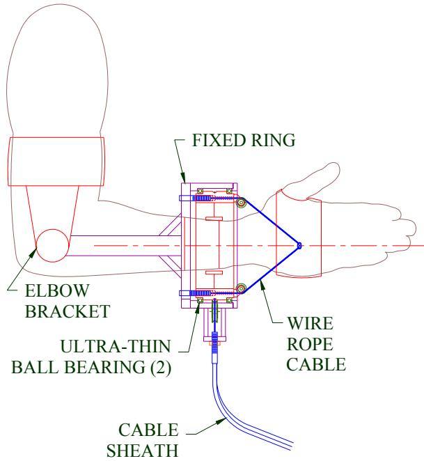
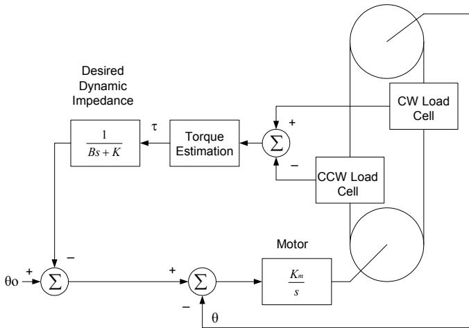
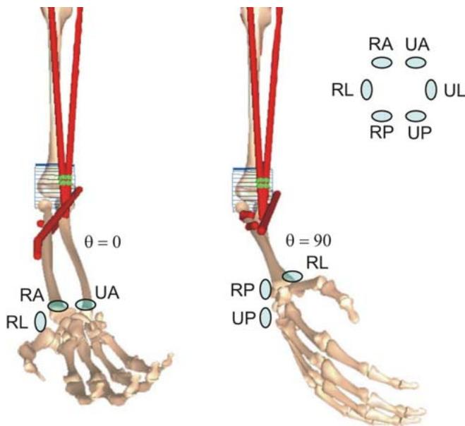

# 用于前臂旋前与旋后康复的外骨骼

D. S. Andreasen1, A.A.Aviles1, S.K. Allen1, K.B.Guthrie1, B.R.Jennings1, S.H. Sprigle2

1Georgia Tech Research Institute, Georgia Institute of Technology, Atlanta, GA, USA

2Center for Assistive Technology and Environmental Access, Georgia Institute of Technology, Atlanta, GA, USA

摘要— 脊髓损伤（SCI）、获得性脑损伤（ABI）或卒中（stroke）后的功能丧失对个人的生活质量有着显著影响。功能恢复一直是物理治疗和作业治疗的长期目标。重复运动练习已被证实对运动功能恢复至关重要。本文介绍了一种用于神经运动康复及上肢神经肌肉系统恢复的机器人设备的开发。该执行器机构在可行时允许自由运动，并能提供可编程的治疗级阻力。传感器系统可对所施加的外力进行表征，并精确测量关节的活动度。控制系统根据传感器数据、标定程序和运行模式，提供执行器指令的实时反馈。

关键词— 康复机器人，外骨骼

## I. 引言

本文介绍了一种用于支持患有颈段脊髓损伤（SCI）、获得性脑损伤（ABI）或卒中等神经损伤患者上肢康复的机器人系统。该机器人辅助康复设备将用于提供重复运动练习，以促进神经恢复并改善上肢的功能性使用。其技术目标是开发一种计算机控制的交互式动力矫形器，能够对康复患者的上肢运动进行训练。第二个目标是开发经过优化的训练方案，以产生日常生活活动（ADLs）中涉及的代表性运动模式。控制选项将包括多种训练协议，如主动、主动助力和抗阻模式。

SCI、ABI 或卒中后的功能丧失对个人的生活质量有着显著影响。功能恢复是物理治疗和作业治疗的长期目标。近期的技术进步推动了针对上肢和下肢功能性运动恢复的研究。这些努力不仅出于人道主义考量，也是基于经济成本效益的要求，特别是在当前医疗卫生服务经济背景下更是如此。鉴于住院时间的显著缩短，临床上迫切需要既操作便捷又经济实惠、兼顾康复医院和家庭使用的机器人训练设备。

重复运动练习已被证实对运动恢复至关重要 [1]。这一主题促使多个团队开发用于神经运动的机器人应用

用于上肢功能恢复的康复训练。多种康复机器人装置致力于为个体提供一台机器人，以便在直接或间接控制下执行任务 [2]。许多研究人员描述了将商用机器人用于康复应用的情况，包括 RT100 和 PUMA-560 机械臂 [3]。商用机器人的一个局限性在于其重量、尺寸，以及需要在基座附近安装大扭矩电机以移动整个机械臂。这一局限性促成了专用康复机械臂的开发。

一些研究人员描述了专门用于训练和神经康复的机器人装置。文献 [4] 描述了一种用于研究“抽象肘部屈伸运动”的装置。用户的肘关节被置于伺服机构中，算法控制对患者肘关节运动的辅助。一款成功的康复机器人装置是 MIT-MANUS，这是一种用于临床应用的新型低阻抗机器人 [5]。MIT-MANUS 的一个理想特性是通过在反馈控制系统中使用阻抗控制来实现的。该控制系统能够对来自患者或临床医生的外部扰动产生温和柔顺的反应。用户穿戴式动力矫形器也已得到开发，并在肌营养不良症、脊髓性肌萎缩症患者以及正常健康成年人中取得了一定的成功应用。

## II. 研究方法

下图展示了执行器的机械设计。该执行器采用线缆驱动，从而最大限度地减轻了施加在患者身上的驱动机构重量。前臂旋转机构通过矫形器连接到前臂。矫形器的设计旨在舒适贴合用户的手臂，并提供与机构的连接方式。为了实现功能性运动，该组件被设计为允许肘关节和腕关节自由活动。该执行器在旋后过程中执行与肱二头肌和旋后肌相同的运动动作，在旋前过程中执行与旋前方肌和旋前圆肌相同的运动动作。

驱动机构的动力由便携式基座单元提供，该单元包含由电动机驱动的串联弹性执行器。基座单元包括用于测量线缆受力的称重传感器。一组角度传感器（一个位于驱动机构上，另一个位于前臂执行器上）用于为控制系统提供位置反馈。该控制系统的一个独特特性是在驱动中结合了串联弹性元件。弹性执行器的优势在于，即使面对来自用户的突发扭矩输入，系统在机械上也具有天然的柔顺性。弹性执行器的弹簧刚度根据康复所需的最大力进行选择。该串联弹性执行器基于文献 [6] 的研究成果，具有良好的力控制、高力保真度以及极小阻抗的优点。

  
Figure 1 前臂康复驱动机构

运动控制器的设计目标是基于手臂与机器人机械结构的组合运动方程，开发完全可编程的机械阻抗。阻抗控制概念 [7] 是向用户提供代表二阶动态系统的力反馈。描述前臂轴动态行为的简化通用方程为：

$$
\boldsymbol {\tau} _ {e x t e r n a l} = I \stackrel {\bullet \bullet} {\theta} + B \stackrel {\bullet} {\theta} + K (\theta - \theta_ {0})\tag{1}
$$

其中 $\theta$ 为前臂旋转角度，$\tau$ 为施加在模拟阻抗上的外部力矩，$K$ 为刚度分量，$\mathrm { B , }$ 为线性阻尼分量，$I$ 为转动惯量。控制器的设计使得这些参数可以在适合预期治疗的有效范围内进行定义。参数 $\theta _ { \alpha } , \ M ,$ B 和 K 在运动控制计算机系统中指定，并根据操作模式进行脚本化设定。

阻抗控制算法在运动控制处理器中作为采样数据系统实现。描述期望动态行为的参数从用户计算机传递到运动控制处理器。运动控制处理器对位置和力数据进行采样，计算驱动力，然后

向电机驱动器提供驱动指令。控制系统的传感器输入为前臂旋转角度以及施加在旋前/旋后轴上的力矩。

Figure 2 显示了在运动控制处理器中实现的一个控制回路。该控制回路配置为提供如下表观阻抗：

$$
\boldsymbol {\tau} = B s \left(\theta - \theta_ {0}\right) + K \left(\theta - \theta_ {0}\right)\tag{2}
$$

该控制回路通过反馈测量力矩并驱动前臂旋转角度来匹配期望的动态响应。该方法与 [8] 中使用气动执行器进行手臂运动的方法类似。测量力矩根据来自传感器的输入进行计算。在方框图所示的案例中，传感器是与缆索串联的两个称重传感器。力矩根据顺时针和逆时针称重传感器中测得的力之差以及执行器内环的已知半径计算得出。测量力矩通过一个对期望动态阻抗进行建模的滤波器。滤波器的输出是对应于期望动态阻抗的期望角度。围绕前臂旋转角度形成位置闭环回路，以使实际旋转角度与期望角度相匹配。

  
Figure 2 阻抗控制系统

在运行过程中，来自用户界面进程、定义了期望运动动力学特性的时间序列脚本被传递到实时循环中。根据脚本中的参数，致动器角度在位置和力传感器的反馈下以闭环方式进行调整。传感器数据以 1 kHz 的固定采样率进行数字化。该 1 kHz 采样率由多功能数据采集卡上的计数定时器设定。在采集到 32 个样本后，运动控制方程进行更新。运动控制算法的结果被

写入 D/A 转换器以驱动致动器。数据还会实时显示在计算机屏幕上，并可写入文件以供离线分析。

所提出的机器人疗法实用性的一个关键要素是准确感知施加在关节上的力矩的手段。进化并没有赋予人体用于安装力矩和负荷传感器的机加工测力板。取而代之的是皮肤、脂肪组织和肌肉。训练有素的治疗师的双手可以主观地感知施加到关节上的力矩大小。系统中使用了若干冗余传感器来测量机器人施加的力。

第一种传感器是一组与通往致动器的线缆串联的负荷传感器。这些传感器用于测量通过线缆施加给患者的力。测得的力还包括手臂和外骨骼的重量。当致动组件的重量和方向产生的力分量大于施加给用户的实际力时，使用与线缆串联的传感器可能会导致测量误差。施加力的冗余测量依赖于驱动轴与前臂旋转角度测量值之间的角度差。已知串联弹性致动器（series elastic actuator）的弹簧常数，即可计算出通过线缆连杆施加的力矩。两个测量值之间的较大差异可用于标记传感器故障，并禁用对致动器的驱动。

  
Figure 3 接触力传感器

力矩测量的第二种方法基于安装在矫形器中的气囊。布置了六个独立的气压感应气囊，用于感知施加在尺骨和桡骨远端周围的力。尺骨后侧、外侧和前侧各一个（UP、UL、UA），桡骨后侧、外侧和前侧各一个（RP、RL、RA）[9]。其设计理念是，控制系统可以像训练有素的治疗师感知施加力一样使用这些传感器。气压传感器的优点在于它们非常靠近机器人与用户之间的接触点，顺应前臂和致动器的运动，并允许前臂旋转中心在不同旋转角度下发生变化。

## III. 结果

该控制系统已在运行 Windows XP 的笔记本电脑上实现。使用多功能数据采集卡采集传感器数据并向电机反馈驱动指令。控制方程已采用 C++ 实现。

该装置可实现多种用于通过重复性训练恢复功能的控制模式。运动控制处理器中已实现以下控制模式：

等长模式（Isometric Mode）：在该模式下，机械臂感知来自患者的扭矩。阻抗控制算法中的参数 $\theta _ { \mathrm { o } }$ 被设定为固定值。在一种实现方案中，$K$ 逐渐递增至高数值，以在固定位置对运动提供强阻力。随后要求患者施加恒定扭矩尝试移动该机构。测量、存储并绘制所产生的扭矩。该模式还可用于测量固定位置处的肌力以及肌肉疲劳度。

主动阻力模式（Active Resistance Mode）：该模式对运动提供主动阻力。在控制器中，该模式通过将阻尼系数 $B$ 设定为常数来实现。控制器的作用是通过提供与角度变化率成正比的扭矩反馈来抵抗位置变化。阻尼系数的值可以作为角度的函数进行阶梯式调整，以施加随角度变化的动态阻力。对于离心运动，可以增加阻力以增强力量。

## IV. 结论

本文介绍了一种具有极大辅助神经运动康复潜力的机器人装置的研发。该系统计划在美国顶尖康复医院之一——位于佐治亚州亚特兰大的 Shepherd Center 进行评估，临床医生和潜在用户将参与其中。未来围绕该系统的工作预计将包括在临床康复环境中优化控制模式和动态阻抗参数。

## 致谢

这项工作由 Georgia Tech Research Institute（佐治亚理工学院研究所）的内部研发项目资助。作者谨向 Shepherd Center 的作业治疗师和物理治疗师表示感谢，感谢他们对康复机器人需求提出的宝贵见解。

## 参考文献

[1] Hummelsheim, H. Rationales for improving motor function. Current opinion in Neurology. 12:697-701, 1999.

[2] Harwin, W.S., Rahman, T., & Foulds, R.A. “A review of Design Issues in Rehabilitation Robotics with Reference to North American Research” IEEE Transactions on Rehabilitation Engineering, March 1995.

[3] Ezenwa, B.N., Bismar, H., Bator, C. “Development of a Robotbased Work Station for OT Upper Extremity Coordination Therapy” Engineering in Medicine and Biology Society, 1993. Proceedings of the 15th Annual International Conference of the IEEE, 1993.

[4] Cozens, J.A., “Robotic assistance of an active upper limb exercise in neurologically impaired patients” , IEEE Transactions on Rehabilitation Engineering, June 1999.

[5] Krebs, H.I., Volpe, B.T., Aisen, M.L., Hogan, N. “Increasing productivity and quality of care: Robot-aided neurorehabilitation”, Journal of Rehabilitation Research and Development November/December 2000.

[6] Robinson, D.W., Pratt J.E., Paluska, D.J., Pratt G.A. “Series Elastic Actuator for a Biomimetic Walking Robot” IEEE/ASME Int’l Conference on Advanced Intellegent Mechatronics, September 1999.

[7] Hogan, N, “Stable Execution of Contact Tasks Using Impedance Control”, Robotics and Automation. Proceedings. 1987 IEEE International Conference on , Volume: 4 , Mar 1987.

[8] Noritsugu,T., Tanaka, T. Yamanaka, T, “Application of a Rubber Artificial Muscle Manipulator as a Rehabilitation Robot”, 1996 IEEE International Workshop on Robot and Human Communication. Pg 112-117.

[9] 前臂图形图像使用交互式肌肉骨骼建模软件（Musculographics Software for Interactive Musculoskeletal Modeling）软件包捕获，Motion Analysis Corporation，加利福尼亚州圣罗莎（Santa Rosa CA）。