# Kinematic Data Analysis for Post-Stroke Patients Following Bilateral Versus Unilateral Rehabilitation With an Upper Limb Wearable Robotic System

Hyunchul Kim, Levi Makaio Miller, Irina Fedulow, Matt Simkins, Gary M. Abrams, Nancy Byl, and Jacob Rosen

Abstract—Robot-assisted stroke rehabilitation has become popular as one approach to helping patients recover function post-stroke. Robotic rehabilitation requires four important elements to match the robot to the patient: realistic biomechanical robotic elements, an assistive control scheme enabled through the human–robot interface, a task oriented rehabilitation program based on the principles of plasticity, and objective assessment tools to monitor change. This paper reports on a randomized clinical trial utilizing a complete robot-assisted rehabilitation system for the recovery of upper limb function in patients post-stroke. In this study, a seven degree-of-freedom (DOF) upper limb exoskeleton robot (UL-EXO7) is applied in a rehabilitation clinical trial for patients stable post-stroke (greater than six months). Patients had a Fugl-Meyer Score between 16–39, were mentally alert ( 19 on the VA Mini Mental Status Exam) and were between 27 and 70 years of age. Patients were randomly assigned to three groups: bilateral robotic training, unilateral robotic training, and usual care. This study is concerned with the changes in kinematics in the two robotic groups. Both patient groups played eight therapeutic video games over 12 sessions (90 min, two times a week). In each session, patients intensively played the different combination of video games that directly interacted with UL-EXO7 under the supervision of research assistant. At each session, all of the joint angle data was recorded for the evaluation of therapeutic effects. A new assessment metric is reported along with conventional metrics. The experimental result shows that both groups of patients showed consistent improvement with respect to the proposed and conventional metrics.

Index Terms—Evaluation metric, exoskeleton, stroke rehabilitation, video game.

## I. INTRODUCTION

R EHABILITATION-INDUCED recovery of motor function in patients chronic post-stroke has attracted great interest due to its potential contribution to quality of life [1].

Recent improvement in brain mapping techniques such as transcranial magnetic stimulation (TMS), positron emission tomography (PET), and functional magnetic resonance imaging (fMRI) have provided researchers a deeper understanding of brain plasticity and neurophysiology. The most interesting and important result from this line of research is that immediate and injury-related motor cortex reorganization in patients can be significantly affected by the post-stroke motor experience in the chronic phase post-stroke [2], [3]. One important question is thus what types of rehabilitative training administered post-stroke can drive the plasticity of the brain post-acute recovery? Intervention strategies based on sound motor recovery principles can facilitate maximal recovery with patients chronic post-stroke [1], [3].

Recently robot-assisted rehabilitation treatment has demonstrated that robotic systems can be useful tools for patients suffering from a wide range ofneuromuscular disorders [4]–[6]. MIT-MANUS [6] is one of the successful rehabilitation robots. MANUS adopted a backdrivable hardware and impedance control to advance robot control system [6]. ARMin is an exoskeleton developed in ETH Zurich and University of Zurich. There are several existing ARMin prototypes, all of which (except for the first) consist of seven degrees-of-freedom (DOF) [5]. This robot provides visual, acoustic and haptic interfaces together with cooperative control strategies to facilitate the patient’s active participation in the game. The lengths of the upper arm, lower arm, hand, and the height of the device are adjustable to accommodate patients of different sizes. The rehabilitation site and robotic system are wheelchair accessible. Pneu-WREX is six DOF exoskeleton robot developed at University ofCalifornia-Irvine. This robotic system uses pneumatic actuators [7], [8] since they produce relatively large forces with a low on-board weight [9]. The robot interacts with virtual-reality game T-WREX based on a Java Therapy 2.0 software system [8]. Another distinguishing feature of this robot is its assist-as-needed control scheme [7], [8]. In this adaptive control scheme, the controller detects a patient’s intention so that a minimal amount of assistance is applied to the patient. Arizona State University researchers developed a robotic arm, RUPERT (robotic upper extremity repetitive therapy) targeted for the cost-effective and light weight stroke-patient rehabilitation system [10], [11]. The device provides the patient with assistive force to facilitate fluid and natural arm movement essential for daily activities such as eating or reaching for objects. The controller for the pneumatic muscles can be programmed for the specific user to improve arm and hand flexibility and strength by providing a repetitive exercise pattern. The rehabilitation program does not support the interaction with a virtual reality environment.

Although we have seen much progress in these areas, current research efforts may be subject to the following deficiencies: 1) to the best of our knowledge no one has applied seven DOF upper limb exoskeleton robot to the bilateral movement training, 2) the assistive control schemes in the rehabilitation programs do not consider the redundant nature of the human arm movement, and 3) there is no built-in inherent objective evaluation metric that can measure the rehabilitation progress on a fine-scale.

The proposed work in this paper attempts to accommodate the deficiencies described above and presents the clinical trial results as well as the complete description of the rehabilitation system model. The seven DOF exoskeleton robot UL-EXO7 [4], [12] is exploited as a core mechanical system that can support 97% of the human arm workspace [12], [4]. The controllers equipped in UL-EXO7 can provide the assistive force to help patients make the natural arm posture based on the work in [13] and [14]. For the objective and fine-scale rehabilitation assessment, we introduce a new assessment metric: an efficiency index that can tell us how close the patients arm movements are to the normal subject’s arm movement.

## II. TYPES OF REHABILITATION

The best rehabilitation program is one that maximizes the effect of the therapy. We introduce the most well-known rehabilitation schemes applied to the clinical trials based on the upper limb exoskeleton (Fig. 2). Several factors, including time, cost, and performance improvement, must be weighed when selecting the most appropriate rehabilitation program.

## A. Unilateral Movement Training

The most well known and widely tested motor rehabilitation scheme is unilateral movement therapy. In this rehabilitation scheme, therapists encourage use of the hemiplegic limb of the stroke patient. The most common type ofunilateral type therapy is the constraint-induced movement therapy (CMT) [15], which showed some success in expediting progress toward recovery of upper limb function [16], [17]. In this type of therapy, the patient’s intact limbs are constrained by a harness to prevent them from moving while the paretic limb interacts with therapist or environment [18], [19]. The theory behind CMT is based on the fact that stroke patients learn how to live without using the affected limb and this will result in decreased functionality of body as a whole. Thus, patients must be encouraged to use the impaired limb by restraining the intact limb. Robot-based rehabilitation therapies to date have been based on unilateral movement training [6], [20].

## B. Bilateral Movement Training

Recently, an alternative rehabilitation approach known as the bilateral movement training has been proposed. The bilateral movement training promotes functional recovery of the impaired limb by using both the intact limb and the impaired limb simultaneously. Based on studies of the interlimb coordination in healthy adults [1], it is known that the bilateral movement training can promote the functional recovery of the impaired limb by exploiting the coupling effect between the upper limbs. During the symmetric and bilateral movement of the limb, what is happening inside brain is that the intact hemisphere interacts with the damaged hemisphere such that this type of brain stimulation might result in improved therapy result. There are couple of research result about the effectiveness of the bilateral movement training. Mudie and Matyas [21] performed 30–40 sessions of bilateral movement training on 12 chronic stroke patients who had been previously treated by the unilateral movement training and demonstrated significant effect of the bilateral movement training. Other studies have reported positive results using the combination of bilateral training protocol, active/passive movements [22], synchronous and alternating movements with rhythmic auditory cuing [23], [24], and bilateral movements with neuromuscular stimulation of the impaired arm [25], [26]. The recent work by [27] presented the direct comparison result between unilateral and bilateral training protocols. In this research, the effect of bilateral training following six sessions of training duration was evaluated. It was reported that the bilateral training showed a positive effect when the subjects are exposed to 6–40 training sessions [25], [26], [28].

## III. SYSTEM MODEL

The entire rehabilitation system is described in Fig. 1(a). The rehabilitation robotic system is composed of three major parts which are UL-EXO7 exoskeleton robot, control algorithm and video games that interact with UL-EXO7. UL-EXO7 Control PC controls the motion controller to motorize the UL-EXO7 based on the XPC/Host-Target interface and all the sensory inputs from the UL-EXO7 are transmitted to the game PC [Fig. 1(a)] through the UDP protocol to minimize the data transmission latency among systems. There are eight different games in the game PC which are joint movement, flower, paint, reach, pong, circular pong, pinball, and hand ball games. They are programmed using the Microsoft Robotic Developer Studio 2008 [29]. The patients can manipulate the objects in each game by moving a specific joint or the whole arm of the robot. The virtual interaction between the game and the patients are feedbacked to the UL-EXO7 Control PC to create the proper haptic interaction between the robot and patients.

## A. UL-EXO7 Exoskeleton Robot

UL-EXO7 [4], [12] is a seven DOF exoskeleton. Articulation of the exoskeleton is achieved by seven single-axis revolute joints [Fig. 3] which support 99% of the range-of-motion required to perform daily activities [4]. Rotating the first joint by 47.5 around the x axis (right direction with respect to the right shoulder), 53.6 around the y axis (frontal direction with respect to the right shoulder), and making joints two and three orthogonal to their preceding joint, the singularity in the shoulder can be located outside of the human arm workspace during ADL. Three revolute joints are responsible for shoulder abduction–adduction, flexion–extension, and internal–external rotation. A single rotational joint at the elbow creates elbow flexion–extension. Finally, the lower arm and hand are connected by a three-axis spherical joint d on October 01,2026 at 09:38:13 UTC from IEEE Xplore. Restrictions apply.

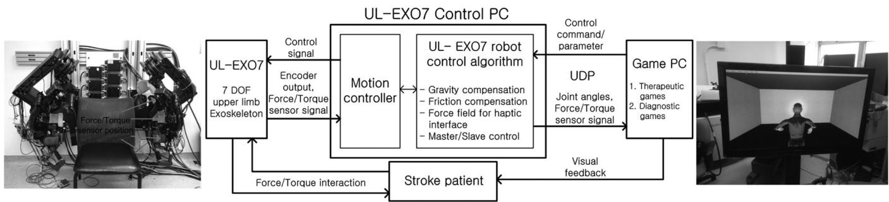  
Fig. 1. Stroke patient rehabilitation system model based on an upper limb exoskeleton robot.

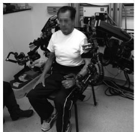  
(a)

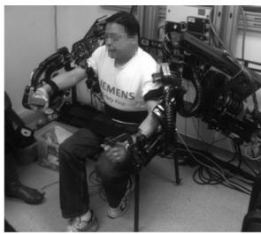  
(b)

Fig. 2. Patients during the unilateral and bilateral movement training in University of California-San Francisco. (a) Unilateral movement group patient with paretic limb on his left side and (b) bilateral movement group patient moving both arms.  
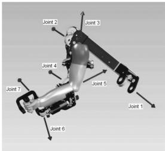  
(a)

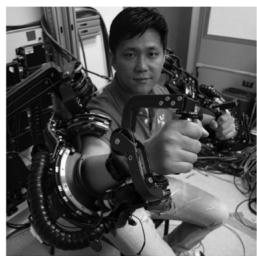  
(b)  
Fig. 3. (a) Joint axis of the upper limb exoskeleton. (b) Exoskeleton supporting 99% of the range-of-motion required to perform daily activities.

resulting in wrist pronation–supination, flexion–extension, and radial–ulnar deviation. As a human–machine interface (HMI), four six-axis force/torque sensors (ATI Industrial Automation, model-Mini40) are attached to the upper arm, the lower arm, the hand, and the tip of the exoskeleton. The force/torque sensor at the tip of the exoskeleton allows measurement of interactions between the exoskeleton and the environment.

## B. Controls

1) Gravity Compensation: The dynamic equation of robot motion characterizes the following time varying response of a system given external influences and initial states. Although dynamics ofthe robot are highly nonlinear and complex, under the assumption of rigid body dynamics all open chain manipulators can be formulated as

$$
\tau = M (\theta) \ddot {\theta} + C (\theta , \dot {\theta}) \dot {\theta} + N (\theta)\tag{1}
$$

where $M _ { n \times n } , C _ { n \times n }$ , and $N _ { n \times 1 }$ mean the manipulator inertia matrix, Coriolis matrix and gravitational terms with other external forces, respectively. Only the $N ( \theta )$ term in (1) is required for the gravity compensation and the compensation algorithm is described in [30]. Assuming that the angular velocity and the acceleration of the joint angles are negligible for the human arm movement, compensating the gravity can resolve the most ofthe human arm dynamic such that gravity compensation becomes the background control scheme for the exoskeleton control.

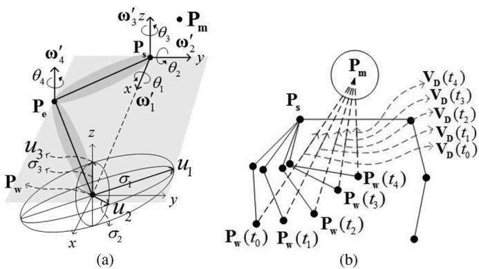  
Fig. 4. (a) Manipulability ellipsoid at the wrist joint and (b) Virtual destination connecting $P _ { m }$ and the wrist joint.

2) Friction Compensation: It is well known that friction depends on both velocity and position, but it is hard to establish the general model to explain this phenomenon especially at low velocity [31]. Thus, considering the computational efficiency and the stability of the control algorithm, the basic form of coulomb friction model [31] is employed as a friction compensation algorithm. To prevent the ambiguity at zero velocity, the individual joint torque for friction compensation is given by the linear model in Fig. 5(a). The friction in the range of $\dot { \theta } \leq \dot { \theta } _ { \mathrm { g u a r d } }$ is modelled as a linear function and $\dot { \theta } _ { \mathrm { g u a r d } }$ is chosen empirically and experimentally for each joint.

3) Force Fields With Swivel Angle Estimation: In the robotassisted rehabilitation therapy, providing an assistive force is necessary and important. For the specific game, robot provides an assistive force by creating a force field based on the target location and current end-effector position such that patient can move their affected arm toward the target in the virtual environment. Fig. 5(b) describes the force filed generation mechanism for the given end-effector position. Due to the redundant nature of the seven DOF robot, the relative position of the hand with respect to the target location can not be directly translated to the assistive force without properly defining the redundancy of the seven DOF exoskeleton robot, which can be parameterized d on October 01,2026 at 09:38:13 UTC from IEEE Xplore. Restrictions apply.

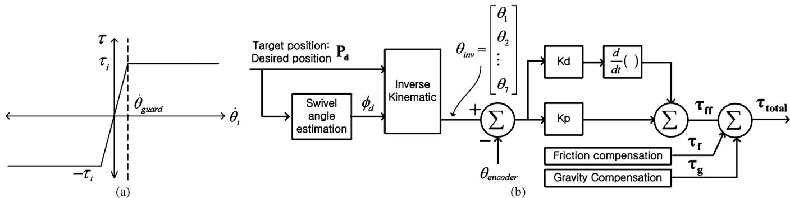  
Fig. 5. (a) The Coulomb friction model which is simplified and modified to prevent the ambiguity at the zero velocity. The friction within $\dot { \theta } _ { \mathrm { g u a r d } }$ is modelled as a linear function considering the practical implementation and $\dot { \theta } _ { \mathrm { g u a r d } }$ is empirically chosen. The practical system has 0.01 for the $\dot { \theta } _ { \mathrm { g u a r d } }$ . (b) The force filed generation mechanism based on the given wrist position and the swivel angle estimation.

by the swivel angle—the rotation angle of the plane including the upper and lower arm around a virtual axis connecting the shoulder and wrist joints in space [32], [33].

The previous work in [13] showed that the manipulability at the end-effector position is given as the ellipsoid under the constraint $\Sigma _ { i = 1 } ^ { n } \dot { \theta } _ { i } ^ { 2 } = \mathrm { 1 }$ [Fig. 4(a)] and the natural human arm movement for the reaching task can be reproduced when the swivel angle is set to make the projection of the largest manipulability vector $u _ { 1 }$ in Fig. 4(a) onto the virtual trajectory $V _ { D }$ in Fig. 4(b) maximized. The virtual trajectory $V _ { D }$ is defined as the vector connecting the joint of the wrist and the virtual target point $P _ { m }$ on the head. The philosophy behind this swivel angle estimation is that the swivel angle is selected by the motor control system to efficiently retract the palm to the head region. It implies that during the arm movement toward an actual target, the virtual target point on the head is also setfor the potential retraction ofthe palm to the virtual target [13], [14].

The equations (2) and (3) show the swivel angle estimation algorithm applied to the force filed generation in Fig. 5(b) for a given $P _ { m }$ (point on the head), $P _ { w }$ (wrist joint) and $P _ { s }$ (shoulder joint)

$$
\vec {f} = P _ {w} - P _ {m}, \quad \vec {f} ^ {\prime} = \vec {f} - (\vec {f} \cdot \vec {n}) \vec {n}\tag{2}
$$

$$
\phi = \arctan 2 (\vec {n} \cdot (\vec {f ^ {\prime}} \times \vec {u}), \vec {f ^ {\prime}} \cdot \vec {u})\tag{3}
$$

where $\vec { n } = P _ { w } - P _ { s }$ and $\vec { u } = \vec { a } - ( \vec { a } \cdot \vec { n } ) \vec { n } ) / \| \vec { a } - ( \vec { a } \cdot \vec { n } ) \vec { n } \|$ Setting $\vec { a } = \vec { - z }$ in , position the elbow at its lowest point when $\phi = 0 [ 3 2 ]$ . Once the swivel angle estimation is completed, the actual joint angles $\{ \theta _ { 1 } , \theta _ { 2 } , \theta _ { 3 } , \theta _ { 4 } \}$ can be computed by solving the following equations [13]:

$$
T _ {1} T _ {2} \left[ \begin{array}{c} P _ {e _ {o}} \\ 1 \end{array} \right] = \left[ \begin{array}{c} P _ {e} (\phi_ {t}) \\ 1 \end{array} \right], \quad T _ {1} T _ {2} T _ {3} T _ {4} \left[ \begin{array}{c} P _ {w _ {0}} \\ 1 \end{array} \right] = \left[ \begin{array}{c} P _ {w} \\ 1 \end{array} \right]\tag{4}
$$

where $T _ { i }$ is the 4 4 homogeneous transformation matrix from the link frame $i - 1$ to $i , P _ { e _ { o } }$ , and $P _ { w _ { 0 } }$ is the initial position of the elbow and the wrist, $P _ { e } ( \phi _ { t } )$ is the elbow position as a function of swivel angle $\phi _ { t }$ and $P _ { w }$ is the given end-effector (wrist) position. Note that the $\big \{ \theta _ { 5 } , \theta _ { 6 } , \theta _ { 7 } \big \}$ which defines the wrist orientation is set {0,0,0} to force the patient’s wrist to be at the neutral position of the hand.

4) Master–Slave Control: For the bilateral movement training, intact limb assists the paretic limb. In order to support this mechanism, desired joint angles are transmitted from the intact limb (Master) to the paretic limb (Slave). The difference of the joint angle between the master and slave side is fed into the PD controller to create the joint torque on the slave side. Since forcing slave side to be completely symmetric with master side can harm the patient’s contracted muscle on the affected limb, the joint torque on the slave side is limited.

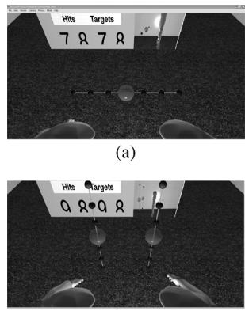  
(c)

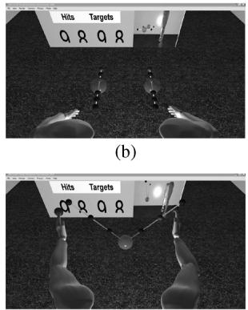  
(d)  
Fig. 6. Flower game: (a) targets on the horizontal line, (b) targets on the another horizontal line rotated by 90 , (c) targets on the vertical lines, and (d) targets on the V shaped-lines targets. There are seven more configurations based on this V shaped-line, where targets are rotated toward the torso by $4 5 ^ { \circ }$ , 90 , 135 , 180 , 225 , 270 , and $3 1 5 ^ { \circ }$ with respect to the target locations in (d).

## C. Video Gamesfor Rehabilitation

There are total of eight different games designed for the rehabilitation program, which are flower, paint, joint movement, reach, pong, circular pong, pinball, and hand ball games. Flower, paint, joint movement, and reach games can be classified as diagnostic games due to the structured tasks in each game while the rest of the games are purely therapeutic games. All the participants played the game for 2 h in their visit to the UCSF medical center under the supervision of a physical therapist.

1) Flower Game: There are eleven different configurations in this game. Fig. 6 shows the four representative configurations among all. The rest of the configurations are variant of those in Fig. 6(d) and have targets on the same V shaped-lines, where targets are rotated toward the torso by 45 , 90 , 135 , 180 , 225 , $2 7 0 ^ { \circ }$ , and $3 1 5 ^ { \circ }$ with respect to the target locations in Fig. 6(d). In each configuration, patients are instructed to touch the large d on October 01,2026 at 09:38:13 UTC from IEEE Xplore. Restrictions apply.

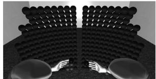  
(a)

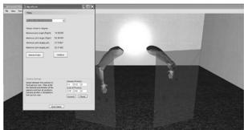  
(b)

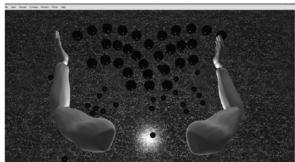  
(c)

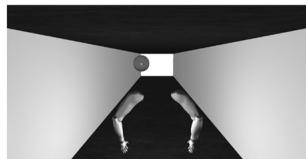  
(d)

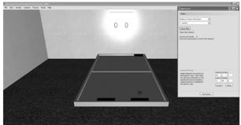  
(e)

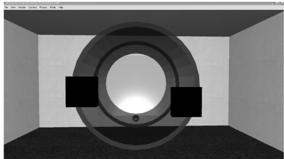  
(f)

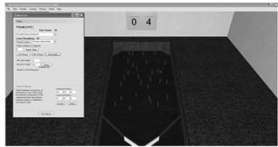  
(g)  
Fig. 7. (a) Paint game. (b) Joint movement game. (c) Reach game. (d) Handball game. (e) Pong game. (f) Circular pong game. (g) Pinball game. All games are programmed by the Microsoft Robotic Developer Studio 2008 [29].

ball at the center to initiate the session and reach the farthest small balls as their hands follow the straight line. By touching the ball at the center again, patients move on to the next configuration. For the unilateral movement training group, patients only touch the targets which are on the same side as their affected limb while bilateral movement training group reach all the targets at the same time. The unilateral movement training group patients are supported by the force filed such that there is a weak assistive force toward target which helps patient follow the desired path.

2) Paint Game: In this game, the small target balls are created spherically around the robot. When patients touch the target balls, the ball color turns into the different color, as shown in Fig. 7(a). The ratio of touched balls and total number of target balls can be used to assess the patient’s mobility improvement. The therapist can set up the radius at which the balls are created considering the degree of patient’s impairment. The default radius defined as the distance between the target balls and the center of the body is 50 cm.

3) Joint Movement Game: Joint movement game is a purely diagnostic game which measures the range-of-motion for each joint. This game is composed of the shoulder abduction–adduction, shoulder flexion–extension, shoulder rotation, elbow flexion–extension, wrist pronation–supination, wrist flextion–extension, and wrist radial–ulnar movement measurement. Fig. 7(b) shows the shoulder abduction–adduction measurement example. The blue plane in the figure indicates the plane on which the arm should move.

4) Reach Game: Target balls are created on the plane at the hight of the waist, as shown in Fig. 7(c). When players reaches the target balls in the air, they drop to the floors. This game is classified as the diagnostic game. In case of the bilateral training group patients, they use both hands to drop balls while the unilateral training group patients only drop halfofthe balls on their affected side.

5) Handball Game: Patients hit the bounced ball from the wall, as shown in Fig. 7(d). The bilateral group patients move both arms symmetrically to block the ball while the unilateral patient group only use the paretic limb. For the unilateral patients, bounced ball tends to come to the paretic limb side. This game is purely therapeutic game.

6) Pong Game and Circle Game: In the pong game [Fig. 7(e)], patients compete with the virtual opponent by blocking the ball and returning it toward the opponent side. The circle game [Fig. 7(f)] is similar to the pong game except that circle game moves paddles along the circumference of the cylinder. The bilateral group patients use two paddles symmetrically and unilateral patients use only one paddle to block the ball. In both games, players can choose the specific joint or the end effector position as a control method. For example, patients can use the minimum and the maximum joint range of the wrist as the left-most and right-most position of the paddle. Therapist chooses which control mechanism is proper for each patient.

7) Pinball Game: This game is exactly same as the traditional pinball game [Fig. 7(g)]. Bilateral movement training group patients move both flippers simultaneously using the control joints while the unilateral movement training group patients flip both flippers together by only using an affected limb. Like the pong game, patients can choose the control joints depending on the stroke type so that the range of the specific joint is mapped into the range of the flipper.

## IV. EXPERIMENT PROTOCOL AND EVALUATION METRICS

Fifteen male and female subjects between 27 and 70 years of age, more than six months post-stroke, with a Fugl-Meyer score between 16 and 39 and a score of 19 or greater on the VA Mini Mental Status Exam were recruited for the study. All were screened and consented prior to random assignment. The subjects were subcategorized by severity and then randomly assigned to each ofthe three groups: unilateral robotic training (5), bilateral robotic training (5), or usual care (5). This study was approved by the Committee on Human Research at the University of California-San Francisco (UCSF). Only the two robotic training groups were included in this part of the study.

All subjects were scheduled for 12, 90-min training sessions. The visits were scheduled for twice a week for six weeks. All of the training was based on the integration of a gaming training protocol with upper limb robotic training in the Table I. For the entire sessions, patients were required to play the default session program defined in the Table I. Then according to their number ofvisit to UCSF, they interchangeably played either odd or even session program on top of the default session program. Note that the unassisted flower game in the even session program is the flower game that does not provide patients with the assistive force except the gravity and friction compensation. Since the flower game provides the well-structured target configuration with visualized path, it is suitable for the pure assessment. The therapy programs are carefully chosen and monitored by the physical therapist group in UCSF.

TABLE I  
THERAPY GAME PROGRAM

<table><tr><td>Session</td><td>Program(2 hours, m=minutes)</td></tr><tr><td>Default</td><td>Flower(30m) → Joint movement(15m) → Paint(15m) → Reach(15m)</td></tr><tr><td>Odd</td><td>Pong(15m) → Pinball(15m) → Paint(15m)</td></tr><tr><td>Even</td><td>Circle(15m) → Handball(15m) → Unassisted flower(15m).</td></tr></table>

TABLE II  
EMPLOYED ASSESSMENT METRIC FOR EACH GAME

<table><tr><td>Game Type</td><td>ROM</td><td>TD</td><td>AR</td><td>IE</td><td>PA</td></tr><tr><td>Flower</td><td></td><td> $\lor$ </td><td> $\lor$ </td><td> $\lor$ </td><td></td></tr><tr><td>Paint</td><td></td><td> $\lor$ </td><td></td><td> $\lor$ </td><td> $\lor$ </td></tr><tr><td>Reach</td><td></td><td> $\lor$ </td><td></td><td> $\lor$ </td><td></td></tr><tr><td>Joint movement</td><td> $\lor$ </td><td></td><td></td><td></td><td></td></tr></table>

## A. Evaluation Metrics

During the entire therapy process, all the joint angle data were measured from the patients in realtime. One of the advantages for the robot assisted physical therapy over the traditional physical therapy is it is possible to assess the patient’s progress objectively in a fine scale during rehabilitation, we introduce a couple of performance evaluation metrics adopted in this research. There are a total of five metrics that can be assessed: range-of-motion, travel distance, relative achievement, area around the straight line, and instantaneous efficiency. Depending on the characteristic of the therapy game, the different combination of metrics are employed, as shown in the Table II.

1) Range-of-Motion: The range-of-motion is directly measured when the patients play the joint movement game. The metric is simply the range of each joint

$$
\begin{array}{r} \mathrm{ROM} = [ \theta (1) _ {\max} - \theta (1) _ {\min}, \theta (2) _ {\max} \\ - \theta (2) _ {\min}, \ldots \theta (7) _ {\max} - \theta (7) _ {\min} ] \end{array}\tag{5}
$$

where $\theta ( i ) _ { \mathrm { m a x } }$ and $\theta ( i ) _ { \mathrm { m i n } }$ is the maximum and minimum value of the th joint angle.

2) Painted Area: In the paint game, the ratio oftouched balls and the total number of target balls can be calculated. $P A ( s , r )$ is the painted area at session and repetition ofthe game where $s \in \{ 1 , 2 , \dots 1 2 \}$ and $r \in \{ 1 , 2 , \ldots R \}$ . Note that , the total number ofrepetition for the given time can be different between subjects. Then scalar value $\begin{array} { r } { P A _ { e } ( s ) = ( 1 / R ) \sum _ { r = 1 } ^ { R } P A ( s , r ) } \end{array}$ becomes the averaged painted area computed at session .

3) Travel Distance: Travel distance defined in (6) is the integrated travel distance of the patient’s hand in a specific game. The $T D ( s , r )$ in (6) means the travel distance measured at session and repetition of each game, and $T D _ { e } ( s )$ in (7) is the travel distance averaged over the repetition . This value will be monitored throughout the entire sessions. It is expected that the travel distance reduces as the therapy progresses

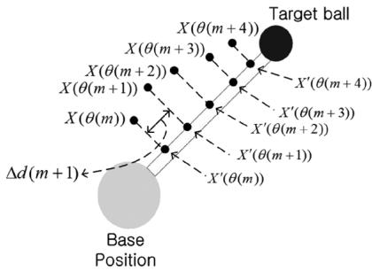  
Fig. 8. Area around straight line: Area of hand trajectory enclosing the desired trajectory.

$$
T D (s, r) = \sum_ {n = 0} ^ {N - 1} \| X (\theta (s, r, n)) - X (\theta (s, r, n - 1)) \|\tag{6}
$$

$$
T D _ {e} (s) = \frac {1}{R} \sum_ {r = 1} ^ {R} \left[ T D (s, r) \right].\tag{7}
$$

$X ( \theta ( s , r , n ) )$ is the hand position of the exoskeleton robot at the th sampled time index in repetition and session . Note that is the total number of repetition done in each session and is total number of samples in each repetition. The time duration between adjacent time indexes is 1/1024 s, which is the sampling rate.

4) Area Around Straight Line: This metric is to measure how much the patient’s hand is deviated from the desired trajectory defined in the assisted and unassisted flower game. Fig. 8 depicts the target locations in the flower game. Patients starts to move their hand from the center of the blue ball and to red target ball following the straight line connecting the blue and red ball as much as possible. The end effector position at the th sampling moment is denoted as $X ( \theta ( m ) )$ and $X ( \theta ( m ) )$ times $\Delta d ( n )$ will be considered as the approximated area around the desired trajectory during the sampling time period. Note that $X ^ { \prime } ( \theta ( m ) )$ is the position vector projected on the straight line connecting the base position and the target

$$
\begin{array}{c} A R (s, r, j) = \sum_ {n = 0} ^ {N - 1} X (\theta (s, r, j, n)) \cdot \Delta d (n) \\ \Delta d (n) = X ^ {\prime} (\theta (s, r, j, n + 1)) - X ^ {\prime} (\theta (s, r, j, n)) \\ A R _ {e} (s) = \frac {1}{R} \sum_ {r = 1} ^ {R} \left(\frac {1}{1 1} \sum_ {j = 1} ^ {1 1} A R (s, r, j)\right) \end{array}\tag{8}
$$

(9)

$A R _ { e } ( s )$ is the averaged $A R ( s , r , j )$ over the 11 different configuration of the flower game and repetition . Note that $X ( \theta ( s , r , j , n ) )$ is the end effector position of the robot at the th sampling moment, th configuration, th repetition, and th session. It is expected that $A R _ { e } ( s )$ reduces as the patient’s arm movements are stabilized.

5) Efficiency Index: Patients after stroke suffer the muscle contraction which results in a limited range-of-motion for the specific joints such that they learn to compensate uncomfortable joints by moving more intact joints. This is possible because human arm is kinematically redundant and can fulfil the task in d on October 01,2026 at 09:38:13 UTC from IEEE Xplore. Restrictions apply.

different postures. As a result, stroke patients get used to the unnatural movement pattern and never achieve the motor function on their affected limb. It is obvious that compensating the movement can deteriorate the quality of the rehabilitation. Although the previously introduced metrics are useful in monitoring the patients progress for the given task, they do not capture how much patient’s movement becomes natural as other healthy subject. Since one of the key factor in the physical therapy is to make the patients move their arm naturally as other healthy subject, it is important to evaluate the patient’s progress in comprehensive manner.

Under the hypothesis that the natural arm movement of the healthy subjects is efficient for the unconstrained reaching tasks and their redundancy resolution for their arm movement is based on the swivel angle estimation introduced in Section III-B3, efficiency index is developed to measure how much the patient’s arm movement resembles the healthy subject’s arm movement. The proposed metric has two versions depending on the therapy type which are efficiency index for the bilateral and unilateral movement training.

Efficiency Index for the Bilateral Movement Training: Let $\begin{array} { r l r } { \theta _ { S l } ( n ) } & { { } = } & { [ \theta _ { S l } ( 1 , n ) , \theta _ { S l } ( 2 , n ) , \ldots \theta _ { S l } ( 7 , n ) ] } \end{array}$ and $\begin{array} { c c l } { { \theta _ { M a } ( n ) } } & { { = } } & { { [ \theta _ { M a } ( 1 , n ) , \theta _ { M a } ( 2 , n ) , \ldots \theta _ { M a } ( 7 , n ) ] } } \end{array}$ mean the joint angles from the master and slave side of the robotic arm recorded at time $n$ . The instantaneous efficiency index for the bilateral movement training is defined as

$$
I E I _ {b i} (s, n) = W \left(\theta_ {S l}\right) \frac {\exp \left(- \sum_ {i = 1} ^ {7} \left(\theta_ {M a} (i , n) - \theta_ {S l} (i , n)\right) ^ {2}\right)}{1 + \sum_ {i = 1} ^ {4} \left(\frac {\theta_ {S l} (i , n) - \theta_ {\mathrm{ref}} (i , n , \phi_ {\mathrm{est}})}{\Delta \theta_ {S l} (i)}\right) ^ {2}}\tag{10}
$$

$$
E I _ {b i} (s) = \frac {1}{N} \sum_ {n = 0} ^ {N - 1} I E I _ {b i} (s, n)\tag{11}
$$

where $\Delta \theta _ { S l } ( i ) = m a x ( \Delta \theta _ { S l } ( i ) ) - m i n ( \Delta \theta _ { S l } ( i ) )$ means the range of the th joint in the slave side and $\theta _ { \mathrm { r e f } } ( i , n , \phi _ { \mathrm { e s t } } )$ is the desired reference joint angles for th joint computed for the given end-effector position and the desired swivel angle $\phi _ { \mathrm { e s t } }$ estimated by (3) in Section III-B3. Note that the repetition variable is omitted from $E I _ { b i } ( s )$ for simplicity. In practice, $E I _ { b i } ( s , r )$ is computed for each repetition cycle.

The numerator of(10) has a Gaussian distribution such that it is maximized when both $\theta _ { M a } ( i )$ and $\theta _ { S l } ( i )$ are same. Since the slave side ofthe robot arm generates smaller torque compared to the master side of the arm, patients should be actively engaged with the robot to make the symmetric arm movement. Thus the numerator indicates how much both hands move symmetrically.

The denominator has a minimum value one when the $\theta _ { S l } ( i )$ is same as the desired joint angle $\theta _ { \mathrm { r e f } } ( i , \phi _ { \mathrm { e s t } } )$ and it indicates whether patients are actively engaged with the given tasks at the slave side or not. Note that since all the tasks given to the patients are in the form of reaching task, the desired joint angles for the patient’s natural arm movement will be close to $\theta _ { \mathrm { r e f } } ( i , \phi _ { \mathrm { e s t } } )$ estimated by (3). In our previous work [13], [14], it was shown that (3) could successfully recreate joint configuration of the natural human arm reaching tasks for the given end effector position. By looking at the denominator, one can capture whether patient avoid the natural arm posture like the healthy subjects or not. If patients do not try to move both arms symmetrically and overcome the limited joint range, the efficiency of the therapy will be reduced. It is worth monitoring the efficiency index because the travel distance does not tell us if patients are using their affected arm in constructive way.

The window function $W ( \theta _ { S l } )$ defined in (12) is a modified sigmoid function where $W ( \theta _ { S l } )$ approaches zero when $\begin{array} { r l r } { \bar { \sum _ { i = 1 } ^ { 7 } | \theta ( i , n ) | } } & { { } \le } & { \theta _ { t h } } \end{array}$ and approaches one when $\begin{array} { r l r } { \sum _ { i = 1 } ^ { 7 } | \dot { \theta } ( i , n ) | } & { { } \ge } & { \theta _ { t h } } \end{array}$ . In this research, sigmoid function is adopted because of its smooth transition around the threshold $\theta _ { t h }$ in a closed form. This function can be replaced with other window functions such as signum or simple form of linear functions. By applying this window function to $I E I _ { b i } ( s , n )$ R only the meaningful joint movement is considered for the data analysis

$$
W (\theta_ {S l}) = \frac {1}{1 + \exp \left(\frac {- \left(\sum_ {i = 1} ^ {7} | \dot {\theta} (i , n) | ^ {2} - \theta_ {t h}\right)}{h}\right)}.\tag{12}
$$

Note that there is no optimum value for $\theta _ { t h }$ and we have empirically chosen $\theta _ { t h } = 1$ and $h = 0 . 5$ considering the noise signal power of the data.

Efficiency Index for the Unilateral Movement Training: In case of unilateral movement training, the equation must be changed considering that there is no master side. From the previous work in [13] and [14], it is shown that the desired joint angles at any time moment is known for the simple reaching and grasping task, the joint angle from the master side $\theta _ { M a } ( i , n )$ can be replaced with desired joint angle $\theta _ { D } ( i , \phi _ { \mathrm { e s t } } , n )$ based on the swivel angle estimation proposed in (2). The modified Instantaneous efficiency for the unilateral movement training is given as

$$
\begin{array}{l} I E I _ {\mathrm{uni}} (s, n) \\ = W (\theta_ {S l}) \frac {\exp \left(- \sum_ {i = 1} ^ {4} (\theta_ {D} (i , \phi_ {\mathrm{est}} , n) - \theta_ {S l} (i , n)) ^ {2}\right)}{1 + \sum_ {i = 1} ^ {4} \left(\frac {\theta_ {S l} (i , n) - \theta_ {\mathrm{ref}} (i , n , \phi_ {\mathrm{est}})}{\Delta \theta_ {S l} (i , n)}\right) ^ {2}} \end{array}\tag{13}
$$

$$
E I _ {\mathrm{uni}} (s) = \frac {1}{N} \sum_ {n = 0} ^ {N - 1} I E I _ {\mathrm{uni}} (s, n).\tag{14}
$$

Similarly from the other metric introduced in the previous section, the averaged efficiency index $E I _ { b i } ( s )$ and $E I _ { \mathrm { u n i } } ( s )$ will be used to represent the result for each session.

## V. SCORING

The evaluation metric of each game is averaged over the time and repetition for each session to get a scalar value and by collecting the scalar value from all 12 sessions, 12 dimensional vector representing the patient’s progress can be formed. Once the 12 dimensional vectors are extracted from the individual subject and game, they were averaged over all subjects belonging to the same training group and all applicable games to the specific metric to extract the group level evaluation result. Finally, the first-order polynomial curve fitting is applied to the

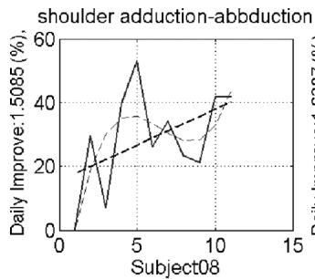

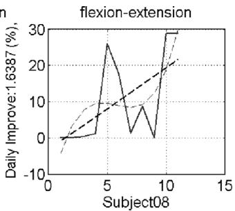

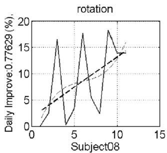

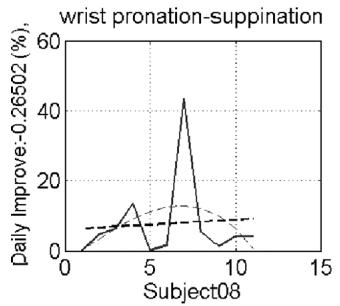

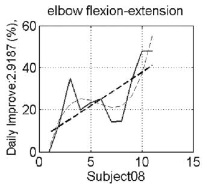

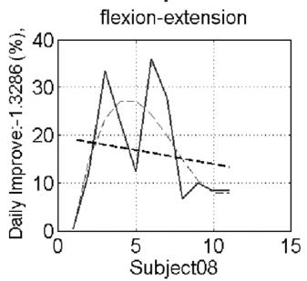

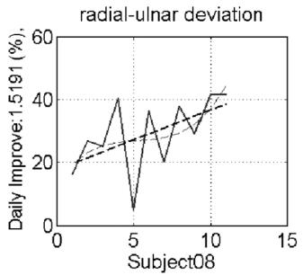

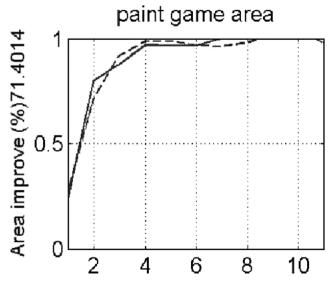

Fig. 9. Averaged range-of-motion (shoulder abduction–adduction, shoulder flexion–extension, shoulder rotation, elbow flexion–extension, Wrist prona tion–supination, wrist flexion–extension, and wrist radial–ulnar deviation) and painted area were calculated for each of the 12 sessions. The range-of-motion is plotted with the first- (black dotted line) and third- (red dotted line) order polynomial fitting while the painted area is plotted with the third-order polynomial fitting.  
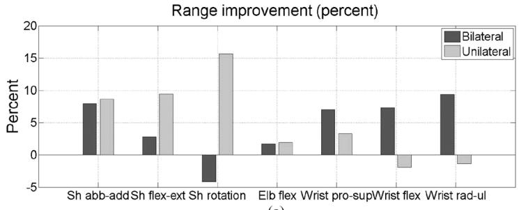  
(a)

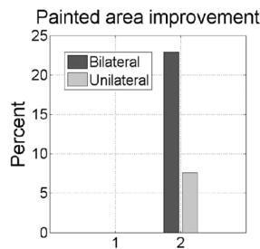  
(b)  
Fig. 10. (a) The range-of-motion improvement in percent. The X axis in this figure means shoulder abduction–adduction, shoulder flexion–extension, shouder rotation, elbow flexion–extension, wrist pronation–supination, wrist flexion–extension, and wrist radial–ulnar. (b) Percentage painted area improvement.

12 dimensional vector. Then conceptually the relative improvement for each training group in terms of the specific metric was defined as

$$
I = \frac {X _ {P} (1 2) - X _ {P} (1)}{X _ {P} (1)} \times 1 0 0\tag{15}
$$

where $X _ { P } ( i )$ means the first-order polynomial curve fitting output of 12 dimensional vector from either unilateral or bilateral movement training group. Fig. 9 shows the exemplary processing result for the range-of-motion and painted area from a single subject. The range-of-motion and the painted area from all 12 sessions are plotted as a blue line. The first-order polynomial curve fitting result is plotted as a black dotted line. Then the relative improvement to the initial session result can be achieved by (15).

Since all dependent variable were measured with multiple trials at each training session, the mean of these measurements could also be determined and described. Thus, the Wilcoxon rank sum test was performed to determine significance between the two groups based on the percent change score.

## VI. RESULTS AND ANALYSIS

The subjects assigned to the two robotic groups were similar in terms of age, gender, and stroke severity. Nine of 10 subjects completed all 12 training sessions while one subject within the unilateral training group only completed eight sessions over nine weeks. This subject had to travel out of the area for personal reasons and could not complete the last four sessions.

## A. Range-of-Motion

The ranges of each joint were measured for shoulder abduction–adduction, shoulder flexion–extension, shouder rotation, elbow flexion–extension, wrist pronation–supination, wrist flexion, and wrist radial–ulnar. The Fig. 10 shows the percentage joint range improvement $I _ { \mathrm { j o i n t } } ( i )$ at th joint from unilateral and bilateral training group.

Let $\Delta \theta _ { i } ^ { \prime } ( S , k )$ and $\Delta \theta _ { i } ^ { \prime } ( 1 , k )$ mean the th joint angle range of subject measured at the final and initial session after the first-order polynomial fitting is applied to the 12 session range-of-motion plot. Then $I _ { \mathrm { j o i n t } } ( i )$ for either unilateral or bilateral training group is defined as

$$
I _ {\mathrm{joint}} (i) = \frac {1}{5} \sum_ {k = 1} ^ {5} \left(\frac {\Delta \theta_ {i} ^ {\prime} (S , k) - \Delta \theta_ {i} ^ {\prime} (1 , k)}{\max \Delta \theta_ {i} ^ {\prime} (k)} \times 1 0 0\right)\tag{16}
$$

where $\Delta \theta _ { i } ^ { \prime }$ is the maximum joint angle range of th joint. Note that two patient did not finish the scheduled 12 sessions due to their personal schedule issue. Thus, will be 12 except on October 01,2026 at 09:38:13 UTC from IEEE Xplore. Restrictions apply.

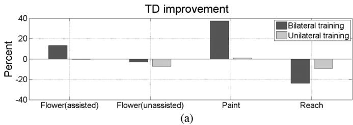

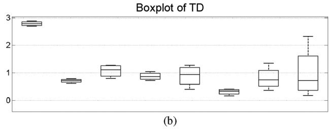  
Fig. 11. Travel distance (a) percentage travel distance improvement for four different games and (b) boxplot of travel distance for four different games. The Y axis in (b) is meter in unit and X axis is same as one in (a).

two patients. This will be applied to other metrics in the same way. The result shows that the unilateral movement training group has relatively higher improvement for the proximal extremities while the bilateral movement training shows higher improvements for distal extremities. In general, it is known that improving the wrist joints are more difficult than improving the shoulderjoints movement. From this aspect, bilateral movement training can be an efficient rehabilitation scheme proper for the distal extremities.

## B. Painted Area

The painted area is only for the paint game. Fig. 10(b) shows that the bilateral movement training group has a higher percentage painted area improvement, which is about 23% while the unilateral group patients showed 8% improvement. The relative improvements for painted area $I _ { P A }$ is computed based on

$$
I _ {P A} = \frac {1}{5} \sum_ {k = 1} ^ {5} \left(\frac {P A (S , k) - P A (1 , k)}{P A (1 , k)}\right) \times 1 0 0\tag{17}
$$

where $P A ( S , k )$ and $P A ( 1 , k )$ mean the painted area of bilateral or unilateral group subject at the final and initial session. Note that the first-order polynomial fitting is omitted for this metric since there is no fluctuation in data.

## C. Travel Distance

Travel distance is estimated for flower (assisted, unassisted), paint and reach games. Relative improvement to the initial travel distance for each game is computed by (18) and the evaluation result is shown in Fig. 11. By looking at the percent improvement of travel distance, it is hard to decide which rehabilitation scheme is better. The averaged travel distance is computed by (19) and shown in Fig. 11(b). According to this, bilateral training group patients showed higher travel distance for most games. This is possible due to the fact that bilateral group patients needed some adaptation time to be used to the coupled motor control scheme. Especially for the assisted flower game [Fig. 11(b)], gap between the bilateral and unilateral training group is biggest. This is possible because the patients in unilateral training group were directly taught by the robot to make the impaired arm move along the desired path even throughout sessions

$$
\begin{array}{c} I _ {T D} (g) = \frac {1}{5} \sum_ {k = 1} ^ {5} \left(\frac {T D _ {e} (S , g , k) - T D _ {e} (1 , g , k)}{T D _ {e} (1 , g , k)}\right) \times 1 0 0 \\ I _ {e T D} (g) = \frac {1}{5} \sum_ {k = 1} ^ {5} \left(\frac {1}{S} \sum_ {s = 1} ^ {S} T D _ {e} (s, g, k)\right) \\ g \in \{\text {Assisted flower, Unassisted flower,} \\ \text {paint, reach} \} \end{array}\tag{18}
$$

(19)

where (18) and (19) follow the same notational convention as (22) and (23).

## D. Area Around Straight Line

AR (area-around-straight-line) is defined for the flower game (unassisted and assisted). Similarly from the above metrics, the data analysis for AR is defined by (20) and (21)

$$
\begin{array}{c} I _ {A R} (g) = \frac {1}{5} \sum_ {k = 1} ^ {5} \left(\frac {A R _ {e} (S , g , k) - A R _ {e} (1 , g , k)}{A R _ {e} (1 , g , k)}\right) \times 1 0 0 \\ I _ {e A R} (g) = \frac {1}{5} \sum_ {k = 1} ^ {5} \left(\frac {1}{S} \sum_ {s = 1} ^ {S} A R _ {e} (s, g, k)\right) \\ g \in \{\text {Assisted flower}, \text {Unassisted flower} \} \end{array}\tag{20}
$$

(21)

where (20) and (21) show the relative improvement and the averaged AR defined for each game. Equation (20) follows the same notational convention as (22). In this case, the unilateral movement training group patients showed better result. This is due to the fact that the AR metric is closely related to the path planning of the arm motion. The unilateral training group patients are taught to follow the optimum path by the robot during the whole sessions. On the other hand, bilateral training group used their own path planning scheme. Therefore, bilateral group patient’s arm movement formed a larger AR. The AR metric might be useful to see the improvement of the patient’s path planning skill.

## E. Efficiency Index

Since the efficiency index can be extracted from flower $( \mathrm { A s } -$ sisted and Unassisted flower game), paint and reach game, the relative improvement representing either unilateral or bilateral training group will be based on (22)

$$
I _ {E I} (g) = \frac {1}{5} \sum_ {\substack {k = 1 \\ \times 100}} ^ {5} \left(\frac {E I _ {u n i , b i} (S , g , k) - E I _ {u n i , b i} (1 , g , k)}{E I _ {u n i , b i} (1 , g , k)}\right) \tag{2}\tag{22}
$$

$$
\begin{array}{c} I _ {e E I} (g) = \frac {1}{5} \sum_ {k = 1} ^ {5} \left(\frac {1}{S} \sum_ {s = 1} ^ {S} E I _ {u n i, b i} (s, g, k)\right) \\ g \in \{\text {Assisted flower}, \text {Unassisted flower}, \\ \text {paint, reach} \} \end{array}\tag{23}
$$

where $E I _ { u n i , b i } ( s , g , k )$ is the extended version of $E I _ { b i } ( s )$ in (11) which is also estimated for the specific game type and subject . This type of notation extension will be applied to the other metrics in the following sections. Fig. 13(a) shows the comparison result of $I _ { E I } ( g )$ from the bilateral and unilateral movement training group. In addition, the averaged $I _ { e E I } ( g )$ over all subject and sessions are estimated by (23) and plotted in Fig. 13(b). From the result in Fig. 13(a), we know that the bilateral movement training delivered a better rehabilitation result to the patients for most games except the reach game where both patient group showed negative improvement. It implies that patients in bilateral movement training group tried to make more natural human arm posture as the therapy continues. Also the result in Fig. 13(b) showed that the bilateral movement training group showed more natural human arm movement pattern throughout the entire session and games.

TABLE III  
FUGL-MEYER SCORE TEST RESULT

<table><tr><td rowspan="2"></td><td colspan="5">Bilateral training group</td><td colspan="5">Unilateral training group</td></tr><tr><td>S10</td><td>S6</td><td>S5</td><td>S11</td><td>S15</td><td>S2</td><td>S1</td><td>S3</td><td>S8</td><td>S13</td></tr><tr><td>Affected side</td><td>R</td><td>R</td><td>R</td><td>L</td><td>R</td><td>R</td><td>R</td><td>R</td><td>L</td><td>L</td></tr><tr><td>Hand dominance</td><td>R</td><td>R</td><td>R</td><td>R</td><td>R</td><td>R</td><td>R</td><td>R</td><td>L</td><td>R</td></tr><tr><td>Function level</td><td>H</td><td>H</td><td>L</td><td>M</td><td>M</td><td>L</td><td>H</td><td>L</td><td>L</td><td>M</td></tr><tr><td>Fugl Meyer(Pre)</td><td>28</td><td>29</td><td>16</td><td>23</td><td>26</td><td>19</td><td>36</td><td>18</td><td>19</td><td>27</td></tr><tr><td>Mean±Std(Pre)</td><td></td><td></td><td colspan="3"> $24.4 \pm 5.2$ </td><td></td><td></td><td colspan="3"> $23.8 \pm 7.7$ </td></tr><tr><td>Fugl Meyer(Post)</td><td>31</td><td>33</td><td>21</td><td>27</td><td>29</td><td>24</td><td>41</td><td>21</td><td>24</td><td>29</td></tr><tr><td>Mean±Std(Post)</td><td></td><td></td><td colspan="3"> $28.2 \pm 4.6$ </td><td></td><td></td><td colspan="3"> $27.8 \pm 7.9$ </td></tr><tr><td>Difference(%)</td><td>10.7</td><td>13.8</td><td>31.3</td><td>17.4</td><td>11.5</td><td>26.3</td><td>13.9</td><td>16.7</td><td>26.3</td><td>7.4</td></tr><tr><td>Mean±Std(Diff)</td><td></td><td></td><td colspan="3"> $16.9 \pm 8.4$ </td><td></td><td></td><td colspan="3"> $18.1 \pm 8.2$ </td></tr></table>

The Fugl-Meyer score results were included in this analysis to see if there is correspondence with other evaluation metrics. The test was done twice, once before the therapy started and once after completing the 12 therapy sessions. Both patient groups showed an average of four point improvement with the gains ranging from 10.7% to 31.3% for the bilateral group and 7.4%–26.3% improvement for the unilateral group (see Table III). To see if there is statistically significant difference between two training groups, we perform the Wilcoxon rank sum test provided by ranksum function in Matlab [34] over the pre-post difference(%) in Table III. Result shows that the returned p value of the test is 0.7937, which means that with 95% significance level, there is no significant difference between two training groups.

## VII. DISCUSSION

The experimental protocol and the size of the therapy groups were carefully chosen by the UCSF physical therapy and neurorehabilitation research groups. In this study, both groups made meaningful gains in kinematic performance after 12 training sessions. The patient’s rehabilitation results were evaluated individually for all subjects based on the five different assessment metrics including one new metric, the efficiency index. When we performed the Wilcoxon rank sum test on bilateral and unilateral training groups with respect to the percent improvement for all the evaluation metrics, the returned p value of the test is 0.1891, which means that with 95% significance level, there is no significant difference between two training groups in terms of percent improvement. The result from the individual evaluation metric showed that the bilateral movement training scheme delivered better rehabilitation result with respect to the wrist joint movement [Fig. 10(a)], painted area [Fig. 10(b)], and efficiency index [Fig. 13(a)] while the unilateral movement training showed relatively higher improvements for the travel distance [Fig. 11(a)] and area-around-straight line [Fig. 12(a)].

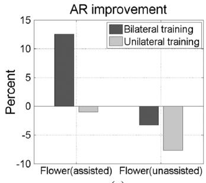  
(a)

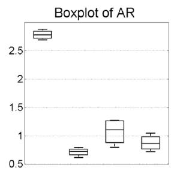  
(b)

Fig. 12. AR: Approximated area computation around straight line. (a) AR improvement in percent for flower (assisted and unassisted) games and (b) boxplot ofAR for flower(assisted and unassisted) games. The Y axis in (b) is (meter squared) in unit and X axis is same as one in (a).  
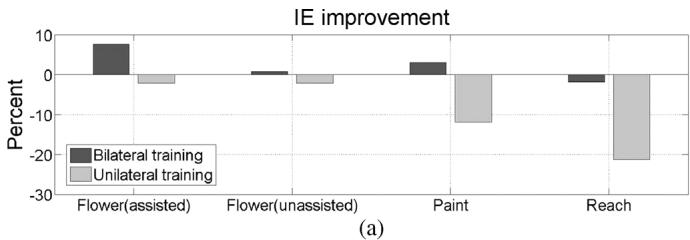

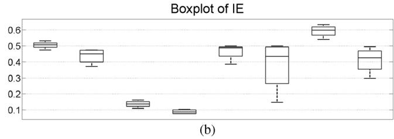  
Fig. 13. Efficiency index improvement (a) percentage efficiency index improvement for four different games and (b) boxplot of efficiency index (over the entire session) for four different games. X axis in (b) is same as one in (a).

In the unilateral training group, the robot supported the subject based on limited assistive schemes or restricted wrist joints to its neutral position in the flower game. Considering the fact that the assistive mechanism for the physically unstable patients should be extremely stable and safe, it is hard to predict the patient’s intention and apply the optimum amount of assistive force to the subjects in a stable manner. Since the post-stroke patients suffer the constant muscle contraction, restricting wrist joints to its neutral position can be fairly effective and stable assistive mechanism for the unilateral movement training. This feature limited the potential benefit of the unilateral training if the subject had limited voluntary movement.

On the other hand, the least affected side could facilitate the movement of the affected limb in bilateral training. Thus, lack of computer aided assistance was not as important and even advantageous over the assitive mode of the unilateral training in some case. It is apparent when observing the range-of-motion in Fig. 10(a), which is the most basic and direct evaluation metric. The result shows that bilateral training group gained more than twice the functionality on the wrist pronation–suppination and d on October 01,2026 at 09:38:13 UTC from IEEE Xplore. Restrictions apply.

more on the other wrist joint movements. It implies that the unilateral training group did not receive active wrist motion facilitation by the robot while the bilateral training group could consistently move the impaired wrist joint based on the assistive force from the healthy arm. This could explain why the bilateral group achieved more functionality on the wrist joint.

Although the meaningful result could be observed in this research, this study also had some limitations. First, the number of subjects was not enough for more conclusive result. Second, the subjects gained an average of four points in the Fugl-Meyer score although a change of five points for the upper limb is considered a minimally successful clinical change. Third, the robot could not provide the sufficient assistive force to the unilateral training group compared to the bilateral training group.

## VIII. CONCLUSION

Bilateral movement training scheme facilitated better rehabilitation outcomes in wrist joint movement, painted area and the efficiency index compared to the unilateral group. The efficiency index demonstrated that subjects training bilaterally showed improvement from an aspect of the natural human arm movement for the unconstrained reaching tasks. On the other hand travel distance and area-around-straight line were assessment metrics about the efficient path-planning. Since the unilateral movement training group were taught the optimum path by the assisting force from the robot, they outperformed the bilateral training group in travel distance and AR. The findings from this study imply that for greater improvement in the rehabilitation effect, both movement training schemes, unilateral and bilateral robotic training needs to be consolidated.

## REFERENCES

[1] C. JH and S. JJ, “Neural plasticity and bilateral movements: A rehabilitation approach for chronic stroke,” Prog. Neurobiol, vol. 75, no. 5, pp. 309–320, 2005.

[2] N. RJ, “Role of cortical plasticity in motor recovery after stroke,” J. Neurol. Phys. Ther., vol. 22, pp. 61–67, 1998.

[3] N. RJ, “Recovery after damage to motor cortical areas,” J. Neurol. Phys. Ther., vol. 9, pp. 740–747, 1999.

[4] J. C. Perry, J. Rosen, and S. Burns, “Upper-limb powered exoskeleton design,” Mechatronics, vol. 12, no. 4, pp. 408–417, 2007.

[5] T. Nef, M. Guidali, V. Klamroth-Marganska, and R. Riender, “Arminexoskeleton robot for stroke rehabilitation,” in World Cong. Med. Phys. Biomed. Eng. IFMBE, Munich, Germany, Sept. 2009, vol. 25/9.

[6] H. I. Krebs, N. Hogan, M. L. Aisen, and B. T. Volpe, “Robot-aided neurorehabilitation,” IEEE Trans. Rehabil. Eng., vol. 6, no. 1, pp. 75–87, Mar. 1998.

[7] D. J. Reinkensmeyer, E. Wolbrecht, and J. Bobrow, “A computational model of human-robot load sharing during robot-assisted arm movement training after stroke,” in Proc. 29th Annu. Int. Conf. IEEE EMBS, Lyon, France, Aug. 2007, pp. 4019–4023.

[8] E. T. Wolbrecht, V. Chan, V. Le, S. C. Cramer, D. J. Reinkensmeyer, and J. E. Bobrow, “Real-time computer modeling of weakness following stroke optimizes robotic assistance for movement therapy,” in Proc. 3rd Int. IEEE EMBS Conf. Neural Eng., May 2007, pp. 152–158.

[9] S. Majumdar, Pneumatic System: Principles and Maintenance. New York: McGraw-Hill, 1995.

[10] J. He, E. J. Koeneman, R. S. Schultz, H. Huang, J. Wanberg, D. E. Herring, T. Sugar, R. Herman, and J. B. Koeneman, “Design of a robotic upper extremity repetitive therapy device,” in Proc. 2005 IEEE 9th Int Conf. Rehabil. Robot., Chicago, IL, 2005, pp. 95–98.

[11] J. He, E. J. Koeneman, R. S. Schultz, D. E. Herring, J. Wanberg, H. Huang, T. Sugar, R. Herman, and J. B. Koeneman, “Rupert: A device for robotic upper extremity repetitive therapy,” in Proc. 2005 IEEE Eng. Med. Biol. 27th Annu. Conf., Shanghai, China, 2005, pp. 6844–6847.

[12] P. Joel, J. Powell, and J. Rosen, “Isotropy ofan upper limb exoskeleton and the kinematics and dynamics of the human arm,” J. Appl. Bion Biomechan., vol. 6, no. 2, pp. 175–191, 2009.

[13] H. Kim, L. M. Miller, N. Byl, G. Abrams, and J. Rosen, “Redundancy resolution of the human arm and an upper limb exoskeleton,” IEEE Trans. Biomed. Eng., vol. 59, no. 6, pp. 1770–1779, Jun. 2012.

[14] H. Kim, Z. Li, D. Milutinovic, and J. Rosen, “Resolving the redundancy ofa seven DOF wearable robotic system based on kinematic and dynamic constraint,” in Proc. 2012 IEEE Int. Conf. Robot. Automat., Saint Paul, MN, May 2012, pp. 305–310.

[15] S. C. Deluca, K. Echols, C. R. Law, and S. L. Ramey, “Intensive pediatric constraint-induced therapy for children with cerebral palsy: Randomized, controlled, crossover trial,” J. Child Neurol., vol. 21, pp 931–938, 2006.

[16] C. LG and H. M, “Neural plasticity and recovery offunction,” in Handbook ofNeurological Rehabilitation, R. J. Greenwood, M. P. Barnes, T. M. McMillan, and C. D. Ward, Eds., 2nd ed. Hove, U.K.: Psy chology Press, 2003, pp. 99–111.

[17] S. K. Fisher BE, “Activity-dependent factors affecting poststroke functional outcomes,” Top. Stroke Rehabil., vol. 8, pp. 31–44, 2001.

[18] T. E, “Harnessing brain plasticity through behavioural techniques to produce new treatments in neurorehabilitation,” Am. Psychol., vol. 59, pp. 692–704, 2004.

[19] T. E and U. E. T, “New treatments in neurorehabilitation founded on basic research,” Nat. Rev. Neurosci., vol. 3, pp. 228–236, 2002.

[20] N. Hogan and H. I. Krebs, “Interactive robots for neuro-rehabilitation,” Restorative Neurol. Neurosci., pp. 349–358, 2004.

[21] M. MH and M. TA, “Can simultaneous bilateral movement involve the undamaged hemisphere in reconstruction of neural networks damaged by stroke?,” Disabil. Rehabil., vol. 22, pp. 23–37, 2000.

[22] B. W. Stinear JW, “Rhythmic bilateral movement training modulates corticomotor excitability and enhances upper limb motoricity post stroke: A pilot study,” J. Clin. Neurophys., vol. 21, pp. 124–131, 2004.

[23] M.-W. S and W. J, “Fine motor control in adults with and without chronic hemiparesis: Baseline comparison to nondisabled adults and effects of bilateral arm training,” Arch. Phys. Med. Rehabil., vol. 85, pp. 1076–1083, 2004.

[24] L. AR, M.-W. S, and W. J et al., “Repetitive bilateral arm training and motor cortex activation in chronic stroke: A randomized controlled trial,” JAMA, vol. 292, pp. 1853–1861, 2004.

[25] C. JH and K. SB, “Chronic stroke motor recovery: Duration of active neuromuscular stimulation,” J. Neurol. Sci., vol. 215, pp. 13–19, 2002.

[26] C. JH, K. SB, and D. A, “Coupled bilateral movements and active neuromuscular stimulation: Intralimb transfer evidence during bilateral aiming,” J. Neurol. Sci., vol. 382, pp. 39–44, 2005.

[27] J. J. Summers, F. A. Kagerer, M. I. Garry, C. Y. Hiraga, A. Loftus, and J. H. Cauraugh, “Bilateral and unilateral movement training on upper limb function in chronic stroke patients: A tms study,” J. Neurological Sci., vol. 252, no. 1, pp. 76–82, 2007.

[28] C. JH and K. S, “Two coupled motor recovery protocols are better than one: Electromyogram-triggered neuromuscular stimulation and bilateral movements,” Stroke, vol. 33, pp. 1589–1594, 2002.

[29] Microsoft Robotic Developer Studio 2008 [Online]. Available: http:// www.microsoft.com

[30] L. M. Miller, “Gravity compensation for a 7 degree of freedom powered upper limb exoskeleton,” M.S. thesis, Univ. Washington, Seattle, 2006.

[31] J. Wang, S. S. Ge, and T. H. Lee, “Adaptive friction compensation for servo mechanisms,” in Proc. 1999 IEEE Int. Conf. Control Appl., vol. 2, pp. 1175–1180.

[32] N. I. Badler and D. Tolani, “Real-time inverse kinematics ofthe human arm,” Presence, vol. 5, no. 4, pp. 393–401, 1996.

[33] D. Tolani, A. Goswami, and N. I. Badler, “Real-time inverse kinematics techniques for anthropomorphic limbs,” Graph. Models Image Process., vol. 62, no. 5, pp. 353–388, Sep. 2000.

[34] Gibbons and J. D, Nonparametric Statistical Inference. New York: Marcel Dekker, 1985.

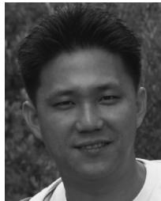

Hyunchul Kim received the B.S. and M.S. degrees in electronic engineering, both from Sogang University, Seoul, Korea, in 2003 and 2005, respectively, and the Ph.D. degree in electrical engineering from University of California-Santa Cruz, Santa Cruz, in 2012.

From 2005 to 2007 he developed a wireless demodulator for DVB-H and TDMB at DTV (Digital TV) lab, LG electronics as a Research Engineer. In 2010 and 2011, he developed stroke rehabilitation system platform based on wearable robot, EXO-UL7. His research interests include the

advanced control for the upper limb exoskeleton robots, human–robot interaction, computer vision, statistical signal processing, and machine learning.

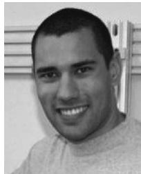

Levi Makaio Miller received the B.S. degree in manufacturing engineering technology from Western Washington University, Bellingham, in 2004, and the M.S. degree in mechanical engineering and the Ph.D. degree in mechanical engineering, studying powered upper limb exoskeletons for rehabilitation, from the University of Washington, in 2006 and 2012, respectively.

From 2008 to 2011, he was a Research Engineer at the University of California-Santa Cruz and is now employed as a Robotics Specialist at the independent consulting firm Carbon Design Group, Seattle, WA. His research interests include the human–machine interface, human-centered robotics, control algorithms, haptics, and neural interfaces.

Irina Fedulow received the B.A. degree in exercise and sports science with a gerontology minor from the University of San Francisco, San Francisco, CA, in 2009.

She is a Research Assistant at the University of California-San Francisco in the Physical Therapy and Rehabilitation Department. During her undergraduate studies, she assisted with the university’s Falls Prevention program, which offered exercise programs for older adults in the community, and was the Senior Intern at the University of San Francisco

Health and Wellness Center. After graduating, she became the Research Assistant for Dr. Nancy Byl and assisted with various projects, including studying the effects of intense exercise for individuals with mild to moderate Parkinsons disease and supervising treatment participants using the Bilateral Exoskeleton Prototype 3 (EXO-UL3).

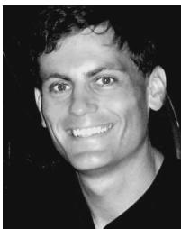

Matt Simkins received the B.S. degree in mechatronics engineering from Chico State, Chico, CA, in 2004. He is currently a Ph.D. degree candidate at the University of California-Santa Cruz.

His current work includes robotically assisted movement training, characterizations of joint synergies, and human motor learning. He has a Six Sigma Black Belt and has helped to launch dozens of new products in the medical device and pharmaceutical industries from 2004 to 2009. Prior to that he worked as an electronics consultant. He is the owner of a

company that designs and manufactures sports equipment

Gary M. Abrams received the medical degree from the University of Pittsburgh, Pittsburgh, PA.

He was Assistant and Chief Resident in neurology at the New York Neurological Institute of Columbia-Presbyterian Medical Center. Prior to moving to San Francisco, CA, he was on the neurology faculty of Columbia University and Director ofColumbia-Presbyterian Medical Services at Helen Hayes Rehabilitation Hospital in New York. His research interests focus on development of novel therapeutic interventions for improving function after stroke and trau

matic brain injury. He is currently Director of Neurological Rehabilitation at the University of California-San Francisco.

Dr. Abrams was the recipient of a Teacher-Investigator Development Award from the National Institutes of Health.

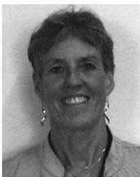

Nancy Byl received the B.S. degree from the University ofCalifornia-San Francisco and the MPH and the Ph.D. degree from the University of California-Berkeley.

She was Professor and Chair of the University of California-San Francisco Department of Physical Therapy and Rehabilitation Science, School of Medicine (25 years). She has been involved in basic animal as well as clinical and translational research identifying and integrating the principles of neuroplasticity to maximize function in patients

with neural trauma, degenerative and neurovascular disease. She and her colleagues developed a novel model of aberrant learning to understand the etiology and guide intervention to manage patients with focal hand dystonia. She is committed to collaborations with engineers to carry out translational clinical studies quantifying differences in outcomes following technology assisted rehabilitation compared to usual rehabilitative/physical therapy care.

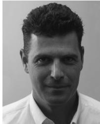

Jacob Rosen received the B.Sc. degree in mechanical engineering, and the M.Sc. and Ph.D. degrees in biomedical engineering from Tel-Aviv University, Tel-Aviv, Israel, in 1987, 1993, and 1997, respectively.

He is a Professor at the Department of Computer Engineering and the Director of the bionics lab, University of California-Santa Cruz (UCSC). His research interests focus on medical robotics, biorobotics, human-centered robotics, surgical robotics, wearable robotics, rehabilitation robotics,

and neural control. From 1987 to 1992, he served as an officer in the Israel Defense Forces studying human–machine interfaces. From 2001 to 2008 he served as a faculty member at the Department of Electrical Engineering, University of Washington, Seattle. He developed several key systems in the field of medical robotics such as the Blue and the Red Dragon for minimally invasive surgical skill evaluation, Raven a surgical robotic system for telesurgery, several generations of upper and lower limb exoskeletons, and most recently the EXO-UL7 two arm wearable robotic systems.