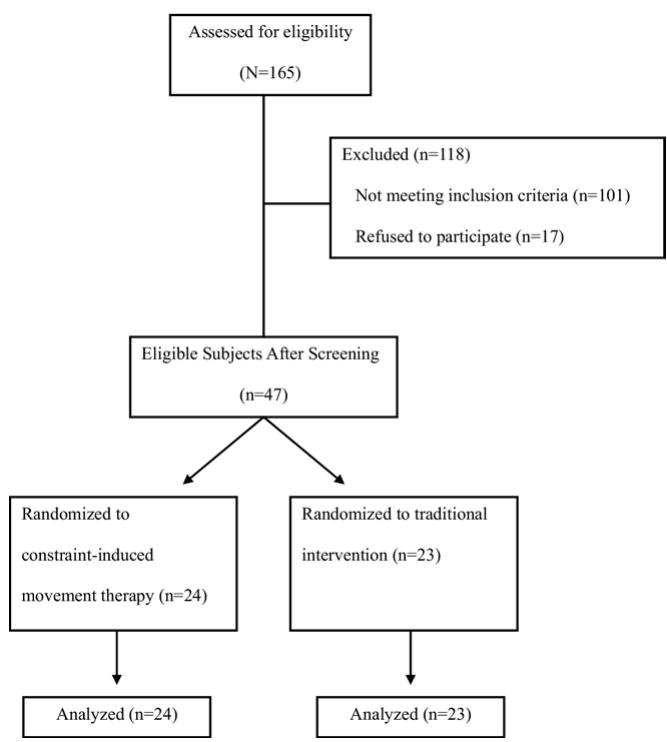

# 脑卒中患者强制性使用运动疗法后上肢运动的运动学与临床分析：一项随机对照试验

Ching-yi Wu, ScD, OTR, Chia-ling Chen, MD, PhD, Simon F. Tang, MD, Keh-chung Lin, ScD, OTR, Ya-ying Huang, MS

摘要. Wu CY, Chen CL, Tang SF, Lin KC, Huang YY. Kinematic and clinical analyses of upper-extremity movements after constraint-induced movement therapy in patients with stroke: a randomized controlled trial. Arch Phys Med Rehabil 2007;88:964-70.

目的：研究强制性使用运动疗法（Constraint-Induced Movement Therapy, CIMT）相比于传统干预对脑卒中患者上肢伸展动作的运动控制策略以及在损伤和功能层面的运动表现的影响。

设计：双组随机对照试验（RCT）；治疗前与治疗后测量。

地点：康复诊所。

参与者：47例首次发生脑血管意外后3周至37个月的脑卒中患者（平均年龄55岁）。

干预措施：在研究期间，47例患者分别接受了CIMT（限制健侧手并结合对患侧上肢的强化训练）或传统干预（对照治疗）。两组的治疗强度保持一致（2小时/天，5天/周，持续3周）。

主要结局指标：使用以下指标评估结局：(1) 用于描述伸展控制策略的伸展运动运动学变量，(2) 评估运动损伤严重程度的 Fugl-Meyer 评估量表（Fugl-Meyer Assessment, FMA），以及 (3) 评估上肢功能能力的运动活动日志（Motor Activity Log, MAL）。

结果：治疗后，CIMT组表现出优于对照组的伸展控制策略（P < .03）。CIMT组在FMA上也表现出更轻的运动损伤（P = .019），在MAL上表现出更高的功能能力（P < .001）。

结论：本研究是首个通过运动学变量测量表明，与传统干预相比，CIMT能够改变运动控制策略的RCT。除了改善损伤和功能层面的运动表现外，CIMT还在运动学分析所确定的控制策略方面带来了治疗获益。

关键词：对照临床试验；运动学；作业疗法；康复；脑卒中。

© 2007 by the American Congress of Rehabilitation Medicine and the American Academy of Physical Medicine and Rehabilitation

在文献中关于强制性使用运动疗法（Constraint-Induced Movement Therapy, CIMT）的临床试验中，该疗法作为一种治疗脑卒中患者受累较重侧上肢（upper extremity, UE）并克服习得性废用现象（习惯性依赖受累较轻侧上肢来完成功能性任务）的手段，引起了广泛关注。1-5 CIMT 包括长时间限制受累较轻侧上肢（每天 6–18 小时，持续 2–3 周），并结合对受累较重侧肢体进行高强度的任务特异性训练（例如，连续 10–15 个工作日，每天 6 小时）。4 与 CIMT 的临床疗效相比，治疗师和患者对 CIMT 的接受度仍然较低。一个可能的原因是，CIMT 期间的高强度和集中式练习对于脑卒中患者而言可能安全性较低，且更易导致疲劳。6 为了解决这些问题，研究人员通过采用较低强度的训练和更短的限制时间，设计了多种 CIMT 衍生疗法。这些 CIMT 衍生疗法可能包括每天对受累上肢进行 0.5 至 3 小时的训练，每周 3 至 5 天，持续 2 至 10 周，同时每天限制受累较轻侧上肢长达 6 小时。7-14 大量证据表明，CIMT 能够改善伴有轻度运动障碍的慢性期（脑卒中后 1 年以上）8,9、亚急性期（脑卒中后 3 个月至 1 年）7,10,11 以及急性期10,12-14脑卒中患者受累较重侧上肢的运动损伤及功能性使用。然而，导致运动表现改善的运动控制机制仍知之甚少。对该机制缺乏了解的一个可能原因与评估上肢功能所采用的方法有关。15

大多数关于 CIMT 的研究都依赖于临床评估，例如由观察者主导的运动损伤评估（例如，Fugl-Meyer 评定量表 [Fugl-Meyer Assessment, FMA]）或功能能力的自我报告评估（例如，运动活动日志 [Motor Activity Log, MAL]）。7-9,11-14 这些测试提供了有关运动损伤程度和功能能力水平，或患者对自己能否良好地功能性使用其上肢的自我感知的临床信息。然而，这些评估方法的某些特定方面可能受制于评估者的主观视角。12,15 动作分析的技术发展使得动作（例如上臂伸展动作）的生物力学研究成为可能。动作的生物力学分析为控制策略提供了更为客观和定量的度量，这对于促进理解脑卒中患者在接受 CIMT 后运动表现改善的潜在机制是必不可少的。16 近期研究已建议将生物力学分析用于 CIMT 的结局评估。12

Alberts et al15 采用动力学分析客观地研究了 CIMT（强制性诱导运动疗法）对精准抓握中力量控制的影响。除了动力学分析之外，功能性任务中的运动学分析已被认为是一种直接、客观测量运动时空控制的有效手段。17 伸手动作的运动学指标已被证明能够区分脑损伤后手部轨迹质量的变化18，并与手臂功能的评估指标（例如动作研究手臂测试 [Action Research Arm Test]）相关联。19 这些指标不仅可用于评估运动表现，还可用于识别运动质量或阐明伸手任务中的运动策略。17 这些信息有助于深入理解运动控制康复如何改变中风患者的运动组织方式。

正常的伸手动作受预编程和在线误差修正两者的共同控制。20-22 伸手动作中更多依赖预编程的控制策略代表着动作掌握得更好或更为熟练。当动作更多依赖于运动预编程时，其启动会更快，动作更高效、直接且更平滑。预编程动作要求快速完成任务，因此执行者可能需要在动作启动时施加更大的力量或冲量，以便迅速将手移向目标。相反，如果动作的控制策略更多依赖于在线修正，则需要更多的规划，因而启动较慢。这类动作在执行过程中需要根据感觉反馈调整方向，从而导致动作的效率、直线度和流畅度降低。

最近的一篇病例报告23采用运动学测量来评估强制性使用运动疗法（CIMT）后运动控制的变化，并提供了初步证据，表明与 CIMT 治疗前相比，治疗后伸手动作实现了更多预编程控制策略。需要使用随机对照试验（RCT）进行进一步研究，以深入了解 CIMT 后运动表现改变的介导机制。本研究采用运动学分析来探讨 CIMT 与传统干预相比对脑卒中后伸手动作控制策略以及上肢（UE）运动障碍和功能能力的影响。将运动学分析与临床评估相结合，有助于全面评估 CIMT 后在损伤和功能水平上控制策略和运动表现的变化。选择伸手动作作为研究任务，是因为它是许多日常活动所必需的基本运动技能。我们假设，与接受传统干预的患者相比，接受 3 周 CIMT 治疗的患者在受累较重的上肢将表现出更好的伸手控制策略、减轻的运动障碍以及提高的功能能力。更好的控制策略将表现为更高效、更直且更平滑的运动。运动障碍的减轻和功能能力的提高将表现为 FMA 和 MAL 得分的提高。

## 方法

## 受试者

2 家医疗中心的人体研究机构审查委员会批准了本研究方案，且所有受试者均签署了知情同意书。受试者招募自 2 个卒中康复科；共有 47 例脑卒中患者（男 32 例，女 15 例；平均年龄 55 岁；范围 40–80 岁）参与。根据自我报告，受试者在卒中前均为右利手。在干预开始时，他们处于缺血性或出血性首次脑血管意外发病后 3 周至 37 个月（平均 12.25 个月）。纳入标准如下：(1) 上肢近端能够达到 Brunnstrom 分期24 III 期或以上，(2) 受累较重侧上肢存在明显的废用（MAL 使用量 [AOU]25 评分 ≤ 2.5），(3) 无严重认知障碍（修改版简易精神状态检查量表26 评分 ≥ 70），(4) 无足以在佩戴实验性约束装置时危及安全的平衡问题，以及 (5) 在过去 3 个月内未参与任何实验性康复或药物研究，且未使用针对上肢肌肉组织的抗痉挛药物（如 A 型肉毒毒素）。所有患者均接受了一名康复医师和一名作业治疗师的独立检查，以确定其入组资格。Figure 1 详细列出了受试者的招募和分配情况。

## 仪器与评估工具

如后文所述，运动数据通过运动学分析和临床评估进行采集。

运动学分析。使用一个桌铃（直径9.7cm [3.80in]；高度4.8cm [1.87in]）作为伸手按压的目标。在伸手动作期间，使用6摄像机运动分析系统结合个人计算机，以捕捉贴在尺骨茎突上的标记点的运动；同时采集2个通道的模拟信号。模拟信号连接到一个压敏手部开关和该桌铃。当手移开手部开关时开始记录运动，当受试者按下桌铃时记录运动终止。运动数据以60Hz进行记录，并使用双向二阶巴特沃斯（Butterworth）滤波器在5Hz下进行数字低通滤波。

临床评估。本研究使用的临床测量指标包括FMA和MAL。FMA用于评估运动损伤的多个维度。MAL是一项功能性测量指标，用于通过自我报告评估执行基本任务和功能性活动的能力。

  
Fig 1. 受试者招募与分组流程图。  
Arch Phys Med Rehabil Vol 88, August 2007

FMA手臂和手部部分（最高分66分）的评分基于3级序数量表（0分，不能执行；1分，能部分执行；2分，能完全执行）。27 FMA得分越高表示运动损伤越轻。该测试的重测信度、评分者间信度和构念效度均已得到确立。28,29

MAL是一项半结构化访谈，用于获取患者在30项重要日常活动中使用其受累更严重侧肢体的情况信息。患者被指导使用6级AOU（使用量）量表（评分范围0–5）评估手臂的使用量，并使用6级动作质量（quality of movement, QOM）量表（评分范围0–5）评估他们在过去一周内使用受累更严重侧UEs（上肢）的质量。25

## 干预

治疗方案的设计旨在确保患者接受相同强度的治疗（2小时/天，5天/周，连续3周），并由作业治疗师直接监督。干预在2个中心进行，分别由2名独立的作业治疗师监督。这两名治疗师在受试者治疗前接受了研究人员关于实施 CIMT（强制性使用运动疗法）方案的培训，并完成了书面能力测试。在治疗期间，记录结构化的每日治疗笔记并由研究人员进行审查，以确保治疗的标准化。所有训练均以个别指导方式进行。受试者对研究假设保持盲态。所有受试者均接受了常规的跨学科脑卒中康复治疗，该治疗独立于在常规安排的作业治疗期间进行的研究治疗。跨学科脑卒中康复由包括物理治疗师和心理学家在内的多个专业团队提供。所有参与者的跨学科康复强度相同（1.5小时/天，5天/周）。

在 CIMT 组中，典型的训练活动涉及使用受累较重侧的 UE（上肢），且类似于日常进行的活动（例如，向前伸手将罐子从一处移到另一处、拿起杯子喝水、拿起发刷梳头、擦窗户）。在整个研究期间，受累较轻侧的手每天被放置在连指手套中6小时。在传统干预组中，治疗包括神经发育疗法（在可能的情况下强调功能性任务练习）、受累较重侧手臂的牵拉和负重，以及精细动作灵巧性训练。

## 流程与测试

受试者使用随机数字表被随机分配到 CIMT 组或传统干预组。在3周干预期的前后，由一名盲态评估员以随机顺序进行实验室测试（即运动学分析）和临床评估（FMA、MAL）。实验室测试和临床评估的顺序进行随机化，以消除残留效应。在实施结局指标评估之前，盲态评估员接受了培训，分别按照 Fugl-Meyer27 和 Taub30 及其同事描述的指南实施 FMA 和 MAL。评估员的能力由具有5年使用这些评估指标经验的主要研究人员进行考核。评估员接受了培训，以按照下述标准化程序进行运动学分析。

在伸手动作运动学实验室测试期间，每位受试者坐在高度可调的椅子上，椅高设定为

受试者站立时测得的膝关节外侧至地面的小腿长度的 100%。躯干用安全带固定在椅背上，以防止侧屈、前屈和旋转，但仍允许肩胛骨活动。受试者将患侧手放在置于桌边缘、与受试者正中矢状面平齐的手部开关上。桌子高度调整至肘部下方 5.1cm（2in）。桌铃放置在受试者的正中矢状线上，触碰铃的伸展距离根据受试者的功能性手臂长度进行了标准化。功能性手臂长度定义为受试者将手臂尽可能抬高至接近 90° 并向前伸展（不伴随躯干运动）至最远时，腋窝内侧缘至远端腕横纹的距离。功能性手臂长度代表受试者在不借助躯干运动的情况下能够向前伸展的最远距离。受试者被告知以舒适的速度用手伸出并按下桌铃；在进行一次练习试验后，共执行了 5 次试验。

## 数据处理与数据分析

使用基于 LabViewb 语言编写的分析程序来处理运动学数据。获取了反应时间、运动时间、总位移、峰值速度和运动单元的值。由于任务距离在不同受试者之间存在差异，因此对运动时间、总位移和运动单元进行了归一化，以校正伸展距离的差异。

反应时间是指启动运动的时间。运动时间是指执行伸展运动的时间，代表运动效率。总位移是指手在三维空间中的路径，反映了运动的直接性。一个运动单元由 1 个加速阶段和 1 个减速阶段组成，可用于表征运动的平滑度，并评估运动执行过程中误差纠正的程度。运动单元越少表示运动越平滑。31,32 峰值速度表示运动启动时的力量或冲量。更大的力量或冲量表现为更高幅度的峰值速度。

使用控制了治疗前差异的协方差分析（ANCOVA）33 来检验 CIMT 组在各项变量的后测中表现是否显著优于传统干预组。在每项分析中，前测表现（运动学数据、FMA 和 MAL 评分）以及中风发病后的时间被用作协变量，组别为自变量，后测表现为因变量。计算了每个结局变量的效应量 r，以指标化组间表现差异的幅度。34 根据 Cohen35 的标准，大效应量以 r 至少为 .50 表示，中等效应量为 .30，小效应量为 .10。

## 结果

除治疗前在标准化总位移（normalized total displacement）上的运动学表现外，两组在所测量的特征方面均无显著差异（表 1）。在比较两组的后测表现时，我们将前测表现作为协变量，以解决组间的前测变异性。

协方差分析（ANCOVA）结果显示，后测时大多数运动学指标均呈现显著且中等程度的效应（表 2）。接受强制性使用运动疗法（CIMT，Constraint-Induced Movement Therapy）治疗的患者比接受传统干预的患者能够更快地启动动作，表现为更短的反应时间（P-.005）。CIMT 组完成任务的效率更高（标准化运动时间更短，P-.021），且患侧手臂的伸展伸手轨迹更直（标准化总位移更小，P-.021）、更平滑（标准化运动单位更少，P-.010）。因此，与传统干预组相比，CIMT 组在治疗后表现出更多的预编程动作（preprogrammed movement）。对于运动学变量峰值速度，结果显示效应微弱且不显著。

Table 1: 受试者临床与人口统计学特征

<table><tr><td>特征</td><td>CIMT (n=24)</td><td>TI (n=23)</td><td>P*</td></tr><tr><td>性别（男/女）</td><td>16/8</td><td>17/7</td><td>.83</td></tr><tr><td>平均年龄 ± SD (y)</td><td>53.93±11.20</td><td>56.77±12.90</td><td>.42</td></tr><tr><td>病灶侧（右/左）</td><td>11/13</td><td>11/12</td><td>.89</td></tr><tr><td>卒中后平均月数 ± SD</td><td>12.51±9.64</td><td>11.98±11.72</td><td>.87</td></tr><tr><td>0.6至6个月之间 (n)</td><td>9</td><td>10</td><td></td></tr><tr><td>6至12个月之间 (n)</td><td>5</td><td>4</td><td></td></tr><tr><td>12至24个月之间 (n)</td><td>6</td><td>6</td><td></td></tr><tr><td>24至37个月之间 (n)</td><td>4</td><td>3</td><td></td></tr><tr><td>Brunnstrom分期（上肢近端）（中位数）</td><td>4.5</td><td>4.5</td><td>.39</td></tr><tr><td>改良MMSE平均得分 ± SD</td><td>84.42±10.35</td><td>84.43±11.62</td><td>.99</td></tr><tr><td>运动学变量治疗前平均表现 ± SD</td><td></td><td></td><td></td></tr><tr><td>反应时间 (s)</td><td>0.72±0.46</td><td>0.60±0.28</td><td>.28</td></tr><tr><td>归一化运动时间</td><td>0.07±0.05</td><td>0.09±0.06</td><td>.95</td></tr><tr><td>归一化总位移</td><td>1.70±0.51</td><td>1.42±0.36</td><td>.036</td></tr><tr><td>峰值速度 (cm/s)</td><td>66.32±22.88</td><td>55.35±15.45</td><td>.062</td></tr><tr><td>归一化运动单位</td><td>7.06±5.26</td><td>5.69±6.25</td><td>.42</td></tr><tr><td>FMA治疗前平均得分 ± SD</td><td></td><td></td><td></td></tr><tr><td>上肢（UE）</td><td>39.50±13.45</td><td>41.74±13.47</td><td>.64</td></tr><tr><td>MAL治疗前平均得分 ± SD</td><td></td><td></td><td></td></tr><tr><td>使用量（AOU）</td><td>0.64±0.86</td><td>0.60±0.92</td><td>.87</td></tr><tr><td>动作质量（QOM）</td><td>0.72±1.01</td><td>0.69±1.17</td><td>.94</td></tr></table>

缩写：MMSE，简易精神状态检查（Mini-Mental State Examination）；SD，标准差（standard deviation）；TI，传统干预（traditional intervention）。  
\*P 值对应于分类变量的卡方检验、连续变量的独立样本 t 检验以及等级变量的 Mann-Whitney U 检验。

结果显示，在 FMA 和 MAL 上，CIMT 组均表现出显著且中到大的有益效应。与传统干预组相比，CIMT 组的运动功能障碍程度更轻（FMA, P-.019）。CIMT 组的受试者报告在日常活动中，其较重受累侧上肢在 AOU $( P { < } . 0 0 1 )$ 和 QOM (P .001) 方面表现出更好的能力。CIMT 组报告在治疗前平均使用较重受累侧上肢进行 14 项活动，传统干预组平均为 15 项；而治疗后两组均达到 24 项活动。

## 讨论

据我们所知，本研究是首个利用运动学分析来探究 CIMT 与传统干预后运动控制策略差异的 RCT。与传统干预相比，我们观察到 CIMT 组在 UE 的伸展运动学方面表现更佳。CIMT 组还通过 FMA 评估表现出更轻的运动损伤，并通过 MAL 评估表现出更高的功能能力。CIMT 的有益效果与先前的研究结果一致，7-9,11-13 但本研究结果进一步表明，运动学数据证实 CIMT 可改善运动控制策略。

本研究的运动学结果将 Hakim et $\mathrm { a l } ^ { 2 3 }$ 的个案报告拓展到了更大的样本中。CIMT 组在伸展运动学（即动作质量）方面的提升可能反映了更优的控制策略（即更具预编程性的策略），这源于强制使用受累更严重的 UE 进行功能性任务的强化练习。这些任务提供了需要解决的运动问题，并使受试者能够尝试各种解决方案以达成任务目标。此外，运动学变量标准差的减小意味着 CIMT 组具有更稳定的动作模式。这种更佳的表现表明，接受 CIMT 的受试者相较于接受传统干预的受试者，能够执行更多预编程的动作。换言之，接受 CIMT 的受试者能够更自发地使用其受累更严重的 UE，并且能够以更少的注意负荷调整正在进行的动作。CIMT 后动作控制改善的进一步证据体现在更快的动作规划或准备（更短的反应时间）、更高的动作效率（更短的标准化运动时间）以及更直、更平滑的运动轨迹（更小的标准化总位移和更少的运动单位）。这种动作控制的增强可能与中枢和脊髓水平的短期学习改变有关。36 对受累更严重的 UE 进行强化训练可能会在中枢水平增强运动规划，并在脊髓水平缩短主动肌与拮抗肌激活之间的潜伏期，从而导致更短的反应时间。37 对多种功能性任务的大量练习可能为患者提供了尝试高效使用手臂进行伸展动作并重获运动技能的机会，从而更快、更高效地完成伸展任务。更直和平滑的动作在中枢水平可能是由于涉及关节间协调的运动规划得到改善所致。38 在脊髓水平，动作协调性的改善也可能是由于脊髓运动神经元池激活强度的增加，从而提高了肌肉收缩的效率与协调性。36

Table 2: 伸手动作运动学与临床评估分析的描述性与推断性统计

<table><tr><td rowspan="2">评估指标</td><td colspan="2">治疗后</td><td colspan="3">ANCOVA</td></tr><tr><td>CIMT (n=24)</td><td>TI (n=23)</td><td> $F_{1,44}$ </td><td>P</td><td>效应量 r</td></tr><tr><td colspan="6">运动学变量</td></tr><tr><td>反应时间 (s)</td><td>0.48±0.17</td><td>0.63±0.32</td><td>8.86</td><td>.005</td><td>.41</td></tr><tr><td>标准化运动时间</td><td>0.04±0.03</td><td>0.05±0.03</td><td>5.72</td><td>.021</td><td>.34</td></tr><tr><td>标准化总位移</td><td>1.32±0.22</td><td>1.42±0.39</td><td>5.75</td><td>.021</td><td>.34</td></tr><tr><td>峰值速度 (cm/s)</td><td>76.42±16.17</td><td>65.72±18.79</td><td>1.10</td><td>.30</td><td>.16</td></tr><tr><td>标准化运动单元</td><td>0.13±0.11</td><td>0.19±0.16</td><td>7.34</td><td>.010</td><td>.38</td></tr><tr><td colspan="6">FMA</td></tr><tr><td>UE</td><td>46.75±11.58</td><td>44.78±13.08</td><td>5.97</td><td>.019</td><td>.35</td></tr><tr><td colspan="6">MAL</td></tr><tr><td>AOU</td><td>1.85±1.24</td><td>0.81±1.13</td><td>32.76</td><td>&lt;.001</td><td>.66</td></tr><tr><td>QOM</td><td>1.85±1.14</td><td>0.84±1.08</td><td>31.59</td><td>&lt;.001</td><td>.65</td></tr></table>

治疗后，CIMT 与传统干预之间的峰值速度差异并不显著。一种可能性与两组内部峰值速度的较大变异性有关。另一种可能性是，峰值速度是一个涉及动作空间和时间特性的综合因素，并且与动作启动时的力量或冲量相关。32由于本研究中的两种治疗方案均未强调肌力强化或力量控制，因此伸手动作中与力量相关的表现可能被视为用于检测疗效差异的不太敏感的变量。当动作速度的改善作为终点指标时，治疗中应纳入需要力量控制的任务（例如，转动钥匙开门）。未来的研究也可以评估在强调速度的伸手任务中与力量相关的表现。

与 CIMT（强制性使用运动疗法）相关的运动学表现提升表明，这种治疗获益可能反映了运动控制策略缺陷的减少。从运动学分析中获得的关于控制策略的运动信息，可以补充源自临床评估的损伤及功能表现结果，并有助于更好地理解 CIMT 潜在的运动控制机制。这种关于卒中患者如何执行伸展运动的认识，为控制策略的特征提供了独特的视角，并可能有助于卒中康复的疗效评估。未来的研究使用运动学分析来检查各种功能性 UE（上肢）任务中的运动控制策略，以探讨当前发现对不同类型日常活动的推广性，这也是非常重要的。多项神经影像学研究39-43表明，CIMT 可通过感觉运动网络同侧病灶、病灶周围及对侧病灶皮质区的扩展、转移和募集，从而导致皮质重组。目前尚不清楚该治疗获益是否归因于支持活动依赖性皮质重组的大脑区域的神经可塑性变化。未来研究的一个方向是在 CIMT 前后采用功能磁共振成像（fMRI）分析，以探究伸展运动的运动学改善与大脑激活改变之间的潜在关联。

与传统干预相比，CIMT 治疗后 FMA 和 MAL 评分表现更好的发现，可能反映了 CIMT 后运动损伤的减轻以及患侧 UE 使用的增加。关于 FMA 的发现与大多数既往研究7,8,12,14一致，但与 van der Lee 等人3的研究结果不同。这一差异可能主要是由于对照组治疗方案的不同所致。本研究以及 Page7,8,12 和 Boake14 等人的研究在对照组中采用了传统干预，而 van der Lee3 的研究在对照组中采用了双侧任务训练。双侧任务训练涉及双手的密集练习，导致 CIMT 组相比对照组在运动损伤减轻方面的优势仅略微显著。MAL 的结果与先前的研究发现7-9,12,13一致，表明在卒中患者中观察到的“习得性废用”现象可以通过 CIMT 得到克服。

本研究招募了具有不同程度手臂运动损伤的患者，其损伤程度从伴有持续性协同运动模式但保留部分独立手臂运动的偏瘫，到具有独立手指运动的轻偏瘫无力不等。CIMT（强制性使用运动疗法）的应用可能不仅限于具有手指运动的高功能患者，还可扩展至仅具有部分独立手臂运动的患者。本研究受试者的卒中康复阶段涵盖了急性期、亚急性期和慢性期。本研究充分考虑了卒中自然康复可能对观察到的 CIMT 疗效产生混杂影响的问题。两组间处于各康复阶段的受试者人数几乎均等。在统计分析中，还将卒中后时间这一变量作为协变量进行了进一步处理。因此，自然康复的混杂效应并不能合理解释 CIMT 的有益疗效。

## 研究局限性

本研究存在一个值得注意的局限性。研究所使用的仪器评估的是实验室内的控制策略。未来的研究可以确定 CIMT 的治疗效果是否能转移到非实验室环境中。本研究中肌电图数据的缺失是另一个局限性；将肌肉激活模式的评估与时空运动控制的评估相结合，或许能更全面地展示可能受 CIMT 影响的特定运动参数。更清楚地了解哪些运动参数对治疗性改变有反应以及这种改变的性质，有助于深入理解治疗对控制策略产生疗效的机制。此外，CIMT 对运动学表现的长期影响尚不明确，有待进行具有长期随访的纵向研究。44 未来的研究还可以探讨 CIMT 后控制策略的改善是否能预测更好的运动再学习能力、更多日常功能的恢复以及更高的重返工作潜力。

## 结论

本项 RCT（随机对照试验）采用运动学和临床分析，研究了不同手臂运动损伤程度的卒中患者在接受 CIMT 与传统干预后的差异。研究表明，CIMT 不仅在控制策略层面改善了运动学表现（峰值速度除外），而且在损伤和功能层面也改善了运动表现。未来的研究可以借助脑成像技术来阐明 CIMT 后控制策略的改善是否与治疗诱导的皮层重组相关。

## 参考文献

1. Langhorne P, Legg L. Evidence behind stroke rehabilitation. J Neurol Neurosurg Psychiatry 2003;74(Suppl IV):18-21.

2. Hakkennes S, Keating JL. Constraint-induced movement therapy following stroke: a systematic review of randomized controlled trials. Austr J Physiother 2005;51:221-31.

3. van der Lee JH, Wagenaar RC, Lankhorst GJ, Vogelaar TW, Deville WL, Bouter LM. Forced use of the upper extremity in chronic stroke patients: results from a single-blind randomized clinical trial. Stroke 1999;30:2369-75.

4. Taub E, Uswatte G, Elbert T. New treatments in neurorehabilitation founded on basic research. Nat Rev Neurosci 2002;3:228-36.

5. Wolf SL, Winstein CJ, Miller JP, et al. Effect of constraintinduced movement therapy on upper extremity function 3 to 9 months after stroke: the EXCITE randomized clinical trial. JAMA 2006;296:2095-104.

6. Page SJ, Levine P, Sisto S, Bond Q, Johnston MV. Stroke patients’ and therapists’ opinions of constraint-induced movement therapy. Clin Rehabil 2002;16:55-60.

7. Page SJ, Sisto S, Levine P, Johnston MV, Hughes M. Modified constraint induced therapy: a randomized feasibility and efficacy study. J Rehabil Res Dev 2001;38:583-90.

8. Page SJ, Sisto S, Levine P, McGrath RE. Efficacy of modified constraint-induced movement therapy in chronic stroke: a singleblinded randomized controlled trial. Arch Phys Med Rehabil 2004;85:14-8.

9. Sterr A, Freivogel S. Motor-improvement following intensive training in low-functioning chronic hemiparesis. Neurology 2003; 61:842-4.

10. Atteya AA. Effects of modified constraint induced therapy on upper limb function in subacute stroke patients. Neuroscience 2004;9:24-9.

11. Page SJ, Sisto S, Johnston MV, Levine P. Modified constraintinduced therapy after subacute stroke: a preliminary study. Neurorehabil Neural Repair 2002;16:290-5.

12. Page SJ, Levine P, Leonard AC. Modified constraint-induced therapy in acute stroke: a randomized controlled pilot study. Neurorehabil Neural Repair 2005;19:27-32.

13. Dromerick AW, Edwards DF, Hahn M. Does the application of constraint-induced movement therapy during acute rehabilitation reduce arm impairment after ischemic stroke? Stroke 2000;31: 2984-8.

14. Boake C, Noser EA, Ro T, et al. Constraint-induced movement therapy during early stroke rehabilitation. Neurorehabil Neural Repair 2007;21:14-24.

15. Alberts JL, Butler AJ, Wolf SL. The effects of constraint-induced therapy on precision grip: a preliminary study. Neurorehabil Neural Repair 2004;18:250-8.

16. Sunderland A, Tuke A. Neuroplasticity, learning and recovery after stroke: a critical evaluation of constraint-induced therapy. Neuropsychol Rehabil 2005;15:81-96.

17. Roby-Brami A, Feydy A, Combeaud M, Biryukova EV, Bussel B, Levin MF. Motor compensation and recovery for reaching in stroke patients. Acta Neurol Scand 2003;107:369-81.

18. Mccrea PH, Eng JJ, Hodgson AJ. Biomechanics of reaching: clinical implications for individuals with acquired brain injury. Disabil Rehabil 2002;24:534-41.

19. Lang CE, Wagner JM, Dromerick AW, Edwads DF. Measurement of upper-extremity function early after stroke: properties of the Action Research Arm Test. Arch Phys Med Rehabil 2006;87: 1605-10.

20. Jeannerod M. 目标导向运动的神经与行为组织. New York: Oxford Univ Pr; 1988.

21. Milner TE. 需要端点精度的动作生成模型. Neuroscience 1992;49:487-96.

22. Haaland KY, Prestopnik JL, Knight RT, Lee RR. 伸手动作在运动学与位置方面的半球不对称性. Brain 2004;127:1145-58.

23. Hakim RM, Kelly SJ, Grant-Beuttler M, Healy B, Krempasky J, Moore S. 病例报告：针对慢性脑卒中患者上肢的改良强制性诱导疗法（mCIT）方案. Physiother Theory Pract 2005;21:243-56.

24. Brunnstrom S. 偏瘫的运动疗法. New York: Harper & Row; 1970.

25. Taub E, Miller NE, Novack TA, et al. 改善脑卒中后慢性运动障碍的技术. Arch Phys Med Rehabil 1993;74:347-54.

26. Teng EL, Chui HC. 改良简易精神状态检查（3MS）. J Clin Psychiatry 1987;48:314-8.

27. Fugl-Meyer AR, Jaasko L, Leyman I, Olsson S, Steglind S. 脑卒中后偏瘫患者：I. 身体功能评估方法. Scand J Rehabil Med 1975;7:13-31.

28. Duncan PW, Propst M, Nelson SG. 脑血管意外后感觉运动功能恢复的 Fugl-Meyer 评估的信度. Phys Ther 1983;63:1606-10.

29. DiFabio RP, Badke RB. 偏瘫患者感觉组织与平衡功能的关系. Phys Ther 1990;70: 542-8.

30. Taub E, Morris D, Bowman M, Delgado A, Uswatte G. 上肢动作活动量表（Upper-Extremity Motor Activity Log）[手册]. Birmingham: Psychology Dept, Univ Alabama; 2000.

31. Kamper DG, McKenna-Cole AN, Kahn LE, Reinkensmeyer DJ. 脑卒中后伸手动作的改变及其与运动方向和损伤严重程度的关系. Arch Phys Med Rehabil 2002; 83:702-7.

32. Ma HI, Trombly CA, Tickle-Degnen L, Wagenaar RC. 单一听觉线索对帕金森病患者运动运动学的影响. Am J Phys Med Rehabil 2004;83:530-6.

33. Stevens JP. 社会科学应用多元统计, 第4版. Mahwah: Lawrence Erlbaum Associates; 2002.

34. Rosenthal R, Rosnow RL. 行为研究精要：方法与数据分析. 第2版. New York: McGraw-Hill; 1991.

35. Cohen J. 行为科学的统计功效分析. 第2版. Hillsdale: Lawrence Erlbaum Associates; 1988.

36. Cirstea MC, Ptito A, Levin MF. 短期练习带来的手臂伸手动作改善取决于脑卒中运动障碍的严重程度. Exp Brain Res 2003;152:476-88.

37. Sabes PN. 伸手动作的规划与控制. Curr Opin Neurobiol 2000;10:740-6.

38. Archambault P, Pigeon P, Feldman AG, Levin MF. 健康人和偏瘫受试者涉及躯干的指向动作中不同自由度的招募与排序. Exp Brain Res 1999;126:55-67.

39. Boniface SJ. 通过经颅磁刺激研究急性缺血性脑卒中后的可塑性. J Neurol Neurosurg Psychiatry 2001;71:713-5.

40. Hamzei F, Liepert J, Dettmers C, Weiller C, Rijntjes M. Two different reorganization patterns after rehabilitative therapy: an exploratory study with fMRI and TMS. Neuroimage 2006;31:710-20.

41. Levy CE, Nichols DS, Schmalbrock PM, Keller P, Chakeres DW. Functional MRI evidence of cortical reorganization in upper-limb

stroke hemiplegia treated with constraint-induced movement therapy. Am J Phys Med Rehabil 2001;80:4-12.

42. Schaechter JD, Kraft E, Hilliard TS, et al. Motor recovery and cortical reorganization after constraint-induced movement therapy in stroke patients: a preliminary study. Neurorehabil Neural Repair 2002;16:326-38.

43. Kim YH, Park JW, Ko MH, Jang SH, Lee PK. Plastic changes of motor network after constraint-induced movement therapy. Yonsei Med J 2004;45:241-6.

44. Kwakkel G, Kollen BJ, Wagenaar RC. Long term effects of intensity of upper and lower limb training after stroke: a randomised trial. J Neurol Neurosurg Psychiatry 2002;72:473-9.

## 供应商

a. Model 370; Vicon, 14 Minns Business Pk, West Way, Oxford OX20JB, UK.

b. National Instruments Corp, 11500 N Mopac Expwy, Austin, TX 78759-3504.