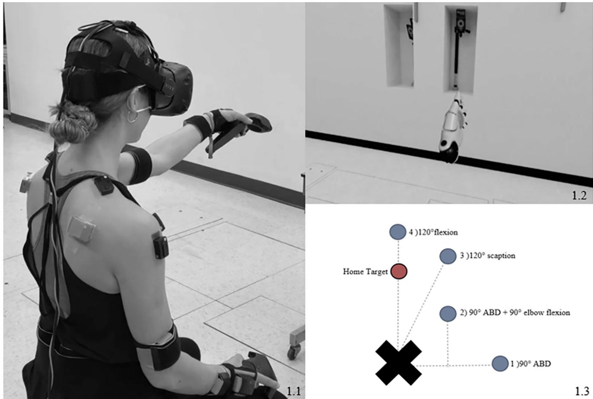
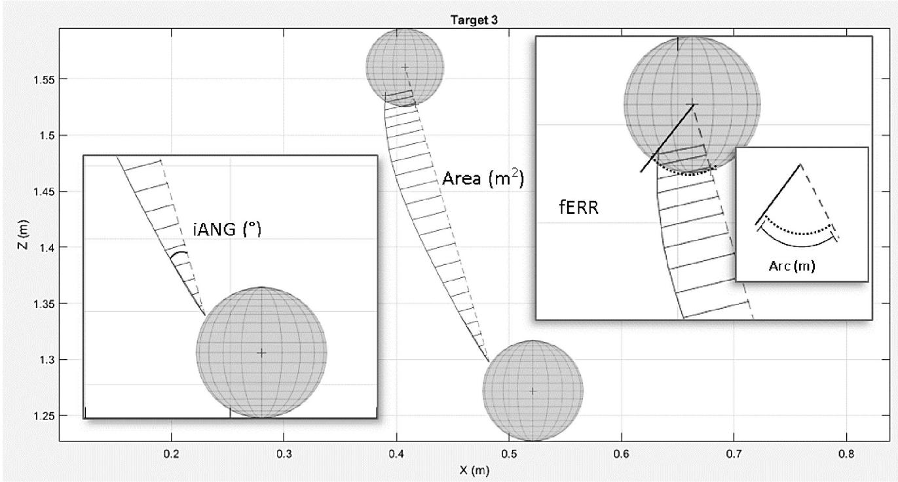
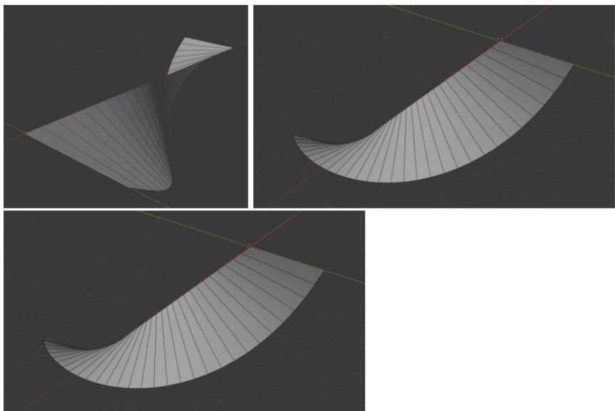
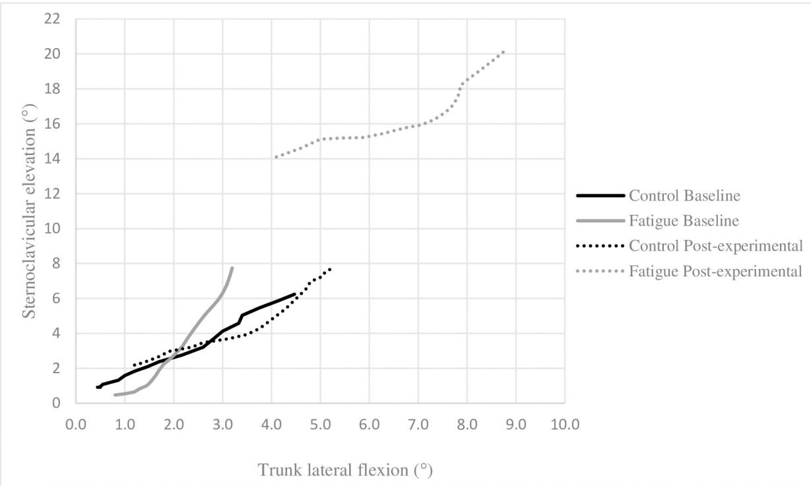
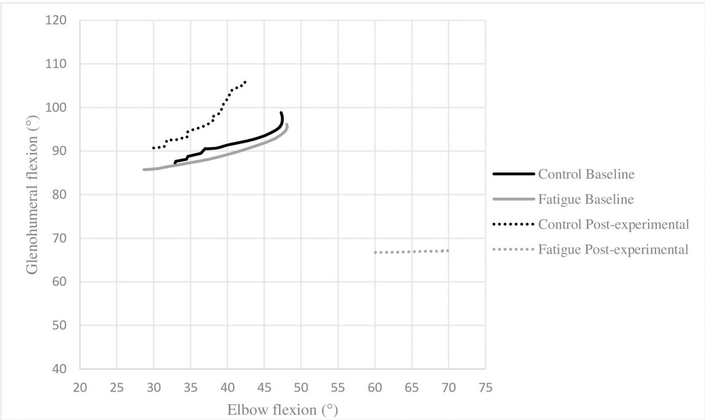
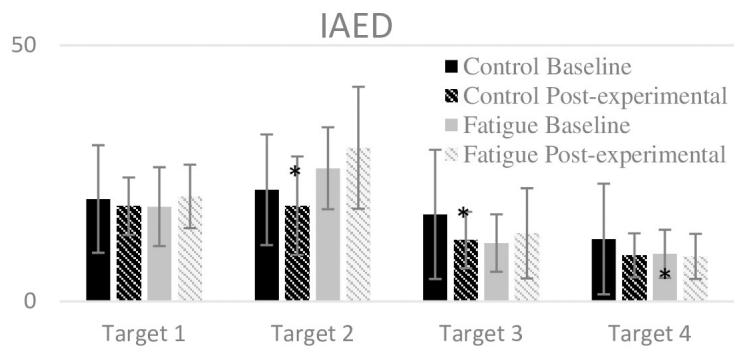
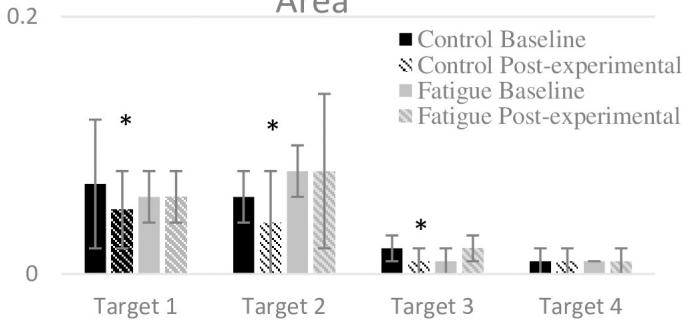
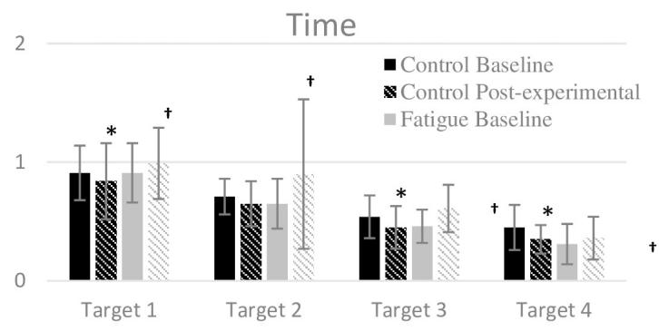
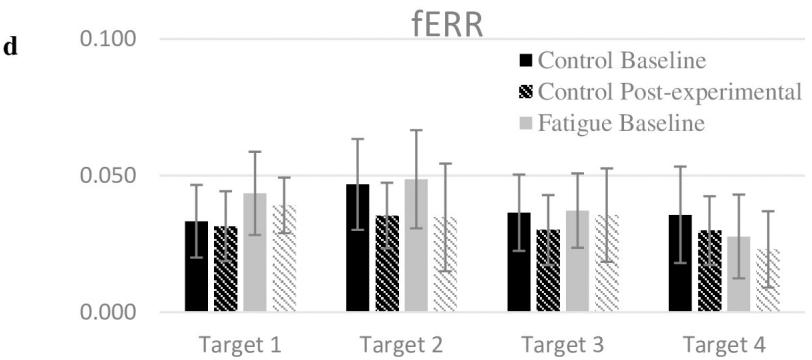

研究论文

# 通过重复性上肢运动任务诱发的疲劳在虚拟现实环境中对上肢伸展任务期间的躯干和肩部运动学产生影响

Fre´de´rique DupuisID1,2, Gisela SoleID3 3 , Craig Wassinger4, Mathieu Bielmann2, Laurent J. BouyerID1,2, Jean-Se´bastien RoyID1,2\*

111111111 updates

1 Faculty of Medicine, Universite´ Laval, Quebec City, Canada, 2 Centre for Interdisciplinary Research in Rehabilitation and Social Integration, Quebec City, Canada, 3 Centre for Health, Activity and Rehabilitation Research, School of Physiotherapy, University of Otago, Dunedin, New Zealand, 4 Department of Physica Therapy, East Tennessee State University, Johnson City, TN, United States of America

\* Jean-Sebastien.Roy@fmed.ulaval.ca

## 开放获取（OPEN ACCESS）

引用格式：Dupuis F, Sole G, Wassinger C, Bielmann M, Bouyer LJ, Roy J-S (2021) Fatigue, induced via repetitive upper-limb motor tasks, influences trunk and shoulder kinematics during an upper limb reaching task in a virtual reality environment. PLoS ONE 16(4): e0249403. https://doi.org/10.1371/ journal.pone.0249403

编辑：Kei Masani, Toronto Rehabilitation Institute - UHN, CANADA

收稿日期：2020年7月12日

录用日期：2021年3月17日

出版日期：2021年4月8日

版权所有：© 2021 Dupuis 等人。这是一篇依据知识共享署名许可协议（Creative Commons Attribution License）分发的开放获取文章，允许在任何媒介中不受限制地使用、分发和复制，前提是注明原作者和出处。

数据可用性声明：由于 comite´ d’e´thique de la recherche sectoriel en re´adaptation et inte´gration sociale, Centre Inte´gre´ Universitaire de Sante´ et de Services Sociaux de la Capitale-Nationale（CIUSSS；CIUSSS-CN 康复与社会融入部门研究伦理委员会）设定的伦理限制，去标识化数据的共享受到限制。数据可根据请求向伦理委员会协调员 Lyne Martel（lyne.martel2.ciussscn@ssss.gouv.qc.ca）获取。如果此类

## 摘要

## 背景

高效的肩部运动取决于中枢神经系统整合感觉信息并生成适当运动指令的能力。日常遇到的各种因素可能会对该指令的执行造成潜在损害，例如疲劳。本研究探讨了疲劳如何在上肢伸展过程中影响肩部运动。

## 方法

40名健康受试者被随机分配到两组之一：对照组或疲劳组。所有受试者在基线和实验后阶段均完成了上肢伸展任务，在此期间，他们在虚拟现实环境中触及位于肩关节外展 90˚、外展 90˚ 下外旋 90˚、肩胛骨平面抬高（scaption）120˚ 以及屈曲 120˚ 的四个目标。基线阶段结束后，疲劳组完成了肩部疲劳方案，而对照组则休息 10 分钟。随后，重复进行伸展任务。在伸展任务期间采集了上肢运动学（关节角度和活动范围/excursions）及拟时空（速度和准确性）数据。同时采集了三角肌前束和中束的肌电活动以表征疲劳状态。采用双因素重复测量方差分析（Two-way repeated-measures ANOVA）以确定时间、组别以及这些因素之间交互作用的影响。

## 结果

在疲劳方案实施后，疲劳组表现出三角肌前束平均中位功率频率降低以及肌电幅度增加（p < 0.05）。还观察到疲劳组的盂肱关节抬高幅度减小，躯干屈曲和旋转以及胸锁关节

提出申请后，伦理委员会将对该申请进行分析（主要审查申请背后的研究目标），然后作出决定。

资助信息：本研究由加拿大自然科学与工程研究委员会（Natural Sciences and Engineering Research Council of Canada，RGPIN-2016-05996）资助。Frédérique Dupuis 受到魁北克健康研究基金（Fonds de recherche du Québec – Santé，FRQS）奖学金的资助。J-SR 受到加拿大卫生研究院（Canadian Institutes of Health Research）和魁北克健康研究基金的薪酬奖项资助。

利益冲突：作者声明不存在利益冲突。

抬高幅度增大（组别 × 时间交互作用，p < 0.05）。对照组在实验后阶段提高了运动速度和准确性，而疲劳组则表现为运动速度下降且准确性未见改善（组别 × 时间交互作用，p < 0.05）。

## 结论

在疲劳状态下，伸展任务过程中观察到了运动策略的改变，包括躯干和胸锁关节运动增加，以及盂肱关节运动减少。疲劳组随着时间推移未见准确性改善且运动速度降低，这表明其运动表现受到了损害。

## 引言

肩部的主要作用是在空间中定位手部，以执行日常生活活动（即触及、进食、从事体育运动、搬运物体等）[1, 2]。为了能够进行这些活动，需要具备高度的灵活性。盂肱关节由于具有多个自由度，是人体中最灵活的关节 [2–4]。尽管其解剖构型提供了这种高度的灵活性，但也使得维持盂肱关节的稳定性成为一项挑战，尤其是在手臂抬高的姿势下（例如抬高超过 60˚）[1, 2]。被动结构（即韧带、关节面和盂唇）和主动结构（即肌肉）共同维持肩部的稳定性 [5, 6]。这些结构中所包含的大量感觉感受器（例如肌梭、高尔基腱器官、鲁菲尼终末、帕西尼小体和迈斯纳小体）会持续向中枢神经系统（CNS）传递有关正在执行的运动、肢体位置以及施加在关节周围结构上的力的感觉信息 [4, 7]。CNS 将这些感觉信息与期望的运动轨迹相整合，从而生成适当的运动指令，以确保在完成特定任务的同时实现高效的肩部运动与稳定性 [2, 4, 7, 8]。

肩部运动的改变被认为是导致肩痛发生和持续的病因学因素之一，例如肩袖相关肩痛（RCRSP）。事实上，患有慢性 RCRSP 的个体在上肢运动过程中表现出盂肱关节和胸锁关节间协调的改变 [9–11]。关节间协调是指在执行功能性动作（如上肢伸展触及）时两个或多个关节之间的协调关系 [12]。这些运动学改变不仅会导致在特定任务中的表现误差（例如投球时精准度下降）[12]，还会导致肌腱、肌肉和滑囊等关节周围结构上的机械负荷增加 [9, 10, 13]。因此，更好地理解肩部运动的这些变化如何发生以及为何发生至关重要。

疲劳，定义为：“一种由表现易疲劳性与感知易疲劳性之间的相互作用导致身体和认知功能受限的症状” [14, 15]，是一种日常经常遇到的状态，它可能是导致慢性 RCRSP 患者出现运动学改变的原因。已有研究表明，在进行与上肢工作相关的任务（如锤击 [16]、使用棘轮扳手 [17] 和模拟流水线作业 [18–20]）期间，疲劳会导致运动学适应，包括盂肱关节抬高幅度减小，以及躯干和肩胛骨运动增加 [14, 15, 21]。疲劳后观察到的这些运动学改变可能由不同的调节因素引起 [14]，例如本体感觉敏锐度下降 [15]、肌肉激活延迟 [22] 和/或肌肉力量变异性 [23, 24]。由于运动学改变

可能会增加肩关节的机械负荷并导致损伤，因此更好地了解疲劳如何影响肩部运动、评估其潜在的有害影响并改进预防性干预措施具有重要意义。

头顶上方活动（肩关节抬高超过 60°）在日常生活、工作和体育运动中频繁进行。这些活动对肩部的要求尤其高，因为在抬高位置时盂肱关节的稳定性会下降 [1, 2]。在头顶上方活动期间，继发于疲劳的运动学改变 [14] 可能对肩部关节周围结构造成更大的损害。据我们所知，现有研究评估了疲劳对在腰部水平执行的任务中肩部运动学的影响 [20–24]。因此有必要更好地了解在抬高位置执行任务期间疲劳的影响，这有助于解释肩痛的发生机制。

本研究的主要目的是探讨在手臂抬高位置以及虚拟现实环境（VRE）中进行上肢触及任务时，疲劳如何影响肩部运动。使用运动学（关节角度和运动幅度）和时空（速度、终点偏转初始角度 [iANG]、曲线下面积 [area] 和最终误差 [fERR]）数据对肩部、肘部和躯干的运动进行了表征，同时使用肌电（EMG）活动来证实疲劳的存在。尽管关于该主题的研究较为稀少，但有理由相信疲劳会导致躯干和胸锁关节运动增加，以及盂肱关节运动 [18, 25–27] 与运动速度和准确性 [18] 的降低。

## 方法

## 参与者

研究人群由年龄在 18 至 40 岁之间的健康成年人组成，在评估时无运动受限，且未自报存在上肢或颈部疼痛及功能障碍。潜在参与者若符合以下条件则被排除：1）既往有颈部和上肢手术史或骨折史；2）有盂肱关节脱位史（<12 个月）。受试者通过 Université Laval 的机构邮件列表以及社交媒体招募。CIUSSS-CN 康复与社会融入部门研究伦理委员会批准了本研究，所有受试者均签署了书面知情同意书。本手稿中的个人已签署书面知情同意书（如 PLOS 同意书中所述），同意发表这些病例细节。

## 研究设计

参与者参加了一次实验室测试。他们首先填写了一份关于社会人口统计学的问卷，并完成了爱丁堡利手量表（Edinburgh Handedness Inventory）以确定利手。他们被随机分配到对照组（Control group）或疲劳组（Fatigue group）。随机化按性别分层，并采用区组设计（区组大小为 4）[32]。随后，要求每位参与者完成实验的两个阶段：

• 基线阶段：参与者使用优势臂在虚拟现实环境（VRE）中执行单侧伸手触及任务。

• 实验后阶段：参与者使用优势臂在 VRE 中执行相同的单侧伸手触及任务。疲劳组（Fatigue group）参与者在完成一项经过验证的肩部疲劳实验方案 [25] 后执行该任务，而对照组（Control group）参与者则在休息 10 分钟后（与执行疲劳方案的平均耗时相当）执行该任务。

在任务执行期间，采集了上肢的肌电、时空和运动学数据。

## 伸手触及任务

该任务在通过 Unreal Engine（Epic games international，Unreal Engine，Switzerland）创建的 VRE 中进行。参与者通过佩戴 HTC VIVE 头显（HTC corporation，VIVEPORT，Taoyuan City，Taoyuan County，Taiwan）（Fig 1）[28]，置身于包含 3D 深度信息（Unreal 3）的逼真视觉场景（即采集数据的同一房间）中。他们用优势手握持手柄，手柄在 VRE 中呈现为其真实手部，且可以在虚拟手掌中看到一个球体（半径 2 cm）。他们坐在椅子上完成任务，躯干可自由活动，膝关节屈曲 90˚，双脚着地。参与者被要求在任务期间自然运动且不移动双脚。对足部位置进行了标记，以确保整个试验过程中足部摆放的一致性。

该任务包含一组共四个虚拟目标，可视化为半径 5-cm 的球体。起始位置为“起始目标”（home target），设置在肩关节屈曲 90˚、肘关节伸展及肱骨中立位旋转处（Fig 1）。随后以随机顺序出现第一个虚拟触及目标，参与者被要求以尽可能快且准确的方式、采用最直接的路径触及该目标，并将虚拟手掌中的虚拟球体置于目标中心。随后触及目标消失，参与者尽可能快地返回起始目标以触发下一个目标。四个触及目标各出现五次，参与者必须连续不休息地完成全部 20 个目标的触及以结束该试验。使用 VRE 可以根据参与者的人体测量数据（例如坐高和臂长），将目标设置在抬高位置、不同角度以及不同运动平面上。它还实现了不同目标的自发且随机呈现。

  
Fig 1. 目标位置与实验设置。ABD：外展（abduction）。a：参与者佩戴 EMG 传感器、IMU 以及 VivePro 头显和控制器执行任务；b：参与者在执行任务时看到的虚拟手视角，左手置于起始目标上；c：围绕参与者（右利手）的目标布局俯视图。起始目标（Home target）位于肩关节前屈 90˚ 处；目标 1 位于肩关节外展 90˚、肘部完全伸展处；目标 2 位于肩关节外展 90˚ 且外旋 90˚、肘部屈曲 90˚ 处；目标 3 位于肩胛骨平面肩关节上举 120˚ 处；目标 4 位于肩关节前屈 120˚ 处。

使用放置在参与者肱骨外侧的电子倾角仪和量角器，在 VRE（虚拟现实环境）中将伸手动作的目标位置设定在以下预设的肩部位置（Fig 1）：

1. 肱骨外展（ABD）90˚，肘部伸展。

2. 肱骨外展 90˚ 状态下外旋（ER）90˚，肘部屈曲 90˚。

3. 肩胛骨平面肱骨上举 120˚，肘部伸展，肱骨中立位旋转。

4. 矢状面肱骨上举 120˚（纯前屈），肘部伸展，肱骨中立位旋转。

这些不同的位置使我们能够评估在不同手臂抬高姿势下进行伸手动作时疲劳所产生的影响。两组参与者均被要求在伸手任务前和任务结束后立即使用博格主观用力感知量表（Borg Rating of Perceived Exertion Scale，Borg CR10 Scale）对其肩部感知用力程度进行评分。

## 疲劳方案

疲劳组的参与者使用其利侧手臂执行了一项先前经过验证的肩部实验性疲劳方案 [25]。该方案由三项活动组成：1）双肩屈曲 45˚ 且双肘完全伸展的状态下，在木板上操作螺丝 2 分钟；2）手持哑铃（女性 2 磅；男性 4 磅）在矢状面内重复进行 20 次手臂上举；3）手持相同重量哑铃在肩胛骨平面内重复进行 20 次手臂上举。在疲劳方案进行期间，每 30 秒询问并记录一次 Borg 量表感知用力程度。参与者重复这三项活动，直至其报告在 Borg 主观用力感知量表上达到至少 8/10 为止。实验后阶段在完成疲劳方案后立即进行。

## 仪器设备

使用六个惯性测量单元（IMU）（MVN, Xsens Technologies, Enschede, Netherlands；采样率：60 Hz）来测量任务过程中的关节角度 [29]。IMU 分别放置在头部、胸骨、骨盆，以及参与者优势臂的肩胛骨、上臂和前臂上。传感器使用魔术贴（Velcro straps）按照 Xsens 建议的传感器配置进行放置。记录人体测量学指标（身高、肩宽、臂展、髋高、髋宽、膝高、踝高、脚长和鞋底厚度），并录入至 MVN Studio 软件中（MVN studio software, v. 4.4.0, Xsens Technologies, Enschede, Netherlands）。按照 Xsens 的建议，使用 N 姿势 + 行走（Npose + walk）校准方法对 Xsens 系统进行校准。

将无线表面肌电（EMG）传感器（Delsys Trigno, USA）放置在优势臂的前三角肌和中三角肌上。选择这两块肌肉是因为它们是肩关节屈曲和外展的主要原动肌。它们在肩关节抬高超过 90˚ 的运动中也起着重要作用 [30]，且其 EMG 活动与工作任务的身体负荷相关 [31]。在放置电极之前，使用酒精清洁皮肤。采用肌肉无创评估表面肌电图（SENIAM）指南进行传感器定位 [32]。前三角肌传感器放置在肩锁关节下方 1–2 cm 处，中三角肌传感器放置在三角肌止点与肩峰之间的中点处。肌肉活动使用 Delsys EMGworks1 采集软件进行记录（采样率：1925.93Hz）。

任务期间，使用优势手中握持的控制器和 Unreal Engine 收集时空数据（采样率：90 Hz）[28]。三个系统（Xsens、EMG 和 Unreal）通过定制的触发盒（trigger box）实现时间同步。

## 数据分析

对于每次试验，计算了每个目标的运动学和时空变量的平均值。由于实验前未进行练习试验，基线期和实验后期的前八次伸展动作（4 个目标的第 1 次和第 2 次出现 [8/ 20]）被排除在分析之外，以减少因学习效应导致的变异性。因此，每个目标最后三次伸展动作的平均值（12/20）被用于统计分析。

使用 MVN studio 和 Xsens 改良 ISB 人体分节模型，从运动学数据中计算出关节角度。关注的变量包括：1) 初始关节角度（伸手动作之间位于起始目标上的关节角度）；2) 最终关节角度（到达目标时的关节角度）以及 3) 总关节角位移（最终角度 - 初始角度）。分析的关节包括躯干（侧屈 [LF]、旋转和屈曲/伸展）、胸锁关节（上提）、肘关节（屈伸）以及盂肱关节（屈曲、外展 [ABD] 和外旋 [ER]）。由于所执行的动作取决于目标位置，我们使用特定目标来评估特定的关节动作：所有目标（1、2、3 和 4）均用于评估胸锁关节上提、躯干屈曲/伸展和肘关节屈伸，因为这些动作不受目标位置的影响；1、2 和 3 号目标用于评估躯干 LF 和旋转；目标 1 和 2 用于评估盂肱关节 ABD；目标 3 和 4 用于评估盂肱关节屈曲，目标 2 用于评估盂肱关节 ER。

疲劳的特征表现为 EMG 功率谱的向下偏移（即中位频率 [MDF] 下降），同时伴随 EMG 信号幅值的增加，这已被提出作为与疲劳相关的神经肌肉适应的良好指标 [33]。所有 EMG 信号均使用在 MATLAB R2013a（The Math-Works Inc., Natick, Massachusetts, United States）中编写的自定义软件进行处理。EMG 信号使用零滞后 4th 阶 Butterworth 滤波器（带通 20–450Hz）进行离线数字滤波。对带通滤波后的信号进行整流，并以 20 秒为一个周期，计算两块所评估肌肉的平均 EMG 信号幅值（RMS，10 ms 无重叠窗口）和 MDF。采用 20 秒周期的均值进行统计分析，因为这有助于评估在特定阶段内各试验中是否存在 EMG 疲劳迹象。功率谱密度由快速傅里叶变换（Fast-Fourier Transform）的平方计算得出 [34]。

时空指标被用于表征参与者在伸展任务中的表现。这些指标通过 Unreal Engine 获取，并使用 MATLAB 编写的自定义软件进行提取。本研究关注的 4 个时空变量如下（Fig 2）：1）到达目标所需时间，即从脱离“起始目标（home target）”瞬间到到达伸展目标的时间；2）终点偏转初始角（iANG），反映动作规划，因为它是基于手部的初始轨迹计算的；该角度是利用两个目标（起始目标与伸展目标）之间的最短连线与对应初始加速度峰值的连线计算得出（Fig 2）；3）最终误差（fERR），反映动作的准确性；即进入球体（目标）的理想到达点与实际到达点之间的最短弧长距离（Fig 2）；4）曲线下

2.1  

2.2  
  
Fig 2. 时空数据采集。a. 伸展至目标 3 时的时空数据采集示例。iANG：终点偏转初始角，该角度基于两目标[起始目标与伸展目标]之间的最短连线与对应初始加速度峰值的连线计算得出）；fERR：最终误差，进入球体（目标）的理想到达点与实际到达点之间的最短弧长距离。b. 单次伸展动作计算出的 3D 曲线下面积示例：曲线下面积是垂直于理想轨迹线和实际轨迹线的直角梯形之和。  
https://doi.org/10.1371/journal.pone.0249403.g002

面积，代表总动作误差，即垂直于理想轨迹线和实际轨迹线的直角梯形之和（Fig 2）。

## 统计分析

基线人口统计学数据采用独立样本 t 检验和 $\chi^2$ 检验进行组间比较。采用双因素重复测量方差分析（ANOVA）比较 Borg 评分量表上的主观疲劳程度，以计算时间（基线、实验后）和组别（疲劳组、对照组）的效应以及这些因素之间的交互作用（proc GLM，SPSS 26）。对于肌电（EMG）变量（信号振幅和中值频率 MDF），采用三因素重复测量方差分析计算时间（基线、实验后）、组别（疲劳组、对照组）和周期（20秒周期/试验）的效应以及这些因素之间的交互效应。对于时空数据和关节运动学，采用三因素重复测量方差分析计算时间（基线、实验后）、组别（疲劳组、对照组）和目标（目标 1、2、3 和 4）的效应，以及时间与组别之间的交互效应。进行了相应的事后检验以详细分析各因素之间的交互作用。所有统计检验均在 IBM SPSS Statistics（IBM SPSS Statistics 26, IBM Corp., NY, USA）中进行，显著性水平设定为 0.05。

## 结果

共纳入40名健康受试者：每组20名。表 1（Table 1）展示了他们的基线特征；各组之间无显著差异（p > 0.05）。

## 疲劳

主观疲劳。两组受试者在基线阶段开始时的平均主观疲劳水平均为 0，在该阶段结束时 Borg 量表上的平均评分为 3±1。疲劳组受试者在 6.5±2.0 分钟内完成了疲劳方案，平均疲劳评分为 9.0±0.6。当受试者达到 6-7/10 时，疲劳感知呈指数级上升，这解释了大多数受试者为何能迅速从 6-7/10 上升到 9/10。

疲劳组受试者在实验后阶段开始时的平均主观疲劳水平显著升高，且与基线相比以更高的平均评分结束，而对照组受试者在各阶段之间的平均值没有差异（时间 × 组别效应：$\mathsf { p } < 0 . 0 0 1$；疲劳组：实验后阶段前的平均评分

Table 1. 受试者基线特征。

<table><tr><td></td><td>对照组 (n = 20)</td><td>疲劳组 (n = 20)</td></tr><tr><td>年龄，岁，  $\bar{X} \pm SD$ </td><td>26±3</td><td>26±3</td></tr><tr><td>性别，男性 (%)</td><td>9 (45)</td><td>7 (35)</td></tr><tr><td>身高，cm，  $\bar{X} \pm SD$ </td><td>170.4±9.4</td><td>172.5±9.3</td></tr><tr><td>体重，kg，  $\bar{X} \pm SD$ </td><td>66.1±11.8</td><td>72.9±11.4</td></tr><tr><td>优势侧，右侧 (%)</td><td>20 (100)</td><td>18 (90)</td></tr><tr><td>体育运动 $^{\dagger}$ , n (%)</td><td>10 (50)</td><td>12 (60)</td></tr><tr><td>工作 $^{\dagger}$ , n (%)</td><td>9 (45)</td><td>12 (60)</td></tr></table>

X , 均值。

†: 受试者被询问是否参与体育运动或/和从事对肩部有体力要求的工作（是/否）

两组间的所有特征均无显著差异（独立样本 t 检验和 $\chi^2$，$p > 0.05$）

https://doi.org/10.1371/journal.pone.0249403.t001

Table 2. 两组在基线和实验阶段的肌电（EMG）信号。

<table><tr><td></td><td colspan="2">三角肌前束</td><td colspan="2">三角肌中束</td></tr><tr><td></td><td>振幅 (V)· $10^{-5}$ </td><td>MDF (Hz)</td><td>振幅 (V)· $10^{-5}$ </td><td>MDF (Hz)</td></tr><tr><td>对照组基线</td><td></td><td></td><td></td><td></td></tr><tr><td>0-20s</td><td>5.8 (2.1)</td><td>95.5 (23.2)</td><td>5.9 (3.7)</td><td>71.4 (9.4)</td></tr><tr><td>20-40s</td><td>6.1 (2.2)</td><td>95.8 (23.1)</td><td>6.4 (4.1)</td><td>71,8 (9.4)</td></tr><tr><td>40-60s</td><td>6.5 (2.3)</td><td>94.9 (23.1)</td><td>6.5 (3.9)</td><td>71.3 (8.4)</td></tr><tr><td>疲劳组基线</td><td></td><td></td><td></td><td></td></tr><tr><td>0-20s</td><td>6.6 (3.2)</td><td>89.6 (22.1)</td><td>4.7 (3.2)</td><td>69.9 (14.4)</td></tr><tr><td>20-40s</td><td>7.2 (3.2)</td><td>87.5 (21.6)</td><td>5.2 (3.5)</td><td>70.8 (14.9)</td></tr><tr><td>40-60s</td><td>7.1 (3.2)</td><td>85.6 (20.9)</td><td>5.3 (3.7)</td><td>70.7 (14.1)</td></tr><tr><td>对照组实验后</td><td></td><td></td><td></td><td></td></tr><tr><td>0-20s</td><td>6.0 (3.7)*</td><td>98.4 (23.7)*</td><td>5.7 (3.7)*</td><td>74.1 (9.9)</td></tr><tr><td>20-40s</td><td>6.6 (2.4)*</td><td>96.7 (22.8)*</td><td>6.0 (3.7)*</td><td>73.4 (9.8) $^{\dagger}$ </td></tr><tr><td>40-60s</td><td>6.7 (2.6)*</td><td>96.6 (24.0)*</td><td>6.4 (3.9)*</td><td>72.6 (9.8) $^{\dagger}$ </td></tr><tr><td>疲劳组实验后</td><td></td><td></td><td></td><td></td></tr><tr><td>0-20s</td><td>8.1 (3.7)* $^{\dagger}$ </td><td>81.9 (20.1)* $^{\dagger}$ </td><td>6.5 (5.0)* $^{\dagger}$ </td><td>70.3 (11.8)</td></tr><tr><td>20-40s</td><td>8.8 (4.3)* $^{\dagger}$ </td><td>82.7 (20.2)* $^{\dagger}$ </td><td>6.7 (4.8)* $^{\dagger}$ </td><td>72.5 (13.7) $^{\dagger}$ </td></tr><tr><td>40-60s</td><td>9.8 (2.6)* $^{\dagger}$ </td><td>82.7 (21.0)* $^{\dagger}$ </td><td>7.4 (5.4)* $^{\dagger}$ </td><td>73.1 (15.2) $^{\dagger}$ </td></tr></table>

• Post-exp：实验后阶段；MDF：平均中位功率频率（mean median power frequency）。  
• 数据以均值（标准差）表示。  
• †基线与实验后阶段之间存在显著差异，$\mathrm { p } < 0 . 0 5 .$  
• *时间 × 组别交互作用显著，$\mathrm { p } < 0 . 0 5 .$  
https://doi.org/10.1371/journal.pone.0249403.t002

实验阶段 = 7±3，实验后阶段之后 = 8±2；对照组：实验后阶段之前的平均得分 = 0，实验后阶段之后 = 3±1）。

肌电（EMG）活动。EMG 分析显示，疲劳组（Fatigue Group）的前三角肌在实验后阶段出现了疲劳。EMG 幅度和中值频率（MDF）存在显著的时间 $\times$ 组别交互作用 $( \mathtt { p } < 0 . 0 1 2 )$。在疲劳组中，前三角肌的平均中值功率频率显著降低，而平均 EMG 幅度显著增加 $( \mathtt { p } < 0 . 0 1 )$；相比之下，对照组（Control group）在不同阶段之间的这些 EMG 变量未表现出显著变化（p > 0.05，Table 2）。

疲劳组中三角肌的平均 EMG 幅度在基线阶段与实验后阶段之间显著增加（时间 $\times$ 组别交互作用，$\mathrm { p } = 0 . 0 8 )$，而对照组中则保持稳定 $( \mathsf { p } > 0 . 0 9 ; \mathrm { T a b l e } 2 )$。两组均存在显著的周期效应 $( \mathtt { p } = 0 . 0 0 1 )$，中三角肌 EMG 幅度在试验过程中显著增加 $( \mathtt { p } = 0 . 0 0 1 )$。然而，中三角肌的平均中值功率频率不存在显著的时间 $\times$ 组别交互作用 $( \mathtt { p } = 0 . 7 6 8 )$。观察到中三角肌 MDF 存在时间效应 $( \mathtt { p } = 0 . 0 0 9 )$，在两组中均有所增加 $\left( \mathrm { p } < 0 . 0 1 ; \mathrm { T a b l e } \ 2 \right)$。

## 关节运动学

在所有初始关节位置（在起始目标位置）（盂肱关节外展除外，glenohumeral $\mathrm { A B D } ; \mathsf { p } = 0 . 9 7 )$，以及总关节活动度（total joint excursions）和最终关节位置（达到目标时的关节幅度）中均观察到了显著的时间 $\times$ 组别交互作用 $( \mathtt { p } < 0 . 0 1 )$。事后检验显示，疲劳组的受试者在疲劳状态下，其整体姿势（初始关节角度）以及伸展动作策略（最终关节角度和总关节角度活动度）均发生了显著改变，而对照组在各阶段之间未表现出显著变化。

疲劳状态下初始关节角度的变化包括躯干屈曲 $\left( \mathtt { p } < 0 . 0 4 \right)$、旋转 $( \mathtt { p } < 0 . 0 1 )$ 以及向伸展臂同侧的侧屈（LF）$( \mathtt { p } = 0 . 0 1 )$ 增加，以及肘关节屈曲 $( \mathtt { p } < 0 . 0 0 1 )$ 和盂肱关节外旋（ER）$( \mathtt { p } < 0 . 0 0 1 )$ 增加。盂肱关节屈曲减小 $( \mathtt { p } < 0 . 0 0 1 )$，这可能被所观察到的胸锁关节上提增加所补偿 $\left( \mathrm { p } < 0 . 0 4 , \mathrm { T a b l e } \ 3 \right)$。

在疲劳状态下，疲劳组的受试者利用更多的躯干和胸锁关节运动以及更少的盂肱关节运动来触及目标，表现为躯干伸展 $\left( \mathtt { p } < 0 . 0 3 \right)$、LF $( \mathtt { p } < 0 . 0 1 )$ 和胸锁关节上提 $\left( \mathtt { p } < 0 . 0 4 \right)$ 的总角位移增加，以及盂肱关节 ABD $( \mathtt { p } < 0 . 0 0 1 )$ 和盂肱关节屈曲 $( \mathtt { p } < 0 . 0 5 )$ 的总角位移减小（Table 3）。这导致其最终的胸锁关节上提 $( \mathtt { p } < 0 . 0 0 1 )$ 和躯干同侧 LF $( \mathtt { p } < 0 . 0 1 )$ 角度增加 $( \mathrm { F i g } 3 \mathrm { A } )$，且最终的盂肱关节 ABD 和盂肱关节屈曲角度减小 $( \mathtt { p } < 0 . 0 1$ , Fig 3B）。疲劳组在触及目标时还保持了更大的肘关节屈曲，导致实验后期肘关节总角位移减小（Fig 3B）。

## 时空参数

除 fERR $( \mathtt { p } = 0 . 3 3 )$ 外，所有时空数据（iANG、曲线下面积和时间）均存在显著的“时间 × 组别”交互作用 $( \mathtt { p } < 0 . 0 4 ,$ , Table 4）。对照组的任务表现有所改善，因为他们在实验后期减少了运动误差（iANG 和曲线下面积）以及触及目标所需的时间 $( \mathtt { p } < 0 . 0 5$ Fig 4）。疲劳组未观察到这种改善，其在运动误差（iANG）和曲线下面积方面的表现保持稳定 $\left( \mathtt { p } > 0 . 4 1 , \mathtt { F i g } 4 \right)$。与基线期相比，疲劳组在实验后期触及目标所需的时间更长（时间效应：$\mathrm { p } = 0 . 0 3 )$。然而，与基线期相比，两组在实验后期的最终误差均未发生改变（时间效应，$\mathtt { p } = 0 . 2 2 6 )$。

## 讨论

本研究评估了疲劳对过头触及任务中肩部运动的影响，该任务代表了日常生活、工作和体育活动中频繁进行的动作类型。使用 VRE（虚拟现实环境）使得评估朝向位于肩关节抬高 $9 0 ^ { \circ }$ 或以上及不同运动平面的目标的触及运动成为可能，据我们所知，这在此前尚未被评估过。在主要于矢状面内执行的疲劳方案后，三角肌前束被诱导产生疲劳，但三角肌中束未产生疲劳。这一观察结果与运动学及时空变量的变化均相关。

## 疲劳与关节运动学

上肢运动学受到疲劳的影响，表现为运动模式发生显著改变，包括不同的初始姿势和不同的伸手策略。疲劳状态下的改变包括盂肱关节上举减小，这似乎通过躯干和胸锁关节活动幅度的增加得到了代偿。其他研究在执行工作任务 [18–20]、棘轮操作 [17] 和伸手动作 [35] 时也观察到了类似的运动学变化。有学者提出，这些运动学改变旨在减轻疲劳关节（即盂肱关节肌群）的负荷 [28]。我们的结果

Table 3. 两组在基线期和实验期的平均总关节活动幅度。

<table><tr><td></td><td>目标</td><td>初始关节角度 均值 (SD)</td><td>p</td><td>终末关节角度 均值 (SD)</td><td>p</td><td>总角位移 均值 (SD)</td><td>p</td></tr><tr><td>躯干侧屈 (Trunk LF)</td><td></td><td></td><td rowspan="13">0.001*</td><td></td><td rowspan="13">0.05*</td><td></td><td rowspan="13">0.002*</td></tr><tr><td>对照组基线</td><td>1</td><td>2.3 (2.1)</td><td>7.8 (2.6)</td><td>4.4 (4.6)</td></tr><tr><td></td><td>2</td><td>2.2 (2.3)</td><td>5.5 (2.5)</td><td>2.9 (3.6)</td></tr><tr><td></td><td>3</td><td>2.3 (2.1)</td><td>4.1 (1.5)</td><td>1.5 (2.0)</td></tr><tr><td>对照组实验后</td><td>1</td><td>2.1 (2.1)</td><td>8.0 (2.8)</td><td>4.8 (4.3)</td></tr><tr><td></td><td>2</td><td>2.1 (2.2)</td><td>5.4 (2.6)</td><td>2.9 (3.5)</td></tr><tr><td></td><td>3</td><td>2.0 (2.4)</td><td>4.1 (2.1)</td><td>1.8 (2.0)</td></tr><tr><td>疲劳组基线</td><td>1</td><td>2.5 (2.1)</td><td>9.1 (2.3)</td><td>6.5 (1.7)</td></tr><tr><td></td><td>2</td><td>2.5 (1.9)</td><td>6.3 (1.9)</td><td>3.8 (2.0)</td></tr><tr><td></td><td>3</td><td>2.6 (1.9)</td><td>4.6 (2.1)</td><td>2.0 (1.5)</td></tr><tr><td>疲劳组实验后</td><td>1</td><td> $4.5 (2.4)^{\dagger}$ </td><td>10.2 (2.2)</td><td> $5.7 (2.1)^{\dagger}$ </td></tr><tr><td></td><td>2</td><td> $4.6 (2.5)^{\dagger}$ </td><td>7.1 (2.1)</td><td> $2.5 (2.1)^{\dagger}$ </td></tr><tr><td></td><td>3</td><td> $4.7 (2.2)^{\dagger}$ </td><td> $6.1 (1.9)^{\dagger}$ </td><td> $1.4 (1.2)^{\dagger}$ </td></tr><tr><td>躯干旋转</td><td></td><td></td><td rowspan="13">0.005*</td><td></td><td rowspan="13">0.005*</td><td></td><td rowspan="13">0.758</td></tr><tr><td>对照组基线</td><td>1</td><td>-13.7 (4.6)</td><td>-13.7 (4.6)</td><td>-10.8 (6.1)</td></tr><tr><td></td><td>2</td><td>-13.0 (5.6)</td><td>-13.0 (5.6)</td><td>-10.4 (5.8)</td></tr><tr><td></td><td>3</td><td>-7.9 (5.7)</td><td>-7.9 (5.7)</td><td>-5.4 (4.2)</td></tr><tr><td>对照组实验后</td><td>1</td><td>-13.9 (7.5)</td><td>-13.9 (7.5)</td><td>-11.9 (8.1)</td></tr><tr><td></td><td>2</td><td>-12.8 (5.9)</td><td>-12.8 (5.9)</td><td>-10.9 (6.2)</td></tr><tr><td></td><td>3</td><td>-6.0 (5.5)</td><td> $-6.0 (5.4)^{\dagger}$ </td><td>-4.7 (3.6)</td></tr><tr><td>疲劳组基线</td><td>1</td><td>-15.0 (5.8)</td><td>-15.0 (3.8)</td><td>-12.1 (2.0)</td></tr><tr><td></td><td>2</td><td>-15.7 (3.6)</td><td>-14.7 (3.6)</td><td>-11.6 (1.8)</td></tr><tr><td></td><td>3</td><td>-8.3 (4.4)</td><td>-8.3 (4.4)</td><td>-5.3 (3.0)</td></tr><tr><td>疲劳组实验后</td><td>1</td><td> $-16.6 (2.8)^{\dagger}$ </td><td> $-16.6 (2.8)^{\dagger}$ </td><td>-11.5 (1.6)</td></tr><tr><td></td><td>2</td><td> $-16.7 (2.8)^{\dagger}$ </td><td> $-16.7 (2.8)^{\dagger}$ </td><td>-11.3 (1.8)</td></tr><tr><td></td><td>3</td><td> $-11.4 (4.9)^{\dagger}$ </td><td> $-11.4 (3.4)^{\dagger}$ </td><td>-6.3 (1.6)</td></tr><tr><td>躯干屈曲</td><td></td><td></td><td rowspan="17">0.001*</td><td></td><td rowspan="17">0.028*</td><td></td><td rowspan="17">0.044*</td></tr><tr><td>对照组基线</td><td>1</td><td>18.5 (4.3)</td><td>17.3 (3.7)</td><td>-0.7 (2.3)</td></tr><tr><td></td><td>2</td><td>18.7 (3.5)</td><td>12.5 (3.1)</td><td>-5.3 (4.2)</td></tr><tr><td></td><td>3</td><td>18.5 (4.3)</td><td>14.3 (3.0)</td><td>-3.4 (2.5)</td></tr><tr><td></td><td>4</td><td>18.4 (4.1)</td><td>15.5 (3.4)</td><td>-2.5 (2.4)</td></tr><tr><td>对照组实验后</td><td>1</td><td>17.4 (3.9)</td><td>16.9 (3.6)</td><td> $0.1 (2.2)^{\dagger}$ </td></tr><tr><td></td><td>2</td><td>17.4 (4.0)</td><td> $11.6 (3.6)^{\dagger}$ </td><td>-4.9 (3.9)</td></tr><tr><td></td><td>3</td><td> $17.3 (4.2)^{\dagger}$ </td><td>14.2 (3.6)</td><td>-2.7 (2.2)</td></tr><tr><td></td><td>4</td><td> $17.4 (4.1)^{\dagger}$ </td><td>14.8 (3.9)</td><td>-2.2 (2.3)</td></tr><tr><td>疲劳组基线</td><td>1</td><td>18.9 (2.4)</td><td>18.0 (2.3)</td><td>-0.8 (2.1)</td></tr><tr><td></td><td>2</td><td>18.6 (4.4)</td><td>13.3 (2.5)</td><td>-5.7 (2.2)</td></tr><tr><td></td><td>3</td><td>18.9 (2.2)</td><td>15.6 (2.3)</td><td>-3.3 (1.1)</td></tr><tr><td></td><td>4</td><td>18.6 (2.4)</td><td>16.3 (2.8)</td><td>-2.4 (1.6)</td></tr><tr><td>疲劳组实验后</td><td>1</td><td> $20.3 (3.6)^{\dagger}$ </td><td>18.6 (3.5)</td><td> $-1.7 (1.8)^{\dagger}$ </td></tr><tr><td></td><td>2</td><td> $20.4 (3.4)^{\dagger}$ </td><td>13.5 (3.5)</td><td> $-6.9 (2.1)^{\dagger}$ </td></tr><tr><td></td><td>3</td><td> $20.4 (3.5)^{\dagger}$ </td><td>16.6 (3.8)</td><td>-3.9 (2.9)</td></tr><tr><td>肘关节屈曲</td><td>4</td><td>19.8 (3.6)</td><td> $18.2 (3.9)^{\dagger}$ </td><td>-1.6 (2.1)</td></tr><tr><td></td><td></td><td></td><td rowspan="17">0.006*</td><td></td><td rowspan="17">0.082</td><td></td><td rowspan="17">0.048*</td></tr><tr><td>对照组基线</td><td>1</td><td>25.1 (15.6)</td><td>17.10 (12.9)</td><td>-7.3 (9.6)</td></tr><tr><td></td><td>2</td><td>23.9 (1.3)</td><td>78.0 (13.5)</td><td>54.1 (12.0)</td></tr><tr><td></td><td>3</td><td>24.1 (16.2)</td><td>25.5 (15.6)</td><td>1.6 (6.8)</td></tr><tr><td></td><td>4</td><td>24.3 (15.9)</td><td>32.4 (17.6)</td><td>6.7 (8.4)</td></tr><tr><td>对照组实验后</td><td>1</td><td>27.9 (16.7)</td><td>18.2 (12.7)</td><td>-8.6 (14.0)</td></tr><tr><td></td><td>2</td><td>26.9 (16.2)</td><td>80.3 (13.1)</td><td>53.4 (14.5)</td></tr><tr><td></td><td>3</td><td>27.2 (16.6)</td><td>29.1 (18.4)</td><td>1.0 (12.8)</td></tr><tr><td></td><td>4</td><td>27.0 (17.2)</td><td>34.6 (19.7)</td><td>6.6 (12.1)</td></tr><tr><td>疲劳组基线</td><td>1</td><td>26.8 (13.4)</td><td>16.4 (14.4)</td><td>-10.4 (9.7)</td></tr><tr><td></td><td>2</td><td>26.0 (13.8)</td><td>78.8 (12.9)</td><td>52.8 (13.7)</td></tr><tr><td></td><td>3</td><td>27.1 (14.2)</td><td>26.7 (15.6)</td><td>-0.3 (8.1)</td></tr><tr><td></td><td>4</td><td>26.3 (13.6)</td><td>34.0 (14.1)</td><td>7.7 (7.8)</td></tr><tr><td>疲劳组实验后</td><td>1</td><td> $42.1 (18.3)^{\dagger}$ </td><td> $23.9 (14.1)^{\dagger}$ </td><td> $-18.2(13.7)^{\dagger}$ </td></tr><tr><td></td><td>2</td><td> $41.1 (18.3)^{\dagger}$ </td><td> $82.6 (11.1)^{\dagger}$ </td><td> $41.5 (17.3)^{\dagger}$ </td></tr><tr><td></td><td>3</td><td> $41.6 (19.1)^{\dagger}$ </td><td> $36.4 (14.6)^{\dagger}$ </td><td>-5.2 (14.3)</td></tr><tr><td></td><td>4</td><td> $42.7 (18.1)^{\dagger}$ </td><td> $45.9 (14.6)^{\dagger}$ </td><td>3.2 (10.9)</td></tr><tr><td>盂肱关节外展 (GH ABD)</td><td></td><td></td><td rowspan="9">0.967</td><td></td><td rowspan="9">0.019*</td><td></td><td rowspan="9">0.003*</td></tr><tr><td>对照组基线</td><td>1</td><td>33.1 (9.7)</td><td>71.8 (8.0)</td><td>34.7 (19.0)</td></tr><tr><td></td><td>2</td><td>33.0 (9.7)</td><td>68.0 (10.5)</td><td>32.1 (16.5)</td></tr><tr><td>对照组实验后</td><td>1</td><td>32.1 (10.9)</td><td>71.0 (9.1)</td><td>35.3 (19.4)</td></tr><tr><td></td><td>3</td><td>31.3 (11.1)</td><td>66.5 (12.8)</td><td>32.9 (16.0)</td></tr><tr><td>疲劳组基线</td><td>1</td><td>32.4 (10.6)</td><td>72.1 (8.4)</td><td>39.8 (7.1)</td></tr><tr><td></td><td>2</td><td>30.9 (10.7)</td><td>61.7 (10.9)</td><td>30.8 (6.7)</td></tr><tr><td>疲劳组实验后</td><td>1</td><td>30.3 (10.8)</td><td> $60.9 (10.7)^{\dagger}$ </td><td> $30.6 (7.1)^{\dagger}$ </td></tr><tr><td></td><td>2</td><td>30.6 (10.9)</td><td>60.0 (11.8)</td><td>29.3 (7.9)</td></tr><tr><td>盂肱关节屈曲 (GH flexion)</td><td></td><td></td><td rowspan="9">&lt;0.0001*</td><td></td><td rowspan="9">&lt;0.0001*</td><td></td><td rowspan="9">0.028*</td></tr><tr><td>对照组基线</td><td>3</td><td>75.9 (11.5)</td><td>96.9 (16.1)</td><td>21.0 (8,4)</td></tr><tr><td></td><td>4</td><td>76.0 (11.6)</td><td>95.6 (11.9)</td><td>19.6 (5.3)</td></tr><tr><td>对照组实验后</td><td>3</td><td>74.9 (13.2)</td><td>95.1 (19.0)</td><td>20.2 (8.7)</td></tr><tr><td></td><td>4</td><td>75.2 (13.4)</td><td>94.8 (13.2)</td><td>19.6 (6.4)</td></tr><tr><td>疲劳组基线</td><td>3</td><td>75.4 (9.5)</td><td>99.8 (11.6)</td><td>22.8 (9.1)</td></tr><tr><td></td><td>4</td><td>76.7 (8.3)</td><td>99.1 (9.2)</td><td>21.9 (6.1)</td></tr><tr><td>疲劳组实验后</td><td>3</td><td> $53.9 (11.1)^{\dagger}$ </td><td> $73.1 (13.5)^{\dagger}$ </td><td> $17.9 (9.3)^{\dagger}$ </td></tr><tr><td></td><td>4</td><td> $54.3 (10.8)^{\dagger}$ </td><td> $76.4 (11.3)^{\dagger}$ </td><td>21.6 (10.4)</td></tr><tr><td>盂肱关节外旋 (GH ER)</td><td></td><td></td><td rowspan="5">&lt;0.0001*</td><td></td><td rowspan="5">0.165</td><td></td><td rowspan="5">0.093</td></tr><tr><td>对照组基线</td><td>1</td><td>20.5 (10.0)</td><td>-13.7 (32.9)</td><td>-30.4 (34.2)</td></tr><tr><td>对照组实验后</td><td>1</td><td>20.6 (10.6)</td><td>-17.4 (37.6)</td><td>-34.8 (38.7)</td></tr><tr><td>疲劳组基线</td><td>1</td><td>19.5 (14.1)</td><td>-4.6 (20.3)</td><td>-24.1 (21.4)</td></tr><tr><td>疲劳组实验后 SC 上提</td><td>1</td><td> $7.2 (14.7)^{\dagger}$ </td><td>-19.1 (17.6)</td><td>-26.3 (13.3)</td></tr><tr><td></td><td></td><td></td><td rowspan="17">&lt;0.0001*</td><td></td><td rowspan="17">&lt;0.0001*</td><td></td><td rowspan="17">0.009*</td></tr><tr><td>对照组基线</td><td>1</td><td>-5.5 (4.1)</td><td>2.7 (4.2)</td><td>7.1 (5.6)</td></tr><tr><td></td><td>2</td><td>-5.6 (4.1)</td><td>7.3 (4.7)</td><td>11.2 (7.8)</td></tr><tr><td></td><td>3</td><td>-5.6 (4.1)</td><td>2.0 (4.5)</td><td>6.1 (5.5)</td></tr><tr><td></td><td>4</td><td>-5.8 (3.9)</td><td>-0.3 (4.3)</td><td>4.7 (3.6)</td></tr><tr><td>对照组实验后</td><td>1</td><td>-5.4 (4.5)</td><td>1.8 (4.7)</td><td>6.0 (5.4)</td></tr><tr><td></td><td>2</td><td>-5.3 (4.7)</td><td>6.1 (5.1)</td><td>9.6 (7.6)</td></tr><tr><td></td><td>3</td><td>-5.3 (4.6)</td><td>0.86 (4.2)</td><td>5.3 (3.9)</td></tr><tr><td></td><td>4</td><td>-5.6 (4.8)</td><td>-0.5 (4.9)†</td><td>4.6 (2.8)</td></tr><tr><td>疲劳组基线</td><td>1</td><td>-5.3 (3.8)</td><td>1.3 (4.1)</td><td>6.6 (6.4)</td></tr><tr><td></td><td>2</td><td>-4.6 (4.8)</td><td>5.1 (5.0)</td><td>9.7 (7.9)</td></tr><tr><td></td><td>3</td><td>-5.4 (3.8)</td><td>0.9 (4.7)</td><td>6.3 (4.7)</td></tr><tr><td></td><td>4</td><td>-5.6 (3.5)</td><td>-0.5 (5.0)</td><td>5.1 (4.2)</td></tr><tr><td>疲劳组实验后</td><td>1</td><td>-0.5 (3.8)†</td><td>9.1 (4.6)†</td><td>9.6 (2.9)†</td></tr><tr><td></td><td>2</td><td>-2.9 (4.8)†</td><td>11.3 (4.5)†</td><td>12.5 (2.4)†</td></tr><tr><td></td><td>3</td><td>-0.7 (4.1)†</td><td>7.6 (4.1)†</td><td>8.3 (2.0)</td></tr><tr><td></td><td>4</td><td>-0.9 (3.8)†</td><td>5.6 (5.3)†</td><td>6.4 (4.1)</td></tr></table>

• LF：侧屈（Lateral Flexion）；SC：胸锁关节（sternoclavicular）；GH：盂肱关节（glenohumeral）；ER：外旋（external rotation）；ABD：外展（abduction）；post-exp：实验后（疲劳组的疲劳状态）。• 躯干旋转：负值代表向伸手手臂同侧的躯干旋转；LF：正值代表向伸手手臂同侧的侧屈；ER：负值代表外旋，正值代表内旋。  
• 目标 1：盂肱关节外展 90˚，肘部伸直；目标 2：盂肱关节外展 90˚ 及盂肱关节外旋 90˚；目标 3：肩胛平面外展（scaption）120˚；目标 4：盂肱关节屈曲 120˚  
• 数据以均值（SD）表示  
• 显著的 时间 × 组别 交互作用（p < 0.05）。  
†与基线值相比具有统计学显著变化的均值评分（p < 0.05）  
https://doi.org/10.1371/journal.pone.0249403.t003

与这一假设一致，因为从生物力学角度来看，姿势适应（即躯干和胸锁关节）与手臂运动学（即盂肱关节和肘关节）的变化似乎都能减轻盂肱关节的负荷。

肩部上举肌群（如三角肌）已被证明在手臂抬高任务中易受疲劳影响 [17, 30]，例如本研究所采用的疲劳方案。事实上，该疲劳方案达到了预期效果，三角肌前束出现了明显的疲劳。在疲劳状态下观察到的盂肱关节上举减少，可能是为了降低对疲劳的盂肱关节上举肌群的肌肉需求 [30]；同样地，肘关节屈曲和躯干同侧旋转活动度的增加使得在完成伸手动作的同时，缩短了盂肱关节上举肌群（即屈肌和外展肌）的力臂。为了触及目标，这些保护性变化可能通过增加胸锁关节上提和躯干伸展来得以代偿 [18]。

三角肌中束作为盂肱关节的主要外展肌，其平均功率频率并未出现显著下降（尽管平均振幅有所增加）[36]。由于起始目标位于受试者正前方（肱骨屈曲 90˚），整个任务的主要抬高成分处于矢状面。疲劳方案中的三项任务也有两项是在矢状面内进行的，这可以解释为何三角肌中束未像三角肌前束那样出现疲劳。这也可能解释了盂肱关节外展（ABD）总活动范围未出现显著变化的原因。

https://doi.org/10.1371/journal.pone.0249403.g003

a  

b  
  
Fig 3. 基线与实验后阶段的关节间协调。触及目标 2（120˚ 肩胛平面外展）时的关节间协调。a. 躯干侧屈（LF）对胸锁（SC）关节上提，以及 b. 盂肱（GH）关节屈曲对肘关节屈曲。躯干侧屈：正值表示向触碰手臂同侧侧屈。两阶段之间 SC 上提、躯干 LF、GH 屈曲和肘关节屈曲均存在显著差异（时间 × 组别效应：$\mathsf { p } < 0 . 0 5 )$。a. 疲劳组在实验后阶段表现出 SC 上提与躯干 LF 的初始和最终位置以及总活动幅度的显著增加 $( \bar { \mathsf { p } } < 0 . 0 5 )$。b. 疲劳组表现出 GH 屈曲初始和最终位置的显著减小，以及肘关节屈曲初始和最终位置的增加；两个关节在实验后阶段的总关节活动度均有所减少（p < 0.05）。

Table 4. 两组基线与实验条件之间的时空数据均值差。

<table><tr><td>时空数据</td><td>目标 1</td><td>目标 2</td><td>目标 3</td><td>目标 4</td></tr><tr><td>iANG 均值差</td><td></td><td></td><td></td><td></td></tr><tr><td>对照组</td><td>-1.38(1.70)</td><td>-3.15(1.76)*</td><td>-5.03(2.34)*</td><td>-3.24(2.32)*</td></tr><tr><td>疲劳组</td><td>1.97(1.29)</td><td>3.94(3.02)</td><td>1.83(1.85)</td><td>-0.44(1.08)</td></tr><tr><td>Area 均值差</td><td></td><td></td><td></td><td></td></tr><tr><td>对照组</td><td>-0.019 (0.010)*</td><td>-0.010 (0.005)*</td><td>-0.005 (0.003)*</td><td>-0.002 (0.001)</td></tr><tr><td>疲劳组</td><td>0.002 (0.006)</td><td>0.007 (0.011)</td><td>0.002 (0.003)</td><td>0.001 (0.001)</td></tr><tr><td>Time 均值差</td><td></td><td></td><td></td><td></td></tr><tr><td>对照组</td><td>-0.069 (0.050)*</td><td>-0.067 (0.049)</td><td>-0.086 (0.032)*</td><td>-0.11 (0.031)*</td></tr><tr><td>疲劳组</td><td> $0.076 (0.073)^{\dagger}$ </td><td> $0.25 (0.130)^{\dagger}$ </td><td> $0.15 (0.056)^{\dagger}$ </td><td> $0.064 (0.047)^{\dagger}$ </td></tr><tr><td>fERR 均值差</td><td></td><td></td><td></td><td></td></tr><tr><td>对照组</td><td>-0.01 (0.01)</td><td>-0.01 (0.01)</td><td>-0.01 (0.01)</td><td>-0.01 (0.01)</td></tr><tr><td>疲劳组</td><td>-0.05 (0.19)</td><td>-0.10 (0.40)</td><td>-0.04 (0.16)</td><td>-0.05 (0.18)</td></tr></table>

• iANG：端点偏离初始角 (˚)；Area：曲线下面积 $( \mathrm { m } ^ { 2 } ) ;$ Time：到达目标所需时间 (s)；fERR：最终误差，弧度符号 (m)。目标 1：90° 盂肱关节外展（ABD），伸肘；目标 2：90˚ 盂肱关节外展及 90˚ 盂肱关节外旋（ER）；目标 3：120˚ 肩胛骨平面外展（scaption）；目标 4：120˚ 盂肱关节屈曲（flexion）。  
• 平均差值：基线与实验阶段之间的平均差值。数据以平均差值（SEM）表示。  
• 对于 iANG、Time 和曲线下面积（Area under the curve），时间效应与时间×组别效应显著，p<0.05。fERR 无显著差异（时间效应：p = 0.226；时间×组别效应：p = 0,33）  
• 与基线相比，对照组的表现显著提高，$\mathrm { p } < 0 . 0 5 .$  
• †与基线相比，表现显著下降，$\mathrm { p } < 0 . 0 5 .$  
https://doi.org/10.1371/journal.pone.0249403.t004

在疲劳状态下，伸手策略（总关节角度活动范围）也存在显著差异。先前的研究结果表明，疲劳后上肢的关节间协调重构类似于刚性系统；已有研究表明，在疲劳状态下，手臂（即腕、肘、肩）完成上肢任务的总角度活动范围较小 [17, 26, 35]。这引发了一种假设，即疲劳状态下的关节运动学适应是应对新的身体状态的一种学习过程的结果：为了在新的情况（即新的力学约束）下完成动作，出现了一种自由度较少的新关节间协调，以降低动作复杂性 [17, 37]。我们的结果与这一假设一致，因为在疲劳状态下盂肱关节和肘关节的总角度活动范围较小。这表明 CNS（中枢神经系统）采用了简化的关节间协调模式来完成任务。

## 疲劳与时空数据

疲劳组未表现出任务表现的改善（如时空变量所示），而对照组则表现出改善（iANG、时间以及曲线下面积）。目前关于疲劳状态下肩部运动表现的大多数证据表明，可以通过采用新的运动学策略（例如新的关节间协调）来维持任务表现 [35, 37–40]。我们的结果与先前的研究结果一致，这些研究表明在疲劳状态下进行上肢伸展任务时，手部的最终位置仍然保持准确 [38, 40]：在本研究中，与基线和对照组相比，疲劳状态下的最终误差并无显著差异。这些结果也可以用以下事实来解释：疲劳方案主要集中在三角肌前束，而任务中四个目标中的三个位于额状面/肩胛骨平面。因此，运动精度可能保持稳定，因为任务期间募集的肌肉（例如三角肌中束）并非受疲劳方案影响最大的肌肉。然而，即使运动

  
Fig 4. 两组在基线和实验后条件下的时空数据。数据以两组基线和实验条件的均值±标准差（mean±SD）呈现。a: iANG，端点偏转初始角度（˚）；b: Area，曲线下面积 $( \bar { \mathrm { m } ^ { 2 } } ) ; c \colon$ Time，到达目标所需时间（s）；d: fERR，最终误差，反正弦（m）。对于 iANG、Time 和 Area，时间效应以及时间与组别交互效应显著，$p<0.05$。fERR 无显著差异（时间效应：p = 0.226；时间与组别交互效应：p = 0,33）。与基线相比对照组表现显著提升，$\mathrm { p } < 0 . 0 5 .$。†与基线相比表现显著下降，$\mathrm { p } < 0 . 0 5$  
https://doi.org/10.1371/journal.pone.0249403.g004

精度（iANG、fERR、Area）在实验后阶段保持稳定，但疲劳组降低了运动速度，这可能是为了准确完成任务。

由于对照组的表现有所提高，而疲劳组则没有 [37, 41]，疲劳组缺乏表现改善的原因可能是疲劳给身体带来了新的机械约束，CNS 必须将其整合以调整运动规划：这种新的身体状态使 CNS 处于一个新的学习过程中，这可能会干扰任务表现。例如，疲劳后姿势的改变可被视为一种新的身体状态，其可能已经改变了表现指标 [37, 41]。

本体感觉已被证明在疲劳状态下会发生改变 [42, 43]，这表明在疲劳状态下，视觉反馈对于执行触及任务（reaching task）变得更为重要。因此，为了保持动作准确性，疲劳状态下可能会在更大程度上利用视觉反馈来指导运动指令 [39]，从而导致准确触及目标所需的平均时间增加（反馈控制）。如果能纳入一个无视觉反馈的对照组来评估这些机制将会很有意义，因为此前的一项研究表明，在触及任务中，缺乏视觉反馈对动作准确性的影响比疲劳更大 [41]。疲劳似乎通过产生的机械约束对 CNS（中枢神经系统）构成挑战，进而影响运动表现，但仍需要更多研究来深入了解其机制，因为其中可能涉及肌肉、脊髓或/和中枢效应。

## 运动学适应的可能后果与临床展望

疲劳状态下的适应对肩部结构（即肌腱、滑囊、肌肉）的后果尚不明确，但它们与慢性 RCRP 患者盂肱关节和肩胛骨运动学中所表现出的改变相似；这些改变已被认为会导致肩峰肱骨间距减小以及肩峰下结构（滑囊、肩袖和肱二头肌长头肌腱）受压，并增加这些结构上的机械负荷 [9, 11, 13]。事实上，在健康个体中，疲劳已被证明会导致肩峰肱骨间距的立即减小 [44–46]。如前所述，损伤人群中出现这些改变的原因尚不明确，因此问题在于：在疲劳状态下观察到的适应性改变如果反复发生，是否会导致肩部运动学的长期改变？由于我们证明了疲劳会影响肩部运动和表现，我们可以假设在疲劳状态下重复运动可能会导致不良运动模式的固化，从而对肌腱和肌肉造成更高的物理应力。这与以下发现一致：在没有身体间歇的情况下（即在肩关节屈曲中缺乏微间歇 [80% 和 >80% 的周期时间]）进行高于肩部水平的操作（$( \mathrm { i } . e . > 9 0 ^ { \circ }$ 的肩部抬高或手高于肩部水平）是发生肩部 RCRP 的危险因素 [47]。研究针对肩部上举肌群的特定耐力训练方案对疲劳适应的影响将具有重要意义，因为这有可能预防在疲劳状态下观察到的运动学代偿，从而降低肩部损伤的风险。

## 优势与局限性

本研究具有多项优势，包括设立了对照组，从而能够考量重复执行任务对所关注变量的影响。研究还采用了新的参数（fERR、iANG、Area、time）来评估任务表现，从而能够更深入地分析疲劳对动作时空特征的影响。最后，据我们所知，此前尚无研究探讨过在上肢处于抬高姿势执行任务期间疲劳的影响，而该姿势对肩部肌肉控制要求极高 [2]。

本研究也存在一些局限性。首先，所有参与者均为年轻人（18–40 岁之间）且无肩部疼痛。因此，将研究结果推广至老年群体或肩痛患者群体存在局限性。其次，参与者在虚拟现实环境中执行任务，这可能会影响感官知觉。最后，实验性疲劳引起的适应可能与现实生活中发生的实际适应并不完全相同。

## 结论

本研究旨在探讨在手臂抬高姿势下执行上肢伸展触及任务时，疲劳对肩部运动的影响。疲劳组的参与者表现出了姿势调整以及用于完成任务的新动作模式，包括更少的盂肱关节运动以及更多的躯干和胸锁关节运动。运动表现发生了改变，表现为疲劳组随时间的推移缺乏准确性的改善，且动作速度有所下降。基于这些结果，疲劳产生了生理影响，导致了对 CNS（中枢神经系统）构成挑战的全新机械约束，并且正如在学习新动作时所观察到的那样，出现了一种新的简化关节间协调模式。因此，本研究强调了将疲劳视为影响肩部运动的潜在因素的重要性。未来需要进一步开展工作，以了解疲劳如何在肌肉、脊髓和中枢水平上影响运动控制。

## 致谢

作者感谢 N. Robitaille 在虚拟现实环境编程以及时空数据采集与分析方面提供的帮助。

## 作者贡献

概念构思：Fre´de´rique Dupuis, Jean-Se´bastien Roy。

数据管理：Fre´de´rique Dupuis。

资金获取：Jean-Se´bastien Roy。

调查研究：Fre´de´rique Dupuis。

方法学：Fre´de´rique Dupuis。

项目管理：Fre´de´rique Dupuis。

资源：Jean-Se´bastien Roy。

软件：Mathieu Bielmann, Laurent J. Bouyer。

监督指导：Jean-Se´bastien Roy。

撰写——初稿：Fre´de´rique Dupuis。

撰写——审阅与编辑：Gisela Sole, Craig Wassinger, Mathieu Bielmann, Laurent J. Bouyer, Jean-Se´bastien Roy。

## 参考文献

1. Lewis J, McCreesh K, Roy JS, Ginn K. Rotator Cuff Tendinopathy: Navigating the Diagnosis-Management Conundrum. J Orthop Sports Phys Ther. 2015; 45(11):923–37. Epub 2015/09/22. https://doi.org 10.2519/jospt.2015.5941 PMID: 26390274.

2. Veeger HEJ, van der Helm FCT. 肩关节功能：灵活性与稳定性之间的完美权衡（Shoulder function: The perfect compromise between mobility and stability）. Journal of Biomechanics. 2007; 40(10):2119–29. https://doi.org/10.1016/j.jbiomech.2006.10.016 PMID: 17222853

3. Pearl ML, Harris SL, Lippitt SB, Sidles JA, Harryman DT, Matsen FA. 一种描述肱骨相对于胸廓位置的系统及其在展示若干功能性重要手臂位置中的应用（A system for describing positions of the humerus relative to the thorax and its use in the presentation of several functionally important arm positions）. Journal of Shoulder and Elbow Surgery. 1992; 1(2):113–8. https://doi.org/10.1016/S1058- 2746(09)80129-8 PMID: 22959048

4. Bachasson D, Singh A, Shah SB, Lane JG, Ward SR. 周围和中枢神经系统在肩袖疾病中的作用（The role of the peripheral and central nervous systems in rotator cuff disease）. J Shoulder Elbow Surg. 2015; 24(8):1322–35. Epub 2015/07/21. https://doi.org/10.1016/j.jse.2015.04.004 PMID: 26189809; PubMed Central PMCID: PMC4508670.

5. Karagiannopoulos C, Watson J, Kahan S, Lawler D. 肌肉疲劳对健康成年人腕关节位置觉的影响（The effect of muscle fatigue on wrist joint position sense in healthy adults）. J Hand Ther. 2019. Epub 2019/04/10. https://doi.org/10.1016/j.jht.2019.03.004 PMID: 30962121.

6. Skinner HB, Wyatt MP, Hodgdon JA, Conard DW, Barrack RL. 疲劳对膝关节位置觉的影响（Effect of fatigue on joint position sense of the knee）. J Orthop Res. 1986; 4(1):112–8. Epub 1986/01/01. https://doi.org/10.1002/jor.1100040115 PMID: 3950803.

7. Brindle TJ, Nitz AJ, Uhl TL, Kifer E, Shapiro R. 具有本体感觉和视觉反馈的肩部简单运动的运动学和肌电特征（Kinematic and EMG characteristics of simple shoulder movements with proprioception and visual feedback）. J Electromyogr Kinesiol. 2006; 16(3):236–49. Epub 2005/08/23. https://doi.org/10.1016/j.jelekin.2005.06.012 PMID: 16111896.

8. Urra O, Casals A, Jane R. 视觉反馈对上肢运动控制的影响（The impact of visual feedback on the motor control of the upper-limb）. Conf Proc IEEE Eng Med Biol Soc. 2015; 2015:3945–8. Epub 2016/01/07. https://doi.org/10.1109/EMBC. 2015.7319257 PMID: 26737157.

9. Lukasiewicz AC, McClure P, Michener L, Pratt N, Sennett B, Ludewig P, et al. 伴有与不伴有肩关节撞击症受试者三维肩胛骨位置及方位的比较（Comparison of 3-Dimensional Scapular Position and Orientation Between Subjects With and Without Shoulder Impingement）. Journal of Orthopaedic & Sports Physical Therapy. 1999; 29(10):574–86. https://doi.org/10.2519/jospt. 1999.29.10.574 PMID: 10560066

10. Lefevre-Colau MM, Nguyen C, Palazzo C, Srour F, Paris G, Vuillemin V, et al. 正常与退行性肩关节的运动学模式。第二部分：肩痛患者三维肩胛骨运动学模式的回顾及临床意义（Kinematic patterns in normal and degenerative shoulders. Part II: Review of 3-D scapular kinematic patterns in patients with shoulder pain, and clinical implications）. Ann Phys Rehabil Med. 2018; 61(1):46–53. Epub 2017/10/11. https://doi.org/10.1016/j.rehab.2017.09.002 PMID: 28987866.

11. Ludewig PM, Braman JP. 肩关节撞击：康复中的生物力学考量（Shoulder impingement: biomechanical considerations in rehabilitation）. Manual therapy. 2011; 16(1):33–9. https://doi.org/10.1016/j.math.2010.08.004 PMID: 20888284.

12. Tomita Y, Rodrigues MRM, Levin MF. 脑卒中患者的上肢协调：定义不清且量化不足（Upper Limb Coordination in Individuals With Stroke: Poorly Defined and Poorly Quantified）. Neurorehabilitation and Neural Repair. 2017; 31(10–11):885–97. https://doi.org/10.1177/1545968317739998 PMID: 29130396

13. Ludewig PM, Cook TM. Alterations in shoulder kinematics and associated muscle activity in people with symptoms of shoulder impingement. Phys Ther. 2000; 80(3):276–91. Epub 2000/03/01. PMID: 10696154.

14. Enoka RM, Duchateau J. Translating Fatigue to Human Performance. Med Sci Sports Exerc. 2016; 48 (11):2228–38. https://doi.org/10.1249/MSS.0000000000000929 PMID: 27015386.

15. Forman DA, Forman GN, Murphy BA, Holmes MWR. Sustained Isometric Wrist Flexion and Extension Maximal Voluntary Contractions on Corticospinal Excitability to Forearm Muscles during Low-Intensity Hand-Gripping. Brain Sci. 2020; 10(7):445. https://doi.org/10.3390/brainsci10070445 PMID: 32668568.

16. Cote JN, Raymond D, Mathieu PA, Feldman AG, Levin MF. Differences in multi-joint kinematic patterns of repetitive hammering in healthy, fatigued and shoulder-injured individuals. Clin Biomech (Bristol, Avon). 2005; 20(6):581–90. Epub 2005/06/02. https://doi.org/10.1016/j.clinbiomech.2005.02.012 PMID: 15927734.

17. Cowley JC, Gates DH. Inter-joint coordination changes during and after muscle fatigue. Hum Mov Sci. 2017; 56(Pt B):109–18. Epub 2017/11/10. https://doi.org/10.1016/j.humov.2017.10.015 PMID: 29121490.

18. McDonald AC, Mulla DM, Keir PJ. Muscular and kinematic adaptations to fatiguing repetitive upper extremity work. Appl Ergon. 2019; 75:250–6. Epub 2018/12/05. https://doi.org/10.1016/j.apergo.2018. 11.001 PMID: 30509533.

19. McDonald AC, Tse CT, Keir PJ. Adaptations to isolated shoulder fatigue during simulated repetitive work. Part II: Recovery. J Electromyogr Kinesiol. 2016; 29:42–9. Epub 2015/06/17. https://doi.org/10. 1016/j.jelekin.2015.05.005 PMID: 26076931.

20. Qin J, Lin JH, Faber GS, Buchholz B, Xu X. Upper extremity kinematic and kinetic adaptations during a fatiguing repetitive task. J Electromyogr Kinesiol. 2014; 24(3):404–11. Epub 2014/03/20. https://doi.org 10.1016/j.jelekin.2014.02.001 PMID: 24642235.

21. Huysmans MA, Hoozemans MJM, van der Beek AJ, de Looze MP, van Diee¨n JH. Fatigue effects on tracking performance and muscle activity. 18(3):410–9.

22. Mendez-Rebolledo G, Gatica-Rojas V, Guzman-Munoz E, Martinez-Valdes E, Guzman-Venegas R, Berral de la Rosa FJ. Influence of fatigue and velocity on the latency and recruitment order of scapular muscles. Phys Ther Sport. 2018; 32:80–6. Epub 2018/05/19. https://doi.org/10.1016/j.ptsp.2018.04. 015 PMID: 29775865.

23. Bigland-Ritchie B, Woods JJ. Changes in muscle contractile properties and neural control during human muscular fatigue. Muscle Nerve. 1984; 7(9):691–9. Epub 1984/11/01. https://doi.org/10.1002 mus.880070902 PMID: 6100456.

24. Bonnard M, Sirin AV, Oddsson L, Thorstensson A. Different strategies to compensate for the effects of fatigue revealed by neuromuscular adaptation processes in humans. Neurosci Lett. 1994; 166(1):101– 5. Epub 1994/01/17. https://doi.org/10.1016/0304-3940(94)90850-8 PMID: 8190349.

25. Ebaugh DD, McClure PW, Karduna AR. Effects of shoulder muscle fatigue caused by repetitive overhead activities on scapulothoracic and glenohumeral kinematics. Journal of Electromyography and Kinesiology. 2006; 16(3):224–35. https://doi.org/10.1016/j.jelekin.2005.06.015 PMID: 16125416

26. Forestier N, Nougier V. The effects of muscular fatigue on the coordination of a multijoint movement in human. Neuroscience Letters. 1998; 252(3):187–90. https://doi.org/10.1016/s0304-3940(98)00584-9 PMID: 9739992

27. Pritchard SE, Tse CTF, McDonald AC, Keir PJ. Postural and muscular adaptations to repetitive simulated work. Ergonomics. 2019; 62(9):1214–26. Epub 2019/06/01. https://doi.org/10.1080/00140139. 2019.1626491 PMID: 31150301.

28. Niehorster D, Li L, Lappe M. The Accuracy and Precision of Position and Orientation Tracking in the HTC Vive Virtual Reality System for Scientific Research. i-Perception. 2017; 8:204166951770820. https://doi.org/10.1177/2041669517708205 PMID: 28567271

29. Poitras I, Dupuis F, Bielmann M, Campeau-Lecours A, Mercier C, Bouyer LJ, et al. Validity and Reliability of Wearable Sensors for Joint Angle Estimation: A Systematic Review. Sensors (Basel). 2019; 19(7). Epub 2019/04/03. https://doi.org/10.3390/s19071555 PMID: 30935116; PubMed Central PMCID: PMC6479822.

30. Nussbaum MA, Clark LL, Lanza MA, Rice KM. Fatigue and endurance limits during intermittent overhead work. Aihaj. 2001; 62(4):446–56. Epub 2001/09/11. https://doi.org/10.1080/15298660108984646 PMID: 11549138.

31. Poitras IA-O, Bielmann M, Campeau-Lecours AA-O, Mercier CA-O, Bouyer LA-O, Roy JS. Validity of Wearable Sensors at the Shoulder Joint: Combining Wireless Electromyography Sensors and Inertial Measurement Units to Perform Physical Workplace Assessments. LID—10.3390/s19081885 [doi] LID —1885. Sensors. 2019; 19(8):1885

32. Hermens HJ, Freriks B, Merletti R, Stegeman D, Blok J, Rau G, et al. European recommendations for surface electromyography. Roessingh research and development. 1999; 8(2):13–54.

33. McCausland C, Sawyer E, Eovaldi BJ, Varacallo M. Anatomy, Shoulder and Upper Limb, Shoulder Muscles. StatPearls. Treasure Island: StatPearls Publishing; 2020.

34. Saey D, Coˆte´ CH, Mador J, Laviolette L, LeBlanc P, Jobin J, Maltais F, et al. Assessment of muscle fatigue during exercise in chronic obstructive pulmonary disease. (0148-639X (Print)).

35. Fuller JR, Lomond KV, Fung J, Cote JN. Posture-movement changes following repetitive motioninduced shoulder muscle fatigue. J Electromyogr Kinesiol. 2009; 19(6):1043–52. Epub 2008/12/19. https://doi.org/10.1016/j.jelekin.2008.10.009 PMID: 19091598.

36. Marco G, Alberto B, Taian V. Surface EMG and muscle fatigue: multi-channel approaches to the study of myoelectric manifestations of muscle fatigue. Physiol Meas. 2017; 38(5):R27–r60. Epub 2017/02/16. https://doi.org/10.1088/1361-6579/aa60b9 PMID: 28199218.

37. Monjo F, Terrier R, Forestier N. Muscle fatigue as an investigative tool in motor control: A review with new insights on internal models and posture-movement coordination. Hum Mov Sci. 2015; 44:225–33. Epub 2015/09/26. https://doi.org/10.1016/j.humov.2015.09.006 PMID: 26406972.

38. Schmid M, Schieppati M, Pozzo T. Effect of fatigue on the precision of a whole-body pointing task. Neuroscience. 2006; 139(3):909–20. https://doi.org/10.1016/j.neuroscience.2005.12.060 PMID: 16504410

39. Dube MO, Roy JS. Effect of fatigue and the absence of visual feedback on shoulder motor control in an healthy population during a reaching task. Gait Posture. 2019; 74:135–41. Epub 2019/09/16. https://doi.org/10.1016/j.gaitpost.2019.09.006 PMID: 31522106.

40. Fuller JR, Fung J, Cote JN. Posture-movement responses to stance perturbations and upper limb fatigue during a repetitive pointing task. Hum Mov Sci. 2013; 32(4):618–32. Epub 2013/09/24. https://doi.org/10.1016/j.humov.2013.03.002 PMID: 24054899.

41. Kawato M. Internal models for motor control and trajectory planning. Curr Opin Neurobiol. 1999; 9 (6):718–27. Epub 1999/12/23. https://doi.org/10.1016/s0959-4388(99)00028-8 PMID: 10607637.

42. Sadler CM, Cressman EK. Central fatigue mechanisms are responsible for decreases in hand proprioceptive acuity following shoulder muscle fatigue. Human Movement Science. 2019; 66:220–30. https://doi.org/10.1016/j.humov.2019.04.016 PMID: 31071614

43. Exercise Proske U., fatigue and proprioception: a retrospective. Exp Brain Res. 2019; 237(10):2447– 59. Epub 2019/09/01. https://doi.org/10.1007/s00221-019-05634-8 PMID: 31471677.

44. McCreesh K, Purtill H, Donnelly A, Lewis J. Increased supraspinatus tendon thickness following fatigue loading in rotator cuff tendinopathy: Potential implications for exercise therapy. BMJ Open Sport & Exercise Medicine. 2017; 3:e000279. https://doi.org/10.1136/bmjsem-2017-000279 PMID: 29333279

45. Chopp JN, Fischer SL, Dickerson CR. The specificity of fatiguing protocols affects scapular orientation: Implications for subacromial impingement. Clin Biomech (Bristol, Avon). 2011; 26(1):40–5. Epub 2010/ 10/12. https://doi.org/10.1016/j.clinbiomech.2010.09.001 PMID: 20926168.

46. Chopp JN, O’Neill JM, Hurley K, Dickerson CR. Superior humeral head migration occurs after a protocol designed to fatigue the rotator cuff: a radiographic analysis. J Shoulder Elbow Surg. 2010; 19(8):1137– 44. Epub 2010/07/06. https://doi.org/10.1016/j.jse.2010.03.017 PMID: 20598916.

47. van Rijn RM, Huisstede BM, Koes BW, Burdorf A. Associations between work-related factors and specific disorders of the shoulder—a systematic review of the literature. Scand J Work Environ Health. 2010; 36(3):189–201. Epub 2010/01/23. https://doi.org/10.5271/sjweh.2895 PMID: 20094690.