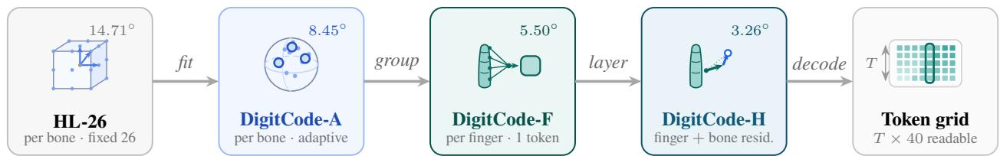
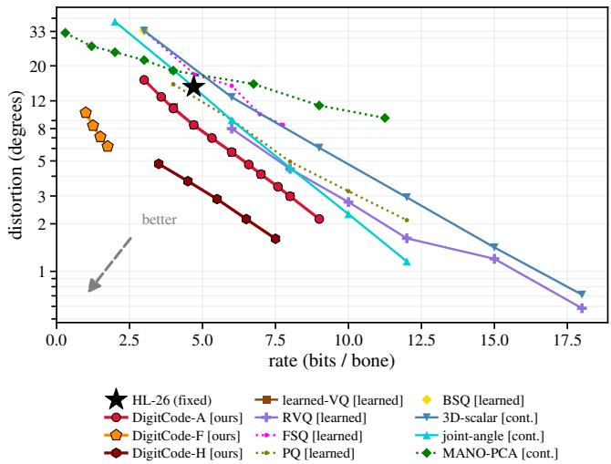
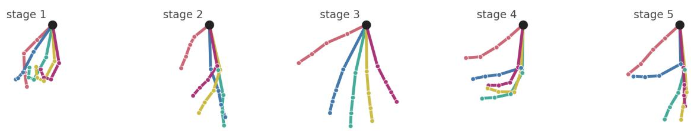
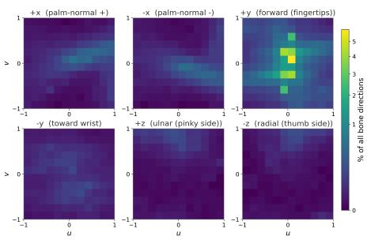
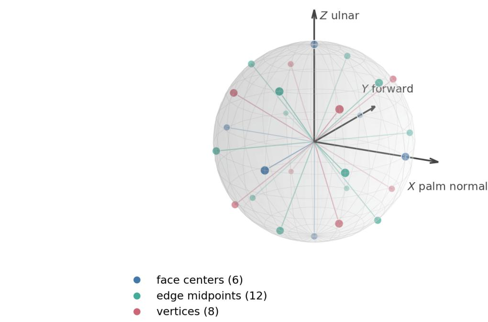
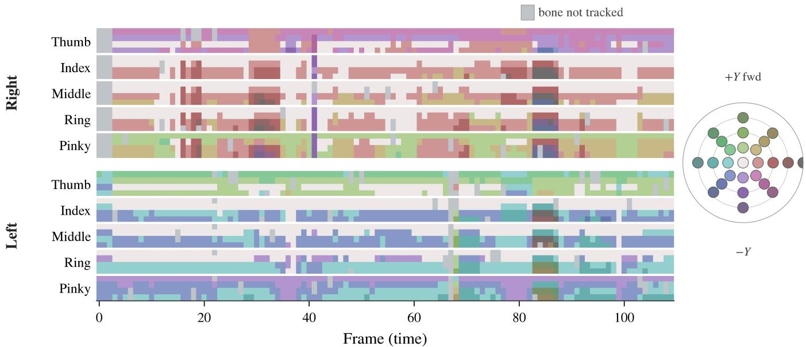
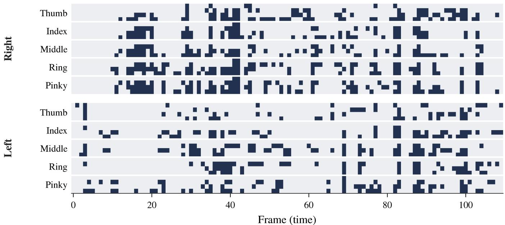
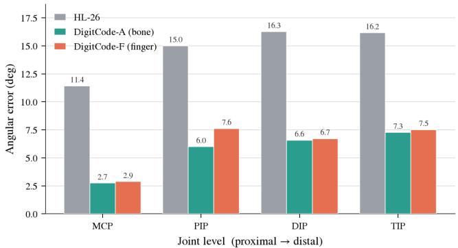
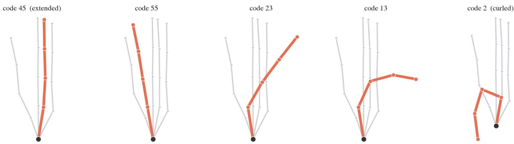
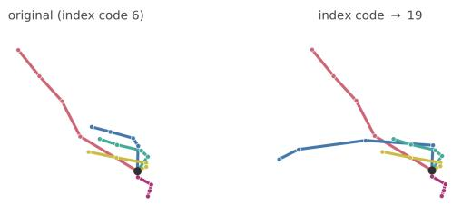

# DigitCode: 基于解剖学单元的手部运动符号化标记

Haoyu Gu1∗, Haotian Lu2∗, Jingrun Du2, Xiao-Ping Zhang2†

1School of Future Technology, South China University of Technology（华南理工大学未来技术学院） 2Shenzhen Key Laboratory of Ubiquitous Data Enabling, Tsinghua Shenzhen International Graduate School, Tsinghua University（清华大学深圳国际研究生院普适数据赋能重点实验室）
ghy20050104@gmail.com, haotianlu666@gmail.com, xpzhang@ieee.org

## 摘要

手部动作承载着人类活动中最细粒度的信息，然而手部生成、理解和机器人学习背后的表征绝大多数是连续的——即关节角或 MANO 参数。这些表征虽然精确但缺乏结构：手指无法作为符号被索引或编辑，也没有机制能标识某个姿态是否符合解剖学有效性。离散符号表征恰好能提供这种结构，而手部拉班记谱法（Hand Labanotation，简称 HL）已经证明了其对手部的可行性，它将动作记录为一个 $T \times 40$ 的网格，每个骨骼对应一个固定的方向符号。基于这一网格，我们提出了其底层的核心问题：一个符号应当涵盖多大的解剖学单元——骨骼、手指还是整只手。DigitCode 通过在单个编码内沿着手部的单元层次结构自适应调整、分组和分层 HL 的符号集回答了这个问题，将符号表征的量化误差降低了四分之三。起关键作用的是单元而非量化器类型：在固定单元下，免训练量化器和强大的学习型量化器在重构性能上可以互换，而沿着解剖学层次向下移动才是改变精度的关键。该层次结构还契合了下游任务的需求。由于手指是一个真实的、可枚举的单元，每个单指 token 兼具免训练、可编辑的手柄功能，能够处理连续表征无法应对的任务——修复生成畸形的手部，以及将其重定向至机器人手。我们发布了可复现的测试基准 HandTok，以便对手部 token 化器进行逐单元的对比。项目主页：https://digitcode-demo.github.io。

## 1 引言

当生成模型绘制出一只大拇指穿过手掌向后弯曲的手时，通常的修复方法是重新绘制整只手，因为其表示方式中没有任何机制能将拇指隔离为一个可以就地修正的部件。这种缺陷可以追溯到手部最初是如何被分词（tokenized）的：每种离散表示都决定了两件事——量化的精细程度，以及一个标记（token）应当跨越的范围。分词研究绝大多数都在追求前者——更大的码本（codebooks）、可学习及残差量化器——而后者通常直接沿用数据本身的网格结构，未被深入探讨。我们认为，对于具有天然组合结构的信号而言，第二个决策才是关键所在。手部运动是测试这一观点的绝佳且清晰的场景。它的组成部分并非主观臆断——公认的事实是手由手指构成，而手指由骨骼构成——因此候选单元来自解剖学而非建模者。这些部件如何协同运动是先验已知的（受肌腱和关节活动范围限制），因此哪种分组方式能带来收益是一个物理层面的预测，而非超参数搜索。此外，手部已经存在符号化网格，因此可以在保持字符表（alphabet）、帧率和提取流程不变的情况下调整分词单元。极少有信号能同时具备这三点，因此这里的结论可作为该设计决策的有力证据，而非仅仅针对某一个数据集的特例。

手部生成、理解以及机器人学习都取决于对手部动作的精准表征（Qin et al. 2022; Shaw, Bahl, and Pathak 2023），然而底层的表征绝大多数是连续的——关节角度，或是由姿态估计器（Moon et al. 2020; Pavlakos et al. 2024）恢复的 MANO 参数化模型（Romero, Tzionas, and Black 2017）——对于任何符号化需求而言，这些表征虽精确却缺乏结构：手势无法被索引，若不重新优化会波及整只手的参数就无法单独编辑单根手指，且没有任何机制能标记姿态是否符合解剖学合理性。离散符号表征在构造上自带这种结构，而手部拉班记谱法（Hand Labanotation，HL）（Li et al. 2024）证明了其在手部的可行性：一个 $T \times 40$ 的网格，每根骨骼对应来自固定 26 方向符号集（HL-26）中的一个符号，具有确定性且可从公开的 3D 关节数据复现。HL 由此将手部引入了符号化世界——但其分辨率是由记谱系统所规定的（每根骨骼一个符号），而非源于手部自身的解剖学特征。其扁平的骨骼网格忽略了手指内部的骨骼倾向于协同运动、而不同手指之间独立运动的特性（§3）；符号底层的这一单元本身，而非符号形式，才是我们提出的核心设计问题。HL 的粗粒度并不单纯是一个缺陷：我们发现它在噪声环境下恰恰是适用于身份级任务的正确单元（§4.4）。核心问题在于何种任务该采用何种单元，而并非 HL 的选择存在错误。

本文的核心观点由两项发现构成。首先，关键的杠杆作用在于单元（unit）本身，而非量化器（quantizer）：在固定单元下，免训练量化器与学习型强量化器是可以互换的，而改变单元则会重塑精度—码率的权衡关系（accuracy–rate trade-off）。其根本原因在于结构特性：一根手指的四块骨骼作为联动链运动，因此对它们进行独立量化会把码率浪费在任何量化器都无法挽回的冗余上，而单个手指 token 则能自然捕获这种联动性。其次，手部呈现出与任务需求高度契合的层级结构——骨骼、手指、整手。

DigitCode 基于手部运动的特性，通过对 HL 进行三处改动将这些发现转化为编码。骨骼方向呈各向异性集中，因此我们使字母表拟合数据。这种联动关系指明了划分的位置，因此我们将单指的骨骼进行分组并联合量化。单个手指 token 会限制精度上限，因此我们在其下方叠加逐骨骼的残差层，从而同时保留这两种单元；随后，相对编码和事件编码进一步压缩近似恒定的时间轴。每个 token 均保持为可读的方向，留出误差从 $1 4 . 7 1 ^ { \circ }$ 降至 3.26◦（图 1）。

本文主要包含三项贡献。

1. DigitCode，一种其 token 为解剖学单元的符号编码。通过沿着“骨骼—手指—手部”层级结构对 HL 的字母表进行拟合、分组与分层，单一编码即可跨越三个单元，并将留出量化误差降低四分之三，同时每个 token 依然代表可读的方向（§3）。

2. 对每种离散手部表征所涉及的两项决策（即 token 所跨越的单元是什么，以及如何对其进行量化）进行了受控分离。在匹配速率下遍历这两个维度的通用测试平台上，沿解剖结构向下细化单元的影响显著主导了量化器族类的任何改变：在固定单元下，免训练量化器与强学习型量化器是可互换的，而切换单元则会重塑率失真边界（§4.2）。

3. 一个兼作任务接口的真正解剖学单元。由于手指是可枚举的，单个单指 token 即可作为一个免训练的操作句柄，用于检测、编辑和修复损坏的手指，以及编译面向机械手的动作重定向（retargeting）——这些操作是任何连续参数化都无法支持的。在六种下游设置中，有效单元与任务紧密对应：动力学读取骨骼，交互读取手指，身份识别读取整只手。我们将该评估测试平台开源为 HandTok（§4–6）。

## 2 相关工作

连续表征。连续参数化方法虽然精确，但缺乏符号结构，而本文则弥补了它们所欠缺的部分。手部动作主要由关节角或 MANO 参数化模型 (Romero, Tzionas, and Black 2017) 来表征，由姿态估计器 (Moon et al. 2020; Pavlakos et al. 2024) 从图像中恢复，并同样被生成与机器人学习流水线所采用——但其中不存在索引、部件级操作句柄，亦无合法集。这一缺陷体现在本文所涉及的两个终端领域：在图像生成中，手部畸形是最常见的伪影，而连续域修复方法（HandRefiner (Lu et al. 2024)、RealisHuman (Wang et al. 2025)）必须重绘整只手，检测器与修复器相互分离且均不支持分部件寻址；在机器人领域，视频到灵巧操作（video-to-dexterity）流水线 (Qin et al. 2022; Shaw, Bahl, and Pathak 2023) 在重定向估计姿态 (Qin et al. 2023) 时，没有合法性检查，也没有单指级别的操作句柄。§5 和 §6 表明，符号化的单指单元能够同时满足这两方面的需求。

符号表记法（Symbolic notation）。符号表记法提供了连续姿态所缺乏的结构，但将单元固定在身体部位分辨率；我们研究如何改变这一设定。拉班舞谱（Labanotation）将动作记录为身体部位网格上的方向符号，HamNoSys (Prillwitz et al. 1989) 对手语也采用了类似做法，牺牲精度以换取可读、可编辑和可归档的符号。随后衍生出一条计算研究脉络——自动转录（Choensawat, Nakamura, and Hachimura 2015; Zhang et al. 2026）、双向转换（DASKEL (Luo, Yu, and Wang 2023)，即我们率失真协议的前提）以及符号空间中的建模（Jiang et al. 2024, 2026）——其中 HL (Li et al. 2024) 标志着该方法推进到了手指级别。在沿物理结构进行离散化的学习型分词器中也出现了类似的直觉：M3T (Symeonidis-Herzig et al. 2026) 为身体、手和面部分别设置了独立的码本，而手-物交互相关的研究（Huang et al. 2025; Luo et al. 2025; Cha et al. 2024; Liu et al. 2023）则沿着相互作用的部件进行因子分解。上述方法都将符号固定在身体部位分辨率上；立足于 HL 的网格，我们探讨了如何在更精细的解剖学单元上对字母表进行自适应、分解和分层（§3），同时保持其可解释性。

离散分词。可学习的分词器将其设计重心倾注于量化器上；而我们发现解剖学单元是更有力的杠杆。VQ-VAE (van den Oord, Vinyals, and Kavukcuoglu 2017) 引发了一波离散动作分词器的浪潮 (Zhang et al. 2023; Guo et al. 2022; Jiang et al. 2023)，并衍生出了残差和掩码变体 (Guo et al. 2024; Pinyoanuntapong et al. 2024; Yuan et al. 2024; Hwang et al. 2026; Li et al. 2026)。一些方法已经采用了比全身更精细的空间单元进行分词——例如 MoGenTS (Yuan et al. 2024) 按关节进行量化——但那里的单元是一次性由网络架构固定的；没有任何工作在匹配速率下将解剖学单元与量化器进行变量对比，而这正是我们所进行的比较。符号音乐（Symbolic music）在时间轴上也采取了类似的做法 (Qian et al. 2026)。手语生成随后也进入了 Pose-VQVAE 词元空间 (Saunders, Camgoz, and Bowden 2020; Xie et al. 2024; Zuo et al. 2025)；CoMo (Huang et al. 2024) 使此类编码具备可编辑性，尽管它无法检测或定位需要编辑的内容。其底层则是量化器本身——RVQ (Zeghidour et al. 2021)、FSQ (Mentzer et al. 2024)、PQ (Jégou, Douze, and Schmid 2011)、BSQ (Zhao, Xiong, and Krähenbühl 2024)——而我们的相对编码和事件编码则借鉴了符号音乐中的类似方法 (Hsiao et al. 2021)。对于手部而言，这一设计空间——量化器族对比解剖学单元、可学习方法对比免训练方法——此前尚未被系统探究；我们在统一的基础（§4）上对其进行了全面刻画。

## 3 方法

DigitCode 是 HL 网格上的一族符号编码，通过逐一更改 HL-26 的设计决策构建而成：我们回顾了 HL-26，衡量了更优编码应在哪些方面有所不同，然后依次实施了这些更改。

对于每只手，HL 从 3D 关节点中提取 20 个骨骼方向向量，并将其归一化到单位球面 $S ^ { 2 }$。HL-26 将方向量化为 $\mathbf { v } \in S ^ { 2 } \mathrm { t o } q ( \mathbf { v } ) = \underset { \mathbf { \sigma } } { \mathrm { a r g m a x } } _ { \mathbf { c } \in \mathcal { C } _ { 2 6 } } \mathbf { v } ^ { \top } \mathbf { c } .$，其中 $\mathcal { C } _ { 2 6 }$ 归一化了 $\{ - 1 , 0 , 1 \} ^ { \bar { 3 } } \backslash \{ 0 \}$（立方体的 6 个面、12 条棱、8 个角）。将两只手在 $T$ 帧上进行堆叠，即可得到我们所构建的 $T \times 4 0$ 符号网格。该规则是确定性的，并且可以从任何公开的 3D 关节点数据源中复现，因此 HL-26 完全不需要 HL 的任何内部数据。

在 InterHand2.6M（36 次采集，717K 个向量）上的三项经验观察构成了该设计的动机，每一项都指出了对 HL-26 固定单骨骼网格的改进方向。(1) 各向异性（Anisotropy）：所有骨骼方向中有 68.1% 落在立方体的单个 $+ Y$ 面上，因此 HL-26 的均匀字母表浪费了其大部分符号，而应改为与数据相拟合（附录 C）。(2) 指内耦合（Intrafinger coupling）：单指内的互信息平均为 39%，而跨指仅为 29%（跨指峰值为中指–无名指的 51%），因此手指而非骨骼才是天然的词元（token）边界——内部存在可利用的强依赖性，外部则是易于切分的弱接缝。(3) 时间冗余性（Temporal redundancy）：79% 的词元与前一帧相比未发生变化，因此时间轴是可压缩的。对于扁平网格上的固定单骨骼编码——即 HL 继承自拉班舞谱（Labanotation）分身体部位列的设计——这些规律都无法被利用；HL-26 自身的保留误差（held-out error）为 $1 4 . { \dot { 7 } } 1 ^ { \circ }$（各项观察的统计数据见附录 A）。

  
Figure 1: DigitCode 概述。对 HL 的字母表进行拟合、分组和分层改变了一个词元所跨越的解剖学单元（DigitCode-A/F/H），在与 HL-26 基本相当的比特率（4.75 对比 4.70 bits）下，将保留误差从 14.71◦ 降低至 $3 . 2 6 ^ { \circ }$；颜色标示了所对应的单元。

DigitCode 依次进行了这三项改进（图 1）：DigitCode-A 将码本拟合到数据中。DigitCode-F 将单元从骨骼转移到手指。DigitCode-H 将两者分层构建为一个“粗粒度加残差”（coarse-plus-residual）的分层体系。随后，相对编码和事件编码压缩了时间轴，并由按解剖结构分组的调度进行解码。每一步都保留在 HL 的网格上，并保持编码的几何性与可读性。在全文中，当一个标记跨度（token span）的有用特性来源于其所命名的物理结构而非训练目标时，我们称其为真实单元（genuine unit）——手指属于此类，而全手学习到的隐变量则不是，§5 通过将其转化为具体操作使这种差异更加明确。骨骼、手指和整只手都是真实单元；某个任务应当读取哪一个单元，则是 §4.3 所回答的另一个问题。

## 3.1 DigitCode-A：$S ^ { 2 }$ 上的数据自适应码本

最小的改动是保留骨骼单元，仅替换固定字符表（改进 1）。DigitCode-A 在训练方向上运行球面 k-means (Lloyd 1982)，并与 HL-26 完全相同地通过余弦最大值（argmax-cosine）进行量化；方向空间是低维的，因此无需进行编码器训练（§7）。在相同的码本大小下（K=26，两者均消耗 4.70 定宽比特/骨骼），自适应编码达到了 $8 . 4 5 ^ { \circ }$，相比 HL-26 的 $1 4 . 7 \dot { 1 } ^ { \circ }$ 降低了 43%（低码率工作点见附录 I）。

## 3.2 DigitCode-F：单指联合量化

下一个改动是单元本身（改动 2）：从骨骼变为手指。DigitCode-F 并非独立量化单根手指的四块骨骼，而是将它们拼接为一个单一的 12 维向量，并对手指进行联合量化；各手指保持独立，沿较弱的跨手指缝隙划分。带来收益的是这一缝隙符合解剖学结构，而非更大的分块：在固定的 12 维块、K 和码率下，随机重新组合相同的骨骼会导致 2.4◦ 的损失（9.48 对比 7.10◦，K=64），而半解剖学划分的结果介于两者之间——经典的块效应（Jégou, Douze, and Schmid 2011）相比于哪些骨骼共享编码而言是次要的（附录 D）。现在一个 token 表示整个手指的姿态：

$$
\mathbf {f} = \left[ \mathbf {v} _ {1}; \mathbf {v} _ {2}; \mathbf {v} _ {3}; \mathbf {v} _ {4} \right] \in \mathbb {R} ^ {1 2}, \quad q _ {F} (\mathbf {f}) = \arg \min _ {k} \| \mathbf {f} - \mathbf {c} _ {k} \| _ {2},\tag{1}
$$

解码时，通过将 $\mathbf { c } _ { q _ { F } ( \mathbf { f } ) }$ 拆分为四个骨骼方向并分别进行归一化。DigitCode-F 在每块骨骼 2.0 比特时达到 $5 . 5 0 ^ { \circ }$，而独立的逐骨骼 k-means 在 6.0 比特时为 5.69◦——以三分之一的码率实现了相同的保真度。解码后的网格保持为 $T \times 4 0$；token 流现在为 $T \times 1 0$

## 3.3 DigitCode-H：分层粗粒度 + 残差

一个手指词元（finger token）必须概括四块骨骼——这是精度的上限。最后一项改动（改动 3）同时保留了这两个单元，并进行分层：手指代码成为捕捉“哪种手指姿态”的粗粒度词元，而在其残差上的逐骨骼代码则进一步细化“程度如何”。手指是接口单元，骨骼是精度单元，单一编码同时承载两者。令 $\hat { \mathbf { v } } _ { b } ^ { c }$ 表示骨骼 $b$ 的粗粒度重构，$R _ { { \bf u }  { \bf e } _ { y } }$ 表示将单位向量 $\mathbf{u}$ 变换到正则极点的最小旋转，残差本身也是一个方向：

$$
\mathbf {r} _ {b} = R _ {\hat {\mathbf {v}} _ {b} ^ {c} \to \mathbf {e} _ {y}} \mathbf {v} _ {b}, \qquad \hat {\mathbf {v}} _ {b} = R _ {\hat {\mathbf {v}} _ {b} ^ {c} \to \mathbf {e} _ {y}} ^ {- 1} \hat {\mathbf {r}} _ {b},\tag{2}
$$

其使用一个包含 $K_2$ 个条目的单一共享球面码本对每块骨骼进行量化。这两个层级承载了近乎独立的信息（粗粒度到残差的互信息 MI 仅为 10%），因此残差的开销很低。DigitCode-H 在更低的比特率下将扁平逐骨骼代码的误差减半，在 6.75 bits 时进一步降至 $1 . 8 6 ^ { \circ }$（Table 1；扁平代码对比见 App. E）。残差量化是标准做法 (Zeghidour et al. 2021)；在此，粗粒度层是一个基于解剖学的手指姿态，因此这种划分具有物理意义。

## 3.4 时间与解码轴

另外两个维度与单元问题相互正交，我们在此简要讨论。相对于其时间或运动学参考对每个方向进行编码会将整条 R–D 曲线向左平移（附录 F）；仅在曲率感知关键帧（Douglas and Peucker 1973）处发射 token 并通过 slerp（Shoemake 1985）对其余部分进行插值，在保真度匹配的情况下可将序列长度减半，前提是合理的对照实验将这种表观上的速度提升归功于解码器而非 token（附录 G）。一帧中逐骨骼的 token 也可以并行、展平或按解剖结构分组的延迟顺序发射（Copet et al. 2023; Wang, Tan, and Yang 2025）；以无泄漏生成进行评分——由于跨帧延迟会泄漏未来帧，强制教学（teacher-forced）似然不具可比性——延迟顺序在长连续运动上表现更优，而在短静态剪辑上则相反，因此我们仅在前者中采用该方法（附录 H）。这些均不会改变单元本身，且下文的主要编码未使用其中任何一种方法。

## 4 实验

本节评估编码本身——重建、下游任务、泛化性；随后第 5–6 节将真实单元的四种属性解读为接口和机器人流程。

## 4.1 设置

四种公开采集机制涵盖了变化的各个维度：双手交互（InterHand2.6M (Moon et al. 2020)）、静态单手（FreiHAND (Zimmermann et al. 2019)）、自由单手序列（HanCo (Zimmermann, Argus, and Brox 2021)）以及带噪声的提升手语（ASL-Skeleton3D (de Amorim and Zanchettin 2022)），均基于公开的 3D 关节点。数据集划分经过了泄漏控制（采集不相交；针对身份任务为主体不相交，见附录 A）。失真度（Distortion）是重建方向与真实方向之间的平均角度误差；码率（rate）在两种标记规范下报告：主表采用固定宽度 $\log _ { 2 } \bar { K }$，对比评测（bake-offs）采用经验熵。量化器测试框架可在任意单元拟合码本，并对比 HL-26 (14.71◦) 对 k-means/VQ/RVQ/FSQ/PQ/BSQ 进行了参数扫描；我们将其作为 HandTok 发布，以便其他分词器（tokenizer）可以在同一基准上进行比较。

自适应码本仅在训练集划分上进行拟合；自回归任务使用小型 LLaMA 风格的 Transformer（Touvron et al. 2023）。主要对比结果附带序列级 Bootstrap 置信区间（CI）和配对置换检验；生成和调度模型在 3 个随机种子下训练，并通过动作自编码器潜空间中对模式坍缩敏感的 Fréchet 距离（AE-FGD）以及速度分布的 Jensen–Shannon 散度进行评分（附录 A）。可学习的基线模型均经过充分调优（EMA、死码复活机制）；我们扫描对比的量化器是已发表动作分词器（motion tokenizer）的核心——VQ（T2M-GPT）、RVQ（MoMask）、FSQ——由于身体动作检查点无法迁移到手部方向，这些量化器均在码率匹配下重新进行了训练。表 1 中对齐对比了一个完整的 MoMask 风格 RVQ-VAE 系统。

## 4.2 率失真：单元决定前沿

表 1 和图 2 展示了沿着解剖结构向下推进的过程：将骨骼单元拟合到数据（DigitCode-A）可达到 8.45◦；将单元调整为手指（DigitCode-F），在保真度匹配的单骨骼编码三分之一的码率下（§3.2）即可达到 5.50◦；而将两者结合进行分层（DigitCode-H）则能在与 HL-26 基本相同的码率下（4.75 对 4.70 比特）达到 3.26◦，并在 6.75 比特时进一步达到 $1 . 8 6 ^ { \circ }$。切换表征单元可以同时降低误差和码率，这是在固定单元下仅改变任何量化器都无法实现的，并且该结论在任一种码率约定下均成立（熵：HL 在 14.71◦ 下为 3.29 比特，而 F 在 5.50◦ 下为 1.94 比特）。

设计空间的其余部分表现出相同的规律。在匹配的比特率下（表 2），无需训练的 k-means 与调优后的可学习 VQ 打成平手——在声明的 $0.5^{\circ}$ 裕度内等价（第 7 节）——而 FSQ、PQ 和 BSQ 则落后多达 $3.8^{\circ}$，因此我们声称的无效假设仅针对强量化器。均匀球面网格甚至比 HL-26 更差（附录 Q）。残差 VQ（RVQ）与码率相关：它在每一列中都落后于 k-means，尤其是在码率最匮乏时（在 $\sim 4.4$ 比特处相差 $1.6^{\circ}$，随后缩小至 $0.6^{\circ}$ 和 $0.4^{\circ}$），因此深度仅在远高于我们工作点的情况下才能带来回报，且是在手指单元而非骨骼单元上（附录 E）。其余差距源于结构性原因：在 $+Y$ 聚集分布下，FSQ 和 BSQ 的网格留下了大部分空单元格，导致其熵饱和值比名义值低 $\sim 2.8$ 和 $\sim 4.9$ 比特。即使是具有我们逐帧局部编码所缺乏的时间上下文的完整 MoMask 风格 RVQ-VAE，充其量也仅能与手指编码持平，且落后分层编码约 $\sim 2\times$——训练无法超越单元对齐。这三步递进同时兼作累积消融实验，且图 2 中的每个族系（其中我们的三个族系占据了前沿）都是 $K$ 值扫描——按设计即为敏感性分析。

<table><tr><td>表征</td><td>固定比特 (fixed b.)</td><td>熵比特 (entr. b.)</td><td>角度 (°)</td></tr><tr><td>HL-26 (固定, K=26)</td><td>4.70</td><td>3.29</td><td>14.71</td></tr><tr><td>+ DigitCode-A (K=26)</td><td>4.70</td><td>4.38</td><td>8.45</td></tr><tr><td>+ DigitCode-F (K=256)</td><td>2.0</td><td>1.94</td><td>5.50</td></tr><tr><td>+ DigitCode-H (K1=128, K2=8)</td><td>4.75</td><td>4.37</td><td>3.26</td></tr><tr><td>+ DigitCode-H (K1=128, K2=16)</td><td>5.75</td><td>5.20</td><td>2.55</td></tr><tr><td>+ DigitCode-H (K1=128, K2=32)</td><td>6.75</td><td>6.12</td><td>1.86</td></tr><tr><td>可学习 VQ (K=26)</td><td>4.70</td><td>4.47</td><td>8.36</td></tr><tr><td>可学习 VQ (K=128)</td><td>7.0</td><td>6.70</td><td>4.11</td></tr><tr><td>MoMask 风格 RVQ-VAE (V=4)</td><td>1.80</td><td>1.67</td><td>5.83</td></tr><tr><td>MoMask 风格 RVQ-VAE (V=14)</td><td>6.30</td><td>5.99</td><td>3.90</td></tr><tr><td>关节角 (连续)</td><td>6.0</td><td>5.21</td><td>9.06</td></tr></table>

Table 1: 三步进阶，在保留的 InterHand2.6M 测试集上；横线下方：可学习 VQ，一种 MoMask 风格的序列 RVQ-VAE 系统（附录 I），连续关节角。码率见第 4.2 节。在 HL-26 的码率下，DigitCode-A 将其误差减半，DigitCode-H $( K _ { 2 } { = } 8 )$ 将其误差降至四分之一；DigitCode-F（加粗）在仅为其 43% 的码率下在两个指标上均优于它。

<table><tr><td rowspan="2">方法</td><td colspan="3">3D，匹配比特数 (°)</td><td rowspan="2">Sph. K=64</td></tr><tr><td>~4.4b</td><td>~5.6b</td><td>~6.6b</td></tr><tr><td>k-means</td><td>8.43</td><td>5.64</td><td>4.07</td><td>6.59</td></tr><tr><td>VQ (learned)</td><td>8.53</td><td>5.63</td><td>4.08</td><td>6.49</td></tr><tr><td>FSQ</td><td>9.88</td><td>8.47</td><td>-</td><td>-</td></tr><tr><td>PQ</td><td>12.58</td><td>9.11</td><td>6.25</td><td>7.36</td></tr><tr><td>RVQ</td><td>10.02</td><td>6.24</td><td>4.45</td><td>8.71</td></tr><tr><td>BSQ</td><td>11.65</td><td>9.45</td><td>-</td><td>23.57</td></tr></table>

Table 2: 在匹配经验熵率下的量化器对比 $( \sp { 6 6 } - \sp { 5 3 } )$：无工作点；完整扫描见附录 I）。FSQ/PQ/BSQ 表现落后：原假设是针对强量化器，而非所有量化器。

## 4.3 下游任务：粒度决定单元

在六种应用——生成、预测、检索、编辑、去噪和分类（Table 3）中，最优的表示层级呈现出清晰的有序性：动力学依赖于骨骼级，交互依赖于手指级，而身份则依赖于整手级。并非每种场景都占据绝对优势——预测任务仅与连续副本持平，检索任务的差距也较为有限——但这种排序绝非偶然：一个任务的自然单元是仍能承载其所需信息的最粗粒度单元。动力学取决于微小的帧间速度，因此需要最精细的骨骼级细节；交互取决于哪根手指在做什么动作，因此与手指级保持一致；身份取决于整手的粗略轮廓，因此整手编码就已足够：单个整手 token 的 top-1 准确率达到 46.8%，仅以其 1/14.6 的码率就匹敌了 20-token 逐骨骼编码的 46.2%（App. K）。本节的其余部分将在各自的自然单元下解读每项任务。

  
Figure 2: 率失真设计空间（保留测试集 Inter-Hand2.6M；对数失真，固定位宽码率）；每个族系是对码本大小 $K$ 的扫描。

动态特性偏好骨骼级表示。这些任务取决于帧间速度，而骨骼级编码在其中胜出。预测任务在一个确定性指标上最清晰地展现了这一点：单骨骼编码预测下一姿态的误差为 12.90◦，而单手指编码为 19.04◦，HL-26 为 18.85◦，在四类模型中的三类上均处于领先——更粗粒度的单元完全如排序所预测的那样表现不佳，其 token 每帧变动过大而难以预测。没有任何分词器（tokenizer）能击败“预测无动作”（predict no motion）基线（12.74◦），因此这仅是关于选择哪种单元的证据，而非相比连续姿态的优势（App. J）。

生成揭示了背后的机制。在对崩溃敏感的 AE-FGD（4.46 对 3.01）指标上，HL-26 在所有随机种子的测试中均落后于两种自适应编码（adaptive codes），其生成的运动速度逐渐趋于静止：粗粒度的 token 通过量化抹去了细微的帧间变化，从而导致在其上训练的模型发生均值崩溃（mean-collapses）。这一差距是编码本身的特性，而非解码器的问题——更强大的掩码解码器（masked decoder，Guo et al. 2024；Pinyoanuntapong et al. 2024）并未弥合这一差距——且在针对该指标的经验原假设进行窗口匹配校准后，该差距依然存在（App. A）。该指标并未将这两种自适应编码彼此区分开来，这正是上述排序依赖于预测（forecasting）的原因。

交互基于手指读取。人们用手指抓取、指向和按压，而检索、去噪和编辑是同一个标记（token）的三个视角，通过对手指码字（codeword）的单一操作实现统一：将其与查询匹配、与码本匹配或对其进行覆盖（Table 3）。检索：符号匹配检索到相同手势片段的概率是随机速率的 23 倍，且组合手指谓词在训练分类器累积误差的情况下依然保持零样本（zero-shot）有效。去噪：将带噪声的手指吸附（snap）到其最近的码字上，可以单次直接将其投影回真实姿态流形上，在各个噪声水平下均优于迭代式 MANO 重新拟合，且速度快约 440 倍。编辑：重写单根手指的代码仅移动该手指而绝不会影响其他手指，超出真实手部弯曲包络线（flexion envelope）的编辑比例仅为 0.02%，相比之下匹配的无约束 MANO 编辑则高达 90%（§5；App. L）。

身份基于整手读取。手势是根据粗略轮廓而非任何单根骨骼读取的，由此带来的速率优势尤为显著：在受试者不重叠的 137 类分类任务中，单个整手标记达到了 46.8% 的 top-1 准确率，以 1/14.6 的速率匹敌了 20 标记逐骨骼代码的 46.2%。DigitCode-F 以 HL-26 45% 的速率达到了相当的性能，加入整手标记后达到 49.7%（+6.7pp，CI [+4.3, +9.0]）——这些单元是互补的。在固定探针（fixed probe）下，这些标记的表现也优于 MANO 和关节角特征（App. K）。

## 4.4 跨数据集与跨机制泛化

DigitCode-A 能够跨数据集和跨应用场景进行迁移：在一个数据集上拟合后，它在另一个数据集上依然优于 HL-26（在 FreiHAND 上为 −61%），并且在 InterHand 上拟合的码本（codebook）在 HanCo 和提升的 ASL（lifted ASL）上同样占据主导地位（−46% 至 −61%）——这体现的是泛化能力，而非过拟合（附录 M）。

噪声从另一个角度印证了粒度排序的有效性。噪声下的判别是一项恒等任务，更青睐粗粒度——HL-26 的粗粒度字母表能够通过量化消除噪声，因而最具鲁棒性；而保真度则依赖于最细粒度的单元，因此在无噪压缩中表现最佳的手指级编码在带噪 ASL 上出现崩溃（14.03◦），其误差主要由单个最差的骨骼所主导。骨骼精度层（bone-precision layer）是解决这一问题的方法：DigitCode-H 的逐骨骼残差解耦了受损骨骼，在 ASL 上达到了 4.29◦（相较于 DigitCode-F 降低了 69%；附录 N）。粗粒度适用于保持恒等，细粒度适用于追求保真。这并非对粒度排序的重复测量，而是对其进行的一项检验：第 4.3 节中的机制预测了噪声会逆转胜出的单元，事实确实如此。与冻结的参数化先验不同，码本还可以重新拟合到目标骨架（6.75◦ 对比 19–25◦；附录 N）。

## 5 检测与修复畸形手部

畸形手是生成式图像和视频模型中最常见的伪影，然而标准的修复方法是重绘整只手，从不定位具体哪根手指存在错误。一种符号化的单指编码（per-finger code）提供了所缺失的交互接口，在此，§3 中的真正单元名副其实：手指词元（finger token）具有以下特性：(i) **具象性**（grounded），指称模型外部的实体；(ii) **可枚举性**（enumerable），因此有限码本即可列举合法集合；(iii) **封闭性**（closed），因为解码结果落入拟合真实手的原型；以及 (iv) **局部可编辑性**（locally editable），因为该编码沿结构进行了因式分解——这是解码映射的特性，而非统计独立性。针对整只手学习到的潜在表示仅满足第二项特性。每种特性都在无需额外机制的情况下转化为一种操作：码字残差用于检测并定位受损的手指，词元作为编辑句柄，而封闭性则确保每个输出都保持在真实手集合之内。我们在留出的 InterHand2.6M 姿态（DigitCode-F, K=128）的已知真值扰动上测试了所有四种特性，涵盖两种机制：流形外（$\sigma=45^\circ$）以及解剖学非法（过度伸展），并按 Table 5（App. O）的指标进行评分。

<table><tr><td>单元 → 机制</td><td>任务</td><td>DigitCode</td><td>Reference</td><td>备注</td></tr><tr><td rowspan="2">骨骼 → 动力学（未解析）</td><td>单步预测</td><td>12.90°</td><td>HL-26 18.85°</td><td>-31%；持平连续复制 12.74°</td></tr><tr><td>分布生成</td><td>AE-FGD 3.01</td><td>HL-26 4.46</td><td>仅限 HL-26 差距；速度-JS 2.2×</td></tr><tr><td>手指 → 交互</td><td>检索</td><td>P@1 25.4%</td><td>random 1.1%</td><td>随机的 23×（多重集匹配）</td></tr><tr><td>手指 → 交互</td><td>去噪</td><td>+5.5°</td><td>MANO 重拟合</td><td>在 σ=20° 条件下；重拟合慢 440×</td></tr><tr><td>手指 → 交互</td><td>单指编辑</td><td>非编辑指 0°†</td><td>MANO 0.90 违规</td><td>结构上保证精确为零</td></tr><tr><td>手部 → 身份</td><td>手势分类</td><td>top-1 49.7%</td><td>HL-26 43.0%</td><td>+6.7pp，CI [+4.3, +9.0]</td></tr></table>

Table 3：下游任务，按其粒度所需的单元排序。“DigitCode”是该单元下的最佳分支，“Reference”为其对比的基线。†结构上精确为零（解码映射可因子化），而非测量得到的接近零。生成任务将自适应编码与 HL-26 区分开来，但无法区分骨骼与手指，因此不带单元标签。分类为跨受试者（subject-disjoint）设置。实验协议和各分词器表格见附录 J。

<table><tr><td>检测器 (AUC↑)</td><td>流形外</td><td>非法</td></tr><tr><td>码字残差（ours，零训练）</td><td>0.953</td><td>0.823</td></tr><tr><td>马氏距离（训练后）</td><td>0.961</td><td>0.684</td></tr><tr><td>指内不连贯性</td><td>0.737</td><td>0.615</td></tr><tr><td>MANO 重拟合残差</td><td>0.428</td><td>0.534</td></tr></table>

Table 4：各机制下的受损手指检测 AUC。

<table><tr><td>修复方法</td><td>corr.° ↓</td><td>innoc.° ↓</td><td>plaus.° ↓</td><td>OOL↓</td></tr><tr><td>无 (none)</td><td>36.2</td><td>0</td><td>25.3</td><td>—</td></tr><tr><td>对齐（最近码字）</td><td>28.4</td><td>2.6</td><td>7.1</td><td>0.00</td></tr><tr><td>token 填充 (token-infill)</td><td>23.8</td><td>5.3</td><td>5.6</td><td>0.00</td></tr><tr><td>全手 VQ (whole-hand VQ)</td><td>17.0</td><td>15.8</td><td>5.2</td><td>0.00</td></tr><tr><td>MANO-PCA 重新拟合</td><td>52.3</td><td>25.6</td><td>39.0</td><td>0.94</td></tr><tr><td>连续修复（学习获得）</td><td>12.4</td><td>2.6</td><td>7.8</td><td>0.00</td></tr><tr><td>+ 码本投影</td><td>12.5</td><td>2.7</td><td>7.6</td><td> $0.00^†$ </td></tr></table>

Table 5: 针对离流形损坏（off-manifold corruptions）的修复方法（†依构造为零；评估协议、非法状态范围以及 $\tau$ 参数扫描见附录 O）。

检测无需训练（Table 4）。单指码字残差——即到最近码字的角度距离——是唯一在两种状态下均表现强大的检测器：经过训练的马氏距离（Mahalanobis）检测器在离流形数据上略微占优，但在非法姿态上完全失效，而 MANO 重新拟合残差则完全没有检测能力。到封闭有效集的距离正是连续参数化方法所缺乏的结构性信号（附录 O）。

检测到的手指随后被就地修复（Table 5）。纯符号的 token 填充（token-infill）——一个以其他四根手指为条件、仅重写被标记手指的小型掩码 Transformer——在两种机制下均优于吸附（snapping），并在所有可寻址修复中产生了最合理的手指。相比之下，基于 MANO 的修复无法保持局部性：MANO 的参数并未按手指进行分解，因此为了校正一根手指而重新拟合会扰动其余手指。因此，每个 MANO 分支都遭遇了灾难性的失败——通过将 MANO 拟合到四根正常手指上来填充一根手指会产生很大偏差，因为其参数化不包含跨手指的条件先验。因此，该先验必须在可寻址基质上进行学习：在相同符号检测器之后运行的连续修复器（continuous inpainter）——而非独立的基线模型——达到了最低的原始误差，尽管相对于真实值（GT）的原始误差倾向于奖励预测条件均值的行为（其手指的合理性得分为 7.8◦，低于真实手指的 8.3◦）。将其输出投影到码本（codebook）上几乎没有任何代价，并且在结构上直接获得了闭包性。我们推荐这种混合方法：符号层提供检测、闭包性和可寻址性；学习模型提供准确性。编辑则是从另一个切入点进行的相同操作——重写单根手指的 token 可以精准命中目标，不移动其他任何手指，并落在一个码本原型上。

真实的估计器会改变这一边界。在 FreiHAND 上应用于 MediaPipe 之后时，该检测器仍然具有迁移能力，但此时的噪声是弥散的——表现为许多微小的误差，而非少数严重错误的手指——在这种情况下，补全式修复（infill-style repairs）的效果甚至不如不修复，而吸附去噪（snap denoising）则展现出优势。这引出了一条部署规则：根据噪声类型进行路由——将结构性损坏路由至上下文补全，将弥散的估计器噪声路由至 snap——并由同一个检测器同时为二者提供服务。这一闭环在生成式内容上得以实现：对于从 CogVideoX 帧中提取的手部，残差能够标记出高残差的手指，而 snap 则在无需真实真值（ground truth）的情况下将它们拉回真实姿态流形（App. O）。

## 6 机械手的重定向与筛选

从人类视频中学习灵巧操作（Qin et al. 2022; Shaw, Bahl, and Pathak 2023; Luo et al. 2025）形成了一条“视频 → 手部姿态估计 → 重定向 → 动作标签”的链条，而当今的每个阶段都运行在连续姿态上：每帧都需要重新求解逆运动学，没有任何机制检查估计出的姿态是否可达，且标签无法被编辑或筛选。手指单元仅凭单一表征即可接入其中的三个步骤，无需特定任务的训练，并具备 §5 中的相同属性 (i)–(iv)。我们使用标准的基于位置的优化器（Qin et al. 2023）将其重定向到涵盖独立手指、共享手腕和欠驱动设计的六种机器人手上（App. P）。

在此处，手指是正确的单元，一项组合测试说明了原因。仅在 FreiHAND 上拟合并在 ASL（美国手语）手势——即新颖的手指组合——上进行测试，单手指编码的退化程度小于容量大 6.4 倍的全手码本（编码残差为 31.2 对比 34.9），尽管全手编码在分布内的拟合更为精确 $( 1 . 7 5 ^ { \circ } \ \mathrm { v s . 3 . 9 8 ^ { \circ } } )$。较粗粒度的单元能更好地对已知分布建模；而因子化的单元则能覆盖其从未见过的组合——这再次印证了 §4.3 中的粒度排序，现已应用于面向机器人的任务中。

<table><tr><td>机械臂 (Allegro)</td><td>任务误差 (mm)</td><td>ms/帧</td></tr><tr><td>逐帧 IK（冻结基座）</td><td>35.1</td><td>2.4</td></tr><tr><td>逐骨骼码 + 逐帧 IK</td><td>-</td><td>2.5</td></tr><tr><td>DigitCode-F 查表（编译后）</td><td>35.5</td><td>0.005</td></tr></table>

Table 6: Allegro 上的编译重定向（$( \ ' - \ ' )$ 表示未生成数值；整手基线及全部六种机械手见附录 P）。

第一步，即重定向（retargeting），可以通过预编译消除。由于逐手指码本（per-finger codebook）是一个有限集合，从编码到机器人关节的映射只需预先求解一次——即 640 次逆运动学求解（5 根手指 × 128 个码字），耗时 1.6 秒——并存入逐手指查找表中，此后流式重定向便简化为 $O(1)$ 的查表组装：在全部六种机械手上比逐帧优化快 480–1500 倍，精度损失仅为 0.4–5.0 mm，其中 Allegro 处于损失较低的一端（Table 6），不过在其余五种机械手上，整手查找表的编译精度更高（附录 P）。单指编码的贡献在于可寻址性与计算摊销，而非峰值精度：修改一个 Token 仅需重新查询单根手指，且该查找表之所以存在，是因为单根手指构成了一个完整的 IK 目标——而逐骨骼码并非完整目标，因此它在 Table 6 中仅作为耗时对照（2.5 对比 2.4 ms）。

随后，同一残差对流水线的动作标签进行筛选，否则这些标签将缺乏免真值（ground-truth-free）校验机制。非法符号会映射到可达集之外的目标，从而在四只手上均增大了正向运动学残差（每个置信区间均排除零），因此封闭码本在逆运动学（IK）求解之前兼作可达性过滤器。仅执行拒绝筛选会使流水线面临数据短缺，因此同一检测器能够零样本（zero-shot）定位出问题的指部，并依据第 5 节的机制规则路由修复——对于结构性损坏，使标签误差降低 25–27%，对于真实估计器噪声降低 13–15%（全部 4/4 只手）。对于无法修复的标签，“检测并丢弃”（detect-and-drop）清洗机制能将混合数据流的误差压缩至接近零（附录 P）。因此，第 5 节的接口在第三个领域上得到了复现，涵盖包括欠驱动、耦合设计在内的四只手。由此，一种表征承载了全部六种操作，尽管其中部分操作（补全、离线 IK 求解）本身是通过学习或优化得到的。我们并未声称取得了任何操作任务的结果；这些均属于表征层与数据层的属性。

## 7 分析与讨论

两种机制解释了这些结果。量化器之所以可互换，是因为方向空间是低维的（参与比为 2.8–4.2），使得可学习编码器相比 Lloyd 算法几乎无法带来额外增益——这种对等性在下游任务中同样成立，其中 VQ-VAE 标记的分类效果并不优于 DigitCode-A。在匹配码率的情况下，单元（unit）的影响比量化器规则大出一个数量级以上（效应分解，附录 I）：将微调后的 VQ 替换为无需训练的 k-means，重构误差的变动最多仅为 0.10°；而在保持机制、深度和编码固定的情况下，仅将粗阶段的单元从骨骼改为单指，误差就会改变 1.63°，且逐骨骼控制所分配的码率只多不少——在 6–9 位的扫描中，逐骨骼粗阶段的效果在任何情况下都无法匹敌逐指粗阶段（附录 E）。由于零假设检验无法证实“没有差异”，我们将量化器的主张表述为相对于声明界限 $\dot { \delta } = 0 . 5 ^ { \circ }$ 的等价性——这还不到我们所主张的最小正效应（单元所对应的 1.63°）的三分之一。观察到的差距（不论正负，均 $\leq 0 . 1 0 ^ { \circ }$）以及在三个 VQ 随机种子上的配对序列差异（$\leq 0 . 1 5 ^ { \circ }$）均落在 $\delta$ 以内，且高于 VQ 自身运行间的 $\pm 0.04^\circ$ 波动底线：这表明其在小到无关紧要的裕度范围内是等价的，而不仅仅是统计上的不显著。深度是唯一一个适得其反的调节旋钮，在固定骨骼单元下会造成 0.38° 的损失。DigitCode 中贯穿着一种权衡：逐指码字是来自真实手部的原型姿态——这是一种在干净数据上带来收益、但在流形之外付出代价的软先验，在流形之外，单个受损骨骼就会主导整个共享码。任何有限码本都是用覆盖度来换取精度，且单元越粗，触及该限制就越早——这正是本设计同时包含两种单元的原因：逐骨骼残差（§3.3）被动地弥补该限制，而补全填充（infill，§5）则主动地弥补。

我们的主张涵盖三个方面。在重建、鲁棒性和具身筛选方面的证据最为充分，其中每个主要效果都附有显著性检验或配对自助法置信区间（paired bootstrap CI）（附录 B）；生成式研究则更具探索性。ASL（美国手语）结果最好理解为相对比较，其真实值（ground truth）是通过升维提取且带有噪声的，因此这些度数指标反映的是改进程度而非绝对校准。而机器人实验结果位于表征和数据层，证实了手指单元能够进行编译和筛选；它是否也能改善下游控制，则有待基于它构建的下一个系统来验证。全面的系统级比较还需要一个该领域尚未共享的通用基准——这正是 HandTok 提供测试框架（harness）的目的。

## 8 结论

我们从 HL 关于手部动作可以写为符号的观察出发，探讨了这些符号应当涵盖什么内容。答案并非单一单元，而是一个层级结构：用于接口的手指词元（finger token）、用于精度的骨骼残差（bone residual），两者共同承载于一个编码中。该设计十分简洁——球面 k-means、拼接、单次旋转——但在匹配码率下，相比可学习的替代方案，它保持了前沿性能，因为这种增益是结构性的：单根手指的各骨骼是相互耦合的，没有任何量化器能够消除由错误单元所固化的冗余。更具通用价值的发现则在于方法论层面。词元化（Tokenization）研究通常是在固定的、沿袭下来的单元上更换量化器；而我们的测试框架对两者均进行了改变，且单元是更为关键的杠杆——在固定单元下，将经过调优的学习型量化器替换为免训练的 k-means 并不会带来可测量的变化，而改变单元则会重塑性能前沿。将词元与真实的解剖学部位对齐，还能将编码转化为一种接口：单个手指级码字无需训练即可检测损坏、就地修复，并将重定向（retargeting）编译为查找表——全手参数化方法无法在不干扰其余部分的情况下对单根手指执行这些操作。这一“单元优先（unit-first）”原则是否同样适用于其他组合信号仍是一个开放性问题，但 HandTok 使其变得可测试：同一个框架支持任意骨骼拓扑结构和任意量化器族。手指并不是唯一值得专门设计的单元；它证明了单元本身是完全值得专门去设计的。

## 参考文献

Cha, J.; Kim, J.; Yoon, J. S.; and Baek, S. 2024. Text2HOI: Text-Guided 3D Motion Generation for Hand-Object Interaction. In IEEE/CVF Conference on Computer Vision and Pattern Recognition (CVPR).

Choensawat, W.; Nakamura, M.; and Hachimura, K. 2015. GenLaban: A Tool for Generating Labanotation from Motion Capture Data. Multimedia Tools and Applications, 74: 10823–10846.

Copet, J.; Kreuk, F.; Gat, I.; Remez, T.; Kant, D.; Synnaeve, G.; Adi, Y.; and Défossez, A. 2023. Simple and Controllable Music Generation. In Advances in Neural Information Processing Systems (NeurIPS).

de Amorim, C. C.; and Zanchettin, C. 2022. ASL-Skeleton3D and ASL-Phono: Two Novel Datasets for the American Sign Language. arXiv preprint arXiv:2201.02065.

Douglas, D. H.; and Peucker, T. K. 1973. Algorithms for the Reduction of the Number of Points Required to Represent a Digitized Line or Its Caricature. The Canadian Cartographer, 10(2): 112–122.

Guo, C.; Mu, Y.; Javed, M. G.; Wan, S.; and Chen, L. 2024. MoMask: Generative Masked Modeling of 3D Human Motions. In IEEE/CVF Conference on Computer Vision and Pattern Recognition (CVPR).

Guo, C.; Zuo, X.; Wang, S.; and Cheng, L. 2022. TM2T: Stochastic and Tokenized Modeling for the Reciprocal Generation of 3D Human Motions and Texts. In European Conference on Computer Vision (ECCV).

Hsiao, W.-Y.; Liu, J.-Y.; Yeh, Y.-C.; and Yang, Y.-H. 2021. Compound Word Transformer: Learning to Compose Full-Song Music over Dynamic Directed Hypergraphs. In Proceedings of the AAAI Conference on Artificial Intelligence.

Huang, M.; Chen, F.-J.; Lin, Y.-H.; et al. 2025. HOIGPT: Learning Long-Sequence Hand-Object Interaction with Language Models. In IEEE/CVF Conference on Computer Vision and Pattern Recognition (CVPR).

Huang, Y.; Wan, W.; Yang, Y.; Callison-Burch, C.; Yatskar, M.; and Liu, L. 2024. CoMo: Controllable Motion Generation through Language Guided Pose Code Editing. In European Conference on Computer Vision (ECCV).

Hwang, I.; Jang, H.; Zhou, B.; Wang, J.; Kim, Y. M.; and Guo, C. 2026. ScaleMoGen: Autoregressive Next-Scale Prediction for Human Motion Generation. arXiv preprint arXiv:2605.11704.

Jégou, H.; Douze, M.; and Schmid, C. 2011. Product Quantization for Nearest Neighbor Search. IEEE Transactions on Pattern Analysis and Machine Intelligence, 33(1): 117–128.

Jiang, B.; Chen, X.; Liu, W.; Yu, J.; Yu, G.; and Chen, T. 2023. MotionGPT：作为外语的人体动作（MotionGPT: Human Motion as a Foreign Language）. In Advances in Neural Information Processing Systems (NeurIPS).

Jiang, J.; Au, H. Y.; Chen, J.; Xiang, J.; and Chen, M. 2024. 基于自动拉班符号标注的动作部件级插值与操控（Motion Part-Level Interpolation and Manipulation over Automatic Symbolic Labanotation Annotation）. In International Joint Conference on Neural Networks (IJCNN).

Jiang, J.; Au, H. Y.; Xiang, J.; and Chen, J. 2026. LaMoGen：基于大语言模型（LLM）引导符号推理的语言到动作生成（LaMoGen: Language to Motion Generation Through LLM-Guided Symbolic Inference）. In IEEE/CVF Conference on Computer Vision and Pattern Recognition (CVPR).

Li, L.; Yang, W.; Xing, J.; Yu, X.; and Zhang, X.-P. 2024. 将动作转化为记谱：用于直观且全面记录手部运动的手部拉班记谱法（Translating Motion to Notation: Hand Labanotation for Intuitive and Comprehensive Hand Movement Documentation）. In Proceedings of the 32nd ACM International Conference on Multimedia (ACM MM).

Li, Y.; Li, Z.; Hou, R.; Chen, Y.; Chang, H.; Liu, H.; and Shan, S. 2026. AnyMo：利用掩码建模扩展任意模态条件动作生成（AnyMo: Scaling Any-Modality Conditional Motion Generation with Masked Modeling）. arXiv preprint arXiv:2605.29488.

Liu, S.; Zhou, Y.; Yang, J.; Gupta, S.; and Wang, S. 2023. ContactGen: Generative Contact Modeling for Grasp Generation. In IEEE/CVF International Conference on Computer Vision (ICCV).

Lloyd, S. P. 1982. Least Squares Quantization in PCM. IEEE Transactions on Information Theory, 28(2): 129–137.

Lu, W.; Xu, Y.; Zhang, J.; Wang, C.; and Tao, D. 2024. HandRefiner: Refining Malformed Hands in Generated Images by Diffusion-Based Conditional Inpainting. In Proceedings of the 32nd ACM International Conference on Multimedia (ACM MM).

Luo, H.; Feng, Y.; Zhang, W.; Zheng, S.; Wang, Y.; Yuan, H.; Liu, J.; Xu, C.; Jin, Q.; and Lu, Z. 2025. Being-H0: Vision-Language-Action Pretraining from Large-Scale Human Videos. arXiv preprint arXiv:2507.15597.

Luo, S.; Yu, B.; and Wang, Z. 2023. DASKEL: An Interactive Choreographic System with Labanotation-Skeleton Translation. In Pacific Graphics Short Papers. The Eurographics Association.

Mentzer, F.; Minnen, D.; Agustsson, E.; and Tschannen, M. 2024. Finite Scalar Quantization: VQ-VAE Made Simple. In International Conference on Learning Representations (ICLR).

Moon, G.; Yu, S.-I.; Wen, H.; Shiratori, T.; and Lee, K. M. 2020. InterHand2.6M: A Dataset and Baseline for 3D Interacting Hand Pose Estimation from a Single RGB Image. In European Conference on Computer Vision (ECCV).

Pavlakos, G.; Shan, D.; Radosavovic, I.; Kanazawa, A.; Fouhey, D.; and Malik, J. 2024. Reconstructing Hands in 3D with Transformers. In IEEE/CVF Conference on Computer Vision and Pattern Recognition (CVPR).

Pinyoanuntapong, E.; Wang, P.; Lee, M.; and Chen, C. 2024. MMM: Generative Masked Motion Model. In IEEE/CVF Conference on Computer Vision and Pattern Recognition (CVPR).

Prillwitz, S.; Leven, R.; Zienert, H.; Hanke, T.; and Henning, J. 1989. HamNoSys Version 2.0: Hamburg Notation System for Sign Languages: An Introductory Guide. Hamburg: Signum Press.

Qian, L.; Gu, H.; Zhao, J.; and Wang, Z. 2026. BEAT: Tokenizing and Generating Symbolic Music by Uniform Temporal Steps. In International Conference on Machine Learning (ICML).

Qin, Y.; Wu, Y.-H.; Liu, S.; Jiang, H.; Yang, R.; Fu, Y.; and Wang, X. 2022. DexMV: Imitation Learning for Dexterous Manipulation from Human Videos. In European Conference on Computer Vision (ECCV).

Qin, Y.; Yang, W.; Huang, B.; Van Wyk, K.; Su, H.; Wang, X.; Chao, Y.-W.; and Fox, D. 2023. AnyTeleop: A General Vision-Based Dexterous Robot Arm-Hand Teleoperation System. In Robotics: Science and Systems (RSS).

Romero, J.; Tzionas, D.; and Black, M. J. 2017. Embodied Hands: Modeling and Capturing Hands and Bodies Together. ACM Transactions on Graphics (Proc. SIGGRAPH Asia), 36(6).

Saunders, B.; Camgoz, N. C.; and Bowden, R. 2020. Progressive Transformers for End-to-End Sign Language Production. In European Conference on Computer Vision (ECCV).

Shaw, K.; Bahl, S.; and Pathak, D. 2023. VideoDex: Learning Dexterity from Internet Videos. In Conference on Robot Learning (CoRL).

Shoemake, K. 1985. Animating Rotation with Quaternion Curves. In Proceedings of SIGGRAPH (ACM Computer Graphics), volume 19, 245–254.

Symeonidis-Herzig, A.; Low, J.; Mercanoglu Sincan, O.; and Bowden, R. 2026. M3T: Discrete Multi-Modal Motion Tokens for Sign Language Production. arXiv preprint arXiv:2603.23617.

Touvron, H.; Lavril, T.; Izacard, G.; et al. 2023. LLaMA: Open and Efficient Foundation Language Models. arXiv preprint arXiv:2302.13971.

van den Oord, A.; Vinyals, O.; and Kavukcuoglu, K. 2017. Neural Discrete Representation Learning. In Advances in Neural Information Processing Systems (NeurIPS).

Wang, B.; et al. 2025. RealisHuman: A Two-Stage Approach for Refining Malformed Human Parts in Generated Images. In Proceedings of the AAAI Conference on Artificial Intelligence.

Wang, T.-K.; Tan, C.-P.; and Yang, Y.-H. 2025. Time-Shifted Token Scheduling for Symbolic Music Generation. arXiv preprint arXiv:2509.23749.

Xie, P.; Zhang, Q.; Peng, T.; Tang, H.; Du, Y.; and Li, Z. 2024. G2P-DDM: Generating Sign Pose Sequence from Gloss Se- quence with Discrete Difusion Model. In Proceedings of the AAAI Conference on Artificial Intelligence.

Yuan, W.; Yu, Y.; He, J.; Zhang, Y.; et al. 2024. MoGenTS: Motion Generation based on Spatial-Temporal Joint Model- ing. In Advances in Neural Information Processing Systems (NeurIPS).

Zeghidour, N.; Luebs, A.; Omran, A.; Skoglund, J.; and Tagliasacchi, M. 2021. SoundStream: An End-to-End Neural Audio Codec. IEEE/ACM Transactions on Audio, Speech, and Language Processing.

Zhang, H.; Li, Y.; Fan, K.; Xu, T.; and Tang, H. 2026. Automatic Generation of Labanotation Based on a Hybrid Transformer–LSTM Network with Multi-Scale Spatio-Temporal Features. Scientific Reports, 16: 18244.

Zhang, J.; Zhang, Y.; Cun, X.; Huang, S.; Zhang, Y.; Zhao, H.; Lu, H.; and Shen, X. 2023. T2M-GPT: Generating Human Motion from Textual Descriptions with Discrete Representations. In IEEE/CVF Conference on Computer Vision and Pattern Recognition (CVPR).

Zhao, Y.; Xiong, Y.; and Krähenbühl, P. 2024. Image and Video Tokenization with Binary Spherical Quantization. arXiv preprint arXiv:2406.07548.

Zimmermann, C.; Argus, M.; and Brox, T. 2021. Contrastive Representation Learning for Hand Shape Estimation. In German Conference on Pattern Recognition (GCPR).

Zimmermann, C.; Ceylan, D.; Yang, J.; Russell, B.; Argus, M.; and Brox, T. 2019. FreiHAND: A Dataset for Markerless Capture of Hand Pose and Shape from Single RGB Images. In IEEE/CVF International Conference on Computer Vision (ICCV).

Zuo, R.; Potamias, R. A.; Ververas, E.; Deng, J.; and Zafeiriou, S. 2025. Signs as Tokens: A Retrieval-Enhanced Multilingual Sign Language Generator. In IEEE/CVF International Conference on Computer Vision (ICCV).

## 技术附录

本附录是随论文一同评审的技术补充材料，逐字内嵌：包含可复现性细节、所有延后研究的完整协议与表格，以及一份整理了负面结果与边界结果的汇总表（第 Q 节）。所有数据均基于留出的、捕获不相交的划分（capture-disjoint splits）；在 InterHand2.6M 上，基于两个独立编码器的 HL-26 基线为 14.7–14.85◦，在其他三种机制下为 $1 4 . 4 \mathrm { - } 1 4 . 9 ^ { \circ }$。

内容检索索引。在开篇的实验协议模块（第 A–B 节）之后，附录各节遵循上文正文的顺序：三种方法决策、时间轴、量化器参数扫描、下游任务、泛化性以及两种应用，最后以未奏效的结果收尾。该索引将每个关键主张映射到包含其完整协议、表格和对照实验的对应章节。

<table><tr><td>主张</td><td>正文</td><td>此处</td></tr><tr><td>单元改变了 R–D（率失真）前沿；量化器规则则不然何处切分手指（分组控制）单变量控制下的层次结构固定的几何形状无法替代任务粒度决定单元的选择噪声机制颠倒了哪种编码胜出手指 token 是一种可编辑的接口手指单元延伸至机器人时间轴编码（相对、事件、调度）</td><td>§4.2§3.2§3.3, §7§3§4.3§4.4§5§6§3.4</td><td>I, BDDEECN, LMOLP F, G, H</td></tr><tr><td>划分、评估指标、随机种子、计算资源未奏效的方法及原因（仅附录提供）</td><td>§4.1—</td><td>AQ</td></tr></table>

## A 可复现性与实现细节

数据。我们使用完整的 InterHand2.6M (Moon et al. 2020)（36 个采集序列，来自双手序列的 71.7 万个骨骼方向向量）和完整的 FreiHAND (Zimmermann et al. 2019)（32,560 个单手姿态）。对于每只手，我们遵循 HL (Li et al. 2024) 提取 20 个局部骨骼方向向量，并将其归一化到单位球面 $S ^ { \stackrel { \triangledown } { 2 } }$。每帧将双手堆叠得到 T × 40 网格。Figure 3 展示了作为底层 21 关节点 3D 骨架的示例手势。

划分。所有评估均采用留出法且按采集序列互斥。对于 InterHand2.6M，我们在偶数索引的采集序列上进行拟合，并在奇数索引的采集序列上进行测试（反之亦然，用于对称性检验）；对于序列任务，我们使用 seqs[::2] 进行训练，使用 seqs[1::2] 进行测试。自适应码本仅在训练分区上拟合，并在留出分区上进行评估；我们从不使用随机逐帧划分，因为这会泄露几乎完全相同的相邻帧。手势分类采用了更严格的划分：官方受试者标注显示受试者跨越多个采集序列（例如受试者 0 出现在 Capture 0、4 和 17 中；受试者 1 出现在 Capture 1 和 2 中），因此偶数/奇数采集序列划分会为分类任务泄露手语者身份；因此，我们将 14 名受试者分配给训练集，13 名受试者分配给测试集且零重叠，并仅引用这种受试者互斥的划分。

**评估指标**。失真度（Distortion）是重建单位方向与真实单位方向之间的平均角度误差（度），即 $\arccos ( \hat { \mathbf { v } } ^ { \top } \mathbf { v } )$，并在所有骨骼和帧上取平均值。对于码率（Rate），我们遵循主论文的设定：主要率失真图和工作点表格使用每个覆盖骨骼的可部署固定位宽开销 $\log _ { 2 }$ K 比特（bits），而量化器对比测试和可压缩性研究（相对/事件编码、gzip、使用偏斜）则使用每个覆盖骨骼的经验 token 熵；各表格均会注明其报告的码率类型。失真度比较均在匹配码率下进行。除非另有说明，重建均值均采用按帧汇聚（frame-pooled）；显著性研究（第 B 节）则使用序列加权均值（序列为其重采样单元）。

HL-26 参考基准的定位。HL-26 几乎是所有表格中的参考基准，且它的设计初衷并非为了最小化角度误差：正如其所源自的拉班舞谱（Labanotation）传统一样，其字符表被设定为紧凑、固定且便于人工转录。尽管如此，以率失真（Rate–distortion）作为评价轴向依然是正确的，原因有二。首先，这正是记谱法路线自身所采用的轴向——网格的价值取决于双向转换（Luo, Yu, and Wang 2023），而无法重建的代码则无法逆向转换。其次，我们的论断并不依赖于此：“在匹配速率下，单元会移动误差，而量化器规则不会”这一结论已通过我们自身各变体之间的受控对照（Table 9、18）得以确立，其中 HL-26 只是作为其中一个工作点引入，而非被反驳的对象。在 HL-26 自身目标适用的场景下——即作为一种粗粒度、容错性强且承载身份特征的符号——它表现最优，我们亦对此进行了汇报（Table 7、20；Sec. N）。

**耦合统计特性。** 骨骼 token 之间的互信息（Mutual Information，MI）沿着手指的运动学链递增，越靠近指尖达到 59%；跨手指的 MI 峰值为 51%（中指–无名指），其中大拇指的独立性最高（约 27%），且手指内部的平均 MI 为 39%，而跨手指的平均 MI 为 29%。在时间维度上，HL-26 中 79% 的 token 以及 DigitCode-A（K=64）中 66% 的 token 相比前一帧均保持不变——这表明手指内部存在可利用的强依赖性，手指之间存在可解耦的弱连接，同时存在大量可压缩的帧间冗余。这些两两成对的数值得到了分区级统计分析（Sec. H）的证实：在将 20 根骨骼划分为若干组的候选方式中，按手指分组具有最高的组内 MI（0.39），高于按关节层级分组（0.33）以及跨手指基线（0.29），因此解剖学划分方案也是 MI 准则下最优的选择。这正是 token 边界划分所依据的统计学基础；51% 的中指–无名指峰值仅属于单个骨骼对，无法平铺划分为五个互不相交的组。

生成指标（AE-FGD 与 speed-JS）。我们的主要生成指标是动作自编码器潜空间 FGD（在学习到的动作自编码器潜空间中计算的 Fréchet 手势/动作距离；AE-FGD）：针对每个数据集在真实训练动作上训练一次小型动作自编码器（窗口 $W { = } 2 4 )$，随机种子为 0，训练 1,500 步），并在拟合到生成片段与保留真实片段的潜码的高斯分布之间计算 Fréchet 距离。一项研究中的所有实验分支与随机种子均共享相同的特征空间；置信区间（CI）为片段级自举采样（B=500）。与固定的统计特征距离不同，学习到的潜空间对模式崩溃敏感：近乎静止的生成器得分会很差。我们将其与速度分布一并报告

  
Figure 3：来自 InterHand2.6M 的手势在五个阶段呈现为 3D 关节骨架（每根手指对应不同颜色；手腕根节点为黑色）。HL 从每只手的这 21 个关节中提取 20 个骨骼方向向量，并将每个向量量化为一个方向 token。

Jensen–Shannon 散度（Jensen–Shannon divergence）。早期手工设计的 45 维运动统计 FGD（45-D motion-statistics FGD）仅作为记录的阴性对照予以保留：它对均值坍缩（mean-collapse）不敏感，且其跨随机种子标准差（在 AR 研究中为 ±283–424）会导致不同随机种子之间的排名颠倒，因此没有任何结论依赖于它；它仅出现在探索性的单预算调度扫描（Sec. H）中，且仅解读远大于该标准差的差距。AE-FGD 数值仅在相同设置下的同一表格内具有可比性：事件压缩（Sec. G）、解码调度（Sec. H）和生成（Table 24）研究采用了不同的流水线和窗口，因此切勿跨表比较这些数值。这两种指标都无法与文献中的身体动作 FGD（body-motion FGD）数值直接比较。

AE-FGD 的有限样本校准。在小样本量下，插件式 Fréchet 距离存在向上偏差，且我们的潜在表示为 64 维，因此我们对其进行校准而非直接假设。有两点事实至关重要：首先，高斯分布是在滑动窗口而非视频片段（clip）上拟合的，因此协方差样本量远大于片段数量（在 16 个片段的自回归（AR）研究中为 120–341 个窗口，在 9 个片段的掩码研究中为 63 个窗口，在调度研究中为 291–521 个窗口）。其次，生成不同长度片段的各个实验分支（arm）所贡献的窗口数量不同，因此每个分支带有不同的偏差。因此，我们在将所有分支以及真实参考集下采样至统一的窗口数量（200 次抽取）后，重新计算了每个 AE-FGD，并测量了经验零分布（empirical null）——即在相同样本量下真实窗口的两个互不相交的子集之间的距离，亦即完美生成器所能获得的得分。

零基线（null）按 ≈50/n 缩放，正如下述有限样本理论所预测的 $O ( d / n )$ 形式：在 $n { = } 6 3 .$ 时为 0.81，在 $n { = } 6 9$ 时为 1.09，在 n≈300 时为 0.15–0.18。对比之下，有两个结论更加明确，而有一个则不然。在所有随机种子以及两种解码器下，HL-26 的差距在匹配后依然存在（AR 为 5.40 对比 3.87/3.96；masked 为 7.15 对比 5.92/6.17），其差距幅度是零基线的 1.3–1.9 倍。解码调度（decoding-schedule）的优劣排序在所有随机种子下也依然成立（delay 为 1.94 对比 parallel 的 2.34 对比 flat 的 2.53），其差距幅度为其零基线的 2–6 倍；那里的零基线之所以较小，是因为该项研究包含最多的窗口。但 DigitCode-A 与 DigitCode-F 之间的差距在匹配后从 0.76 缩小至 0.09，并且在三个 AR 种子中的一个下发生了反转，使其落入零基线底线之下：在该样本量下，AE-FGD 能够区分 HL-26 与自适应编码（adaptive codes），但无法将这两种自适应编码彼此区分开来。这就是为什么正文仅无保留地采用了生成研究中与 HL-26 的对比结论，同时这也是“AE-FGD 数值仅在同一表格内具有可比性”这一警示的定量形式体现。重新计算是离线进行的——每个片段生成的动作仅转储一次——因此无需重新训练任何模型。

一个工作点，两种约定。$K { = } 2 6$ 处的 DigitCode-A 表现为两个自洽的数值，仅在流程和码率约定上有所不同：$8 . 4 5 ^ { \circ }$（帧汇聚、定长码率；见 R–D 表和显著性研究，其重采样根据每个序列的向量计数进行加权）以及 $9 . 0 8 ^ { \circ }$（来自以熵率运行的相对编码流程；Table 12）。这些是约定上的选择，而非数据矛盾。同样的情况也适用于逐骨骼（per-bone）$K { = } 6 4$ k-means，它在四项研究中进行了独立拟合：R–D 扫描流程下为 5.69◦（进展表和 Method），鲁棒性流程下为 5.68◦（Table 29），量化器竞逐（bake-off）流程下为 5.64◦（Table 15 和随机种子研究），以及粒度扫描流程下为 5.58◦（Table 17）。这一离散范围 $( \leq 0 . 1 1 ^ { \circ } )$ 反映了拟合子集与初始化的差异。

为什么量化器的零差异是在流水线（pipeline）内部测量的。该 $\leq 0 . \bar { 1 1 } ^ { \circ }$ 的离散度绝不能与 0.15◦ 的配对 k-means 与 VQ 的差值相混淆，且学习到的 VQ 也以相同方式变化：在 K=26 时，在 R–D 扫描流水线（主论文的进展表）下为 $8 . 3 6 ^ { \circ }$，在比拼（bake-off）流水线（Table 15）下为 $8 . 5 3 ^ { \circ }$。这些是接近但并不完全相同的运行点——实现的熵分别为 4.47 和 4.53 bit——然而 $0 . 1 7 ^ { \circ }$ 的离散度仍然超过了我们称之为零差异（null）的 ${ \leq } 0 . 1 0 ^ { \circ }$ 的 k-means 与 VQ 差距。这就是为什么比较是在流水线内部进行而绝不跨流水线进行的原因。在每个流水线内部，差距保持在 $\dot { \leq } 0 . 1 0 ^ { \circ }$ 且符号发生翻转（R–D 扫描：k-means 8.45 对比 VQ 8.36；bake-off：k-means 8.43 对比 VQ 8.53），并且在所有情况下平局均成立。这一 $\leq 0 . 1 1 ^ { \circ }$ 的论述仅适用于逐骨骼编码（per-bone code）；逐手指单元（per-finger unit）表现出大得多的未调和跨流水线差距，我们在 Table 17 的说明文字中对此进行了明确标注，而不是将其归入此惯例说明中。

**计算资源。** 运行在 Linux 环境下的 NVIDIA A800 (80 GB) GPU（驱动版本 535）上进行，使用 Python 3.11、PyTorch 2.5.1 (CUDA 12.1) 以及 HuggingFace Transformers；生成式视频研究还额外使用了 Diffusers 0.39 (CogVideoX-2b) 和 MediaPipe 的手部关键点检测器（hand landmarker）。几何 $k$-means/$k$-medoids 码本是轻量级的且可在 CPU 上计算，修复接口（repair-interface）模型也是如此；发布的 HandTok 环境锁定了具体版本。生成、掩码生成（masked-generation）、事件以及解码调度研究均使用 3 个随机种子进行训练，并以均值±标准差（mean±std）以及片段级（clip-level）bootstrap 置信区间（CI）进行报告；显著性研究（Sec. B）使用了 10,000 次 bootstrap/置换重复抽样；其余表格均为单次运行结果。

模型超参数与随机种子。所有序列模型共享同一种配置，该配置先验固定且不针对各个任务单独调优：一个包含 6 层的 LLaMA 风格解码器，隐藏层大小为 320，10 个注意力头，中间层大小为 4 倍，且 RoPE $\theta \ = \ 1 0 ^ { 4 }$，使用 AdamW（学习率 $3 ~ \times ~ 1 0 ^ { - 4 }$，权重衰减 0.01）、带有 3% 预热（warmup）的余弦退火调度以及批大小 32 进行训练。码本大小 K 是唯一遍历搜索的超参数（单骨骼 $K \in \{ 2 6 , 6 4 , 1 2 8 \}$，单手指 $\bar { K } \in \{ 6 4 , 1 2 8 , 2 5 6 \}$，分层 $( K _ { 1 } , \dot { K _ { 2 } } ) ~ =$ $( 1 \bar { 2 } 8 , \{ 8 , 1 6 , 3 2 \bar { \} } ) )$），通过 R–D 表中的等码率比较进行选择；针对修复接口（repair-interface）的结论在 K ∈ {64, 128, 256} 上进行了稳定性检验（Sec. O）。随机性策略：单次运行分析全程固定随机种子 0（NumPy default\_rng(0)，torch.manual\_seed(0)）；上述多随机种子研究使用三个不同的整数种子重新训练，并报告均值±标准差；AE-FGD 背后的 motion-AE 仅在种子 0 下训练一次，并在研究的所有组别中共享。

量化器。球形 k-means 使用余弦分配，并采用“先求均值再归一化”的更新方式；k-medoids 将中心限制在观测到的方向内。可学习的 VQ/RVQ 采用带有码本 EMA 的直通估计器（straight-through estimator）；FSQ（Mentzer et al. 2024）、PQ（Jégou, Douze, and Schmid 2011）以及 BSQ（Zhao, Xiong, and Krähenbühl 2024）均遵循其标准形式构建。对于自回归预测与生成，我们在 token 网格上训练了一个小型 LLaMA 风格的 Transformer（Touvron et al. 2023）；掩码解码器则遵循 MoMask/MMM 风格的置信度解码（Guo et al. 2024; Pinyoanuntapong et al. 2024）。

## B 统计显著性

我们将 95% 置信区间（CI）和配对置换检验（paired permutation tests）附加到核心结论中，全部五行数据现均来自单一协议与运行。基本原则是重采样单元等于划分单元——即测试序列或手语样本，绝非单个帧，因为相邻帧近乎重复，基于逐帧的 bootstrap（自助法）会伪造出过窄的区间。对于重建与鲁棒性，我们对测试序列进行重采样，每个序列按其（帧，骨骼）数量加权，以使点估计与帧汇聚（frame-pooled）的 R–D 表相匹配；对于分类，我们对测试样本进行重采样并对 Top-1 命中率取平均。每次比较均为配对比较（由两种方法对相同单元进行评分），因此置换检验翻转每个单元 A−B 差值的符号（$N = 10,000$，双侧，加一平滑；随机种子 0）；置信区间为 10,000 次重复的百分位 bootstrap。

Table 7 显示所有五项主要效应在 $p < 10^{-4}$ 水平下均显著，且置信区间均远离零——包括刻意设置的反转实验（在带噪 ASL 手型上，粗粒度 HL-26 优于单指+全手组合码，高出 +11.3 点），置换检验确认该现象是真实的而非表面假象。对于重建，我们在匹配码数（K=26）下进行比较；自适应码对其预算的利用也更为充分（4.38 对比 3.29 比特，HL-26 的使用呈现偏斜）。

<table><tr><td>主张 (A → B)</td><td>A</td><td>B</td><td>Δ [95% CI]</td></tr><tr><td>重建，HL-26 → DC-A (K=26)，IH (°)</td><td>14.71</td><td>8.45</td><td>-6.26 [-6.48, -6.03]</td></tr><tr><td>手势 top-1，HL-26 →+全手，主体不相交 (%)</td><td>43.0</td><td>49.7</td><td>+6.7 [+4.3, +9.0]</td></tr><tr><td>ASL 手型，HL-26 → DC-F+WH（反转）(%)</td><td>31.4</td><td>20.0</td><td>-11.3 [-12.4, -10.3]</td></tr><tr><td>鲁棒性 ASL 内部，DC-F → DC-H (°)</td><td>14.03</td><td>4.29</td><td>-9.74 [-9.84, -9.64]</td></tr><tr><td>鲁棒性 IH → ASL 迁移，DC-F → DC-H (°)</td><td>24.68</td><td>8.95</td><td>-15.73 [-15.86, -15.60]</td></tr></table>

Table 7：五个主要效应，单一协议与单次运行（重采样单元 = 测试序列或样本，绝非单帧；10,000 次重复的 Bootstrap CI 和配对符号翻转置换检验，随机种子为 0）；所有 $p < 1 0 ^ { - 4 }$。DC-A/F/H = DigitCode-A/F/H，WH = 全手 token。手势行使用的是主体不相交划分，而非存在身份泄露的划分。第 3–5 行为 ASL 机制内部的相对比较；第 3 行为预期的噪声反转（在噪声干扰下，粗粒度的 HL-26 优于更细粒度的代码）。

## C 几何基底与球面诊断

表 8 报告了仅改变几何形状的固定（数据无关）代码本；图 5 展示了这些变体所扰动的 HL-26 字母表。对均匀代码进行密集化或重新坐标化并不是获胜的关键：朴素的均匀球面网格比 HL-26 的表现更差。经验方向密度（图 4）揭示了原因：骨骼方向高度集中在 +Y 面上，因此均匀字母表将其大部分代码浪费在了几乎为空的区域上。

  
Figure 4：$S ^ { \tilde { 2 } }$ 上手部骨骼方向的经验分布（保留测试集 InterHand2.6M）。方向高度集中在 $+ Y$ 面上，导致 HL-26 均匀放置的代码在其他区域未被充分利用。

各向异性数据及其统计方法。主论文中的 68.1% 是按如下方式测量的：将每个有效的骨骼方向分配给六个立方体面中最接近的一个——即其轴带有最大 $| v _ { i } |$ 的面，并取该分量的符号——然后进行计数。在 InterHand2.6M（36 次采集，双手，逐骨骼有效性掩码；不限于完全有效的帧）的所有 717,543 个有效方向向量中，六个

Figure 5: HL-26 字母表：立方体表面上的 26 个方向（6 个面中心、12 个边中点、8 个顶点）——归一化到 $S ^ { 2 }$ 的 $\cdot \{ - 1 , 0 , 1 \} ^ { 3 } \backslash$ {0}——在手部规范坐标系（X 手掌法线、Y 向前/指尖、Z 尺骨侧）中显示。HL-26 通过最大余弦值将每个骨骼方向量化为这些方向中最接近的一个。

<table><tr><td>方案</td><td>K</td><td>熵 (比特)</td><td>角度 (°)</td></tr><tr><td>HL-26 (立方体表面)</td><td>26</td><td>3.29</td><td>14.71</td></tr><tr><td>球面 θφ 均匀 5×8</td><td>40</td><td>3.64</td><td>16.79</td></tr><tr><td>球面极点校正 8×14</td><td>74</td><td>4.71</td><td>8.63</td></tr><tr><td>立方体贴图 4×4</td><td>96</td><td>4.98</td><td>9.38</td></tr><tr><td>Fibonacci 近似均匀</td><td>128</td><td>5.47</td><td>6.96</td></tr></table>

Table 8: 几何基研究（固定码本，保留的 InterHand2.6M 测试集）。均匀 θϕ 网格劣于 HL-26；极点校正和 Fibonacci 采样恢复了质量，但误差仍高于主论文的数据自适应编码。

面分别占比

$$
\underbrace {6 8 . 1} _ {+ Y} \underbrace {1 0 . 7} _ {+ X} \underbrace {1 0 . 4} _ {- X} \underbrace {5 . 4} _ {- Y} \underbrace {2 . 8} _ {+ Z} \underbrace {2 . 5} _ {- Z} \%,
$$

，而均匀分布下每个面为 16.7%：单个面承载了超过三分之二的数据量，而其中三个面合计承载不足 11%。如果改用量化码字进行计数——即其 HL-26 编码属于 $y>0$ 的九个字母表条目之一的比例——结果为 82.4%；我们报告面分配数值是因为它衡量的是数据，而非字母表。无论哪种方式，结论都正如 Fig. 4 所示：均匀字母表将其大部分符号浪费在几乎没有内容需要编码的地方。

朴素球坐标为何表现欠佳。朴素球坐标网格行的失效是由于设置问题，而非球坐标本身存在固有缺陷。朴素 $(\theta, \phi)$ 网格将其极点放置在 +Z 轴上——这是手骨最稀疏的方向——因此网格单元聚集在没有数据的地方（在 $K { = } 1 2 8 / 2 4 )$ 时有 42–50% 的死码）。两项修复弥补了大部分差距：将极点移至 +Y（密集的“前向”轴）将误差从 $1 5 . 3 5 ^ { \circ }$ 改善至 $1 0 . 4 1 ^ { \circ }$，切换到等面积网格单元则进一步改善至 10.27◦（这是在更高 K 下进行的独立极点与单元形状扫描，并非 Table 8 中的 K=40 行），与 Fibonacci 采样相当。在低码率端，自适应编码所需的码率预算极低：在 K=12（3.59 比特）下逐骨骼 k-means 的误差已达到 12.7◦，以更少的比特数低于 HL-26。

## D 分组控制：解剖结构还是块长度？

从逐骨骼编码转变为逐手指编码同时改变了两点：解剖学单元以及矢量量化块长度（从 3-D 变为 12-D）。对于任何相关维度的分组，经典的块量化（Jégou, Douze, and Schmid 2011）仅凭块长度本身就能带来收益，因此解剖学划分可能除了使块变大之外并没有起到额外作用。该对照实验将这两者分离开来。

<table><tr><td rowspan="2">划分方式</td><td colspan="2">K=64</td><td colspan="2">K=256</td></tr><tr><td>entr. b.</td><td>Ang. (°)</td><td>entr. b.</td><td>Ang. (°)</td></tr><tr><td>指内 (Within-finger, DC-F)</td><td>1.46</td><td>7.10</td><td>1.94</td><td>5.50</td></tr><tr><td>跨指 (Cross-finger，拇指完整)</td><td>1.43</td><td>8.91</td><td>1.90</td><td>7.08</td></tr><tr><td>随机四元组 (Random quartets, 10×)</td><td>1.45</td><td>9.48±0.23</td><td>1.93</td><td>7.52±0.19</td></tr><tr><td>对角 (Diagonal，拉丁方)</td><td>1.45</td><td>9.65</td><td>1.93</td><td>7.69</td></tr><tr><td>关节点级别 (Joint level, 15-D)</td><td>1.14</td><td>10.34</td><td>1.53</td><td>8.40</td></tr></table>

Table 9: 在保留测试集 InterHand2.6M 上的分组对照实验：相同的 12-D 块、相同的 K、匹配的码率（差异均在 0.03 熵比特/骨骼以内）、相同的处理流程与数据集划分——仅改变骨骼到分组的分配方式。随机四元组结果为 10 次采样的均值±标准差（在 K=64 时范围为 [9.07, 9.76]，在 K=256 时为 [7.16, 7.77]）。最后一行使用了不同的块长度，且未与其他行进行码率匹配。

我们将块大小（5 个组 × 4 根骨骼 = 12 维）、码本大小 $K$、拟合流程、数据集划分以及评估指标保持固定，仅改变哪些骨骼归入同一组：指内分组（within-finger，即 DigitCode-F 本身）；跨指分组（cross-finger），将食指/中指/无名指/小指的关节层级 $j$ 组合在一起，同时保持拇指完整——这是特意设计的半解剖学结构；对角线分组（diagonal），即一种拉丁方阵（Latin square），其中组 $g$ 从手指 $(g+j) \bmod 5$ 中选取关节 $j$，从而使每个组都跨越四根不同的手指和四个不同的关节层级；以及十次随机抽取的互不相交的四元子集。关节层级划分（4 个组 × 5 根骨骼）由于其块长度不同而单独报告。指内分组实验精确复现了 DigitCode-F 已发表的工作点至小数点后三位（$K { = } 6 4 ; 5 . 5 0 4 ^ { \circ }$ 在 1.46 bits/bone 时为 7.100◦；在 $K=256$ 时 1.94 bits/bone 下为 $5.504^\circ$），从而使对照实验锚定在原论文给出的数据上，而不是基于重新实现的结果。

解剖学划分在 K=64 时胜出 1.8–2.6◦（相比随机和对角线分支胜出 2.4–2.5◦，相比半解剖学跨手指分支胜出 1.8◦），在 K=256 时胜出 1.6–2.2◦，并且在这两种规模下均低于 10 次随机抽样中的最佳结果（$( 9 . 0 7 ^ { \circ }$ 和 7.16◦）——大约比随机均值低 10 个标准差。块长度（Blocklength）不可能是其作用机制：基准线以上的每个分支都在相同的 K 值和相差不超过 0.03 bits 的相同码率下对相同的 12 维块进行量化。将它们区分开来的是解剖结构保留程度的“剂量-反应”关系：保持一根手指完整（跨手指）可弥补与完全解剖学划分之间约三分之一的差距，而旨在切断所有手指内部连接链的对角线分支在两个 K 值下都是表现最差的 12 维分支。块长度效应是真实存在的，正是它让每个 12 维分支的表现都优于逐骨骼编码；而解剖学分组则将其从微小的增益转变为前沿水平。关节级别分支不具有直接可比性（更大的块、更少的 token、更低的码率），但其优劣排序是一致的：跨手指对相同关节进行分组的效果劣于对单根手指进行分组。

## E 分层分解

Table 10 详细展示了粗粒度+残差编码：逐手指的粗粒度层捕获“何种姿态”，逐骨骼的残差层细化“程度多大”，并且两者承载着近乎独立的信息（粗粒度→残差的 MI 仅为 10%），因此残差的开销很低。

<table><tr><td>方案</td><td>熵比特 (entr. b.)</td><td>固定比特 (fixed b.)</td><td>角度 (°) (Ang. (°))</td></tr><tr><td>仅粗量化（单指）</td><td>1.70</td><td>1.75</td><td>6.18</td></tr><tr><td>粗量化 + 残差 ( $K_{2}$ =8)</td><td>4.37</td><td>4.75</td><td>3.26</td></tr><tr><td>粗量化 + 残差 ( $K_{2}$ =16)</td><td>5.20</td><td>5.75</td><td>2.55</td></tr><tr><td>粗量化 + 残差 ( $K_{2}$ =32)</td><td>6.12</td><td>6.75</td><td>1.86</td></tr><tr><td>扁平单骨骼（基准）</td><td>6.55</td><td>7.00</td><td>4.07</td></tr><tr><td>单骨骼两阶段 RVQ（基准）</td><td> $\sim$ 6.6</td><td>—</td><td>4.45</td></tr></table>

Table 10: 分层粗量化+残差与两种较强的单骨骼对照方案的对比（保留的 InterHand2.6M 测试集，K=128）：扁平单阶段 k-means（6.55 熵比特时为 4.07◦）以及两阶段单骨骼 RVQ（约 6.6 比特时为 4.45◦——骨骼单元处的相同残差；Table 15）。分层方案在更低码率下均超越了二者（6.12 比特、6.75 固定位宽时达到 1.86◦），且在码率基本与 HL-26 相当时（4.75 对比 4.70 固定比特，K2=8）就已达到 3.26◦。单骨骼编码最终确实能超过该方案，但需要其 1.5–1.8 倍的码率才能做到（扁平 k-means 在 9.36 比特时为 1.52◦；RVQ 在 10.75 比特时为 1.18◦，对比分层方案的 6.12 比特）——这里的结论是指其具有更优的率失真（R–D）折中点，而非无条件的绝对占优。

单元控制：机制相同，仅粗阶段分组发生改变。上述各对比项与 DigitCode-H 的差异不仅在于单元——平坦的逐骨骼（per-bone）编码在深度上不同，逐骨骼 RVQ 在量化器类别上不同——因此两者都未能隔离出本文主张所针对的变量。Table 11 进行了严格的对照实验。其采用相同的函数功能：对一组骨骼方向执行欧氏 k-means、重新归一化、将每根骨骼的残差旋转至规范极点（canonical pole）、对残差执行单一共享的球面 k-means。拟合子集、迭代次数、随机种子、划分方式以及评估指标均使用共享代码。唯一改变的是粗阶段中 20 根骨骼的划分方式：每组 4 根共 5 组（逐手指，per-finger）或每组 1 根共 20 组（逐骨骼）。这是将 Sec. D 的分组对照应用于层级结构而非单层结构。

在整个参数扫描范围内，逐骨骼粗阶段的表现从未达到逐手指粗阶段的水平。在最近的匹配点上，逐骨骼分支在两种码率设定下都被赋予了更高的码率（定宽为 7.00 vs. 6.75，熵为 6.79 vs. 6.12），但表现仍落后 1.63◦；它需要额外 +1.25 bits/bone 才能将差距缩小至 0.83◦ 以内，而在 +2.25 bits/bone（定宽 9.00，码率增加三分之一）时，它仍然落后（2.06 vs. 1.88◦）。我们在 Table 18 中将 1.63◦ 报告为单元效应，而非采用较宽松对比项给出的更大数值，因为在三者之中，唯有该设置在固定机制和深度的同时，还赋予了逐骨骼对照组更高的码率。

空间解耦而非时间解耦（边界结果）。我们测试了这两个层是否构成了快–慢时间分解。事实并非如此：粗粒度层与残差层几乎以相同的每帧变化率发生改变（47% 对比 48%）。因此，该分层结构是一种空间解耦（整指姿态对比逐骨骼细化），而非时间解耦——在 $K=128$ 下的逐指编码已经足够精细，能够在每一帧都发生变动。

<table><tr><td>粗粒度单元</td><td> $(K_1, K_2)$ </td><td>定长比特</td><td>熵编码比特</td><td>角度 (°)</td></tr><tr><td>逐指 (DigitCode-H)</td><td>(128, 32)</td><td>6.75</td><td>6.12</td><td>1.88</td></tr><tr><td>逐指 (DigitCode-H)</td><td>(128, 16)</td><td>5.75</td><td>5.18</td><td>2.52</td></tr><tr><td>逐骨骼（对照组）</td><td>(8, 8)</td><td>6.00</td><td>5.57</td><td>5.21</td></tr><tr><td>逐骨骼（对照组）</td><td>(32, 4)</td><td>7.00</td><td>6.79</td><td>3.51</td></tr><tr><td>逐骨骼（对照组）</td><td>(16, 8)</td><td>7.00</td><td>6.57</td><td>3.60</td></tr><tr><td>逐骨骼（对照组）</td><td>(8, 16)</td><td>7.00</td><td>6.40</td><td>3.85</td></tr><tr><td>逐骨骼（对照组）</td><td>(16, 16)</td><td>8.00</td><td>7.41</td><td>2.71</td></tr><tr><td>逐骨骼（对照组）</td><td>(32, 16)</td><td>9.00</td><td>8.30</td><td>2.06</td></tr></table>

Table 11: 分层结构的单元控制（保留测试集 Inter-Hand2.6M）。相同的两阶段几何机制、相同的拟合代码、随机种子和数据划分；仅粗粒度阶段的骨骼到分组划分存在差异。在整个参数扫描中，逐骨骼分支在任何码率下均无法达到逐指分支的性能，包括在 9.00 定长比特下也是如此——这比 DigitCode-H 消耗的码率高出三分之一。在该流水线下，第一行在 0.02° 的误差范围内复现了公开发表的 1.86° 工作点。

<table><tr><td>方案</td><td>熵编码比特</td><td>角度 (°)</td></tr><tr><td>绝对 k-means (K=26)</td><td>4.38</td><td>9.08</td></tr><tr><td>父节点相对（链式）</td><td>3.98</td><td>6.02</td></tr><tr><td>时序相对</td><td>2.70</td><td>4.70</td></tr><tr><td>逐指拼接 → 增量 (delta)</td><td>1.72</td><td>4.60</td></tr></table>

Table 12: 相对编码（保留测试集 InterHand2.6M，熵率）。时间相对编码在更低误差下将码率降低了大约一半；单指增量是低码率下的最优方案。此处的绝对 $\bar { K } { = } 2 6$ 基准（9.08◦）来自该相对编码流程；率失真（R–D）表在相同设置下报告的是 8.45◦（帧汇聚）。

## F 相对编码与时间结构

网格具有明显的冗余性。图 6 和图 7 将一个 110 帧的双手机制窗口渲染为 $T \times 40$ 的 HL-26 网格及其逐帧变化图，使下文定量分析的冗余性一目了然。

相对编码。相对于参考基准进行方向编码可以使分布更加集中，并将整个率失真（R–D）曲线向左移动（表 12）。到 +Y 轴的平均角距离从 43.8◦（绝对编码）下降到 26.8◦（父节点相对编码），再下降到 15.4◦（时间相对编码）。

闭环稳定性。在解码端使用重建的（而非真实真值）参考基准时，误差增长是有界的：父节点相对链在链末端的退化约为 ${ \sim } + 1 ^ { \circ }$，而时间相对编码的退化为 +1.6–2.1◦。两者均保持可用。

时间相对编码包含了压缩。两项诊断表明，去相关（decorrelation）和压缩在此处是同一操作。(i) 对于绝对词元（tokens），多步条件熵 $H ( t \mid t - k )$ 衰减缓慢（在 $k { = } 2 0$ 时仍然很低），但在时间相对编码下，对于 $k > 1$ 其基本保持平坦——其残差接近独立同分布（i.i.d.）。(ii) 现成的 gzip 可将 HL-26 词元流压缩至 1.57 位/向量，但对于 3.37 位的时间相对词元则完全无法压缩。与此相关的是，HL-26 在帧与帧之间仅改变了 21% 的词元：粗粒度编码“吸收”了微小运动，这有助于检索，但会损害精细预测。

<table><tr><td>保留率%</td><td>RDP (曲率)</td><td>事件 (漂移)</td><td>均匀</td></tr><tr><td colspan="4">HanCo (下限 4.29°)</td></tr><tr><td>20</td><td>7.63</td><td>9.97</td><td>8.79</td></tr><tr><td>30</td><td>6.11</td><td>7.95</td><td>7.18</td></tr><tr><td>40</td><td>5.24</td><td>6.61</td><td>6.29</td></tr><tr><td>50</td><td>4.75</td><td>5.74</td><td>5.59</td></tr><tr><td colspan="4">InterHand (下限 5.58°)</td></tr><tr><td>20</td><td>9.57</td><td>13.00</td><td>18.66</td></tr><tr><td>40</td><td>8.19</td><td>10.96</td><td>11.44</td></tr><tr><td>50</td><td>6.56</td><td>8.85</td><td>9.74</td></tr></table>

Table 13: 时间事件压缩（角度误差，◦；slerp 解码）。基于曲率感知的关键帧（RDP）在各个保留率下均占主导地位。保留约 45–57% 的帧即可实现近乎无损。

## G 时间事件压缩

主论文通过仅在关键帧保留标记（tokens）来压缩帧数；在 HanCo 上保留 45–57% 的帧相比全帧基线损失 $< 0 . 7 ^ { \circ }$，在突发性更强的 InterHand 数据上约为 1◦；将事件与时间相对编码（temporal-relative coding）叠加可达到 1.81 bits/direction，即两次压缩的乘积（在下游实现了 4.38× 更优的速率×质量指标）。Table 13 比较了在匹配保留率下采用 slerp 解码的三种关键帧规则：均匀下采样（uniform subsampling）、漂移阈值事件规则（drift-threshold event rule）以及曲率感知 Douglas–Peucker（RDP）。RDP 在所有速率下均表现最佳，在平滑的 HanCo 上领先 ${ \sim } 1 ^ { \circ }$，在突发性更强的 InterHand 运动范围数据上领先 $3 { - } 9 ^ { \circ }$。

关键帧规则必须与解码器相匹配。漂移阈值准则限制了零阶保持误差，因此在保持解码（hold decoding）下它优于均匀采样（例如在 HanCo 上保留 9% 时为 12.66◦ 对比 16.29◦）；但 slerp 解码需要在曲率极值处设置锚点，而漂移规则无法提供这一点，因此在此处它仅与均匀采样持平。RDP 恰好在 slerp 误差最大的位置放置锚点，因此在 slerp 解码下胜出。

下游任务。在基于事件的符号序列编码效率协议标准下，在分布保真度相当的情况下，事件序列缩短了 2.10 倍（编码效率指标提升 4.38 倍）：在 3 个随机种子下，对模式坍塌敏感的 AE-FGD 与均匀速率建模持平（0.820±0.108 对比 0.820±0.103）。一项公平性对照实验通过相同的“关键帧+球形线性插值（slerp）”管线对均匀模型自身的生成结果进行解码；其速度 JS 散度（0.041±0.005）与事件模型（0.053±0.004）相匹配，将曾经表面上呈现的 5 倍 JS 增益归因于平滑解码器而非 token 本身。事件 token 真正保留的是速度本身：平均生成速度为 7.16，而平滑对照组为 6.06（真实值为 7.46），即在避免插值引起的系统性减速的同时呈现出平滑的动力学特性。该主张的核心在于同等质量下的高效性，而非更优的动力学表现。

  
Figure 6: 作为“手部钢琴卷帘（hand pianoroll）”的 HL-26 token 网格：在 110 帧的时间窗口（列）内包含 40 个骨骼方向通道（行；双手由白色分割线隔开）。颜色编码的是 token 所指定的方向而非其索引：亮度随着与 +Y（向前）方向夹角的增大而降低，色相表示绕该轴的方位角，因此邻近的方向被赋予相邻的颜色，微小的姿态变化表现为微小的颜色转变。覆盖网格大部分区域的浅色基调即为第 C 节中描述的 +Y 方向聚集。右侧图例：26 个编码以半径 = 与 +Y 夹角、方位角 = 方位角进行排列。长条状恒定颜色的水平条带——以及几乎保持恒定的掌指关节（MCP，指节）行——代表了具备时间感知能力的编码可以压缩的时间和运动学冗余。

<table><tr><td>调度方式 (Schedule)</td><td>机制 (regime)</td><td>步数/帧 (steps/fr.)</td><td>AE-FGD ↓</td></tr><tr><td>扁平 (全自回归 / flat (full AR))</td><td>细粒度 (fine-grained)</td><td>20.0</td><td>2.43 ± 0.25</td></tr><tr><td>并行 (parallel)</td><td>复合 (compound)</td><td>1.00</td><td>2.20 ± 0.07</td></tr><tr><td>延迟 (delay (PJ-DISTAL))</td><td>延迟 (delay)</td><td>1.08</td><td>1.81 ± 0.04</td></tr></table>

Table 14：基于 DigitCode-A 标记（token）的匹配预算解码调度方案（无泄漏生成；motion-AE 潜空间 FGD；HanCo；3 个随机种子的均值±标准差）。在简短、静态的 InterHand 片段上，该排序发生反转。

## H 解码调度：详细信息

主论文关于调度方案的主张基于 Table 14：在 HanCo 数据集上，采用匹配的 12K 步预算和 3 个随机种子，在鲁棒的 motion-AE 潜空间 FGD 下，按解剖结构分组的延迟在每个随机种子下均生成了最佳动作（协议和对照详见下文“匹配预算对照”部分）。随后，在传统统计 FGD（见下文）下进行的更广泛的单预算扫描绘制了调度空间，我们仅从中获取相对排序。

为什么采用基于解剖结构分组的延迟。延迟分组的设计源于对 DigitCode-A 每骨骼 token（$K=64$）的条件熵分析。手指内部的运动学链具有很强的方向性——沿链条方向的父节点 $\rightarrow$ 子节点互信息逐步上升（PIP|MCP 为 0.16，DIP|PIP 为 0.43，TIP|DIP 为 0.59）——且按手指对 token 进行打包（组内互信息为 0.39）或按关节层级打包（0.33）均优于跨组基线（0.29）。这促使我们按解剖结构而非随意地对延迟进行分组。更广泛的单种子参数扫描（传统 45 维统计量 FGD，跨种子标准差为 $\pm 283$–$424$）证实，只有粗粒度划分对该噪声具有鲁棒性：每种基于解剖结构分组的延迟（$\sim 2000$–$2300$）均优于并行方案（2572）、帧内随机顺序方案（3261）以及扁平全自回归（full-AR）链方案（6650），该结论在 $K\in\{32, 64, 128\}$ 下均保持一致。更细粒度的对比——链方向和延迟宽度——则落在了种子噪声范围之内，因此我们不对其做确定性主张：链方向的选取是基于上述运动学熵的论证，而最小延迟幅度的选取则是基于计算成本（1.08 对比 1.6/2.1 步/帧），而非基于测得的质量。

为什么选择生成评估，而非教师强制似然。教师强制似然（每骨骼 token 比特数，bits per bone-token，bpt）对于跨帧延迟调度而言并非有效的评估指标。第 $t$ 帧中被延迟的骨骼在解码时，已经以未来帧中较早延迟的骨骼为条件；由于手部运动是平滑的，这些未来的真实值（ground-truth）token 会人为拉低损失——延迟调度的 bpt 是信息泄漏的结果，而非真实学到的性能。最明显的迹象在于零延迟并行配置（无泄漏）表现较差；因此在似然层面，平坦的全自回归（flat full-AR）链构成了因果上限（无泄漏、帧内因果：flat 为 3.24 ≈ 帧内重排序 3.28 ≈ 随机 3.25，说明帧内调度不会带来额外的免费似然收益）。因此，与正文一致，我们仅通过无泄漏生成（FGD）来评估各种调度。

匹配预算对照。为了排除 flat 仅仅是需要更多训练的可能性，我们在 3 个训练随机种子下，将每个调度重新训练至相同的 12K 步预算，并使用对模式坍缩敏感的 motion-AE 隐空间 FGD（第 A 节）评估无泄漏生成。在 HanCo 数据集上（每个配置生成 $n=119$ 个片段），表 14 中的优劣排序在所有随机种子下均完全一致。

  
Figure 7：相同窗口的变化图：黑色标记表示该骨骼的 token 与前一帧不同。HL-26 单元格中仅有约 21% 发生改变（与整个数据集 21.1% 的变化率吻合；更精细的编码记录了更多变化——DigitCode-A $K=64$ 为 34%，单指编码为 44%），且掌指关节（MCP）行基本保持不变——这正是本节所量化的帧间冗余。

延迟机制（delay）比充分训练的 flat 链好约 26%，比同样简短的并行调度好约 18%，因此该差距既非欠训练伪影，也非单纯的序列缩短；这两种机制被清晰地分离为序列长度（长 20 倍的 flat 链会发生漂移，其生成的速度过冲至 $1 7 - 2 0 ^ { \circ }$，而真实值为 7.5，这也导致传统统计指标 FGD 的跨种子标准差不稳定，达 ±1709——这也是我们未引用更大的传统比率的原因）以及帧内依赖性（并行方案同时输出所有骨骼，落后于延迟机制）。在 InterHand2.6M 数据集上，相同的匹配协议并未复现该优势：评估片段短且基本为静态（每个分支 n=8），传统指标在各个随机种子上未显示出一致的方向，而鲁棒指标则颠倒了排序（flat 表现最好为 5.72±0.31，parallel 为 6.64±0.26，delay 为 6.79±0.26）。因此，正如正文中所述，我们将延迟机制的优势界定在长连续运动中。效率增益（解码步数减少约 18 倍）是结构性的，并且在两种情况下均成立。

## I 完整量化器比较

表 15 扩展了正文中的量化器表格，增加了额外的操作点以及高保真区间。每个单元格均按经验熵（empirical entropy）而非固定宽度码率（fixed-width rate）进行匹配，因此正文中最核心的单骨骼数据点——HL-26 在 4.70 固定宽度比特下的 14.71◦ 对比 DigitCode-A 在相同 4.70 比特下的 8.45◦——并未原样出现在该表中。对应的熵率条目为 K=26 列对（在 4.39/4.53 b 下 k-means 为 8.43，VQ 为 8.53）。在两种约定下，这两者代表相同的操作点，已在附录 A 中进行了统合说明。除 PQ（其逐轴网格恰好契合这种分解）之外，对原始 3D 方向进行量化在所有方法上均优于球面 $( \theta , \phi )$ 坐标

<table><tr><td>方法</td><td>~4.4b</td><td>~5.6b</td><td>~6.6b</td><td>~8b</td></tr><tr><td>k-means</td><td>8.43</td><td>5.64</td><td>4.07</td><td>2.47</td></tr><tr><td>VQ (learned)</td><td>8.53</td><td>5.63</td><td>4.08</td><td>2.45</td></tr><tr><td>FSQ</td><td>9.88</td><td>8.47</td><td>-</td><td>-</td></tr><tr><td>PQ</td><td>12.58</td><td>9.11</td><td>6.25</td><td>-</td></tr><tr><td>RVQ</td><td>10.02</td><td>6.24</td><td>4.45</td><td>2.80</td></tr><tr><td>BSQ</td><td>11.65</td><td>9.45</td><td>-</td><td>-</td></tr></table>

Table 15: 原始 3D 空间中的完整量化器对比（角度误差，◦，匹配比特数）。单个 k-means 层在各个码率下均可与学习型 VQ 相媲美，包括高保真区间（在 ∼8 b 下分别为 2.47 对比 2.45◦），且两者在该区间均优于两阶段 RVQ（在 8.03 b 下为 2.80◦）；在相同码率下 FSQ/PQ/BSQ 均处于劣势（BSQ 仅在使用 256 码本时达到 10.33◦）。码率通过经验熵进行匹配；∼8b 单元格分别对应 7.99、8.30 和 8.03 比特。

## 这种分解；我们全程使用原始 3D。

RVQ 阶梯。残差量化（Residual VQ，RVQ）包含两个调节参数——每阶段的 K 值和深度——因此上表中它的每个单元格都报告了最接近该列比特率的最佳 (K, stages) 组合：4.33 b 时的 (6, 2)、5.82 b 时的 (5, 3)、6.61 b 时的 (16, 2) 以及 8.03 b 时的 (32, 2)。在比特紧缺的情况下，深度并非毫无代价：在约 5.0 比特时，三阶段编码的表现比两阶段编码更差（5.04 b 时的 8.34◦ 对比 5.06 b 时的 7.51◦），因为在第一个阶段尚未确定方向之前，每个额外的阶段都会耗费一个编码索引。这就是为什么随着比特率下降，与单层 k-means 的差距呈单调扩大的原因：在约 6.6、约 5.6 和约 4.4 比特时，差距分别为 0.38◦、0.60◦ 和 1.59◦。

在高比特率端，这种优劣顺序并没有逆转。向上扩展单阶段扫描范围补充了另一端的情况。与 RVQ 发布的两个高比特率点相比，k-means 在 7.99 b 时达到 $\bar { 2 } . 4 7 ^ { \circ }$（RVQ 在 8.03 b 时为 2.80），在 10.34 b 时达到 1.08◦（RVQ 在 10.75 b 时为 1.18），此外还有更多的单阶段点：1.52◦/9.36 b、0.89◦/10.88 b 和 0.77◦/11.28 b。在我们测量的每一个比特率下，骨骼单元上的单个 k-means 层的表现至少与同一单元上的残差深度模型相当。主论文对此给出了保守的表述，承认在远高于我们工作点的位置存在交叉点；但在骨骼单元上实际上不存在交叉点。深度真正发挥价值的地方在于单指粗粒度阶段——即 DigitCode-H，这正是主论文所作的区分。

球坐标列的匹配依据。主论文量化器表格中的球坐标列是按标称 K 进行匹配的，而不是按熵。在该列中，总码本大小为 64（(8, 2)，5.41 熵比特）时误差为 8.71◦，相比之下，k-means 在 5.84 b 时为 6.59◦。

为什么 FSQ 和 BSQ 没有高码率单元。两者都均匀地放置单元，而骨骼方向并不均匀（Figure 4），因此它们添加的编码大多落在没有数据的地方，其实际达到的熵越来越低于所付出的标称 $\log K$。FSQ 的逐轴网格在 $L { = } 3 { - } 6 \ ( K { = } 2 7 { - } 2 1 6 )$ 时的熵分别为 2.64、3.68、4.48、5.00 比特，其差距从 2.11 扩大到 2.75 比特；BSQ 的二进制球面编码在 $K { = } \dot { 8 } { \mathrm { - } } \dot { 1 } 0 2 4 .$ 时的熵分别为 2.54、3.03、4.04、4.61、5.10 比特，差距达到 4.90。在我们测试的任何码本大小下，两者都无法跨过约 6.6 比特这一列——且在最大尺寸下该差距仍在扩大——因此 Table 15 中的破折号记录的是饱和状态，而非未运行的配置。这是主论文中约 2.8 和约 4.9 比特数值的定量形式，这也是为什么这两个族系被排除在我们针对强量化器所主张的无效假设之外，而不是被计入反对该假设的数据中。

外部完整系统基线：MoMask 风格的序列 RVQ-VAE。正文中的量化器扫描对比了不同机制；在此，我们在相同的网格和数据划分上对齐一个完整的可学习系统。该模型是按我们数据规模调整的 MoMask 方案：在单手 $20\times3$ 方向网格的 $W$ 帧窗口上构建的时间卷积编码器（隐藏层维度 256，三个残差块，可选的步长为 2 的下采样 $d$）、残差 VQ 瓶颈层（$V$ 个层级 $\times\ K=512$ 个码本，采用带死码重生的 EMA 码本——与上述调优后的 VQ 规范一致），以及带有逐骨骼重归一化的镜像解码器，采用 Reproducibility（可复现性）章节的标准优化器设置训练 12K 步。时间窗口为该系统提供了我们基于单帧的局部编码从未见过的上下文信息。定长比特率为每根骨骼 $V \log _ { 2 } K / ( d { \cdot } 2 0 )$ 比特；评估在不重叠的留出窗口上进行（在 $W=32$ 时 $n=40$，在 $W=16$ 时 $n=216$）。Table 16 汇报了参数扫描结果，并以单位对齐的编码作为参考：该系统的最佳配置（$W=16$）在低比特率下与手指编码持平（在 1.80 比特时为 $5.83^\circ$，介于 DigitCode-F 在 1.75 比特时的 $6.18^\circ$ 和 2.0 比特时的 $5.50^\circ$ 之间），但在高比特率下落后分层编码约 $2\times$（$3.90^\circ \ \mathrm { v s . \ i . 8 6 ^ { \circ } }$），而具有 4 倍时间下采样的真正类似 MoMask 的配置是表现最差的。结果对随机种子具有稳定性（$W=32$，3 个种子：$7 . 7 8 \pm 0 . { \overset { \cdot } { 0 } } 5 ^ { \circ } \ { \mathrm { a t } } V { = } 4 , 5 . 4 7 \pm 0 . 0 3 ^ { \circ } \ { \mathrm { a t } } V { = } 1 4 )$。训练误差降至 $1^\circ$ 以下，但留出集误差却没有：在此数据量下，可学习系统出现了过拟合，而几何编码由于没有可供过拟合的编码器而不会过拟合——这是机制层面发现的系统级表现形式。

<table><tr><td>配置 (d, V, W)</td><td>固定比特</td><td>熵比特</td><td>角度 (°)</td></tr><tr><td>d=1, V=2, W=32</td><td>0.90</td><td>0.78</td><td>10.68</td></tr><tr><td>d=1, V=4, W=32</td><td>1.80</td><td>1.56</td><td>7.74</td></tr><tr><td>d=1, V=8, W=32</td><td>3.60</td><td>3.09</td><td>6.38</td></tr><tr><td>d=1, V=14, W=32</td><td>6.30</td><td>5.34</td><td>5.50</td></tr><tr><td>d=4, V=8, W=32</td><td>0.90</td><td>0.71</td><td>10.92</td></tr><tr><td>d=1, V=4, W=16</td><td>1.80</td><td>1.67</td><td>5.83</td></tr><tr><td>d=1, V=14, W=16</td><td>6.30</td><td>5.99</td><td>3.90</td></tr><tr><td>DigitCode-F (K=128)</td><td>1.75</td><td>-</td><td>6.18</td></tr><tr><td>DigitCode-F (K=256)</td><td>2.0</td><td>1.94</td><td>5.50</td></tr><tr><td>DigitCode-H (K1=128, K2=32)</td><td>6.75</td><td>6.12</td><td>1.86</td></tr></table>

Table 16: 在保留测试集 InterHand2.6M 上对齐的 MoMask 风格序列 RVQ-VAE 系统（上半区；单次运行，随机种子 $0$；在 W=32 条件下，$V { = } 4 / V { = } 1 4$ 在 3 个随机种子下的稳定性为 $\pm 0 . 0 5 ^ { \circ } / \pm 0 . 0 3 ^ { \circ }$），横线下方为单位对齐的参考点。正文引用了该系统的最佳窗口大小（W=16）。

我们明确指出了公平性的局限，而不是将其含蓄带过。过拟合差距是针对当前这一数据规模（717K 个向量，也是我们可获取的最大公开双手数据源）的证据，而非针对广义上的可学习分词器（learned tokenizers）；更多手部动作数据可能会弥合这一差距。与此同时，有两点保证了对比的客观性：其一，可学习系统获得了我们基于单帧局部（frame-local）的编码从未见过的时间窗口，因此任何上下文优势均归其所有；其二，它采用与经过调优的 VQ 相同的优化器、计算预算和码本维护机制（EMA、死码复活）进行训练，我们汇报其充分调优后的形式，是因为未充分调优的 VQ 会发生崩溃，从而人为抬高我们方法的相对优势。因此，这一结论是有明确适用范围的——在手部领域目前所拥有的数据量下，单元对齐（unit alignment）带来的收益大于单纯的学习——它并非无条件成立。

几何量化达到了学习边界。Table 17 在三种粒度（$K { = } 6 4$）下，与经过充分调优的可学习 VQ（带有死码复活机制的 EMA 码本）进行了受控参数扫描对比。两者在所有测试中均打成平手——在各个粒度下的差距均在 0.2◦ 以内，且利用率均达到 ≈100%——这是因为方向空间是低维的（参与比为 2.8–4.2）且结构简单，使得可学习编码器相比 Lloyd 算法几乎无法带来额外收益。我们特意报告了调优后的 VQ：未充分调优的 VQ（无死码复活机制）会发生坍缩并表现劣化，而这会使几何量化显得虚假占优。逐骨骼的平局对随机种子是稳定的：在 3 个 VQ 随机种子下，成对的逐序列差异保持在 $\leq 0 . 1 5 ^ { \circ }$，并在 K=64/128 时出现正负符号翻转（k-means $5 . 6 4 / 4 . 0 7 ^ { \circ } \mathrm { { \ w s . \ V Q \ 5 . 6 0 \pm 0 . { \dot { 0 } } 4 / { \dot { 4 } } . 0 8 \pm 0 . 0 3 } }$），提供了声称性能匹配所需的证据。这种平局在整个码率轴上一直保持：在约 8 个熵比特时，k-means 和 VQ 仅相差 0.02◦（2.47 对比 2.45），这是量化器选择规则差异微不足道的第四个工作点。在我们扫描的任何码率下，残差深度都无法将逐骨骼性能前沿推进到单层以上（Table 15）；能够拓展性能前沿的是改变基本单元。

效应分解：量化规则在其噪声基底面前是无效的（效应为零）。不显著的检验结果对于“量化器无关紧要”而言只能算是微弱的证据（缺乏证据并不等于不存在的证据）。相反，Table 18 根据 VQ 自身的单次运行间噪声来校准每个设计旋钮，并且——这也是该表的核心所在——在每个对照行中，均在固定解剖单元与码率的同时仅调整一个旋钮。我们将常被混淆的两件事分离开来：量化规则（argmax-余弦 vs. k-means 分配 vs. FSQ/PQ/BSQ），在固定单元和码率下其效应为零；以及码本内容（固定立方体 vs. 数据拟合的码字集），其效应不为零——DigitCode-A 完全保留了 HL-26 的规则，仅更改了其 26 个码字，便带来了 6.26◦ 的收益。

<table><tr><td></td><td>维度</td><td>固定位宽</td><td>VQ</td><td>k-means</td></tr><tr><td>每骨骼 (per-bone)</td><td>3</td><td>6.0</td><td>5.61</td><td>5.58</td></tr><tr><td>每手指 (per-finger)</td><td>12</td><td>1.5</td><td>10.28</td><td>10.25</td></tr><tr><td>整手 (per-hand)</td><td>60</td><td>0.3</td><td>11.84</td><td>11.74</td></tr></table>

Table 17: 几何 k-means 与调优后的学习型 VQ（EMA + 死码复活）对比，K=64，保留测试集 InterHand2.6M（角度误差 ◦；单次运行；正文中按随机种子平均的每骨骼平局 5.64 vs. 5.60±0.04 来自同台竞技评估流程）。两者在各个粒度上均打成平手（≈ 100% 利用率）。本次参数扫描匹配的是码本大小而非码率——一个标记覆盖 1/4/20 根骨骼（每骨骼比特数 $6 . 0 / 1 . 5 / 0 . 3 )$，因此更细粒度的单元仅是通过消耗 20 倍的预算才胜出；码率匹配的结论见 Table 10、18，而非此处。每手指的 $1 0 . 2 5 ^ { \circ }$ 是池化单码本拟合的结果，比 DigitCode-$\mathbf { \nabla \bar { F ^ { \prime } s } }$ 的每手指 7.10◦ 差了 3.15◦（Table 29、9）——池化丢弃了每手指的结构，而这正是本文的核心论点；此处两个对比分支均使用了池化，因此平局依然成立，只是处于这个较差的水平上。

逐行阅读：用免训练的 k-means 替换微调过的 VQ，重建误差的变动无论正负最多仅有 $0 . 1 0 ^ { \circ }$，与 VQ 自身 3 个种子的标准差 $( \pm 0 . 0 4 ^ { \circ } )$ 处于同一量级；而将规则放宽至较弱的族类（FSQ/PQ/BSQ）确实会改变误差，在约 $5.6$ 比特时变动达 $3 . 8 1 ^ { \circ } \mathrm { a t } \sim 5 . 6 $ bits，因此我们所主张的零假设是针对强规则而言的，而非所有规则。码本的内容在两端都至关重要：在相同的 $K { = } 2 6$ 以及相同的 4.70 定宽比特下，用数据拟合码本替换 HL-26 的立方体可带来 $6 . 2 6 ^ { \circ }$ 的收益；即使与我们所能构建的最佳固定几何结构（斐波那契 $\bar { K } { = } 1 2 8 , 6 . 9 6 ^ { \circ }$，在 5.47 熵比特下）相比，在匹配比特率下的数据拟合单骨骼（per-bone）编码仍然要优 1.32◦。在固定骨骼单元上增加深度并无收益：两阶段单骨骼 RVQ（在 ${ \sim } 6 . 6$ 熵比特下为 4.45◦）比单阶段 k-means（在 6.55 熵比特下为 $4 . 0 7 ^ { \circ }$）差了 0.38◦，并且在我们扫描的整个比特率轴上（从 4.3 到 10.9 比特，Sec. I），这一正负符号从未改变。相反，若将相同的残差机制置于单手指粗阶段（per-finger coarse stage），在 6.12 熵比特下即可达到 1.86◦。不过，这两个对比项都没有隔离单元变量——一个在深度上存在差异，另一个在量化器族类上存在差异——因此我们进行了该论点实际所需的对照实验（Table 11），其给出的效应比两者都小：1.63◦，且单骨骼分支被赋予了更多而非更少的比特率。

绝对尺度与相对尺度。在绝对度数上，字符表内容（6.26◦）超过了单元（1.63◦），但这两个对比处于不同的工作点——内容是在误差仍为 14.71◦ 时测量的，而单元是在误差已降至 $3 . 5 1 ^ { \circ } -$ 时测量的——且角度误差以下限为零，因此起始值越低，相同的相对增益换取的绝对度数改善就越小。相对

<table><tr><td>调节项（变化内容）</td><td>保持固定</td><td> $|\Delta|$  (°)</td><td>相对 %</td></tr><tr><td>量化器规则：微调 VQ ↔ k-means</td><td>单元，速率</td><td> $\leq 0.10$ </td><td> $\leq 1.7$ </td></tr><tr><td>VQ 运行间变化（3 个随机种子）</td><td>单元，速率，规则</td><td>0.04</td><td>0.7</td></tr><tr><td>量化器族，包括 FSQ/PQ/BSQ</td><td>单元，速率 (~5.6b)</td><td>3.81</td><td>40</td></tr><tr><td>字符表：最佳固定几何结构 → 数据拟合</td><td>单元（骨骼），速率 (~5.5b)</td><td>1.32</td><td>19</td></tr><tr><td>字符表内容：固定立方体 → 数据拟合，K=26</td><td>单元，4.70b，K</td><td>6.26</td><td>43</td></tr><tr><td>固定骨骼单元下的深度：1阶段 → 2阶段 RVQ</td><td>单元，速率 (~6.6b)</td><td> $0.38^{\ddagger}$ </td><td> $9^{\ddagger}$ </td></tr><tr><td>粗阶段单元：骨骼 → 手指</td><td>深度，机制，速率</td><td>1.63</td><td>46</td></tr><tr><td>端到端总量，HL-26 → DigitCode-H（所有调节项；非分解项）</td><td></td><td>12.85</td><td>87</td></tr></table>

Table 18: 留出集 InterHand2.6M 上的效应分解（角度误差）。第二条分隔线之上的每一行都只改变一个变量，并与“保持固定”中的所有内容完全匹配；单元（unit）行必然会改变解剖学单元，并赋予逐骨骼分支更多码率而非完全匹配的码率（来源：Table 15、8、10、7）。“rel. %”是将 $|\Delta|$ 表示为该对比组中较高误差分支的比例——由于各对比组处于不同的工作点，这是一个具有可比性的尺度。量化器规则相对于随机种子噪声 $( \pm 0 . { \bar { 0 4 } } ^ { \circ } )$ 而言是无效的；字母表内容和单元都会以度为单位改变误差，且两者在相对尺度上相当（46% 对 43%）。单元行采用了最严格的可用对照（Table 11）：相同的两阶段几何编码，仅更改粗粒度分组，并为逐骨骼分支分配更高的码率。‡在固定骨骼单元下的深度表现适得其反（恶化了 0.38◦/9%）。最后一行是端到端的总量（字母表 + 单元 + 深度 + 码率 4.70 → 6.75 b），而非分解项。

就各自消除的误差而言，两者相当（46% 对 43%），但单元是唯一能够同时改善误差和码率的调节旋钮。我们报告了两种尺度，并基于相对尺度陈述了核心结论。因此，字母表和单元在匹配码率下都能改变误差，而无效的仅是量化器规则，并非编码设计本身。

逐骨骼误差细分。在自适应编码下，HL-26 在每个关节上均被超越，而不仅是在平均水平上（Figure 8）。

## J 完整下游表格

主论文的下游任务表格包含六行，本节完整展示了其中的四行——预测（forecasting）、检索（retrieval）、去噪（denoising）和生成（generation）。其余两项在定义其机制的部分进行了详细规约，而未在此处重复：Sec. L 中的单指编辑（精确为零的指部列，及其背后的双手控制），以及 Sec. K 中的手势分类（46.8% 的单整手 token 点、49.7% 的组合、受试者不相交划分以及特征维度控制）。检索任务中的复合谓词分支位于下方的“符号谓词查询”（Symbolic predicate queries）中。

  
Figure 8: 每骨骼重建误差。DigitCode 在每个关节上均优于 HL-26，而不仅是提升了平均值；掌指关节（MCP / knuckle）行改善了 75%（11.41 → 2.87◦）。

<table><tr><td>Tokenizer</td><td>LLaMA</td><td>GRU</td><td>LSTM</td><td>Trans.</td><td>copy</td></tr><tr><td>HL-26</td><td>18.85</td><td>28.19</td><td>32.99</td><td>33.05</td><td>22.72</td></tr><tr><td>DigitCode-A</td><td>12.90</td><td>26.31</td><td>30.34</td><td>28.21</td><td>15.67</td></tr><tr><td>DigitCode-F</td><td>19.04</td><td>32.90</td><td>38.99</td><td>27.49</td><td>15.77</td></tr></table>

Table 19: 预测（角度误差，◦，↓）。仅自回归建模优于 token 复制列；DigitCode-A 是预测冠军（相比 HL-26 降低 −31%），但仅与独立于分词器的连续姿态复制结果（12.74◦）持平。

正如主论文中所述，DigitCode-A 表示逐骨骼数据自适应编码（k-means，K=64），DigitCode-F 表示逐手指关节编码（K=64），而 DigitCode-H 表示分层粗略+残差编码。Figure 9 将五个 DigitCode-F 编码解码为骨架，展现了方法（Method）部分所承诺的可读性。

跨模型动作预测。Table 19 报告了四种序列模型以及一个标记复制（token-copy）基线的下一姿态预测结果。DigitCode-A 是预测表现最好的（相比 HL-26 降低了 −31%）；自回归建模在该编码和 HL-26 上均优于标记复制列，但最佳分支仅能与独立于分词器的连续姿态复制相持平（12.90 vs. 12.74°）：手部动作方向本质上难以预测，且在此没有分词器能够击败“预测无动作”。

检索。Table 20 报告了免训练序列检索结果（precision@1，随机基线约为 1.1%）。标记序列直接支持精确符号匹配（词袋模型 bag-of-tokens、n-gram）和离散 token-DTW，与连续浮点数上的度量搜索不同，无需校准度量或阈值。

符号谓词查询。这些符号还支持组合式零样本查询。我们定义了五个单手属性，其真值是连续姿态上的阈值化几何规则——根据构建方式，该规则即为基准（oracle，F1 = 1.0）——并将符号集查找（零训练；一次性枚举匹配的码字，随后为 $O(1)$ 成员判定）与在 14,400 个标注帧上训练的单属性逻辑回归检测器进行了对比（Table 21）。在数据自适应编码上，符号查找以零训练成本在每个属性上都达到或超过了训练得到的检测器，且差距最大的地方恰好是 HL-26 粗粒度字母表表现最弱之处（小指向上/pinky-up：0.896 对比 HL-26 的 0.641）。在复合查询 index-up ∧ thumb-side ∧ ¬fist 上，符号查询的性能下降呈现次可加性（0.825），而训练得到的检测器则产生了复合误差（0.747）：组合性是符号天然具备的特性（集合交集）且具有可审计性（匹配的码字清晰可读），这为主论文中复合谓词的主张提供了证据支持。

<table><tr><td>Tokenizer</td><td>bag</td><td>n-gram</td><td>DTW</td></tr><tr><td>HL-26</td><td>17.0</td><td>23.0</td><td>31.2</td></tr><tr><td>DigitCode-A</td><td>19.2</td><td>19.4</td><td>26.6</td></tr><tr><td>DigitCode-F</td><td>25.4</td><td>22.0</td><td>28.6</td></tr><tr><td>DigitCode-H</td><td>24.8</td><td>17.4</td><td>27.0</td></tr></table>

Table 20：检索 Precision@1（%，↑；加粗表示每种匹配方案下的最优值）。单指词袋（bag-of-tokens）表现最强；差距并不显著（HL-26 在 n-gram 和 DTW 下表现最好），因此检索主要是一项可用性结果，而非强区分器。

<table><tr><td>属性（正样本率）</td><td>HL-26</td><td>DigitCode-A</td><td>trained</td></tr><tr><td>食指向上 (0.32)</td><td>0.929</td><td>0.924</td><td>0.802</td></tr><tr><td>拇指侧向 (0.31)</td><td>0.838</td><td>0.890</td><td>0.866</td></tr><tr><td>小指向上 (0.24)</td><td>0.641</td><td>0.896</td><td>0.800</td></tr><tr><td>食指弯曲 (0.29)</td><td>0.844</td><td>0.935</td><td>0.919</td></tr><tr><td>握拳 (0.25)</td><td>0.910</td><td>0.978</td><td>0.938</td></tr><tr><td>复合属性 (0.11)</td><td>0.825</td><td>—</td><td>0.747</td></tr></table>

Table 21: 零样本符号谓词查询（F1↑；预留的 InterHand2.6M 测试集）。符号集查找（HL-26 和 DigitCode-A）完全无需训练且仅需 $O(K)$ 枚举，对比在 14,400 帧上训练的逻辑回归检测器。各属性的几何定义规则作为真值（oracle，F1=1.0，略去）；粗体标出 DigitCode-A 胜过受训检测器的项。复合属性 = 食指向上 ∧ 拇指侧向 ∧ ¬握拳。

去噪。Table 22 报告了在角度噪声 $\sigma$ 下的去噪增益（带噪误差减去重建误差；正值表示分词器对输入进行了净化）。一旦噪声超过码本分辨率，各手指的关节编码即呈现净正收益。

单次净化与替代方案对比。Table 23 对比了在 FreiHAND（$n=800$）上净化后的绝对误差，对比基线包括向干净训练集投影的最近邻方法以及迭代 MANO 重新拟合，本方法的计算开销分别降低了约 280 倍和约 440 倍。

分布级生成。表 24 报告了在自回归（AR）和掩码解码下，3 个训练随机种子上的崩溃敏感运动自编码器（motion-AE）隐空间 FGD 以及速度分布 Jensen–Shannon 散度。自适应 token 生成了逼真的动力学特征；在更强的掩码解码器下，与 HL-26 的差距依然存在，因为小幅度运动信息在量化时被去除了。

  
图 9：DigitCode-F 单指码本（食指）：覆盖弯曲范围的五个编码，每个均解码为一个完整手指的 3D 姿态（变化的手指为橙色，手部其余部分为灰色）。由于一个编码对手指进行联合量化，每个 token 都是一个清晰可辨、符合解剖学合理性的构型——从伸展到弯曲。

<table><tr><td>σ</td><td>noisy</td><td>HL-26</td><td>DigitCode-A</td><td>DigitCode-F</td></tr><tr><td>5°</td><td>3.98</td><td>-11.2</td><td>-2.9</td><td>-3.4</td></tr><tr><td>10°</td><td>7.98</td><td>-8.7</td><td>-1.9</td><td>-0.2</td></tr><tr><td>15°</td><td>11.96</td><td>-7.2</td><td>-1.3</td><td>+2.8</td></tr><tr><td>20°</td><td>15.98</td><td>-6.1</td><td>-0.9</td><td>+5.5</td></tr></table>

表 22：去噪增益（◦，↑）。在 $\sigma { = } 2 0 ^ { \circ }$ 时，尽管单指重建的无噪声基准误差更高（7.10 对比 5.64◦），但其重建结果（10.51◦）远比独立的单骨骼 k-means（16.87◦）更干净，因为联合量化将四根骨骼对齐到了一个经验性的完整手指原型上。HL-26 在所有情况下均为净负增益。

<table><tr><td>σ</td><td>含噪</td><td>DigitCode-F</td><td>nn-clean</td><td>MANO 重新拟合</td></tr><tr><td>5°</td><td>4.01</td><td>5.18</td><td>2.32</td><td>5.91</td></tr><tr><td>10°</td><td>7.99</td><td>6.23</td><td>5.08</td><td>7.07</td></tr><tr><td>15°</td><td>11.95</td><td>7.42</td><td>7.26</td><td>8.51</td></tr><tr><td>20°</td><td>16.08</td><td>8.90</td><td>9.42</td><td>10.46</td></tr></table>

Table 23: 单次清理后的绝对误差（◦, ↓; Frei-HAND, n=800）。DigitCode-F 在每个 σ 下均优于迭代 MANO 重新拟合，并在高噪声下超越最近邻，且耗时仅为其极小一部分（0.018 vs. 4.97 vs. 7.96 ms/frame）。

为什么这两个指标对 A 和 F 的排序不同。在两种解码器下，两个指标都认为 HL-26 最差，但它们在两种 DigitCode 变体上产生了分歧：AE-FGD 更倾向于 per-bone（3.01 对比 3.77），speed-JS 则更倾向于 per-finger（0.075 对比 0.152）。这并不是噪声所致（JS 标准差 $\le 0.003$；AE-FGD 的差距约为 3 个合并标准差），而是测量内容不同的结果。Speed-JS 是针对单一标量的边际分布；AE-FGD 则是同时对姿态和动力学进行编码的隐空间中的联合距离。在 $K=64$ 时，per-finger 编码记录了更多的帧间变化（44% 对比 34%；Fig. 7），因此它能更好地区分微小速度，而其较粗糙的姿态分辨率（7.10◦ 对比 5.68◦；Table 29）使其生成的帧离真实流形更远——这两者产生了相反的影响。我们以 AE-FGD 的排序为准，因为速度边际分布无法检测出姿态错误但速度正确的情况（正是这种坍缩敏感性使得 statistic-FGD 被弃用；见 Metrics 部分），并附带说明这一限定条件：仅就速度边际分布而言，按手指编码（finger code）生成的效果更好。该研究的 $n$ 也是最小的（每个种子 16 个 AR 片段，9 个被掩码），在这种情况下 Fréchet 协方差存在实质性偏差——这正是为什么只有在两种解码器下每个种子中幅度大且符号一致的 HL-26 差距，才能无保留地据此得出结论。

<table><tr><td>Tokenizer</td><td>AR AE-FGD</td><td>AR JS</td><td>mask AE-FGD</td><td>mask JS</td></tr><tr><td>HL-26</td><td>4.46±0.38</td><td>0.340</td><td>6.75±0.33</td><td>0.366</td></tr><tr><td>DigitCode-A</td><td>3.01±0.12</td><td>0.152</td><td>5.54±0.32</td><td>0.151</td></tr><tr><td>DigitCode-F</td><td>3.77±0.23</td><td>0.075</td><td>5.85±0.13</td><td>0.083</td></tr></table>

Table 24: 分布级生成指标（↓；3 个随机种子的均值±标准差；AR 每种子 $n=16$ 个片段，掩码（masked）$n=9$；各处 JS 标准差均 $\leq 0 . 0 0 3$）。掩码 AE-FGD 整体高于 AR（窗口协议不同，采用固定的 60 帧窗口），因此应在列内比较，而非跨列比较。这两种指标对 DigitCode-A 和 -F 的排序不同；详见下文。

## K 全手（顶层）Token

除方向编码之外，我们还探究了两种正交的 Token 类型：全手形状 Token 和跨手指关系 Token。

全手形状 Token。在完整的 60 维手部数据（20 根骨骼 × 3）上进行单个 k-means 编码，每帧可生成一个形状 Token——这是最紧凑的顶层编码。在受试者不重叠的 137 类手势分类任务中（Table 25），将包含 128 个条目的全手编码与 DigitCode-F 相结合，在 1.80 bits/vector（HL-26 码率的 55%）下将 top-1 准确率提升至 49.7%（相较于 HL-26 提升 +6.7 个百分点；Table 7），而单独使用 DigitCode-F 在 1.46 bits 下即可达到与 HL-26 相当的水平（43.0%）。单个全手 Token 显著具有最高的码率效率：在 $K=256$ 时，仅凭每帧一个 Token（0.38 bits/vector）即可达到 46.8%，优于码率为 14.6 倍的 20-Token 单骨骼编码的 46.2%，且优于码率为 8.6 倍的 HL-26 的 43.0%。

对全手码本大小进行遍历呈现倒 U 型曲线——在 $K = 64$ 到 [...] 时分别为 35.4%、42.6%、46.8%、44.9%、37.5%、27.4%

<table><tr><td>分词器</td><td>熵 (比特)</td><td>top-1 (%)</td></tr><tr><td>HL-26</td><td>3.27</td><td>43.0</td></tr><tr><td>DigitCode-A (K=26)</td><td>4.40</td><td>43.0</td></tr><tr><td>DigitCode-A (K=64)</td><td>5.55</td><td>46.2</td></tr><tr><td>DigitCode-F (K=64)</td><td>1.46</td><td>43.0</td></tr><tr><td>DigitCode-F (K=128)</td><td>1.73</td><td>44.6</td></tr><tr><td>whole-hand (K=64)</td><td>0.28</td><td>35.4</td></tr><tr><td>whole-hand (K=128)</td><td>0.33</td><td>42.6</td></tr><tr><td>whole-hand (K=256)</td><td>0.38</td><td>46.8</td></tr><tr><td>whole-hand (K=512)</td><td>0.43</td><td>44.9</td></tr><tr><td>whole-hand (K=1024)</td><td>0.47</td><td>37.5</td></tr><tr><td>whole-hand (K=2048)</td><td>0.51</td><td>27.4</td></tr><tr><td>DigitCode-F + whole-hand</td><td>1.80</td><td>49.7</td></tr></table>

Table 25: 手势分类（InterHand2.6M，137 个类别，受试者不相交：官方受试者标注，14 名训练受试者 / 13 名测试受试者，零重叠；序列级多数类别占比 1.0%）。DigitCode-F 以 HL-26 45% 的速率达到了与其相匹配的性能；全手（whole-hand）组合效果最佳。速率是指每个骨骼向量的经验熵比特数。

2048——但对照实验表明，下降的后半段并非由于身份任务排斥细节，我们如实报告了这一现象，而非以讨巧的方式去解读曲线。增大 $K$ 会同时改变三件事：编码分辨率、独热（one-hot）特征维度以及每个编码的样本量。保持码本（codebook）和探针（probe）固定，并将独热特征替换为所分配的码字（code-word）本身（维度固定为 60，而不是增长至 2048），便可完全消除性能崩溃：此时准确率随 $K$ 呈上升趋势，分别为 26.7%、33.9%、33.2%、35.8%、35.5%、36.5%，在独热特征表现最低处取得了最高值。测试集划分的码本占用率全程保持在 0.85–1.00，因此死码（dead codes）也不是导致崩溃的原因。因此，高 $K$ 崩溃是独热特征带来的探针容量伪影（probe-capacity artifact）。所有实验分支均采用相同的评估协议和跨受试者划分（subject-disjoint split）；$K \ge 512$ 的点使用了语义完全一致的 GPU $k$-means，并已验证可完全精确复现 $K = 64/128/256$ 时的数值。

参数扫描所支持的结论。仅能支持由峰值支撑的论断：在其最佳工作点下，单个全手（whole-hand）token 仅需一小部分码率即可达到与 20-token 的单骨骼（per-bone）编码相当的性能。将峰值区域编码与手指编码相结合效果更佳（49.7%），这表明二者是互补的而非冗余的。然而，在含噪声的 ASL 手势分类任务中，全手编码失效了（准确率仅为 10–15%，而 HL-26 为 31.4%）：覆盖整只手的单个编码对噪声的敏感度甚至高于单手指编码，这与数据质量分析（Section N）的结论相吻合。

Token 作为分类特征（直接对比）。Table 26 固定了分类器（池化均值+标准差特征，线性探测），并在相同的 137 类任务上仅改变表征，因此各行可直接对比。离散 token 是最强的特征——紧凑的单指编码（per-finger code）效果最佳（在 1.7 bits/bone 下达到 43.3%）——并且学习到的 VQ 平手局面也延续到了下游：VQ-VAE token（42.0%）并未超越 DigitCode-A（42.4%）。池化 MANO 参数具有竞争力（42.1%），因此相较于最佳连续输入的优势较小；核心在于可解释的几何 token 相较于学习得到的潜在表征毫不逊色。绝对数值与 Table 25 略有不同，后者的 token 袋（bag-of-token）评估协议（以及多数类基准）有所差异；在本表中，多数类比率为 13.4%。

<table><tr><td>表征</td><td>类型</td><td>top-1 (%)</td></tr><tr><td>DigitCode-F (K=128)</td><td>token</td><td>43.3</td></tr><tr><td>DigitCode-A (K=64)</td><td>token</td><td>42.4</td></tr><tr><td>MANO-param (mean+std)</td><td>连续</td><td>42.1</td></tr><tr><td>VQ-VAE (K=64)</td><td>token</td><td>42.0</td></tr><tr><td>HL-26</td><td>token</td><td>39.0</td></tr><tr><td>joint-angle (mean+std)</td><td>连续</td><td>37.5</td></tr><tr><td>raw-direction (mean+std)</td><td>连续</td><td>35.8</td></tr></table>

Table 26：单一固定评估协议下的分类特征表征（池化特征上的线性探测；137 类；多数类占比 13.4%）。Token 表现领先；VQ-VAE 在下游任务中同样未击败几何 DigitCode-A。

关系 Token（可解释性）。将每根手指简化为三级弯曲状态（伸展/弯曲/卷曲）可在每帧产生一个五符号关系码（15 维，人类可读）。它具有真实的可解释结构：其与 ASL（美国手语）手型的归一化互信息为 0.301，且每种手型的主导关系码几乎完全对应其语言学形态——例如张开的“5”手势对应 ext/ext/ext/ext/ext，指向的“1”对应 bent/ext/curl/curl/curl，$\mathbf { \tilde { \Sigma } ^ { 6 6 } V , }$ 对应 bent/ext/ext/curl/curl，闭合拳头对应 bent/curl/curl/curl/curl。关系 Token 的价值在于可解释性，而非原始精度（其三个级别较为粗粒度），但它比任何方向码都更直接地回答了“一个 Token 可以被解读 $\mathrm { a s ? ^ { \dag } }$ 为何物”。

## L Token 编辑与双手动作保留

在 InterHand2.6M 双手交互上，我们测试了一种双手编辑：通过符号 token 编辑将右手导向目标姿态，然后测量右手保真度和左手受到的扰动，其中联合指标 joint = right_match×left_preserve $( \tau _ { \mathrm { r i g h t } } { = } 2 0 ^ { \circ } , \varepsilon _ { \mathrm { l e f t } } { = } 5 ^ { \circ }$，18 个捕获序列上的序列级均值）。我们列出了可行切片（feasible slice，双手均有效）的数据；完整切片（full slice，仅右手有效）给出了相同的排序。由于解耦的单手代码（factored per-hand code）仅重写右手 token，左手在字节层面上完全未被改动，因此对于所有解耦代码而言，其漂移在理论上必然为 0——这把 Fig. 10 中的单手局部性扩展到了双手情况，作为一种结构性保证，而非学习到的行为。在解耦代码中，联合得分主要由右手保真度决定（即率失真差距）：DigitCode-H 重现目标右手姿态的误差达到 2.2◦，单指误差为 $7 . 3 ^ { \circ } .$，相比之下粗粒度的 HL-26 为 $1 4 . 7 ^ { \circ }$，因此 DigitCode-H 获得了最佳联合得分（Table 27）。作为对照，我们添加了一个在双手上未解耦的联合代码（在 40 骨骼姿态上使用 256 个条目）：操纵其右半部分会拖累左半部分产生 $30 . 9 ^ { \circ }$ 的偏移，并使保持度崩溃至 0.25。这里的经验在于应当对双手进行解耦——DigitCode 在结构设计上就实现了这一点——而不是某种解耦粒度比另一种具有更好的保持性。

Figure 10：Token 编辑（单手）。替换单个手指的编码仅会重写该手指：被编辑的手指平均移动 98.3◦，而其他所有手指完全移动 $0 . 0 0 ^ { \bar { \circ } }$。在等幅度 MANO 对抗比较中（t=2 次编辑，400 个片段），无约束的原始 MANO 编辑在 0.895 的编辑中超出了屈曲包络线（flexion envelope），而编码替换仅为 0.00017；在所有五种编辑幅度下，编码替换均保持在 0.0005 以下。包络线是在拟合划分集上每个手指的三个骨间屈曲角度的 [0.5, 99.5] 百分位区间，因此该指标衡量的是“在真实手部所占据的范围内”，而非生物力学关节极限模型。

<table><tr><td>方案（可行切片）</td><td>右误差 $^{\circ}$ </td><td>左漂移 $^{\circ}$ </td><td>左保持率</td><td>联合得分</td></tr><tr><td>HL-26 (per-bone)</td><td>14.71</td><td>0.000</td><td>1.000</td><td>0.788</td></tr><tr><td>DigitCode-F</td><td>7.30</td><td>0.000</td><td>1.000</td><td>0.966</td></tr><tr><td>DigitCode-H</td><td>2.18</td><td>0.000</td><td>1.000</td><td>0.998</td></tr><tr><td>joint-2-hands (foil)</td><td>10.74</td><td>30.92</td><td>0.250</td><td>0.216</td></tr></table>

Table 27：双手保持能力。分解的单手编码能使未编辑的（左）手完全保持固定（漂移为 0）；联合得分因而取决于右手保真度，因此 DigitCode-H 表现最佳。非分解的双手编码（对照方案）则会将编辑泄漏到左手中。

## M 跨数据集迁移

跨数据集迁移。Table 28 显示，逐骨骼自适应码本在两个方向上均可迁移，且显著优于 HL-26（在 FreiHAND 上为 −61%）。逐手指关节码本则更加依赖数据：在 FreiHAND 上拟合的关节编码迁移至 InterHand 时会退化至 22.5◦，因为关节编码需要多样化的训练姿态。我们选择报告这一权衡，而非予以隐瞒。

另外两种机制。正文中对全部四种采集机制提出了迁移性结论，因此 HanCo 和 lifted-ASL 部分与其余迁移证据一同归于此处（机制本身的设置见第 N 节）。在 InterHand 上拟合的相同单骨骼码本 $( \bar { K } { = } 6 4 )$ 应用于其从未见过的机制时，在 HanCo 上达到了 $6 . 2 3 ^ { \circ }$，相比 HL-26 的 14.94◦ 降低了（−58%）；在 lifted ASL 上达到了 7.90◦，相比 14.59◦ 降低了（−46%）；结合表 28 中的 FreiHAND 迁移（−61%），这些构成了正文中 −46% 至 −61% 范围的端点。（其他地方出现的相近 ASL 数据是由于采用了不同的协议，并非存在分歧：8.14◦ 是表 29 中鲁棒性研究的工作点，7.97◦ 是重新拟合研究的工作点，两者均在第 N 节中）。在每种机制中，方向分布都是各向异性的 $( + Y$ 占 57–70%），这就是为什么拟合的

<table><tr><td>评估集</td><td>HL-26</td><td>DigitCode-A (迁移)</td><td>同数据集</td></tr><tr><td>FreiHAND</td><td>14.43</td><td>5.69 (fit-IH)</td><td>4.26</td></tr><tr><td>InterHand</td><td>14.71</td><td>9.96 (fit-FH)</td><td>5.61</td></tr></table>

Table 28: 跨数据集迁移（角度误差，◦）。“同数据集”表示在相同数据集上拟合与测试。

字母表完全可以迁移的原因。

## N 跨机制泛化与单指鲁棒性

其他机制。我们使用了两个直接提供 3D 关节（无需 MANO 拟合）的公开数据集，从而避免了数据获取和拟合带来的混淆因素：HanCo（Zimmermann, Argus, and Brox 2021）（1,455 个自由单手序列，102,359 帧）和 ASL-Skeleton3D（de Amorim and Zanchettin 2022）（9,398 个美式手语样本，28,358 帧，包含手形/手语词（gloss）/手势者标签）。ASL-Skeleton3D 属于 2D 到 3D 的提升（2D→3D lifting），因此噪声较大；其绝对误差偏高，我们将这些数值视为相对比较。每个数据集都通过恒等映射映射到一个通用的 21 关节拓扑结构上。

分布与机制内率失真（R–D）。在所有四种机制下，方向分布都是各向异性的（+Y 占据了 57–70%），且 HL-26 的使用熵为 2.9–3.6 比特，远低于 log 26 = 4.70 的上限，因此固定码在任何地方都会浪费符号。数据自适应码在每种机制中均胜出；在 HanCo 上，k-means-64 达到了 4.22◦，而 HL-26 为 14.91◦。时序相对编码在 HanCo 上再次同时降低了码率与误差，复现了 InterHand 的结果。

迁移。在 InterHand 上拟合的 DigitCode-A 码本应用于不同的机制时，相比 HL-26 降低了 −46% 至 −61% 的误差，证实了性能增益并非 InterHand 所特有。

重新拟合对比冻结的参数化先验。主论文关于自适应性的主张是在提升后的 ASL 词表上进行评估的：在目标骨架上重新训练的 DigitCode-A 码本（约 1.6 秒）的重建误差为 6.75◦，即使在不进行重新训练的情况下直接迁移也能达到 $7.97^\circ$；而冻结的 MANO-PCA 先验的误差在 $19-25^\circ$ 之间（取决于保留的主成分数量），全轴角 MANO 为 9.45◦，固定的 HL-26 字母表为 14.6◦。该对比关注的是自适应性，而非固有精度：码本可以在数秒内利用任意领域的骨架数据完成重新拟合，而参数化先验则需要目标人群的 3D 扫描数据才能重新拟合。

噪声下的判别（反转）。在带噪声的跨领域 ASL 手形分类中，排名发生了反转：粗粒度的 HL-26 符号最为鲁棒（Top-1 准确率为 31.4%），优于数据自适应码（约 24%）和基于单指的码（Bootstrap 对测试了单指+全手组合，为 20.0%；在全集协议下单指单独为 19.3%）。粗粒度字母表通过量化消除了输入噪声，这虽然损害了重建效果，但对判别器有所助益。正如对序列级标签的预期，手语词（Gloss）无法从单手静态手形词袋（接近多数类）中恢复。

<table><tr><td>方法</td><td>ASL 域内</td><td>IH → ASL</td><td>InterHand</td></tr><tr><td>DigitCode-F (按手指)</td><td>14.03</td><td>24.68</td><td>7.10</td></tr><tr><td>I2 鲁棒分配 (失败)</td><td>16.48</td><td>26.89</td><td>7.65</td></tr><tr><td>I1 = DigitCode-H</td><td>4.29</td><td>8.95</td><td>2.17</td></tr><tr><td>DigitCode-A (按骨骼)</td><td>6.81</td><td>8.14</td><td>5.68</td></tr></table>

Table 29: 单指鲁棒性诊断与修复（角度误差，单位：$^\circ$）。本研究的工作点（比主要结果更粗粒度）：单指 $K { = } 6 4$，分层 $K _ { 1 } { = } 6 4 / K _ { 2 } { = } 3 2 \ ( 5 . 8 1$ 熵比特），单骨骼 $K { = } 6 4$。主要的 DigitCode-H（$K _ { 1 } { = } 1 \bar { 2 } \bar { 8 } / K _ { 2 } \bar { = } 3 2$，6.12 比特）在 InterHand 上达到 $1 . 8 6 ^ { \circ }$（Table 10）；此处的 $2 . 1 7 ^ { \circ }$ 是粗码本减半时的同一模型，并非结果矛盾。本表中的所有分支均共享该较粗的工作点，因此内部对比是完全对齐的。鲁棒分配（I2）没有帮助；独立的单骨残差（I1，DigitCode-H）修复了性能崩塌，并在 ASL 域内以及干净的 InterHand 上优于按骨骼的 DigitCode-A（在纯迁移情况下 A 略好）。

诊断单指崩溃。由于 DigitCode-F 将单根手指的四根骨骼打包为一个 12 维代码，单根受损的骨骼就可能“绑架”整个共享分配：手指误差与单根最差骨骼的相关性达到 0.90–0.92，且在噪声下被“绑架”手指的比例上升了 7 倍（在 ASL 上为 11.0%，而干净数据上为 1.6%）。表 29（Table 29）对比了两种修复方法。一种稳健分配变体（I2；根据最佳的三根骨骼选择质心）失败了——它无法帮助偏离流形的骨骼，并且会带来轻微的负面影响。在粗粒度单指编码之上添加独立的单骨骼残差（I1，即 DigitCode-H）解耦了受损骨骼，在 ASL 内部评估以及干净的 InterHand 上均取得更优效果，并超越了基于单骨骼的 DigitCode-A；在纯 IH→ASL 迁移设定下，DigitCode-A 仍然略微更优（8.14 对比 8.95）。

## O 符号修复接口：协议与完整结果

实验协议。保留测试集 InterHand2.6M；DigitCode-F（K=128）。所有结论均在 $K \_ { \mathbf { \Sigma } } \in$ {64, 128, 256} 下以 $\pm 0 . 5 ^ { \circ }$ 的误差范围重新验证，且检测 AUC 单调上升（流形外为 0.945/0.953/0.960，非法姿态为 0.808/0.823/0.827）。我们采用两种损坏机制：流形外（每根手指的各骨骼偏移 $\sigma { = } 4 5 ^ { \circ }$；400 个姿态 × 5 根手指 = 2000 个位置）以及解剖学非法（PIP/DIP/TIP 绕 MCP 轴反射至过伸状态，仅应用于 MCP–TIP 角度 $> 4 5 ^ { \circ }$ 的弯曲手指；$n { = } 8 4 1 )$）。评估指标包括损坏手指和未损坏手指的角度误差；合理性（plausibility）= 手指的 12 维方向向量到包含 4,000 个真实训练手指姿态池的 1-NN 角度距离（独立于码本；真值手指得分 $8 . 3 ^ { \circ } )；$ 以及 OOL = 合理性超出干净手指第 99 百分位数（27.1◦）的手指比例。OOL 评估的是修复输出的结果，因此未修复行在各修复表中均无条目。由于在这两种机制下，每个符号分支输出的合理性均落在 $5 { - } 1 1 ^ { \circ }$ 之间，远在阈值之内，因此它们的 OOL 均大幅保持为 0。该列的核心结论在于，只有 MANO 重新拟合会大规模脱离流形（0.82–0.94；学习到的连续修复在非法机制下轻微触及 0.01，直至码本投影将其归零），而输出码字的修复方式则完全不会脱离流形。检测阈值 $\tau$ 为干净残差分布的百分位数。

<table><tr><td>修复方法</td><td>损坏° ↓</td><td>未损坏° ↓</td><td>合理性° ↓</td><td>OOL↓</td></tr><tr><td>无</td><td>77.7</td><td>0</td><td>16.0</td><td>—</td></tr><tr><td>吸附（最近码字）</td><td>78.9</td><td>2.9</td><td>10.0</td><td>0.00</td></tr><tr><td>标记补全 (token-infill)</td><td>54.1</td><td>5.8</td><td>9.1</td><td>0.00</td></tr><tr><td>全手 VQ（未门控）</td><td>29.9</td><td>20.6</td><td>6.2</td><td>0.00</td></tr><tr><td>MANO g/l/p</td><td>103/104/95</td><td>~25</td><td>32–35</td><td>0.82–0.88</td></tr><tr><td>连续修复（学习所得）</td><td>45.9</td><td>4.2</td><td>11.0</td><td>0.01</td></tr><tr><td>+ 码本投影</td><td>46.1</td><td>4.4</td><td>10.6</td><td>0.00</td></tr></table>

Table 30: 在解剖学非法损坏（过度伸展；τ=第90百分位数，K=128，n=841；召回率为0.50时的门控分支）上的修复分支（repair arms）。Snap 恢复了有效性但未恢复正确性；全手 VQ 显示出跨手指的上下文信号，但不可寻址；MANO 分支失效。

检测工作点。流形外（off-manifold）机制：τ=第90百分位数（19.4◦）在10%假阳性率下的召回率为0.88；第95百分位数（22.7◦）为0.79/0.05；第99百分位数 $( 3 6 . 3 ^ { \circ } ) : 0 . 3 3 / 0 . 0 \dot { 1 }$。在难度更高的非法机制下，τ=90 门控的召回率为0.50；见下方的修复段落。对于完整的检测器对比，AUC 成对报告为流形外 / 非法：码字残差（codeword residual）为 0.953 / 0.823；训练后的马氏距离（trained Mahalanobis）为 0.961 / 0.684；指内不一致性（intra-finger incoherence）为 0.737 / 0.615；MANO 重拟合残差（MANO-refit residual）为 0.428 / 0.534。按检测器纵向阅读各组结果，而非横跨单一机制对比：训练后的检测器在流形外姿态上提升了 0.008，但在非法姿态上损失了 0.139；而 MANO 重拟合残差在流形外低于随机水平（chance），在非法姿态上也仅勉强高于随机水平（0.428，0.534）——重新拟合一个本身对合法集毫无概念的参数化模型，根本无法衡量到合法集的距离。只有码字残差在两列中均表现强劲，且它是唯一无需训练的方法。

在非法工况下的修复。Table 30 补充了正文中的离流形（off-manifold）表格。Snap 恢复了有效性（validity）但未恢复正确性 $( 7 8 . 9 ^ { \circ } )$，并不优于未修复的 $7 7 . 7 ^ { \circ } .$；然而合理性（plausibility）有所改善 $1 6 . 0  1 0 . 0 ^ { \circ } )$：翻转手指最近的合法码字是一个合法但错误的姿态。全手 VQ 方案绕过了检测门控（它重写了每个手指），因此其 $2 9 . { \bar { 9 } } ^ { \circ }$ 不受门控限制，而门控分支在该工况下具有 τ=90 时 0.50 的召回率（未检测到的手指仍保持损坏状态）；在检测到的子集上，门控分支分别达到 ≈30◦（填充，infill）和 ${ \approx } 1 4 ^ { \circ }$（连续修复，continuous inpaint），且脱靶损伤比全手 VQ 低 3–4 倍。

阈值扫描（离流形）。除主表中的 $\tau { = } 9 0 \colon \mathrm { a t } \ \tau { = } 9 5$ 外：填充为 $2 3 . 0 ^ { \circ }$，连续修复为 $1 3 . 7 ^ { \circ }$，混合方案（hybrid）为 $1 3 . 8 ^ { \circ }$（合理性 8.5◦，OOL 0）；在 τ=99 时（召回率 0.33），分别为 $2 8 . 8 / 2 4 . 2 / 2 4 . 3 ^ { \circ }$：一旦门控匮乏，召回率便会主导每个分支。在非法工况下，$\tau { = } 9 9$ 导致几乎所有内容均未被修复（召回率 0.03），这是因为非法残差与干净样本的高分位数发生重叠；τ 应根据具体应用对假阳性的容忍度来设定，而第 90 百分位数正是最佳平衡点。

置信度校准。在保留的各向同性破坏（$\sigma \sim U ( 0 , 6 0 ^ { \circ } )$，拟合/测试集两半互斥）上对残差进行分箱校准：Spearman（残差, 误差）为 0.836，期望误差 $\mathrm { M A E 6 . 6 ^ { \circ } }$，针对 $P ( \mathrm { e r r } > 1 5 ^ { \circ } )$ 的 ECE 为 0.017；阈值 $\tau = 1 5 / 2 0 / 2 5 / 3 0 ^ { \circ }$ 下的精度为 $0 . \dot { 8 1 } / 0 . 9 0 / 0 . 9 5 / 0 . 9 7$，对应召回率为 $0 . 9 5 / 0 . 8 0 / 0 . 6 2 / 0 . 4 5$。未作改动直接迁移到非法形态时，校准失效（偏差 $- 5 4 . 5 ^ { \circ }$，Spearman 0.14）：镜像反转的手指可能靠近合法码字，因此结构上的非法性是可检测的（AUC 0.823），但无法根据残差大小进行量化。

可命名编码。编码带有零训练名称：通过多数 ASL（美国手语）手势进行语义命名（手语者互斥：256 个编码中命名了 166 个，纯度 0.32，覆盖率 0.97），仅通过纯查表即可使“名称 $\rightarrow$ 编码”检索率达到 26.8%（相比之下多数类基准为 10.1%，共 44 类；例如，编码 246 [全弯曲] 是 ASL “10”/拳头，232 [全伸展] 是 “5”）。码本必须与已命名数据共享规范手掌坐标系——在世界坐标系下拟合会使检索率下降至 18.4%。

真实估计器研究。MediaPipe (Tasks API) 在最后 2,500 帧原始 FreiHAND 帧上运行（检测到 2,333 帧）；在提取骨骼方向之前，真值（ground truth）和估计值均进行了规范化；码本和修复模型在剩余的真值姿态上进行拟合。噪声特性分布弥散且部分具有系统性：单指误差均值为 $2 8 . 6 ^ { \circ }$，中位数为 $2 3 . 3 ^ { \circ }$，第 90 百分位数为 $\bar { 5 } 3 . 4 ^ { \circ } , \bar { P } ( \mathrm { e r r } > 1 5 ^ { \circ } ) = 0 . 8 0$。检测能力具备可迁移性：针对 $\mathrm { e r r } > 1 5 ^ { \circ }$ 标签的 AUC 为 0.819（针对 $> 2 5 ^ { \circ }$ 为 0.785），在 $\tau = 1 5 ^ { \circ }$ 时，召回率为 0.42 对应的精确率为 0.99。修复表现发生反转：当 $\scriptstyle \mathbf { a } \ \tau = 9 0$ 门控标记出 0.93 的手指时，snap 改善为 $2 9 . 0  2 1 . 5 ^ { \circ }$（合理性为 2.3◦，OOL 为 0），而填充（infill）$( 3 2 . 6 ^ { \circ } )$、连续修复（continuous inpaint）$( 3 6 . 5 ^ { \circ } )$ 和混合方法（hybrid）$( 3 4 . 7 ^ { \circ } )$ 的效果均低于不修复（no-repair）：当上下文本身存在噪声且训练集（真值）与测试集（估计器）分布发生偏移时，上下文条件化（context conditioning）将会失效。这是主论文部署规则的基础。

生成视频中的手部。为了在生成内容本身上测试该闭环，我们使用一个公开的文本到视频模型（CogVideoX-2b；10 个以手部为中心的提示词 × 3 个随机种子）渲染了 30 个 2 秒的视频片段，采样了 270 帧，并使用相同的 MediaPipe 流水线提升手部（检测到 207 只手）。单指码字残差 $\scriptstyle ( K = 1 2 8 ; \tau$ 设为干净 InterHand 训练集第 95 百分位数）在至少一根手指上标记了 92.3% 的生成手部（单指标记率为 0.42–0.71；残差均值为 12.1◦），将标记的手指对齐到码本使其回到真实姿态流形：针对保留的真实姿态池的最近邻合理性在被标记手指上从 $1 0 . 8 ^ { \circ }$ 改善至 $3 . 0 ^ { \circ }$（全体手指上从 $8 . { \overset { \cdot } { 2 } } ^ { \circ } \ t 0 { \overset { \cdot } { 4 . } } 1 ^ { \circ }$），全流程均无需任何真实值（ground truth）。以相同方式运行的真实图像对照组（上述 2,500 帧 FreiHAND，规范化后保留 2,310 帧）标记了 97.1%（合理性为 $1 2 . 4 ^ { \circ }  3 . 0 ^ { \circ } )$。为确保客观性，需注意两点限制：对照组并未区分生成内容与真实内容——两组均处于弥散的 MediaPipe 噪声范围内，此时干净数据的 $\tau$ 达到饱和，因此该闭环被证明在不同内容来源间具有一致性，而非专门针对生成伪影——且对齐操作下的合理性提升在一定程度上是构造使然。具有参考价值的量化指标在于标记模式、在生成内容上的端到端运行，以及完全无需真实值这一要求。

<table><tr><td></td><td>生成 (CogVideoX)</td><td>真实 (FreiHAND)</td></tr><tr><td>手部数量</td><td>207</td><td>2,310</td></tr><tr><td>标记率（任意手指）</td><td>0.923</td><td>0.971</td></tr><tr><td>残差均值 (°)</td><td>12.1</td><td>14.6</td></tr><tr><td>合理性（修复前）(°)</td><td>10.8</td><td>12.4</td></tr><tr><td>合理性（snap 后）(°)</td><td>3.0</td><td>3.0</td></tr></table>

Table 31: 从生成视频中提升出的手部与真实图像对照组上的检测与修复（Detect-and-repair），采用相同流程（$\tau$ 来自干净的 InterHand 训练集；合理性 = 到保留的真实姿态池的 NN 角度距离）。两组均处于弥散估计器噪声区间；参见正文中的说明。

流式扩展（Streaming extension）。在 $\pm 2$ 帧范围内对残差进行中值滤波，可在保持 1.00 召回率的同时将假阳性减少 $-31\%$；时序填充（temporal infill）达到了与逐帧修复器相当的误差（13.8 对比 13.4°），但消除了其代码切换抖动——时序维度的贡献在于平滑度，而非准确性。

## P 具身重定向与标签筛选：协议及逐手结果表

**实验协议（Protocol）。** 重定向（Retargeting）在涵盖运动学设计空间的六种右手机械手上使用标准位置优化器 (Qin et al. 2023)：Allegro 和 Leap（独立手指链）、Shadow 和 Schunk SVH（手指共享腕关节），以及 Ability 和 Inspire（欠驱动、模仿耦合）。查表分支（lookup arms）与其逐帧参考在相同的固定 6 自由度（6-DoF）基座下进行比较（goldFB：固定基座逐帧优化），因此该比较是配对且基座匹配的；每只手的缩放比例（per-hand scale）在相同固定基座机制下的 30 个参考帧上校准一次。人类数据为规范坐标系下的 FreiHAND 姿态；码本（DigitCode-F，每个手指 $K=128$；用于预算匹配对比的全手码本包含 256/640/4096 个条目）仅在训练集划分上拟合。评估采用 $n=800$ 个保留帧、3 个码本随机种子 $( \mathrm { s t d } \leq 0 . 1 1 \mathrm { m m } )$ 以及帧级别的配对自举法（paired bootstrap）95% 置信区间。任务误差是执行的机器人姿态相对于重定向目标的平均指尖位置误差（mm）。

跨六种机械手的预编译查找。编译单指码本（per-finger codebook）需要求解 640 次 IK（5 根手指 × 128 个编码，耗时 1.6 s，仅需一次）；随后的流式重定向（streaming retargeting）即为 $O(1)$ 的查表组装，耗时约为 0.005 ms/帧，而逐帧优化则需要 2.4–7.5 ms/帧，在每种机械手上均实现了 480–1500 倍的分摊加速。单骨骼编码则根本无法编译：骨骼编码无法构成手指级别的 IK 目标，因此解码后的数据流仍需要逐帧优化（在 Allegro 上为 2.5 ms/帧）。表 32 报告了精度结果。在 Allegro 上，单指查找与固定基座的逐帧优化误差在本次测试中相差在 0.4 mm 以内（表 32；在早期标定下为 0.7 mm）；在其他机械手上，在匹配或更大预算下的全手查找表是精度更高的编译单元，这与本文关于跨手指相关性的证据一致（真实手部姿态集中在流形上，数百个全手原型即可实现良好的覆盖）。这就是机器手上的“粒度-任务映射”：手指是提供可寻址性（编辑单指仅需重新查找该手指的关节）和下文筛选接口的单元，全手是精度更高的编译单元，而骨骼则无法编译出任何内容。

<table><tr><td>机械手</td><td>goldFB</td><td>F-lookup</td><td>W@640</td><td>W@4096</td></tr><tr><td>Allegro</td><td>35.1</td><td>35.5</td><td>36.8</td><td>35.6</td></tr><tr><td>Shadow</td><td>27.7</td><td>30.3</td><td>29.6</td><td>29.1</td></tr><tr><td>Leap</td><td>40.5</td><td>45.5</td><td>42.1</td><td>41.2</td></tr><tr><td>Schunk SVH</td><td>36.9</td><td>39.4</td><td>37.5</td><td>37.1</td></tr><tr><td>Ability</td><td>49.4</td><td>51.3</td><td>50.3</td><td>49.9</td></tr><tr><td>Inspire</td><td>39.9</td><td>42.1</td><td>41.1</td><td>40.6</td></tr></table>

Table 32: 跨六种机械手的编译重定向（任务误差，mm；n=800，F-lookup 基于 3 个码本种子，std $\leq 0 . 1 1 \mathrm { m m }$，配对 bootstrap 置信区间排除零）。goldFB 表示冻结基座的逐帧优化；F-lookup 表示编译的逐指查找表；W@m 表示具有 m 个条目的编译整手查找表。

<table><tr><td>机械臂 (n=600)</td><td>可达残差 (Alg/Shd)</td><td>标签 Δq</td><td>任务误差 (mm)</td></tr><tr><td>clean (= oracle)</td><td>33.2 / 24.4</td><td>0</td><td>33.2 / 24.4</td></tr><tr><td>corrupt</td><td>38.7 / 29.0</td><td>.067 / .049</td><td>36.7 / 26.7</td></tr><tr><td>snap</td><td>36.5 / 27.0</td><td>.068 / .051</td><td>36.6 / 26.6</td></tr><tr><td>infill</td><td>34.1 / 24.7</td><td>.050 / .036</td><td>35.0 / 25.5</td></tr></table>

Table 33: 在 Allegro (Alg) 和 Shadow (Shd) 上的非法符号筛选与修复。各列依次为：正向运动学（FK）可达残差（mm）、标签关节误差 $\Delta q .$ 以及标签任务误差。可达性差距和 infill 增益在 Leap 和 Ability 上均带置信区间成功复现。

合法性筛选：非法 ⇔ 不可达。在 FreiHAND 评估姿态中，将单根手指翻转至解剖学上非法的过伸状态（n=600，真实骨骼长度，仅方向扰动），在测试置信区间（CI）的全部四种机械手（Allegro/Shadow/Leap/Ability）上，受损数据流相对于其自身请求目标的正向运动学残差均高出干净基线：+4.6–6.1 mm，且所有配对 CI 均不包含零。非法符号请求的目标位于可达集之外，因此封闭码本（closed codebook）可以在逆运动学（IK）之前筛选标签。零训练残差检测器的 AUC 达到 0.975（在 $\tau_{90}$ 下召回率为 0.932 / 精确率为 0.900），并以 0.988 的 AUC 定位异常手指（干净最大残差为 $5 . 9 ^ { \circ }$，受损为 $2 3 . 7 ^ { \circ }$）。Table 33 报告了两种完整制表机械手上的修复分支方案；该状态规则在全部四种 CI 机械手上均可复现：infill（填补）将可达性恢复至干净基线并降低了标签误差（∆q −25/−27%，4/4 的 CI 均排除零），snap（对齐）恢复了可达性但未能恢复姿态（其标签-∆q CI 在 3/4 的机械手上跨越零，与 Sec. O 中的扩散与结构边界相同），而在干净/受损混合流上执行 detect-and-drop（检测并丢弃）使标签误差大幅下降（Allegro 上 ∆q 从 0.033 → 0.002，Shadow 上从 0.024 → 0.003），代价是丢弃了 52% 的帧——修复还是丢弃取决于数据稀缺性的权衡决策。

真实估计器标签与数据筛选。在使用真实 FreiHAND 图像的 MediaPipe 估计值（检测到 2,333/2,500）重定向为动作标签时，吸附去噪（snap denoising，将检测到的手指吸附到最近的合法代码，保留估计的骨骼长度）使标签任务误差改善了 13–15%（Allegro 从 59.1 → 51.6 mm，Shadow 从 42.7 → 36.1 mm；在所有 4 种 CI 手上均显著，降低 −5.3 至 −7.5 mm），符合扩散噪声机制规则。相同的残差可作为单调筛选指标：保留最干净的 $25/50/75/100\%$ 帧，在 Allegro 上得到的 label-∆q 分别为 0.101/0.106/0.111/0.127，在 Shadow 上为 0.060/0.063/0.066/0.083（Spearman 相关系数 0.42/0.50），为从视频学习（learning-from-video）流水线提供了一种无需真实标签（ground-truth-free）的数据质量排序方法。

<table><tr><td>码本</td><td>分布内 (°)</td><td>分布外 ASL (°)</td><td>增幅</td></tr><tr><td>DigitCode-F (5×128)</td><td>3.98</td><td>31.2</td><td>+27.2</td></tr><tr><td>whole-hand @640</td><td>6.1</td><td>36.8</td><td>+30.7</td></tr><tr><td>whole-hand @4096</td><td>1.75</td><td>34.9</td><td>+33.2</td></tr></table>

Table 34: 分布内（FreiHAND）与分布外（ASL 手势）的编码残差对比，码本仅在 FreiHAND 上拟合。整手代码对已见分布的拟合效果最好，但在新颖的手指组合上性能退化最严重；因子化的单指代码退化最小且最终残差最低。所有代码在 OOD 数据上的残差均急剧上升：本文所主张的是因子化带来的更缓慢的性能退化，而非绝对的鲁棒性。

组合式分布外编码。仅在 FreiHAND 数据集上拟合，并在 ASL（美国手语）手势（新颖的手指组合）上进行评估时，在相同或 6.4 倍更大预算下，单指编码的性能下降幅度均小于全手码本（Table 34）：因子化编码能够覆盖全手原型必须事先见过的未见组合。这是一种表征层属性（编码残差），报告中亦据此说明；在分布内，全手编码仍然是拟合更为精确的方案，这一权衡与 Table 32 相同。采用独立采样的两个独立实现方案在方向和幅度上均保持一致。

## Q 负面与边界结果汇总

Table 35 汇总了未取得最优表现的结果，并给出了每种情况的在机理分析。我们之所以包含这些结果，是因为它们勾勒出了设计空间的边界，并支持了本研究的核心结论——最佳表征取决于具体的下游任务：若干在重建指标上落后的方法为特定下游任务编码了有用的归纳偏置，而若干在压缩指标上胜出的方法在生成任务上的表现却较差。

<table><tr><td>结果</td><td>机制</td></tr><tr><td>均匀球面 &lt; HL-26</td><td>极点位于稀疏的 +Z 轴；几何密集化并非优势所在</td></tr><tr><td>movMF / 加权 k-means</td><td>κ 估计崩溃 / 仅重塑尾部</td></tr><tr><td>FSQ / PQ / BSQ 处于劣势</td><td>均匀网格 / 独立轴 / 均匀卦限无法适应 +Y 方向的集中分布</td></tr><tr><td>骨骼单元处的残差深度</td><td>在 4.3–10.9 b 的每个比特率下，平坦层均胜出：将单个骨骼的预算分散到各个阶段所付出的代价超过了分阶段所能挽回的收益</td></tr><tr><td>协同 PCA 存在约 10° 的下限</td><td>丢弃的方差无法恢复；仅适用于极低比特率</td></tr><tr><td>均匀关节角分箱</td><td>良好的参数化 ≠ 良好的量化网格</td></tr><tr><td>分层结构并非快慢分离</td><td>粗粒度层不够慢（47% 对比 48% 的变化）</td></tr><tr><td>单指模式对节奏不鲁棒</td><td>在节奏扭曲（tempo warp）下产生最高的 DTW 代价</td></tr><tr><td>单指 / 分层结构难以预测（AR）</td><td>高熵粗粒度 token 每帧的变化量过大</td></tr></table>

Table 35: 负面与边界结果及其机制。每一项均排除了一种微不足道的解释，或标明了设计空间的极限。