# VQ-HPS：矢量量化隐空间中的人体姿态与体型估计

Guénolé Fiche1, Simon Leglaive1, Xavier Alameda-Pineda2, Antonio Agudo3, and Francesc Moreno-Noguer3

1CentraleSupélec, IETR UMR CNRS 6164, France 2Inria, Univ. Grenoble Alpes, CNRS, LJK, France 3Institut de Robòtica i Informàtica Industrial (CSIC-UPC), Spain

## 摘要

先前基于 RGB 图像的人体姿态与体型估计（Human Pose and Shape Estimation, HPSE）工作大致可分为两大类：参数化方法与非参数化方法。参数化技术利用低维统计人体模型来获得逼真的结果，而近期的非参数化方法则通过直接回归人体网格的 3D 坐标来实现更高的精度。本工作提出了一种解决 HPSE 问题的新范式，该范式引入了人体网格的低维离散隐式表征，并将 HPSE 构建为一个分类任务。我们不再预测人体模型参数或 3D 顶点坐标，而是专注于预测所提出的离散隐式表征，该表征可以解码为配准的人体网格。这种创新范式具有两个主要优势：首先，即使在训练数据较少的情况下，预测低维离散表征也能将我们的预测限制在符合人体测量学的姿态和体型空间内；其次，通过将该问题构建为分类任务，我们可以充分利用神经网络固有的判别能力。所提出的模型 VQ-HPS 能够预测网格的离散隐式表征。实验结果表明，在少量数据训练的情况下，VQ-HPS 优于当前最先进的非参数化方法，同时能生成与参数化方法一样逼真的结果。VQ-HPS 在大规模数据集上训练时也展现出了极具前景的结果，凸显了分类方法在 HPSE 任务中的巨大潜力。项目主页见 https://g-fiche.github.io/research-pages/vqhps/。

## 1 引言

从 RGB 数据中捕获和理解人体运动是计算机视觉中的一项基础任务，具有广泛的应用，例如电影和视频游戏行业的角色动画 [4–6] 或体育领域的表现优化 [7, 8]。然而，由于深度二义性，从单目图像估计 3D 人体姿态与体型是一个欠定问题。为了克服这一问题，参数化方法（也称为基于模型的方法）利用人体的统计模型，通过预测少量的参数即可重建 3D 人体网格 [9–13]。早期的基于优化的方法利用 2D 线索迭代估计人体模型的参数 [14–16]。然而，这类方法需要良好的初始化、运行速度慢，并且容易陷入局部极小值，这促使近年来的许多工作转向基于回归的方法，即直接从 RGB 数据预测人体模型的参数 [1, 2, 17]。尽管在大多数场景下能够生成逼真的结果，但回归人体模型参数的方法仍面临文献中充分记录的若干问题：1）参数化方法难以捕捉细致的身体体型，且偏向于平均体型 [18]；2）大多数人体模型采用沿运动学树的旋转来表示姿态，这种表示不仅对于神经网络而言难以预测 [19, 20]，而且在同时预测所有旋转时还会引发误差累积 [21, 22]；3）大多数回归方法从图像中提取全局特征向量作为输入，其中并不包含细粒度的局部细节 [23]。

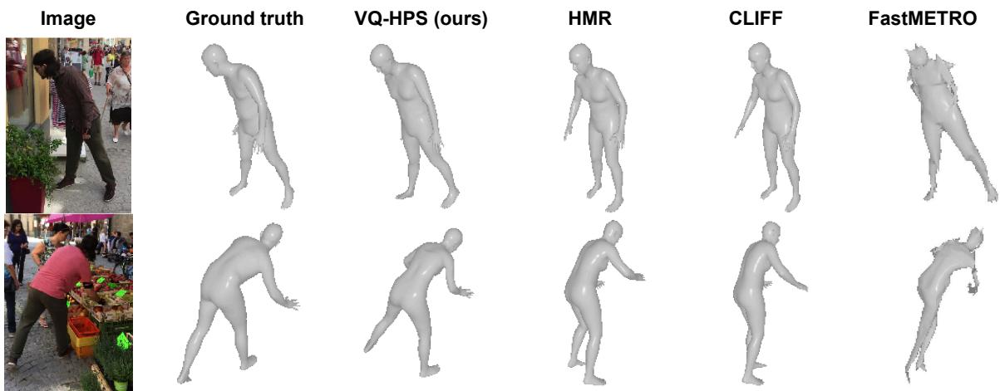  
Figure 1: VQ-HPS 将人体姿态与体型估计问题表述为矢量量化隐空间中的分类任务。我们展示了 VQ-HPS 在具有野外环境和弱光照的两种挑战性场景下的结果，并将其在少量数据训练下的性能与 HMR [1]、CLIFF [2] 和 FastMETRO-S [3] 进行了比较。

为了缓解这些问题，一些研究转向了受 3D 姿态估计模型启发的直接预测 3D 坐标的方法。早期方法使用图卷积神经网络（GCNNs）对网格结构进行建模，并专注于相邻顶点之间的局部交互，从而预测完整 SMPL [9] 网格的 6890 个顶点 [19, 20]。尽管 [24] 使用 Transformer [25] 来建模关节点与顶点之间的全局交互，但也有研究认为混合图卷积神经网络（GCNNs）和 Transformer 的混合架构能够同时对局部和全局交互进行建模 [23]。最近，FastMETRO [3] 提出了一种基于 Transformer 的编码器-解码器架构，用于解耦图像和网格特征，并预测身体关节点的 3D 坐标以及可上采样为完整 SMPL 人体网格的粗糙网格。与先前的研究显著不同的是，LVD [18] 提出了一种基于优化的方法，通过利用神经场（neural fields）预测顶点位移来独立估计每个顶点的位置。尽管提出了基于模型方法的替代方案，但这些方法也存在一些缺点：1) 一次性回归人体网格所有顶点的方法在使用 GCNN 时缺乏全局交互建模 [23]，而在使用 Transformer 时计算成本极高 [3, 26]；2) 基于回归的方法有时会输出带有噪声的网格，其中一些方法从预测的网格中回归 SMPL 参数以获得更平滑的预测，但这伴随着精度的损失 [3, 19, 20]。当可用的训练数据较少时，该问题尤为明显，会出现如 Fig. 1 中 [3] 所示的非拟人化预测；3) 回归 3D 顶点的方法对训练数据和测试数据之间的分布偏移非常敏感 [24]（见 Sec. 5.4）；4) LVD [18] 具有实时性并在形状估计方面取得了领先水平（state-of-the-art），但无法适应极端姿态。

本研究介绍了一种与以往所有人体姿态与体型估计（HPSE）方法截然不同的新方法。我们并非预测人体模型的参数或 3D 坐标，而是学习预测 3D 网格的离散潜在表示，从而将 HPSE 转化为一个分类问题；在该问题中，我们可以充分利用 Transformer 最初设计所具备的判别能力，而这种能力在自然语言处理中已被证明是无可匹敌的。为了学习网格的离散潜在表示，我们基于矢量量化变分自编码器（VQ-VAE）[27] 框架，并将其适配到 [28] 中提出的全卷积网格自编码器中。所提出模型的编码器被称为 Mesh-VQ-VAE，它提供了一种能够保留网格空间结构的低维离散潜在表示。随后，我们提出了一个名为 VQ-HPS 的基于 Transformer 的编码器-解码器模型，通过使用交叉熵损失来学习解决 HPSE 问题。一旦预测出网格的离散表示，我们便可以使用预训练的 Mesh-VQ-VAE 解码器对其进行解码，并获得符合 SMPL 网格拓扑结构 [9] 的完整网格。由于 Mesh-VQ-VAE 是在大型人体动作捕捉数据库 [29] 上进行预训练的，因此它能自动学会解码出平滑且逼真的人体网格。这在仅有少量数据进行训练时尤其具有优势：正如补充材料中所展示的，VQ-HPS 在训练早期阶段就能学会预测对应于逼真网格的索引序列。

在可用训练数据较少的情况下，VQ-HPS 在具有挑战性的野外基准 3DPW [30] 和 EMDB [31] 上取得了最先进的（SOTA）性能：它在定量上显著优于其他方法，同时产生的定性结果与参数化方法一样逼真（见图 1）。此外，当在标准大规模数据集上训练时，它同样展现出了 SOTA 性能，进一步突显了基于分类的方法在解决 HPSE 问题上的巨大潜力。

我们的主要贡献可总结如下：

• 一种能够提供 3D 网格离散潜在表示的 Mesh-VQ-VAE 架构。

• 基于所引入的人体网格离散潜在表示，构建了 HPSE 问题的分类形式表述。

• VQ-HPS，一个基于 Transformer 的编码器-解码器模型，通过交叉熵损失学习解决所提出的 HPSE 分类问题。

• 代码和训练好的模型可在项目主页获取。

## 2 相关工作

## 2.1 参数化方法

许多方法致力于恢复参数化人体模型（例如 SMPL [9]）的参数。优化技术根据图像或视频迭代估计人体模型的参数，确保预测结果的投影与一组 2D 线索对齐，包括 2D 骨架 [12, 14, 32, 33]、部位分割 [15, 34] 或 DensePose [35]。姿态和运动先验通常被引入优化方法中，以增强预测的真实感 [16, 36–38]。相反，回归方法利用神经网络从输入的图像或视频中预测人体模型的参数。这些方法中许多都利用卷积神经网络（CNN）来提取图像特征 [1, 2, 39–48]。如 [17, 50–52] 所示，近期的工作通过使用 Vision Transformers [49] 替代 CNN 展现出了卓越的性能。一些方法输出概率性结果，从而能够在合理的解空间中进行采样 [53–57]。尽管优化方法通常能产生更优的结果，但其运行时间明显长于回归方法，并且需要精确的初始化和准确的 2D 线索。训练回归模型的一个局限性在于缺乏带有 3D 标注的 RGB 数据。先前的研究通过使用合成数据 [53, 58–61] 或伪标签 [15, 33, 62] 来训练模型，以应对这一挑战。

尽管参数化模型可以估计出合理的人体姿态，但模型参数空间可能并不是预测人体姿态和体型（pose and shape）最合适的研究重点 [18, 19]。认识到参数化方法固有的这些局限性，促进了非参数化方法的发展。

## 2.2 非参数化方法

一些研究探索了不依赖人体模型参数而直接预测 3D 网格（mesh）的方法 [3, 18, 19, 23, 24, 63]。在早期的研究中，提出了基于 GCNN 的回归架构，该架构利用了从 SMPL 人体网格拓扑结构中派生出的图结构 [19, 23, 63]。近期的进展利用了 Transformer 架构，借助注意力机制来捕捉关节点和顶点之间的关系。尽管诸如 [23, 24] 等方法引入了基于编码器的策略，通过拼接图像特征和网格标记（tokens）来预测 3D 坐标，但 FastMETRO [3] 提出了一种编码器-解码器架构，有效地解耦了图像和网格模态。最近，[26] 引入了一种标记剪枝（token pruning）策略以提高基于 Transformer 的 HPSE（人体姿态与形状估计）的效率，而 [18] 则通过依赖逐顶点神经特征的优化方法，在体型估计中实现了最先进的精度。

本工作介绍了一种用于 HPSE（人体姿态与形状估计）的非参数化方法。我们的目标是估计符合 SMPL 拓扑结构 [9] 的人体网格（mesh）顶点。与以往所有工作不同，我们的方法通过离散隐式表征来预测网格，从而将 HPSE 重构为一个分类问题。尽管利用分类网络的判别能力此前已在人体姿态估计（Human Pose Estimation, HPE）问题中被提出（参见第 2.3 节），但据我们所知，这在 HPSE 问题中尚属首次。

## 2.3 人体姿态与形状的量化

一些工作探讨了用于 HPE 的量化技术。[64] 提出离散化水平和垂直坐标用于 2D HPE。另一方面，[65, 66] 使用锚点姿态（anchor poses）并对其进行细化以解决 3D HPE 问题。[67] 提出了一种人体姿态与形状分类方法，但该系统仅在 12 种不同的姿态上进行了训练。一些方法提出了手部形状分类 [68]，特别是沿着 [69] 的工作用于手语识别。还有一些工作提出了人脸形状分类 [70]，以及使用支持向量机（Support Vector Machine）的头部姿态估计 [71]。

人体运动生成领域的近期工作 [72–75] 使用 VQ-VAE [27] 来量化人体运动。与本文提出的 Mesh-VQ-VAE 的主要区别在于，在这些工作中，单个索引编码了一系列姿态序列。相比之下，我们使用多个索引来编码单个姿态，从而获得更高的精度。此外，这些工作均未编码 3D 网格：[72] 使用了 SMPL 参数，而其他工作仅编码 3D 骨架。此外，人体运动预测和生成任务与 HPSE 存在显著差异。

与本工作同期发表的 TokenHMR [76] 提出了针对 HPSE 量化人体姿态的方法。与我们的情况类似，这种标记化（tokenization）利用有效姿态标记（token）字典充当姿态先验。然而，TokenHMR 的标记化与我们不同，它是在 SMPL [9] 姿态参数上进行的，而我们量化的是 3D 网格。VQ-HPS 与 TokenHMR 之间的另一个主要区别在于标记化姿态的使用方式。TokenHMR 将其用作中间表征，同时仍将 HPSE 问题作为回归任务来解决：与以往 HPSE 领域的工作类似，其训练目标是 SMPL 姿态和形状参数以及顶点坐标。我们建议将 HPSE 构建为分类任务：网格的唯一训练目标是其离散量化表征。实验表明，VQ-HPS 在使用更少的训练数据和性能较弱的骨干网络（backbone）的情况下，取得了优于 TokenHMR 的结果。

## 3 背景

SMPL 模型。SMPL [9] 是一种基于蒙皮顶点的人体模型，通过可微函数 $\mathcal { M } ( \beta , \theta )$ 将体型参数 $\beta \in \mathbb { R } ^ { 1 0 }$ 和姿态参数 $\bar { \theta \in \mathbb { R } ^ { 7 2 } }$ 映射到 3D 顶点。它输出配准网格的 3D 顶点 $V \in \mathbb { R } ^ { 6 8 9 0 \times 3 }$，并且可以使用关节点回归器矩阵 $\mathcal { J } _ { s m p l }$ 从网格中提取 3D 关节点 $J \in \mathbb { R } ^ { 2 4 \times 3 }$。在这项工作中，我们不预测 SMPL 模型的参数，因为先前的研究 [18–20] 表明它们并不是回归模型的合适目标。然而，所提出的 VQ-HPS 模型预测的网格遵循 SMPL 网格拓扑结构。这使我们能够使用关节点回归器等工具，并与现有方法进行公平比较。

全卷积网格自编码器。全卷积网格自编码器 [28] 是一种专为处理任意配准网格数据而定制的自编码器。它依赖于定义新型卷积和池化算子，这些算子具有全局共享权重以及取决于网格结构的局部变化系数。这些可变系数对于捕捉不规则网格连接所固有的复杂细节至关重要，从而提升了模型在网格重建方面的性能。全卷积架构的主要优势之一是潜在编码是局部化的，从而形成保留网格空间结构的潜在空间。全卷积网格自编码器的潜在表示位于 $\mathbb { R } ^ { N \times L }$ 中，其中 N 是潜在向量的数量，L 是潜在向量的维度。

向量量化变分自编码器。VQ-VAE [27] 是一种具有离散化潜在空间的编码器-解码器模型。其核心思想是联合学习编码器、潜在编码字典和解码器。编码器将输入数据 x 映射到潜在变量 $z \in \dot { \mathbb { R } } ^ { N \times L }$。然后，我们使用包含 S 个维度为 L 的潜在编码的学习字典对 z 进行离散化。接着我们可以记为 $z _ { d } \in \mathbb { R } ^ { N \times L }$（其中 z 的每个向量被最接近的潜在编码替换），或记为 $z _ { q } \in \{ 1 , \ldots , S \} ^ { N }$（其中最接近的潜在编码的索引替换了 z 的每个向量）。解码器从离散潜在表示 $z _ { d }$ 和学习字典中重建 x。

## 4 方法

## 4.1 所提出的 HPSE 方法

我们提出了一种用于 HPSE 的新型基于分类的方法。我们的目标是从图像中预测出带有朝向的 3D 网格。VQ-HPS 采用编码器-解码器架构，根据图像特征预测所引入的 Mesh-VQ-VAE 的人体网格离散表示。我们认为这是预测离散潜在表示最合适的架构，其中编码器 token 对应于图像块（patches），解码器 token 对应于身体部位以及潜在空间中的索引。为了简化网格的低维表示学习，所预测的网格是无朝向且以原点为中心的（见附录 A）：我们称之为规范网格（canonical mesh）。为了获得最终带有朝向的网格，我们随后需要预测旋转矩阵 $R \in \mathbb { R } ^ { 3 \times 3 }$，并且为了更好地与图像对齐，我们还回归了透视相机参数 $\pi = \textstyle { \tilde { [ s , t ] } } \in \mathbb { R } ^ { 3 }$，其中 s 为尺度参数，t 为 2D 平移。整体方法如图 2 所示，接下来我们将详细介绍其各个核心组件。

Mesh-VQ-VAE。为了学习网格的离散表示，我们基于全卷积网格自编码器 [28]（见第 3 节）将完整的规范网格顶点 $V _ { c } \in \mathbb { R } ^ { 6 8 9 0 \times 3 }$ 编码为潜在表示 $z \in \mathbb { R } ^ { N \times L }$。我们在潜在空间中添加了类似于 [27]（见第 3 节）的矢量量化步骤，将 z 映射为离散潜在表示 $z _ { q } \dot { \in } \{ 1 , \ldots , S \} ^ { N }$。全卷积架构保留了网格的空间结构，而添加的量化步骤使我们能够将 HPSE 视为一个分类任务，因为我们的目标是在给定图像的情况下预测潜在网格表示的索引。图 2 中的 Mesh-VQ-VAE 可以看作是一个架构对应于全卷积网格自编码器的 VQ-VAE [27]。

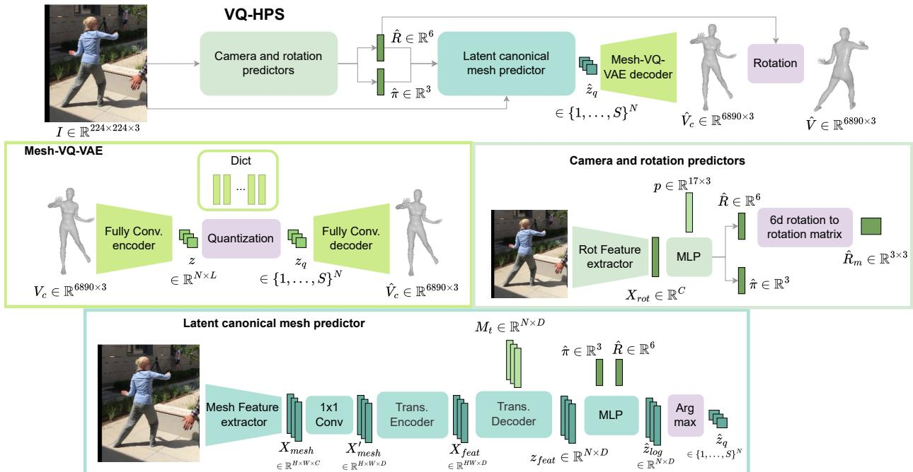  
Figure 2: 给定图像预测网格的 VQ-HPS 整体流程。我们首先从图像 I 中预测相机参数 $\hat { \pi }$ 和旋转 $\hat { R }$。然后，我们利用图像、预测的旋转和相机参数来预测规范网格的顶点 $\hat { V } _ { c }$。最后，根据 $\hat { R }$ 对 $\hat { V } _ { c }$ 进行旋转以获得最终的网格顶点 $\hat { V } 。$

特征提取器。基于图像的 HPSE 的第一步是从图像中提取特征。我们使用 CNN 主干网络来保留图像的空间结构，并获得特征 $X \in \mathbb { R } ^ { H \times W \times C }$，其中 $C$ 是主干网络的通道数，H 和 $W$ 是空间维度。我们使用了两个特征提取器。相机和旋转预测器的特征提取器输出 $X _ { r o t . }$。特征提取器在潜在规范网格预测器中输出 $W = 1$ 的 $X _ { m e s h }$。

旋转与相机预测。我们首先预测网格旋转和透视相机参数（再次参见 Fig. 2）。这些预测依赖于图像特征以及遵循 Human3.6M [77] 关节点布局并对应于 SMPL T-pose 的初始人体姿态 $p \in \mathbb { R } ^ { 1 7 \times 3 }$。我们预测旋转 $\hat { R }$ 和弱透视相机参数 πˆ。

隐式规范网格回归器编码器。然后我们预测规范网格（canonical mesh）的离散隐式表示。Transformer 编码器的输入是由 CNN 骨干网络提取的特征。在输入到 Transformer 编码器之前，我们对图像特征应用 1x1 卷积以匹配其维度，并获得 $X _ { m e s h } ^ { \prime } \in \mathbb { R } ^ { H \times W \times D }$，其中 D 是 Transformer 的隐藏状态大小。这些特征被展平以获得 HW 个维度为 $D _ { \colon }$ 的 token，然后我们添加位置编码。得到的 token 被输入到 Transformer 编码器中，利用所有图像 token 之间的自注意力机制输出编码后的图像特征 $X _ { f e a t } \in \mathbb { R } ^ { H W \times D }$。

隐式规范网格回归器解码器。Transformer 解码器输入 N 个大小为 $D ,$ 的可学习网格 token $M _ { t }$，每个 token 负责预测 Mesh-VQ-VAE 离散隐式表示的一个索引。我们需要解决 N 个分类问题，每个索引对应一个问题。每个问题有 $S$ 个类别，S 对应于 Mesh-VQ-VAE 码本（codebook）的大小。Transformer 解码器由可学习 token 之间的自注意力和与图像特征之间的交叉注意力组成。它输出隐式网格特征 $z _ { f e a t } \in \mathbb { R } ^ { N \times D }$。然后（参见 Fig. 2），为了获得 logits $\hat { z } _ { l o g } \in \mathbb { R } ^ { N \times S }$，我们依赖于网格特征以及先前预测的旋转和相机参数。我们通过应用 arg max(·) 操作获得预测的离散表示 $\hat { z } _ { q } \in \{ 1 , \ldots , S \} ^ { N }$。

重建完整网格。从离散隐式网格表示 $\hat { z } _ { q } \in \{ 1 , \ldots , S \} ^ { N }$ 出发，我们使用引入的 Mesh-VQ-VAE 的解码器来重建完整规范网格的顶点 $\hat { V } _ { c } \in \mathbb { R } ^ { 6 8 9 0 \times 3 }$。我们将相机坐标系中有向网格的预测旋转 $\hat { R }$ 应用于顶点，以获得顶点 $\hat { V }$。该过程如图 Fig. 2 所示。

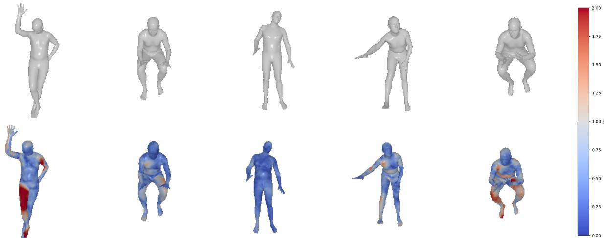  
Figure 3: Mesh-VQ-VAE 重建误差。在 3DPW 测试集上的重建样本。误差以 cm 为单位，对应于重建的原始网格与相应顶点之间的欧氏距离。

## 4.2 训练 VQ-HPS

VQ-HPS 在配对有网格（mesh）的 RGB 图像数据集上以监督方式进行训练。规范网格（canonical mesh）预测器仅在网格的离散潜在表征上进行训练。为了获取真实值（ground truth）的潜在表征并将预测的索引解码为完整网格，我们使用了 Mesh-VQ-VAE，该模型经过预训练并在 VQ-HPS 训练期间保持冻结。在数据匮乏的情况下，Mesh-VQ-VAE 在 VQ-HPS 训练期间保持冻结这一特性对于做出逼真的预测至关重要。预训练起到了正则化作用，从而能够减少所需的训练数据量。

Mesh-VQ-VAE。Mesh-VQ-VAE（参见 Fig. 2）在 AMASS [29] 数据集上进行训练，并在 3DPW [30] 训练集上进行微调。为了便于用有限数量的索引学习网格的离散表征，我们使用平移到原点且无定向的网格（规范网格）来训练 Mesh-VQ-VAE。最终的重建误差为 4.7 mm。该重建误差是一个重要参数，因为它对应于我们所能获得的最小逐顶点误差（参见 Sec. 5.2）。在 3DPW 上的定性重建结果如 Fig. 3 所示。

Latent canonical meshes。为了学习预测姿态和形状，我们仅使用规范网格的离散表征作为训练目标。损失函数 $\mathcal { L } _ { m e s h }$ 是真实网格的离散潜在表征与预测值之间的交叉熵。

Mesh rotation。我们通过计算真实值与预测旋转矩阵之间的均方误差来学习预测全局朝向。

Reprojection。我们添加了重投影误差以指导旋转学习并实现更好的图像对齐。该误差是在从预测网格提取的 3D 关节的 2D 投影（使用预测的弱透视相机）与 2D 真实关节之间计算的。该损失使用 SMPL 的 24 个关节进行计算，这些关节可以使用关节回归器 $\mathcal { J } _ { s m p l }$（参见 Sec. 3）从完整网格中提取。重投影损失计算如下：

$$
\mathcal {L} _ {2 D} = | | \hat {s} \Pi (\hat {J} _ {3 D}) + \hat {t} - J _ {2 D} | | _ {1},\tag{1}
$$

其中 sˆ 为预测的尺度，$\hat { t }$ 为预测的 2D 平移，$\hat { J } _ { 3 D }$ 是从预测的有向网格顶点 $\hat { V } .$ 计算出的 3D 关节。Π 表示使用矩阵 ${ \left[ \begin{array} { l l l } { 1 } & { 0 } & { 0 } \\ { 0 } & { 1 } & { 0 } \end{array} \right] } ^ { \textsf { T } }$ 的正交投影，$J _ { 2 D }$ 表示真实的 2D 关节。

学习方案。旋转预测通过 $\mathcal { L } _ { \mathit { r o t } }$ 和 $\mathcal { L } _ { 2 D }$ 进行学习。我们对相机使用 $\mathcal { L } _ { 2 D }$，对规范网格（canonical mesh）使用 $\mathcal { L } _ { m e s h }$。$\mathcal { L } _ { 2 D }$ 可能有助于学习姿态，但我们选择不使用它，以证明交叉熵足以做出准确的预测。

Table 1: 真实自然场景数据集上的结果 我们使用标准指标，将 VQ-HPS 与 SOTA 方法在 3DPW（在 3DPW 上训练，第1列）、3DPW（在 COCO 上训练，第2列）、EMDB（在 EMDB 上训练，第3列）以及 EMDB（在 COCO 上训练，第4列）上进行了比较。所有结果均以 mm 为单位给出。

<table><tr><td>方法</td><td colspan="4">PVE ↓</td><td colspan="4">MPJPE ↓</td><td colspan="4">PA-MPJPE ↓</td></tr><tr><td>HMR [1]</td><td>209.3</td><td>110.3</td><td>191.3</td><td>170.0</td><td>177.6</td><td>94.1</td><td>172.2</td><td>149.2</td><td>89.3</td><td>57.8</td><td>96.2</td><td>82.4</td></tr><tr><td>CLIFF [2]</td><td>223.9</td><td>105.4</td><td>163.3</td><td>163.2</td><td>188.8</td><td>89.3</td><td>144.7</td><td>143.0</td><td>89.2</td><td>56.8</td><td>86.9</td><td>81.6</td></tr><tr><td>FastMETRO-S [3]</td><td>176.3</td><td>107.8</td><td>151.0</td><td>143.1</td><td>157.0</td><td>95.8</td><td>132.9</td><td>123.9</td><td>104.6</td><td>57.0</td><td>95.5</td><td>80.2</td></tr><tr><td>VQ-HPS (ours)</td><td>163.9</td><td>102.9</td><td>138.5</td><td>152.7</td><td>139.8</td><td>88.0</td><td>117.1</td><td>131.1</td><td>84.9</td><td>53.3</td><td>77.5</td><td>74.5</td></tr></table>

## 5 结果

## 5.1 数据集

AMASS。Mesh-VQ-VAE 在 AMASS [29] 上进行训练，该数据集是一个基于 SMPL [9] 格式的大型人体动作数据库。它包含 11000 多个动作和 300 名受试者，这使其具有多样化身体姿态和体型的代表性。

3DPW。该数据集 [30] 包含 60 个带有真实 3D 人体标注的真实自然场景 RGB 视频。我们使用预定义的划分进行训练、验证和测试。需要注意的是，当在混合数据集上进行训练时（见第 5.4 节），我们不会在 3DPW 上对模型进行微调，以评估其泛化能力。我们还在 3DPW-OCC（[78] 中提出的一个包含遮挡 3DPW 视频的基准）上评估了 VQ-HPS。

EMDB。EMDB [31] 包含 81 个带有 SMPL 人体真值的室内和室外视频。我们使用由 17 个最具挑战性的序列组成的 EMDB1 进行测试，并在数据集的其余部分（在 [31] 中称为 EMDB2）上进行训练。

COCO。COCO [79] 是一个标注有 2D 关键点的图像数据集。为了训练人体网格预测器，我们遵循 [2, 33] 的做法，使用伪真值（pseudo-ground truth）网格。我们使用与 [2] 相同的标注，包含 2.8 万张图像。

## 5.2 评估指标

我们使用多种指标来评估 VQ-HPS 的预测结果。在整个结果章节中，所有指标均以毫米（mm）为单位表示。

每顶点误差（Per-vertex error, PVE）用于衡量预测顶点与真实值之间的欧几里得距离。

平均关节点位置误差（MPJPE，Mean-per-joint error）用于度量预测关节点与真实值之间的欧氏距离。在我们的实验中，关节点是使用类似于 $\mathcal { J } _ { s m p l }$ 的关节点回归器从预测的网格中提取的。

普氏分析对齐平均关节点位置误差（PA-MPJPE，Procrustes-aligned mean-per-joint error）用于度量经过普氏分析（Procrustes alignment）对齐后预测关节点与真实值之间的欧氏距离。

## 5.3 Training on limited data

我们分别在 3DPW、COCO 和 EMDB 训练集上训练 VQ-HPS（见第 5.1 节），以观察其在有限数据训练下的表现。我们将自身性能与使用相同数据训练的 HMR [1]、CLIFF [2] 和 FastMETRO [3] 进行了比较。我们之所以选择这 3 个模型进行对比，是因为 HMR 是参数化人体网格恢复的基础架构，CLIFF 是参数化人体姿态与形状估计（HPSE，Human Pose and Shape Estimation）的当前最优方法（SOTA，State-of-the-Art），而 FastMETRO 是非参数化 HPSE 的 SOTA 且与我们的方法最为接近。在这些实验中，所有网络的主干网络均为在 ImageNet [81] 上预训练的 ResNet-50 [80]。我们使用 FastMETRO 的公开实现，并采用了 [60] 提供的 HMR 和 CLIFF 实现。在所有对比中，我们均使用 FastMETRO-S，因为该版本与 VQ-HPS 最为接近。在 COCO 上进行训练时，我们提出了 VQ-HPS 的改进版本，将隐式规范网格回归器的 MLP 替换为在隐式网格特征 $z _ { f e a t }$ 之间实现自注意力机制的 Transformer。定量结果见表 1（Tab. 1），可视化效果见图 4（Fig. 4）。

总体而言，当在 3DPW 和 EMDB 上训练时，VQ-HPS 显著优于现有的 SOTA 方法（见 Tab. 1，第 1 列和第 3 列）。结果的可视化证实了我们的方法表现最佳（见 Fig. 4），我们在附录 D 中提供了更详细的误差分析。HMR 和 CLIFF 展示了逼真的预测结果，但准确度低于 VQ-HPS。尽管指标相当不错，但 FastMETRO 生成了不平滑且不符合人体体型的结果。

图像

真实值

VQ-HPS（本方法）

HMR

CLIFF

FastMETRO

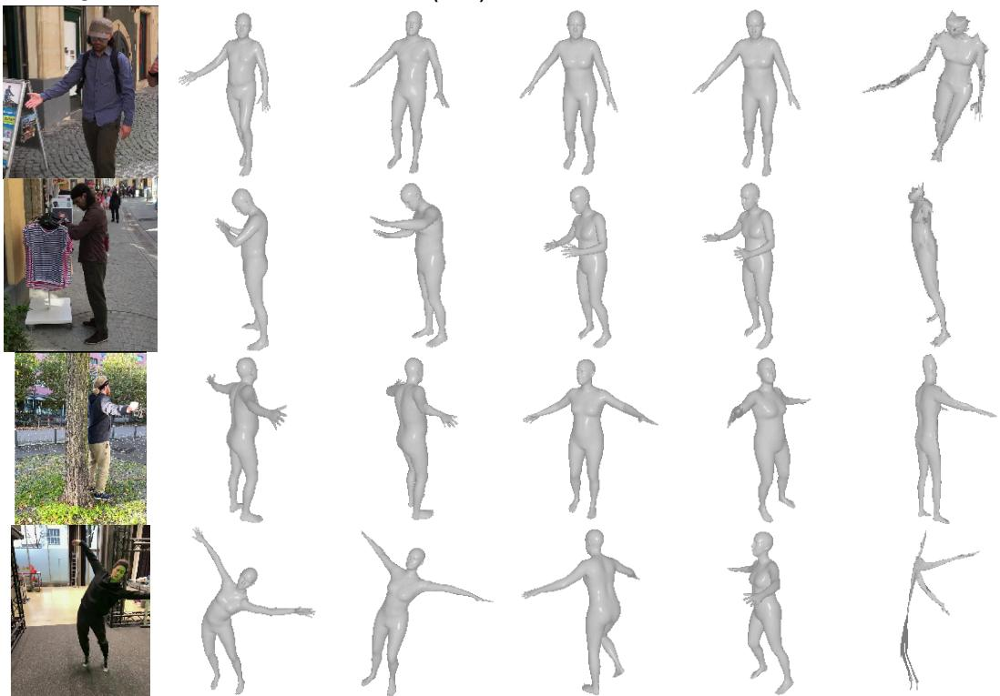  
Figure 4: 定性结果 我们在 3DPW 数据集上（使用 3DPW 训练，前 3 行）以及在 EMDB 数据集上（使用 EMDB 训练）将我们的方法与 HMR [1]、CLIFF [2] 和 FastMETRO-S [3] 进行了比较。

这可能是由于训练集有限造成的，因为原论文中展示的结果看起来更为逼真。这凸显了直接预测 3D 坐标的非参数化方法的明显局限性；相比之下，VQ-HPS 需要少得多的数据即可提供逼真的预测，这可能是因为学习对应于拟人网格的索引序列比理解 3D 顶点的结构更为容易。此外，VQ-HPS 受益于在人体运动数据集上的大规模预训练，这起到了正则化的作用，使得仅用较少带有 3D 姿态标注的图像数据就能进行有效学习。

Mesh-VQ-VAE（其解码器是 VQ-HPS 的重要组成部分）在 AMASS [29] 上进行了预训练，这一事实是我们方法的一大优势。事实上，我们可以利用大量未与图像配对的人体网格数据进行训练。这一点尤其引人关注，因为许多人体运动数据可以通过动画软件或生成模型生成。我们可以根据目标应用，使用罕见的人体体型 [82] 或极端姿态 [83, 84] 对 Mesh-VQ-VAE 进行微调。

在 COCO 上训练时，FastMETRO 在 EMDB 基准测试的全局指标上略微领先。VQ-HPS 在使用稀缺数据训练时所具备的优势在这里变得不那么显著。确实，COCO 拥有的图像数量与 EMDB 或 3DPW 相当，但其多样性远高于视频数据集，而在视频数据集中，不同图像之间存在显著的相关性 [33]。

## 5.4 在大规模数据集上的训练

遵循标准做法 [1–3]，我们在 Human3.6M [77]、MPI-INF-3DHP [86]、COCO [79] 和 MPII [87] 上训练 VQ-HPS。对于本实验，我们使用与第 5.3 节相同版本的 VQ-HPS。我们在不使用 3DPW 训练集进行微调的情况下，在 3DPW [30] 和 EMDB [31] 上对 VQ-HPS 进行评估。为了公平比较，我们仅将 VQ-HPS 与使用相同骨干网络（Backbone）和相同数据集的最先进（SOTA）模型进行对比。对于其他方法，我们直接采用论文中的结果，或使用其提供的实现代码和检查点（Checkpoint）。需要注意的是，[3, 85] 上的结果与原论文有所不同，因为我们在测试前未在 3DPW [30] 数据集上微调模型。近期使用不同骨干网络（如 Vision Transformer (ViT) [49]）以及额外数据集 [60, 61, 88, 89] 的方法可能会取得更好的结果。然而，这种比较是不公平的。结果如表 2 所示。

Table 2: 与 SOTA 方法的比较。我们在不使用 3DPW 微调的情况下，使用混合数据集训练的 VQ-HPS（见第 5.1 节），并在 3DPW 和 EMDB 上使用标准指标对其进行评估，同时与当前最先进方法进行比较。在左半部分，各方法使用 ResNet-50 骨干网络。在右半部分，模型使用 HRNet 骨干网络，但 TokenHMR [76] 使用 ViT [49] 骨干网络和额外数据。所有结果的单位均为 mm。  
(a) ResNet-50 骨干网络

<table><tr><td>Method</td><td>PVE ↓</td><td>MPJPE ↓</td><td>PA-MPJPE ↓</td></tr><tr><td>GraphCMR [19]</td><td>-</td><td>-</td><td>70.2</td></tr><tr><td>I2LMeshNet [63]</td><td>-</td><td>93.2</td><td>58.6</td></tr><tr><td>FastMETRO-S [3]</td><td>129.4</td><td>112.6</td><td>68.9</td></tr><tr><td>HMR [1]</td><td>-</td><td>130.0</td><td>81.3</td></tr><tr><td>SPIN [39]</td><td>116.4</td><td>96.9</td><td>59.2</td></tr><tr><td>PyMAF [42]</td><td>110.1</td><td>92.8</td><td>58.9</td></tr><tr><td>ROMP [47]</td><td>105.6</td><td>89.3</td><td>53.5</td></tr><tr><td>DSR [48]</td><td>105.8</td><td>91.7</td><td>54.1</td></tr><tr><td>PARE [41]</td><td>99.7</td><td>82.9</td><td>52.3</td></tr><tr><td>VQ-HPS (ours)</td><td>93.6</td><td>79.1</td><td>50.4</td></tr></table>

(b) HRNet 骨干网络

<table><tr><td rowspan="2">方法</td><td colspan="3">3DPW</td><td colspan="3">EMDB</td></tr><tr><td>PVE ↓</td><td>MPJPE ↓</td><td>PA-MPJPE ↓</td><td>PVE ↓</td><td>MPJPE ↓</td><td>PA-MPJPE ↓</td></tr><tr><td>FastMETRO-L [3]</td><td>121.6</td><td>109.0</td><td>65.7</td><td>119.2</td><td>108.1</td><td>66.8</td></tr><tr><td>ROMP [47]</td><td>103.1</td><td>85.5</td><td>54.9</td><td>134.9</td><td>112.7</td><td>75.2</td></tr><tr><td>PARE [41]</td><td>97.9</td><td>82.0</td><td>50.9</td><td>133.2</td><td>113.9</td><td>72.2</td></tr><tr><td>Virtual Marker [85]</td><td>93.8</td><td>80.5</td><td>48.9</td><td>-</td><td>-</td><td>-</td></tr><tr><td>CLIFF [2]</td><td>87.6</td><td>73.9</td><td>46.4</td><td>122.9</td><td>103.1</td><td>68.8</td></tr><tr><td>TokenHMR [76]</td><td>88.1</td><td>76.2</td><td>49.3</td><td>124.4</td><td>102.4</td><td>67.5</td></tr><tr><td>VQ-HPS（本文方法）</td><td>84.8</td><td>71.1</td><td>45.2</td><td>112.9</td><td>99.9</td><td>65.2</td></tr></table>

Table 3: 消融实验。我们在 3DPW 数据集上对 VQ-HPS 架构和训练过程进行了多项消融实验。所有结果均以 mm 为单位。

<table><tr><td>方法</td><td>PVE ↓</td><td>MPJPE ↓</td><td>PA-MPJPE ↓</td></tr><tr><td>VQ-HPS</td><td>176.6</td><td>152.0</td><td>91.8</td></tr><tr><td>SMPL</td><td>199.8</td><td>171.8</td><td>99.3</td></tr><tr><td>3D 损失</td><td>220.3</td><td>194.9</td><td>144.1</td></tr><tr><td>无重投影</td><td>183.9</td><td>158.4</td><td>95.6</td></tr></table>

无论与参数化方法 [1, 2, 39, 41, 42, 47, 48] 还是非参数化方法 [3, 19, 63, 85] 相比，VQ-HPS 在所有 3 项指标上均优于其他所有方法。需要注意的是，Tab. 2 中 FastMETRO 和 Virtual Marker 的性能与原论文中报告的结果存在较大差距。这是因为我们没有在 3DPW 上进行微调（finetuning）。FastMETRO 的作者承认，直接回归 3D 顶点的诸如 [3,23,24,85] 等方法在与训练集差异显著的数据上表现较差1。[24] 中也描述了非参数化方法的这一局限性。

尽管 TokenHMR 的主干网络（backbone）更强大，且该方法在额外的 2D 数据集上进行了训练，但 VQ-HPS 在 3DPW 和 EMDB 数据集上仍然优于 TokenHMR [76]。当在训练集中额外引入 Bedlam [60] 时，TokenHMR 在 3DPW 数据集上取得了领先，其 PVE、MPJPE 和 PA-MPJPE 分别达到 84.6、71.0 和 44.3 mm，但 VQ-HPS 在使用更少训练数据和较弱主干网络的情况下依然保持着竞争力。在 EMDB 数据集上，使用 Bedlam 进行训练的 TokenHMR 在 PVE、MPJPE 和 PA-MPJPE 上分别取得了 109.4、91.7 和 55.6 mm。

## 5.5 消融实验

我们对 VQ-HPS 的架构和训练方案进行了消融实验，并在 Tab. 3 中展示了结果。我们在 3DPW [30] 数据集上进行这些实验的训练与测试。需要注意的是，为了加快实验速度，我们使用了容忍度（patience）为 10 个 epoch 的早停法（early stopping），这使得训练提前很多停止。Tab. 3 的第一行展示了更新后的 VQ-HPS 结果。

“SMPL”表示预测 SMPL 参数，而不是使用我们提出的离散潜在表示。为了获得最终的 3D 预测结果，使用 SMPL 模型代替 Mesh-VQ-VAE 解码器。性能差距表明，在使用相似架构的情况下，预测离散潜在表示相比预测 SMPL 参数带来了性能的提升。

消融实验“3D loss”将交叉熵损失替换为 PVE $\mathcal { L } _ { 3 D } = | | V - \hat { V } | | _ { 2 }$，其中 V 为真实网格顶点，$\hat { V }$ 为最终预测。鉴于性能的大幅下降（见 Tab. 3），我们得出结论：交叉熵是所有以往工作（如 [1–3]）中所使用的 3D 损失的良好替代方案。使用 PVE 训练 VQ-HPS 会生成对应于非人体形态结果的索引序列，这让人联想到在有限数据上训练时 Fig. 4 中 FastMETRO 获得的结果。

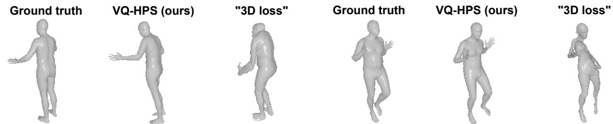  
Figure 5: 消融研究。“3D loss”消融实验的效果。我们可以看到，将交叉熵替换为 PVE 损失会产生不自然的姿态，这体现了基于分类的方法的价值。

“No reprojection”表示我们不计算重投影误差。这主要增加了 PVE 和 MPJPE 的误差，这是符合预期的，因为 PA-MPJPE 仅与标准网格（canonical mesh）相关，并且重投影损失未用于训练标准网格预测器。然而，它仍然存在影响，因为标准网格预测是以预测的旋转为条件的。

## 6 结论

在这项工作中，我们提出了 Mesh-VQ-VAE，这是一种为配准的人体网格提供离散潜在表示的自编码器架构。这种离散表示使我们能够从分类的角度来解决 HPSE 问题，避免了 Sec. 1 中描述的参数化和非参数化 HPSE 方法的局限性。我们还引入了 VQ-HPS，一种用于解决所提出的 HPSE 分类问题的基于 Transformer 的模型。

虽然采用交叉熵损失（cross-entropy loss）进行训练，但 VQ-HPS 在稀缺数据上训练时显著优于现有最先进（SOTA）方法，并在大规模数据集上展现出了极具前景的性能。这种基于分类的方法充分利用了 Transformer 的判别能力。它解决了非参数化方法的若干已知问题，例如结果的合理性，以及在大规模数据集上训练而未在目标域上微调时的泛化能力不足问题。与 [3] 的对比以及我们的消融实验（第 5.5 节）表明，在使用相似架构时，基于分类的方法相比于参数化和现有的非参数化方法展现出了优越性。

失效案例在附录 E 中进行了讨论。未来的工作可能包括使用更先进的 SOTA 骨干网络（backbone）[49, 90] 或额外的数据集 [60,89] 以获得更佳的性能。基于分类的方法还可以进一步探索扩展至其他类型的配准网格，例如人手或人脸。我们还认为，涉及文本和 3D 人体的多模态应用 [91, 92] 将受益于 Mesh-VQ-VAE 表示，因为它可以被视作一种语言。

## 致谢

本研究是 EUR DIGISPORT 项目的一部分，该项目由 ANR 在 PIA France 2030 框架（ANR-18-EURE-0022）下提供资助。本工作使用了来自 CentraleSupélec、École Normale Supérieure Paris-Saclay 和 Université Paris-Saclay 的“Mésocentre”计算中心的高性能计算（HPC）资源，并获得了 CNRS 和 Région Île-de-France 的支持。本工作得到了 MIAI@Grenoble Alpes 的部分资助（ANR-19-P3IA-0003）。

## 参考文献

[1] Angjoo Kanazawa, Michael J. Black, David W. Jacobs, and Jitendra Malik. End-to-end recovery of human shape and pose. In IEEE/CVF Conference on Computer Vision and Pattern Recognition (CVPR), pages 7122–7131, 2018.

[2] Zhihao Li, Jianzhuang Liu, Zhensong Zhang, Songcen Xu, and Youliang Yan. Cliff: Carrying location information in full frames into human pose and shape estimation. In European Conference on Computer Vision (ECCV), pages 590–606. Springer, 2022.

[3] Junhyeong Cho, Kim Youwang, and Tae-Hyun Oh. Cross-attention of disentangled modalities for 3d human mesh recovery with transformers. In European Conference on Computer Vision (ECCV), pages 342–359. Springer, 2022.

[4] Sebastian Starke, Ian Mason, and Taku Komura. Deepphase: Periodic autoencoders for learning motion phase manifolds. ACM Transactions on Graphics (TOG), 41(4), 2022.

[5] Andrew Feng, Samuel Shin, and Youngwoo Yoon. A tool for extracting 3d avatar-ready gesture animations from monocular videos. In ACM SIGGRAPH Conference on Motion, Interaction and Games (ACM MIG), pages 1–7, 2022.

[6] Haotian Zhang, Ye Yuan, Viktor Makoviychuk, Yunrong Guo, Sanja Fidler, Xue Bin Peng, and Kayvon Fatahalian. Learning physically simulated tennis skills from broadcast videos. ACM Transactions on Graphics (TOG), 42(4), 2023.

[7] Moritz Einfalt, Dan Zecha, and Rainer Lienhart. Activity-conditioned continuous human pose estimation for performance analysis of athletes using the example of swimming. In IEEE/CVF Winter conference on Applications ofComputer Vision (WACV), pages 446–455. IEEE, 2018.

[8] Jianbo Wang, Kai Qiu, Houwen Peng, Jianlong Fu, and Jianke Zhu. Ai coach: Deep human pose estimation and analysis for personalized athletic training assistance. In ACM International Conference on Multimedia (ACM MM), pages 374–382, 2019.

[9] Matthew Loper, Naureen Mahmood, Javier Romero, Gerard Pons-Moll, and Michael J Black. Smpl: A skinned multi-person linear model. ACM Transactions on Graphics (TOG), 34(6), 2015.

[10] Dragomir Anguelov, Praveen Srinivasan, Daphne Koller, Sebastian Thrun, Jim Rodgers, and James Davis. Scape: Shape completion and animation of people. ACM Transactions on Graphics (TOG), 24(3), 2005.

[11] Ahmed A. A. Osman, Timo Bolkart, Dimitrios Tzionas, and Michael J. Black. SUPR: A sparse unified part-based human representation. In European Conference on Computer Vision (ECCV), pages 568–585. Springer, 2022.

[12] Georgios Pavlakos, Vasileios Choutas, Nima Ghorbani, Timo Bolkart, Ahmed A. A. Osman, Dimitrios Tzionas, and Michael J. Black. Expressive body capture: 3d hands, face, and body from a single image. In IEEE/CVF Conference on Computer Vision and Pattern Recognition (CVPR), pages 10975–10985, 2019.

[13] Hongyi Xu, Eduard Gabriel Bazavan, Andrei Zanfir, William T Freeman, Rahul Sukthankar, and Cristian Sminchisescu. Ghum & ghuml: Generative 3d human shape and articulated pose models. In IEEE/CVF Conference on Computer Vision and Pattern Recognition (CVPR), pages 6184–6193, 2020.

[14] Federica Bogo, Angjoo Kanazawa, Christoph Lassner, Peter Gehler, Javier Romero, and Michael J. Black. Keep it SMPL: Automatic estimation of 3D human pose and shape from a single image. In European Conference on Computer Vision (ECCV), pages 561–578. Springer, 2016.

[15] Christoph Lassner, Javier Romero, Martin Kiefel, Federica Bogo, Michael J Black, and Peter V Gehler. Unite the people: Closing the loop between 3d and 2d human representations. In IEEE/CVF Conference on Computer Vision and Pattern Recognition (CVPR), pages 6050–6059, 2017.

[16] Davis Rempe, Tolga Birdal, Aaron Hertzmann, Jimei Yang, Srinath Sridhar, and Leonidas J. Guibas. Humor: 3d human motion model for robust pose estimation. In IEEE/CVF International Conference on Computer Vision (ICCV), pages 11488–11499, 2021.

[17] Shubham Goel, Georgios Pavlakos, Jathushan Rajasegaran, Angjoo Kanazawa, and Jitendra Malik. Humans in 4d: Reconstructing and tracking humans with transformers. In IEEE/CVF International Conference on Computer Vision (ICCV), pages 14783–14794, 2023.

[18] Enric Corona, Gerard Pons-Moll, Guillem Alenyà, and Francesc Moreno-Noguer. Learned vertex descent: a new direction for 3d human model fitting. In European Conference on Computer Vision (ECCV), pages 146–165. Springer, 2022.

[19] Nikos Kolotouros, Georgios Pavlakos, and Kostas Daniilidis. 单张图像人体形状重建的卷积网格回归. In IEEE/CVF Conference on Computer Vision and Pattern Recognition (CVPR), pages 4501–4510, 2019.

[20] Hongsuk Choi, Gyeongsik Moon, and Kyoung Mu Lee. Pose2mesh: 从二维人体姿态恢复三维人体姿态与网格的图卷积网络. In European Conference on Computer Vision (ECCV), pages 769–787. Springer, 2020.

[21] Hongwen Zhang, Jie Cao, Guo Lu, Wanli Ouyang, and Zhenan Sun. 从密集人体部位学习三维人体形状与姿态. IEEE Transactions on Pattern Analysis and Machine Intelligence (PAMI), 44(5):2610–2627, 2020.

[22] Dongkai Wang and Shiliang Zhang. 基于序列全局旋转估计的三维人体网格恢复. In IEEE/CVF International Conference on Computer Vision (ICCV), pages 14953–14962, 2023.

[23] Kevin Lin, Lijuan Wang, and Zicheng Liu. Mesh graphormer. In IEEE/CVF International Conference on Computer Vision (ICCV), pages 12939–12948, 2021.

[24] Kevin Lin, Lijuan Wang, and Zicheng Liu. 基于 Transformer 的端到端人体姿态与网格重建. In IEEE/CVF Conference on Computer Vision and Pattern Recognition (CVPR), pages 1954–1963, 2021.

[25] Ashish Vaswani, Noam Shazeer, Niki Parmar, Jakob Uszkoreit, Llion Jones, Aidan N Gomez, Łukasz Kaiser, and Illia Polosukhin. Attention is all you need. Advances in Neural Information Processing Systems (NIPS), 30:5998–6008, 2017.

[26] Zhiyang Dou, Qingxuan Wu, Cheng Lin, Zeyu Cao, Qiangqiang Wu, Weilin Wan, Taku Komura, and Wenping Wang. Tore: 基于 Transformer 的高效人体网格恢复 Token 削减方法. In IEEE/CVF International Conference on Computer Vision (ICCV), pages 15143–15155, 2023.

[27] Aaron Van Den Oord, Oriol Vinyals, et al. 神经离散表示学习. Advances in neural information processing systems (NIPS), 30:6306–6315, 2017.

[28] Yi Zhou, Chenglei Wu, Zimo Li, Chen Cao, Yuting Ye, Jason Saragih, Hao Li, and Yaser Sheikh. 基于高效空间变化核的全卷积网格自编码器. Advances in neural information processing systems (NIPS), 33:9251–9262, 2020.

[29] Naureen Mahmood, Nima Ghorbani, Nikolaus F Troje, Gerard Pons-Moll, and Michael J Black. AMASS：作为表面形态的动作捕捉数据库. In IEEE/CVF International Conference on Computer Vision (ICCV), pages 5442–5451, 2019.

[30] Timo von Marcard, Roberto Henschel, Michael Black, Bodo Rosenhahn, and Gerard Pons-Moll. 利用 IMU 与移动相机恢复野外精确的三维人体姿态. In European Conference on Computer Vision (ECCV), pages 601–617. Springer, 2018.

[31] Manuel Kaufmann, Jie Song, Chen Guo, Kaiyue Shen, Tianjian Jiang, Chengcheng Tang, Juan José Zárate, and Otmar Hilliges. EMDB：野外全局三维人体姿态与形状电磁数据库. In IEEE/CVF International Conference on Computer Vision (ICCV), pages 14632–14643, 2023.

[32] Taosha Fan, Kalyan Vasudev Alwala, Donglai Xiang, Weipeng Xu, Todd Murphey, and Mustafa Mukadam. Revitalizing optimization for 3d human pose and shape estimation: A sparse constrained formulation. In IEEE/CVF International Conference on Computer Vision (ICCV), pages 11457–11466, 2021.

[33] Hanbyul Joo, Natalia Neverova, and Andrea Vedaldi. Exemplar fine-tuning for 3d human model fitting towards in-the-wild 3d human pose estimation. In International Conference on 3D Vision (3DV), pages 42–52. IEEE, 2021.

[34] Andrei Zanfir, Elisabeta Marinoiu, and Cristian Sminchisescu. Monocular 3d pose and shape estimation of multiple people in natural scenes-the importance of multiple scene constraints. In IEEE/CVF Conference on Computer Vision and Pattern Recognition (CVPR), pages 2148–2157, 2018.

[35] Riza Alp Guler and Iasonas Kokkinos. Holopose: Holistic 3d human reconstruction in-the-wild. In IEEE/CVF Conference on Computer Vision and Pattern Recognition (CVPR), pages 10884–10894, 2019.

[36] Garvita Tiwari, Dimitrije Antic, Jan Eric Lenssen, Nikolaos Sarafianos, Tony Tung, and Gerard Pons-Moll Pose-ndf: Modeling human pose manifolds with neural distance fields. In European Conference on Computer Vision (ECCV), pages 572–589. Springer, 2022.

[37] Mingyi Shi, Sebastian Starke, Yuting Ye, Taku Komura, and Jungdam Won. Phasemp: Robust 3d pose estimation via phase-conditioned human motion prior. In IEEE/CVF International Conference on Computer Vision (ICCV), pages 14725–14737, 2023.

[38] Zhengyi Luo, S. Alireza Golestaneh, and Kris M. Kitani. 3d human motion estimation via motion compression and refinement. In Asian Conference on Computer Vision (ACCV), 2020.

[39] Nikos Kolotouros, Georgios Pavlakos, Michael J Black, and Kostas Daniilidis. Learning to reconstruct 3d human pose and shape via model-fitting in the loop. In IEEE/CVF International Conference on Computer Vision (ICCV), pages 2252–2261, 2019.

[40] Muhammed Kocabas, Nikos Athanasiou, and Michael J. Black. Vibe: Video inference for human body pose and shape estimation. In IEEE/CVF Conference on Computer Vision and Pattern Recognition (CVPR), pages 5253–5263, 2020.

[41] Muhammed Kocabas, Chun-Hao P. Huang, Otmar Hilliges, and Michael J. Black. PARE: Part attention regressor for 3D human body estimation. In IEEE/CVF International Conference on Computer Vision (ICCV), pages 11127–11137, 2021.

[42] Hongwen Zhang, Yating Tian, Xinchi Zhou, Wanli Ouyang, Yebin Liu, Limin Wang, and Zhenan Sun. Pymaf: 3d human pose and shape regression with pyramidal mesh alignment feedback loop. In IEEE/CVF International Conference on Computer Vision (ICCV), pages 11446–11456, 2021.

[43] Xiangyu Xu, Hao Chen, Francesc Moreno-Noguer, László A Jeni, and Fernando De la Torre. 3d human shape and pose from a single low-resolution image with self-supervised learning. In European Conference on Computer Vision (ECCV), pages 284–300. Springer, 2020.

[44] Hongsuk Choi, Gyeongsik Moon, Ju Yong Chang, and Kyoung Mu Lee. Beyond static features for temporally consistent 3d human pose and shape from a video. In IEEE/CVF Conference on Computer Vision and Pattern Recognition (CVPR), pages 1964–1973, 2021.

[45] Angjoo Kanazawa, Jason Y. Zhang, Panna Felsen, and Jitendra Malik. Learning 3d human dynamics from video. In IEEE/CVF Conference on Computer Vision and Pattern Recognition (CVPR), pages 5614–5623, 2019.

[46] Xiangyu Xu, Hao Chen, Francesc Moreno-Noguer, Laszlo A Jeni, and Fernando De la Torre. 3d human pose, shape and texture from low-resolution images and videos. IEEE Transactions on Pattern Analysis and Machine Intelligence (PAMI), 44(9):4490–4504, 2021.

[47] Yu Sun, Qian Bao, Wu Liu, Yili Fu, Michael J Black, and Tao Mei. Monocular, one-stage, regression of multiple 3d people. In IEEE/CVF International Conference on Computer Vision (ICCV), pages 11179–11188, 2021.

[48] Sai Kumar Dwivedi, Nikos Athanasiou, Muhammed Kocabas, and Michael J Black. Learning to regress bodies from images using differentiable semantic rendering. In IEEE/CVF International Conference on Computer Vision (ICCV), pages 11250–11259, 2021.

[49] Alexey Dosovitskiy, Lucas Beyer, Alexander Kolesnikov, Dirk Weissenborn, Xiaohua Zhai, Thomas Unterthiner, Mostafa Dehghani, Matthias Minderer, Georg Heigold, Sylvain Gelly, Jakob Uszkoreit, and Neil Houlsby. An image is worth 16x16 words: Transformers for image recognition at scale. In International Conference on Learning Representations (ICLR), 2021.

[50] Jing Lin, Ailing Zeng, Haoqian Wang, Lei Zhang, and Yu Li. One-stage 3d whole-body mesh recovery with component aware transformer. In IEEE/CVF Conference on Computer Vision and Pattern Recognition (CVPR), pages 21159–21168, 2023.

[51] Zhongang Cai, Wanqi Yin, Ailing Zeng, Chen Wei, Qingping Sun, Yanjun Wang, Hui En Pang, Haiyi Mei, Mingyuan Zhang, Lei Zhang, et al. Smpler-x: Scaling up expressive human pose and shape estimation. Advances in Neural Information Processing Systems (NIPS), 36, 2024.

[52] Ce Zheng, Xianpeng Liu, Guo-Jun Qi, and Chen Chen. Potter: Pooling attention transformer for efficient human mesh recovery. In IEEE/CVF Conference on Computer Vision and Pattern Recognition (CVPR), pages 1611–1620, 2023.

[53] Akash Sengupta, Ignas Budvytis, and Roberto Cipolla. Probabilistic 3d human shape and pose estimation from multiple unconstrained images in the wild. In IEEE/CVF Conference on Computer Vision and Pattern Recognition (CVPR), pages 16094–16104, 2021.

[54] Nikos Kolotouros, Georgios Pavlakos, Dinesh Jayaraman, and Kostas Daniilidis. Probabilistic modeling for human mesh recovery. In IEEE/CVF Conference on Computer Vision and Pattern Recognition (CVPR), pages 11605–11614, 2021.

[55] Benjamin Biggs, David Novotny, Sebastien Ehrhardt, Hanbyul Joo, Ben Graham, and Andrea Vedaldi. 3d multibodies: Fitting sets of plausible 3d human models to ambiguous image data. Advances in Neural Information Processing Systems (NIPS), 33:20496–20507, 2020.

[56] Qi Fang, Kang Chen, Yinghui Fan, Qing Shuai, Jiefeng Li, and Weidong Zhang. Learning analytical posterior probability for human mesh recovery. In IEEE/CVF Conference on Computer Vision and Pattern Recognition (CVPR), pages 8781–8791, 2023.

[57] Akash Sengupta, Ignas Budvytis, and Roberto Cipolla. Humaniflow: Ancestor-conditioned normalising flows on so (3) manifolds for human pose and shape distribution estimation. In IEEE/CVF Conference on Computer Vision and Pattern Recognition (CVPR), pages 4779–4789, 2023.

[58] Gül Varol, Javier Romero, Xavier Martin, Naureen Mahmood, Michael J. Black, Ivan Laptev, and Cordelia Schmid. Learning from synthetic humans. In IEEE/CVF Conference on Computer Vision and Pattern Recognition (CVPR), pages 109–117, 2017.

[59] Zhongang Cai, Mingyuan Zhang, Jiawei Ren, Chen Wei, Daxuan Ren, Zhengyu Lin, Haiyu Zhao, Lei Yang, and Ziwei Liu. Playing for 3d human recovery. arXiv preprint arXiv:2110.07588, 2021.

[60] Michael J. Black, Priyanka Patel, Joachim Tesch, and Jinlong Yang. BEDLAM: A synthetic dataset of bodies exhibiting detailed lifelike animated motion. In IEEE/CVF Conference on Computer Vision and Pattern Recognition (CVPR), pages 8726–8737, 2023.

[61] Priyanka Patel, Chun-Hao P. Huang, Joachim Tesch, David T. Hoffmann, Shashank Tripathi, and Michael J. Black. AGORA: Avatars in geography optimized for regression analysis. In IEEE/CVF Conference on Computer Vision and Pattern Recognition (CVPR), pages 13468–13478, 2021.

[62] Gyeongsik Moon, Hongsuk Choi, and Kyoung Mu Lee. Neuralannot: Neural annotator for 3d human mesh training sets. In IEEE/CVF Conference on Computer Vision and Pattern Recognition (CVPR), pages 2299–2307, 2022.

[63] Gyeongsik Moon and Kyoung Mu Lee. I2l-meshnet: Image-to-lixel prediction network for accurate 3d human pose and mesh estimation from a single rgb image. In European Conference on Computer Vision (ECCV), pages 752–768. Springer, 2020.

[64] Yanjie Li, Sen Yang, Peidong Liu, Shoukui Zhang, Yunxiao Wang, Zhicheng Wang, Wankou Yang, and Shu-Tao Xia. Simcc: A simple coordinate classification perspective for human pose estimation. In European Conference on Computer Vision (ECCV), pages 89–106. Springer, 2022.

[65] Gregory Rogez, Philippe Weinzaepfel, and Cordelia Schmid. Lcr-net++: Multi-person 2d and 3d pose detection in natural images. IEEE Transactions on Pattern Analysis and Machine Intelligence (PAMI), 42(5):1146–1161, 2019.

[66] Grégory Rogez and Cordelia Schmid. Mocap-guided data augmentation for 3d pose estimation in the wild. Advances in neural information processing systems (NIPS), 29:3108–3116, 2016.

[67] Isaac Cohen and Hongxia Li. Inference of human postures by classification of 3d human body shape. In IEEE International Workshop on Analysis and Modeling of Faces and Gestures, pages 74–81, 2003.

[68] Cem Keskin, Furkan Kıraç, Yunus Emre Kara, and Lale Akarun. Hand pose estimation and hand shape classification using multi-layered randomized decision forests. In European Conference on Computer Vision (ECCV), pages 852–863. Springer, 2012.

[69] Necati Cihan Camgoz, Simon Hadfield, Oscar Koller, and Richard Bowden. Subunets: End-to-end hand shape and continuous sign language recognition. In IEEE/CVF International Conference on Computer Vision (ICCV), pages 3056–3065, 2017.

[70] Pornthep Sarakon, Theekapun Charoenpong, and Supiya Charoensiriwath. Face shape classification from 3d human data by using svm. In Biomedical Engineering International Conference, pages 1–5. IEEE, 2014.

[71] Guodong Guo, Yun Fu, Charles R Dyer, and Thomas S Huang. Head pose estimation: Classification or regression? In International Conference on Pattern Recognition (ICPR), pages 1–4. IEEE, 2008.

[72] Thomas Lucas, Fabien Baradel, Philippe Weinzaepfel, and Grégory Rogez. Posegpt: Quantization-based 3d human motion generation and forecasting. In European Conference on Computer Vision (ECCV), pages 417–435. Springer, 2022.

[73] Li Siyao, Weijiang Yu, Tianpei Gu, Chunze Lin, Quan Wang, Chen Qian, Chen Change Loy, and Ziwei Liu. Bailando: 3d dance generation by actor-critic gpt with choreographic memory. In IEEE/CVF Conference on Computer Vision and Pattern Recognition (CVPR), pages 11050–11059, 2022.

[74] Jianrong Zhang, Yangsong Zhang, Xiaodong Cun, Yong Zhang, Hongwei Zhao, Hongtao Lu, Xi Shen, and Ying Shan. Generating human motion from textual descriptions with discrete representations. In IEEE/CVF Conference on Computer Vision and Pattern Recognition (CVPR), pages 14730–14740, 2023.

[75] Sicheng Yang, Zhiyong Wu, Minglei Li, Zhensong Zhang, Lei Hao, Weihong Bao, and Haolin Zhuang. Qpgesture: Quantization-based and phase-guided motion matching for natural speech-driven gesture generation. In IEEE/CVF Conference on Computer Vision and Pattern Recognition (CVPR), pages 2321–2330, 2023.

[76] Sai Kumar Dwivedi, Yu Sun, Priyanka Patel, Yao Feng, and Michael J. Black. Tokenhmr: Advancing human mesh recovery with a tokenized pose representation. arXiv preprint arXiv:2404.16752, 2024.

[77] Catalin Ionescu, Dragos Papava, Vlad Olaru, and Cristian Sminchisescu. Human3.6m: Large scale datasets and predictive methods for 3d human sensing in natural environments. IEEE Transactions on Pattern Analysis and Machine Intelligence (PAMI), 36(7):1325–1339, 2013.

[78] Tianshu Zhang, Buzhen Huang, and Yangang Wang. Object-occluded human shape and pose estimation from a single color image. In IEEE/CVF Conference on Computer Vision and Pattern Recognition (CVPR), pages 7376–7385, 2020.

[79] Tsung-Yi Lin, Michael Maire, Serge Belongie, James Hays, Pietro Perona, Deva Ramanan, Piotr Dollár, and C Lawrence Zitnick. Microsoft coco: Common objects in context. In European Conference on Computer Vision (ECCV), pages 740–755. Springer, 2014.

[80] Kaiming He, Xiangyu Zhang, Shaoqing Ren, and Jian Sun. Deep residual learning for image recognition. In IEEE/CVF Conference on Computer Vision and Pattern Recognition (CVPR), pages 770–778, 2016.

[81] Olga Russakovsky, Jia Deng, Hao Su, Jonathan Krause, Sanjeev Satheesh, Sean Ma, Zhiheng Huang, Andrej Karpathy, Aditya Khosla, Michael Bernstein, et al. Imagenet large scale visual recognition challenge. International Journal of Computer Vision (IJCV), 115:211–252, 2015.

[82] Akash Sengupta, Ignas Budvytis, and Roberto Cipolla. Synthetic training for accurate 3d human pose and shape estimation in the wild. In British Machine Vision Conference (BMVC), 2020.

[83] Guénolé Fiche, Vincent Sevestre, Camila Gonzalez-Barral, and Simon Leglaive. Swimxyz: A large-scale dataset of synthetic swimming motions and videos. In ACM SIGGRAPH Conference on Motion, Interaction and Games (MIG), 2023.

[84] Wen Guo, Xiaoyu Bie, Xavier Alameda-Pineda, and Francesc Moreno-Noguer. Multi-person extreme motion prediction. In IEEE/CVF Conference on Computer Vision and Pattern Recognition (CVPR), pages 13053–13064, 2022.

[85] Xiaoxuan Ma, Jiajun Su, Chunyu Wang, Wentao Zhu, and Yizhou Wang. 3d human mesh estimation from virtual markers. In IEEE/CVF Conference on Computer Vision and Pattern Recognition (CVPR), pages 534–543, 2023.

[86] Dushyant Mehta, Helge Rhodin, Dan Casas, Pascal Fua, Oleksandr Sotnychenko, Weipeng Xu, and Christian Theobalt. Monocular 3d human pose estimation in the wild using improved cnn supervision. In International Conference on 3D Vision (3DV), pages 506–516. IEEE, 2017.

[87] Mykhaylo Andriluka, Leonid Pishchulin, Peter Gehler, and Bernt Schiele. 2d human pose estimation: New benchmark and state of the art analysis. In IEEE/CVF Conference on Computer Vision and Pattern Recognition (CVPR), pages 3686–3693, 2014.

[88] Wenjia Wang, Yongtao Ge, Haiyi Mei, Zhongang Cai, Qingping Sun, Yanjun Wang, Chunhua Shen, Lei Yang, and Taku Komura. Zolly: Zoom focal length correctly for perspective-distorted human mesh reconstruction. In IEEE/CVF International Conference on Computer Vision (ICCV), pages 3925–3935, 2023.

[89] Zhongang Cai, Daxuan Ren, Ailing Zeng, Zhengyu Lin, Tao Yu, Wenjia Wang, Xiangyu Fan, Yang Gao, Yifan Yu, Liang Pan, et al. Humman: Multi-modal 4d human dataset for versatile sensing and modeling. In European Conference on Computer Vision (ECCV), pages 557–577. Springer, 2022.

[90] Matthieu Armando, Salma Galaaoui, Fabien Baradel, Thomas Lucas, Vincent Leroy, Romain Brégier, Philippe Weinzaepfel, and Grégory Rogez. Cross-view and cross-pose completion for 3d human understanding. arXiv preprint arXiv:2311.09104, 2023.

[91] Ginger Delmas, Philippe Weinzaepfel, Thomas Lucas, Francesc Moreno-Noguer, and Grégory Rogez. Posescript: 3d human poses from natural language. In European Conference on Computer Vision (ECCV), pages 346–362. Springer, 2022.

[92] Yao Feng, Jing Lin, Sai Kumar Dwivedi, Yu Sun, Priyanka Patel, and Michael J Black. Posegpt: Chatting about 3d human pose. arXiv preprint arXiv:2311.18836, 2023.

图像

# 补充材料

## A 实现细节

在本节中，我们提供了 Mesh-VQ-VAE 和 VQ-HPS 的实现细节。有关这些模型的更多信息可以在正文中找到（见第 4.1 节和图 2）。

Mesh-VQ-VAE。Mesh-VQ-VAE 架构（见图 2）改编自 [1] 的全卷积网格自编码器。该模型将网格编码为潜在表示 $\mathbf { \Psi } _ { z } \in \mathbb { R } ^ { N \times L }$，其中 N = 54 且 L = 9。量化步骤使用大小为 S = 512 的字典进行。

特征提取器。为了与之前的方法进行公平比较，我们的 CNN 主干网络是在 ImageNet [3] 上预训练的 ResNet-50 [2]。对于规范网格（canonical mesh）预测，我们移除了最后一个全连接层，以获取特征 $\boldsymbol { X _ { m e s h } } ^ { \bullet } \in \mathbb { R } ^ { H \times W \times C }$，其中 $H = W = 7 , C = 2 0 4 8$。对于旋转和相机预测，我们保留完整的 ResNet-50 以获取特征 $X _ { r o t } \in \mathbb { R } ^ { C }$。

旋转与相机预测器。受 [4] 的启发，用于预测旋转和网格的网络包含一个多层感知机（MLP）回归模块，该模块由接在 CNN 主干网络之后的两个具有 1024 个神经元的全连接层组成（见图 2）。在送入 MLP 之前，将图像特征 $X _ { r o t } ^ { \mathbf { \Upsilon } } \in \mathbb { R } ^ { C }$ 与展平后的姿态 $p \in \mathbb { R } ^ { 1 7 * 3 }$ 进行拼接。旋转以 6 维旋转格式 [5] 进行预测，并且 p 初始化为 SMPL T 姿态（T-pose）。

潜在规范网格回归器。该 Transformer 遵循原始 Transformer 架构 [6]。其隐藏维度为 D = 512，且编码器和解码器中的所有 MLP 的隐藏层大小均为 1024。它拥有 530 万个参数（用于 COCO [7] 和大规模训练的版本为 760 万个参数）。我们对输入 token 使用正弦位置编码。

## B 额外定性结果

图 1 中提供了在少量数据上训练的其他方法的额外对比，以补充图 4 的结果。

真实值（Ground truth）

VQ-HPS（本文方法）

HMR

CLIFF

FastMETRO

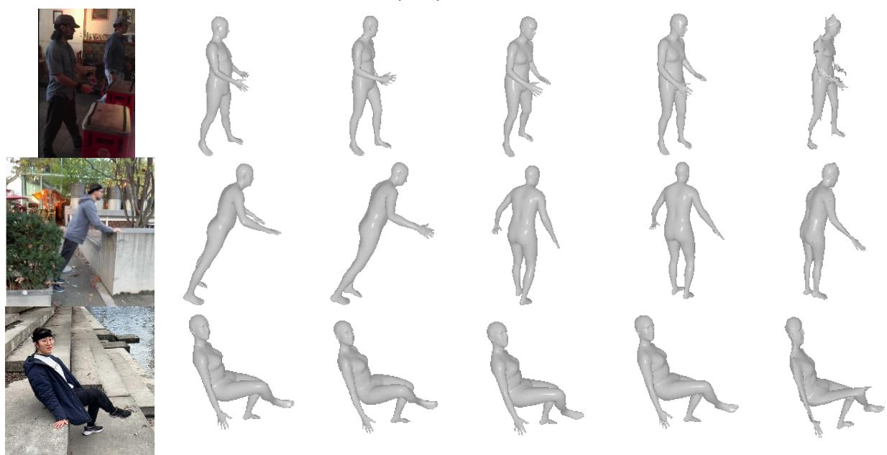  
Figure 1: 额外对比。我们在 3DPW（第一行，在 3DPW 上训练）和 EMDB（在 EMDB 上训练）上将我们的方法与 HMR、CLIFF 和 FastMETRO-S 进行了对比。

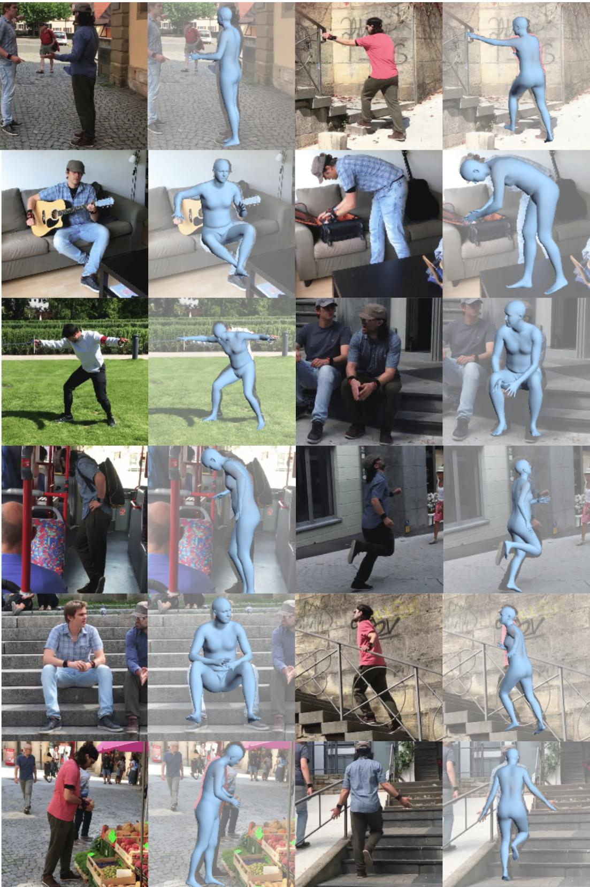  
Figure 2: 定性结果。我们在 3DPW 数据集上可视化了使用 VQ-HPS 获得的结果。

Epoch 1

Epoch 3

Epoch 5

Epoch 10

Epoch 20

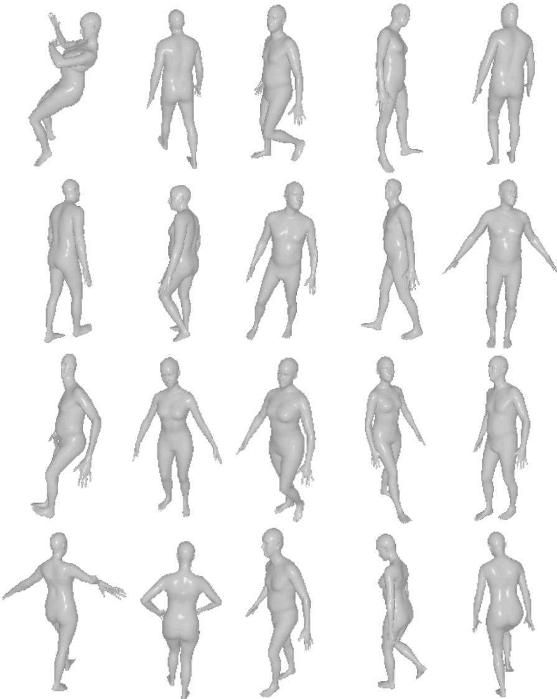  
Figure 3: 在 EMDB 上的训练过程中随机验证样本的可视化。网格从第 1 个 epoch 开始就是平滑的，并在大约 5 个 epoch 内变得符合人体形态。

我们在 Fig. 2 中还展示了使用 HRNet 骨干网络的 VQ-HPS 所获得的一些定性结果（如 Tab. 2 中所评估）。

## C 训练过程中预测的可视化

我们在 Fig. 3 中可视化了在 EMDB 数据集上训练时的验证样本（参见 Sec. 5.3）。网格从第 1 个 epoch 开始就是平滑的，并在大约 5 个 epoch 内呈现出人体形态。正如正文中所讨论的，我们认为这是由多种因素造成的。首先，其解码器对 VQ-HPS 至关重要的 Mesh-VQ-VAE 是在大规模人体动作数据集上预训练的，并且随后被冻结。这种预训练可能起到了一种正则化作用，从而减少了学习解决 HPSE 任务所需的标注数据量。其次，VQ-HPS 学习离散索引上的分布以生成符合人体形态的网格。相比于从 6890 个 3D 坐标中学习结构，学习 54 个离散索引上的分布要容易得多。

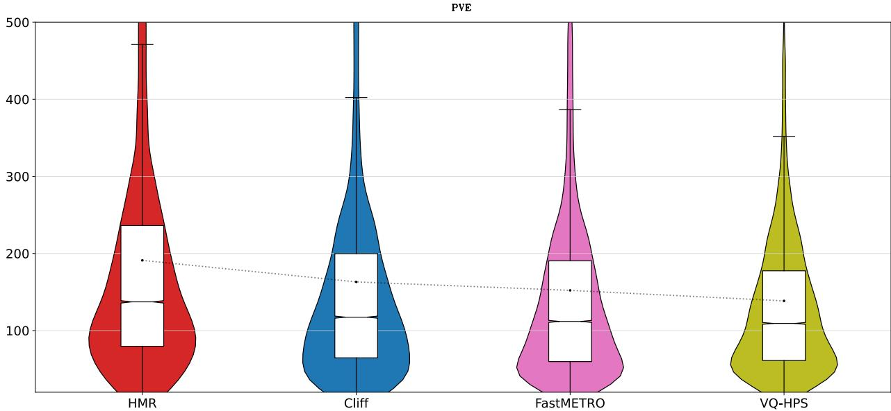  
Figure 4: PVE 的分布。我们研究了 EMDB 测试集上所有 4 种方法的每顶点误差（PVE）分布。黑点代表均值。箱线图给出了第 1 和第 3 四分位数以及中位数，中位数周围带有表示置信区间的缺口（notch）。须线（whiskers）从箱体延伸到距箱体 1.5 倍四分位距（IQR）以内的最远数据点。我们还绘制了小提琴图以可视化误差的分布。

## D 误差分析

我们在 Fig. 4 中分析了当模型在 EMDB2 上训练时，在 EMDB1 上的每顶点误差分布（PVE，参见 Sec. 5.2；定量结果见 Tab. 1）。我们可以看到 VQ-HPS 在许多方面都优于其他方法。首先，它的均值、中位数、第 1 和第 3 四分位数均低于其他方法。VQ-HPS 的第 1 和第 3 四分位数之间的距离远小于其他方法。非参数化方法在低误差区域具有极高的样本集中度，而参数化方法的分布则更为均匀。VQ-HPS 的另一个显著优势是其具有高误差的离群值要少得多。

## E 失败案例

失败案例见图 5。当在稀缺数据上训练时（第 5.3 节实验），低可见度和罕见姿态会导致产生具有完全不同姿态和身体朝向的离群值。在大规模数据集上训练时有明显的改善（见第 5.4 节），但仍然存在一些失败案例。在第一张图像中，模型估计了错误的人物的姿态。在第二张图像中，一个非常罕见的姿态导致了非拟人化的预测（尤其是左臂）。最后，VQ-HPS 有时会对罕见姿态产生全局朝向错误。避免此类失败案例的潜在改进方向包括改进特征提取器 [8] 或使用包含更多罕见姿态的额外数据 [9]，正如最近的研究 [10] 强调了骨干网络（backbones）和数据对获得更好性能的关键作用。

## F 估计体型

我们提出评估 VQ-HPS 在估计体型方面的潜力。正如先前的研究所证明的，准确估计体型最重要的是训练数据 [9]。我们在包含多样化体型的合成数据集 Bedlam [9] 的 5% 数据上微调了 VQ-HPS（见第 5.4 节，表 2 中的“ResNet-50 backbone”）。在图 6 中，我们比较了在 Bedlam 上微调 VQ-HPS 前后在 SSP-3D [11]（一个包含具有挑战性体型的真实图像数据集）上获得的结果。明显的改善表明，如果在适当的数据上进行训练，VQ-HPS 可以用于体型估计。

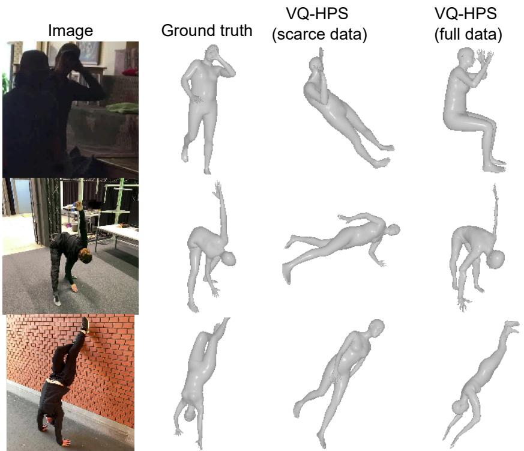  
Figure 5: 失败案例。我们研究了在稀缺数据和大规模数据集上训练时的失败案例。

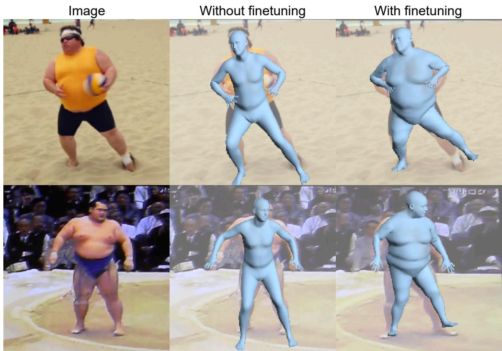  
Figure 6: 估计体型。我们在包含多样化体型的数据集上进行微调前后，定性评估了 VQ-HPS 在 SSP-3D 上的表现。

VQ-HPS

M2

头部

左臂

左腿

右臂

右腿

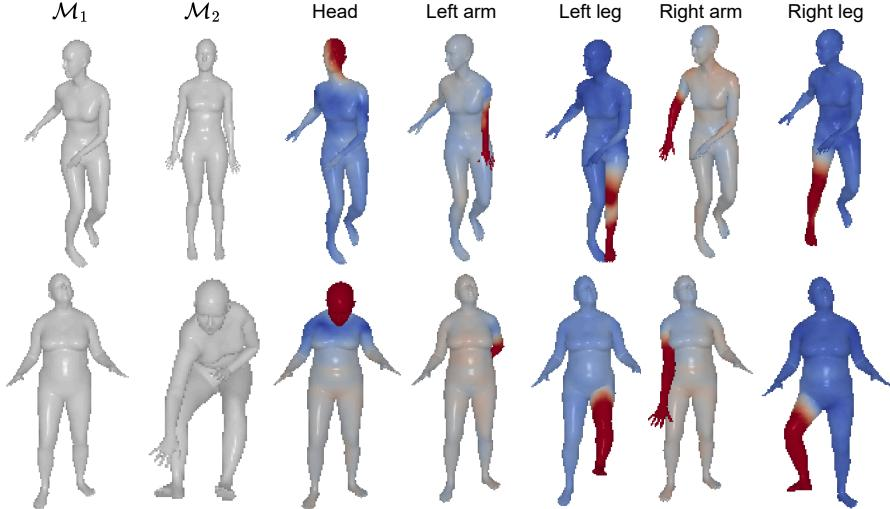  
Figure 7: 交换身体部位。在手动识别负责每个身体部位的索引后，我们在潜空间中交换两个网格之间的身体部位。颜色映射显示了 M 与重建之间的距离。

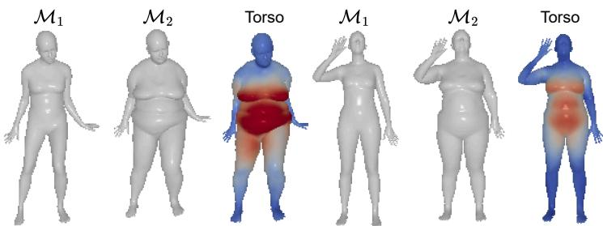  
Figure 8: 交换躯干。我们在潜空间中交换两个网格之间的躯干。

## G Mesh-VQ-VAE 的可视化

主论文（参见第 4.1 节）解释了 Mesh-VQ-VAE 是全卷积的。因此，潜在空间保留了网格的空间结构。我们通过在随机修改每个索引后可视化重建结果，手动识别出与每个索引相关联的身体部位。我们提出通过在不同网格之间交换身体部位来可视化这一特性。具体而言，给定两个网格 $\mathcal { M } _ { 1 }$ 和 $\mathcal { M } _ { 2 }$，我们对两个网格进行编码，并在将指定身体部位的索引替换为来自 $\mathcal { M } _ { 2 }$ 的索引后解码 $\mathcal { M } _ { 1 }$。结果如图 7 所示。

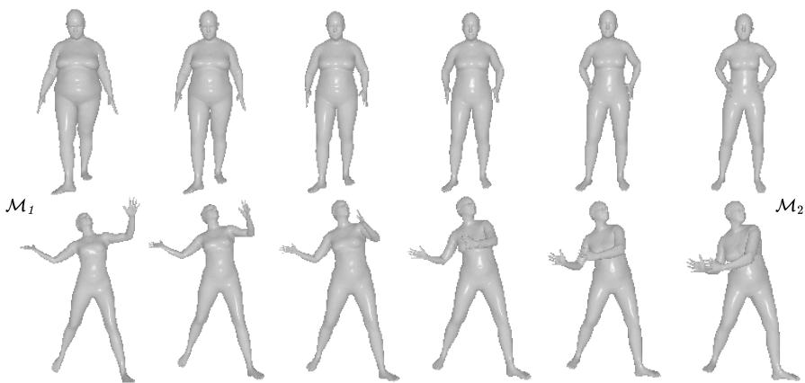  
Figure 9: Mesh-VQ-VAE 潜在空间中的插值。注意潜在空间同时涵盖了姿态和体型。

我们还可以修改躯干。为了更直观地展示，我们在图 8 中提供了具有不同体型的个体的定性结果。请注意，这与修改整体体型略有不同，因为手臂和腿部保持不变。

最后，在图 9 中，我们展示了可以在潜在空间中对网格 $\mathcal { M } _ { 1 }$ 和 $\mathcal { M } _ { 2 }$ 进行插值。具体而言，我们在对应的连续潜在表示 $z _ { 1 }$ 和 $z _ { 2 }$ 之间进行线性插值，然后将结果量化并解码以获得中间网格。

## 补充参考文献

[1] Yi Zhou, Chenglei Wu, Zimo Li, Chen Cao, Yuting Ye, Jason Saragih, Hao Li, and Yaser Sheikh. Fully convolutional mesh autoencoder using efficient spatially varying kernels. Advances in neural information processing systems (NIPS), 33:9251–9262, 2020.

[2] Kaiming He, Xiangyu Zhang, Shaoqing Ren, and Jian Sun. Deep residual learning for image recognition. In IEEE/CVF Conference on Computer Vision and Pattern Recognition (CVPR), pages 770–778, 2016.

[3] Olga Russakovsky, Jia Deng, Hao Su, Jonathan Krause, Sanjeev Satheesh, Sean Ma, Zhiheng Huang, Andrej Karpathy, Aditya Khosla, Michael Bernstein, et al. Imagenet large scale visual recognition challenge. International Journal ofComputer Vision (IJCV), 115:211–252, 2015.

[4] Angjoo Kanazawa, Michael J. Black, David W. Jacobs, and Jitendra Malik. End-to-end recovery of human shape and pose. In IEEE/CVF Conference on Computer Vision and Pattern Recognition (CVPR), pages 7122–7131, 2018.

[5] Yi Zhou, Connelly Barnes, Jingwan Lu, Jimei Yang, and Hao Li. On the continuity of rotation representations in neural networks. In IEEE/CVF Conference on Computer Vision and Pattern Recognition (CVPR), pages 5745–5753, 2019.

[6] Ashish Vaswani, Noam Shazeer, Niki Parmar, Jakob Uszkoreit, Llion Jones, Aidan N Gomez, Łukasz Kaiser, and Illia Polosukhin. Attention is all you need. Advances in Neural Information Processing Systems (NIPS), 30:5998–6008, 2017.

[7] Tsung-Yi Lin, Michael Maire, Serge Belongie, James Hays, Pietro Perona, Deva Ramanan, Piotr Dollár, and C Lawrence Zitnick. Microsoft coco: Common objects in context. In European Conference on Computer Vision (ECCV), pages 740–755. Springer, 2014.

[8] Matthieu Armando, Salma Galaaoui, Fabien Baradel, Thomas Lucas, Vincent Leroy, Romain Brégier, Philippe Weinzaepfel, and Grégory Rogez. Cross-view and cross-pose completion for 3d human understanding. arXiv preprint arXiv:2311.09104, 2023.

[9] Michael J. Black, Priyanka Patel, Joachim Tesch, and Jinlong Yang. BEDLAM: A synthetic dataset of bodies exhibiting detailed lifelike animated motion. In IEEE/CVF Conference on Computer Vision and Pattern Recognition (CVPR), pages 8726–8737, 2023.

[10] Hui En Pang, Zhongang Cai, Lei Yang, Tianwei Zhang, and Ziwei Liu. Benchmarking and analyzing 3d human pose and shape estimation beyond algorithms. Advances in Neural Information Processing Systems (NIPS), 35:26034–26051, 2022.

[11] Akash Sengupta, Ignas Budvytis, and Roberto Cipolla. Synthetic training for accurate 3d human pose and shape estimation in the wild. In British Machine Vision Conference (BMVC), 2020.