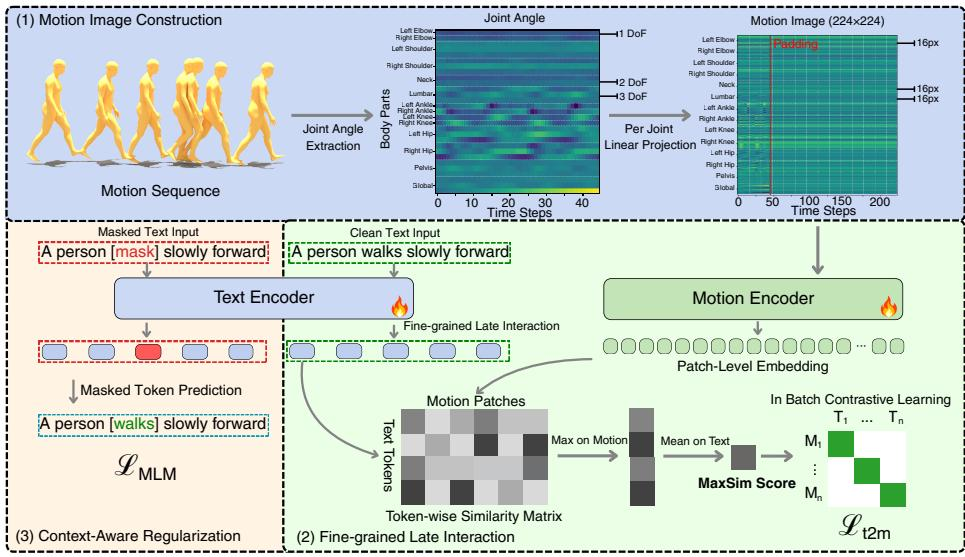
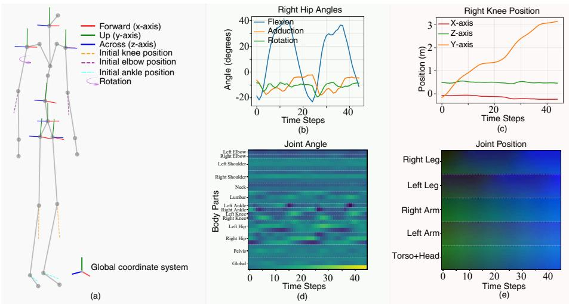
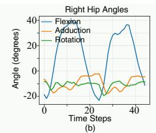
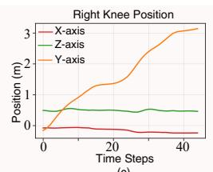
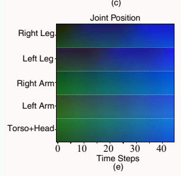
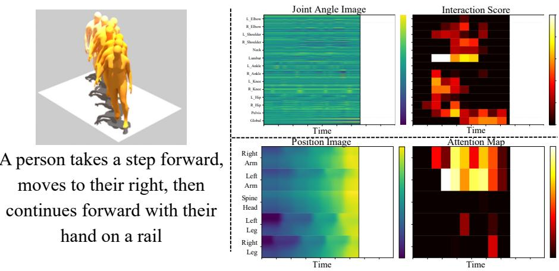

# 基于关节角动作图像与Token-Patch后期交互的细粒度动作检索

Yao Zhang1, Zhuchenyang Liu1, Yanlan He2, Thomas Ploetz3, and Yu Xiao1

1 Aalto University, Espoo, Finland

{yao.1.zhang,zhuchenyang.liu,yu.xiao}@aalto.fi

2 Fudan University, Shanghai, China

23307130480@m.fudan.edu.cn 3 Georgia Institute of Technology, Atlanta GA, USA thomas.ploetz@gatech.edu

摘要. 文本-动作检索旨在学习自然语言描述与 3D 人体动作骨架序列之间语义对齐的潜在空间，从而实现跨越这两种模态的双向搜索。现存的大多数方法采用双编码器框架，将动作和文本压缩为全局嵌入，从而丢弃了细粒度的局部对应关系，降低了准确性。此外，这些全局嵌入方法对于检索结果的可解释性有限。为了克服这些局限性，我们提出了一种具有可解释性的、基于关节角的动作表征方法，该方法将关节级别的局部特征映射到结构化的伪图像中，与预训练的 Vision Transformer 兼容。针对文本到动作检索，我们采用了基于标记（token）的后期交互机制 MaxSim，并通过掩码语言建模（Masked Language Modeling）正则化对其进行增强，以促进鲁棒且可解释的文本-动作对齐。在 HumanML3D 和 KIT-ML 上的广泛实验表明，我们的方法优于当前最先进的文本-动作检索方法，同时在文本与动作之间提供了可解释的细粒度对应关系。

关键词：文本-动作检索 · 动作理解 · 细粒度跨模态对齐 · 后期交互 · 动作表征

## 1 引言

文本-动作检索是人体动作理解中的一项关键任务，其核心目标是在 3D 人体动作骨架序列与自然语言描述之间建立一个语义对齐的潜在空间 [9, 22, 23]。一个良好对齐的潜在空间能够促进双向检索，其中对齐的精度和粒度显著影响下游任务的表现，例如文本驱动动作生成 [28]、动作描述生成 [10,13] 以及语言引导动作编辑 [38]。

近期的研究致力于从不同角度实现精准且细粒度的对齐。在动作表征方面，一些研究 [34, 37] 将动作骨骼序列转换为伪图像，以利用预训练视觉模型。然而，这些直接源自原始 3D 关节点位置的表征将全局平移运动与单个关节点的运动混为一谈，阻碍了对细微运动学差异的区分（见 Sec. 3.1）。在文本模态方面，先前的研究利用大语言模型生成增强描述或部位级描述 [37, 39]，或者开发复杂的跨模态注意力模块以实现更精细的对齐 [27,31]。尽管如此，这些方案引入了显著的外部依赖和计算开销。此外，大多数现有方法（如 TMR [22]）遵循全局嵌入对齐范式，通过将输入序列编码为单个全局向量来进行对齐。尽管在计算上高效，但这种全局嵌入范式将动作序列及其文本描述的丰富内容压缩成单个向量，不可避免地丢失了细粒度的局部信息。结果，这限制了检索性能，并使得将特定文本标记（tokens）与精准身体动作相对齐变得更加困难，而这种对齐对于区分相似动作至关重要。

本文从两个关键角度解决这些挑战。首先，我们通过引入一种基于关节角度的动作表征，来解决混淆全局与局部关节点运动的问题。解剖学定义的关节角度 [29,30] 具有平移不变性，并能独立编码各个关节，从而显式地将身体的全局轨迹与局部关节点运动解耦（详见 Sec. 2.1）。通过将这些解耦特征（而非原始 3D 关节点位置）投影到结构化的 224×224 伪图像中，我们有效地利用了预训练 Vision Transformers (ViT) 的视觉先验。该方法确保了不同的空间区域对应于特定的关节点，为部位级对齐提供了天然的基础。

其次，受文本检索 [14] 和视觉文档检索 [6] 中有效的迟交互（late interaction）机制的启发，我们用最大相似度（Maximum Similarity, MaxSim）算子取代了全局嵌入对齐，以实现显式的 token-to-patch 匹配。该算子为每个文本 token 保留其在所有动作 patch 中的最大相似度得分，从而生成可解释的细粒度对应图。然而，由于 MaxSim 是在单个 token 级别计算相似度，这就带来了一个关键挑战：每个 token 和 patch 的嵌入必须携带足够的上下文信息，以支持可靠的匹配。在动作方面，序列通常由静态或过渡姿态主导，这可能导致 MaxSim 为无信息量的 patch 分配高相似度，仅仅因为它们恰好与查询 token 特征相似。在文本方面，语义空洞的 token（如“a”或“person”）可能充当噪声锚点，与任意动作 patch 匹配并稀释对齐信号；即使像“hand”这样的实词，如果缺乏句子级上下文，也可能匹配到无关的 patch。为了解决这些问题，我们引入了掩码语言建模（Masked Language Modeling, MLM）[4] 作为正则化，训练文本编码器根据周围上下文重构被掩码的 token。这种创新的方法生成了富含上下文信息的嵌入，从而稳定了细粒度匹配，且完全无需数据增强或外部模型。据我们所知，如 Sec. 2.2 和 2.3 所述，这是首个在文本-动作检索中用结构扎实、细粒度的迟交互机制取代全局嵌入范式的工作。

在 HumanML3D 和 KIT-ML 上的大量实验表明，我们将基于关节角的动作表示与 token-patch 迟交互相结合的方法，持续超越了最先进的文本-动作检索基线。此外，它还能生成可解释的对应图，透明地将文本语义与特定的人体关节及时间阶段对齐。我们方法的细节和评估结果分别在 Sec. 3 和 Sec. 4 中给出，随后在 Sec. 5 中进行总结。

## 2 背景与相关工作

本节回顾现有的人体动作表示（Sec. 2.1）、文本-动作检索方法（Sec. 2.2）以及用于文本或文档检索的迟交互机制（Sec. 2.3）。

## 2.1 人体动作表示

3D 人体动作序列通常表示为逐帧骨骼特征。最广泛采用的格式是 Guo 等人 [9] 提出的 263 维特征向量，该向量在每帧中拼接了根节点角速度、根节点线速度、关节位置、6D 关节旋转、关节速度以及二值化足部触地标签。近期关于动作生成的研究重新审视了动作表征的选择：MARDM [21] 分析了此类多视角姿态编码的冗余性，而 ACMDM [20] 则表明直接使用绝对关节坐标可以简化动作生成。对于检索任务而言，紧凑且具判别力的表征同样更受青睐。MoPatch [34] 更进一步，将动作序列转换为类似图像的 patch（图块），并利用预训练的 ViT 编码器，证明了来自 ImageNet 的视觉先验可以缓解动作理解中的数据匮乏问题。然而，其动作图像是直接由按身体区域分组的原始 3D 关节位置构建的，这掩盖了关节之间细粒度的运动学差异。

在生物力学中，由国际生物力学学会（ISB）标准化的关节坐标系（JCS）沿明确定义的解剖平面将每个关节的运动分解为具有临床意义的分量，例如屈曲/伸展、外展/内收以及内旋/外旋 [29, 30]。这些角度提供了具有解剖学意义的可解释性，每个自由度（DoF）都对应特定类型的关节活动 [26]。它们本质上还具有平移不变性，描述了关节相对于其父节段的运动方式（例如，大腿是膝关节的父节段，骨盆是髋关节的父节段）。尽管具有这些优势，关节角度在跨模态动作检索中的探索仍然不足。我们通过基于逐关节角度特征构建结构化的动作图像（Motion Image）来解决这一问题，其中每个空间区域编码一个不同的关节，以实现细粒度的 token 到 patch 的对齐。

## 2.2 文本-动作检索

自然语言与 3D 人体骨骼动作之间的跨模态检索引起了越来越多的关注 [9, 19, 23]。受图文 [24] 和视频-文本检索模型 [32] 架构的启发，TMR [22] 引入了一种用于文本-动作检索的双编码器框架，其中动作编码器和文本编码器独立地将其输入映射到一个共享的潜在空间中，然后通过生成的全局嵌入之间的余弦相似度来执行文本到动作（T2M）和动作到文本（M2T）检索。采用与 TMR [22] 相似架构的多项工作寻求更细粒度的对齐，其方式包括利用 LLM 丰富训练数据（例如 CAR [7]、SGAR [37] 和 KinMo [39]），或引入较粗略的局部性概念（例如 Lyu 等人 [31]、ReMoGPT [35]、SECL [27]）；更近期的工作则追求针对特定部位或分层的细粒度匹配（例如 WaMo [25]、Chen 等人 [2]）。最近的研究还针对多模态检索，将动作与音频或图像等其他模态进行对齐，以学习更广泛的联合嵌入空间（例如 Motion-Bind [15]、MonSTeR [3] 和 Multi-Modal Motion Retrieval [33, 36]）。然而，这些方法都没有在单个词语与特定身体区域或时间片段之间建立起直接的、基于结构的对应关系，而这正是我们的 token-to-patch 对齐所提供的能力。

## 2.3 检索中的后期交互

后期交互（Late interaction）由 ColBERT [14] 引入用于文本检索。与将文档压缩为单个嵌入向量的单向量模型不同，ColBERT 保留了逐 token 的表征，并通过最大相似度（MaxSim）算子计算相关性：查询中的每个文本 token 会找到其最匹配的文档 token，最终得分则是这些最大值的累加。这在保留细粒度细节的同时，保留了独立编码的计算效率。具体而言，与在运行时需要通过模型对查询和图库中的每个项目进行联合处理的交叉注意力（cross-attention）机制 [4, 27] 不同，后期交互允许在离线状态下预先对所有图库项目进行编码。在推理过程中，仅查询需要进行前向传播，检索则是通过轻量级的相似度计算来实现的。该范式此后已被扩展到多模态场景：ColPali [6] 将其应用于视觉文档检索，将查询文本 token 与图像 patch 嵌入进行匹配，而无需 OCR。这些进展表明，后期交互天然适用于模态元素之间存在细粒度对应关系的跨模态任务，然而，它在动作领域尚未得到探索。据我们所知，我们的工作首次引入了该机制，并结合基于 MLM 的正则化进行增强，以用于文本-动作检索。

## 3 方法

为实现可解释的细粒度文本-动作检索，我们提出了一个旨在克服传统全局嵌入信息瓶颈的框架。如图 1 所示，给定一个 3D 骨骼动作序列（表示为来自 SMPL [9] 或类似骨骼模型的逐帧关节点位置）和一段自然语言描述，我们的流程分为三个步骤。

  
Fig. 1: 三阶段训练流程概览。

首先，为了显式地将局部关节点运动与全局身体轨迹解耦，原始动作序列被转换为一个结构化的 224×224 伪图像，称为动作图像（Motion Image）。这是通过逆运动学（inverse kinematics）提取关节角特征，并将每个关节点的自由度（Degrees of Freedom, DoF）投影到一个统一的 16 像素水平条带中来实现的，从而使每个空间区域编码一个特定的关节点（Sec. 3.1）。

其次，将动作图像输入到 Vision Transformer 中，而文本描述则由基于 Transformer 的语言模型进行处理。它们分别输出图像块级别（patch-level）和标记级别（token-level）的嵌入，从而为下游匹配保留时空细微差异，而不是将所有信息压缩为单一的全局向量（Sec. 3.2）。这些嵌入通过 MaxSim 后期交互机制 [14] 进行组合，以产生用于文本-动作对齐的细粒度 MaxSim 分数（Sec. 3.3）。该分数作为训练和推理的统一检索指标：在训练期间，它用于批次内对比学习 $\left( \mathcal { L } _ { t 2 m } \right)$；在推理期间，它直接对候选动作（或文本）进行排序以实现检索。

第三，由于标记级别的匹配对语义噪声较为敏感，因此它与 MLM（掩码语言建模）辅助目标相结合，利用句子级上下文丰富标记嵌入，以稳定对齐过程（Sec. 3.4）。MLM 在视觉-语言预训练 [1,16] 中与对比目标结合已被广泛使用，以提高文本表征质量；在我们的框架中，它的具体目的是确保每个标记嵌入不仅编码词汇本身的信息，还编码其在更广泛句子中的作用，从而为细粒度跨模态匹配提供稳定的基础。

第三步仅在训练期间使用；其他步骤在训练和推理中均会执行。关于推理部分，对于文本到动作检索（T2M retrieval），给定一个文本查询 $\tau$ 和包含 G 个候选动作的库 $\{ \mathcal { M } _ { g } \} _ { g = 1 } ^ { G }$，文本编码器和动作编码器分别独立生成标记（token）级和补丁（patch）级嵌入。系统会为每个候选动作计算 MaxSim 分数 Sim $( \mathcal { T } , \mathcal { M } _ { g } )$，并据此对动作进行排序。对于动作到文本检索（M2T retrieval），两者的角色互换：使用转置后的相似度矩阵，对动作查询与所有候选文本进行打分。由于两个编码器是相互独立的，候选嵌入仅需计算一次，即可在多个查询之间复用。

## 3.1 基于关节角度的动作表征

关节角度描述了一个关节相对于其父肢体段的弯曲或旋转方式，而与人体在世界坐标系中的位置无关。与以往依赖原始关节位置的方法 [22, 31, 34] 不同，我们采用基于关节角度的动作表征，显式地将局部关节运动与全局运动解耦，以构建细粒度的动作图像（Motion Image）。这为检索带来了三个优势：(1) 动作图像中的每个空间条带独立地编码一个特定关节的行为，从而实现部件级对齐；(2) 该表征对全局平移和朝向变化具有天然的鲁棒性；(3) 具有判别力的运动学模式（例如行走过程中周期性的髋关节屈曲）得以保留，而不会被平滑的全局漂移所掩盖。这种基于角度的表征也是可逆的；我们在补充材料 1.4 中展示了通过正向运动学高保真度恢复 3D 关节位置的过程。

如图 Fig. 2(a) 所示，我们将一个动作分解为 $K { = } 1 4$ 个不同的运动学关节（例如髋部、膝盖、肩部）。遵循每个关节的解剖学自由度（DoF）定义（例如，像髋部这样的球窝关节为 3 维，像膝盖这样的铰链关节为 1 维）以及关节角度定义的标准医学惯例 [29, 30]，我们通过逆运动学管线从原始关节位置计算出每个部件的角度特征以及全局位置。这在每个时间步 t 产生一个输入向量 $p _ { t } \in \mathbb { R } ^ { 2 9 }$。Table 1 总结了所有 14 个关节计算出的关节角度特征。

关节角度提取。我们在每一帧构建一个以骨盆为锚点的以身体为中心的坐标系 $R _ { \mathrm { b o d y } }$（补充材料 1.1），并根据关节类型通过逆运动学提取关节角度。对于球窝关节（髋部、肩部；3 自由度），我们将子关节位置转换到父关节的局部坐标系中以获得 $\tilde { v } \in \mathbb { R } ^ { 3 }$，并将其分解为屈曲/伸展（flexion/extension）以及内收/外展（adduction/abduction）：

$$
\theta_ {\mathrm{flex}} = \mathrm{atan2} (\tilde {v} _ {x}, - \tilde {v} _ {y}), \quad \theta_ {\mathrm{add}} = \mathrm{sign} (\tilde {v} _ {z}) \cdot \arccos \left(\frac {\tilde {v} \cdot \tilde {v} _ {x y}}{\| \tilde {v} \| \| \tilde {v} _ {x y} \|}\right)\tag{1}
$$

其中 $\tilde { v } _ { x y }$ 是 $\tilde{v}$ 在矢状面上的投影。轴向旋转 $\theta _ { \mathrm { { r o t } } }$ 通过传播父级坐标系并测量孙级扭转获得（补充材料 1.2）。铰链关节（1-DoF，自由度）使用相邻肢体节段之间的夹角，而脊柱关节（2–3 DoF）遵循相同的分解方式但以向上的 y 轴为参考。所有坐标系均遵循分层递归传播，从而确保平移不变特征（完整推导见补充材料 1）。

Table 1: 关节角特征汇总。我们计算了对应于 14 个关节的 29 个运动学维度。

<table><tr><td>关节</td><td>特征</td><td>自由度 (DoF)</td><td>关节类型</td></tr><tr><td>骨盆（方向）</td><td>前倾/后倾 (tilt)、侧倾 (list)、旋转 (rotation)</td><td>3</td><td>朝向</td></tr><tr><td>骨盆（平移）</td><td>tx, ty, tz</td><td>3</td><td>全局位置</td></tr><tr><td>髋关节 (×2)</td><td>屈曲、内收、旋转</td><td>6</td><td>球窝关节</td></tr><tr><td>膝关节 (×2)</td><td>弯曲</td><td>2</td><td>铰链关节</td></tr><tr><td>踝关节 (×2)</td><td>弯曲</td><td>2</td><td>铰链关节</td></tr><tr><td>腰椎</td><td>伸展、侧屈、旋转</td><td>3</td><td>脊柱（3-DoF）</td></tr><tr><td>肩关节 (×2)</td><td>屈曲、内收、旋转</td><td>6</td><td>球窝关节</td></tr><tr><td>肘关节 (×2)</td><td>屈曲</td><td>2</td><td>铰链关节</td></tr><tr><td>颈部</td><td>屈曲、内收</td><td>2</td><td>脊柱（2-DoF）</td></tr><tr><td>总计</td><td></td><td>29</td><td></td></tr></table>

动作图像（Motion Image）构建。每个动作被拆分为特定于关节的特征 $\{ p _ { t , k } \} _ { k = 1 } ^ { K }$。由于关节具有不同的自由度（1–3 个维度），我们使用可学习的线性投影 $\{ \phi _ { k } \} _ { k = 1 } ^ { K }$ 将它们映射到一个统一的空间：

$$
h _ {t, k} = \phi_ {k} (p _ {t, k}) \in \mathbb {R} ^ {d _ {p a r t}}\tag{2}
$$

其中 $d _ { p a r t } { = } 1 6$ 与 ViT [5] 的 patch 大小相匹配，从而使每个关节恰好占据一条 16 像素的水平条带，实现了一对一的关节到 patch 的映射（可针对其他 ViT 配置进行调整，例如 $d _ { p a r t } { = } 1 4$）。在每一帧 t，所有 K 个关节的投影特征被拼接成一列 $H _ { t } \in \mathbb { R } ^ { D _ { e m } }$ b $( D _ { e m b } = K \times d _ { p a r t } = 2 2 4 )$。将所有帧沿时间轴堆叠并填充至 T=224，生成一个名为“动作图像”（Motion Image）的伪图像 $I _ { m o t i o n } \in \bar { \mathbb { R } } ^ { 2 2 4 \times 2 2 4 }$。如图 1 所示，每个水平条带对应一个特定关节，自然地支持与预训练 ViT 进行部位级对齐。

图 2 以动作“一个人缓慢向前行走”为例，说明了平移不变特征。右髋的关节角度（图 2(b)）表现出明显的周期性步态模式，而相应的关节位置（图 2(c)）则受全局轨迹漂移的主导。在全身层面上，关节角度动作图像（Motion Image）（图 2(d)）显示出具有时间局部性、关节特异性的激活，而基于位置的图像（图 2(e)）在所有条带上均显示出一致的漂移，从而掩盖了运动学差异。

  
图 2：“一个人缓慢向前行走”基于关节角度与基于关节位置的表示对比。(a) 骨骼结构和以身体为中心的坐标轴。(b) 右髋角度。(c) 右膝位置。(d) 我们的 29 维关节角度动作图像（Motion Image）：每个条带编码一个不同的关节。(e) MoPatch [34] 位置图像。

## 3.2 双流架构

该框架由包含动作编码器（Motion Encoder）和文本编码器（Text Encoder）的双流架构组成，旨在提取稠密特征表示以用于后续的后期交互（late interaction）。

动作编码器（Motion Encoder）。动作编码器 ${ \mathcal { E } } _ { m }$ 使用 ViT 骨干网络。单通道动作图像 $I _ { m o t i o n }$ 在 RGB 通道上重复，以匹配 ImageNet 预训练输入格式，从而生成 patch 嵌入：

$$
V = \mathcal {E} _ {m} (I _ {m o t i o n}) = \{v _ {1}, v _ {2}, \dots , v _ {N} \} \in \mathbb {R} ^ {N \times d}\tag{3}
$$

其中 N 是 patch 的数量（例如，14 × 14 网格为 196 个），d 是特征维度。与 CLIP 风格的模型不同，我们保留完整的 patch 序列 V，而不是池化为全局 [CLS] 标记（token）。

文本编码器（Text Encoder）。文本编码器 $\mathcal { E } _ { t }$（基于 Transformer 的语言模型，例如 DistilBERT）将描述 $\tau$ 映射为 token 级别的隐藏状态：

$$
L = \mathcal {E} _ {t} (\mathcal {T}) = \{l _ {1}, l _ {2}, \dots , l _ {M} \} \in \mathbb {R} ^ {M \times d}\tag{4}
$$

其中 M 为序列长度。我们使用内容 token 嵌入 {li}（不包括 [CLS] 和 [SEP]）进行细粒度交互。

## 3.3 细粒度后期交互 (MaxSim)

标准的全局池化会过早聚合信息，而 MaxSim 显式建模了不同文本 token 与动作 patch 之间的对齐。我们将 token-patch 交互矩阵 $S \in \mathbb { R } ^ { M \times N }$ 定义为归一化文本与动作特征之间的点积：

$$
S _ {i j} = \frac {l _ {i} \cdot v _ {j} ^ {T}}{\| l _ {i} \| \| v _ {j} \|}\tag{5}
$$

我们在 T2M 方向上计算 MaxSim：对于每个文本 token $l _ { i } \ \left( e . g . , \right.$ 代表“手”），我们识别出产生最大激活响应的动作 patch $v _ { j }$。然后，通过对这些逐 token 的最大值取平均，获得文本-动作对的相似度得分：

$$
\operatorname{Sim} (\mathcal {T}, \mathcal {M}) = \frac {1}{M} \sum_ {i = 1} ^ {M} \max _ {j = 1} ^ {N} (S _ {i j})\tag{6}
$$

该机制使模型能够将每个词动态定位到其最相关的运动学特征上，从而过滤掉无关的动作背景。我们仅在 T2M 方向上计算 MaxSim，是因为动作序列包含的 patch 数量 $\left( N { = } 1 9 6 \right)$ 远多于文本 token $( M \ll N )$，且许多 patch 编码了没有文本对应项的静态或重复姿势；反向对文本取最大值（max-over-text）会引入大量噪声。

## 3.4 基于 MLM 的上下文感知正则化

为了确保 token 嵌入携带足够的上下文信息以实现可靠的 MaxSim 匹配，我们引入 MLM（掩码语言建模，Masked Language Modeling）[4,16] 作为上下文感知正则化任务。在训练期间，我们随机遮蔽一定比例的输入 token $( e . g . , 1 5 \% )$ 以生成损坏的文本 $\mathcal { T } _ { m a s k e d }$。然后，Text Encoder 需要根据可见 token 的上下文依赖关系来重建原始 token。该辅助任务迫使编码器深度编码句子内的句法和语义关系：

$$
\mathcal {L} _ {m l m} = - \sum_ {i \in \mathrm{mask}} \log P (w _ {i} | \mathcal {T} _ {m a s k e d}; \theta_ {t e x t})\tag{7}
$$

通过优化 $\mathcal { L } _ { m l m }$，我们确保用于 MaxSim 的输出嵌入不仅仅是孤立的词表示，而是富含全局上下文。需要注意的是，我们仅将 MLM 应用于文本编码器，而非同时应用于两种模态。这种设计的动机与我们单向 MaxSim 背后的不对称性相同：由于是由文本 token 查询动作 patch，因此每个 token 嵌入的上下文质量是对齐精度的主要瓶颈。

## 3.5 训练策略与损失函数

对于包含 B 个文本-动作对的批次，我们使用 T2M MaxSim 得分 $\left( \mathrm { E q . ~ 6 } \right)$ 计算成对相似度矩阵 $\mathbf { S } _ { \mathrm { b a t c h } } \in \mathbb { R } ^ { B \times B }$。T2M 检索损失采用以对角线为目标的批内交叉熵：

$$
\mathcal {L} _ {t 2 m} = - \frac {1}{B} \sum_ {i = 1} ^ {B} \log \frac {\exp (\mathbf {S} _ {\mathrm{batch}} [ i , i ] / \tau)}{\sum_ {j = 1} ^ {B} \exp (\mathbf {S} _ {\mathrm{batch}} [ i , j ] / \tau)}\tag{8}
$$

其中 $\tau$ 是可学习的温度参数。M2T 损失 $\mathcal { L } _ { m 2 t }$ 在转置矩阵 $\mathbf { S } _ { \mathrm { b a t c h } } ^ { \top }$ 上应用相同的公式。总目标函数将对称检索损失与 MLM 正则化结合在一起：

$$
\mathcal {L} _ {r e t} = \frac {1}{2} (\mathcal {L} _ {t 2 m} + \mathcal {L} _ {m 2 t}), \qquad \mathcal {L} _ {t o t a l} = \mathcal {L} _ {r e t} + \lambda_ {m l m} \mathcal {L} _ {m l m}\tag{9}
$$

其中 $\lambda _ { m l m }$ 用于平衡检索与正则化。在训练过程中，未被遮蔽的文本用于 $\mathcal { L } _ { \mathit { r e t } }$，掩码文本用于 $\mathcal { L } _ { m l m }$；两个目标共享文本编码器参数。

## 4 实验

## 4.1 数据集与实现细节

我们在两个数据集上评估所提出的方法。HumanML3D [9] 聚合了来自 AMASS [19] 和 HumanAct12 [11] 的动作骨骼数据，包含 14,616 个动作片段和 44,970 条文本描述，涵盖多种日常活动。我们遵循标准划分 [9, 22]：在 20 FPS 下按 23,384/1,460/4,380 划分为训练集/验证集/测试集 [7, 22, 34, 35]。KIT-ML [23] 包含 3,911 个动作及 6,278 条描述，在 12.5 FPS 下按 4,888/300/830 划分为训练集/验证集/测试集 [7, 22, 34, 35]。

该系统通过在给定文本查询时对图库动作进行排序来执行 T2M，并通过在给定动作时对文本进行排序来执行 M2T。我们报告了 T2M 和 M2T 检索的 Recall@K（R@K）和中位数排名（MedR）；R@K 越高、MedR 越低越好。由于近似重复/相似动作的干扰，R@1/R@2 在不同随机种子间存在较高的方差（见补充材料 3）；因此，我们在 Table 2 中使用相同的随机种子 42 报告更稳定的 R@5/R@10/MedR，以确保与以往工作的公平比较。我们的基础模型命名为 MotionColBert，遵循先前工作使用 ViT-Base 和 DistilBERT。为了评估可扩展性，我们还报告了一个更大的变体 MotionColBert-L，采用 ViT-Large [5] 和 RoBERTa-Large [17]。为了公平起见，我们与 MoPatch-L 和 SGAR-L 进行了比较，后者将 MoPatch [34] 和 SGAR [37] 扩展到了相同的 ViT-Large 和 RoBERTa-Large 骨干网络。

两个编码器都将其输出投影到维度为 d = 256 的共享潜在空间中。我们在单张 NVIDIA H200 GPU 上训练 60 个 epoch，批大小为 128，使用 AdamW [18]（权重衰减 0.1），HumanML3D 和 KIT-ML 的学习率分别为 $1 \times 1 0 ^ { - 4 }$ 和 $1 \times 1 0 ^ { - 5 }$。我们对 15% 的 token 进行掩码以计算 MLM 损失，其中 $\lambda _ { \mathrm { m l m } } { = } 0 . 2$。

Table 2: 在 HumanML3D 和 KIT-ML 数据集上与最先进方法的比较。MotionColBert-L 使用 ViT-Large 和 RoBERTa-Large 骨干网络。†：使用额外大语言模型（LLM）数据增强作为输入的方法。

<table><tr><td rowspan="2">数据集</td><td rowspan="2">方法</td><td rowspan="2">出处</td><td colspan="4">T2M 检索</td><td colspan="4">M2T 检索</td></tr><tr><td>R@3↑</td><td>R@5↑</td><td>R@10↑</td><td>MedR↓</td><td>R@3↑</td><td>R@5↑</td><td>R@10↑</td><td>MedR↓</td></tr><tr><td rowspan="12">HML3D</td><td>TMR [22]</td><td>ICCV&#x27;23</td><td>16.33</td><td>22.06</td><td>33.37</td><td>25.00</td><td>16.90</td><td>22.92</td><td>32.21</td><td>26.00</td></tr><tr><td>CAR [7]</td><td>ECCV&#x27;24</td><td>18.96</td><td>26.42</td><td>37.28</td><td>19.50</td><td>20.19</td><td>26.65</td><td>36.37</td><td>20.50</td></tr><tr><td> $KinMo^†$  [39]</td><td>ICCV&#x27;25</td><td>20.47</td><td>28.62</td><td>41.60</td><td>16.00</td><td>21.42</td><td>29.50</td><td>41.43</td><td>16.00</td></tr><tr><td>PL-TMR $^†$  [35]</td><td>AAAI&#x27;25</td><td>22.18</td><td>29.48</td><td>43.43</td><td>14.00</td><td>21.45</td><td>28.34</td><td>39.11</td><td>19.00</td></tr><tr><td>Lyu 等 [31]</td><td>ICLR&#x27;25</td><td>23.25</td><td>30.81</td><td>43.36</td><td>14.00</td><td>22.17</td><td>29.25</td><td>40.34</td><td>17.00</td></tr><tr><td>MoPatch [34]</td><td>CVPR&#x27;24</td><td>21.94</td><td>29.15</td><td>40.78</td><td>17.00</td><td>21.94</td><td>29.08</td><td>38.73</td><td>18.00</td></tr><tr><td>MoPatch-L</td><td>-</td><td>22.88</td><td>30.36</td><td>42.36</td><td>15.00</td><td>22.51</td><td>29.36</td><td>40.10</td><td>17.00</td></tr><tr><td> $SGAR^†$  [37]</td><td>NeurIPS&#x27;25</td><td>23.52</td><td>30.75</td><td>43.00</td><td>15.00</td><td>23.38</td><td>30.09</td><td>41.83</td><td>16.00</td></tr><tr><td> $SGAR-L^†$ </td><td>-</td><td>21.59</td><td>28.50</td><td>41.37</td><td>16.00</td><td>20.84</td><td>27.38</td><td>39.37</td><td>17.00</td></tr><tr><td>Multi-Modal  $MR^†$  [36]</td><td>TMM&#x27;26</td><td>19.19</td><td>27.10</td><td>40.69</td><td>16.00</td><td>20.78</td><td>27.64</td><td>41.61</td><td>15.00</td></tr><tr><td>MotionColBert</td><td>本文方法</td><td>23.53</td><td>31.71</td><td>43.80</td><td>14.00</td><td>22.82</td><td>30.45</td><td>41.45</td><td>16.00</td></tr><tr><td>MotionColBert-L</td><td>本文方法</td><td>26.22</td><td>34.89</td><td>48.08</td><td>11.00</td><td>25.47</td><td>33.22</td><td>44.74</td><td>13.00</td></tr><tr><td rowspan="9">KIT-ML</td><td>TMR [22]</td><td>ICCV&#x27;23</td><td>20.74</td><td>30.03</td><td>44.66</td><td>14.00</td><td>22.14</td><td>29.39</td><td>38.55</td><td>16.00</td></tr><tr><td>CAR [7]</td><td>ECCV&#x27;24</td><td>25.78</td><td>37.22</td><td>53.01</td><td>11.00</td><td>24.93</td><td>32.53</td><td>46.74</td><td>14.00</td></tr><tr><td>Lyu 等 [31]</td><td>ICLR&#x27;25</td><td>31.61</td><td>36.81</td><td>54.12</td><td>8.00</td><td>30.06</td><td>35.63</td><td>47.53</td><td>10.50</td></tr><tr><td>MoPatch [34]</td><td>CVPR&#x27;24</td><td>28.60</td><td>34.33</td><td>50.78</td><td>10.00</td><td>26.14</td><td>34.70</td><td>44.23</td><td>13.00</td></tr><tr><td>MoPatch-L</td><td>-</td><td>28.08</td><td>33.89</td><td>50.31</td><td>10.00</td><td>25.92</td><td>34.07</td><td>44.60</td><td>13.00</td></tr><tr><td> $SGAR^†$  [37]</td><td>NeurIPS&#x27;25</td><td>30.48</td><td>40.00</td><td>53.61</td><td>9.00</td><td>25.54</td><td>35.54</td><td>48.31</td><td>11.00</td></tr><tr><td> $SGAR-L^†$ </td><td>-</td><td>30.36</td><td>39.88</td><td>54.70</td><td>8.00</td><td>25.90</td><td>36.02</td><td>49.76</td><td>11.00</td></tr><tr><td>MotionColBert</td><td>本文方法</td><td>32.29</td><td>43.37</td><td>59.28</td><td>7.00</td><td>25.78</td><td>35.06</td><td>49.64</td><td>11.00</td></tr><tr><td>MotionColBert-L</td><td>本文方法</td><td>30.60</td><td>42.65</td><td>56.39</td><td>8.00</td><td>28.80</td><td>38.80</td><td>51.33</td><td>9.00</td></tr></table>

## 4.2 性能表现

与前沿方法的对比。表 2 展示了在 HumanML3D 和 KIT-ML 上与近期方法的全面对比。在这两个基准测试中，我们的基础模型均达到或超越了所有不依赖基于 LLM 文本增强的方法，并且与使用文本增强的方法相比也具有竞争力。值得注意的是，在 KIT-ML 上，我们的基础模型在 T2M 检索中取得了最佳的 R@10（59.28%）和 MedR（7.00），在 R@10 上比最强的竞争方法 SGAR-L [37] 高出 4.58 个百分点，这表明在需要区分候选样本之间细微差异时，细粒度匹配尤为有利。

向更大骨干网络扩展。我们框架的一个关键优势在于其出色的可扩展性。在 HumanML3D 上，MotionColBert-L 在 T2M R@10 上相比基础模型提升了 +4.28%，并将 MedR 从 14 降至 11，而 MoPatch-L 和 SGAR-L 相对于其基础变体仅显示出微弱或负向的收益。在 KIT-ML 上也呈现出类似的趋势（详细的扩展分析见补充材料 2.1）。这些结果表明，由于表征被压缩到单一向量中，全局匹配方法在扩展时面临收益递减的问题。我们结构解耦的动作表征提供了语义一致的 patch 特征，而词元级（token-level）后期交互直接利用了这些特征，从而使额外的模型容量能够转化为更具区分度的匹配能力。

  
Fig. 3: 关节角与基于位置的表征及其词元到图像块（token-to-patch）映射图。上方：我们的关节角动作图像（Motion Image，每个色带代表一个关节）及其 MaxSim 交互分数。下方：基于位置的图像（按身体区域分组）及其注意力图。关节角交互清晰地局域化在相关关节和时间阶段上，而基于位置的注意力则是弥散的。

## 4.3 关节角与位置得分图

为了具体说明我们这种表示方法的优势，Figure 3 对比了相同查询下的关节角运动图像（ours）与基于位置的图像（MoPatch [34]），以及词元到图块（token-to-patch）的交互图。在关节角图像中，每个水平条带独立编码单个关节，因此不同的运动学事件保持可分离；而在基于位置的图像中，所有身体区域条带都随全局轨迹一同偏移（从左到右的颜色变化），模糊了每个关节的细节。通过将逐词元、逐图块的 MaxSim 分数聚合为交互分数图，我们的分数图将运动的每个阶段准确对应到正确的关节上：在踏步阶段，它关注腰部和腿部条带（左/右膝和髋部），而在手触及扶手时，则转移到右肩和全局位置行（反映平移位移）。相比之下，基于位置的注意力图较为发散且集中在手臂区域，缺乏清晰的时间或身体部位层面的对应关系。因此，关节角表示结合 MaxSim 实现了细粒度对齐，并提供了基于位置的方法所缺乏的可解释性。更多分数图和检索对比见 Supplementary Material 5。

Table 3: HumanML3D 上特征表示、检索策略及掩码语言建模（Masked Language Modeling, MLM）的消融研究。

<table><tr><td rowspan="2">Dataset</td><td rowspan="2">Repr.</td><td rowspan="2">Strategy</td><td rowspan="2">MLM</td><td colspan="4">T2M Retrieval</td><td colspan="4">M2T Retrieval</td></tr><tr><td>R@3↑</td><td>R@5↑</td><td>R@10↑</td><td>MedR↓</td><td>R@3↑</td><td>R@5↑</td><td>R@10↑</td><td>MedR↓</td></tr><tr><td rowspan="8">HML3D</td><td>Pos</td><td>Global</td><td>✘</td><td>22.88</td><td>30.36</td><td>42.36</td><td>15.00</td><td>22.51</td><td>29.36</td><td>40.10</td><td>17.00</td></tr><tr><td>Pos</td><td>Global</td><td>✓</td><td>20.72</td><td>28.89</td><td>40.02</td><td>17.00</td><td>20.45</td><td>28.20</td><td>36.29</td><td>19.50</td></tr><tr><td>Pos</td><td>MaxSim</td><td>✘</td><td>23.51</td><td>30.54</td><td>43.17</td><td>15.00</td><td>22.19</td><td>29.49</td><td>40.64</td><td>17.00</td></tr><tr><td>Pos</td><td>MaxSim</td><td>✓</td><td>23.88</td><td>31.00</td><td>44.18</td><td>14.00</td><td>23.20</td><td>30.13</td><td>41.76</td><td>16.00</td></tr><tr><td>Angle</td><td>Global</td><td>✘</td><td>23.63</td><td>31.11</td><td>44.72</td><td>14.00</td><td>23.67</td><td>30.21</td><td>40.92</td><td>17.00</td></tr><tr><td>Angle</td><td>Global</td><td>✓</td><td>22.57</td><td>29.60</td><td>41.08</td><td>16.00</td><td>20.90</td><td>28.08</td><td>37.39</td><td>19.00</td></tr><tr><td>Angle</td><td>MaxSim</td><td>✘</td><td>25.03</td><td>32.39</td><td>45.64</td><td>12.00</td><td>23.64</td><td>31.67</td><td>42.30</td><td>15.00</td></tr><tr><td>Angle</td><td>MaxSim</td><td>✓</td><td>26.22</td><td>34.89</td><td>48.08</td><td>11.00</td><td>25.47</td><td>33.22</td><td>44.74</td><td>13.00</td></tr></table>

## 4.4 消融实验

表 3 报告了从基于全局匹配（Global）的关节点位置（Pos）开始的系统性消融实验，逐步添加：(1) 关节角度表示（Angle）、(2) MaxSim 晚期交互（MaxSim late interaction）以及 (3) 掩码语言建模（MLM）正则化。我们还提供了 (4) 效率分析。所有实验均使用 ViT-Large 和 RoBERTa-Large 骨干网络（即我们的 MotionColBert-L 配置）。关于编码器扩展和超参数敏感性的其他消融实验见补充材料 2。

关节角度表示的效果。在两种匹配策略下，从关节点位置转换为关节角度都能持续提升高召回率指标。这种提升在 MaxSim 下更为显著（例如，在 HumanML3D 上，MaxSim 下的 T2M R@5 提升了 +1.85%，而全局匹配下仅提升 +0.75%），证实了将局部关节运动与全局轨迹解耦能够为检索产生更清晰的信号。当与细粒度匹配结合时，这种优势被进一步放大，因为 MaxSim 将单个词元（token）与动作图块（motion patch）对齐，角度表示这种结构化的、逐关节的特性提供了在语义上更加连贯的图块特征。

MaxSim 晚期交互的效果。用词元级 MaxSim 替代全局匹配在两种表示下均改善了检索性能（例如，关节点位置的 T2M R@10 从 42.36 上升至 43.17，关节角度从 44.72 上升至 45.64）。当 MaxSim 进一步与 MLM 结合时，这种协同效应最强（Angle+MaxSim+MLM 的 T2M R@10 达到 48.08），验证了我们将细粒度匹配与结构解耦表示相结合的设计。

MLM 正则化的效果。MLM 仅在与词元级 MaxSim 结合时有效，而在全局池化下则是有害的。在使用 MaxSim 时，添加 MLM 提升了所有指标：在 HumanML3D 上，它将 Angle+MaxSim 的 T2M R@10 从 45.64 提升至 48.08（+2.44），M2T R@10 从 42.30 提升至 44.74（+2.44），关节点位置也有类似增益。相比之下，在全局匹配下，相同的目标函数却损害了性能（Angle+Global 的 T2M R@10 从 44.72 降至 41.08，Pos+Global 从 42.36 降至 40.02）。这种不对称性强化了我们框架的耦合设计：MLM 用句子级上下文丰富了每个词元嵌入，但这种上下文只能被词元级匹配算子所利用。单个池化嵌入丢弃了 MLM 正则化的逐词元结构，因此辅助目标仅仅是与对比信号竞争而非促进对比学习。关于 MLM 损失权重 $\left( \lambda _ { m l m } \right)$ 的进一步敏感性分析见补充材料 2.2。

Table 4: HumanML3D 上的效率与压缩权衡。PQ：乘积量化（Product Quantization）；Binary：非对称二值哈希（asymmetric binary hashing）。查询延迟在单张 NVIDIA H200 GPU 上测得。

<table><tr><td>方法</td><td>存储</td><td>压缩比</td><td>T2M R@10↑</td><td>M2T R@10↑</td><td>延迟 (ms)</td></tr><tr><td>MoPatch (全局)</td><td>4.28 MB</td><td>-</td><td>40.78</td><td>38.73</td><td>3.14</td></tr><tr><td>MotionColBert (Float32)</td><td>837.21 MB</td><td>1×</td><td>43.80</td><td>41.45</td><td>4.10</td></tr><tr><td>MotionColBert + PQ (m=64, 8bit)</td><td>52.32 MB</td><td>16×</td><td>43.39 (-0.41)</td><td>41.06 (-0.39)</td><td>-</td></tr><tr><td>MotionColBert + 二进制</td><td>26.14 MB</td><td>32×</td><td>43.10 (-0.70)</td><td>39.87 (-1.58)</td><td>-</td></tr></table>

效率分析。表 4 汇报了在 HumanML3D 上的效率与压缩权衡。遵循标准检索范式 [6, 14]，所有动作嵌入均在离线阶段预先计算。由于 MaxSim 为每个动作保留 $N=196$ 个 patch 嵌入，图库存储空间增加至约 837 MB，而 MoPatch 的全局向量仅约为 4 MB。然而，得益于 GPU 并行相似度计算，查询延迟仅略微增加（4.10 ms 对比 3.14 ms；在 KIT-ML 上为 3.19 ms 对比 2.79 ms）。事后压缩有效缓解了存储开销：采用 $m=64$ 的乘积量化（Product Quantization, PQ）[12] 实现了 16 倍压缩，且 R@10 损失 $\le 0.41\%$；在 32 倍压缩下的二进制哈希（binary hashing）[8] 则保持了 43.10% 的 T2M R@10。

## 5 结论

我们提出了一个用于细粒度文本-动作检索的框架，该框架通过将符合解剖学定义的关节角表示与 MaxSim 后期交互机制及 MLM 正则化相结合，克服了全局嵌入方法的信息瓶颈。大量实验证明了其最先进的检索性能以及可解释的词元到 patch（token-to-patch）对应图。在实际应用中，这种透明性使动画制作人员能够在检索庞大动作数据库的同时验证特定的局部匹配，并为语言驱动的动作生成和局部编辑等下游任务提供了坚实的基础。尽管我们的方法带来了优异的准确率和可解释性，但保留密集的 patch 嵌入会在离线图库的存储和计算开销方面引入权衡。未来的工作将探索高效的索引策略，例如近似最近邻搜索（approximate nearest-neighbor search）和矢量量化（vector quantization），以将这一可解释的检索框架扩展到海量、工业级的动作库中。

## 参考文献

1. Bao, H., Wang, W., Dong, L., Liu, Q., Mohammed, O.K., Aggarwal, K., Som, S., Piao, S., Wei, F.: Vlmo: Unified vision-language pre-training with mixture-ofmodality-experts. Advances in neural information processing systems 35, 32897– 32912 (2022) 5

2. Chen, H., Lyu, G., Xu, C., Yan, J., Yang, X., Deng, C.: Beyond global alignment: Fine-grained motion-language retrieval via pyramidal shapley-taylor learning. arXiv preprint arXiv:2601.21904 (2026) 4

3. Collorone, L., Gioia, M., Pappa, M., Leoni, P., Ficarra, G., Litany, O., Spinelli, I., Galasso, F.: Monster: a unified model for motion, scene, text retrieval. In: Proceedings of the IEEE/CVF International Conference on Computer Vision. pp. 10940– 10949 (2025) 4

4. Devlin, J., Chang, M.W., Lee, K., Toutanova, K.: Bert: Pre-training of deep bidirectional transformers for language understanding. In: Proceedings of the 2019 conference of the North American chapter of the association for computational linguistics: human language technologies, volume 1 (long and short papers). pp. 4171–4186 (2019) 2, 4, 9

5. Dosovitskiy, A., Beyer, L., Kolesnikov, A., Weissenborn, D., Zhai, X., Unterthiner, T., Dehghani, M., Minderer, M., Heigold, G., Gelly, S., et al.: An image is worth 16x16 words: Transformers for image recognition at scale. arXiv preprint arXiv:2010.11929 (2020) 7, 10

6. Faysse, M., Sibille, H., Wu, T., Omrani, B., Viaud, G., Hudelot, C., Colombo, P.: Colpali: Eficient document retrieval with vision language models. In: International Conference on Learning Representations. vol. 2025, pp. 61424–61449 (2025) 2, 4, 14

7. Fujiwara, K., Tanaka, M., Yu, Q.: Chronologically accurate retrieval for temporal grounding of motion-language models. In: European Conference on Computer Vision. pp. 323–339. Springer (2024) 4, 10, 11

8. Gong, Y., Lazebnik, S., Gordo, A., Perronnin, F.: Iterative quantization: A procrustean approach to learning binary codes for large-scale image retrieval. IEEE transactions on pattern analysis and machine intelligence 35(12), 2916–2929 (2012) 14

9. Guo, C., Zou, S., Zuo, X., Wang, S., Ji, W., Li, X., Cheng, L.: Generating diverse and natural 3d human motions from text. In: Proceedings of the IEEE/CVF conference on computer vision and pattern recognition. pp. 5152–5161 (2022) 1, 3, 4, 5, 10

10. Guo, C., Zuo, X., Wang, S., Cheng, L.: Tm2t: Stochastic and tokenized modeling for the reciprocal generation of 3d human motions and texts. In: European Conference on Computer Vision. pp. 580–597. Springer (2022) 1

11. Guo, C., Zuo, X., Wang, S., Zou, S., Sun, Q., Deng, A., Gong, M., Cheng, L.: Action2motion: Conditioned generation of 3d human motions. In: Proceedings of the 28th ACM international conference on multimedia. pp. 2021–2029 (2020) 10

12. Jegou, H., Douze, M., Schmid, C.: Product quantization for nearest neighbor search. IEEE transactions on pattern analysis and machine intelligence 33(1), 117– 128 (2010) 14

13. Jiang, B., Chen, X., Liu, W., Yu, J., Yu, G., Chen, T.: Motiongpt: Human motion as a foreign language. Advances in Neural Information Processing Systems 36, 20067–20079 (2023) 1

14. Khattab, O., Zaharia, M.: Colbert: Eficient and efective passage search via contextualized late interaction over bert. In: Proceedings of the 43rd International ACM SIGIR conference on research and development in Information Retrieval. pp. 39–48 (2020) 2, 4, 5, 14

15. Kinfu, K., Vidal, R.: Motionbind: Multi-modal human motion alignment for retrieval, recognition, and generation. Advances in Neural Information Processing Systems 38, 122518–122548 (2026) 4

16. Li, J., Selvaraju, R., Gotmare, A., Joty, S., Xiong, C., Hoi, S.C.H.: Align before fuse: Vision and language representation learning with momentum distillation. Advances in neural information processing systems 34, 9694–9705 (2021) 5, 9

17. Liu, Y., Ott, M., Goyal, N., Du, J., Joshi, M., Chen, D., Levy, O., Lewis, M., Zettlemoyer, L., Stoyanov, V.: Roberta: A robustly optimized bert pretraining approach. arXiv preprint arXiv:1907.11692 (2019) 10

18. Loshchilov, I., Hutter, F.: Decoupled weight decay regularization. arXiv preprint arXiv:1711.05101 (2017) 10

19. Mahmood, N., Ghorbani, N., Troje, N.F., Pons-Moll, G., Black, M.J.: Amass: Archive of motion capture as surface shapes. In: Proceedings of the IEEE/CVF international conference on computer vision. pp. 5442–5451 (2019) 4, 10

20. Meng, Z., Han, Z., Peng, X., Xie, Y., Jiang, H.: Absolute coordinates make motion generation easy. arXiv preprint arXiv:2505.19377 (2025) 3

21. Meng, Z., Xie, Y., Peng, X., Han, Z., Jiang, H.: Rethinking difusion for text-driven human motion generation: Redundant representations, evaluation, and masked autoregression. In: Proceedings of the Computer Vision and Pattern Recognition Conference. pp. 27859–27871 (2025) 3

22. Petrovich, M., Black, M.J., Varol, G.: Tmr: Text-to-motion retrieval using contrastive 3d human motion synthesis. In: Proceedings of the IEEE/CVF International Conference on Computer Vision. pp. 9488–9497 (2023) 1, 2, 4, 6, 10, 11

23. Plappert, M., Mandery, C., Asfour, T.: The kit motion-language dataset. Big data 4(4), 236–252 (2016) 1, 4, 10

24. Radford, A., Kim, J.W., Hallacy, C., Ramesh, A., Goh, G., Agarwal, S., Sastry, G., Askell, A., Mishkin, P., Clark, J., et al.: Learning transferable visual models from natural language supervision. In: International conference on machine learning. pp. 8748–8763. PmLR (2021) 4

25. Ren, J., Zhang, G., Fu, H., Wu, P., Wang, H.: Wamo: Wavelet-enhanced multifrequency trajectory analysis for fine-grained text-motion retrieval. arXiv preprint arXiv:2508.03343 (2025) 4

26. Schlegel, K., Jiang, L., Ni, H.: Using joint angles based on the international biomechanical standards for human action recognition and related tasks. arXiv preprint arXiv:2406.17443 (2024) 3

27. Shi, H., Zhang, H.: Sequence-event semantic consistent learning for text-to-motion retrieval. In: Proceedings of the 33rd ACM International Conference on Multimedia. pp. 8740–8749 (2025) 2, 4

28. Tevet, G., Raab, S., Gordon, B., Shafir, Y., Cohen-Or, D., Bermano, A.H.: Human motion difusion model. arXiv preprint arXiv:2209.14916 (2022) 1

29. Wu, G., Van der Helm, F.C., Veeger, H.D., Makhsous, M., Van Roy, P., Anglin, C., Nagels, J., Karduna, A.R., McQuade, K., Wang, X., et al.: Isb recommendation on definitions of joint coordinate systems of various joints for the reporting of human joint motion—part ii: shoulder, elbow, wrist and hand. Journal of biomechanics 38(5), 981–992 (2005) 2, 3, 6

30. Wu, G., Siegler, S., Allard, P., Kirtley, C., Leardini, A., Rosenbaum, D., Whittle, M., D D’Lima, D., Cristofolini, L., Witte, H., et al.: Isb recommendation on definitions of joint coordinate system of various joints for the reporting of human joint motion—part i: ankle, hip, and spine. Journal of biomechanics 35(4), 543–548 (2002) 2, 3, 6

31. Xu, C., Yan, J., Yang, M., Deng, C., et al.: Towards unified human motion-language understanding via sparse interpretable characterization. In: International Conference on Learning Representations. vol. 2025, pp. 15529–15553 (2025) 2, 4, 6, 11

32. Xu, H., Ghosh, G., Huang, P.Y., Okhonko, D., Aghajanyan, A., Metze, F., Zettlemoyer, L., Feichtenhofer, C.: Videoclip: Contrastive pre-training for zero-shot video-text understanding. In: Proceedings of the 2021 conference on empirical methods in natural language processing. pp. 6787–6800 (2021) 4

33. Yin, K., Zou, S., Ge, Y., Tian, Z.: Tri-modal motion retrieval by learning a joint embedding space. In: Proceedings of the IEEE/CVF conference on computer vision and pattern recognition. pp. 1596–1605 (2024) 4

34. Yu, Q., Tanaka, M., Fujiwara, K.: Exploring vision transformers for 3d human motion-language models with motion patches. In: Proceedings of the IEEE/CVF Conference on Computer Vision and Pattern Recognition. pp. 937–946 (2024) 1, 3, 6, 8, 10, 11, 12

35. Yu, Q., Tanaka, M., Fujiwara, K.: Remogpt: Part-level retrieval-augmented motionlanguage models. In: Proceedings of the AAAI Conference on Artificial Intelligence. vol. 39, pp. 9635–9643 (2025) 4, 10, 11

36. Yu, S., Wang, Z.A., Yin, K., Tian, Z., Zhang, M., Si, W., Zou, S.: Multi-modal motion retrieval by learning a fine-grained joint embedding space. IEEE Transactions on Multimedia (2026) 4, 11

37. Zhang, J., Lin, L., Yang, S., Liu, J.: Sgar: Structural generative augmentation for 3d human motion retrieval. Advances in Neural Information Processing Systems 38, 106931–106959 (2026) 1, 2, 4, 10, 11

38. Zhang, M., Cai, Z., Pan, L., Hong, F., Guo, X., Yang, L., Liu, Z.: Motiondifuse: Text-driven human motion generation with difusion model. IEEE transactions on pattern analysis and machine intelligence 46(6), 4115–4128 (2024) 1

39. Zhang, P., Liu, P., Garrido, P., Kim, H., Chaudhuri, B.: Kinmo: Kinematic-aware human motion understanding and generation. In: Proceedings of the IEEE/CVF International Conference on Computer Vision. pp. 11187–11197 (2025) 2, 4, 11