# Learning Joint Twist Rotation for 3D Human Pose Estimation from a Single Image

Chihiro Nakatsuka, Jianfeng Xu and Kazuyuki Tasaka KDDI Research, Inc., Saitama, Japan

Keywords:

3D Human Pose Estimation, Learning Joint Twist Rotation, Swing-twist Decomposition.

## Abstract:

We consider monocular 3D human pose estimation with joint rotation representations because they are more expressive than joint location representations and better suited to some applications such as CG character control and human motion analysis in sports or surveillance. Previous approaches have encountered difficulties when estimating joint rotations with actual twist rotation around limbs. We present a novel approach to estimating joint rotations with actual twist rotations from a single image by handling joint rotations separately decomposed into swing and twist rotations. To extract twist rotations from an image, we emphasize the joint appearances and use them effectively in our model. Our model estimates the twist angles with an average radian error of 0.14, and we show that estimation of twist rotations achieves a more precise 3D human pose.

## 1 INTRODUCTION

In recent years, monocular 3D human pose estimation has been attracting attention in the computer vision field. Monocular 3D human pose estimation makes it possible to capture human motions in 3D space without dedicated devices, and it is expected that it will be used for many applications such as CG character control and human motion analysis in sports or surveillance.

3D human poses are generally described in two ways: 3D joint locations with their connections or 3D joint rotations with a skeletal body model (Ionescu et al., 2014). The pose representations based on joint locations are widely used and the estimation methods have been improved in terms of robustness and runtime efficiency (Mehta et al., 2017; Xu et al., 2020). However, most of the representations are too ambiguous to express precise poses such as twist of limbs as shown in Figure 1, and they lack the precision needed for some applications like CG character control.

On the other hand, the representations based on joint rotations against the template pose express more precise poses. The pose parameters of the SMPL body model (Loper et al., 2015) are a well-known example. The SMPL body model reconstructs a 3D body mesh and joint locations depending on the shape and pose parameters. There are a variety of approaches (Bogo et al., 2016; Kanazawa et al., 2017; Pavlakos et al., 2019) that can be used to estimate pose parameters, although these approaches run into difficulties when estimating actual twist rotations, which are a component of joint rotations around connected limbs. This is because they mainly aim to reduce joint location errors. Twist rotations are estimated using pose priors such as angle limitations to avoid unusual poses with impossible twists, or by using additional body keypoints like finger joints with longer processing time and a clearer appearance of the whole body.

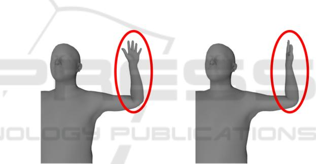  
Figure 1: An example for different poses with same body joint locations of the left elbow and left wrist. Body joint locations have ambiguities to express a 3D body pose.

Our goal is to estimate joint rotations with actual twist rotations from a single image with a minimal number of calculations for real-time applications. It is difficult to estimate twist rotations with the other components of joint rotations because they are not clearly visible in images compared to the other components such as the swing rotations of limbs. In addition, it is difficult to train a model to estimate twist rotations because there are relatively few images of people twisting their limbs in natural scenes, and it is difficult to get accurate ground truth for twist rotations from images.

To solve these problems, we focus on estimating twist angles around limbs by swing-twist decomposition of joint rotations and emphasizing the appearance of limb joints because we believe important information for twist estimation appears around the joints. We assume that 3D joint locations are obtainable by previous approaches (Mehta et al., 2017; Xu et al., 2020) and they can be utilized to estimate swing rotations. Furthermore, we prepare a pseudo ground truth of joint rotations for the CMU Panoptic Dataset (Joo et al., 2015) as the training and evaluation dataset by using the previous approach (Pavlakos et al., 2019) and annotating the qualities of their results.

Our model estimates twist angles around arms with an average radian error of 0.14. Reconstructed joint rotations with given 3D joint locations and estimated twist angles are improved by an average of 0.08 radians in terms of twist rotations compared to reconstructed joint rotations with only given 3D joint locations. We also discuss how twist rotations affect human body mesh reconstruction.

Our main contributions are summarized as follows.

We reduce the difficulty of estimating joint rotations with actual twist rotations by decomposing joint rotations into swing and twist rotations.

We present the first model for estimation of actual twist angles from a single image directly in real time.

 We show how estimation of twist rotations achieves a more precise 3D human pose.

Below, we review studies related to 3D human pose estimation with joint rotations (Section 2). Then, we present the data preparation method and our approach (Sections 3 and 4). In the experimental section (Section 5), we demonstrate the performance of our approach and discuss the results. Finally, we present our conclusion and future work (Section 6).

## 2 RELATED WORK

There are many 3D pose estimation approaches. Here, we discuss the most relevant approaches for handling 3D joint rotations with a skeletal body model.

Bogo et al. (2016), Lassner et al. (2017), Xiang et al. (2018), Pavlakos et al. (2019) and Mehta et al. (2019) proposed model fitting approaches to estimate pose and shape parameters for a skeletal body model from a single image. They extract 2D landmarks or 3D features from a single image and optimize body model parameters to fit to this geometric information and other additional information such as pose priors and time consistency. Pose prior has some variations, and Murthy et al. (2019) proposed priors that described the relationship between swing and twist rotations. Such additional information is effective for avoiding strange poses. However, it is not sufficient for estimation of precise poses including actual twist rotations. As shown in some previous studies (Lassner et al., 2017; Xiang et al., 2018; Pavlakos et al., 2019), more geometric information allows poses to be estimated more precisely, however, it increases computational complexity. We aim to estimate actual twist rotations with a small number of calculations.

Another research group (Kanazawa et al., 2017; Omran et al., 2018; Pavlakos et al., 2018; Rong et al., 2019) proposed direct regression approaches for pose parameters. They use 2D keypoints or body part segmentation as an explicit intermediate representation to regress pose parameters. Their approaches are computationally rapid, but tend to be less accurate because pose parameter regression encounters problems due to the complexity and discontinuity of 3D rotations. Kolotouros et al. (2019a) attempt to integrate these direct regression approaches with model fitting approaches, which tend to be slow but accurate, to compensate for the disadvantages of each approach. However, it is still difficult to estimate precise and accurate poses with a smaller number of calculations.

More recent approaches (Zhou et al., 2019; Varol et al., 2018; Kolotouros et al., 2019b) avoid regressing pose parameters directly. Zhou et al. (2019) regress joint rotations by using 5D and 6D rotation representations instead of pose parameters as more suitable representations for neural networks. Varol et al. (2018) and Kolotouros et al. (2019b) attempt to directly regress the body mesh from a single image. They obtained accurate and precise results with fewer calculations. However, their method requires high cost 3D mesh annotations for training. We regress the twist angles as a simpler target than 5D/6D rotation or 3D meshes without high cost annotations such as 3D meshes.

## 3 DATA PREPARATION

In the training and evaluation phases of our approach, we require human images with their 3D joint rotations including accurate twist rotations. There are several datasets suitable for performing 3D human pose estimation from images (Ionescu et al., 2014; Joo et al., 2015; Lassner et al, 2017). We avoid datasets with motion sensors because sensors will become noise on the human body appearance when extracting essential features about twist rotations that are not clearly visible in images.

We use the CMU Panoptic Dataset (Joo et al., 2015) because it has a huge number of natural human multiview images with camera parameters and accurate 3D pose annotations. In the CMU Panoptic Dataset, 3D pose annotations are described in 3D joint locations for just the body or body and hands, and they have no twist rotation data. We predict joint rotations and twist rotations from the existing annotations of 3D body and hands joint locations using the SMPLify-x method (Pavlakos et al., 2019), which is able to estimate pose parameters of the SMPL body model accurately and precisely. We customize the SMPLify-x method by fitting the body model to 3D joint locations instead of 2D joint locations. Then, we select high-quality predictions manually. “High quality” means the body joint locations and the palm orientations of the reconstructed SMPL model are visually consistent with the pose of the person in the image. Twist rotations are extracted as pseudo ground truth from the selected predictions and 3D joint locations. Note that we create annotations of twist rotations solely around the arms and we ignore pose parameter errors for the lower body because there are few high-quality results for the whole body due to the relatively sparse annotations for the lower body in the original CMU Panoptic dataset.

Here, we explain SMPL pose parameters and our settings. The SMPL body model defines the kinematic tree with the pelvis as the root (e.g. the child joint of the shoulder is the elbow.) As shown in Figure 2, joint rotations of SMPL pose parameters mean the relative rotation for their child joints and the connected limbs around them, and they can be decomposed to swing and twist rotations. Joint rotations of the SMPL pose parameters are described by angle-axis representations. The 3D mesh of the SMPL model is controlled by the pose and shape parameters, and 3D joint locations are regressed from the mesh. For simplicity, we assume that the shape parameter is always set to zero; meaning a normal body shape. We refer to the pose with zero pose parameters as the “T pose”.

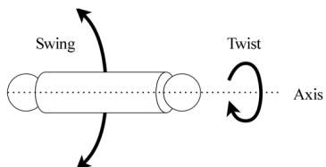  
Figure 2: Left sphere is the parent joint and right sphere is the child joint. There is a limb between both joints. The joint rotation for the parent joint is decomposed into swing and twist rotations.

For extraction of twist rotations, we follow the swing-twist decomposition formula of Dobrowolski (2015) as the direct method. First, we convert the joint rotations adopted as the pose parameters to quaternion representations from axis-angle representations. Let $R _ { j }$ be the rotation of joint $J _ { j } \left( j = 0 , \ldots , 3 \right.$ for right/left shoulder and right/left elbow). For the following explanations, we designate the conversion from axis-angle representation to quaternion representation as � and inverse conversion as �. We assume that $R _ { j }$ can be decomposed to the swing rotation $S _ { j }$ and the twist rotations $T _ { j }$ as formula (1).

$$
R _ {j} = T _ {j} \cdot S _ {j}\tag{1}
$$

Let $v _ { j }$ be the direction vector from joint $J _ { j }$ to its child joint $J _ { j _ { c } }$ on T pose, and rotate $v _ { j }$ by $R _ { j }$ or $S _ { j }$ ; then we obtain rotated direction vector �௝ as formula (2).

$$
w _ {j} = R _ {j} \cdot \binom{v _ {j}}{0} \cdot R _ {j} ^ {- 1} = S _ {j} \cdot \binom{v _ {j}}{0} \cdot S _ {j} ^ {- 1}\tag{2}
$$

�௝ can be calculated from �௝ and �௝ by formula (3).

$$
S _ {j} = \varphi \left(\cos^ {- 1} (v _ {j} \cdot w _ {j}) \cdot \frac {v _ {j} \times w _ {j}}{\| v _ {j} \times w _ {j} \|}\right)\tag{3}
$$

Here, we get the twist rotation $T _ { j }$ and the twist angle $\theta _ { j }$ around its rotation axis.

$$
T _ {j} = R _ {j} \cdot S _ {j} ^ {- 1}\tag{4}
$$

$$
\theta_ {j} = \left\{ \begin{array}{l l} \| \psi (T _ {j}) \|, & i f \frac {\psi (T _ {j})}{\| \psi (T _ {j}) \|} = w _ {j} \\ - \| \psi (T _ {j}) \|, & o t h e r w i s e \end{array} \right.\tag{5}
$$

Finally, we convert the range of angles $\theta _ { j }$ from $( - 2 \pi , 2 \pi )$ to $( - \pi , \pi )$ . The twist angle is a simpler representation than the other representations. In our method, we represent twist rotations by twist angles expressed in radians.

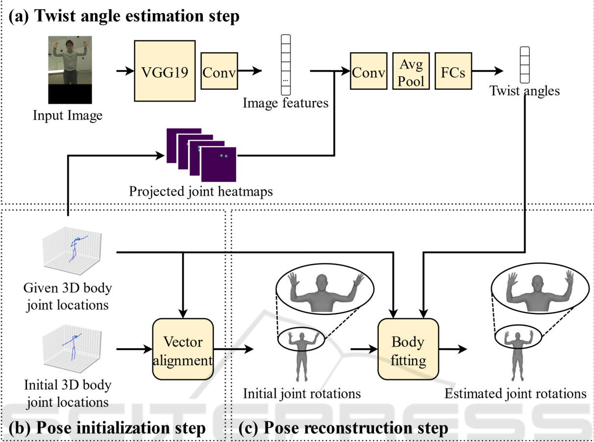  
Figure 3: (a)Twist angle estimation step. Our model estimates twist angles around arms from a single RGB image and the heatmaps for projecting the parent joint and child joint locations on the input image. (b) Pose initialization step. Initial 3D body joint locations (T pose) and given 3D body joint locations undergo vector alignment to calculate the rotations between the direction vectors for each limb, and the skeletal body model is initialized by the calculated joint rotations. (c) Pose reconstruction step. The initialized skeletal body model undergoes body fitting so that its 3D body joint locations correspond more closely to the given locations and its twist angles around the arms correspond more closely to estimated angles.

## 4 APPROACH

We propose an approach to estimate twist angles around arms from a single RGB image and reconstruct the skeletal body pose by using given 3D body joint locations and estimated twist angles around arms. Our approach has 3 steps: twist angle estimation step (Section 4.1), pose initialization step (Section 4.2) and pose reconstruction step (Section 4.3). An overview is shown in Figure 3.

## 4.1 Twist Angle Estimation

Our model estimates twist angles around arms from a single RGB image and the heatmaps for the projected parent joint and child joint locations on the input image as shown in Figure 3(a).

First, we extract image features � from a single RGB image $I \in \mathbb { R } ^ { h \times w \times \overline { { 3 } } }$ by using the first 10 layers of the pretrained VGG19 from the ImageNet dataset (Simonyan & Zisserman, 2014) and one convolutional layer. In our approach, the input image � is assumed to contain a single person. We consider that the twist rotation around a limb mainly affects the appearance of its parent and child joint. Thus, we also create the heatmaps $H _ { j , j _ { c } } \in \mathbb { R } ^ { h \times w }$ for the locations of the parent joint $J _ { j }$ and child joint $J _ { j _ { c } }$ on the input image �. The joint locations on the image are projected from given 3D body joint locations and given camera parameters. Here, the heatmap $H _ { j , j _ { c } }$ is calculated by formulas (6) and (7).

$$
H _ {j} (p) = \exp \left(- \frac {\left\| p - l _ {j} \right\|}{\sigma^ {2}}\right)\tag{6}
$$

$$
H _ {j, j _ {c}} (p) = \max \left(H _ {j} (p, l _ {j}), H _ {j} (p, l _ {j _ {c}})\right)\tag{7}
$$

Where $H _ { j } \in \mathbb { R } ^ { h \times w }$ is the heatmap of the joint $J _ { j }$ location, $p \in \mathbb { R } ^ { 2 }$ is any location on heatmaps, $H ( \cdot )$ is the value of the heatmap on the input location, $l _ { j } \in \mathbb { R } ^ { 2 }$ is the location of $J _ { j }$ and $\sigma ^ { 2 }$ controls the spread of the peak on the heatmap. These heatmaps $H _ { j , j _ { c } }$ and image features � are concatenated to emphasize the image features around the parent and child joints effectively, and then they are passed to the convolutional layer, average pooling layer, and three fully connected layers.

Thereby, we obtain the set of twist angles $\theta ^ { * }$ . The range of these twist angles is $( - \pi , \pi )$ , however, the valid range for human joints is limited around zero. Therefore, we do not need to consider the singularity around െ� and �. For this reason, we simply adopt the mean squared error as the loss function for $\theta ^ { * }$ The $\theta ^ { * }$ and the ground truth � are the normalized range from $( - \pi , \pi )$ to ሺ0, 1ሻ by formula (8) for simplicity of training, and our model is trained by minimizing the loss function $\scriptstyle { \mathcal { L } } o s s _ { \overline { { t w { \imath } s t } } }$ defined by formula (9).

$$
\bar {\theta} = \frac {\theta + \pi}{2 \pi}\tag{8}
$$

$$
\mathcal {L} o s s _ {\overline {{t w i s t}}} = \left\| \bar {\theta} - \overline {{\theta^ {*}}} \right\| ^ {2}\tag{9}
$$

## 4.2 Pose Initialization

In the pose initialization step, the skeletal body model is initialized to make the following pose reconstruction step easier as shown in Figure 3(b). We make the relative joint locations of the skeletal body model closer to given 3D body joint locations. We call the joint locations of the skeletal body model with T pose as the initial 3D body joint locations. The vector from a specific joint location to its child joint location is called as a limb direction vector. The pair of limb direction vectors for the initial joint locations and given joint locations are applied to the vector alignment. Vector alignment means calculating a rotation between the pair of direction vectors in the same manner as expressed in the formula (3). The skeletal body model is initialized by the obtained joint rotations.

(a) Training dataset  
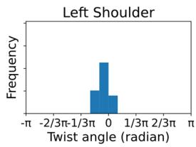

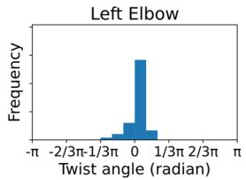

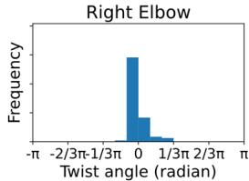

(b) Evaluation dataset  
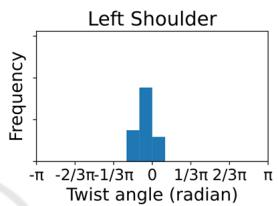

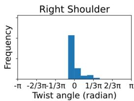

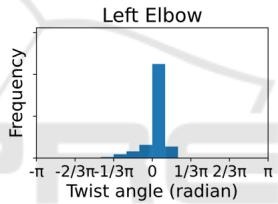

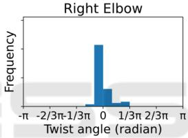  
Figure 4: The distributions for twist angles around the arms of (a) training and (b) evaluation dataset. The title of each graph is the parent joint name of the target limb.

## 4.3 Pose Reconstruction

In the pose reconstruction step, the skeletal body model is optimized to fit the given 3D body joint locations and estimated twist angles as shown in Figure 3(c). We seek to minimize the objective function $\mathcal { L } o s s _ { b o d y }$ defined in formula (10) to (12) by using the Levenberg-Marquardt algorithm.

$$
\mathcal {L} o s s _ {3 D} = \left\| L _ {b o d y} - L _ {g i v e n} \right\| ^ {2}\tag{10}
$$

$$
\mathcal {L} o s s _ {a n g l e} = \left\| \theta_ {b o d y} - \theta^ {*} \right\| ^ {2}\tag{11}
$$

$$
\mathcal {L} o s s _ {b o d y} = \mathcal {L} o s s _ {3 D} + \varepsilon \mathcal {L} o s s _ {a n g l e}\tag{12}
$$

Where $L _ { b o d y }$ and $L _ { g i v e n }$ are the 3D body joint locations of the current skeletal body pose and given pose. $\theta _ { b o d y }$ is the twist angles around arms calculated from the current skeletal body pose by formulas (1) to (5). The � controls the weight for $\mathcal { L } o s s _ { a n g l e } .$ . Finally, we obtain the prediction of the joint rotations.

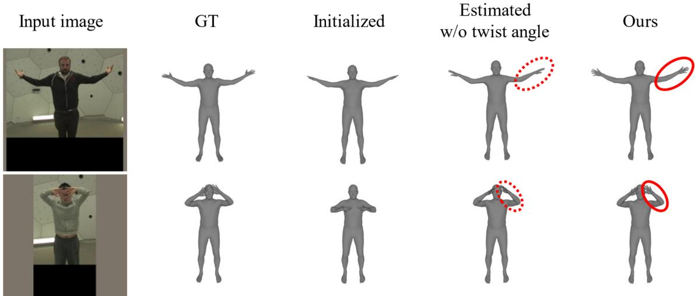  
Figure 5: Body meshes reconstructed by the ground truth joint rotations (GT), initial joint rotations at the pose initialization step (Initialized), estimated joint rotations without twist angle estimation (Estimated w/o twist angle) and estimated joint rotations with twist angle estimation (Ours). Our approach improves the twist of arms (solid line circle) compared to the result without twist angle estimation (dotted line circle).

Table 1: The mean error of estimated twist angles (radian) for the evaluation dataset (623 poses) with some of them having a large twist angle around any limb (96 poses).

<table><tr><td>parent joint name</td><td>LSho</td><td>RSho</td><td>LElb</td><td>RElb</td></tr><tr><td>eval data</td><td>0.06</td><td>0.17</td><td>0.18</td><td>0.15</td></tr><tr><td>w large twist</td><td>0.06</td><td>0.20</td><td>0.17</td><td>0.17</td></tr></table>

## 5 EXPERIMENTS

We present the performance of our approach by evaluating the accuracy of the twist angle estimated at the first step and the poses reconstructed at the final step and the computational efficiency. Reconstructed poses are evaluated in terms of twist angle errors, joint rotation errors and vertex errors. First, we show our dataset and training details, and then each result is described and discussed.

## 5.1 Dataset and Training Details

Our dataset prepared in Section 3 provides the human body images with the ground truth joint rotations and locations. It has 2,042 poses with 61,539 images from multiple views and 7 video sequences for training, and 623 poses with 623 images from a single view and 2 video sequences for evaluation. These 9 video sequences are the same as the sequences used in the experiments conducted by Xiang et al. (2019). Figure 4 shows the distributions for twist angles around arms of a (a) training and (b) evaluation dataset. Twist angles are concentrated on small values, and it makes training difficult.

Our model requires an input image size of 368x368 (single person cropped). We train our model for 19.7K iterations with 8 images in a batch.

## 5.2 Twist Angle Estimation Accuracy

We evaluate our model at the twist angle estimation step. Our approach requires 3D body joint locations as input. We use the ground truth locations for our all evaluation to focus on twist of arms. Table 1 shows the mean error of estimated twist angles in radians for the evaluation dataset with 623 poses and some of them with 96 poses including a large twist angle (over 0.35 radians) around any limb. The estimated twist angles for the evaluation dataset has small errors from 0.06 to 0.18 with an average of 0.14 radians. There are few poses with a large twist angle in the training dataset as shown in Figure 4(a), however, the errors for the evaluation dataset with large twist angles are still relatively small from 0.06 to 0.20 with an average of 0.15 radians. It means our model makes it possible to capture the magnitude of the twist around arms robustly from a whole-body image and the heatmaps of joint locations.

## 5.3 Pose Reconstruction Accuracy

We evaluate reconstructed joint rotations at the final step of our approach and show the effect of the twist angles estimated at the first step by comparing with the poses reconstructed without twist angles. The � in formula (12) is 0.02 for reconstruction with twist angles and the � is zero for reconstruction without twist angles. Table 2(a) shows the mean error of twist angles in radians calculated from the reconstructed joint rotations in the same manner as formulas (1) to (5). Results were obtained for the entire evaluation data and part of the data having a large twist angle around any limb. For the entire evaluation data, estimated twist angles improve the results by a max of 0.15 and an average of 0.08 radians, and for the data with a large twist angle, a greater effect was observed for most joints, improving by a max of 0.33 and an average of 0.12 radians.

We also evaluate the result by the quaternion error of joint rotations. Quaternion error $E _ { q }$ shows the magnitude of rotation between two rotations, and it is defined by formula (13).

$$
E _ {q} = \| \psi (Q _ {e s t i m a t e d} \cdot Q _ {G T} ^ {- 1}) \|\tag{13}
$$

Where $Q _ { e s t i m a t e d }$ and $Q _ { G T }$ are respectively the estimated and ground truth joint rotations in quaternion representation. The mean quaternion errors with/without estimated twist angles for the entire/part of the evaluation data are shown in Table 2(b). The estimated twist angles improve the results especially for elbow rotations. Table 2(a) and Table 2(b) show that the errors for right shoulder rotations for the data with a large twist angle are increased by estimated twist angles. Estimated twist angles around the limb connected to the right shoulder are relatively inaccurate as shown in Table 1, and it makes the optimization around the right shoulder difficult. We consider that the lower accuracy of estimated twist angles for the right shoulder is caused by data bias. The evaluation dataset includes the rare right shoulder postures for training data.

In Table 2(c), we present the vertex-to-vertex (v2v) error of the reconstructed body mesh. The v2v error is the mean error of the reconstructed mesh vertex locations. They are usually used for evaluation of reconstructed joint rotations. There are negligible differences between the v2v error results. It is not suitable for evaluation of twist estimation because the displacement of limb meshes caused by a twist rotation is minor in comparison with whole body meshes. In addition, these v2v errors are much smaller than previous approaches in general because the precise 3D body joint locations are given as input unlike previous ones.

Finally, we show that the estimated twist angles improve the quality of body mesh reconstruction around arms in Figure 5. It’s highly effective against body meshes with large twist angles.

## 5.4 Runtime and Model Size

On a NVIDIA TITAN V GPU, our model at the twist angle estimation step is small with 41.98 MB parameters, and it performs very rapidly at 5 msec/person. It shows our model estimates twist angles from a single image directly in real time. However, the pose reconstruction step takes 139 msec/person on 12 CPUs (Intel(R) Core(TM) i7-8700K CPU @ 3.70GHz) and the total processing time is 189 msec/person. Although it is difficult to make a direct comparison due to differences in input and output data, SMPLify-x method (Pavlakos et al., 2019), which is able to estimate the poses accurately and precisely, takes much longer time in our environment.

Table 2: The mean error of (a) twist angles (radian)/(b) quaternions (radian)/(c) v2v (mm) calculated from the reconstructed joint rotations with/without estimated twist angles for entire/part of the evaluation data.

<table><tr><td colspan="6">(a)</td></tr><tr><td colspan="2">parent joint name</td><td>LSho</td><td>RSho</td><td>LElb</td><td>RElb</td></tr><tr><td rowspan="2">eval data</td><td>w</td><td>0.29</td><td>0.23</td><td>0.15</td><td>0.20</td></tr><tr><td>w/o</td><td>0.29</td><td>0.32</td><td>0.30</td><td>0.27</td></tr><tr><td rowspan="2">w large twist</td><td>w</td><td>0.23</td><td>0.42</td><td>0.28</td><td>0.30</td></tr><tr><td>w/o</td><td>0.25</td><td>0.25</td><td>0.61</td><td>0.60</td></tr><tr><td colspan="6">(b)</td></tr><tr><td colspan="2">parent joint name</td><td>LSho</td><td>RSho</td><td>LElb</td><td>RElb</td></tr><tr><td rowspan="2">eval data</td><td>w</td><td>0.42</td><td>0.37</td><td>0.50</td><td>0.50</td></tr><tr><td>w/o</td><td>0.39</td><td>0.39</td><td>0.64</td><td>0.65</td></tr><tr><td rowspan="2">w large twist</td><td>w</td><td>0.33</td><td>0.52</td><td>0.56</td><td>0.59</td></tr><tr><td>w/o</td><td>0.32</td><td>0.34</td><td>0.87</td><td>0.91</td></tr><tr><td colspan="3">(c)</td><td rowspan="4" colspan="3"></td></tr><tr><td></td><td>w</td><td>w/o</td></tr><tr><td>eval data</td><td>20.74</td><td>20.13</td></tr><tr><td>w large twist</td><td>26.34</td><td>25.67</td></tr></table>

## 6 CONCLUSION

We proposed a novel approach to estimate twist rotations around limbs to improve 3D human pose estimation from a single RGB image. Previous visionbased approaches did not handle twist rotations around limbs directly because of their ambiguity. Our experiments demonstrated the feasibility of estimating twist rotations from an image and its effect on pose reconstruction using a skeletal body model.

There is no enough dataset which includes 3D joint rotations on images, so we focus on normal twist rotations around the arms. As future work, we will create a larger dataset to evaluate our model in more detail and estimate twist rotations around the other limbs including variety of poses. We also believe creating a larger dataset for training and applying data balancing to twist angles bias would be effective strategies to improve the robustness and accuracy of our model. We will also tackle the problems of pose reconstruction from noisy 3D body joint locations and make a performance comparison between previous approaches and ours.

## REFERENCES

Bogo, F., Kanazawa, A., Lassner, C., Gehler, P., Romero, J., & Black, M. J. (2016). Keep It SMPL: Automatic Estimation of 3D Human Pose and Shape from a Single Image. ECCV, 561–578.

Dobrowolski, P. (2015). Swing-twist decomposition in Clifford algebra. In arXiv [cs.RO]. arXiv. http://arxiv.org/abs/1506.05481

Ionescu, C., Papava, D., Olaru, V., & Sminchisescu, C. (2014). Human3.6M: Large Scale Datasets and Predictive Methods for 3D Human Sensing in Natural Environments. TPAMI/PAMI, 36(7), 1325–1339.

Joo, H., Liu, H., Tan, L., Gui, L., Nabbe, B., Matthews, I., Kanade, T., Nobuhara, S., & Sheikh, Y. (2015). Panoptic studio: A massively multiview system for social motion capture. ICCV, 3334–3342.

Kanazawa, A., Black, M. J., Jacobs, D. W., & Malik, J. (2018). End-to-end recovery of human shape and pose. CVPR, 7122–7131.

Kolotouros, N., Pavlakos, G., Black, M. J., & Daniilidis, K. (2019a). Learning to reconstruct 3D human pose and shape via model-fitting in the loop. ICCV, 2252–2261.

Kolotouros, N., Pavlakos, G., & Daniilidis, K. (2019b). Convolutional mesh regression for single-image human shape reconstruction. CVPR, 4501–4510.

Lassner, C., Romero, J., Kiefel, M., Bogo, F., Black, M. J., & Gehler, P. V. (2017). Unite the people: Closing the loop between 3d and 2d human representations. CVPR, 6050–6059.

Loper, M., Mahmood, N., Romero, J., Pons-Moll, G., & Black, M. J. (2015). SMPL: a skinned multi-person linear model. TOG, 34(6), 1–16.

Mehta, D., Sotnychenko, O., Mueller, F., Xu, W., Elgharib, M., Fua, P., Seidel, H.-P., Rhodin, H., Pons-Moll, G., & Theobalt, C. (2020). XNect: Real-time Multi-Person 3D Motion Capture with a Single RGB Camera. TOG, 39(4), 82:1–82:17.

Mehta, D., Sridhar, S., Sotnychenko, O., Rhodin, H., Shafiei, M., Seidel, H.-P., Xu, W., Casas, D., & Theobalt, C. (2017). VNect: real-time 3D human pose estimation with a single RGB camera. TOG, 36(4), 1–14.

Murthy, P., Butt, H. T., Hiremath, S., Khoshhal, A., & Stricker, D. (2019). Learning 3D joint constraints from vision-based motion capture datasets. IPSJ Transactions on Computer Vision and Applications, 11(1), 5.

Omran, M., Lassner, C., Pons-Moll, G., Gehler, P., & Schiele, B. (2018). Neural Body Fitting: Unifying Deep Learning and Model Based Human Pose and Shape Estimation. 3DV, 484–494.

Pavlakos, G., Choutas, V., Ghorbani, N., Bolkart, T., Osman, A. A., Tzionas, D., & Black, M. J. (2019). Expressive Body Capture: 3D Hands, Face, and Body From a Single Image. CVPR, 10967–10977.

Pavlakos, G., Zhu, L., Zhou, X., & Daniilidis, K. (2018). Learning to estimate 3D human pose and shape from a single color image. CVPR, 459–468.

Rong, Y., Liu, Z., Li, C., Cao, K., & Loy, C. C. (2019). Delving deep into hybrid annotations for 3d human recovery in the wild. ICCV, 5340–5348.

Simonyan, K., & Zisserman, A. (2015). Very Deep Convolutional Networks for Large-Scale Image Recognition. ICLR.

Varol, G., Ceylan, D., Russell, B., Yang, J., Yumer, E., Laptev, I., & Schmid, C. (2018). Bodynet: Volumetric inference of 3d human body shapes. ECCV, 20–36.

Xiang, D., Joo, H., & Sheikh, Y. (2019). Monocular total capture: Posing face, body, and hands in the wild. CVPR, 10965–10974.

Xu, J., Yu, Z., Ni, B., Yang, J., Yang, X., & Zhang, W. (2020). Deep Kinematics Analysis for Monocular 3D Human Pose Estimation. CVPR, 899–908.

Zhou, Y., Barnes, C., Lu, J., Yang, J., & Li, H. (2019). On the Continuity of Rotation Representations in Neural Networks. CVPR, 5738–5746.