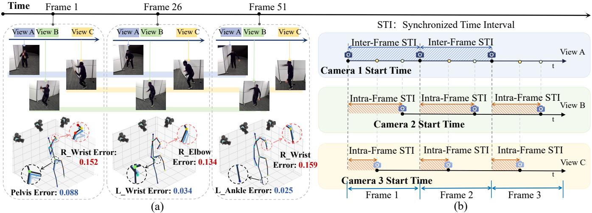
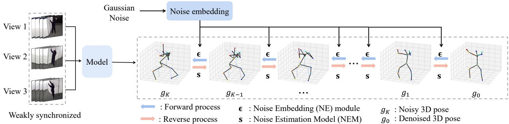
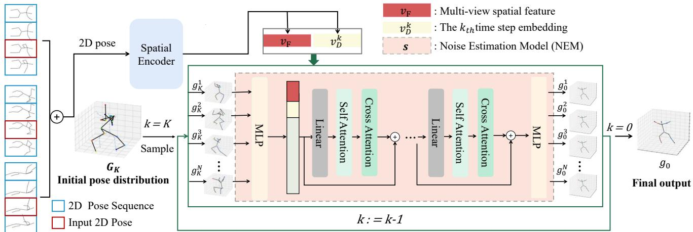
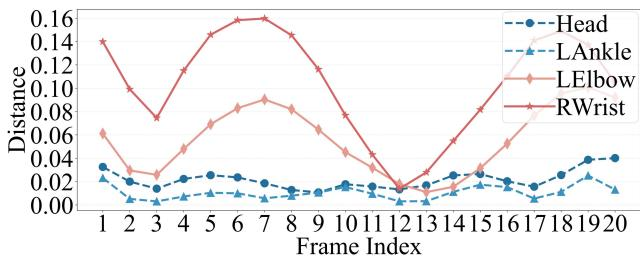
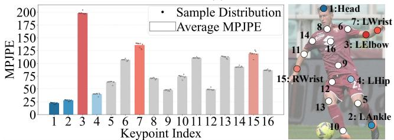
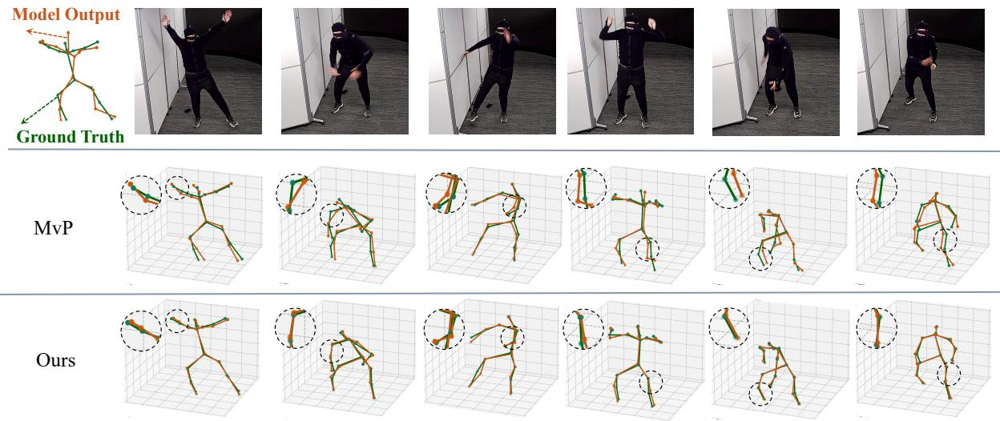

# 基于弱同步图像的多视角三维人体姿态估计

Ling Li1, Ruiwen Gu1, Chongyang Wang3, Junliang Xing2, Xinchun Yu1, Xiao-Ping Zhang1 \*

1Shenzhen Key Laboratory of Ubiquitous Data Enabling, Shenzhen International Graduate School, Tsinghua University,

China, Shenzhen

2Department of Computer Science and Technology, Tsinghua University

3 West China Hospital, Sichuan University

liling22@mails.tsinghua.edu.cn, grw23@mails.tsinghua.edu.cn, mvrjustid@gmail.com, jlxing@tsinghua.edu.cn, yuxinchun@sz.tsinghua.edu.cn, xpzhang@ieee.org

## 摘要

多视角三维人体姿态估计（Multi-View 3D Human Pose Estimation, MHPE）是计算机视觉领域的一项重要研究任务。为了在数据采集过程中保持一致性，通常使用硬件同步设备连接各个相机，以确保不同视角的图像能够被同时捕获。然而，使用额外设备进行同步存在两个明显的局限性：相关硬件通常 i) 价格昂贵且 ii) 在室外开放场景中部署不够灵活。如果模型能够提高对多视角图像采集时间差异的容忍度，那么部署的难度和成本将大大降低，MHPE 的应用也将更加广泛。在本文中，我们试图回答如何构建一个直接利用多视角“弱同步图像”（其中捕获的图像在单帧内存在相互偏移）进行姿态估计的模型。为此，我们引入了一项以弱同步图像作为输入的新型多视角三维人体姿态估计任务。除现有的高度同步数据集外，我们还提出了首个包含 80 万张图像的弱同步数据集。在此基础上，我们提出了 SyncDiffPose，这是一种基于扩散方法的姿态估计新模型，用于去除此类数据中的误差。通过结合简单的同步策略（例如计时器方法），我们的方法无需硬件校准即可完成姿态估计。

## 引言

近年来，计算机视觉任务取得了飞速进展（Chen et al. 2024a; Qian et al. 2024; Chen et al. 2024b; Sun 2024; Sun et al. 2024; Hu et al. 2024a,b; Ling et al. 2024a）。作为一项基础任务，多视角三维人体姿态估计（Multi-view 3D Human Pose Estimation, MHPE）在体育和艺术动作分析中具有关键的应用价值（Li and Meng 2022; Li et al. 2023, 2024; Xu et al. 2024; Wang et al. 2022, 2024a; Jin et al. 2023; Wang et al. 2024b; Ling et al. 2024b）。我们使用来自不同视角的图像作为输入，并预测人体关节的三维坐标。现有的 MHPE 方法在数据采集过程中通常需要相机同步，以确保视角之间的时间一致性。同步多视角图像最常见的方法是使用专用设备连接各相机，以进行硬件级的同步采集。然而，此类同步设备通常昂贵且不适合户外使用。基于相机的时钟同步是一种替代解决方案。该方法的挑战在于需要在相机之间建立统一的协议，从而导致更高的开发成本。此外，相机的时钟同步依赖于 WiFi 信号的稳定性，WiFi 信号的波动会显著影响同步精度。理想情况下，多视角模型应当能够消除对同步的依赖，以促进 MHPE 方法的更广泛应用。

近期的一些研究已开始探索在 MHPE 中消除硬件同步设备需求的方法（Wu et al. 2019; Yin et al. 2022; Liu et al. 2024）。早期的研究人员探索了一种技术路线，即首先基于同步算法获取不同视角之间的时间差，以对齐来自不同视角的输入，从而进行姿态的时序估计。这些研究利用如 Human3.6M（Ionescu et al. 2013）等同步的 MHPE 数据集来生成视角间的非同步数据，进而用于训练模型以估计不同视角之间的时间差（Yin et al. 2022）。然而，该方法只能实现帧间时间差的整数倍对齐，这意味着图像帧只能按整帧移动，无法获取分数帧的时间差。在实际应用中，由帧内时间间隔引起的误差仍然十分显著。

此外，消除帧间间隔误差的难度并不大，通常可以使用场记板或计时器等方法轻松消除。难点在于消除帧内误差，因为同步数据仅允许每次移动整帧，从而限制了输入的多样性。Liu 等人收集了包含帧间和帧内时间差的 IFID 数据集，以支持该任务的研究（Liu et al. 2024）。然而，IFID 数据集缺乏人体姿态信息。在人体姿态估计中，现有的 MHPE（多视角人体姿态估计）数据集通常使用硬件级同步设备采集，导致缺乏弱同步数据集及相应的算法。

提高帧率是解决相机间偏移的另一种简单方法。随着相机帧率的提升，由帧内间隔引起的误差会不断减小。然而，相机的成本也会显著增加。从本质上讲，该策略无法解决弱同步引入的误差。理想情况下，我们的模型应该能够直接基于“弱同步图像”进行姿态估计。

  
Figure 1: (a) 多视角弱同步图像示意图。这些图像是来自不同视角、具有帧内同步时间间隔（Synchronization Time Interval, STI）的多视角捕获图像。尽管来自不同视角的图像之间的时间间隔很小，但在涉及肢体高速运动的场景中，快速移动的关键点（如脚踝和手腕）可能会发生快速的位置变化。(b) 帧内和帧间 STI 概念的解释。我们将单帧内各视角之间的 STI 持续时间称为帧内 STI。超出整个单帧长度的视角间 STI 持续时间称为帧间 STI。

基于弱同步数据的 3D 人体姿态估计的挑战在于视角间的信息融合。与同步数据不同，来自额外视角的弱同步数据在引入额外噪声的同时也携带了有效信息。当人体运动时，快速运动的关节位置可能会在极短的时间内发生显著变化。若使用现有的姿态估计模型，来自不同视角的同一关节的这种位置差异可能会导致显著的误差（Liu et al. 2024）。我们需要找到一种方法来消除不同视角之间的同步差异，从而有效利用来自各个视角的信息。

在本文中，我们首先为多视角三维人体姿态估计（Multi-view 3D Human Pose Estimation，MHPE）定义了一项新颖的任务，重点关注同步时间间隔（Synchronization Time Interval，STI）限制在单帧以内的数据。我们将这类数据称为“弱同步图像”（weakly synchronized images），这是我们首次提出的概念，如图 Figure 1 所示。为了缓解弱同步数据的稀缺性，我们构建了一个由弱同步多视角图像组成的大规模三维人体姿态数据集。该数据集包含 800,000 帧图像以及由 OptiTrack 设备捕获的真实关节坐标（ground truth），从而能够对该任务进行全面探索。据我们所知，这是目前首个针对 MHPE 弱同步数据的数据集。在数据采集过程中，我们确保其中一台相机与 Mocap（动作捕捉）系统保持良好同步，而其他相机则保持弱同步状态。在姿态估计中，不同视角之间的时间弱同步会引入噪声。为了解决这一问题，我们提出了一种新颖的模型——

SyncDiffPose，该模型采用基于扩散的方法来识别并消除姿态估计中的噪声。在以弱同步图像作为输入的 MHPE 任务中，该方法展现出了卓越的性能。总的来说，我们的贡献如下：

• 我们首次提出了“弱同步”的概念，并定义了一项新任务以扩展多视角三维人体姿态估计的问题公式化表述。

• 我们构建了 WeakSyncPose3D，这是首个大规模多视角弱同步人体姿态数据集，涵盖了具有高运动频率特征的广泛动作范围。

• 考虑到在给定弱同步数据的情况下进行姿态估计面临着关节与噪声混合的挑战，我们基于扩散方法设计了我们的模型 SyncDiffPose，并取得了优异的性能。

## 相关工作

## 3D 人体姿态估计

单目三维人体姿态估计（Monocular 3D human pose estimation）较为普遍，需要从单视角图像输入中估计姿态 (Moreno-Noguer 2017; Rhodin et al. 2018; Li et al. 2020)。然而，受限于单个相机所能捕获的信息，单目三维人体姿态估计常常遇到遮挡问题 (Zhang, Chen, and Tu 2022; Zhang, Huang, and Wang 2020; Radwan, Dhall, and Goecke 2013)。一种自然的解决方案是从多个视角估计姿态，即多视角三维人体姿态估计（multi-view 3D human pose estimation）(Qiu et al. 2019; Jiang, Hu, and Xia 2023)。在多视角三维人体姿态估计中，直接回归和基于体素的回归已逐渐成为两种主流方法。通常，直接回归方法的性能略低于体素回归，但它们在训练和推理时往往需要较少的计算资源。随着卷积神经网络和 Transformer 模型的不断发展，近期的方法 (He et al. 2016; Vaswani et al. 2017; Liu et al. 2021) 在多视角三维姿态估计中表现良好。当具有充分的视角信息时，现有方法能够从不同视角同时捕获的图像中获得比单视角估计相对更准确的结果。

  
Figure 2: SyncDiffPose 架构概览。我们逐步将由噪声嵌入（Noise Embedding, NE）模块 ϵ 引入的高斯噪声嵌入到“真实标签（ground truth）”中。经过 K 轮加噪后，最终形成具有高噪声偏差的带噪三维姿态 $g _ { K }$。在启动逆向过程之前，使用标准建模方法初始化嵌入了噪声的中间三维姿态 $g _ { k }$。部署噪声估计模型（Noise Estimation Model, NEM）s 以在整个逆向过程中推断并系统地减少噪声偏差。经过 K 步的迭代去噪，最终恢复出原始的无噪三维姿态 g0。

## 用于人体姿态估计的扩散模型

去噪扩散概率模型（Denoising Diffusion Probabilistic Models, DDPM）（Ho, Jain, and Abbeel 2020）的出现，为生成模型带来了重大突破，并广泛应用于计算机视觉的各类任务中（Lugmayr et al. 2022; Rombach et al. 2022; Hoogeboom et al. 2022; Tashiro et al. 2021）。扩散方法主要包括两个阶段：训练和推理。在训练期间，通过隐马尔可夫链（hidden Markov chain）（Ephraim and Merhav 2002）不断向信息中添加噪声。随后，利用神经网络来逆转扩散过程并恢复数据。在推理阶段，在条件的引导下不断去除噪声，最终达到生成目标。鉴于现有的 2D 姿态估计方法（Wang et al. 2020; Zhang, Zhu, and Ye 2019）已经取得了良好的性能，扩散方法主要应用于 3D 人体姿态估计（Feng et al. 2023）。在这一过程中，3D 姿态通常被视为带有噪声的姿态（Rommel et al. 2023）或直接源自随机噪声（Zhou et al. 2023），并将 2D 姿态作为条件来进行去噪。

## MHPE 的可用数据集

Human3.6M（Ionescu et al. 2013）、CMU-panoptic（Joo et al. 2015）、MPI-INF-3DHP（Mehta et al. 2017）等是多视角 3D 人体姿态的基准数据集。然而，这些数据集在采集过程中使用硬件同步设备连接相机。这导致它们无法获得弱同步数据，使得后续训练的模型在真实应用场景中缺乏通用性。IFID 数据集（Liu et al. 2024）是首个在自然采集下带有帧内时间间隔标注的多视角不同步数据集，用于时间同步任务。遗憾的是，IFID 数据集缺乏 3D 人体姿态的标注。为了弥补这一空白，我们发现有必要建立一个利用多视角弱同步图像进行人体姿态估计的数据集。

## 方法

## 问题表述

弱同步图像。在本研究中，我们引入了“弱同步图像”的概念，用以表征在特定环境中从多个视角采集的、未实现完全同步的图像集合。更准确地说，弱同步图像是指在同一环境中从 M 个不同视角 $V = \{ v _ { 1 } , v _ { 2 } , . . . , v _ { M } \}$ 采集的一系列图像序列 $\mathcal { D } ~ = ~ \{ { \mathcal D } _ { j } \} _ { j = 1 } ^ { M }$，其中 $\mathcal { D } _ { j } = ( \mathbf { I _ { 1 , j } } , \mathbf { I _ { 2 , j } } , \ldots , \mathbf { I _ { N , j } } ) \in$ $\mathbb { R } ^ { N \times H \times W \times 3 }$，每个 $\mathbf { I _ { i , j } } \in \mathbb { R } ^ { H \times W \times 3 }$ 表示来自视角 $v _ { j }$ 的第 i 次图像采样实例。这些图像的一个关键属性是，尽管来自不同视角的采样实例在时间上并非完全同步，但来自任意两个视角 $v _ { j }$ 和 $v _ { k }$ 的对应样本 $\mathbf { I _ { i , j } }$ 与 $\mathbf { I _ { i , k } }$ 的时间戳 $t _ { i , j }$ 和 $t _ { i , k }$ 之间的差异被约束在预定义的最大同步误差 $\Delta t _ { f r a m e }$ 之内。形式上，弱同步图像满足以下条件

$$
| t _ {i, j} - t _ {i, k} | <   \Delta t _ {f r a m e},\tag{1}
$$

其中 $i \in \{ 1 , 2 , \ldots , N \} , j , k \in \{ 1 , \ldots , M \}$ 且 $j \neq k .$ $\Delta t _ { f r a m e } = \mathrm { \bar { 1 } } / f$，其中 f 表示相机帧率。建模目标。传统的多视角 3D 人体姿态估计任务使用多视角相机同时捕获的图像作为输入。在此，我们将输入扩展为包含一组弱同步图像序列 $\mathcal { D } \in \mathbb { R } ^ { N \times M \times H \times W \times 3 }$。我们将其定义如下

  
Figure 3: 逆过程的流程管线。编码器从弱同步的 2D 姿态中提取空间信息，生成特征向量 $v _ { F }$。应用时间编码为每个第 k 步生成步长特征 $v _ { D } ^ { k }$。然后我们初始化带噪声的 3D 姿态分布 $G _ { K }$，并从该分布中采样 N 个带噪声的姿态样本 $\{ g _ { k } ^ { i } \} _ { i = 1 } ^ { N }$ 输入到逆过程模型中。这些样本在噪声估计模块（NEM）中经历 K 次噪声估计与去除迭代。该过程产生 N 个去噪后的姿态样本 $\{ g _ { 0 } ^ { i } \} _ { i = 1 } ^ { N }$，并由此计算平均值 $\begin{array} { r } { g _ { 0 } = \frac { 1 } { N } \sum _ { i = 1 } ^ { N } g _ { 0 } ^ { i } } \end{array}$，构成我们最终的姿态输出。

$$
\mathbf {f}: \mathcal {T} (\mathcal {D}, \Phi , \phi) = \mathcal {C}.\tag{2}
$$

此处，$\Phi$ 是基于弱同步图像的三维人体姿态估计模型，$\phi$ 表示相机参数，$\mathcal { C } = ( C _ { 1 } , C _ { 2 } , \dotsc , C _ { N } ) \ \stackrel { \cdot } { \in } \ \mathbb { R } ^ { N \times J \times 3 }$ 表示三维人体姿态坐标，而 $f$ 将模型的预测映射为关键点坐标。在本文中，我们逐帧进行处理，并将该问题定义为

$$
\mathbf {f}: \mathcal {T} (\{\mathbf {I _ {i , j}} \} _ {j = 1} ^ {M}, \Phi , \phi) = C _ {i}.\tag{3}
$$

## WeakSyncPose3D 数据集

我们在一个 4m × 3m 的区域内布置了 3 台光学相机和 4 台动作捕捉相机。我们将其中一台光学相机与 4 台动作捕捉相机进行同步。表演者在场地内进行各种运动，以突出帧内 STI 的重要性并提高运动频率。姿态的多样性和高频运动也增加了姿态估计的难度。补充材料提供了对光学相机、动捕相机以及我们设计的动作捕捉装置的详细介绍。

标注细节。为了在同一环境中采样的多视角图像中获取具有帧内 STI 的弱同步数据，我们首先使用一种被称为“计时器法”的手动标定技术来消除帧间 STI。在录制开始时，我们在场地内启动一个计时器，并根据计时器的显示来校准时间。我们所用计时器的精度为 1 毫秒。在标定过程中，我们手动同步来自不同视角的图像，并去除录制开始时包含计时器的视频片段。为了获取人体关键点坐标，我们穿戴动作捕捉服并将标记点贴在身体相应的关节上。OptiTrack 设备能够高精度且实时地捕捉人体关键点的三维坐标。

数据泛化性。值得注意的是，我们在自然条件下采集了多段运动数据，确保了不同相机之间的启动初始化时间是随机的。这种启动时间的随机性保证了所采集的弱同步数据涵盖了广泛的帧内同步时间间隔，从而增强了数据集的泛化能力。

## 用于姿态估计的扩散模型表述

扩散模型是一类概率生成模型（Lugmayr et al. 2022），旨在通过跨越 $K$ 个步骤的系统性去噪过程，从噪声样本（表示为 $g _ { K }$）过渡到特定任务的数据样本 g0，形式化为 $g _ { K }  g _ { K - 1 }  . . .  g _ { 0 }$。该过程被称为反向扩散，用于逆转前向扩散路径 $g _ { 0 }  g _ { 1 }  . . .  g _ { K }$。

为了让模型学习这种逆向扩散（reverse diffusion），需要一系列中间噪声样本 $\{ g _ { k } \} _ { k = 1 } ^ { K - 1 }$ 来促进从原始样本 g0 到潜在噪声样本 $g _ { K }$ 的过渡。执行前向扩散以生成中间样本，该过程可视为马尔可夫过程（Markov process），并定义为

$$
\begin{array}{l} q (g _ {k} | g _ {k - 1}) = \mathcal {N} \left(g _ {k}; \sqrt {1 - \beta_ {k}} g _ {k - 1}, \beta_ {k} \mathbf {I}\right), \\ q (g _ {1: K} | g _ {0}) = \prod_ {k = 1} ^ {K} q (g _ {k} | g _ {k - 1}), \end{array}\tag{4}
$$

其中 $\mathcal { N } ( g _ { k } ; \cdot )$ 表示均值向量为 $\sqrt { 1 - \beta _ { k } } g _ { k - 1 }$、协方差矩阵为 $\beta _ { k } \mathbf { I }$ 的正态分布，$\beta _ { k }$ 是预先设定的噪声方差调度（noise variance schedule），用于调节任意采样步骤下的噪声。

<table><tr><td>方法</td><td>头部</td><td>左脚踝</td><td>左肘</td><td>髋部</td><td>左膝</td><td>肩部</td><td>左手腕</td><td>骨盆</td><td>右脚踝</td><td>右肘</td><td>右膝</td><td>右手腕</td><td>脊柱</td><td>平均</td></tr><tr><td>Denis et al.</td><td>34.42</td><td>56.06</td><td>182.40</td><td>60.76</td><td>87.62</td><td>130.97</td><td>190.02</td><td>70.74</td><td>96.20</td><td>145.59</td><td>184.52</td><td>184.64</td><td>94.88</td><td>112.26</td></tr><tr><td>Karim et al.</td><td>37.61</td><td>54.41</td><td>182.54</td><td>63.50</td><td>85.27</td><td>129.54</td><td>178.16</td><td>68.09</td><td>94.06</td><td>138.65</td><td>178.47</td><td>179.84</td><td>98.81</td><td>110.82</td></tr><tr><td>MvP</td><td>35.50</td><td>49.56</td><td>168.05</td><td>58.18</td><td>81.42</td><td>125.85</td><td>171.33</td><td>65.40</td><td>92.51</td><td>135.47</td><td>167.52</td><td>163.31</td><td>94.51</td><td>104.70</td></tr><tr><td>Ours</td><td>23.10</td><td>28.45</td><td>127.98</td><td>44.24</td><td>63.83</td><td>99.65</td><td>137.27</td><td>48.95</td><td>74.26</td><td>110.32</td><td>112.79</td><td>117.97</td><td>85.84</td><td>84.86</td></tr><tr><td>Denis et al.</td><td>28.80</td><td>49.65</td><td>178.91</td><td>55.80</td><td>78.65</td><td>125.78</td><td>177.41</td><td>64.85</td><td>94.22</td><td>135.09</td><td>176.71</td><td>173.60</td><td>86.49</td><td>105.57</td></tr><tr><td>Karim et al.</td><td>24.12</td><td>33.39</td><td>153.41</td><td>51.91</td><td>70.27</td><td>116.83</td><td>157.68</td><td>54.25</td><td>79.62</td><td>123.71</td><td>152.31</td><td>151.25</td><td>80.31</td><td>93.29</td></tr><tr><td>MvP</td><td>32.99</td><td>40.71</td><td>152.63</td><td>46.04</td><td>67.49</td><td>114.81</td><td>159.17</td><td>57.84</td><td>91.67</td><td>131.27</td><td>148.43</td><td>145.34</td><td>81.12</td><td>94.29</td></tr><tr><td>Ours</td><td>18.75</td><td>22.39</td><td>111.06</td><td>35.66</td><td>61.22</td><td>87.08</td><td>117.49</td><td>43.55</td><td>74.02</td><td>102.18</td><td>95.71</td><td>100.66</td><td>78.16</td><td>70.24</td></tr></table>

Table 1: 与现有方法的对比。在表格的上半部分，结果是通过 ShuffleNet V2 (Ma et al. 2018) 模型的 2D 姿态估计获取的。在下半部分中，使用的是真实 2D 姿态。人体关节点的位置与 MPII 数据集 (Andriluka et al. 2014) 中的关节点位置保持一致。

<table><tr><td></td><td>方法</td><td>头部</td><td>左脚踝</td><td>左手肘</td><td>髋部</td><td>左膝</td><td>肩部</td><td>左手腕</td><td>骨盆</td><td>右脚踝</td><td>右手肘</td><td>右膝</td><td>右手腕</td><td>脊柱</td><td>平均</td></tr><tr><td>S</td><td>Denis et al.</td><td>66.32</td><td>61.04</td><td>68.29</td><td>66.30</td><td>50.87</td><td>68.75</td><td>73.85</td><td>72.61</td><td>55.88</td><td>57.81</td><td>51.19</td><td>54.39</td><td>50.69</td><td>63.08</td></tr><tr><td>y</td><td>Karim et al.</td><td>60.14</td><td>61.07</td><td>55.40</td><td>48.74</td><td>66.08</td><td>56.05</td><td>62.79</td><td>54.49</td><td>51.66</td><td>69.69</td><td>51.53</td><td>63.48</td><td>66.17</td><td>57.78</td></tr><tr><td>n</td><td>MvP</td><td>49.61</td><td>21.36</td><td>26.76</td><td>24.55</td><td>19.58</td><td>41.69</td><td>28.65</td><td>21.89</td><td>30.28</td><td>44.45</td><td>53.73</td><td>46.40</td><td>32.88</td><td>32.97</td></tr><tr><td>c.</td><td>Ours</td><td>56.95</td><td>32.62</td><td>10.04</td><td>44.11</td><td>19.29</td><td>51.98</td><td>10.87</td><td>26.38</td><td>15.46</td><td>32.50</td><td>28.09</td><td>16.11</td><td>42.05</td><td>30.85</td></tr><tr><td>U</td><td>Denis et al.</td><td>77.42</td><td>122.86</td><td>43.09</td><td>95.65</td><td>65.74</td><td>76.96</td><td>80.20</td><td>141.90</td><td>107.58</td><td>131.69</td><td>119.05</td><td>99.90</td><td>106.04</td><td>99.70</td></tr><tr><td>n</td><td>Karim et al.</td><td>78.01</td><td>85.13</td><td>139.80</td><td>82.40</td><td>71.20</td><td>92.21</td><td>80.26</td><td>66.94</td><td>122.85</td><td>139.48</td><td>71.30</td><td>107.45</td><td>51.99</td><td>90.91</td></tr><tr><td>S</td><td>MvP</td><td>56.31</td><td>116.38</td><td>127.70</td><td>77.03</td><td>124.33</td><td>112.42</td><td>86.07</td><td>65.22</td><td>51.70</td><td>69.99</td><td>71.17</td><td>129.71</td><td>117.44</td><td>92.98</td></tr><tr><td>y.</td><td>Ours</td><td>50.18</td><td>55.41</td><td>58.38</td><td>74.84</td><td>85.35</td><td>75.13</td><td>69.71</td><td>75.84</td><td>49.85</td><td>82.50</td><td>65.39</td><td>81.33</td><td>51.91</td><td>69.17</td></tr></table>

Table 2: 不同方法在 Human3.6M 上的结果对比。表格上半部分展示了使用原始 Human3.6M 数据集获得的训练和测试结果，用于评估我们模型在同步数据上的性能。下半部分展示了在不同视角间施加 0 或 1 帧随机帧偏移时的结果。

假设 $\begin{array} { r } { \overline { { \alpha } } _ { k } = \prod _ { i = 1 } ^ { k } \alpha _ { i } = \prod _ { i = 1 } ^ { k } ( 1 - \beta _ { i } ) } \end{array}$，我们可以相应地将 $g _ { k }$ 表示为原始样本 $g _ { 0 }$ 与噪声项 $\epsilon$ 的线性组合，$g _ { k }$ 可定义为

$$
g _ {k} = \sqrt {\overline {{\alpha}} _ {k}} g _ {0} + \sqrt {(1 - \overline {{\alpha}} _ {k})} \epsilon .\tag{5}
$$

其中噪声项 ϵ 的每个元素均来自 $\mathcal { N } ( 0 , 1 )$。由于独立高斯分布的可加性，我们可以将给定 g0 条件下 $g _ { k }$ 的条件概率表示为

$$
q (g _ {k} | g _ {0}) = \mathcal {N} \left(g _ {k}; \sqrt {\overline {{\alpha}} _ {k}} g _ {0}, (1 - \overline {{\alpha}} _ {k}) \mathbf {I}\right).\tag{6}
$$

随着最大步数 $K  \infty ,$ ，$g _ { K }$ 的分布收敛于标准高斯分布，表明 $g _ { 0 }$ 完全转化为高斯噪声。

利用初始样本 $g _ { 0 }$ 和通过前向过程生成的中间带噪样本 $\{ g _ { k } \} _ { k = 1 } ^ { K }$，模型 s 经过优化以预测反向分布 $p ( g _ { k - 1 } | g _ { k } )$。每个反向扩散步通常被建模为一个函数 $f ,$，可以表示为

$$
g _ {k - 1} = f (g _ {k}, s).\tag{7}
$$

## SyncDiffPose 模型架构

如图 Figure 2 所示，基于弱同步图像进行 3D 姿态估计的过程分为两个阶段：(i) 使用基础模型进行 3D 姿态估计，以获得带有噪声偏差的初始不确定姿态分布 $G _ { k }$；(ii) 执行反向扩散过程以促进噪声消除。利用噪声估计模型 s，我们迭代地消除嵌入在初始姿态分布 $G _ { k } ,$ 中的噪声，最终获得高质量、确定的姿态 $g _ { 0 } \in \mathbb { R } ^ { \tilde { J } \times 3 }$。

## SyncDiffPose 前向扩散

为了有效地学习渐进式去噪，需要中间“真实真值”（ground truth）分布作为训练监督信号。具体而言，在定义了目标姿态 g0 的情况下，前向扩散序列 $( g _ { 0 } \to g _ { 1 } \to . . . \to g _ { K } ) $（其中 K 表示最大扩散步数）旨在系统地逐步增加 $g _ { 0 } .$ 中的不确定性，并收敛至姿态不确定性 $g _ { K }$。

最终姿态 $g _ { K }$ 不仅仅是随机噪声。它源自现有模型的 3D 姿态分布，呈现出复杂的特征。基于这一分析，我们采用了如图 Figure 2 所示的前向噪声模型。不同之处在于，我们强调使用噪声嵌入（Noise Embedding，NE）来模拟由弱时间同步产生的噪声，从而复现带噪且不确定的 3D 姿态分布 $G _ { k } .$。具体而言，基于 NE 的前向过程如下

$$
\min _ {n} \sum_ {i = 1} ^ {n} \mathcal {L} \left(g _ {K} ^ {i}, g _ {K} ^ {\hat {i}} \mid \Phi_ {N E}\right).\tag{8}
$$

$g _ { K } ^ { 1 } , \dotsc , g _ { K } ^ { n }$ 是从带噪声姿态分布 $G _ { K }$ 中采样的 $n$ 个带噪声姿态。此处，$L$ 表示损失函数。我们在此采用均方误差（Mean Square Error, MSE）损失。$\Phi _ { N E }$ 表示 NE 模块，它由若干简单的线性层组成。$\hat { g _ { K } }$ 由 NE 模块确定：

$$
\hat {g _ {K}} = \mu^ {N E} + \sqrt {\overline {{\alpha}} _ {k}} (g _ {0} - \mu^ {N E}) + \sqrt {(1 - \overline {{\alpha}} _ {k})} \cdot \epsilon^ {N E}.\tag{9}
$$

此处，$\mu ^ { N E }$ 是由 NE 模块确定的均值，$\epsilon ^ { N E } \sim \mathcal { N } ( 0 , \Sigma ^ { N E } )$，其中 $\Sigma ^ { N E }$ 为协方差矩阵。具体而言，$\mu ^ { N E } \ = \ \mathcal { L } ( \mu _ { g _ { 0 } } | \Phi _ { N E } )$，其中 $\Phi _ { N E }$ 表示由线性层组成的 NE 模型。$\mathcal { L } ( \mu _ { g _ { 0 } } | \Phi _ { N E } )$ 表示基于 NE 模型的特征变换，作为 g0 的输入。$\mu _ { g _ { 0 } } =$ $\mu ( g _ { 0 } )$ 是确定姿态 g0 的均值。通过这种方式，当 $\alpha _ { K } \approx 0$ 时，$\hat { g _ { K } }$ 从拟合的 NE 模块中抽取，即 $g _ { K } \overset { \vartriangle } { = } \mu ^ { N E } + \epsilon ^ { \vartriangle }$。这使我们能够生成样本作为训练 NE 模块的监督信号。

(a)  
  
(b)  
(c)  
Figure 4: (a) 序列中连续帧之间特定关节位置的欧氏距离。(b) 使用传统模型对弱同步多视角数据进行姿态估计时，弱同步对肢体末端精度的影响更为显著。(c) 关键点索引与人体关节位置之间的映射关系。

## 反向扩散过程

反向扩散过程旨在消除不确定 3D 姿态分布 $G _ { K }$ 中的噪声，从而获得无噪声且精确的 3D 姿态 $g _ { 0 }$。反向过程的流程如图 3 所示。

多视角空间编码器（Multi-View Spatial Encoder）。我们利用空间编码器从多视角 2D 姿态 $\mathcal { S } = \mathcal { \bar { \{ S _ { 1 } , S _ { 2 } , \ldots , S _ { M } \} , S _ { M } \in } }$ $\mathbb { R } ^ { J \times 2 }$ 中提取全面的空间信息 $v _ { F }$。其中 $M$ 表示视角数量，$J$ 表示关键点数量。在此，我们将 $v _ { F }$ 表示为

$$
v _ {F} = \mathcal {F} (\operatorname{concat} (S _ {1}, S _ {2}, \dots , S _ {M})), v _ {F} \in \mathbb {R} ^ {J \times 6 4}.\tag{10}
$$

在此，我们设置 $M = 3 , J = 1 6 . \mathcal { F }$ 是一个将维度从 $\mathbb { R } ^ { M \times J \times 2 } { \mathrm { ~ t o ~ } } \mathbb { R } ^ { J \times 6 4 }$ 进行变换的线性层。

噪声估计模型 $s$。如图 $^ { 3 , }$ 所示，我们的噪声估计模型 $s$ 由轻量级的序列到序列（sequence-to-sequence）模块组成，每个模块包含一个线性层、一个自注意力（self-attention）结构和一个交叉注意力（cross-attention）结构。这些模块通过残差连接相互连接。在第 $k$ 步中，我们将 $g _ { k } \ \in \ \breve { \mathbb { R } } ^ { N \times J \times 3 }$ 作为输入并预测噪声分布。具体的维度信息在补充材料中提供。

反向过程。扩散过程侧重于在训练或评估阶段将带有噪声的不确定姿态分布 $G _ { K }$ 细化为精确的姿态 $g _ { 0 } .$。给定带噪姿态 $\hat { g } _ { \boldsymbol k }$，以扩散步长 $k$ 和提取的时空上下文 $v _ { F }$ 为条件的噪声嵌入模型 $\epsilon$ 有条理地从 $\hat { g } _ { k }$ 推导出 $\hat { g } _ { k - 1 }$。以扩散步长 $k$ 和提取的空间特征 $v _ { F } ,$ 为条件的噪声模型估计当前噪声，从而持续辅助姿态去噪。该过程可表示为：

<table><tr><td>方法</td><td>Diff</td><td>NE</td><td>上身</td><td>下身</td><td>平均</td></tr><tr><td rowspan="2">MvP</td><td>✗</td><td>✗</td><td>159.54</td><td>84.56</td><td>104.70</td></tr><tr><td>√</td><td>✗</td><td>157.93</td><td>83.44</td><td>103.41</td></tr><tr><td rowspan="3">SyncPose</td><td>✗</td><td>✗</td><td>177.87</td><td>93.46</td><td>115.98</td></tr><tr><td>√</td><td>✗</td><td>154.44</td><td>83.93</td><td>101.84</td></tr><tr><td>√</td><td>√</td><td>123.39</td><td>61.30</td><td>84.86</td></tr></table>

Table 3: 特别采用扩散（diffusion）和 NE 模块的方法之间的性能对比。输入的 2D 姿态由 ShuffleNet V2 (Ma et al. 2018) 预测。

$$
\hat {g} _ {k - 1} = f (s _ {\theta} \left(\hat {g} _ {k}, v _ {F}, v _ {D} ^ {k}\right)), \quad k \in \{1, \dots , K \}.\tag{11}
$$

## 实验

## 数据集与评估指标

数据集。WeakSyncPose3D 数据集是首个多视角弱同步 3D 人体姿态估计数据集。它共包含 835, 272 帧动作，其中 624, 996 帧用于训练，93, 816 帧用于验证，116, 460 帧用于测试。

Human3.6M (Ionescu et al. 2013) 是一个广泛使用的多视角 3D 人体姿态数据集。在数据采集过程中，使用了同步设备以确保来自不同视角的输入图像在时间上完全同步。该数据集包含 11 个动作受试者（subjects）。我们在 5 个受试者（S1、S5、S6、S7、S8）上进行训练，并在 2 个受试者（S9、S11）上进行测试。评估指标。我们使用常用的评估指标，如每关节平均位置误差（MPJPE），来衡量去噪后的 3D 姿态相对于真实数据（ground truth）的准确性。MPJPE 衡量 3D 空间中去噪后的 3D 姿态与真实值之间的平均欧氏距离。对于由 $N$ 个关节点及其 3D 坐标构成的去噪 3D 姿态 $J$ 及其对应的真实姿态 $J ^ { * }$，我们计算 MPJPE 如下

$$
\mathbf {M P J P E} = \frac {1}{N} \sum_ {i = 1} ^ {N} \| J _ {i} - J _ {i} ^ {*} \| _ {2},\tag{12}
$$

其中 $J _ { i }$ 和 $J _ { i } ^ { * }$ 分别表示第 $i$ 个关节的 3D 坐标，$\lVert \cdot \rVert _ { 2 }$ 表示 L2 范数。

## 实验结果

我们在 WeakSyncPose3D 和 Human3.6M (Ionescu et al. 2013) 数据集上将我们的模型与几种先进的 3D 人体姿态估计模型（Tome et al. 2018; Iskakov et al. 2019; Zhang et al. 2021）进行了对比，结果分别如 Table 1 和 Table 2 所示。在这些方法中，Denis 等人（Tome et al. 2018）和 Karim 等人（Iskakov et al. 2019）代表了性能优异的基于 CNN 的方法。MvP（Zhang et al. 2021）是一种基于注意力机制且性能出色的方法。

  
Figure 5: 不同方法估计的 3D 人体姿态的定性对比。绿色骨架代表真实值（ground truth），与其他单视角和多视角方法相比，我们方法取得的显著改进用黑色虚线圆圈突出显示并进行了放大。

我们分别在 WeakSyncPose3D 和 Human3.6M 数据集上训练和测试了我们的模型。Table 1 显示了我们的模型在 WeakSync-Pose3D 数据集上训练后的测试结果。Table 2 展示了我们的模型在 Human3.6M 数据集上的性能，包括原始数据以及单帧帧移的弱同步数据。与在同步数据集上的改进相比，我们的模型在弱同步数据集上表现出了更为显著的提升。

在 Figure 4 (a) 中，我们计算了特定点位置之间的欧式距离，并分析了弱同步数据中连续帧内各关键点位置的波动情况。我们的分析表明，在肢体末端（如左肘和右腕），连续帧之间的位置波动显著。鉴于弱同步数据的最大 STI 对应于单帧间隔，这些波动展示了由弱同步引起的误差。因此，帧内 STI 对这些点产生了显著影响。Figure 4 (b) 中各点的 MPJPE 结果也验证了这一观察。从 Figure 5 中，我们可以直观地观察到我们方法的出色性能。

## 消融实验

关于使用扩散模型的结果对比。如 Table 3 所示，应用扩散方法提高了模型性能。在我们看来，扩散模型有潜力部分缓解因不同视角之间的时间差异或其他影响因素而导致的坐标偏差。

关于使用 NE 模块的结果对比。如 Table 3 所示，扩散方法与 NE 模块相结合带来了显著提升。考虑到与弱同步数据相关的误差上下限，我们推测 NE 模块将噪声映射到了相应的误差空间中，从而有效地对齐了噪声分布。

## 结论

在本研究中，我们进一步拓展了基于“弱同步图像”的多视角 3D 人体姿态估计任务。引入这一概念显著降低了 MHPE（多视角人体姿态估计）的部署复杂度和成本，极大地促进了 MHPE 方法的更广泛应用。为了应对这一新发现的挑战，我们构建了一个包含 800k 帧多视角弱同步 3D 人体姿态的综合数据集，建立了首个专门针对该特定任务的数据集。我们还提出了一种基于扩散方法的 3D 人体姿态估计新框架 SyncDiffPose，该框架专门用于缓解弱同步所带来的误差。我们的实验结果证明了该方法的卓越性能。局限性。尽管取得了令人满意的成果并有效缓解了弱同步引入的噪声，但我们模型的性能仍受限于同步能力不足，未能达到以完全同步图像作为输入的模型所表现出的最优水平。

## 致谢

本研究由深圳市泛在数据赋能重点实验室（项目编号：ZDSYS20220527171406015）以及深圳市鹏瑞基金会清华大学深圳国际研究生院-深圳鹏瑞讲席教授计划资助。

Andriluka, M.; Pishchulin, L.; Gehler, P.; and Schiele, B. 2014. 2D Human Pose Estimation: New Benchmark and State of the Art Analysis. In Proceedings of the IEEE Conference on computer Vision and Pattern Recognition, 3686– 3693.

Chen, Y.; Huang, W.; Liu, X.; Deng, S.; Chen, Q.; and Xiong, Z. 2024a. Learning Multiscale Consistency for Self-Supervised Electron Microscopy Instance Segmentation. In Proceedings of the IEEE International Conference on Acoustics, Speech and Signal Processing, 1566–1570.

Chen, Y.; Shi, H.; Liu, X.; Shi, T.; Zhang, R.; Liu, D.; Xiong, Z.; and Wu, F. 2024b. TokenUnify: Scalable Autoregressive Visual Pre-training with Mixture Token Prediction. arXiv preprint arXiv:2405.16847, 1–28.

Ephraim, Y.; and Merhav, N. 2002. Hidden Markov processes. IEEE Transactions on Information Theory, 48: 1518–1569.

Feng, R.; Gao, Y.; Tse, T. H. E.; Ma, X.; and Chang, H. J. 2023. DiffPose: SpatioTemporal Diffusion Model for Video-Based Human Pose Estimation. In Proceedings of the IEEE/CVF International Conference on Computer Vision, 14861–14872.

He, K.; Zhang, X.; Ren, S.; and Sun, J. 2016. Deep Residual Learning for Image Recognition. In Proceedings ofthe IEEE Conference on Computer Vision and Pattern Recognition, 770–778.

Ho, J.; Jain, A.; and Abbeel, P. 2020. Denoising Diffusion Probabilistic Models. In Advances in Neural Information Processing Systems, 6840–6851.

Hoogeboom, E.; Satorras, V. G.; Vignac, C.; and Welling, M. 2022. Equivariant Diffusion for Molecule Generation in 3D. In Proceedings ofthe International Conference on Machine Learning, 8867–8887.

Hu, D.; Guan, R.; Liang, K.; Yu, H.; Quan, H.; Zhao, Y.; Liu, X.; and He, K. 2024a. ScEGG: An Exogenous Geneguided Clustering Method for Single-cell Transcriptomic Data. Briefings in Bioinformatics, 25: bbae483.

Hu, D.; Liu, S.; Wang, J.; Zhang, J.; Wang, S.; Hu, X.; Zhu, X.; Tang, C.; and Liu, X. 2024b. Reliable Attribute-missing Multi-view Clustering with Instance-level and feature-level Cooperative Imputation. In Proceedings of the ACM International Conference on Multimedia, 1456–1466.

Ionescu, C.; Papava, D.; Olaru, V.; and Sminchisescu, C. 2013. Human3.6M: Large Scale Datasets and Predictive Methods for 3D Human Sensing in Natural Environments. IEEE Transactions on Pattern Analysis and Machine Intelligence, 36: 1325–1339.

Iskakov, K.; Burkov, E.; Lempitsky, V.; and Malkov, Y. 2019. Learnable Triangulation of Human Pose. In Proceedings of the IEEE/CVF International Conference on Computer Vision, 7718–7727.

Jiang, B.; Hu, L.; and Xia, S. 2023. Probabilistic Triangulation for Uncalibrated Multi-View 3D Human Pose Estimation. In Proceedings of the IEEE/CVF International Conference on Computer Vision, 14850–14860.

Jin, Z.; Wang, Z.; Wang, Q.; Jia, J.; Bai, Y.; Zhao, Y.; Li, H.; and Wang, X. 2023. HoloSinger: Semantics and Music Driven Motion Generation with Octahedral Holographic Projection. In Proceedings of the ACM International Conference on Multimedia, 9393–9395.

Joo, H.; Liu, H.; Tan, L.; Gui, L.; Nabbe, B.; Matthews, I.; Kanade, T.; Nobuhara, S.; and Sheikh, Y. 2015. Panoptic Studio: A Massively Multiview System for Social Motion Capture. In Proceedings of the IEEE International Conference on Computer Vision, 3334–3342.

Li, R.; and Meng, L. 2022. Multi-View Spatial-Temporal Network for Continuous Sign Language Recognition. arXiv preprint arXiv:2204.08747.

Li, R.; Zhang, Y.; Zhang, Y.; Zhang, H.; Guo, J.; Zhang, Y.; Liu, Y.; and Li, X. 2024. Lodge: A Coarse to Fine Diffusion Network for Long Dance Generation Guided by the Characteristic Dance Primitives. In Proceedings of the IEEE/CVF Conference on Computer Vision and Pattern Recognition, 1524–1534.

Li, R.; Zhao, J.; Zhang, Y.; Su, M.; Ren, Z.; Zhang, H.; Tang, Y.; and Li, X. 2023. FineDance: A Fine-grained Choreography Dataset for 3D Full Body Dance Generation. In Proceedings of the IEEE/CVF International Conference on Computer Vision, 10234–10243.

Li, S.; Ke, L.; Pratama, K.; Tai, Y.-W.; Tang, C.-K.; and Cheng, K.-T. 2020. Cascaded Deep Monocular 3D Human Pose Estimation With Evolutionary Training Data. In Proceedings of the IEEE/CVF Conference on Computer Vision and Pattern Recognition, 6173–6183.

Ling, L.; Xing, J.; Yu, X.; and Zhang, X.-P. 2024a. Deviation Wing Loss for High-Performance 2D Pose Estimation. In Proceedings of the IEEE International Conference on Multimedia and Expo, 1–6.

Ling, L.; Yang, W.; Yu, X.; Xing, J.; and Zhang, X.-P. 2024b. Translating Motion to Notation: Hand Labanotation for Intuitive and Comprehensive Hand Movement Documentation. In Proceedings of the ACM International Conference on Multimedia, 4092–4100.

Liu, Y.; Ai, H.; Xing, J.; Li, X.; Wang, X.; and Tao, P. 2024. Advancing Video Synchronization with Fractional Frame Analysis: Introducing a Novel Dataset and Model. In Proceedings of the AAAI Conference on Artificial Intelligence, 3828–3836.

Liu, Z.; Lin, Y.; Cao, Y.; Hu, H.; Wei, Y.; Zhang, Z.; Lin, S.; and Guo, B. 2021. Swin Transformer: Hierarchical Vision Transformer using Shifted Windows. In Proceedings of the IEEE/CVF International Conference on Computer Vision, 10012–10022.

Lugmayr, A.; Danelljan, M.; Romero, A.; Yu, F.; Timofte, R.; and Van Gool, L. 2022. RePaint: Inpainting Using Denoising Diffusion Probabilistic Models. In Proceedings of the IEEE/CVF Conference on Computer Vision and Pattern Recognition, 11461–11471.

Ma, N.; Zhang, X.; Zheng, H.-T.; and Sun, J. 2018. ShuffleNet V2: Practical Guidelines for Efficient CNN Architecture Design. In Proceedings of the European Conference on Computer Vision, 116–131.

Mehta, D.; Rhodin, H.; Casas, D.; Fua, P.; Sotnychenko, O.; Xu, W.; and Theobalt, C. 2017. Monocular 3D Human Pose Estimation in the Wild Using Improved CNN Supervision. In Proceedings of the IEEE International Conference on 3D vision, 506–516.

Moreno-Noguer, F. 2017. 3D Human Pose Estimation From a Single Image via Distance Matrix Regression. In Proceedings of the IEEE Conference on Computer Vision and Pattern Recognition, 2823–2832.

Qian, H.; Chen, Y.; Lou, S.; Khan, F.; Jin, X.; and Fan, D.-P. 2024. MaskFactory: Towards High-quality Synthetic Data Generation for Dichotomous Image Segmentation. In Proceedings of the Neural Information Processing Systems, 1– 24.

Qiu, H.; Wang, C.; Wang, J.; Wang, N.; and Zeng, W. 2019. Cross View Fusion for 3D Human Pose Estimation. In Proceedings of the IEEE/CVF International Conference on Computer Vision, 4342–4351.

Radwan, I.; Dhall, A.; and Goecke, R. 2013. Monocular Image 3D Human Pose Estimation under Self-Occlusion. In Proceedings of the IEEE International Conference on Computer Vision, 1888–1895.

Rhodin, H.; Sporri, J.; Katircioglu, I.; Constantin, V.; Meyer,¨ F.; Muller, E.; Salzmann, M.; and Fua, P. 2018. Learning¨ Monocular 3D Human Pose Estimation From Multi-View Images. In Proceedings of the IEEE Conference on Computer Vision and Pattern Recognition, 8437–8446.

Rombach, R.; Blattmann, A.; Lorenz, D.; Esser, P.; and Ommer, B. 2022. High-Resolution Image Synthesis With Latent Diffusion Models. In Proceedings of the IEEE/CVF Conference on Computer Vision and Pattern Recognition, 10684– 10695.

Rommel, C.; Valle, E.; Chen, M.; Khalfaoui, S.; Marlet, R.; Cord, M.; and Perez, P. 2023. DiffHPE: Robust, Coherent´ 3D Human Pose Lifting with Diffusion. In Proceedings of the IEEE/CVF International Conference on Computer Vision, 3220–3229.

Sun, H. 2024. Ultra-High Resolution Segmentation via Boundary-Enhanced Patch-Merging Transformer. arXiv:2412.10181.

Sun, H.; Xu, L.; Jin, S.; Luo, P.; Qian, C.; and Liu, W. 2024. PROGRAM: PROtotype GRAph Model based Pseudo-Label Learning for Test-Time Adaptation. In The Twelfth International Conference on Learning Representations, 1–31.

Tashiro, Y.; Song, J.; Song, Y.; and Ermon, S. 2021. CSDI: Conditional Score-based Diffusion Models for Probabilistic Time Series Imputation. In Advances in Neural Information Processing Systems, 24804–24816.

Tome, D.; Toso, M.; Agapito, L.; and Russell, C. 2018. Rethinking Pose in 3D: Multi-stage Refinement and Recovery for Markerless Motion Capture. In Proceedings ofthe International Conference on 3D Vision, 474–483.

Vaswani, A.; Shazeer, N.; Parmar, N.; Uszkoreit, J.; Jones, L.; Gomez, A. N.; Kaiser, Ł.; and Polosukhin, I. 2017. Attention is All you Need. In Advances in Neural Information Processing Systems, 1–11.

Wang, J.; Long, X.; Gao, Y.; Ding, E.; and Wen, S. 2020. Graph-PCNN: Two Stage Human Pose Estimation with Graph Pose Refinement. In Proceedings of the European Conference on Computer Vision, 492–508.

Wang, Z.; Jia, J.; Sun, S.; Wu, H.; Han, R.; Li, Z.; Tang, D.; Zhou, J.; and Luo, J. 2024a. DanceCamera3D: 3D Camera Movement Synthesis with Music and Dance. In Proceedings of the IEEE/CVF Conference on Computer Vision and Pattern Recognition, 7892–7901.

Wang, Z.; Jia, J.; Wu, H.; Xing, J.; Cai, J.; Meng, F.; Chen, G.; and Wang, Y. 2022. GroupDancer: 基于风格协同的音乐驱动多人舞蹈合成 (GroupDancer: Music to Multi-People Dance Synthesis with Style Collaboration). In Proceedings of the ACM International Conference on Multimedia, 1138–1146.

Wang, Z.; Li, J.; Qin, X.; Sun, S.; Zhou, S.; Jia, J.; and Luo, J. 2024b. DanceCamAnimator: 基于关键帧的可控 3D 舞蹈相机轨迹合成 (DanceCamAnimator: Keyframe-Based Controllable 3D Dance Camera Synthesis). In Proceedings of the ACM International Conference on Multimedia, 10200– 10209.

Wu, X.; Wu, Z.; Zhang, Y.; Ju, L.; and Wang, S. 2019. 通过匹配共享运动主体的姿态特征实现多视频时间同步 (Multi-Video Temporal Synchronization by Matching Pose Features of Shared Moving Subjects). In Proceedings of the IEEE/CVF International Conference on Computer Vision, 2729–2738.

Xu, Z.; Zhang, Y.; Yang, S.; Li, R.; and Li, X. 2024. 生成链：基于级联条件控制的多模态手势合成 (Chain of Generation: Multi-Modal Gesture Synthesis via Cascaded Conditional Control). In Proceedings of the AAAI Conference on Artificial Intelligence, 6387–6395.

Yin, L.; Han, R.; Feng, W.; and Wang, S. 2022. 基于自监督人体姿态的多相机视频同步 (Self-Supervised Human Pose based Multi-Camera Video Synchronization). In Proceedings of the ACM International Conference on Multimedia, 1739–1748.

Zhang, F.; Zhu, X.; and Ye, M. 2019. 快速人体姿态估计 (Fast Human Pose Estimation). In Proceedings of the IEEE/CVF Conference on Computer Vision and Pattern Recognition, 3517–3526.

Zhang, J.; Cai, Y.; Yan, S.; Feng, J.; et al. 2021. 直接多视角多人 3D 姿态估计 (Direct Multiview Multi-person 3D Pose Estimation). In Advances in Neural Information Processing Systems, volume 34, 13153– 13164.

Zhang, J.; Chen, Y.; and Tu, Z. 2022. 基于单目视频的不确定性感知 3D 人体姿态估计 (Uncertainty-Aware 3D Human Pose Estimation from Monocular Video). In Proceedings of the ACM International Conference on Multimedia, 5102–5113.

Zhang, T.; Huang, B.; and Wang, Y. 2020. 基于单张彩色图像的物体遮挡人体形状与姿态估计 (Object-Occluded Human Shape and Pose Estimation From a Single Color Image). In Proceedings of the IEEE/CVF Conference on Computer Vision and Pattern Recognition, 7376–7385.

Zhou, J.; Zhang, T.; Hayder, Z.; Petersson, L.; and Harandi, M. 2023. Diff3DHPE: 用于 3D 人体姿态估计的扩散模型 (Diff3DHPE: A Diffusion Model for 3D Human Pose Estimation). In Proceedings of the IEEE/CVF International Conference on Computer Vision, 2092–2102.