# Masked reconstruction model of latent space vector quantization for human skeleton-based action recognition☆

Enqing Chen1 iD, Xueting Wang, Xin Guo\* iD

The School of Electrical and Information Engineering, Zhengzhou University, Zhengzhou, Henan 450001, China

## H I G H L I G H T S

• Aiming at the problem that most of the current work focuses on the classification of complete skeleton data, we propose the VQMVAE. When the skeleton joints are occluded, the classification accuracy can be improved by restoring the occluded skeleton joints.

• By discretizing the potential space, the generated skeleton joints conform to the movement trend of their class, thereby reducing the classification failure caused by the diferences between diferent people performing the same action.

• The feature extraction ability of encoder is improved by VQMVAE.

## A R T I C L E I N F O

Communicated by Y. Mu

Reconstruction of occluded skeleton data Vector quantization variational autoencoder Self-supervised learning Human skeleton-based action recognition

## A B S T R A C T

In recent years, skeleton-based human action recognition has advanced significantly. However, most methods rely on the assumption that all skeleton joints are unobstructed, which is unrealistic in real-world scenarios. Factors such as camera angles and occlusions caused by people or objects make it very challenging to collect data on all key skeleton joints. The occlusion of key skeleton joints can cause diferent actions to exhibit similar feature representations, leading to a sharp decline in recognition accuracy. To address this issue, we propose a Vector Quantized Masked Variational Autoencoder (VQMVAE) method, which employs Vector Quantized Variational Autoencoder (VOVAE) for pre-training tasks involving masked reconstruction. This approach reconstructs oc: cluded skeleton joints from visible ones, thereby enhancing classification accuracy under occlusion. Additionally, our self-supervised technique improves the encoder’s feature representation capability, achieving better generalization with limited labeled data. Experimental results on the NTU-60 and NTU-120 datasets demonstrate that our method efectively enhances action recognition performance in occluded scenarios

## 1. Introduction

Action recognition has consistently remained a highly active area of study in the field of computer vision. When compared to various data formats like RGB [1–4] and depth information [5–8], skeleton data [9–11] ofers the benefit of removing unnecessary information such as background and lighting, leading to improved eficiency. This type of data is advantageous due to its high order, lightweight, and high robustness. As research on pose estimation [12,13] continues to advance, the process of extracting human skeleton data has become increasingly rapid and precise.

Nowadays, the mainstream human action recognition method is still fully supervised learning, which can be divided into Recurrent Neural Networks (RNN) [14,15], Convolutional Neural Networks (CNN) [16–18], Graph Convolutional Neural Networks (GCN) [19,20], and Transformer [21–24]. These supervised learning methods typically require large amounts of labeled data. However, it is a costly and timeconsuming task to collect and label data. Moreover, such approaches are susceptible to overfitting during the model training process. To address these limitations, recent research has explored self-supervised learning techniques, which leverage unlabeled data to learn meaningful representations. The core idea is to pre-train models by solving pretext tasks, thereby obtaining generalized feature representations that can be efectively transferred to downstream tasks.

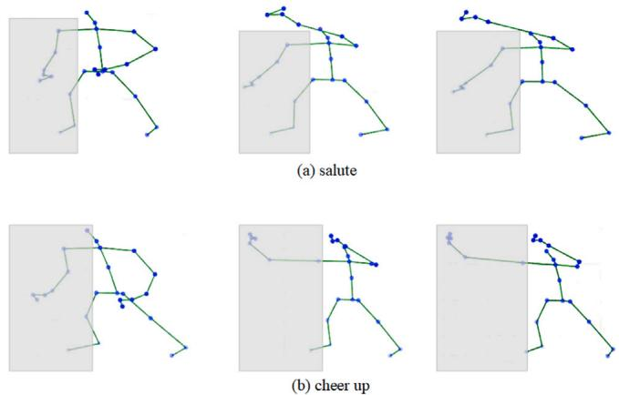  
Fig. 1. The right half of the body of the two actions of ‘salute’ and ‘cheer up’ is occluded.

In self-supervised learning, contrastive learning has emerged as a dominant method [25,26]. This approach aims to train models to distinguish between similar and dissimilar instances by optimizing a contrastive loss function. A critical aspect of contrastive learning lies in the construction of efective positive and negative sample pairs. Early methods relied on standard data augmentation techniques to generate positive pairs. However, recent advancements have introduced more sophisticated strategies. For instance, AimCLR [27] proposed the use of extreme data augmentation to enhance the diversity of positive samples. Similarly, CrosSCLR [28] introduced a novel approach to identify positive pairs from potentially negative samples, employing multi-view consistency learning to extract more comprehensive cross-view features. Furthermore, SkeAttnCLR [29] highlighted the importance of local body parts in human action recognition, introducing a framework that distinguishes between salient and non-salient local features. SG-CLR [30] uses multi-modal encoder to provide semantic information for positive and negative sample pairs, and proposes SkeleMask enhancement to mine advanced temporal motion information to achieve superior performance. SkeletonCLSP [31] aims at multimodal representation learning for skeleton action recognition, employs the contrastive learning method, and uses cross-modal multivariable feature integration and abnormal distribution auxiliary correction for self-monitoring motion representation. These advancements demonstrate the potential of self-supervised learning to overcome the limitations of traditional supervised approaches.

Most of the existing methods mentioned above are based on complete skeleton data and have achieved good performance. However, in the case of occlusion, especially when the key parts are occluded, the classification performance is greatly reduced. As shown in Fig. 1, the two actions of ‘salute’ and ‘cheer up’ are diferent. The key part of distinguishing these two behaviors is the right arm. If the right arm is occluded, the remaining parts of the two actions are identified and classified. These two actions may not be distinguished, which will greatly reduce the classification accuracy. If the right arm actions of the two behaviors can be restored through the context, it will be beneficial to the classification task. At present, the action recognition of partial occlusion of human skeleton joints is mostly focused on the design of multi-stream networks, which aim to improve the robustness of the network to incomplete skeleton data by fully learning rich discriminant features. From another perspective, we hope to recover the occluded human skeleton joints and then classify them. To this end, we propose a novel method called Vector Quantized Masked Variational Autoencoder (VQMVAE). Inspired by SkeletonMAE [32], the pre-training of masked reconstruction can efectively learn the context of human skeleton data, so that the masked skeleton joints can be restored according to the unmasked skeleton joints. From this point of view, we propose to use this structure to complete the reconstruction of occluded skeleton data. In order to further enhance the generation ability of this structure, we replace the potential space of SkeletonMAE with the discrete space of VQVAE [33], and propose the VQMVAE. By introducing discrete elements, we can transform continuous representation space into discrete representa tion space, so as to improve the modeling ability of the model for data. We consider that in the quantization process, since each codeword in the discrete latent space codebook represents a class of features in the skeleton data, the latent vector is forced to be expressed in a more compact and distinguishable form, and changes in smaller actions can also cause dramatic changes in the latent vector. VQVAE not only learns the feature representation of input data, but also learns the potential relationship between these features. This enables VQVAE to generate new samples that are more diverse and conform to the distribution of input data. This means that VQMVAE can generate occluded skeleton joints that meet the input skeleton data category. In addition, this discrete representation method can not only help the model learn more general feature representations, but also improve the generalization ability of the model on unseen data. This discrete feature representation has stronger robustness and interpretability, and can resist the influence of noise and interference to a certain extent.

Specifically, in the pretraining stage, according to the randomness of data missing, the input skeleton sequence is randomly masked in temporal and spatial dimensions, and then the unmasked data is input into the encoder for coding and discrete quantization. Finally, the discretized feature vector and the learnable token are input into the decoder for reconstruction. The model at this stage is used to recover the occluded skeleton joints. The decoder is removed in the fine-tuning stage, and a simple output layer is added after the encoder to predict the skeleton data. The model in the fine-tuning phase can be used for classification tasks. In the ablation experiment, we discussed the influence of masking rate, latent space size, encoder size, decoder size and decoder depth on the recognition task, and found the best combination. We performed a complete data classification task and semi-supervised generalization verification on the fine-tuned encoder. Experimental results also show that our method is generalized and robust, and efectively im proves the accuracy of classification in downstream classification tasks. We input the simulated occluded skeleton data into the encoder, and found that the occluded data has a great influence on its classification efect. However, by classifying the recovered occluded data, the classification performance is greatly improved, proving the efectiveness of our model.

In general, we have made the following contributions:

(1) We propose an efective and simple mask reconstruction framework based on vector quantization, which can recover the occluded skeleton joints.

(2) We discretize the potential space to unify the expression of the same category while preserving diverse human action features.

(3) Through the random masking of frames and joints, the encoder’s feature expression ability is further enhanced. The compact and distinguishable human skeleton feature representation is learned to improve the accuracy of the downstream classification task.

## 2. Related work

## 2.1. Occluded human skeleton-based action recognition

Most of the previous human skeleton-based action recognition work focused on the complete skeleton data recognition. If the input data is occluded, the recognition efect will be greatly reduced. In recent years, a part of the work has focused on the occluded human skeleton action recognition. MSFGCN [34] constructs a multi-stream network, where each branch deals with diferent conditions of occlusion, and for actions with small action ranges, it is proposed to extract motion features of diferent scales and distinguish actions with diferent motion ranges. RA-GCN [35] proposes a multi-stream model based on GCN, which aims to learn rich features on all joints to reduce the impact of data degradation and improve the robustness of occluded data. IST-GCN [36] suggests that in order to improve the robustness of the model, the key is to explore richer and deeper spatio-temporal dependencies betweenjoints. PD-GCN [37] fully extracts the local and global information of the skeleton by simulating the occlusion situation to improve the accuracy of occluded skeleton recognition. Ref. [38] proposes spatio-temporal occlusion of multiple views, and introduces MGL module to fuse multi-view features. The above models are devoted to improving the robustness of the model to occluded data. From another point of view, if we can efectively restore the occluded human skeleton data, we can greatly improve the subsequent classification accuracy.

## 2.2. Generation model

Generative models have evolved significantly in recent years, driven by diverse architectural paradigms. Autoencoders (AEs) [39] are a neural network architecture consisting of an encoder and a decoder. The encoder compresses input data into a low-dimensional latent representation, while the decoder reconstructs the original input from this latent code. AEs are trained to minimize reconstruction error but lack explicit probabilistic modeling, limiting their ability to generate diverse samples. To address this, Variational Autoencoders (VAEs) [40] introduced prob abilistic principles to AEs by modeling the latent space as a distribution. VAEs optimize a variational lower bound to balance reconstruction fidelity and latent space regularization, enabling controlled generation but often producing blurry outputs due to the Gaussian assumption. In parallel, Generative Adversarial Networks (GANs) [41] revolutionized the field through adversarial training: a generator synthesizes data to fool a discriminator, achieving unprecedented visual quality. However, GANs face challenges such as mode collapse and unstable optimization.

A pivotal advancement emerged with Vector-Quantized VAEs (VQVAEs) [33], which discretized the latent space via a learnable codebook. By replacing continuous latent vectors with discrete codes, VQVAEs bypass the “posterior collapse” issue in VAEs and produce sharper reconstructions. Their discrete tokens naturally align with autoregressive models (e.g., Transformers), enabling hierarchical and highresolution generation. Crucially, VQVAEs excel in structured tasks like masked image reconstruction: the codebook acts as a semantic dictionary, constraining plausible outputs while autoregressive modeling fills masked regions coherently. This contrasts with GANs, which may hallucinate inconsistent details, and VAEs, which average over ambiguities. While GANs dominate photorealistic synthesis, VQVAEs ofer stability, interpretability, and superior performance in conditional generation tasks requiring structural precision (e.g., inpainting, partial observation recovery). Together, these models underscore a trade-of between sample quality (GANs), probabilistic rigor (VAEs), and structured generation (VQVAEs), shaping the modern generative landscape.

## 2.3. Masked reconstruction

Some self-supervised models such as BERT [42], MAE [43], and SkeletonMAE [32] leveraged masked reconstruction as a pretext task. In natural language processing, the famous model BERT [42] masked tokens representing sequential data and then predicted the masked tokens. It calculated the loss between the predicted results and the original data to capture the features of language sequences. Following the idea of BERT, in the field of image processing, MAE [43] adopted an asymmetric encoder–decoder structure to mask image patches and reconstruct them at the pixel level. Inspired by MAE, VideoMAE [44] applies masking encoding to the field of RGB video. Because of the redundancy of time, it can also deliver good performance with a very high masking ratio. In the field of skeleton action recognition, SkeletonMAE [32] first introduced the idea of MAE. It masked joints at the frame and joint levels, only encoded the unmasked joints and predicted the masked ones. MAMP [45] designed a motion aware masking strategy and proposed a mask motion prediction method for learning 3D motion representations, greatly alleviating the problem of insuficient contextual motion modeling in traditional masked self structuring paradigms.

Most existing masked reconstruction methods for skeleton data focus on improving masking strategies and predicting targets, without considering the spatial sparsity of skeleton point data. They all adopt an autoencoder structure with continuous latent space. However, this continuous representation often struggles to efectively capture the inherent sparsity and discrete nature of skeleton data, which consists of a limited number of key points. This limitation can lead to suboptimal reconstruction quality and reduced robustness to noise. The core innovation of VQMVAE proposed in this paper is to introduce the discrete latent space of VQVAE into a skeleton action recognition framework based on masked reconstruction. By leveraging vector quantization, VQMVAE maps the continuous latent representations into a discrete codebook, which inherently aligns with the sparse and structured nature of skeleton data. This innovation not only addresses the limitations of existing methods but also leverages the inherent sparsity of skeleton data to achieve superior performance in terms of reconstruction quality, noise resistance, and representation eficiency.

## 3. Methods

In this part, we propose a new masked reconstruction model for action recognition based on human skeleton. This model is diferent from the usual masked reconstruction model, which discretizes the potential space. It can be seen that the validity of human skeleton data is represented by discrete feature vectors. In this part, we will introduce the detailed structure of our proposed model (VQMVAE).

## 3.1. Model architecture

Our method adopts an encoder–decoder framework designed for masked skeleton sequence reconstruction. The key components include: Input masking strategy, Encoder design, Latent Space Mapping and Decoder design. The model structure is shown in Fig. 2.

The input masking strategy adopts both temporal and spatial masking. Temporal masking is randomly select entire video frames and fully masks their content. By contrast, spatial masking randomly occludes specific skeletal joints within individual frames. These dual masking mechanisms simulate real-world partial observations and enhance the model’s robustness to missing data. The encoder processes masked sequences using an 8-layer Spatio-Temporal Transformer-Aggregation (STTA) block. The STTA block first divides the input sequence into non-overlapping tuples of 6 frames. Then, it applies multi-head selfattention to model spatio-temporal dependencies within each tuple. Lastly, it fuses features across tuples via convolutional layers to capture global context. Latent space mapping discretizes the encoder’s outputs via a learnable codebook to obtain quantized latent features $z _ { q } .$ To further regularize the latent space, we apply secondary masking to the reconstructed latent tokens and feed the masked latent tokens to the decoder for reconstruction. The decoder comprises 6-layer STTA blocks followed by a fully connected output layer. It progressively refines the latent features to reconstruct the original unmasked skeleton sequence.

## 3.1.1. Spatial-temporal masking strategy

Because of the redundancy of skeleton data in video sequences, we can obtain the skeleton joint information through the skeleton joints around the same frame and adjacent frames of a skeleton joint. This redundancy can be fully utilized by us to complete the skeleton joint reconstruction task, so that the encoder learns useful features. Therefore, we adopt the random masking strategy in both temporal and spatial dimensions when we mask skeleton data. The masking process is shown in Fig. 3. Given the skeleton sequence $X \in \mathbb { R } ^ { N \times C \times T \times J }$ , where N is the size of batchsize, C is the dimension of skeleton sequence, T is the number of frames in skeleton sequence, and J is the number ofjoints in each frame of skeleton sequence. We first randomly mask(i.e., delete) in the time dimension. According to the given frame masking rate $M _ { t } ,$ , the masked skeleton sequence becomes $X \in \mathbb { R } ^ { N \times C \times ( 1 - M _ { t } ) \times T \times J }$ . Then, in the spatial dimensions, the joints on all frames are randomly masked according to the given joint masking rate $M _ { j }$ . Finally, the skeleton sequence input into the network is $X \in \mathbb { R } ^ { N \times C \times ( \hat { 1 } - M _ { t } ) \times T \times ( 1 - M _ { j } ) \times J }$

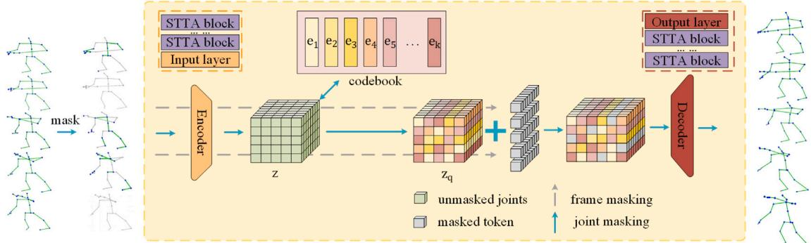  
(a) VQMVAE self-supervised pre-training process

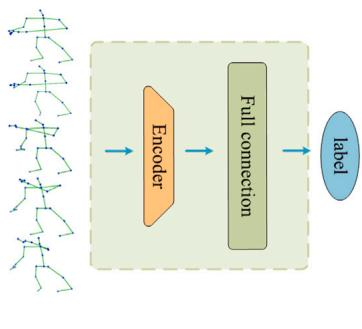  
(b) VQMVAE fine-tuning process

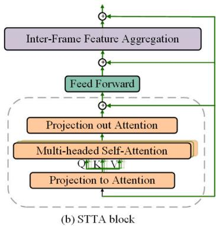  
Fig. 2. VQMVAE structure. (a) The pretrain prosses of VQMVAE. Through this part, the model performs the pre-training task of masking and reconstructing the masked joints. (b) VQMVAE fine-tuning process. Only the pre-trained encoder and a full connection layer are used for the fine-tuning task of downstream classification of skeleton data. (c) The structure of STTA block.

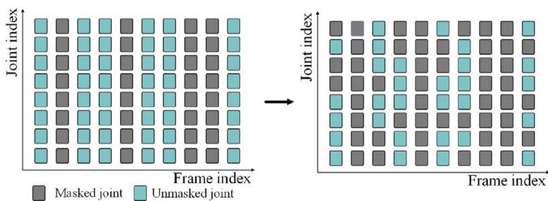  
Fig. 3. The spatial-temporal random masking process.

## 3.1.2. VQMVAE encoder

We use the masked skeleton sequence data as the input to the encoder. As shown in Fig. 2, similar to SkeletonMAE, the encoder of VQMVAE also uses multiple STTFormer blocks to capture the relationships between diferent keypoints in consecutive frames, enabling the encoding and representation of the unmasked parts of the skeleton sequences. As shown in Table 1, the encoder processes masked sequences using an 8-layer Spatio-Temporal Transformer-Aggregation (STTA) block. The STTA block structure is shown in Fig. 2. The STTA block first divides the input sequence into non-overlapping tuples of 6 frames. Then, it applies multi-head self-attention to model spatiotemporal dependencies within each tuple. Lastly, it fuses features across tuples via convolutional layers to capture global context. The ‘input dim’ of each block in Table 1 is the dimension mapped into attention ‘Output dim’ is the dimension that maps attention. In order to preserve the location information, we introduce location embedding after masking. The output of the encoder obtains a continuous coding vector $z \in \mathbb { R } ^ { N \times D \times T ^ { \prime } \times V ^ { \prime } }$ . D is the dimension of the potential variable output by the encoder, T' is the number of frames after sequence masking, and $V ^ { \prime }$ is the number of joints per frame after masking.

Table 1  
The structure of SkeletonMVQVAE.

<table><tr><td></td><td>Layer name</td><td>Input dim</td><td>Output dim</td><td>QKV dim</td></tr><tr><td rowspan="9">Encoder</td><td>input layer</td><td>3</td><td>64</td><td></td></tr><tr><td>block1</td><td>64</td><td>64</td><td>16</td></tr><tr><td>block2</td><td>64</td><td>64</td><td>16</td></tr><tr><td>block3</td><td>64</td><td>128</td><td>32</td></tr><tr><td>block4</td><td>128</td><td>128</td><td>32</td></tr><tr><td>block5</td><td>128</td><td>256</td><td>64</td></tr><tr><td>block6</td><td>256</td><td>256</td><td>64</td></tr><tr><td>block7</td><td>256</td><td>256</td><td>64</td></tr><tr><td>block8</td><td>256</td><td>256</td><td>64</td></tr><tr><td rowspan="7">Decoder</td><td>block1</td><td>256</td><td>256</td><td>64</td></tr><tr><td>block2</td><td>256</td><td>256</td><td>64</td></tr><tr><td>block3</td><td>256</td><td>128</td><td>64</td></tr><tr><td>block4</td><td>128</td><td>128</td><td>32</td></tr><tr><td>block5</td><td>128</td><td>64</td><td>32</td></tr><tr><td>block6</td><td>64</td><td>64</td><td>16</td></tr><tr><td>output layer</td><td>64</td><td>3</td><td></td></tr></table>

## 3.1.3. VQMVAE potential space

Unlike the usual MAE, we do not directly use z as the input of the decoder, but map it to a discrete vector z according to a set of code- $z _ { q }$ books. Specifically, for skeleton sequence data, the encoder outputs a continuous vector $z ~ \in ~ \mathbb { R } ^ { N \times D \times T ^ { \prime } \times V ^ { \prime } }$ . The network learns a codebook $E = \left\lceil e _ { 1 } , e _ { 2 } , e _ { 3 } \ldots e _ { K } \right\rceil ( E \in \mathbb { R } ^ { D \times K } ) _ { ! }$ where e is the D-dimensional vector in the codebook, and K is the size of the codebook. VQVAE completes the mapping between the continuous vector z and the codebook E through the nearest neighbor search

$$
k = \underset {j} {\arg \min} \left\| z _ {i} - e _ {j} \right\| _ {2}\tag{1}
$$

where j is the index of the codebook vector closest to $z _ { i } .$

$$
z _ {i} = e _ {k}\tag{2}
$$

The continuous vector z is mapped to the discrete vector $z _ { q } ~ \in$ $\mathbb { R } ^ { N \times D \times T ^ { \prime } \times V ^ { \prime } }$

Skeleton data has spatial sparsity and typically involves only the activity of a limited number of joints, such as hands and arms. This characteristic means that some joints will have a significant impact on movement. In the context of continuous latent space, intra-class differences (i.e. diferences observed in diferent instances of the same action) may be magnified by small variations in joint positions. This kind of magnification may pose challenges in accurately capturing motion features.

To solve this problem, let $x \in \mathbb { R } ^ { T \times J \times 3 }$ denote a skeleton sequence with T frames and J joints. The continuous latent space in standard VAEs learns a mapping $z = f ( x ) + \varepsilon .$ , where ε is unstructured noise. In contrast, VQMVAE enforces $z _ { q } ~ = ~ \underset { { \scriptscriptstyle { \tau } } _ { * } } { \arg \operatorname* { m i n } } \left\| f ( x ) - e _ { k } \right\| ^ { 2 }$ , where $e _ { k }$ is k the codebook. The discrete codebook uses vector quantization to map similar motions to the same codewords, making them very suitable for the inherent spatial sparsity in skeleton data and efectively reducing intra-class variance. This mapping process forces the encoder to focus on salient features that indicate motion, which helps to learn more meaningful feature representations and improve the encoder’s representation ability, and thus enhance classification accuracy.

In addition, due to the redundancy of the data, continuous latent spaces are often prone to overfitting or noise sensitivity. By utilizing discrete representations, redundant information is eliminated, thereby achieving a more compact representation of similar data. This compactness not only facilitates more eficient representation, but also enhances the robustness of the model to interference.

## 3.1.4. VQMVAE decoder

The decoder structure is also shown in Table 1, including 6 layers of STTA blocks and a fully connected output layer. It progressively refines the latent features to reconstruct the original unmasked skeleton sequence. We found that a simple fully connected layer can complete the prediction. The input of the decoder is no longer the direct output of the encoder, but the quantized $z _ { q } .$ . We fill the learnable tokens in the masked skeleton sequence. The decoder reconstructs the masked token according to the feature vector and position information. The goal of reconstruction is to maintain consistency between the reconstructed skeleton sequence and the original skeleton sequence. Our decoder uses a structure that is asymmetric to the encoder. We find that a weaker decoder is more conducive to enhancing the feature representation ability of the encoder. The diferent structures of the decoder will be introduced in the ablation experiment section.

## 3.2. Pretrain

The pretraining process of VQMVAE is shown in Fig. 2(a). We randomly mask a certain proportion of frames and skeleton joints in the original skeleton sequences, and then embed the position into the skeleton sequence. The unmasked skeleton joint data is sent to the encoder and mapped to a discrete vector after being encoded by the encoder. The obtained discrete vector is filled with learnable mask tokens and input into the decoder for reconstruction.

The reconstruction loss is defined as

$$
L = \log p (x | z _ {q}) + \left\| s g [ z ] - z _ {q} \right\| _ {2} ^ {2} + \beta \left\| z - s g [ z _ {q} ] \right\| _ {2} ^ {2}\tag{3}
$$

Among them, the first part is the reconstruction loss, which optimizes the encoder and decoder by reducing the error between the original sequence and the reconstructed sequence. The second part faces challenges due to the argmin operation on the feature vector during mapping, which prevents gradient calculation. To train the latent space codebook, the L2 error between the encoder’s output z and the latent space e is computed, with sg representing the stop gradient operation. In the third part, the L2 error between the encoder’s output z and the corresponding potential space e is also calculated, but sg is applied to e to ensure the encoder’s output aligns with the embedding space and avoids drastic changes (such as switching from one embedding vector to another). The β is the weight coeficient, and we set it to 0.25.

We save the model with the smallest validation loss as the best model.

## 3.3. Finetune

In the previous section, we explained the self-supervised pre-training process, randomly masking some frames and joints, so that the encoder performs feature learning on the unmasked part, and recovers the masked joints through the decoder. In order to evaluate the representation learning ability of VQMVAE, we focus on end-to-end fine-tuning. We only use the above pre-trained encoder part to load the pre-trained parameter weights onto the model, and combine the fully connected layer for classification to fine-tune the downstream recognition task. During the entire fine-tuning process, the cross-entropy loss is used as a loss function, and the model that achieves the highest verification accuracy is retained as the optimal model.

## 4. Experiments

## 4.1. Datasets

## 4.1.1. NTU-RGB+D 60

The NTU RGB+D 60 dataset [48] contains 60 action classes with a total of 56,578 action sequences. Among them, there are 40 kinds of daily behavior actions, 9 kinds of health-related actions, and 11 kinds of mutual actions between two people. The dataset is partitioned into training and testing sets using two criteria. The first is Cross-Subject, which divides the data based on subject IDs. And the second is Cross-View, which divides the data based on the capturing camera. The testing stage utilizes data from Camera 1, while training utilizes data from Cameras 2 and 3.

## 4.1.2. NTU-RGB+D 120

The NTU RGB+D 120 dataset[49] adds 60 action categories on the basis of NTU60, for a total of 60 categories and 114,480 samples. The dataset is also divided using two criteria. The rule of Cross-Subject is consistent with NTU RGB-D 60. Besides, it adopts a new and challenging strategy: Cross-Setup divides the training set and the test set according to the even IDs and the odd IDs.

## 4.2. Experimental settings

Our experiments are implemented under the framework of Pytorch[50]. Both the pre-training model and fine-tuning model utilize the Adam optimizer. The base learning rate is set to 0.01, with a weight decay of 0.0001. The pretraining epoch number is 200, and the finetuning epoch number is 100. Batch size is set to 64. We employ a step-wise learning rate strategy, adjusting the learning rate to one-tenth at epochs 20, 90, and 110 when pretraining, and 60, 90, and 110 when finetuning. To ensure the reliability of the experiment, we conducted 5 repeated experiments for all the experiments.

Table 2  
Finetuned results on NTU-60 and NTU-120 datasets.

<table><tr><td rowspan="2">Method</td><td rowspan="2">Backbone</td><td colspan="2">NTU-60 (%)</td><td colspan="2">NTU-120 (%)</td></tr><tr><td>X-Sub</td><td>X-View</td><td>X-Sub</td><td>X-Set</td></tr><tr><td>SkeletonCLR [29]</td><td>ST-GCN</td><td>82.2</td><td>88.9</td><td>73.6</td><td>75.3</td></tr><tr><td>CPM[46] (ECCV&#x27;22)</td><td>ST-GCN</td><td>84.8</td><td>91.1</td><td>78.4</td><td>78.9</td></tr><tr><td>CrosSCLR[28] (CVPR&#x27;21)</td><td>ST-GCN</td><td>86.2</td><td>92.5</td><td>80.5</td><td>80.4</td></tr><tr><td>AimCLR[27] (AAAI&#x27;22)</td><td>ST-GCN</td><td>86.9</td><td>92.8</td><td>80.1</td><td>80.9</td></tr><tr><td>Hi-TRS[47] (ECCV&#x27;22)</td><td>Transformer</td><td>86.0</td><td>93.0</td><td>80.6</td><td>81.6</td></tr><tr><td>AimCLR[27] (AAAI&#x27;22)</td><td>STTFormer</td><td>83.9</td><td>90.4</td><td>74.6</td><td>77.2</td></tr><tr><td>CrosSCLR[28] (CVPR&#x27;21)</td><td>STTFormer</td><td>84.6</td><td>90.5</td><td>75.0</td><td>77.9</td></tr><tr><td>SkeletonMAE[32] (ICMEW&#x27;23)</td><td>STTFormer</td><td>86.6</td><td>92.9</td><td>76.8</td><td>79.1</td></tr><tr><td>VQMVAE</td><td>STTFormer</td><td>87.9</td><td>93.0</td><td>79.8</td><td>81.3</td></tr></table>

Table 3  
Finetuned results comparison on the NTU-60 and NTU-120 datasets with fewer labeled data.

<table><tr><td rowspan="3">Method</td><td colspan="4">NTU-60 (%)</td><td colspan="4">NTU-120 (%)</td></tr><tr><td colspan="2">X-Sub</td><td colspan="2">X-View</td><td colspan="2">X-Sub</td><td colspan="2">X-Set</td></tr><tr><td>5 %</td><td>10 %</td><td>5 %</td><td>10 %</td><td>5 %</td><td>10 %</td><td>5 %</td><td>10 %</td></tr><tr><td>Hi-TRS[47] (ECCV&#x27;22)</td><td>63.3</td><td>70.7</td><td>68.3</td><td>74.8</td><td>-</td><td>-</td><td>-</td><td>-</td></tr><tr><td>CPM[46] (ECCV&#x27;22)</td><td>-</td><td>73.0</td><td>-</td><td>77.1</td><td>-</td><td>-</td><td>-</td><td>-</td></tr><tr><td>SkeletonMAE[32] (ICMEW&#x27;23)</td><td>64.4</td><td>73.0</td><td>68.8</td><td>76.9</td><td>50.4</td><td>61.8</td><td>52.0</td><td>62.5</td></tr><tr><td>VQMVAE</td><td>66.7</td><td>73.3</td><td>69.5</td><td>78.0</td><td>55.6</td><td>62.4</td><td>56.3</td><td>64.2</td></tr></table>

## 4.3. Comparison with existing mainstream methods

We compare VQMVAE with other mainstream models on NTU-60 and NTU-120 datasets. The results are shown in Table 2, and our model outperforms the compared models. On the NTU-60 dataset, our VQMVAE achieves an accuracy of 1.3 % higher than SkeletonMAE under the X-sub protocol, and an accuracy of 0.1 % higher under the X-view protocol. On the NTU-120 dataset, the accuracy of our VQMVAE under the X-sub protocol is 3.0 % higher than that of SkeletonMAE, and the accuracy under the X-set protocol is 2.2 % higher than that of SkeletonMAE. Experimental results show the efectiveness of our proposed method. The VQMVAE model we proposed shows excellent performance on both NTU-60 and NTU-120 datasets, indicating its efectiveness in capturing and utilizing underlying data patterns. Compared with the comparison model, the significant improvement in accuracy highlights the robustness and eficiency of our method in dealing with complex human skeleton data. These results highlight the potential of VQMVAE in human skeleton-based action recognition tasks.

## 4.4. Semi-supervised results

We proceed to select 5 % and 10 % of the data from the training set in a random manner for semi-supervised fine-tuning. Our sampling approach ensures that an equal percentage of data is sampled from each class. The outcomes of the semi-supervised process are detailed in Table 3. These findings demonstrate that our proposed technique outperforms the methods we compared it against. When evaluating VQMVAE against SkeletonMAE on NTU-60 and NTU-120 datasets, we observe varying degrees of enhancement ranging from 0.3 % to 5.2 %. The experimental outcomes suggest that VQMVAE maintains its capacity for generalization even with limited labeled data, showcasing improved generalization compared to SkeletonMAE.

## 4.5. Occluded data validation

We performed diferent proportions of interference on the test set data (i.e., some of the skeletonjoints were set to 0). As shown in Fig. 4(a), we find that when we only use the encoder to classify the occluded data, the classification accuracy decreases rapidly with the increase in the proportion of defects, which is also true for SkeletonMAE. As shown in Fig. 4(b), we propose to reconstruct the occluded part using pre-trained reconstruction model, and input the reconstructed human skeleton into the encoder again. We test on NTU-60 and NTU-120, and the results are as shown in the Fig. 5. ‘SkeletonMAE’ and ‘VQMVAE’ represent the fine-tuned classifiers of SkeletonMAE and VQMVAE to classify the occluded data directly, and ’REC + VQMVAE’ indicates that our pretrained model is used to recover the occluded part and then classify them.

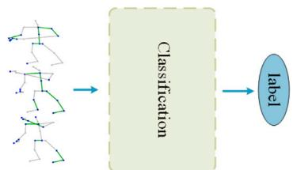  
(a) Classification of occluded data without reconstruction

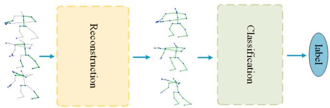  
(b) Classification of reconstructed occluded data  
Fig. 4. Occluded Data Validation. (a) Classification of occluded data directly. In this part, the occluded joints are not restored, and the fine-tuning model is directly used for classification. (b) The occluded data is first reconstructed and then classified. In this part, when facing the occluded joints, first use the pretraining model to restore the occluded joints, and then use the fine-tuning model to classify.

Under the X-sub protocol of the NTU-60 dataset, our reconstructionbased method ‘REC + VQMVAE’ demonstrates superior performance compared to the non-reconstruction methods ‘SkeletonMAE’ and ‘VQMVAE’. Specifically, with a 5 % random masking ratio of skeleton joints, ‘REC + VQMVAE’ achieves 3.7 % and 2.2 % higher accuracy than ‘SkeletonMAE’ and ‘VQMVAE’, respectively. Increasing the masking ratio to 10 %, the accuracy advantage of ‘REC + VQMVAE’ rises to

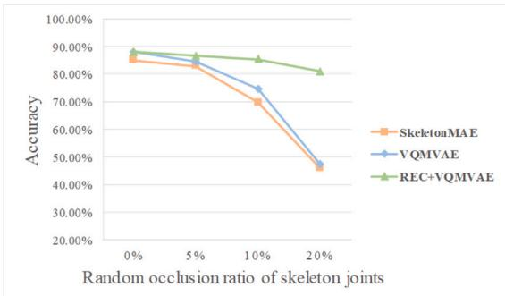  
(a) The accuracy of NTU-60 under X-sub

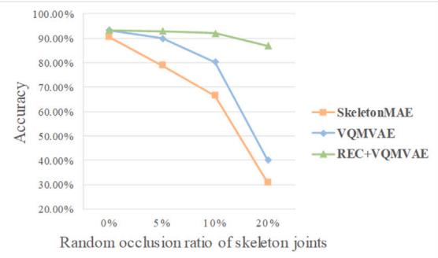  
(b) The accuracy of NTU-60 under X-view

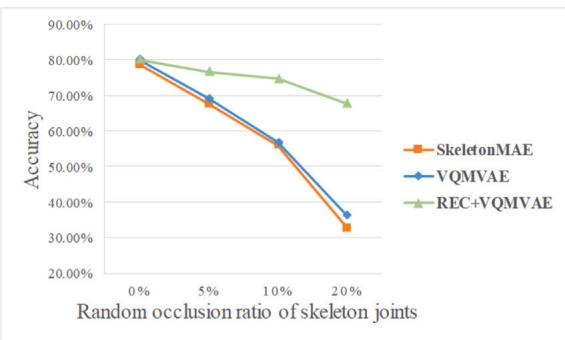  
(c) The accuracy of NTU-120 under X-sub

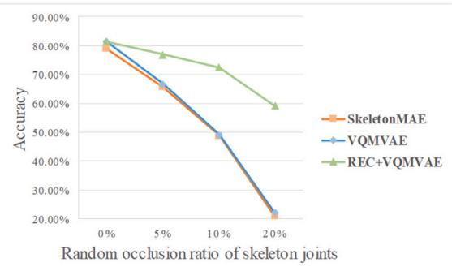  
(d) The accuracy of NTU-120 under X-set  
Fig. 5. The classification accuracy of occluded data on NTU-60 and NTU-120 datasets.

15.7 % and 10.6 %. With a 20 % masking ratio, the improvements are even more pronounced, at 35.2 % and 33.8 %.

Similarly, under the X-view protocol of the NTU-60 dataset, ‘REC + VQMVAE’ outperforms ‘SkeletonMAE’ and ‘VQMVAE’. At a 5 % masking ratio, ‘REC + VQMVAE’ shows a 14.2 % and 2.9 % higher accuracy. With a 10 % masking ratio, the method achieves 25.5 % and 11.7 % higher accuracy. At a 20 % masking ratio, the performance boost is 56.1 % and 47.1 %.

For the NTU-120 dataset under the X-sub protocol, ‘REC + VQMVAE also leads in accuracy. At a 5 % masking ratio, it surpasses ‘SkeletonMAE and ‘VQMVAE’ by 9.1 % and 7.8 %. With a 10 % masking ratio, the advantage increases to 18.5 % and 17.9 %. At a 20 % masking ratio, the improvements are 34.9 % and 31.4 %.

Lastly, under the X-set protocol of the NTU-120 dataset, ‘REC + VQMVAE’ maintains its superior performance. At a 5 % masking ratio, it achieves 11.2 % and 10.0 % higher accuracy compared to ‘SkeletonMAE and ‘VQMVAE’. With a 10 % masking ratio, the accuracy advantage is 23.5 % and 23.2 %. At a 20 % masking ratio, the method’s accuracy is 38.3 % and 37.1 % higher.

It is evident that the random occlusion of skeleton joints significantly impacts methods that do not utilize reconstruction. When 20 % of the joints are occluded, both SkeletonMAE and VQMVAE methods degrade to between one-half and one-quarter of their performance with complete skeleton joints. The proposed method efectively mitigates the rapid decline in the encoder’s performance when dealing with occluded data, achieving a 56.1 % accuracy improvement under the X-view protocol of the NTU-60 dataset with 20 % occlusion. This demonstrates that our VQMVAE pre-trained model excels at context-based reconstruction, enabling it to recover occluded parts using the intact portions of the skeleton.

## 4.6. Ablation study

All the experiments in this section are carried out on the NTU-60 dataset, and more details of the model we proposed are analyzed.

## 4.6.1. Frame and joint masking ratio

Based on practical experience, we observe that missing data in the actual dataset often occurs randomly. If a skeleton joint is masked, the same skeleton joint of adjacent frames can provide efective redundant information. Therefore, in order to enhance our pre-training process, random masking techniques are used at the time and space levels. More specifically, we mask the joints with probabilities of 0.4, 0.5 and 0.6 in the temporal dimension, and mask the joints with probabilities of 0.4, 0.6 and 0.8 in the spatial dimension of the unmasked frames. As shown in Table 4, under the X-sub standard of NTU-60 dataset, the frame masking rate of 0.4 and the joint masking rate of 0.4 produce the best results, with an accuracy of 88.0 %.

Table 4  
Ablation study on frame and joint masking ratios.

<table><tr><td>Frame masked ratio</td><td>Joint masked ratio</td><td>NTU-60 X-sub (%)</td></tr><tr><td rowspan="3">0.4</td><td>0.4</td><td>88.0</td></tr><tr><td>0.6</td><td>86.2</td></tr><tr><td>0.8</td><td>86.8</td></tr><tr><td rowspan="3">0.5</td><td>0.4</td><td>86.5</td></tr><tr><td>0.6</td><td>87.8</td></tr><tr><td>0.8</td><td>87.7</td></tr><tr><td rowspan="3">0.6</td><td>0.4</td><td>86.2</td></tr><tr><td>0.6</td><td>87.3</td></tr><tr><td>0.8</td><td>87.1</td></tr></table>

Table 5  
Ablation study on the number of potential vectors.

<table><tr><td>Potential spatial dimension</td><td>NTU-60 X-sub (%)</td></tr><tr><td>100</td><td>86.8</td></tr><tr><td>128</td><td>88.0</td></tr><tr><td>256</td><td>86.3</td></tr><tr><td>512</td><td>87.7</td></tr></table>

Table 6  
Ablation study on decoder embedding dimension.

<table><tr><td>Decoder embedding dimension</td><td>NTU-60 X-sub (%)</td><td>Parameters</td></tr><tr><td>128</td><td>86.7</td><td>3 M</td></tr><tr><td>256</td><td>87.7</td><td>10 M</td></tr><tr><td>512</td><td>86.4</td><td>26 M</td></tr></table>

Table 7  
Ablation study on decoder depth.

<table><tr><td>Decoder depth</td><td>NTU-60 X-sub (%)</td><td>Parameters</td></tr><tr><td>5</td><td>87.4</td><td>7 M</td></tr><tr><td>7</td><td>88.0</td><td>10 M</td></tr><tr><td>9</td><td>87.7</td><td>11 M</td></tr><tr><td>11</td><td>87.1</td><td>13 M</td></tr></table>

Table 8  
Ablation study on decoder depth.

<table><tr><td>Model</td><td>Parameters (M)</td><td>FLOPs(G)</td><td>Pre-training time(hours)</td></tr><tr><td>SkeletonMAE</td><td>11</td><td>42.8</td><td>39</td></tr><tr><td>VQMVAE</td><td>10</td><td>36.3</td><td>38</td></tr></table>

## 4.6.2. Size of the potential space

In this experiment, we explore the influence of the codebook size of the latent space (i.e., the compactness of the latent vector) on the classification task. The impact of diferent codebook sizes K on the classification task is shown in the Table 5. We find that too large or too small K is not conducive to downstream classification tasks. For the same type of action, diferent people perform this action with diversity. The diversity of motion trajectories may lead to classification errors. We use VQVAE to encode human skeleton joint data so that the same type of action can be represented by neighboring coding. Excessive K makes the word vector distribution in the codebook more sparse, and there is no way to learn compact representation. Therefore, when K is 256 and

512, the classification efect is not as good as when k is 128. The information provided by too small K is not as much as that provided by larger K, and the information will be lost. Therefore, when K is 100, the classification accuracy is lower than that when K is 128. When K is 128, the classification accuracy is 88.0 %, which is the best result.

## 4.6.3. Decoder embedding dimension

We perform ablation experiments on the embedding dimension of the decoder to evaluate the performance of the model in three diferent dimensions of 128, 256 and 512. The experimental results are shown in Table 6. With the increase in dimension, the parameters of the model also increase. When the decoder embedding dimension is set to 256, the model achieves the best accuracy, which is 2.3 % higher than that when the dimension is 128 and 1.3 % higher than that when the dimension is 512.

## 4.6.4. Decoder depth

We further performed ablation experiments on diferent decoder depths, which refer to the number of STTFormer blocks utilized along with a fully connected layer. The depth of the decoder is set to 5, 7, 9, and 11 layers respectively in our study. The results of ablation experiments are shown in Table 7. The results show that the optimal accuracy is achieved when the decoder depth is 7 layers, and the depth of the decoder being too deep (11 layers) or too shallow (5 layers) reduces the fine-tuning accuracy. SkeletonMAE is based on a symmetrical en coder–decoder structure, while our VQMVAE uses fewer decoder layers, considering that the stronger feature extraction of the encoder makes it unnecessary to have a more powerful decoder.

Because fewer decoder layers are used, the proposed model achieves fewer parameters and less computation, and reduces the code runtime. The specific parameters, calculations, and running time of the model are shown in Table 8. Compared with SkeletonMAE, VQMVAE has 1 M fewer parameters, 6.5 G less computation and 1 h less pre-training time.

## 4.7. Skeleton visualization

We visualize the reconstruction efect of VQMVAE. As shown in Figs. 6–9, the first line is the visualization of the original skeleton

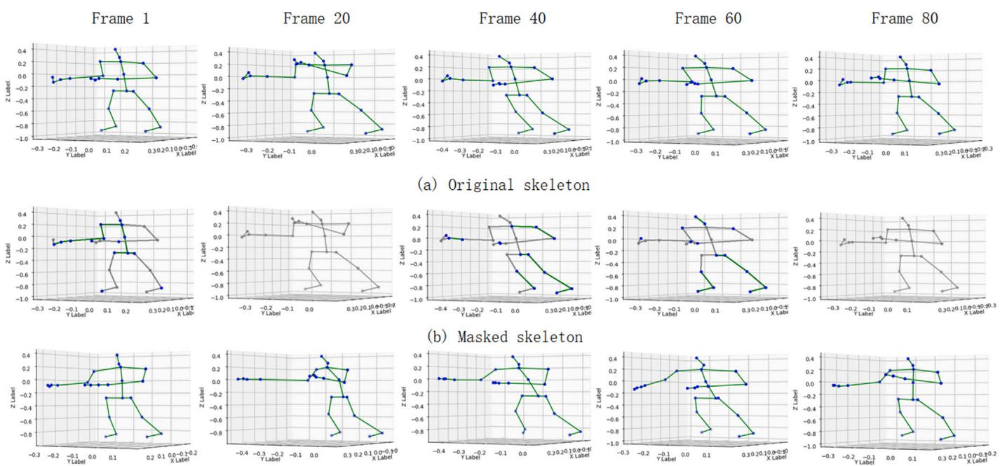  
(c)Reconstructed skeleton  
Fig. 6. Visualization of eat meal in dataset NTU-60.

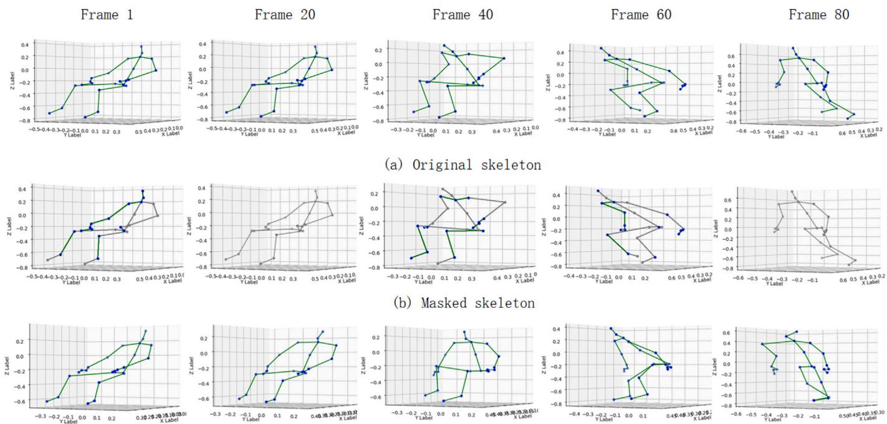  
(c)Reconstructed skeleton

Fig. 7. Visualization of stand up in dataset NTU-60.  
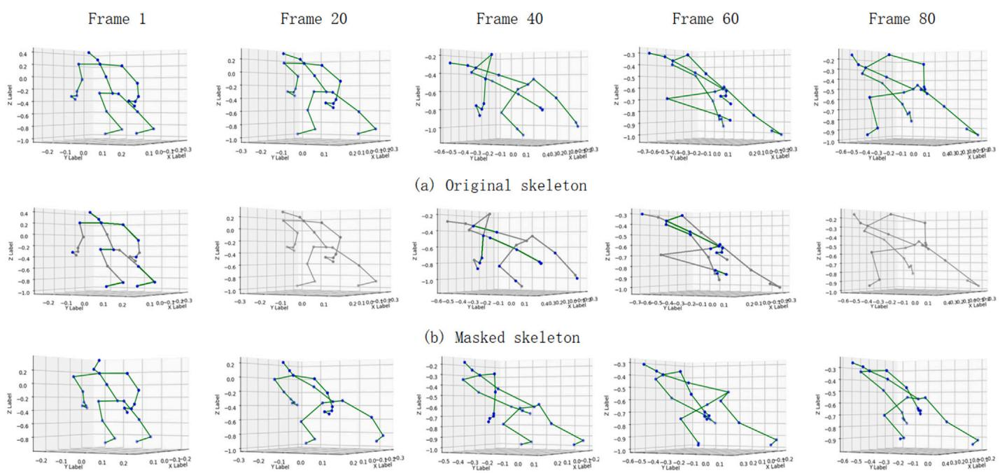  
(c)Reconstructed skeleton  
Fig. 8. Visualization of drop in dataset NTU-60.

sequence, the second line is the masked skeleton sequence, where the gray joints and frames are masked with a probability of 0.4, and the third line is the reconstructed skeleton sequence. Fig. 6 shows the action of ’eating meat’, Fig. 7 shows the action of ’stand up’, Fig. 8 shows the action of ’drop’, and Fig. 9 shows the action of ’clapping’. It can be seen that the human skeleton data reconstructed by VQMVAE is slightly diferent from the original data in detail, but the motion trajectory of the overall framework is not distorted and there is no obvious deformation The visualization results demonstrate the efectiveness of VQMVAE in reconstructing occluded human skeleton sequences. By comparing the original data with the reconstructed sequences, it is evident that while there are slight diferences in the detailed joint positions, the overall motion trajectories remain consistent without significant distortion. This indicates that VQMVAE possesses strong feature representation and generation capabilities, enabling it to successfully recover occluded joints and maintain the integrity of the skeleton sequences. These results showcase the potential of VQMVAE in handling incomplete or noisy skeleton data.

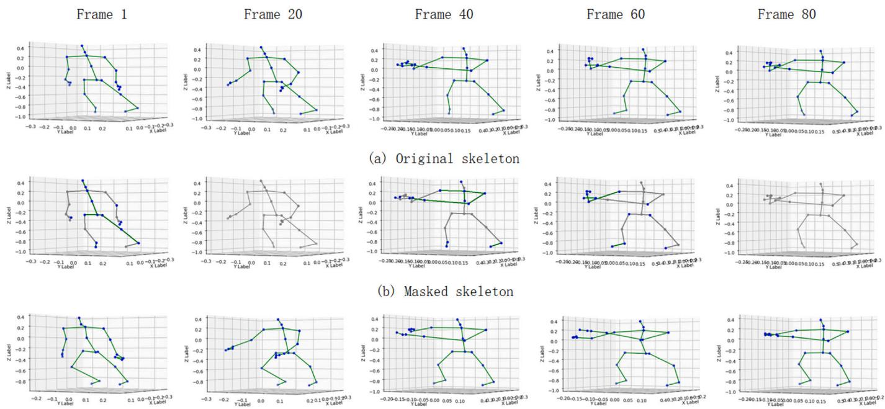  
(c)Reconstructed skeleton  
Fig. 9. Visualization of clapping in dataset NTU-60.

## 5. Conclusion

In this work, we propose a spatio-temporal masked reconstruction model VQMVAE based on vector quantization. It is a self-supervised model that uses VQVAE for masked skeleton sequence reconstruction, and then applies the pre-trained encoder to fine-tune the downstream human action recognition task. Our method maps continuous skeleton sequence data to discrete variables. All experiments show that the discrete space learned by VQMVAE captures the important structural features of the skeleton sequence. Our model not only enhances the interpretability of the skeleton sequence data but also improves the overall performance of the downstream recognition task. Compared with the usual MAE model, it significantly improves the recognition accuracy of the encoder in the downstream recognition task, which proves the efectiveness of our VQMVAE in human skeleton-based action recognition. In addition, the generative ability of VQMVAE provides us with a new idea for classifying occluded data.

## CRediT authorship contribution statement

Enqing Chen: Writing – review & editing, Methodology, Project administration. Xueting Wang: Software, Writing – original draft, Methodology. Xin Guo: Writing – review & editing, Methodology, Project administration.

## Declaration of competing interest

The authors declare that they have no known competing financial interests or personal relationships that could have appeared to influence the work reported in this paper.

## Acknowledgment

The author would like to express gratitude to the National Supercomputing Zhengzhou Center for providing computing resources.

## Data availability

Data will be made available on request.

## References

[1] K. Simonyan, A. Zisserman, Two-stream convolutional networks for action recogni tion in videos, Adv. Neural Inf. Process. Syst. 27 (2014).

[2] C. Feichtenhofer, H. Fan, J. Malik, K. He, Slowfast networks for video recognition, in: Proceedings of the IEEE/CVF international conference on computer vision, 2019, pp. 6202–6211

[3] S. Buch, V. Escorcia, C. Shen, B. Ghanem, J. Carlos Niebles, Sst: Single-stream temporal action proposals, in: Proceedings of the IEEE conference on Computer Vision and Pattern Recognition, 2017, pp. 2911–2920.

[4] G. Varol. I. Laptey. C. Schmid. Long-term temporal convolutions for action recogni tion, JEEE Trans, Pattern Anal, Mach, Intell, 40 (6) (2017) 1510–1517.

[5] Z. Cao, T. Simon, S.-E. Wei, Y. Sheikh, Realtime multi-person 2d pose estimation using part afinity fields, in: Proceedings of the IEEE conference on computer vision and pattern recognition 2017 pp. 7291–7299

[6] H.-S. Fang, S. Xie, Y.-W. Tai, C. Lu, Rmpe: Regional multi-person pose estimation, in: Proceedings of the IEEE international conference on computer vision, 2017, pp. 2334-2343.

[7] J. Xu, Z. Yu, B. Ni, J. Yang, X. Yang, W. Zhang, Deep kinematics analysis for monocular 3d human pose estimation, in: Proceedings of the IEEE/CVF Conference on computer vision and Pattern recognition, 2020, pp. 899–908.

[8] Y. Chen, Z. Zhang, C. Yuan, B. Li, Y. Deng, W. Hu, Channel-wise topology refinement graph convolution for skeleton-based action recognition, in: Proceedings of the IEEE/CVF international conference on computer vision. 2021, pp. 13 359–13 368.

[9] H. Duan, Y. Zhao, K. Chen, D. Lin, B. Dai, Revisiting skeleton-based action recogni tion, in: Proceedings of the IEEE/CVE Conference on Computer Vision and Patterr Recognition, 2022, pp. 2969–2978.

[10] F.M. Thoker, H. Doughty, C.G.M. Snoek, Skeleton-contrastive 3d action representation learning, in: Proceedings of the 29th ACM international conference on multimedia. 2021 pp. 1655–1663

[11] H. Duan, Y. Zhao, K. Chen, D. Lin, B. Dai, Revisiting skeleton-based action recognition, in: Proceedings of the IEEE/CVF Conference on Computer Vision and Pattern Recognition, 2022, pp. 2969–2978.

[12] Z. Cao, T. Simon, S.-E. Wei, Y. Sheikh, Realtime multi-person 2d pose estimation using part afinity fields, in: Proceedings of the IEEE conference on computer vision and pattern recognition, 2017, pp. 7291–7299.

[13] P. Lu, T. Jiang, Y. Li, X. Li, K. Chen, W. Yang, Rtmo: Towards high-performance one-stage real-time multi-person pose estimation, arXiv preprint arXiv:2312.07526, 2023).

[14] Y. Du, W. Wang, L. Wang, Hierarchical recurrent neural network for skeleton based action recognition, in: Proceedings of the IEEE conference on computer vision and pattern recognition. 2015 pp. 1110–1118.

[15] S. Li, W. Li, C. Cook, Y. Gao, Deep independently recurrent neural network (indrnn), arXiv preprint arXiv:1910.06251, 2019).

[16] Y. Hou, Z. Li, P. Wang, W. Li, Skeleton optical spectra-based action recognition using convolutional neural networks, IEEE Trans. Circuits Syst. Video Technol. 28 (3) (2016) 807–811

[17] P. Wang, Z. Li, Y. Hou, W. Li, Action recognition based on joint trajectory maps using convolutional neural networks, in: Proceedings of the 24th ACM internationa conference on Multimedia, 2016, pp. 102–106.

[18] A. Banerjee, P.K. Singh, R. Sarkar, Fuzzy integral-based cnn classifier fusion for 3d skeleton action recognition JEEE Trans. Circuits Syst. Video Technol. 31 (6) (2020) 2206–2216.

[19] S. Yan, Y. Xiong, D. Lin, Spatial temporal graph convolutional networks for skeletonbased action recognition, in: Proceedings of the AAAI conference on artificia intelligence, vol. 32, 2018, no. 1).

[20] Z. Liu, H. Zhang, Z. Chen, Z. Wang, W. Ouyang, Disentangling and unifying graph convolutions for skeleton-based action recognition, in: Proceedings of the IEEE/CVF conference on computer vision and pattern recognition, 2020, pp. 143–152.

[21] Q. Wang, S. Shi, J. He, J. Peng, T. Liu, R. Weng, Iip-transformer: Intra-interpart transformer for skeleton-based action recognition, in: 2023 IEEE Internationa Conference on Big Data (BigData), IEEE, 2023, pp. 936–945.

[22] Y. Zhang, B. Wu, W. Li, L. Duan, C. Gan, Stst: Spatial-temporal specialized trans former for skeleton-based action recognition, in: Proceedings of the 29th ACM International Conference on Multimedia, 2021, pp. 3229–3237.

[23] W. Xin, R. Liu, Y. Liu, Y. Chen, W. Yu, Q. Miao, Transformer for skeleton-based action recognition: A review of recent advances, Neurocomputing 537 (2023) 164–186.

[24] R. Liu, Y. Liu, W. Xin, Q. Miao, L. Li, Action jitter killer: Joint noise optimization cascade for skeleton-based action recognition, IEEE Trans. Instrum. Meas. (2024).

[25] J. Dong, S. Sun, Z. Liu, S. Chen, B. Liu, X. Wang, Hierarchical contrast for unsupervised skeleton-based action representation learning, in: Proceedings of the AAA Conference on Artificial Intelligence, vol. 37. 2023, pp. 525–533, no. 1)

[26] L. Lin, J. Zhang, J. Liu, Actionlet-dependent contrastive learning for unsupervised skeleton-based action recognition, in: Proceedings of the IEEE/CVF Conference on Computer Vision and Pattern Recognition, 2023, pp. 2363–2372.

[27] T. Guo, H. Liu, Z. Chen, M. Liu, T. Wang, R. Ding, Contrastive learning from extremely augmented skeleton sequences for self-supervised action recognition, in: Proceedings of the AAAI Conference on Artificial Intelligence, vol. 36, 2022, pp. 762–770, no. 1).

[28] L. Li, M. Wang, B. Ni, H. Wang, J. Yang, W. Zhang, 3d human action representation learning via cross-view consistency pursuit, in: Proceedings of the IEEE/CVF conference on computer vision and pattern recognition, 2021, pp. 4741–4750.

[29] Y. Hua, W. Wu, C. Zheng, A. Lu, M. Liu, C. Chen, S. Wu, Part aware contrastive learning for self-supervised action recognition, arXiv preprint arXiv:2305.00666, 2023).

[30] R. Liu, Y. Liu, M. Wu, W. Xin, Q. Miao, X. Liu, L. Li, Sg-clr: Semantic representation guided contrastive learning for self-supervised skeleton-based action recognition, Pattern Recognit, (2025).111377

[31] Y. Liu, R. Liu, W. Xin, Q. Miao, Y. Hu, J. Qi, Language-skeleton pre-training to col laborate with self-supervised human action recognition, in: Chinese Conference on Pattern Recognition and Computer Vision (PRCV), Springer, 2024, pp. 409–423.

[32] W. Wu, Y. Hua, C. Zheng, S. Wu, C. Chen, A. Lu, Skeletonmae: Spatial-tempora masked autoencoders for self-supervised skeleton action recognition, in: 2023 IEEE International Conference on Multimedia and Expo Workshops (ICMEW), IEEE, 2023, pp. 224–229.

[33] A. Van Den Oord, O. Vinyals, et al., Neural discrete representation learning, Adv. Neural Inf. Process. Syst. 30 (2017).

[34] D. Li, W. Shi, Partially occluded skeleton action recognition based on multi-stream fusion graph convolutional networks, in: Advances in Computer Graphics: 38th Computer Graphics International Conference. CGI 2021. Virtual Event. September 6–10. 2021, Proceedings 38, Springer, 2021, pp. 178–189.

[35] Y.-F. Song, Z. Zhang, C. Shan, L. Wang, Richly activated graph convolutional network for robust skeleton-based action recognition, IEEE Trans. Circuits Syst. Video Technol, 31 (5) (2020) 1915–1925

[36] Y. Xing, J. Zhu, Y. Li, J. Huang, J. Song, An improved spatial temporal graph convolutional network for robust skeleton-based action recognition, Applied Intelligence 53 (4) (2023) 4592–4608.

[37] Z. Chen, H. Wang, J. Gui, Occluded skeleton-based human action recognition with dual inhibition training, in: Proceedings of the 31st ACM International Conference on Multimedia. 2023, pp. 2625–2634.

[38] Y. Chen, L. Wang, D. Hu, H. Cheng, Multi-view graph convolution network for the recognition of human action with spatial and temporal occlusion problems, J. Vis. Commun. Image Represent. 97 (2023) 103957.

[39] D.E. Rumelhart, G.E. Hinton, R.J. Williams, Learning representations by back propagating errors, nature 323 (6088) (1986) 533–536.

[40] D.P. Kingma, M. Welling, Auto-encoding variational bayes, arXiv preprint arXiv:1312.6114, 2013).

[41] I. Goodfellow, J. Pouget-Abadie, M. Mirza, B. Xu, D. Warde-Farley, S. Ozair, A. Courville, Y. Bengio, Generative adversarial nets, Adv. Neural Inf. Process. Syst. 27 (2014).

[42] J. Devlin, M.-W. Chang, K. Lee, K. Toutanova, Bert: Pre-training of deep bidirectiona transformers for language understanding, arXiv preprint arXiv:1810.04805, 2018).

[43] K. He, X. Chen, S. Xie, Y. Li, P. Dollár, R. Girshick, Masked autoencoders are scalable vision learners, in: Proceedings of the IEEE/CVF conference on computer vision and pattern recognition, 2022, pp. 16 000–16 009.

[44] Z. Tong, Y. Song, J. Wang, L. Wang, Videomae: Masked autoencoders are dataeficient learners for self-supervised video pre-training, Adv. Neural Inf. Process. Syst. 35, pp.10 078–10 093, 2022).

[45] Y. Mao, J. Deng, W. Zhou, Y. Fang, W. Ouyang, H. Li, Masked motion predictors are strong 3d action representation learners, in: Proceedings of the IEEE/CVF International Conference on Computer Vision, 2023, pp. 10 181–10 191.

[46] H. Zhang, Y. Hou, W. Zhang, W. Li, Contrastive positive mining for unsupervised 3d action representation learning, in: European Conference on Computer Vision, Springer, 2022, pp. 36–51.

[47] Y. Chen, L. Zhao, J. Yuan, Y. Tian, Z. Xia, S. Geng, L. Han, D.N. Metaxas, Hierarchically self-supervised transformer for human skeleton representation learning, in: European Conference on Computer Vision, Springer, 2022, pp. 185–202.

[48] A. Shahroudy, J. Liu, T.-T. Ng, G. Wang, Ntu rgb+ d: A large scale dataset for 3d human activity analysis, in: Proceedings of the IEEE conference on computer vision and pattern recognition, 2016, pp. 1010–1019.

[49] J. Liu, A. Shahroudy, M. Perez, G. Wang, L.-Y. Duan, A.C. Kot, Ntu rgb+ d 120: A large-scale benchmark for 3d human activity understanding JEEE Trans. Patterr Anal. Mach. Intell. 42 (10) (2019) 2684–2701.

[50] A. Paszke, S. Gross, F. Massa, A. Lerer, J. Bradbury, G. Chanan, T. Killeen, Z. Lin, N. Gimelshein, L. Antiga, et al., Pytorch: An imperative style, high-performance deep learning library, Adv. Neural Inf. Process. Syst. 32 (2019).

## Author biography

  
Enqing Chen, received the Ph.D. degree in communication and information system from the Beijing Institute of Technology. He is currently a Professor at the School of Electrical and Information Engineering, Zhengzhou University. His research interests are in the areas of machine learning and image processing, including computer visionand human action recognition.

  
Xueting Wang, received the M.S. degree in communication and information system from Zhengzhou University, Zhengzhou, China. Her research interests include machine learning and human action recognition.

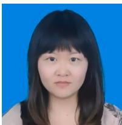

Xin Guo, received the Ph.D. degree in communication and information system from Zhengzhou University, Zhengzhou, China. She is currently an associate professor at the School of Electrical and Information Engineering, Zhengzhou University. Her research interests include multimedia signal processing, embodied perception and artificial intelligence.