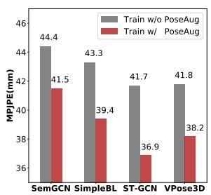
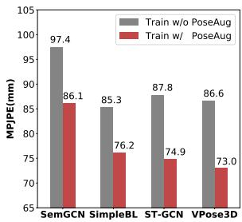
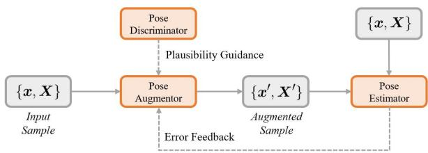
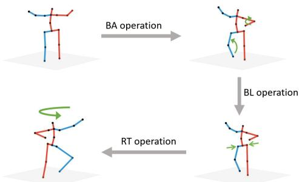
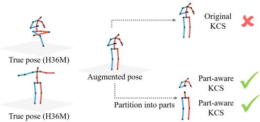
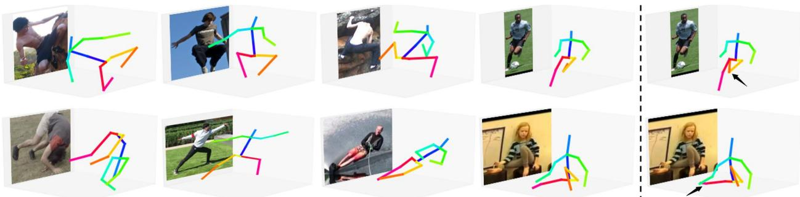
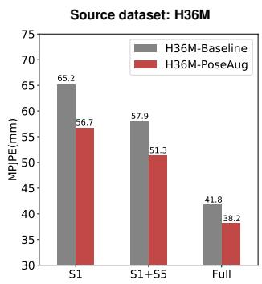
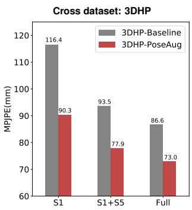
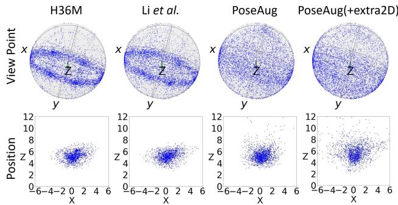

# PoseAug：用于 3D 人体姿态估计的可微姿态增强框架

Kehong Gong \* † Jianfeng Zhang \* Jiashi Feng

National University of Singapore（新加坡国立大学）

gongkehong@u.nus.edu zhangjianfeng@u.nus.edu elefjia@nus.edu.sg

## 摘要

现有的 3D 人体姿态估计器在泛化到新数据集时表现较差，这主要是由于训练数据中 2D-3D 姿态对的多样性有限。为了解决这一问题，我们提出了 PoseAug，这是一种新颖的自动增强框架，旨在学习对现有的训练姿态进行增强以获得更大的多样性，从而提升训练得到的 2D 到 3D 姿态估计器的泛化能力。具体而言，PoseAug 引入了一种新颖的姿态增强器，通过可微操作学习调整姿态的各种几何因素（例如姿势、体型、视角和位置）。借助这种可微特性，增强器可以与 3D 姿态估计器进行联合优化，并将估计误差作为反馈，以在线方式生成更多样且更具挑战性的姿态。此外，PoseAug 引入了一种新颖的局部感知运动链空间（part-aware Kinematic Chain Space），用于评估局部关节角度的合理性，并相应地开发了一个判别模块以确保增强姿态的合理性。这些精心设计使 PoseAug 能够比现有的离线增强方法生成更多样且合理的姿态，从而使姿态估计器获得更好的泛化能力。PoseAug 具有通用性，易于应用于各种 3D 姿态估计器。大量实验表明，PoseAug 在同场景和跨场景数据集上均带来了显著的改进。值得注意的是，在跨数据集评估设置下，它在 MPI-INF-3DHP 上达到了 88.6% 的 3D PCK，比先前基于数据增强的最佳方法 [22] 提高了 9.1%。代码可在以下地址获取：https://github.com/jfzhang95/PoseAug。

## 1. 引言

3D 人体姿态估计旨在估计图像或视频中的 3D 人体关节点。这是一项基础任务，在动作识别 [47, 39]、人机交互 [11]、人体跟踪 [29] 等领域具有广泛的应用。该任务通常使用基于学习的方法 [26, 52, 3, 32] 来解决，这些方法依赖于在实验室环境中采集的真实标注数据 [16]。尽管这些方法在室内场景中取得了成功，但它们很难泛化到跨场景数据集（例如野外场景数据集）。我们认为，其较差的泛化性能主要是由于训练数据的多样性有限，例如人体姿势、体型、相机视角和位置的变化有限。

源数据集：H36M  

跨数据集：3DHP  
  
Figure 1: 四个成熟模型 [52, 26, 33, 3] 在使用与不使用 PoseAug 训练时，在 H36M（数据集内评估）和 3DHP（跨数据集评估）上的估计误差（以 MPJPE 为单位）。PoseAug 显著提升了它们在数据集内和跨数据集设置下的性能。

近期的研究探索了利用数据增强（data augmentation）来提升训练数据的多样性并增强所训练模型的泛化能力。它们要么通过图像合成 [37, 29, 28] 与生成 [5, 42] 来产生数据，要么通过应用预定义的变换直接从现有的训练数据中生成 2D-3D 姿态对 [22]。然而，所有这些工作都将数据增强和模型训练视为两个独立的阶段，并以离线方式进行数据增强，与模型训练缺乏交互。因此，它们往往会生成对模型训练而言过于简单的无效增强数据，导致对模型泛化能力的提升微乎其微。此外，这些方法在数据增强时严重依赖预定义的规则，例如关节角度限制 [1] 和运动学约束 [37]，这限制了生成数据的多样性，并使得到的模型难以泛化到更具挑战性的自然（in-the-wild）场景中。

为了提升增强数据的多样性，我们提出了 PoseAug，一种用于 3D 人体姿态估计的全新自动增强（auto-augmentation）框架。PoseAug 没有将数据增强和网络训练割裂开来，而是以在线方式端到端地联合优化增强过程与网络训练。我们的核心见解是，来自训练过程的反馈可以作为有效的指导信号，用来自适应地改进数据增强。具体而言，PoseAug 利用由神经网络实现的可微增强模块（“增强器”，augmentor）直接对训练数据中的 2D-3D 姿态对进行增强。考虑到姿态对中几何方面潜在的域偏移（domain shift，例如姿势、视角）[36, 22, 50]，增强器学习执行三种类型的增强操作，分别控制 1) 骨骼关节角度、2) 身体尺寸以及 3) 视角和人体位置。通过这种方式，增强器能够生成具有更多样化几何特征的增强姿态，从而缓解多样性受限的问题。凭借其可微特性，增强器可以通过误差反馈策略与姿态估计器一起进行端到端的联合优化。具体来说，通过将增加估计器的训练损失作为学习目标，增强器可以通过扩大数据变化和难度来丰富输入姿态对；反过来，通过克服这些不断增加的难度，姿态估计器在训练过程中会变得越来越强大。

为了确保增强姿态的合理性，我们使用姿态判别器模块来指导数据增强，以避免生成可能妨碍模型训练的不合理关节角度 [1]、不合理位置或视点。具体而言，该模块包含一个用于增强关节角度合理性的 3D 姿态判别器和一个用于指导身体尺寸、视点和位置合理性的 2D 姿态判别器。该 3D 姿态判别器采用运动学链空间（Kinematic Chain Space，KCS）[44] 表示，并将其扩展为用于局部级监督的部件感知 KCS。更具体地，它将骨骼关节划分为若干部件，分别关注每个部件中的关节角度，而不是整个身体姿态，从而赋予增强姿态更大的灵活性。通过以端到端的方式联合训练姿态增强器、估计器和判别器（Fig. 2），PoseAug 能够大幅提高训练数据的多样性，进而提升模型在源数据集和更具挑战性的跨场景数据集上的性能。

我们的 PoseAug 框架在 3D 人体姿态估计器的选择上具有很高的灵活性。PoseAug 在四个代表性的 3D 姿态估计模型 [52, 26, 33, 3] 上，于源数据集（H36M）[16] 和跨场景数据集（3DHP）[29] 上均取得了显著提升，充分证明了这一点（Fig. 1）。值得注意的是，在 3DHP 上，它使所有模型关于 MPJPE 获得了超过 13.1% 的平均性能提升。此外，在跨数据集评估设置下，它在 3DHP 上达到了 88.6% 的 3D PCK，相比以往基于数据增强的最佳方法 [22] 提升了 9.1%。

  
Figure 2: 我们的 PoseAug 框架概览。增强器、估计器和判别器通过误差反馈训练策略进行端到端联合训练。因此，增强器能够在估计器和判别器的指导下学习如何增强数据。

我们的贡献主要有三个方面：1) 据我们所知，我们是首个在 3D 人体姿态估计中研究可微数据增强的工作。2) 我们提出了一种可微姿态增强器及误差反馈设计，能够生成多样且逼真的 2D-3D 姿态对以训练 3D 姿态估计器，并极大增强了模型的泛化能力。3) 我们提出了一种新的部件感知 3D 判别器，通过局部级监督扩大了增强姿态的可行区域，兼顾了数据的合理性与多样性。

## 2. 相关工作

3D 人体姿态估计 近年来 3D 人体姿态估计的进展在很大程度上受到各种深度神经网络模型部署的推动 [41, 26, 12, 52, 31, 3, 38, 53]。然而，它们都高度依赖于标注良好的数据来进行全监督模型训练，并且很难泛化到训练数据集中未见过的模式的新场景，例如新的相机视角和人体姿态。因此，一些近期的工作探索利用外部信息来提高其泛化能力。例如，一些方法 [54, 48, 9, 44, 14, 45, 6, 33, 20] 利用在野外采集的 2D 姿态数据进行模型训练，例如通过探索运动学先验进行正则化或后处理 [54, 9, 33]，以及对抗训练 [48, 44]。最近，基于几何的自监督学习 [36, 10, 4, 19, 34, 23, 35] 已被用于利用无标注数据训练模型。尽管这些方法有效，但其应用在很大程度上受限于合适外部数据集的可用性。与专注于复杂的网络架构和学习方案不同，我们探索了一种可学习的姿态增强框架，以直接丰富手头的 3D 姿态数据。具体而言，所提出的框架可以生成兼具多样性和合理性的 2D-3D 姿态对，用于训练姿态估计模型。此外，我们的框架是通用的，可以适用于这些方法以进一步提高其性能。

3D 人体姿态的数据增强 数据增强被广泛用于缓解训练数据多样性的瓶颈并提高模型的泛化能力。一些工作通过拼接图像块来增强数据 [37, 29, 51]，还有一些工作利用图形引擎生成新数据 [5, 42]。最近，Li 等人 [22] 通过在源数据集上随机应用部分骨架重组和关节点角度扰动，直接增强 2D-3D 姿态对。为了确保数据的合理性，施加了若干约束，包括关节点角度限制 [1] 以及在视角和人体位置上的固定增强范围。尽管在源数据上取得了良好的效果，但这些预定义的规则限制了数据多样性的扩展，并损害了模型在更具挑战性的野外场景中的适用性。与所有这些方法不同，我们首次尝试探索 3D 人体姿态估计上的可学习数据增强，并证明其对于提高模型泛化能力是有效的。

## 3. 方法

## 3.1. 问题定义

令 $\pmb { x } \in \mathbb { R } ^ { 2 \times J }$ 表示图像中人体 J 个关键点的 2D 空间坐标，$\pmb { X } \in \mathbb { R } ^ { 3 \times J }$ 表示相机坐标系中对应的 3D 关节点位置。我们的目标是获得一个 3D 姿态估计器 $\mathcal { P } : \pmb { x } \mapsto \pmb { X }$，以从输入的 2D 姿态中恢复 3D 姿态信息。通常，带有参数 $\theta$ 的估计器 ${ \mathcal P }$ 是通过解决以下优化问题在标注良好的源数据集（例如，控制良好的室内环境 [16]）上进行训练的：

$$
\min _ {\theta} \mathcal {L} _ {\mathcal {P}} (\mathcal {P} _ {\theta}, \mathcal {X}) = \mathcal {L} _ {\mathcal {P}} (\mathcal {P} _ {\theta} (\boldsymbol {x}), \boldsymbol {X}),\tag{1}
$$

其中 $\mathcal { X } = \{ \pmb { x } , \pmb { X } \}$ 表示来自源训练数据集的成对 2D-3D 姿态，损失函数 $\mathcal { L } _ { \mathcal { P } }$ 通常定义为预测的 3D 姿态与真实 3D 姿态之间的均方误差（MSE）。然而，通常会观察到，在这样的室内数据集上训练的姿态估计器 $\mathcal { P }$ 很难泛化到具有更多样化姿态、体型、视角或人体位置的新数据集（例如，自然场景）[14, 50, 46]。

为了提高模型的泛化能力，我们提出设计一个姿态增强器 $\mathcal { A } : \mathcal { X } \mapsto \mathcal { X } ^ { \prime }$，将训练姿态对 X 增强为更加多样化的姿态对 $\mathcal { X } ^ { \prime } = \{ \pmb { x } ^ { \prime } , \pmb { X } ^ { \prime } \}$ 来训练模型 $\mathcal { P }$：

$$
\min _ {\theta} \mathcal {L} _ {\mathcal {P}} (\mathcal {P} _ {\theta}, \mathcal {A} (\mathcal {X})).\tag{2}
$$

有几种以离线方式构建增强器的策略，例如随机增强 [5, 29, 42] 或基于进化的增强 [22]。与此不同的是，我们提出通过带有参数 $\theta _ { A }$ 的神经网络来实现增强器 A，并以在线方式与估计器联合训练，从而可以充分利用姿态估计器的损失作为增强多样性的代理指标，并有效地指导增强器的学习。具体而言，增强器被训练用于生成更困难的增强样本，以增加当前姿态估计器的训练损失：

$$
\min _ {\theta} \max _ {\theta_ {A}} \mathcal {L} _ {\mathcal {P}} (\mathcal {P} _ {\theta}, \mathcal {A} _ {\theta_ {A}} (\mathcal {X})).\tag{3}
$$

## 3.2. PoseAug 形式化定义

我们提出的框架旨在生成多样化的训练数据，并为姿态估计器提供适当的难度，从而提高模型的泛化性能。因此需要解决两个挑战：如何使增强后的数据具有多样性且有利于模型训练；以及如何使它们自然且逼真。为了解决这些问题，我们在训练增强器（augmentor）时提出了两个新颖的构想。

面向在线姿态增强的误差反馈学习 与以离线方式执行随机姿态增强 [37, 5, 22] 不同，所提出的姿态增强器 $\mathcal { A }$ 采用了可微设计，能够与姿态估计器 $\mathcal { P } .$ 进行在线联合训练。通过将来自姿态估计器 $\mathcal { P }$ 的训练误差作为反馈（见公式 (3)），姿态增强器 A 学习生成最适合当前姿态估计器的姿态——由于在线增强，增强后的姿态呈现出适当的难度和多样性，从而最大程度地有利于所训练的 3D 姿态估计模型的泛化。

面向合理姿态增强的判别式学习 纯粹追求误差最大化的增强可能会导致违背人体生物力学结构的不合理训练姿态，并可能损害模型性能。先前的增强方法 [37, 5, 22] 大多依赖预定义的规则来确保合理性（例如关节角度约束 [1]），但这会严重限制生成姿态的多样性。例如，一些难度更大但合理的姿态可能无法通过其基于规则的合理性检查 [22]，因而不会被用于模型训练。为了解决这个问题，我们在身体关节的局部关系上部署了一个姿态判别器模块 [44] 来辅助训练增强器，从而在不牺牲多样性的前提下确保增强姿态的合理性。

## 3.3. 架构

图 2 总结了我们的 PoseAug 架构设计。它包括 1) 一个姿态增强器，将输入的姿态对 $\{ x , X \}$ 增强为增强后的姿态对 $\{ x ^ { \prime } , X ^ { \prime } \}$，用于姿态估计器 P 的训练；2) 一个包含 3D 和 2D 空间中两个判别器的姿态判别器模块，用于确保增强数据的合理性；以及 3) 一个提供姿态估计误差反馈的 3D 姿态估计器。

增强器 给定一个 3D 姿态 $\pmb { X } \in \mathbb { R } ^ { 3 \times J } .$，增强器首先通过分层变换 $B = \mathcal { H } ( \pmb { X } ) \ [ 4 4 , 2 2 ]$ 获得其骨骼向量 $B \in \mathbb { R } ^ { 3 \times ( J - 1 ) }$，该向量可进一步分解为骨骼方向向量 $\hat { B }$（表示关节角度）和骨骼长度向量 $\| B \|$（表示体型大小）。

随后，增强器利用多层感知机（MLP）从输入的 3D 姿态 X 中提取特征。此外，在特征提取过程中，将基于高斯分布的噪声向量与 X 进行拼接，以引入足够的随机性来增强特征多样性。提取的特征随后用于回归三个操作参数（$( \gamma _ { b a } , \gamma _ { b l }$ 和 (R, t)），以改变关节角度、体型以及视点和位置，如图 3 所示。在这些参数中：

1) $\gamma _ { b a } \in \mathbb { R } ^ { 3 \times ( J - 1 ) }$ 是用于调整骨骼角度（Bone Angle, BA）的骨骼角度残差向量，具体如下：

$$
\hat {B} ^ {\prime} = \hat {B} + \gamma_ {b a}, \quad (\text { BA   operation }).\tag{4}
$$

具体而言，BA 操作会将输入的骨骼方向向量 $\hat { B }$ 旋转 $\gamma _ { b { \pmb a } } .$，从而生成新的骨骼方向向量 $\hat { B ^ { \prime } }$。

2) $\gamma _ { b l } \in \mathbb { R } ^ { 1 \times ( J - 1 ) }$ 表示用于调整骨骼长度（Bone Length, BL）的骨骼长度比例向量：

$$
\| \boldsymbol {B} ^ {\prime} \| = \| \boldsymbol {B} \| \times (1 + \gamma_ {b l}), \quad (\text { BL   operation }).\tag{5}
$$

BL 操作通过 $\gamma _ { b l }$ 修改输入的骨骼长度向量 $\| B \|$ 来调整体型。值得注意的是，为确保生物力学对称性，身体的左右部分共享相同的参数。

3) $\pmb { R } \in \mathbb { R } ^ { 3 \times 3 }$ 和 $\pmb { t } \in \mathbb { R } ^ { 3 \times 1 }$ 分别表示用于刚性变换（Rigid Transformation, RT）操作的旋转和平移参数，以控制姿态视点和位置：

$$
\boldsymbol {X} ^ {\prime} = \boldsymbol {R} \left[ \mathcal {H} ^ {- 1} \left(\boldsymbol {B} ^ {\prime}\right) \right] + \boldsymbol {t}, \quad (\text { RT   operation }),\tag{6}
$$

其中 $\boldsymbol { B } ^ { \prime } = \| \boldsymbol { B } ^ { \prime } \| \times \hat { B } ^ { \prime }$ 是由上述 BA 和 BL 操作得到的增强骨骼向量。$\mathcal { H } ^ { - 1 }$ 是将 $B ^ { \prime }$ 转换回 3D 姿态的分层逆变换 [44, 22]。

通过应用这些操作，增强器可以从原始 3D 姿态 X 生成具有更具挑战性的姿态、体型、视点和位置的增强 3D 姿态 $X ^ { \prime }$（图 3）。然后，利用原始数据中的相机参数，通过 $\pmb { x } ^ { \prime } = \Pi ( \pmb { X } ^ { \prime } )$ 将增强后的姿态重新投影到 2D，其中 $\Pi : \mathbb { R } ^ { 3 }  \mathbb { R } ^ { 2 }$ 表示透视投影 [15]。随后，增强后的 2D-3D 对 $\{ x ^ { \prime } , X ^ { \prime } \}$ 被用于进一步训练姿态估计器。

Figure 3: 使用 PoseAug 进行的数据增强操作。通过修改源 3D 姿态的姿势（通过 BA 操作）、身体尺寸（通过 BL 操作）以及视点和位置（通过 RT 操作）对其进行增强。  
  
Figure 4: 原始与基于部件感知的 KCS 判别器之间的差异示意图。给定一个新颖且有效的增强姿态，原始基于 KCS 的判别器会因其未出现在源数据（H36M）中而将其错误地分类为假，而基于部件感知的 KCS 判别器由于检查局部关节关系，会将其识别为真实并予以认可。可以看出，基于部件感知的 KCS 判别器有助于增强器生成更多样化且合理的姿态增强。

判别器（Discriminator） 由于在增强过程中缺乏先验，增强后的姿态可能会出现违背生物力学结构 [1] 的不合理关节角度，或不合理的位置和视点。尽管这些姿态对估计器来说确实是更具挑战性的样本，但在这些姿态上进行训练并不能提升模型的泛化能力。

为确保增强姿态的合理性，我们引入了一个姿态判别器模块来指导增强过程。具体来说，该模块由用于评估关节角度合理性的 3D 姿态判别器 $D _ { 3 d }$ 和用于评估身体尺寸、视点及位置合理性的 2D 判别器 $D _ { 2 d }$ 组成。

3D 姿态判别器设计的关键是在不牺牲多样性的前提下确保姿态的合理性。受运动链空间（Kinematic Chain Space, KCS）[44] 的启发，我们设计了部件感知 KCS（part-aware KCS）作为判别器的输入。与原始 KCS 考虑全身姿态不同，我们的部件感知 KCS 仅关注局部关节角度，从而扩大了增强姿态的可行区域，兼顾了合理性与多样性（Fig. 4）。

具体来说，为了计算输入姿态（无论是 X 还是其增强姿态 $X ^ { \prime }$）的部件感知 KCS，我们如上所述将姿态转换为骨骼方向向量 $\hat { B }$，并将其划分为 5 个部分（躯干和左/右手臂/腿）[1]，分别记为 $\hat { B } _ { i } , i =$ $1 , \ldots , 5$。然后，我们为第 i 个部分计算如下局部关节角度矩阵 $K C S _ { l o c a l } ^ { i }$：

$$
K C S _ {l o c a l} ^ {i} = \hat {\boldsymbol {B}} _ {i} ^ {\top} \hat {\boldsymbol {B}} _ {i},\tag{7}
$$

该矩阵封装了第 i 个部分内部的关节间角度信息。基于上述局部 KCS 表示，构建了一个 3D 姿态判别器 $D _ { 3 d }$，它以 $K C S _ { l o c a l } ^ { i }$ 作为输入，并通过训练来区分原始 3D 姿态和增强 3D 姿态。

除了 3D 判别器之外，我们还引入了一个 2D 判别器来引导增强器生成逼真的身体尺寸、视角和位置。由于 2D 姿态包含视角（旋转）、位置（平移）和身体尺寸（骨长）等信息，2D 判别器可以通过对抗训练学习此类信息，并引导姿态增强器生成逼真的旋转 $\scriptstyle { R , }$、平移 t 和骨长比例 $\gamma _ { b l }$。

估计器 姿态估计器 $\mathcal { P }$ 从 2D 姿态估计 3D 姿态。我们使用原始与增强后的 2D-3D 姿态对 $\{ x , X \}$ 和 $\{ { \pmb x } ^ { \prime } , { \pmb X } ^ { \prime } \}$ 来训练姿态估计器。该姿态估计器包含一个用于从 2D 姿态中捕获内部特征的特征提取器，以及一个用于估计相应 3D 姿态的回归层。此外，任何现有的有效估计器都可以在我们的 PoseAug 框架中实现。在 Sec. 4.3 中，我们进行了实验以检验 PoseAug 在不同估计器下的鲁棒性，结果表明 PoseAug 能为所有模型在源数据集和跨场景数据集上均带来显著的性能提升。

## 3.4. 训练损失

姿态估计损失 我们采用真实值（GT）X 与预测姿态 $\widetilde { X }$ 之间的均方误差（MSE）作为姿态估计损失，公式表示为

$$
\mathcal {L} _ {\mathcal {P}} = \| \boldsymbol {X} - \widetilde {\boldsymbol {X}} \| _ {2} ^ {2}.\tag{8}
$$

我们结合原始与增强后的姿态对，使用 $\mathcal { L } _ { \mathcal { P } }$ 联合训练姿态估计器，这可以显著提升在具有挑战性的野外场景中的性能。

姿态增强损失 为了促进模型训练，增强后的数据应该比原始数据更难，即 $\mathcal { L } _ { \mathcal { P } } ( X ^ { \prime } ) > \mathcal { L } _ { \mathcal { P } } ( X )$，但又不能过难而损害训练过程。设计损失函数的一种简单方法是使增强数据和原始数据上的姿态估计损失之差保持在合适范围内。受 [25, 21] 的启发，我们实现了一个可控的反馈损失，形式为

$$
\mathcal {L} _ {f b} = | 1. 0 - \exp [ \mathcal {L} _ {\mathcal {P}} (\boldsymbol {X} ^ {\prime}) - \beta \mathcal {L} _ {\mathcal {P}} (\boldsymbol {X}) ] |,\tag{9}
$$

其中 $\beta > 1$ 控制生成姿态的难度级别，使 $\mathcal { L } _ { \mathcal { P } } ( X ^ { \prime } )$ 的值相对于 $\mathcal { L } _ { \mathcal { P } } ( X )$ 保持在一定范围内。在训练过程中，随着姿态估计器变得越来越强大，我们相应地增大了 $\beta$ 值，以生成更具挑战性的增强数据来对其进行训练。

此外，为了防止极端困难的样本导致训练崩溃，我们引入了一个修正 L2 损失用于对增强参数 $\gamma _ { b a }$ 和 γbl 进行正则化：

$$
\mathcal {L} _ {r e g} (\boldsymbol {\gamma}) = \left\{ \begin{array}{l l} 0, & \text { if } \bar {\boldsymbol {\gamma}} <   t h r e s h o l d, \\ \| \boldsymbol {\gamma} \| ^ {2}, & \text { otherwise }, \end{array} \right.\tag{10}
$$

其中 $\gamma$ 表示 $\gamma _ { b a }$ 和 $\gamma _ { b l }$，$\bar{\gamma}$ 表示其所有元素的平均值。结合公式 (9) 和公式 (10)，总增强损失 $\mathcal { L } _ { A }$ 表示为

$$
\mathcal {L} _ {\mathcal {A}} = \mathcal {L} _ {f b} + \mathcal {L} _ {r e g}.\tag{11}
$$

姿态判别损失 对于判别损失 $\mathcal { L } _ { D }$，我们在 3D 和 2D 空间中均采用 LS-GAN 损失 [25]：

$$
\begin{array}{r} \mathcal {L} _ {\mathcal {D}} = \mathbb {E} [ (D _ {3 d} (\boldsymbol {X}) - 1) ^ {2} ] + \mathbb {E} [ D _ {3 d} (\boldsymbol {X} ^ {\prime}) ^ {2} ] \\ + \mathbb {E} [ (D _ {2 d} (\boldsymbol {x}) - 1) ^ {2} ] + \mathbb {E} [ D _ {2 d} (\boldsymbol {x} ^ {\prime}) ^ {2} ], \end{array}\tag{12}
$$

其中 $\{ x , X \}$ 和 $\{ { \pmb x } ^ { \prime } , { \pmb X } ^ { \prime } \}$ 分别表示原始（真实）和增强（伪造）姿态对。

端到端训练策略 借助可微设计，姿态增强器、判别器和估计器可以进行联合端到端训练。我们通过最小化公式 (11)、公式 (12) 和公式 (8) 中的损失来交替更新它们。此外，在端到端训练整个框架之前，我们首先预训练姿态估计器 $\mathcal { P }$，这确保了训练的稳定性并能产生更好的性能。

## 4. 实验

我们在实验中研究了四个问题：1) PoseAug 是否能够在数据集内和跨数据集场景下均提高 3D 姿态估计器的性能？2) PoseAug 在增强训练数据多样性方面是否有效？3) PoseAug 对于不同的姿态估计器以及训练数据有限的情况是否始终有效？4) PoseAug 的各个组件是如何发挥作用的？我们在 H36M、3DHP 和 3DPW 上进行了实验。在整个实验过程中，除非另有说明，我们均采用 VPose [33] 的单帧版本作为姿态估计器。

## 4.1. 数据集

Human3.6M (H36M) [16] 遵循以往的工作 [26, 52]，我们在 H36M 的受试者 S1、5、6、7、8 上训练模型，并在受试者 S9 和 S11 上进行评估。我们使用两个评估指标：以毫米为单位的平均每关节位置误差（Mean Per Joint Position Error, MPJPE）以及通过刚性变换与真实 3D 姿态（GT 3D poses）对齐后的 MPJPE（PA-MPJPE）。

MPI-INF-3DHP (3DHP) [29] 这是一个包含 130 万帧的大型 3D 姿态数据集，呈现出比 H36M 更具多样性的动作。我们使用其测试集来评估模型对未见环境的泛化能力，采用的评估指标包括 MPJPE、正确关键点百分比（Percentage of Correct Keypoints, PCK）和曲线下面积（Area Under the Curve, AUC）。

3DPW [43] 这是一个包含更复杂动作和场景的野外（in-the-wild）数据集。为了验证所提方法在具有挑战性的野外场景中的泛化能力，我们使用其测试集进行评估，并以 PA-MPJPE 作为评估指标。

MPII [2] 和 LSP [17] 它们是仅包含 2D 人体关节点标注的野外数据集，用于定性评估模型对未见姿态的泛化能力。

## 4.2. 实验结果

H36M 上的结果 我们在 H36M 上将 PoseAug 与最先进的方法 [52, 38, 33, 30, 22] 进行了比较。与 [22] 类似，我们使用来自 HR-Net [40] 的 2D 姿态作为输入。如 Table 1 所示，我们的方法大幅优于 SOTA 方法 [52, 38, 33, 30]，证明了其有效性。值得注意的是，与以往最佳的增强方法 [22] 相比，尽管后者使用了外部骨骼长度数据进行数据增强，且用于模型训练的数据量几乎是我们的 3 倍，我们的 PoseAug 仍取得了更低的 MPJPE。这清楚地验证了 PoseAug 在线增强方案的优势——它能够生成更多样化且信息更丰富的数据，从而更好地有益于模型训练。

Table 1: H36M 上基于 MPJPE 和 PA-MPJPE 的评估结果。最佳结果以粗体显示。

<table><tr><td>方法</td><td>MPJPE (↓)</td><td>PA-MPJPE (↓)</td></tr><tr><td>SemGCN (CVPR&#x27;19) [52]</td><td>57.6</td><td>-</td></tr><tr><td>Sharma et al.(CVPR&#x27;19) [38]</td><td>58.0</td><td>40.9</td></tr><tr><td>VPose (CVPR&#x27;19) [33] (1-frame)</td><td>52.7</td><td>40.9</td></tr><tr><td>Moon et al.(ICCV&#x27;19) [30]</td><td>54.4</td><td>-</td></tr><tr><td>Li et al.(CVPR&#x27;20) [22]</td><td>50.9</td><td>38.0</td></tr><tr><td>Ours</td><td>50.2</td><td>39.1</td></tr></table>

Table 2: 3DHP 上的结果。CE 表示跨场景评估。PCK、AUC 和 MPJPE 用于评估。

<table><tr><td>方法</td><td>CE</td><td>PCK (↑)</td><td>AUC (↑)</td><td>MPJPE (↓)</td></tr><tr><td>Mehta et al. [27]</td><td></td><td>76.5</td><td>40.8</td><td>117.6</td></tr><tr><td>VNect [29]</td><td></td><td>76.6</td><td>40.4</td><td>124.7</td></tr><tr><td>Multi Person [28]</td><td></td><td>75.2</td><td>37.8</td><td>122.2</td></tr><tr><td>OriNet [24]</td><td></td><td>81.8</td><td>45.2</td><td>89.4</td></tr><tr><td>LCN [8]</td><td>✓</td><td>74.0</td><td>36.7</td><td>-</td></tr><tr><td>HMR [18]</td><td>✓</td><td>77.1</td><td>40.7</td><td>113.2</td></tr><tr><td>SRNet [49]</td><td>✓</td><td>77.6</td><td>43.8</td><td>-</td></tr><tr><td>Li et al. [22]</td><td>✓</td><td>81.2</td><td>46.1</td><td>99.7</td></tr><tr><td>RepNet [44]</td><td>✓</td><td>81.8</td><td>54.8</td><td>92.5</td></tr><tr><td>Ours</td><td>✓</td><td>88.6</td><td>57.3</td><td>73.0</td></tr><tr><td>Ours(+Extra2D)</td><td>✓</td><td>89.2</td><td>57.9</td><td>71.1</td></tr></table>

在 3DHP 上的结果（跨场景） 接下来，我们评估 PoseAug 如何促进模型在跨场景数据集上的泛化能力。我们将 PoseAug 与各种最先进的方法进行了比较，包括使用离线数据增强的最新方法 [22]、利用复杂网络架构的方法 [8, 49] 和弱监督学习方法 [18, 44]，以及在 3DHP 训练集上训练的方法 [27, 29, 28, 24]。从 Table 2 中可以看出，我们的方法在所有指标上均取得了最佳性能，大幅超越了以往的方法。这验证了 PoseAug 在提升模型对未知场景泛化能力方面的有效性。此外，PoseAug 还可以通过使用额外的野外 2D 姿态（MPII）来训练 2D 判别器，从而进一步提升性能（MPJPE 从 73.0 改善至 71.1）。这证明了其在利用额外 2D 姿态以进一步丰富增强数据多样性方面的可扩展性。

在 3DPW 上的结果（跨场景） 我们在 H36M 上分别在不使用和使用 PoseAug 的情况下训练了四种 3D 姿态估计器 [26, 52, 3, 33]，并比较了它们在 3DPW 上的泛化性能。如 Table 4 所示，PoseAug 平均为所有模型带来了 12.6% 的提升。

Table 3: 四种估计器在 3DPW 上的 PA-MPJPE 结果。

<table><tr><td>方法</td><td>PA-MPJPE (↓)</td></tr><tr><td>SemGCN [52]</td><td>102.0</td></tr><tr><td>+ PoseAug</td><td>82.2 (-19.8)</td></tr><tr><td>SimpleBaseline [26]</td><td>89.4</td></tr><tr><td>+ PoseAug</td><td>78.1 (-11.3)</td></tr><tr><td>ST-GCN [3](1-frame)</td><td>98.0</td></tr><tr><td>+ PoseAug</td><td>73.2 (-24.8)</td></tr><tr><td>VPose [33] (1-frame)</td><td>94.6</td></tr><tr><td>+ PoseAug</td><td>81.6 (-13.0)</td></tr></table>

定性结果 为了进行主观评估，我们选择了四个具有挑战性的数据集，即 LSP、MPII、3DHP 和 3DPW，它们的数据与来自 H36M 的数据在姿态、体型和视角上存在很大差异。结果如图 Fig. 5 所示。我们可以看到，即使对于那些未见过的困难姿态，我们的方法也表现得相当出色。

## 4.3. PoseAug 分析

对不同估计器的适用性 我们的 PoseAug 框架是通用的，适用于不同的 3D 姿态估计器（3D pose estimators）。为了证明这一点，我们采用四种具有代表性的 3D 姿态估计器作为骨干网络：1）SemGCN [52]，一种基于图的 3D 姿态估计网络；2）SimpleBaseline [26]，一种有效的基于 MLP 的网络；3）ST-GCN [3]（1-frame），一种使用基于 GCN 的架构来编码全局和局部关节点关系的先驱网络；4）VPose [33]（1-frame），一种具有 SOTA 性能的全卷积网络。我们使用来自四种不同 2D 姿态检测器（包括 CPN [7]、DET [13]、HR-Net [40] 和真值（GT））的 2D 姿态在 H36M 数据集上训练这些模型。我们在 H36M 和 3DHP 的测试集上根据 MPJPE 指标对这些模型进行评估。在 H36M 上，我们使用相应的 2D 姿态进行评估；而在 3DHP 上，我们使用 GT 2D 姿态评估这些模型，以排除 2D 姿态检测器的影响。结果如 Table 4 所示。我们可以看到 PoseAug 在 H36M 和更具挑战性的 3DHP 数据集上都为所有模型带来了明显的提升。值得注意的是，在使用 PoseAug 训练时，它们在 3DHP 上获得了超过 13.1% 的平均提升。

  
Figure 5: 来自 LSP、MPII、3DHP 和 3DPW 的 3D 姿态估计示例。我们的结果显示在左侧四列中。最右侧一列显示了未使用 PoseAug 训练的 Baseline——VPose [33] 的结果。误差用黑色箭头标出。

Table 4: 在 H36M 和 3DHP 数据集上，使用与不使用 PoseAug 训练的各种姿态估计器在 MPJPE 上的性能对比。DET、CPN、HR 和 GT 分别表示在不同 2D 姿态来源上训练的 3D 姿态估计模型。我们在 H36M 测试集上使用相应的 2D 姿态源评估模型。在 3DHP 测试集上，我们使用 GT 2D 姿态作为输入来评估模型的泛化能力。我们可以观察到 PoseAug 在所有数据集和估计器上均一致地降低了误差。

<table><tr><td></td><td colspan="4">H36M</td><td colspan="4">3DHP</td></tr><tr><td>方法</td><td>DET</td><td>CPN</td><td>HR</td><td>GT</td><td>DET</td><td>CPN</td><td>HR</td><td>GT</td></tr><tr><td>SemGCN [52]</td><td>67.5</td><td>64.7</td><td>57.5</td><td>44.4</td><td>101.9</td><td>98.7</td><td>95.6</td><td>97.4</td></tr><tr><td>+ PoseAug</td><td>65.2 (-2.3)</td><td>60.0 (-4.8)</td><td>55.0 (-2.5)</td><td>41.5 (-2.8)</td><td>89.9 (-11.9)</td><td>89.3 (-9.4)</td><td>89.1 (-6.5)</td><td>86.1 (-11.2)</td></tr><tr><td>SimpleBaseline [26]</td><td>60.5</td><td>55.6</td><td>53.0</td><td>43.3</td><td>91.1</td><td>88.8</td><td>86.4</td><td>85.3</td></tr><tr><td>+ PoseAug</td><td>58.0 (-2.5)</td><td>53.4 (-2.2)</td><td>51.3 (-1.7)</td><td>39.4 (-3.9)</td><td>78.7 (-12.4)</td><td>78.7 (-10.1)</td><td>76.4 (-10.1)</td><td>76.2 (-9.1)</td></tr><tr><td>ST-GCN [3] (1-frame)</td><td>61.3</td><td>56.9</td><td>52.2</td><td>41.7</td><td>95.5</td><td>91.3</td><td>87.9</td><td>87.8</td></tr><tr><td>+ PoseAug</td><td>59.8 (-1.5)</td><td>54.5 (-2.4)</td><td>50.8 (-1.5)</td><td>36.9 (-4.8)</td><td>83.5 (-12.1)</td><td>77.7 (-13.6)</td><td>76.6 (-11.3)</td><td>74.9 (-12.9)</td></tr><tr><td>VPose [33] (1-frame)</td><td>60.0</td><td>55.2</td><td>52.7</td><td>41.8</td><td>92.6</td><td>89.8</td><td>85.6</td><td>86.6</td></tr><tr><td>+ PoseAug</td><td>57.8 (-2.2)</td><td>52.9 (-2.3)</td><td>50.2 (-2.5)</td><td>38.2 (-3.6)</td><td>78.3 (-14.4)</td><td>78.4 (-11.4)</td><td>73.2 (-12.4)</td><td>73.0 (-13.6)</td></tr></table>

  
Figure 6: 有限数据设置下的消融实验。我们汇报 MPJPE 以进行评估。彩色查看效果最佳。

在有限训练数据情况下的有效性 3D 姿态标注的采集成本高昂，使得有限的训练数据成为普遍面临的挑战。为了证明我们的方法在解决此类情况时的有效性，我们使用来自 H36M S1 以及 S1+S5 的姿态数据进行模型训练，它们分别仅包含 16% 和 41% 的训练样本。图 6 中的结果表明，在不同训练数据量的情况下，PoseAug 在 H36M 和 3DHP 上均能持续提升模型性能。同时，在训练数据较少的情况下，我们的方法所带来的提升更加显著（例如 3DHP 上的 MPJPE，S1：116.4 → 90.3，全量数据：86.6 → 73.0）。此外，在跨场景泛化方面，仅使用 S1 训练的我们的方法取得了与使用全量数据集训练的基准模型相当的结果（MPJPE：90.3 对比 86.6），而使用 S1+S5 训练的我们的方法则大幅超越了使用全量数据集训练的基准模型（MPJPE 为 77.9 对比 86.6）。

对增强器的分析 我们接着检验增强器中各个模块的有效性。表 5 总结了结果。通过逐步添加 BA、RT 和 BL 操作，姿态估计误差可以从 41.8/86.6 单调下降至 38.8/73.5（在 H36M/3DHP 上）。此外，引入误差反馈引导可以进一步将 H36M 的性能提升至 38.2，3DHP 的性能提升至 73.0。这些结果验证了增强器中各模块在生成更有效的增强样本方面的有效性。在这些模块中，RT 对跨场景性能的贡献最大，这表明它最有效地提升了数据多样性。

  
Figure 7: 原始数据 H36M 以及来自 Li 等人 [22]、PoseAug（第 3 列）和带有额外 2D 姿态的 PoseAug 的增强数据在视角（顶行）和位置（底行）上的分布。该分布表明 PoseAug 显著提高了视角和位置的多样性。

Table 5: 增强器组件的消融实验。我们报告了在 H36M 和 3DHP 数据集上的 MPJPE。

<table><tr><td>方法</td><td>BA</td><td>RT</td><td>BL</td><td>Feedback</td><td>H36M (↓)</td><td>3DHP (↓)</td></tr><tr><td>Baseline</td><td></td><td></td><td></td><td></td><td>41.8</td><td>86.6</td></tr><tr><td>Variant A</td><td>√</td><td></td><td></td><td></td><td>39.7 (-2.1)</td><td>85.2 (-1.4)</td></tr><tr><td>Variant B</td><td></td><td>√</td><td></td><td></td><td>39.2 (-2.6)</td><td>75.9 (-10.7)</td></tr><tr><td>Variant C</td><td>√</td><td>√</td><td></td><td></td><td>39.1 (-2.7)</td><td>75.5 (-11.1)</td></tr><tr><td>Variant D</td><td>√</td><td>√</td><td>√</td><td></td><td>38.8 (-3.0)</td><td>73.5 (-13.1)</td></tr><tr><td>PoseAug</td><td>√</td><td>√</td><td>√</td><td>√</td><td>38.2 (-3.6)</td><td>73.0 (-13.6)</td></tr></table>

多样性提升分析 为了证明 PoseAug 在增强数据多样性方面的有效性，考虑到如 Table 5 所示，增强视点和位置的 RT 操作对跨场景性能的贡献最大，我们对视点和位置分布进行了多样性分析。Fig. 7 展示了 H36M 以及由 Li 等人 [22] 和我们的方法生成的增强数据的视点和位置分布。对于 H36M 数据，可以观察到其视点集中在 xz 平面附近，沿 y 轴的多样性有限；其位置形成了一个小而集中的聚类，同样表现出有限的多样性。这解释了为什么在 H36M 上训练的模型很难泛化到自然（in-the-wild）场景。类似地，我们观察到来自 Li 等人 [22] 的增强数据在视点和位置分布上的差异很小。这表明手工设计规则所带来的多样性提升是有限的。相比之下，我们的 PoseAug 可以使用可学习的增强器提供更多合理（plausible）的视点和位置，且多样性显著增加。此外，借助额外的 2D 姿态可以进一步改善人体位置的多样性，这也解释了其在 Table 2 中所带来的泛化能力提升。

判别器分析 在此，我们展示了来自 2D 和 3D 判别器的合理性引导的有效性。Table 6 总结了实验结果。通过仅添加 2D 或 3D 判别器中的一个，基线（baseline）在 H36M/3DHP 上的性能分别提升了 2.2/5.8 和 2.2/7.0。在 PoseAug 训练中同时引入两个判别器可以进一步将 H36M/3DHP 上的性能提升 3.6/13.6，这清楚地验证了两个判别器的有效性，同时也证明了（增强姿态中的）合理性对估计器性能的重要性。

Table 6: 在 H36M 和 3DHP 上对判别器 $\mathcal { D } _ { 2 D }$ 和 $\mathcal { D } _ { 3 D }$ 进行的消融实验。使用 MPJPE 进行评估。

<table><tr><td>Method</td><td> $\mathcal{D}_{2D}$ </td><td> $\mathcal{D}_{3D}$ </td><td>H36M (↓)</td><td>3DHP (↓)</td></tr><tr><td>Baseline</td><td></td><td></td><td>41.8</td><td>86.6</td></tr><tr><td>Variant A</td><td>✓</td><td></td><td>39.6 (-2.2)</td><td>80.8 (-5.8)</td></tr><tr><td>Variant B</td><td></td><td>✓</td><td>39.6 (-2.2)</td><td>79.6 (-7.0)</td></tr><tr><td>PoseAug</td><td>✓</td><td>✓</td><td>38.2 (-3.6)</td><td>73.0 (-13.6)</td></tr></table>

部位感知 KCS（PA-KCS）分析 为了验证其有效性，我们在 PoseAug 中将其替换为 KCS [44]。Table 7 总结了实验结果。PA-KCS 在 3DHP 和 3DPW 上均明显优于 KCS。这证实了我们的 PA-KCS 在训练过程中比 KCS 提供了更好的引导。

Table 7: 部位感知 KCS（PA-KCS）的消融实验。我们报告了 3DHP 上的 MPJPE 以及 3DPW 上的 PA-MPJPE。

<table><tr><td>方法</td><td>KCS</td><td>PA-KCS</td><td>3DHP (↓)</td><td>3DPW (↓)</td></tr><tr><td>基线</td><td></td><td></td><td>86.6</td><td>94.6</td></tr><tr><td>变体 A</td><td>√</td><td></td><td>77.7 (-8.9)</td><td>88.4 (-6.2)</td></tr><tr><td>PoseAug</td><td></td><td>√</td><td>73.0 (-13.6)</td><td>81.6 (-13.0)</td></tr></table>

## 5. 结论

在本文中，我们提出了一个自动增强框架 PoseAug，该框架通过学习丰富训练数据的多样性，进而提升训练后的姿态估计模型的性能。PoseAug 有效集成了包括增强器（augmentor）、估计器（estimator）和判别器（discriminator）在内的三个组件，并使它们之间实现充分交互。具体而言，增强器被设计为可微的，因此能够以估计器的训练误差作为反馈，学习改变 2D-3D 姿态对的主要几何因子，从而更好地适应估计器。判别器则基于一种新颖的部件感知 KCS（part-aware KCS）表示来确保增强数据的合理性。大量实验证明，PoseAug 能够增强出多样且信息丰富的数据，从而提升多种 3D 姿态估计器的估计性能。

致谢 本研究得到了 AISG-100E-2019-035、MOE2017-T2-2-151、NUS ECRA FY17 P08 以及 CRP20-2017-0006 的部分资助。JZ 对 NVIDIA AI Tech Center (NVAITC) 对该研究项目的支持表示感谢。

## 参考文献

[1] Ijaz Akhter and Michael J Black. Pose-conditioned joint angle limits for 3d human pose reconstruction. In CVPR, 2015.

[2] Mykhaylo Andriluka, Leonid Pishchulin, Peter Gehler, and Bernt Schiele. 2d human pose estimation: New benchmark and state of the art analysis. In CVPR, 2014.

[3] Yujun Cai, Liuhao Ge, Jun Liu, Jianfei Cai, Tat-Jen Cham, Junsong Yuan, and Nadia Magnenat Thalmann. Exploiting spatial-temporal relationships for 3d pose estimation via graph convolutional networks. In ICCV, 2019.

[4] Ching-Hang Chen, Ambrish Tyagi, Amit Agrawal, Dylan Drover, Rohith MV, Stefan Stojanov, and James M Rehg. Unsupervised 3d pose estimation with geometric selfsupervision. In CVPR, 2019.

[5] Wenzheng Chen, Huan Wang, Yangyan Li, Hao Su, Zhenhua Wang, Changhe Tu, Dani Lischinski, Daniel Cohen-Or, and Baoquan Chen. Synthesizing training images for boosting human 3d pose estimation. In 3DV, 2016.

[6] Xipeng Chen, Kwan-Yee Lin, Wentao Liu, Chen Qian, and Liang Lin. Weakly-supervised discovery of geometry-aware representation for 3d human pose estimation. In CVPR, 2019.

[7] Yilun Chen, Zhicheng Wang, Yuxiang Peng, Zhiqiang Zhang, Gang Yu, and Jian Sun. Cascaded pyramid network for multi-person pose estimation. In CVPR, 2018.

[8] Hai Ci, Chunyu Wang, Xiaoxuan Ma, and Yizhou Wang. Optimizing network structure for 3d human pose estimation. In ICCV, 2019.

[9] Rishabh Dabral, Anurag Mundhada, Uday Kusupati, Safeer Afaque, Abhishek Sharma, and Arjun Jain. Learning 3d human pose from structure and motion. In ECCV, 2018.

[10] Dylan Drover, Rohith MV, Ching-Hang Chen, Amit Agrawal, Ambrish Tyagi, and Cong Phuoc Huynh. Can 3d pose be learned from 2d projections alone? In ECCVw, 2018.

[11] Andrew Errity. Human–computer interaction. An Introduction to Cyberpsychology, 241, 2016.

[12] Hao-Shu Fang, Yuanlu Xu, Wenguan Wang, Xiaobai Liu, and Song-Chun Zhu. Learning pose grammar to encode human body configuration for 3d pose estimation. In AAAI, 2018.

[13] Ross Girshick, Ilija Radosavovic, Georgia Gkioxari, Piotr Dollar, and Kaiming He. Detectron.´ https://github. com/facebookresearch/detectron, 2018.

[14] Ikhsanul Habibie, Weipeng Xu, Dushyant Mehta, Gerard Pons-Moll, and Christian Theobalt. In the wild human pose estimation using explicit 2d features and intermediate 3d representations. In CVPR, 2019.

[15] Richard Hartley and Andrew Zisserman. Multiple View Geometry in Computer Vision. Cambridge University Press, New York, NY, USA, 2 edition, 2003.

[16] Catalin Ionescu, Dragos Papava, Vlad Olaru, and Cristian Sminchisescu. Human3. 6m: Large scale datasets and predictive methods for 3d human sensing in natural environments. IEEE Trans. on Pattern Analysis and Machine Intelligence, 36(7):1325–1339, 2014.

[17] Sam Johnson and Mark Everingham. Clustered pose and nonlinear appearance models for human pose estimation. In BMVC, 2010.

[18] Angjoo Kanazawa, Michael J. Black, David W. Jacobs, and Jitendra Malik. End-to-end recovery of human shape and pose. In CVPR, 2018.

[19] Muhammed Kocabas, Salih Karagoz, and Emre Akbas. Selfsupervised learning of 3d human pose using multi-view geometry. In CVPR, 2019.

[20] Nikos Kolotouros, Georgios Pavlakos, Michael J Black, and Kostas Daniilidis. Learning to reconstruct 3d human pose and shape via model-fitting in the loop. In ICCV, 2019.

[21] Ruihui Li, Xianzhi Li, Pheng-Ann Heng, and Chi-Wing Fu. Pointaugment: an auto-augmentation framework for point cloud classification. In CVPR, 2020.

[22] Shichao Li, Lei Ke, Kevin Pratama, Yu-Wing Tai, Chi-Keung Tang, and Kwang-Ting Cheng. Cascaded deep monocular 3d human pose estimation with evolutionary training data. In CVPR, 2020.

[23] Yang Li, Kan Li, Shuai Jiang, Ziyue Zhang, Congzhentao Huang, and Richard Yi Da Xu. Geometry-driven selfsupervised method for 3d human pose estimation. In AAAI, 2020.

[24] Chenxu Luo, Xiao Chu, and Alan Yuille. Orinet: A fully convolutional network for 3d human pose estimation. BMVC, 2018.

[25] Xudong Mao, Qing Li, Haoran Xie, Raymond YK Lau, Zhen Wang, and Stephen Paul Smolley. Least squares generative adversarial networks. In ICCV, 2017.

[26] Julieta Martinez, Rayat Hossain, Javier Romero, and James J Little. A simple yet effective baseline for 3d human pose estimation. In ICCV, 2017.

[27] Dushyant Mehta, Helge Rhodin, Dan Casas, Pascal Fua, Oleksandr Sotnychenko, Weipeng Xu, and Christian Theobalt. Monocular 3d human pose estimation in the wild using improved cnn supervision. In 3DV, 2017.

[28] Dushyant Mehta, Oleksandr Sotnychenko, Franziska Mueller, Weipeng Xu, Srinath Sridhar, Gerard Pons-Moll, and Christian Theobalt. Single-shot multi-person 3d pose estimation from monocular rgb. In 3DV, 2018.

[29] Dushyant Mehta, Srinath Sridhar, Oleksandr Sotnychenko, Helge Rhodin, Mohammad Shafiei, Hans-Peter Seidel, Weipeng Xu, Dan Casas, and Christian Theobalt. Vnect: Real-time 3d human pose estimation with a single rgb camera. ACM Trans. on Graphics, 36(4):44, 2017.

[30] Gyeongsik Moon, Ju Yong Chang, and Kyoung Mu Lee. Camera distance-aware top-down approach for 3d multiperson pose estimation from a single rgb image. In ICCV, 2019.

[31] Aiden Nibali, Zhen He, Stuart Morgan, and Luke Prendergast. 3d human pose estimation with 2d marginal heatmaps. In WACV, 2019.

[32] Xuecheng Nie, Jianfeng Zhang, Shuicheng Yan, and Jiashi Feng. Single-stage multi-person pose machines. In ICCV, 2019.

[33] Dario Pavllo, Christoph Feichtenhofer, David Grangier, and Michael Auli. 3d human pose estimation in video with tem-

poral convolutions and semi-supervised training. In CVPR, 2019.

[34] Aleksis Pirinen, Erik Gartner, and Cristian Sminchisescu.¨ Domes to drones: Self-supervised active triangulation for 3d human pose reconstruction. In NeurIPS, 2019.

[35] Helge Rhodin, Victor Constantin, Isinsu Katircioglu, Mathieu Salzmann, and Pascal Fua. Neural scene decomposition for multi-person motion capture. In CVPR, 2019.

[36] Helge Rhodin, Mathieu Salzmann, and Pascal Fua. Unsupervised geometry-aware representation for 3d human pose estimation. In ECCV, 2018.

[37] Gregory Rogez and Cordelia Schmid. Mocap-guided data´ augmentation for 3d pose estimation in the wild. In NeurIPS, 2016.

[38] Saurabh Sharma, Pavan Teja Varigonda, Prashast Bindal, Abhishek Sharma, and Arjun Jain. Monocular 3d human pose estimation by generation and ordinal ranking. In ICCV, 2019.

[39] Chenyang Si, Wentao Chen, Wei Wang, Liang Wang, and Tieniu Tan. An attention enhanced graph convolutional lstm network for skeleton-based action recognition. In CVPR, 2019.

[40] Ke Sun, Bin Xiao, Dong Liu, and Jingdong Wang. Deep high-resolution representation learning for human pose estimation. In CVPR, 2019.

[41] Bugra Tekin, Artem Rozantsev, Vincent Lepetit, and Pascal Fua. Direct prediction of 3d body poses from motion compensated sequences. In CVPR, 2016.

[42] Gul Varol, Javier Romero, Xavier Martin, Naureen Mahmood, Michael J Black, Ivan Laptev, and Cordelia Schmid. Learning from synthetic humans. In CVPR, 2017.

[43] Timo von Marcard, Roberto Henschel, Michael Black, Bodo Rosenhahn, and Gerard Pons-Moll. Recovering accurate 3d human pose in the wild using imus and a moving camera. In ECCV, 2018.

[44] Bastian Wandt and Bodo Rosenhahn. Repnet: Weakly supervised training of an adversarial reprojection network for 3d human pose estimation. In CVPR, 2019.

[45] Luyang Wang, Yan Chen, Zhenhua Guo, Keyuan Qian, Mude Lin, Hongsheng Li, and Jimmy S Ren. Generalizing monocular 3d human pose estimation in the wild. In ICCVw, 2019.

[46] Zhe Wang, Daeyun Shin, and Charless C Fowlkes. Predicting camera viewpoint improves cross-dataset generalization for 3d human pose estimation. In ECCVw, 2020.

[47] Sijie Yan, Yuanjun Xiong, and Dahua Lin. Spatial temporal graph convolutional networks for skeleton-based action recognition. In AAAI, 2018.

[48] Wei Yang, Wanli Ouyang, Xiaolong Wang, Jimmy Ren, Hongsheng Li, and Xiaogang Wang. 3d human pose estimation in the wild by adversarial learning. In CVPR, 2018.

[49] Ailing Zeng, Xiao Sun, Fuyang Huang, Minhao Liu, Qiang Xu, and Stephen Lin. Srnet: Improving generalization in 3d human pose estimation with a split-and-recombine approach. In ECCV, 2020.

[50] Jianfeng Zhang, Xuecheng Nie, and Jiashi Feng. Inference stage optimization for cross-scenario 3d human pose estimation. In NeurIPS, 2020.

[51] Jianfeng Zhang, Dongdong Yu, Jun Hao Liew, Xuecheng Nie, and Jiashi Feng. Body meshes as points. In CVPR, 2021.

[52] Long Zhao, Xi Peng, Yu Tian, Mubbasir Kapadia, and Dimitris N Metaxas. Semantic graph convolutional networks for 3d human pose regression. In CVPR, 2019.

[53] Kun Zhou, Xiaoguang Han, Nianjuan Jiang, Kui Jia, and Jiangbo Lu. Hemlets pose: Learning part-centric heatmap triplets for accurate 3d human pose estimation. In ICCV, 2019.

[54] Xingyi Zhou, Qixing Huang, Xiao Sun, Xiangyang Xue, and Yichen Wei. Towards 3d human pose estimation in the wild: a weakly-supervised approach. In ICCV, 2017.