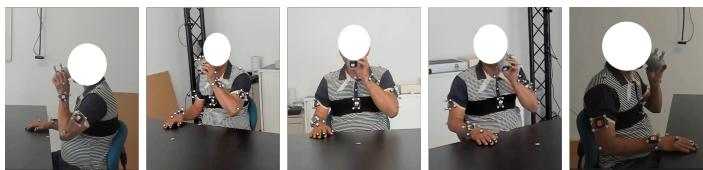
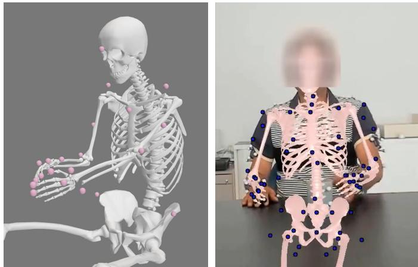
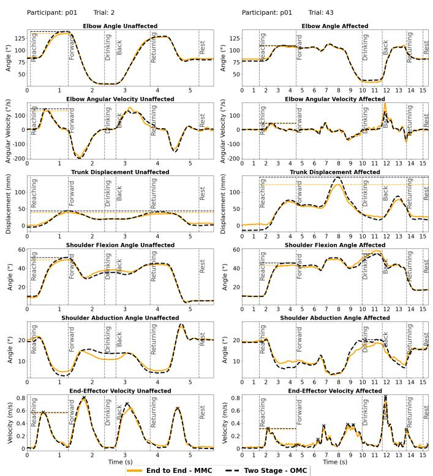
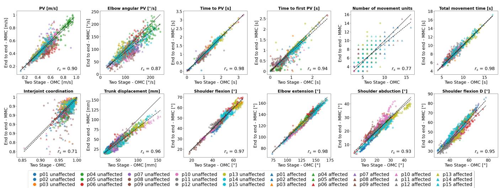

# 可微生物力学用于上肢脑卒中康复中的无标记动作捕捉：与光学动作捕捉的比较

1st\* Tim Unger DART Lab, LLUI, Vitznau RELab, ETH, Zurich Switzerland tim.unger@llui.org

2nd\* Arash Sal Moslehian Neuro-X Institute EPFL Lausanne, Switzerland arash.salmoslehian@epfl.ch

5th Roger Gassert Rehabilitation Engineering Laboratory (RELab) ETH Zurich, Switzerland roger.gassert@hest.ethz.ch

8th† Chris Awai Easthope Data Analytics & Rehabilitation Technology (DART Lab) Lake Lucerne Institute (LLUI) Vitznau, Switzerland chris.awai@llui.org

6th Olivier Lambercy RELab ETH Zurich, Switzerland olivier.lambercy@hest.ethz.ch

4th Johann Ullrich DART Lab, LLUI, Vitznau RELab, ETH, Zurich Switzerland jullrich@ethz.ch

7th† R. James Cotton Shirley Ryan AbilityLab Dept of PM&R, Northwestern University Chicago, IL rcotton@sralab.org

\* 共同第一作者 † 共同资深作者

3rd\* J.D. Peiffer Dept of Biomedical Engineering Northwestern University Chicago, IL jpeiffer@sralab.org

摘要—基于标记的光学动作捕捉（Optical Motion Capture, OMC）结合生物力学建模目前被认为是测量人体运动学最精密和准确的方法。然而，将可微生物力学建模与无标记动作捕捉（Markerless Motion Capture, MMC）相结合，为临床环境中的动作捕捉提供了一种前景广阔的方法，该方法仅需要极简的设备（如同步网络摄像头），且数据采集所需工作量极小。

本研究比较了15例脑卒中患者在执行饮水任务（drinking task，一项推荐用于评估上肢运动质量的功能性任务）时，经生物力学建模的 MMC 与 OMC 数据的关键运动学结果。

我们观察到 MMC 和 OMC 之间的运动学轨迹具有高度一致性，表现为高相关性（绝大多数运动学轨迹的中位数 $r > 0.95$），关节角度的中位数 RMSE 值在 2◦–5◦ 之间，末端执行器速度为 0.04 m/s，躯干位移为 6 mm。OMC 与 MMC 之间各次试验间的偏差在同一受试者的测试期内保持一致，关节角度偏差的四分位距在 1 − 3◦ 左右，末端执行器速度约为 0.01 m/s，躯干位移约为 3 mm。

我们的研究结果表明，我们用于手臂追踪的 MMC 正在接近基于标记的方法的精度，支持了其在临床环境中应用的潜力。MMC 可以为脑卒中患者的运动康复提供有价值的见解，有可能提高康复策略的有效性。

关键词—无标记动作捕捉，光学动作捕捉，手臂生物力学，脑卒中，饮水任务

## I. 引言

受中风及相关神经系统疾病影响的患者人数不断增加，迫切需要提高康复策略的有效性 [1]。超过 70% 的中风幸存者患有急性上肢功能障碍 [2]，因此需要对上肢运动质量进行准确且频繁的评估，以定制干预方案并监测康复进展 [3]。理想情况下，中风患者的康复依赖于神经可塑性（neuroplasticity），即通过重组神经通路来恢复运动功能 [4]。代偿策略（例如依赖未受影响的肌肉或肢体）虽然能提供短期的功能性益处，但会通过强化适应不良模式而阻碍神经可塑性康复 [5]。因此，在控制了因疼痛导致的运动改变后，运动质量的偏差可作为神经可塑性受限和真正康复减少的生物标志物 [6], [7]。

欧洲中风专家的共识指南建议引入仪器化饮水任务（instrumented drinking task）来评估中风患者的上肢运动质量 [3]。多项研究已利用光学运动捕捉（optical motion capture, OMC）确立了该任务的运动质量指标 [8]–[10]。尽管 OMC 并不直接测量骨骼运动，但它仍被广泛视为生物力学测量的金标准 [11]。然而，OMC 的高昂成本和后勤复杂性限制了其在常规临床实践中的普及。不过，利用计算机视觉进行人体姿态估计的最新进展使得利用多个标定相机进行无标记运动捕捉（markerless motion capture, MMC）成为可能，这可能为 OMC 提供一种可行的替代方案 [12]。

传统的基于标记点的生物力学建模遵循两阶段过程：首先，捕获三维标记轨迹，并利用静止期来缩放生物力学模型；其次，将标记轨迹与带有虚拟标记的已缩放生物力学模型进行拟合，从而最小化观测标记与模型标记之间的误差。该过程假设在已知身体解剖标志上有固定的标记轨迹，以防止测量不确定性在模型中传播，因此需要高度精确的标记放置和标记轨迹。OMC 和 MMC 在满足这一要求方面都面临挑战，原因在于 OMC 中存在标记放置不一致 [13] 和软组织伪影（soft tissue artifacts）[14]，而 MMC 中存在关键点检测的不确定性 [15]。

为了解决传统建模的局限性，特别是在 MMC 中的局限性，Cotton 等人提出了一种可微端到端优化算法，允许同时优化运动轨迹和模型缩放参数 [16], [17]（以下简称端到端 MMC）。尽管该方法基于较低的重投影误差和时空步态参数展现出高准确性 [16], [18]，但尚未针对基于 OMC 的运动学数据进行验证。

在本研究中，我们首次对 OMC（光学动作捕捉）与这种新型端到端 MMC（无标记动作捕捉）方法进行了对比分析。我们评估了中风患者饮水任务的动作质量指标，并比较了用于推导这些指标的基础运动学轨迹。我们的假设是，这两个系统在关节角度、末端执行器速度和躯干位移等关键运动学轨迹上，以及在既定的饮水任务动作质量指标上，都会表现出高度的一致性。我们使用运动学轨迹和动作质量指标的对比图，以及 RMSE（均方根误差）、相关性和偏差等若干对比指标来检验这一假设，以评估每个系统生成的动作质量指标和基础运动学轨迹的一致性1。

## II. 方法

## A. 参与者

本研究遵循了当地伦理委员会制定的伦理准则（BASEC-No: 2022-00491）。从苏黎世大学医院中风登记库（University Hospital Zurich Stroke Registry）和 cereneo 诊所招募了轻度和中度上肢功能障碍的中风康复患者。符合条件的参与者被邀请参加单次测量。纳入标准要求参与者年满 18 岁，能够提供知情同意，并确诊患有中风。此外，参与者需要具备至少部分执行伸手到达动作的能力，并能用患手使用圆柱握姿在无辅助的情况下抓取水杯。排除标准包括既往存在的上肢缺陷（如骨科损伤）以及其他神经系统疾病。

## B. 数据采集与预处理

参与者分别使用患侧和健侧手臂进行了 40 次标准化饮水任务 [8]，同时使用 OMC 以及用于 MMC 的五台同步消费级网络摄像头进行记录。OMC 系统的采样频率为 100Hz，在不同的测量设置中采用了来自 Qualisys 和 Optitrack 的技术。我们采用了 Alt Murphy 等人 [8] 用于饮水任务的基础标记点集，并添加了更多标记点以更好地表征运动。OMC 数据经过了手动填补空白与标注。五台同步的 Logitech Brio 网络摄像头以 1080p 和 60Hz 记录参与者。这五台摄像头均匀分布在参与者周围的半圆内，间隔约为 45°（见 Fig. 1）。基于 OMC 主触发信号将视频分割为各个试次，从而生成一个由多个试次组成的同步数据集，每个试次代表标准化饮水任务的单次重复。

  
Fig. 1: 用于 MMC 的五台网络摄像头的视角。

## C. 数据处理与逆运动学

1) 两阶段 OMC（Two-Stage OMC）：利用参与者坐在桌前的初始静态期间通过 OMC 测量的 3D 标记点，在 OpenSim 中对生物力学模型进行缩放（scale）。该 OpenSim 模型基于 Rajagopal 2016 模型 [19]，鉴于原模型限制了旋前和旋后运动，我们修改了其运动范围以更好地贴合自然运动范围。由于在饮水任务期间腿部保持静止且被桌子遮挡，我们移除了髋部以下的所有标记点，从而在标准姿态下有效地锁定了所有腿部自由度。随后，使用缩放后的模型以及来自 OMC 的实测 3D 标记点轨迹，利用 OpenSim 中的 IK 工具计算逆运动学。所有计算均通过 Python 脚本结合 OpenSim API 进行，以实现批处理。最终将 OMC 的运动学轨迹从 100Hz 插值至 60Hz，以便与 MMC 进行直接比较。

2) 端到端 MMC（End-to-End MMC）：先前的研究表明，以端到端可微的方式联合求解人体尺度参数和关节角度，是学习具备生物力学感知轨迹的有效方法 [17]。为了将该方法应用于此处收集的数据，我们首先使用 AniposeLib [20] 并借助包含 A1 尺寸 ChArUco 板的标定录像对相机进行外参和内参标定，这是进行 2D 关键点三角测量所必需的。利用 PosePipe [21]，我们首先使用 MeTrabs-ACAE [22] 从每个网络摄像头视频中提取 87 个 2D 关键点，然后使用 EasyMocap [23] 执行自动人物关联。对于自动人物关联失败的视频，我们进行了手动人物关联。

最后，我们按照文献 [17] 重构了关节运动学。简而言之，该方法将一段记录的运动轨迹参数化为一个隐式函数 $f _ { \phi } : t  \theta$，用于从时间映射到关节角度，其中 $f _ { \phi }$ 是通过多层感知机（multilayer perceptron）实现的。这些参数 ϕ 以及身体缩放（body scaling）和标记点偏移（marker offset）参数是通过优化联合学习的。在每个优化步骤中，隐式函数输出的关节角度通过使用 GPU 加速的 Mjx 版本 [24], [25] 传入 MuJoCo 中的生物力学正向运动学函数，并利用已知的相机外参/内参将 3D 姿态标记点位置投影到各个相机画面中。该方法还采用了一种双层优化（bilevel optimization），通过多次试验联合学习每个受试者的身体尺度以及逆运动学 [26]。由于我们此处展示的每位受试者都有大约 80 次试验，无法将所有试验一次性全部载入显存为 10GB 的 NVIDIA RTX 3080 GPU 中；因此，我们对每位受试者试验的一个子集执行了双层优化，并将其分为八个批次。我们使用了 Hamner 等人 [27], [28] 提出的生物力学模型的修改版本，该版本与 MuJoCo 兼容。我们发现，用于 OMC（OpenSim）和 MMC（MuJoCo）的模型在相关模型自由度上没有显著差异。

## D. 系统比较

1) 运动学轨迹：根据文献 [8]，我们纳入了用于推导中风患者执行饮水任务时运动质量评估指标的关键运动学轨迹（运动学时间序列数据，如关节角度、位移和速度曲线）。具体而言，这些运动学轨迹包括：肩关节屈曲（Shoulder Flexion）、肩关节外展（Shoulder Abduction）、肘关节屈曲（Elbow Flexion）、肘关节角速度（Elbow Angular Velocity）、躯干位移（Trunk Displacement）和末端执行器速度（End-Effector Velocity）。

  
Fig. 2: 生物力学建模可视化。左图：基于 OpenSim 的 OMC 数据；右图：基于 MuJoCo 的端到端 MMC。

关节角度均通过生物力学模型的逆运动学提取，其中 OMC 使用 OpenSim，MMC 使用 MuJoCo。对于 OMC，末端执行器速度由 OpenSim 根据手部标记点几何中心的速度进行计算；而对于 MMC，我们对手部关键点的位置进行微分来计算。躯干位移则在模型拟合后根据躯干标记点（MMC 中为胸骨关键点）的位置确定。

对于每次试验和每条运动学轨迹，我们计算了两个系统之间的静态偏移（static offset），即 MMC 轨迹与 OMC 轨迹均值之差。随后将此偏差（偏移量）加到 OMC 信号中。记录每条运动学轨迹的静态偏差，以评估这两种方法之间的偏移在不同试验和受试者之间的一致性。后续所有针对噪声的分析均在去除了偏差的运动学轨迹上进行。

为了解决由于系统间同步不完全而导致的潜在时间偏移，我们通过在另一运动学轨迹上平移一条运动学轨迹（最大平移 0.25 秒）来确定两个信号之间的最佳时延。在每次平移时，我们计算了 RMSE，并确定了使该误差最小化的时延。所得的时延被记录为同步精度的衡量指标。最后，我们计算了每次试验中 OMC 和 MMC 调整后运动学轨迹之间的 RMSE 和 Pearson 相关系数，以评估两个系统之间的一致性。

2) 动作质量指标：基于 Alt Murphy 等人 [8] 定义的方法，饮水任务的动作质量指标由 MMC 和 OMC 的运动学轨迹导出。这些指标包括：总动作时间、动作单元数（平滑度）、伸手（reaching）时的峰值速度（PV）、伸手时的峰值肘关节角速度、伸手时达到峰值速度的时间、伸手时达到首次峰值速度的时间、伸手时的最大肘伸展、饮水/伸手时的最大肩外展角、任务期间的最大躯干位移、伸手/饮水时的最大肩屈曲角、关节间协调性（伸手期间肘伸展与肩屈曲之间的 Pearson 相关性）。两个系统的饮水任务阶段分类（Reaching、Forward、Drinking、Back、Returning 和 Rest）均遵循 [8] 中的方法，基于手腕和水杯上的 OMC 标记计算出的末端执行器速度进行分类。这消除了阶段分类差异的任何影响，从而将重点完全集中在运动学数据上。因此，未报告伸手期间达到峰值速度的时间和达到首次峰值速度的时间（以 % 计），因为 MMC 和 OMC 的阶段持续时间相同，使得这些指标与以秒为单位报告的指标冗余。

为了评估两个系统在动作质量指标提取上的一致性，我们使用相关图对来自 MMC 和 OMC 的指标进行了可视化评估。此外，针对每个动作质量指标，我们分别计算了单次试验 $( r _ { s } )$ 以及每位参与者所有患侧和健侧试验的平均动作指标 $( r _ { a v } )$ 的 Pearson 相关系数。

## III. 结果

## A. 研究人群

本研究纳入了由 15 名卒中患者（9 名男性，6 名女性）组成的特别样本，平均年龄为 71 岁 $( \mathrm { S D } = 1 5 )$，平均卒中后时间为 24 个月。参与者存在轻度至中度上肢功能障碍，表现为 Fugl-Meyer 上肢评估（Fugl-Meyer Upper Limb Assessment）平均得分为 56.3 $\mathrm { ( S D = 8 . 4 ) }$，得分范围为 39 至 66。

## B. 数据与处理

总共纳入了 15 名参与者的 1160 次饮水任务试验，每位参与者患侧手臂试验的中位数为 40 [39, 40] 次，健侧手臂试验的中位数为 39 [38, 41] 次。对试验进行了人工检查，排除率为 6%。在排除的试验中，51 次是由于动作不正确，13 次是由于端到端 MMC 重建失败，5 次是由于两个系统之间的同步问题。使用清洗后的 OMC 数据在 OpenSim 中计算逆向运动学，在配备 32 GB RAM 的第 13 代 Intel® Core™ i9-13900H 处理器（2.60 GHz）上大约需要 30 小时。借助 NVIDIA RTX 3080 GPU，整个端到端 MMC 流程完成所有试验大约耗时 12 天。其中大部分时间用于从总计 5800 个视频（包含 1160 次试验中的 5 个摄像头）中提取 2D 关键点。

  
Fig. 3: 参与者 p01 的示例运动学轨迹，分别展示了患侧和健侧手臂的各一次试验。水平线标出了运动质量评估指标，末端执行器速度上的“x”标记了各个运动单元。

TABLE I: 运动学轨迹的 RMSE、r、偏差（bias）和时滞（time lag）的中位数与 [IQR]，基于所有患者计算并区分了患侧与健侧手臂。

<table><tr><td>运动学指标</td><td>数值</td><td>健侧手臂</td><td>患侧手臂</td></tr><tr><td rowspan="4">末端执行器速度</td><td>r</td><td>0.99 [0.97, 0.99]</td><td>0.99 [0.96, 0.99]</td></tr><tr><td>RMSE (m/s)</td><td>0.04 [0.03, 0.07]</td><td>0.03 [0.03, 0.05]</td></tr><tr><td>Bias (m/s)</td><td>0.00 [-0.01, 0.00]</td><td>0.00 [-0.01, 0.00]</td></tr><tr><td>Time Lag (s)</td><td>0.00 [0.00, 0.02]</td><td>0.01 [0.00, 0.02]</td></tr><tr><td rowspan="4">肘关节角速度</td><td>r</td><td>0.96 [0.94, 0.97]</td><td>0.96 [0.93, 0.97]</td></tr><tr><td>RMSE (°/s)</td><td>16.11 [12.13, 20.95]</td><td>13.12 [10.54, 17.54]</td></tr><tr><td>Bias (°/s)</td><td>0.33 [-0.62, 1.22]</td><td>0.26 [-0.58, 1.05]</td></tr><tr><td>Time Lag (s)</td><td>0.02 [0.00, 0.03]</td><td>0.02 [-0.02, 0.03]</td></tr><tr><td rowspan="4">肘关节伸展</td><td>r</td><td>0.99 [0.98, 0.99]</td><td>0.99 [0.98, 1.00]</td></tr><tr><td>RMSE (°)</td><td>5.03 [3.83, 6.69]</td><td>4.18 [3.16, 5.58]</td></tr><tr><td>Bias (°)</td><td>-7.52 [-13.84, -0.47]</td><td>-5.86 [-10.78, -2.45]</td></tr><tr><td>Time Lag (s)</td><td>0.00 [-0.02, 0.03]</td><td>0.02 [-0.02, 0.03]</td></tr><tr><td rowspan="4">肩关节屈曲</td><td>r</td><td>0.99 [0.99, 1.00]</td><td>0.99 [0.99, 1.00]</td></tr><tr><td>RMSE (°)</td><td>2.39 [1.86, 3.03]</td><td>2.53 [1.73, 3.38]</td></tr><tr><td>Bias (°)</td><td>-23.55 [-26.57, -20.40]</td><td>-23.57 [-26.17, -19.45]</td></tr><tr><td>Time Lag (s)</td><td>-0.02 [-0.03, 0.02]</td><td>0.00 [-0.03, 0.02]</td></tr><tr><td rowspan="4">肩关节外展</td><td>r</td><td>0.88 [0.78, 0.93]</td><td>0.89 [0.83, 0.94]</td></tr><tr><td>RMSE (°)</td><td>1.97 [1.37, 2.71]</td><td>2.13 [1.50, 2.77]</td></tr><tr><td>Bias (°)</td><td>7.42 [5.23, 11.11]</td><td>7.47 [3.52, 11.65]</td></tr><tr><td>Time Lag (s)</td><td>0.03 [0.00, 0.05]</td><td>0.02 [-0.02, 0.03]</td></tr><tr><td rowspan="4">躯干位移</td><td>r</td><td>0.95 [0.91, 0.98]</td><td>0.98 [0.91, 0.99]</td></tr><tr><td>RMSE (mm)</td><td>5.41 [4.16, 7.00]</td><td>6.18 [4.30, 10.71]</td></tr><tr><td>Bias (mm)</td><td>-4.62 [-8.10, -1.01]</td><td>-6.76 [-9.57, -3.39]</td></tr><tr><td>Time Lag (s)</td><td>-0.02 [-0.07, 0.02]</td><td>-0.02 [-0.05, 0.02]</td></tr></table>

## C. 系统比较

1) 运动学轨迹：对运动学轨迹的直观观察表明，OMC 与 MMC 在所有运动学轨迹上均表现出极高的一致性（见 Fig. 3）。

定量分析进一步支持了这一点（见 Table I），两个系统之间观察到了高相关系数（r）。值得注意的是，肩关节屈曲（shoulder flexion）和肘关节伸展（elbow extension）表现出强相关性 $\begin{array} { r l r } { ( r } & { { } = } & { 0 . 9 9 ) } \end{array}$ ，表明在这些关键运动中具有高度一致性。在运动学轨迹中，健侧肩关节外展（shoulder abduction）的相关性最低 $( r = 0 . 8 8 \ [ 0 . 7 8 , 0 . 9 3 ] )$ ），但 RMSE 仍保持在较低水平，为 1.97◦ [1.37◦, 2.71◦]。

总体而言，RMSE 值较低，特别是肩关节屈曲和肩关节外展（两者均约为 2◦）。在关节角度轨迹中，肘关节伸展的 RMSE 最高，中位数 RMSE 约为 $4 ^ { \circ } { - } 5 ^ { \circ }$

每位受试者在 OMC 和 MMC 之间的运动学轨迹偏差的试验间变异性均较低，如 Table II 所示，该表展示了所有受试者的平均变异性（每个运动学轨迹偏差的 IQR）：肩关节 $< 2 ^ { \circ }$，肘关节伸展 $< 4 ^ { \circ }$，肘关节角速度 $< 2 ^ { \circ } / \mathrm { s }$，躯干位移约为 3 mm。然而，受试者之间的绝对偏差存在差异，这反映在 Table I 较高的偏差 IQR 中，该表展示了受试者间的平均偏差和 IQR。

TABLE II: 患者间偏差的平均 IQR，代表患者各次试验内偏差的平均变异性。

<table><tr><td>运动学指标</td><td>偏差</td><td>健侧手臂</td><td>患侧手臂</td></tr><tr><td>末端执行器速度</td><td> $\overline{IQR}$  (m/s)</td><td>0.01</td><td>0.01</td></tr><tr><td>肘关节角速度</td><td> $\overline{IQR}$  (°/s)</td><td>1.83</td><td>1.57</td></tr><tr><td>肘关节伸展</td><td> $\overline{IQR}$  (°)</td><td>3.69</td><td>3.88</td></tr><tr><td>肩关节屈曲</td><td> $\overline{IQR}$  (°)</td><td>1.34</td><td>1.14</td></tr><tr><td>肩关节外展</td><td> $\overline{IQR}$  (°)</td><td>1.20</td><td>0.91</td></tr><tr><td>躯干位移</td><td> $\overline{IQR}$  (mm)</td><td>2.86</td><td>3.10</td></tr></table>

系统间的时间对齐在所有运动学轨迹中保持一致，微小的差异（< 0.03 s）主要出现在肩部和躯干指标中。

2) 运动质量测量指标：在逐次试验对比中，我们观察到各系统之间存在高度相关性，而在对试验取平均值时相关性进一步提高（$0 . 9 1 ~ <$ $r _ { a v } ~ < ~ 1$，关节间协调除外，见 Table III）。关节角度测量指标总体上表现出高度相关性，其中肩部屈曲为 $( r _ { s } ~ = ~ 0 . 9 7 , ~ r _ { a v } ~ = ~ 0 . 9 8 )$，肘部伸展为 $( r _ { s } = 0 . 9 8 , r _ { a v } = 0 . 9 9 )$，肩部外展为 $( r _ { s } = 0 . 9 3$ $r _ { a v } = 0 . 9 4 )$。关节间协调的相关性最低（$r _ { s } = r _ { a v } = 0 . 7 1$），且存在若干异常值，而肘关节角 PV 表现出较低的相关性（$r _ { s } ~ = ~ 0 . 8 7 , ~ r _ { a v } ~ = ~ 0 . 9 3$）和更宽的值分布（见 Fig. 4）。末端执行器速度测量指标表现出高度相关性（$0 . 9 0 < r _ { s } <$ $0 . 9 8 , 0 . 9 6 < r _ { a v } < 1$），除运动单元数量外（$r _ { s } = 0 . 7 7 , r _ { a v } = 0 . 9 1$），后者也表现出更宽的值分布（见 Fig. 4）。躯干位移显示出高度相关性（$r _ { s } ~ = ~ 0 . 9 6 , ~ r _ { a v } ~ = ~ 0 . 9 7$），尽管在较高幅值时 MMC 相比 OMC 系统性地低估了数值（见 Fig. 4）。

## IV. 讨论

这是首个将基于生物力学的 OMC 运动学与 Cotton 等人 [17] 提出的端到端 MMC 方法进行比较的研究。以往极少有研究使用商用 THEIA3D MMC 比较来自 MMC 与 OMC 的生物力学建模上肢运动学（例如，健全成人的空击动作 [29]，健全儿童的 Box and Block 测试 [30]）。据我们所知，这也是首个在神经系统疾病患者中比较 OMC 与 MMC 之间生物力学建模上肢运动学的研究。

总体而言，我们发现各系统在中风患者饮水任务的运动学轨迹上具有高度一致性，并且在大多数运动质量测量指标上表现出强相关性。

端到端 MMC 方法表现出高鲁棒性，仅在 1.6% 的试验中重建失败（1160 次中占 13 次）。对于末端执行器速度，较小的偏差和较低的 RMSE 表明手腕关键点检测精确，且各方法之间的尺度缩放一致，这可能得益于双层优化（bilevel optimization）的支持，从而实现了系统间末端执行器速度的直接可比性。

TABLE III: 比较 OMC 与端到端 $\mathbf { M M C }$ 的运动质量测量指标：$r _ { s }$ 代表所有试验的相关性，而 $r _ { a v }$ 表示两个系统间每个手臂平均参与者试验的相关性。

<table><tr><td>运动质量度量</td><td> $r_s$ </td><td> $r_{av}$ </td></tr><tr><td>PV [m/s]</td><td>0.90</td><td>0.96</td></tr><tr><td>肘关节角 PV [°/s]</td><td>0.87</td><td>0.93</td></tr><tr><td>至 PV 时间 [s]</td><td>0.98</td><td>1.00</td></tr><tr><td>至首个 PV 时间 [s]</td><td>0.94</td><td>0.99</td></tr><tr><td>运动单元数 [n]</td><td>0.77</td><td>0.91</td></tr><tr><td>总运动时间 [s]</td><td>0.98</td><td>1.00</td></tr><tr><td>关节间协调性</td><td>0.71</td><td>0.71</td></tr><tr><td>躯干位移 [mm]</td><td>0.96</td><td>0.97</td></tr><tr><td>肩关节屈曲 [°]</td><td>0.97</td><td>0.98</td></tr><tr><td>肘关节伸展 [°]</td><td>0.98</td><td>0.99</td></tr><tr><td>肩关节外展 [°]</td><td>0.93</td><td>0.94</td></tr><tr><td>肩关节屈曲 D [°]</td><td>0.95</td><td>0.97</td></tr></table>

肘关节角度（中位数 RMSE 约为 $5 ^ { \circ } )$、躯干位移（中位数 RMSE 约为 6mm）和肩关节角度（中位数 RMSE 约为 2◦）的差异较小，而 OMC 与 MMC 之间残留的差异可能反映了标记点放置和模型变化的影响，这些因素会导致轨迹出现微小差异。OMC 与 MMC 之间的运动学轨迹差异处于仅使用 OMC 观察到的不同测试间变异范围内 [13]，这表明端到端 MMC 的准确度与精密度正接近 OMC。我们的结果与先前使用商业系统 THEIA3D 进行的 MMC 与 OMC 比较一致，且略有提升，该研究报告了系统间关节角度差异的 $\mathrm { R M S E } ~ < ~ 6 ^ { \circ }$ [30]。MMC 与 OMC 在上肢运动学方面的比较仍然有限，且目前尚无研究评估非商业性、基于生物力学的 MMC 运动学与 OMC 的对比。本文提出的端到端 MMC 方法展现出与 THEIA3D 相当的准确度，同时优于此前在饮水任务中测试的定制 MMC 系统 [31]。MMC 有望成为 OMC 的可靠替代方案，并显著减少设置和手动处理时间。

系统之间的时间差异微不足道，时滞在 0 至 0.03 s 之间，这支持了端到端 MMC 方法在高精度捕捉运动时间特性方面的可靠性。

总体而言，在大多数运动质量度量中，OMC 与端到端 MMC 之间的相关性均较高，仅观察到极少数离群试验。对试验取平均值通常能提高相关性（例如，达峰值速度时间和总运动时间的 $( \mathrm { e . g . , } r _ { a v } = 1 . 0 0$），这与推荐用于确保表现稳定性的临床实践相一致 [9]。尽管确保表现稳定性所需的试验次数在 OMC 中已确立 [9]，但在 MMC 中可能需要进行微调以考虑测量不确定性。取平均值还有助于离群值检测，这对临床应用中的稳健性非常有价值。

基于关节角度的运动质量指标，例如肩关节屈曲 $( r _ { s } = 0 . 9 7 , r _ { a v } = 0 . 9 8 )$ 和肘关节伸展 $( r _ { s } ~ = ~ 0 . 9 8 , ~ r _ { a v } ~ = ~ 0 . 9 9 )$，以及末端执行器速度指标（如峰值速度和达到峰值速度的时间），显示出

  
● p01 unaffected p04 unaffected p07 unaffected p10 unaffected p13 unaffected p01 affected A p04 affected ▲ p07 affected p10 affected p13 affected p02 unaffected p05 unaffected p08 unaffected p11 unaffected p14 unaffected p02 affected ▲ p05 affected ▲p08 affected ▲ p11 affected p14 affected p03 unaffected p06 unaffected è p09 unaffected ● p12 unaffected p15 unaffected p03 affected A p06 affected p09 affected p12 affected A p15 affected

Fig. 4: 各项指标的相关性图，对比了两阶段 OMC 与端到端 MMC。每个数据点代表单次试验。试验按受试者进行颜色编码，并按手臂（患侧/健侧）进行形状编码。

系统之间的高度一致性，表明在检测这些关键运动学轨迹的峰值幅度方面具有高精度。躯干位移的轻微低估（见 Fig. 4）可能是由于胸部标记点放置的模型差异所致，这表明模型具有进一步优化的潜力。

诸如运动单元数量 $( r _ { s } \ = \ 0 . 7 7 ,$ $r _ { a v } = 0 . 9 1 )$ 和关节间协调度 $( r _ { s } = r _ { a v } = 0 . 7 1 )$ 等指标显示出较低的相关性，在此类指标中，微小的运动学轨迹变化可能会产生较大的差异。用其他平滑度指标（例如对数无量纲加加速度，Log Dimensionless Jerk）替代运动单元数量，可提高平滑度评估的可靠性。

在 OMC 与 MMC 之间的运动学轨迹中观察到的试验间偏差在同一会话内的各次试验中保持一致，较小的 IQR（关节角度约为 $1 ^ { \circ } - 3 ^ { \circ }$，末端执行器速度约为 0.01 m/s，躯干位移约为 3 mm）证明了这一点。这表明每个会话存在系统性偏差，可能归因于系统之间标记点/关键点位置的差异（OMC 解剖标志点对比 MMC 检测到的关键点）或生物力学模型的差异。偏差的会话间（患者间）变异可能源自 OMC 和 MMC 系统的可变性。在 MMC 中，关键点检测在不同个体之间可能存在细微差异，而在 OMC 中，标记点放置和配准的微小差异可能会显著影响逆运动学计算。例如，Uchida and Seth [13] 证明了 1–2 cm 的标记点配准不确定性可能导致 5°–10° 的膝关节屈曲角度差异。此外，一项使用商用 THEIA3D MMC 系统的先前研究表明，与 OMC 相比，MMC 具有更低的会话间变异性 [32]。因此，我们推测会话间偏差变异性主要源于 OMC 的变异性。然而，得出确切结论还需要进一步的数据，例如同一受试者的多会话记录，或来自双平面荧光透视（dual-plane fluoroscopy）的真实骨骼运动真值数据。

尽管研究结果很有前景，但本研究仍存在一些局限性。首先，虽然 OMC 通常被视为金标准，但由于标记点放置错误和软组织伪影带来的潜在误差，它并非绝对的真实真值。此外，所使用的上肢生物力学模型缺乏某些自由度（例如手指运动），而这些自由度本可以提供更全面的评估。例如，[18] 将端到端 MMC 优化方法扩展到了完整的手臂和手部模型。用于 OMC 的 OpenSim 模型与用于端到端 MMC 的 MuJoCo 模型并不完全相同，这可能会影响两个系统之间数据的直接可比性。此外，OMC 采用两阶段流程，而 MMC 采用端到端方法；在端到端模型中使用 OMC 数据可能有助于更好地单独分离出基于标记点与无标记采集方式本身带来的影响。

阶段分类仅使用 OMC 数据进行，这意味着 MMC 阶段分类在独立应用中仍需要验证。最后，本研究针对的是执行单一任务的轻度至中度功能障碍的特定患者群体。在其他任务或人群中结果可能会有所不同，这可能会为更广泛的应用带来额外的挑战和考量。

未来的研究应侧重于采集同时包含双平面荧光透视（biplanar fluoroscopy）、MMC 和 OMC 记录的数据集，以建立真正的真实基准（ground truth），从而如 [33] 中那样对临床测量的不确定性进行背景化分析。此外，研究还应探讨相机数量和拍摄角度对 MMC 精度的影响（包括单目设置），并将分析扩展到涵盖所有上半身自由度，包括手指 [18]。

## V. 结论

得益于更优异的关键点检测器和复杂的 GPU 加速生物力学建模，MMC 的准确度和精度持续提升，如本研究所证明的那样，已达到与 OMC 相当的水平。MMC 免去了放置标记点的负担，并显著降低了成本和应用复杂度，仅需使用消费级相机构成的极简设置即可。我们的结果展现了其在临床应用中的前景，表明 MMC 能够在常规临床环境中采集准确、精密的运动数据，为运动康复领域开发新颖且更精确的生物标志物提供了有价值的工具。

## 致谢

我们衷心感谢本研究的参与者。

## 参考文献

[1] G. Kwakkel, N. A. Lannin, K. Borschmann, C. English, M. Ali, L. Churilov, G. Saposnik, C. Winstein, E. E. Van Wegen, S. L. Wolf, J. W. Krakauer, and J. Bernhardt, “Standardized measurement of sensorimotor recovery in stroke trials: Consensus-based core recommendations from the Stroke Recovery and Rehabilitation Roundtable,” International Journal of Stroke, vol. 12, pp. 451–461, July 2017.

[2] E. S. Lawrence, C. Coshall, R. Dundas, J. Stewart, A. G. Rudd, R. Howard, . Charles, and D. A. Wolfe, “Estimates of the Prevalence of Acute Stroke Impairments and Disability in a Multiethnic Population,” pp. 1279–1284, 2001.

[3] G. Kwakkel, E. E. H. V. Wegen, J. H. Burridge, C. J. Winstein, L. E. H. v. Dokkum, M. A. Murphy, M. F. Levin, and J. W. Krakauer, “Standardized measurement of quality of upper limb movement after stroke: Consensus-based core recommendations from the Second Stroke Recovery and Rehabilitation Roundtable,” International Journal ofStroke, vol. 14, pp. 783–791, Oct. 2019. Publisher: SAGE Publications Inc.

[4] F. Su and W. Xu, “Enhancing Brain Plasticity to Promote Stroke Recovery,” Frontiers in Neurology, vol. 11, p. 554089, Oct. 2020.

[5] C. Alia, C. Spalletti, S. Lai, A. Panarese, G. Lamola, F. Bertolucci, F. Vallone, A. Di Garbo, C. Chisari, S. Micera, and M. Caleo, “Neuroplastic Changes Following Brain Ischemia and their Contribution to Stroke Recovery: Novel Approaches in Neurorehabilitation,” Frontiers in Cellular Neuroscience, vol. 11, Mar. 2017.

[6] S. Solnik, M. P. Furmanek, and D. Piscitelli, “Movement Quality: A Novel Biomarker Based on Principles of Neuroscience,” Neurorehabilitation and Neural Repair, vol. 34, pp. 1067–1077, Dec. 2020.

[7] M. F. Levin, J. A. Kleim, and S. L. Wolf, “What do motor ”recovery” and ”compensationg” mean in patients following stroke?,” Neurorehabilitation and Neural Repair, vol. 23, pp. 313–319, May 2009.

[8] M. A. Murphy, S. Murphy, H. C. Persson, U. B. Bergstrom, and K. S.¨ Sunnerhagen, “Kinematic analysis using 3D motion capture of drinking task in people with and without upper-extremity impairments,” Journal of Visualized Experiments, vol. 2018, Mar. 2018. Publisher: Journal of Visualized Experiments.

[9] G. E. Frykberg, H. Grip, and M. A. Murphy, “How many trials are needed in kinematic analysis of reach-to-grasp?—A study of the drinking task in persons with stroke and non-disabled controls,” Journal of NeuroEngineering and Rehabilitation, vol. 18, pp. number–101, Dec. 2021. Publisher: BioMed Central Ltd.

[10] M. A. Murphy, C. Willen, and K. S. Sunnerhagen, “Movement kine-´ matics during a drinking task are associated with the activity capacity level after stroke,” Neurorehabilitation and Neural Repair, vol. 26, no. 9, pp. 1106–1115, 2012.

[11] F. D’Isidoro, C. Brockmann, B. Friesenbichler, T. Zumbrunn, M. Leunig, and S. J. Ferguson, “Moving fluoroscopy-based analysis of THA kinematics during unrestricted activities of daily living,” Frontiers in Bioengineering and Biotechnology, vol. 11, p. 1095845, Apr. 2023.

[12] W. W. T. Lam, Y. M. Tang, and K. N. K. Fong, “A systematic review of the applications of markerless motion capture (MMC) technology for clinical measurement in rehabilitation,” Dec. 2023. ISSN: 17430003 Issue: 1 Publication Title: Journal of NeuroEngineering and Rehabilitation Volume: 20.

[13] T. K. Uchida and A. Seth, “Conclusion or Illusion: Quantifying Uncertainty in Inverse Analyses From Marker-Based Motion Capture due to Errors in Marker Registration and Model Scaling,” Frontiers in Bioengineering and Biotechnology, vol. 10, May 2022. Publisher: Frontiers.

[14] N. M. Fiorentino, P. R. Atkins, M. J. Kutschke, J. M. Goebel, K. B. Foreman, and A. E. Anderson, “Soft tissue artifact causes significant errors in the calculation of joint angles and range of motion at the hip,” Gait & posture, vol. 55, pp. 184–190, June 2017.

[15] A. V. Ruescas-Nicolau, E. Medina-Ripoll, H. de Rosario, J. Sanchiz Navarro, E. Parrilla, and M. C. Juan Lizandra, “A Deep Learning Model for Markerless Pose Estimation Based on Keypoint Augmentation: What Factors Influence Errors in Biomechanical Applications?,” Sensors, vol. 24, p. 1923, Jan. 2024. Number: 6 Publisher: Multidisciplinary Digital Publishing Institute.

[16] R. J. Cotton, A. DeLillo, A. Cimorelli, K. Shah, J. Peiffer, S. Anarwala, K. Abdou, and T. Karakostas, “Optimizing Trajectories and Inverse Kinematics for Biomechanical Analysis of Markerless Motion Capture Data,” in 2023 International Conference on Rehabilitation Robotics (ICORR), (Singapore, Singapore), pp. 1–6, IEEE, Sept. 2023.

[17] R. J. Cotton, “Differentiable Biomechanics Unlocks Opportunities for Markerless Motion Capture,” 2024年2月. arXiv:2402.17192 [cs].

[18] P. Firouzabadi, W. Murray, A. R. Sobinov, J. Peiffer, K. Shah, L. E. Miller, and R. J. Cotton, “Biomechanical Arm and Hand Tracking with Multiview Markerless Motion Capture,” 载于 2024 10th IEEE RAS/EMBS International Conference for Biomedical Robotics and Biomechatronics (BioRob), (Heidelberg, Germany), 第 1641–1648 页, IEEE, 2024年9月.

[19] A. Rajagopal, C. L. Dembia, M. S. DeMers, D. D. Delp, J. L. Hicks, and S. L. Delp, “Full-Body Musculoskeletal Model for Muscle-Driven Simulation of Human Gait,” IEEE Transactions on Biomedical Engineering, 卷 63, 第 2068–2079 页, 2016年10月.

[20] L. Karashchuk, “AniposeLib,” 2024年11月.

[21] R. J. Cotton, “PosePipe: Open-Source Human Pose Estimation Pipeline for Rehabilitation Research,” Archives of Physical Medicine and Rehabilitation, 卷 103, 第 e161–e162 页, 2022年12月. 出版商: Elsevier.

[22] I. Sarandi, A. Hermans, and B. Leibe, “Learning 3D Human Pose Estimation from Dozens of Datasets using a Geometry-Aware Autoencoder to Bridge Between Skeleton Formats,” 2022. 版本号: 1.

[23] “EasyMoCap - Make human motion capture easier.,” 2021.

[24] E. Todorov, T. Erez, and Y. Tassa, “MuJoCo: A physics engine for model-based control,” 载于 2012 IEEE/RSJ International Conference on Intelligent Robots and Systems, 第 5026–5033 页, 2012年10月. ISSN: 2153-0866.

[25] V. Caggiano, H. Wang, G. Durandau, M. Sartori, and V. Kumar, “MyoSuite: A Contact-rich Simulation Suite for Musculoskeletal Motor Control,” 载于 Proceedings of The 4th Annual Learning for Dynamics and Control Conference, 第 492–507 页, PMLR, 2022年5月. ISSN: 2640-3498.

[26] K. Werling, M. Raitor, J. Stingel, J. L. Hicks, S. Collins, S. L. Delp, and C. K. Liu, “Rapid bilevel optimization to concurrently solve musculoskeletal scaling, marker registration, and inverse kinematic problems for human motion reconstruction,” 2022年8月.

[27] S. R. Hamner, A. Seth, and S. L. Delp, “Muscle contributions to propulsion and support during running,” Journal of Biomechanics, 卷 43, 第 2709–2716 页, 2010年10月.

[28] F. Al-Hafez, G. Zhao, J. Peters, and D. Tateo, “LocoMuJoCo: A Comprehensive Imitation Learning Benchmark for Locomotion,” 2023. 版本号: 2.

[29] B. K. Lahkar, A. Muller, R. Dumas, L. Reveret, and T. Robert, “Accuracy of a markerless motion capture system in estimating upper extremity kinematics during boxing,” Frontiers in Sports and Active Living, 卷 4, 第 939980 页, 2022年7月.

[30] R. M. Hansen, S. L. Arena, and R. M. Queen, “Validation of upper extremity kinematics using Markerless motion capture,” Biomedical Engineering Advances, 卷 7, 第 100128 页, 2024年6月.

[31] J. Huber, S. Slone, and J. Bae, “Computer vision for kinematic metrics of the drinking task in a pilot study of neurotypical participants,” Scientific Reports, 卷 14, 第 20668 页, 2024年9月. 出版商: Nature Publishing Group.

[32] R. M. Kanko, E. Laende, W. S. Selbie, and K. J. Deluzio, “无标记动作捕捉步态运动学的会话间可重复性（Inter-session repeatability of markerless motion capture gait kinematics）,” Journal of Biomechanics, vol. 121, p. 110422, 2021年5月.

[33] T. Unger, R. d. S. Ribeiro, M. Mokni, T. Weikert, J. Pohl, A. Schwarz, J. P. O. Held, L. Sauerzopf, B. Kuhnis, E. Gavagnin, A. R. Luft,¨ R. Gassert, O. Lambercy, C. A. Easthope, and J. G. Schonhammer,¨ “上肢运动质量评估：脑卒中患者执行饮水任务时 IMU 与光学动作捕捉的比较（Upper limb movement quality measures: comparing IMUs and optical motion capture in stroke patients performing a drinking task）,” Frontiers in Digital Health, vol. 6, 2024. 出版商：Frontiers Media SA.