# Learning-based inverse dynamics of human motion

Petrissa Zell and Bodo Rosenhahn
Leibniz University Hannover, Germany
zell@tnt.uni-hannover.de

## Abstract

In this work we propose a learning-based algorithm for the inverse dynamics problem of human motion. Our method uses Random Forest regression to predict joint torques and ground reaction forces from motion patterns. For this purpose we extend temporally incomplete force plate data via a direct Random Forest regression from motion parameters to force vectors. Based on the resulting completed data we estimate underlying joint torques using a modified physics-based predictive dynamics approach. The optimization results for model states and controls act as predictors and responses for the final Random Forest regression from motion to joint torques and ground reaction forces.

The evaluation of our method includes a comparison to state-of-the-art results and to measured force plate data and a demonstration of the robust performance under influence of noisy and occluded input.

## 1. Introduction

The analysis of human motion is indispensable for medical applications, such as diagnostics and rehabilitation of the human locomotor system $[10, 16, 17]$ . To measure the load at individual joints, researchers use the concept of joint torques as the sum of all applied torques, e.g. caused by the exerted forces of the skeleton, tendons and ligaments. Based on this concept the healthiness of human motion can be assessed and abnormalities can be detected.

The biomechanical state of the art is to estimate joint torques from motion data using optimization approaches. A performance measure, such as the dynamic effort, is minimized in compliance with a set of constraints. There exist several different optimization formulations for this specific problem, namely forward, inverse and predictive dynamics $[3, 6, 21, 26, 27]$ . Characteristic challenges of these methods are high computational cost, non-convex parameter spaces and large scale problems. Therefore these optimization problems require a careful treatment regarding initialisation and constraining in order to ensure convergence. Furthermore the quality of the resulting joint torques is strongly depending on the accuracy of the input joint position trajectories which are generally obtained using a motion capture system.

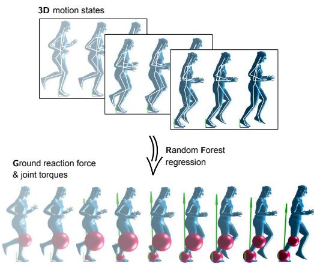  
Figure 1. Random Forest regression from model states to controls. We consider short windows of three consecutive frames. The green arrows represent the ground reaction force and the red spheres are the joint torques.

To address these issues we propose a learning-based approach to estimate joint torques together with contact forces from motion using a sliding window procedure coupled with a Random Forest (RF) parameter regression. Since we rely on learned correlations between motions and the inducing torques and forces our method is less susceptible to noise and can even handle large occlusions (e.g. one entire leg).

A motion sequence is divided into overlapping windows which are separately fed to the RF to regress the underlying joint torques and contact forces, as illustrated in Fig. 1. Using a large window overlap we achieve smooth curve progressions and since windows are processed separately, our method is suitable for parallelisation. Compared to the predictive dynamics optimization, introduced in Sec. 3.2 we reduce computation times from over one hour to less than three minutes, on average (using unoptimized Matlab code).

In order to generate the RF we create a training set of motion windows with optimized force and torque profiles based on a physical model of the human body. The corresponding optimization problems are solved with a predictive dynamics approach $[27]$ . In this context it is crucial to constrain the modeled GRF and its point of action, the center of pressure (COP) since joint torques and contact forces are interdependent.

We evaluate the performance of our method concerning computation time, GRF and COP estimation error and the consistency of joint torques and compare with results generated with a modified predictive dynamics approach and our own implementation of a state-of-the-art method by Brubaker et al. [7].

Our method generalizes to partly untrained and noisy data (cf. Sec. 4.2) and is independent of force plate measurements. In contrast to that, optimization-based approaches are often restricted to a laboratory setup or need careful constraining to make up for the missing contact force measurements.

To summarize, we propose

\- a learning-based approach for the inverse dynamics problem to estimate joint torques and contact forces from motion.

\- For this purpose, we introduce a Random Forest regression from motion to contact force properties (Force Regression Forest: FRF) to complete force plate measurements (Sec. 3.2).

\- Based on the completed data, we define contact regularizations for a predictive dynamics optimization (PDO), that is used to generate training sets consisting of motion windows (Sec. 3.2).

\- Finally, we regress joint torques and contact force vectors from motion parameters using a Random Forest trained on the complete, regularized sets (Torque Regression Forest: TRF) (Sec. 3.3).

## 2. Related work

Physics-based modeling provides the basis for human motion simulation and analysis in numerous state-of-the-art methods. Researchers in computer graphics use physical models to synthesise realistically looking motions $[2, 12, 19, 24, 29]$ . The naturalness of an artificial motion can either be achieved by exploiting motion capture data or by minimizing some kind of efficiency measure, e.g. the dynamic effort. This approach is motivated by the overall tendency of humans to avoid energy expenditure.

In computer vision physical models are used to facilitate tasks like robust person and object tracking and 3D pose estimation [6, 13, 14, 20, 15, 23, 25]. In [6] a simple planar model is exploited to estimate the biomechanical characteristics of gait and combined with a 3D kinematic model for monocular tracking. A related approach by $[23]$ considers not only walking but a wide range of motion types. The authors propose a full-body 3D physical prior that integrates the corresponding dynamics into a Bayesian filtering framework.

There are a number of recent methods that use physical models and constraints to solve specific tasks of computer vision: The works of Oikonomidis et al. $[14]$ and Pham et al. $[15]$ model hand-object interactions for hand pose tracking and estimation of grasping forces, respectively. Maksai et al. $[13]$ and Park et al. $[20]$ deal with the estimation of outer forces effecting objects and persons in 2D images and videos.

The works discussed so far use physical models to solve a specific problem but do not analyse the forces and torques of a full human body model. The estimation of joint torques from motion data is subject of human motion analysis and has been realized by means of inverse dynamics $[3, 26]$ , forward dynamics $[6]$ and predictive dynamics $[21, 27]$ . All of these approaches can be formulated as optimization problems. In inverse dynamics, the model states, i.e. the motion parameters are set as optimization variables and the producing forces are calculated inversely from these states. In contrast to that, forward dynamics treats the forces as optimization variables that generate a motion through integration of the related equations of motion. Predictive dynamics is closely related to Direct Collocation, known from optimal control problems: The states, as well as the forces are optimized, while the equations of motion are incorporated as equality constraints. General challenges of physics-based optimization are high computational expense concerning the calculation of objectives, constraints and their derivatives and a high-dimensional parameter-space, resulting in computation times in the order of hours.

Brubaker et al. address the issue of high computational cost in $[7]$ . They use an articulated body model to infer joint torques and contact dynamics from 3D motion data. The optimization procedure is accelerated by introducing additional root-forces which effectively decouple the equations of motion at different time frames. These artificial root-forces are then minimized.

In recent years, researchers aim to find a direct mapping from a motion parametrization to the acting forces, using machine learning techniques: $[11]$ investigates sparse coding for inverse dynamics regression via a CNN and $[28]$ introduces a two dimensional statistical model for human gait analysis.

## 3. Method

The proposed method relies on a training set that includes motion, GRF and joint torque parameters for short overlapping windows. In order to generate this set, the underlying joint torques and GRF have to be determined by means of a physics-based optimization procedure. In this context the equations of motion of a physical model are used as equality constraints. In the following section we will introduce the physical model and present the associated equations of motion. A detailed description of the optimization problem follows in Sec. 3.2. To convey an overview of the proposed algorithm we depict a flowchart in Fig. 2.

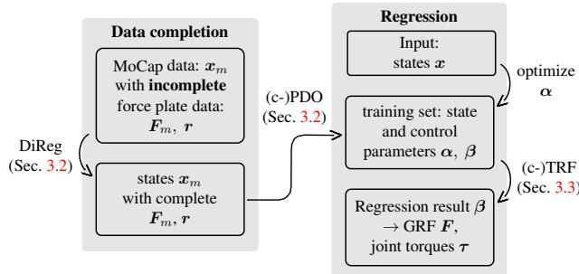  
Figure 2. Flowchart of the proposed method.

## 3.1. Physical model

We use a physical model, consisting of 13 segments with related inertial properties, obtained from literature [9] and 12 joints. The model has 29 degrees of freedom, that constitute the coordinates q. They comprise 6 global degrees of freedom for the position and the orientation of the root joint and 23 joint angles. The vector q is effected by the joint torques $\tau$ with no actuation of the global coordinates, i.e. $\tau_{1},\ldots,\tau_{6}=0$ .

For the modeling of the ground contact, the kinematic chain is equipped with two contact points for each foot segment, one at the toe and one at the heel. The total GRF at one foot is distributed to both points, which enables us to simulate a movement of the COP along the foot sole. This results in the following contact force vector:

$$
\pmb {F} _ {c} = (\pmb {f} _ {c _ {l 1}} ^ {T}, \pmb {f} _ {c _ {l 2}} ^ {T}, \pmb {f} _ {c _ {r 1}} ^ {T}, \pmb {f} _ {c _ {r 2}} ^ {T}) ^ {T},\tag{1}
$$

which corresponds to stacked 3-dimensional force vectors acting at the left toe, left heel, right toe and right heel. The force $F_{c}$ is 12 dimensional and can be transformed from $R^{12\times1}$ to $R^{6\times1}$ by a matrix C that adds the vectors acting at heel and toe:

$$
\boldsymbol {F} = \boldsymbol {C} \boldsymbol {F} _ {c} = \binom{\boldsymbol {f} _ {c _ {l 1}} + \boldsymbol {f} _ {c _ {l 2}}}{\boldsymbol {f} _ {c _ {r 1}} + \boldsymbol {f} _ {c _ {r 2}}} = \binom{\boldsymbol {f} _ {c _ {l}}}{\boldsymbol {f} _ {c _ {r}}}.\tag{2}
$$

The equations of motion are formulated using a combination of the Newton-Euler method and the Lagrange formalism, in general referred to as TMT-method $[18]$ . They have the following form:

$$
\pmb {\mathcal {M}} \ddot {\pmb {q}} = \pmb {\tau} + \pmb {J} ^ {T} \pmb {M} (\pmb {a} _ {g} - \pmb {G}) + \pmb {J} _ {c} ^ {T} \pmb {F} _ {c},\tag{3}
$$

with inertia matrices M and $\mathcal{M}(\boldsymbol{q}) = \boldsymbol{J}(\boldsymbol{q})^{T} \boldsymbol{M} \boldsymbol{J}(\boldsymbol{q})$ for dependent and independent coordinates, respectively. The kinematics of the corresponding coordinate transformation are described by the Jacobian $\boldsymbol{J}(\boldsymbol{q})$ and the contact Jacobian $\boldsymbol{J}_{c}(\boldsymbol{q})$ . Finally, $a_{g}$ and $\boldsymbol{G}(\boldsymbol{q}, \dot{\boldsymbol{q}}) = \frac{\partial}{\partial \boldsymbol{q}} (\boldsymbol{J}(\boldsymbol{q}) \dot{\boldsymbol{q}}) \dot{\boldsymbol{q}}$ are gravitational and convective acceleration, respectively. We shorten the right hand side of Eq. (3) by $\mathcal{M}\ddot{\boldsymbol{q}} = \mathcal{F}(\boldsymbol{x}, \boldsymbol{u})$ , with the parameter sets

$$
\pmb {x} = (\pmb {q} ^ {T}, \dot {\pmb {q}} ^ {T}) ^ {T} \mathrm{and} \pmb {u} = (\pmb {\tau} ^ {T}, \pmb {F} _ {c} ^ {T}) ^ {T},\tag{4}
$$

called model states and controls, respectively.

## 3.2. Generation of training data

We decompose a sequence into windows of 3 frames with an overlap of 2 frames. This window length yields sufficient information to reflect the acceleration of the model states, while allowing the use of 2nd order Hermite polynomials for the state and control discretization. The large overlap is necessary to facilitate a highly resolved analysis of motion sequences and to generate a maximal training set.

## Predictive dynamics

For every motion window (discretized on the temporal grid $t = t_{1}, \ldots, t_{3}$ ) we estimate the underlying joint torques and GRF, i.e. we determine the control vector u that generates the considered motion using an optimization approach. To reduce the number of design variables, the model states x and the control parameters u are discretized by approximating them with Hermite polynomials $H_{i}(t)$ :

$$
\boldsymbol {x} (t) = \sum_ {i = 1} ^ {2} \boldsymbol {\alpha} _ {i} H _ {i} (t), \boldsymbol {u} (t) = \sum_ {i = 1} ^ {2} \beta_ {i} H _ {i} (t)\tag{5}
$$

The weighting coefficients $\alpha$ and $\beta$ become optimization parameters of a predictive dynamics approach [27] and will later be used for the RF regression. They are optimized simultaneously in compliance with a set of constraints. This set typically encompasses constraints for the motion pattern, the contact dynamics and in particular for the equations of motion, which have to be fulfilled at the temporal grid points. Due to measurement inaccuracies and model simplifications it is sometimes difficult to find a valid set for these constraints.

## Modified predictive dynamics

We phrase the predictive dynamics optimization using regularization terms, introduced in Eq. (7) instead of hard constraints to support the convergence. The problem

$$
\begin{array}{l} \underset {\boldsymbol {\alpha} \boldsymbol {\beta}} {\min} \Big \{w _ {0} h _ {\tau} (\boldsymbol {\beta}) + w _ {1} h _ {\mathrm{e}} (\boldsymbol {\alpha}, \boldsymbol {\beta}) \\ + w _ {2} h _ {\mathrm{x}} (\boldsymbol {\alpha}) + w _ {3} h _ {\mathrm{f}} (\boldsymbol {\beta}) + w _ {4} h _ {\mathrm{d}} (\boldsymbol {\beta}) \Big \}, \end{array}\tag{6}
$$

is solved using an interior point algorithm [8]. Here, $w_{0}, \ldots, w_{4} > 0$ are weighting factors that sum to one.

The individual terms of Eq. (6) are defined as follows:

$$
h _ {\tau} (\pmb {\beta}) = \frac {1}{T} \sum_ {i} \| \pmb {\tau} (t _ {i}) \| ^ {2}\tag{7a}
$$

$$
h _ {\mathrm{e}} (\boldsymbol {\alpha}, \boldsymbol {\beta}) = \frac {1}{T} \sum_ {i} \| \boldsymbol {\mathcal {M}} \ddot {\boldsymbol {q}} (t _ {i}) - \boldsymbol {\mathcal {F}} (\boldsymbol {x} (t _ {i}), \boldsymbol {u} (t _ {i})) \| ^ {2}\tag{7b}
$$

$$
h _ {\mathrm{x}} (\pmb {\alpha}) = \frac {1}{T} \sum_ {i} \left\| \pmb {x} (t _ {i}) - \pmb {x} _ {m} (t _ {i}) \right\| ^ {2}\tag{7c}
$$

$$
h _ {\mathrm{f}} (\boldsymbol {\beta}) = \frac {1}{T} \sum_ {i} \left\| \boldsymbol {F} (t _ {i}) - \boldsymbol {F} _ {m} (t _ {i}) \right\| ^ {2}\tag{7d}
$$

$$
\begin{array}{l} h _ {\mathrm{d}} (\boldsymbol {\beta}) = \frac {1}{T} \sum_ {i} \sum_ {j = l, r} \left(\left(\| \boldsymbol {f} _ {c _ {j 1}} (t _ {i}) \| - r _ {j 2} (t _ {i}) \| \boldsymbol {f} _ {c _ {j}} (t _ {i}) \|\right) ^ {2} + \left(\| \boldsymbol {f} _ {c _ {j 2}} (t _ {i}) \| - r _ {j 1} (t _ {i}) \| \boldsymbol {f} _ {c _ {j}} (t _ {i}) \|\right) ^ {2}\right) \\ \quad + \left. \left(\| \boldsymbol {f} _ {c _ {j 2}} (t _ {i}) \| - r _ {j 1} (t _ {i}) \| \boldsymbol {f} _ {c _ {j}} (t _ {i}) \|\right) ^ {2}\right) \end{array} \tag {7e}
$$

with the duration $T = t_{3} - t_{1}$ of 3 frames.

The first term $h_{\tau}$ is the so called dynamic effort, which penalizes large joint torques. The second function $h_{e}$ describes the violation of the equations of motion, defined in Eq. (3). Furthermore we minimize the terms $h_{x}$ and $h_{f}$ to prevent a strong deviation of the states and the modeled GRF from ground truth values. Here, measured data is indicated by an index m. In particular, $x_{m}$ are the states of a model, fitted directly to the captured joint trajectories and $F_{m}$ is based on the measured force plate data but temporally extended using a RF regression that will be described in the next section.

Finally in Eq. (7e), we regularize the force partitioning between toe and heel contact points depending on the respective distances of these points to the COP on the force plate, i.e. to the point of action of the GRF vector. More precisely, we enforce a linear distribution of force vectors according to the relative distances

$$
\pmb {r} = (r _ {l 1}, r _ {l 2}, r _ {r 1}, r _ {r 2}) ^ {T} = \binom{\frac {1}{d _ {l 1} + d _ {l 2}} (d _ {l 1}, d _ {l 2}) ^ {T}}{\frac {1}{d _ {r 1} + d _ {r 2}} (d _ {r 1}, d _ {r 2}) ^ {T}}\tag{8}
$$

Here, $(d_{l1}, d_{l2}, d_{r1}, d_{r2})$ denote the distances of the left toe, left heel, right toe and right heel to the COP.

To demonstrate the influence of $h_{d}$ , we compare the simulated COP motion during the stance phase of walking with and without its minimization and analyze the resulting ankle torque profiles: The left side of Fig. 3 shows the optimized relative force magnitude $\|f_{c_{l1}}\|/\|f_{c_{l}}\|$ at the toe contact point compared to the ground truth distance $r_{l2}$ . Without regularization the resulting force partitioning can only approximate the COP position during mid-stance, but fails shortly after and before heel-strike and toe-off, respectively. Based on such a contact force distribution the ankle torque significantly differs from the optimization result with inclusion of $h_{d}$ , as can be seen in Fig. 3 on the right side. The figure shows optimized ankle torques resulting with the regularization weights $\boldsymbol{w} = (0, 0.249, 0.249, 0.499, 0.003)$ , $\boldsymbol{w}_{a} = (0.024, 0.243, 0.243, 0.487, 0.003)$ and $\boldsymbol{w}_{b} = (0.024, 0.244, 0.244, 0.488, 0)$ . With $\boldsymbol{w}_{b}$ ( $h_{d}$ set to zero), an unrealistically high plantar flexion moment is necessary to reach foot-flat and a dorsi flexion moment appears at toe-off to avoid hyperextension.

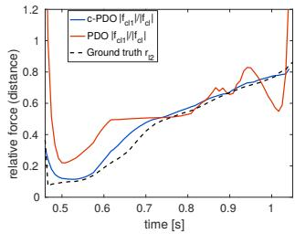

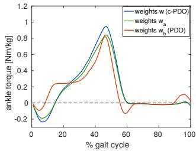  
Figure 3. Left: Comparison of optimized relative forces at the toe to the measured relative heel-to-COP distance $r_{l2}$ . Right: Influence of different weight vectors on the optimized ankle torque. The vectors $w_{b}$ (PDO) and w (c-PDO) set $h_{d}$ and $h_{\tau}$ to zero, respectively.

The optimization with regularization weights w does not take $h_{\tau}$ (cf. Eq. (7a)) into consideration. An additional minimization of this term, i.e. using the weights $w_{a}$ , does not change the characteristic torque progression, while in turn increasing the other regularization terms, e.g. the violation of the equations of motion $h_{e}$ . In the following we will refer to the window-wise predictive dynamics optimization with regularization according to w as COP-regularized predictive dynamics optimization (c-PDO) and to the corresponding procedure with $w_{b}$ as PDO.

## Data completion

We recorded motion sequences of walking, jogging and jumping subjects in a laboratory setup with two force plates embedded in the ground to measure $F_{m}$ . For walking and jogging the captured force plate data does not represent a whole cycle in many cases, since the subjects only hit one plate to maintain a natural movement style.

Because the quality of the final torque regression correlates to the size of the training set, i.e. the number of motion windows, we decided to complete the partial force plate data with inferred GRF values. This regression is termed as Force Regression Forest (FRF) and is realized using a bagged Random Forest [4] that is trained with the predictor matrix $A_{FRF}$ and the response matrix $B_{FRF}$ . These matrices consist of parameter vectors for all N frames of motion capture data of each motion class:

$$
\boldsymbol {A} _ {\mathrm{FRF}} = \left( \begin{array}{c} \ddot {\boldsymbol {q}} _ {1} \dots \ddot {\boldsymbol {q}} _ {N} \\ \boldsymbol {y} _ {c _ {1}} \dots \boldsymbol {y} _ {c _ {N}} \\ \boldsymbol {v} _ {c _ {1}} \dots \boldsymbol {v} _ {c _ {N}} \end{array} \right),   \boldsymbol {B} _ {\mathrm{FRF}} = \binom{\boldsymbol {F} _ {m _ {1}} \dots \boldsymbol {F} _ {m _ {N}}}{\boldsymbol {r} _ {1} \dots \boldsymbol {r} _ {N}}\tag{9}
$$

We infer GRF vectors $F_{m}$ and relative contact point to COP distances r from the angular accelerations $\ddot{q}$ , the vertical distances $y_{c}$ of the contact points to the ground and their velocities $v_{c}$ . Here, $\ddot{q}$ is calculated using finite differences of three consecutive frames. The contact parameters $y_{c}$ and $v_{c}$ are computed based on the model state of the respective center frame. In our experience, a regression based on these features instead of the joint trajectories or the model states provides better results for this particular problem.

## 3.3. Joint torque and force regression

The RF regression described in the previous section provides completed force plate data $F_{m}$ and r which is then used in Eq. (7d) and (7e) to regulate the contact force and its point of action during the optimization of the coefficients $\alpha$ and $\beta$ . These weighting coefficients determine the quantities of interest, that is the GRF $F(t)$ and the joint torques $\tau(t)$ .

In other words, the successive execution of the force regression FRF and the predictive dynamics optimization (c-)PDO provides training sets for the final RF regression from motion to hidden forces and torques. These training sets include parameter vectors $\alpha$ and $\beta$ for the states $\boldsymbol{x} = (\boldsymbol{q}^{T}, \dot{\boldsymbol{q}}^{T})^{T}$ and the controls $\boldsymbol{u} = (\boldsymbol{\tau}^{T}, \boldsymbol{F}_{c}^{T})^{T}$ , respectively. The final RF regression from motion to torques and forces will be referred to as Torque Regression Forest (TRF) in the remainder of the paper. The whole algorithm is schematically presented in Fig. 2. We introduce the notations TRF and c-TRF to distinguish between the RF trained with the parameters resulting from PDO and c-PDO, respectively.

To support the consideration of parameter correlations we first perform principle component analysis on both the predictor and the response set and then train a RF on the resulting principle component scores. We use a bagged RF [4] comprising 110 decision trees with a minimal leaf size of 3 parameter vectors. These properties were determined via cross validation. The forest is trained using the predictor values $A_{\mathrm{TRF}}$ and the responses $B_{\mathrm{TRF}}$ consisting of principle component scores $s$ :

$$
\begin{array}{r} \pmb {A} _ {\mathrm{TRF}} = (\pmb {s} _ {1} ^ {\mathrm{in}} \dots \pmb {s} _ {K} ^ {\mathrm{in}}), \pmb {B} _ {\mathrm{TRF}} = (\pmb {s} _ {1} ^ {\mathrm{out}} \dots \pmb {s} _ {K} ^ {\mathrm{out}}) \\ \pmb {s} ^ {\mathrm{in}} = C _ {\mathrm{in}} ^ {- 1} (\pmb {\theta} - \bar {\pmb {\theta}}), \pmb {s} ^ {\mathrm{out}} = C _ {\mathrm{out}} ^ {- 1} (\pmb {\beta} - \bar {\pmb {\beta}}). \end{array}\tag{10}
$$

Here, $C_{in}$ and $C_{out}$ denote the corresponding principle components and the mean of a variable is marked with a horizontal bar above the character. The integer K is the number of motion windows in the training set. The predictor scores are based on the parameter vector

$$
\pmb {\theta} = (\pmb {\alpha} _ {r} ^ {T}, \ddot {\pmb {q}} ^ {T}, \pmb {v} _ {c} ^ {T}) ^ {T}.\tag{11}
$$

The angular acceleration $\ddot{q}$ is calculated via finite differences and the contact point velocities $v_{c}$ are derived from the states $\boldsymbol{x}(t)$ and averaged over the window length. As already stated in Sec. 3.2, we found that these additional features improve the performance of the regression.

Instead of the complete coefficient vector $\alpha$ , we use a reduced version $\alpha_{r}$ that does not include the coefficients for the global position of the root joint. Thereby, we achieve translational invariance of the predictors. Based on the response score $s^{out}$ we calculate $\beta$ and subsequently the joint torques $\tau$ and the GRF F via Eq. (2), (4) and (5).

For the application of (c-)TRF the considered motion sequence first has to be divided into windows of 3 frames, with possible overlap. Then every window can be processed independently making the algorithm suitable for parallelization. We determine the coefficients $\alpha$ by solving the isolated optimization problem $\min_{\alpha}\{h_x(\alpha)\}$ (cf. Eq. (7c)) using the BFGS Quasi-Newton method [5] and subsequently reduce to $\alpha_r$ . The remaining parameters $\ddot{q}$ and $v_c$ from Eq. (11) are derived as described above.

## 4. Experiments

We use synchronized motion capture and force plate data of 11 subjects that perform walking, jogging and vertical jumping motions. In total our training sets consist of 38 sequences for each, walking and jogging and 36 sequences for jumping.

We obtain the 3D motion using a marker-based Vicon T-series motion capture system consisting of 8 IR-cameras and measure the related GRF with AMTI force plates. Based on 3D marker trajectories a skeleton fit is performed and the resulting joint trajectories are used to calculate joint angles, angular velocities, root position and root velocity, which constitute the model states $x(t)$ (cf. Eq. 4).

## 4.1. Data completion

First of all we will evaluate FRF that we use to complete force plate data for walking and jogging motions (cf. Sec. 3.2). As mentioned earlier, the resulting GRF values are used as regularization during the window-wise predictive dynamics optimization and their quality is critical for a sound joint torque estimation. Therefore we use all available information, including frames of the same sequence that have valid GRF measurements.

For the evaluation of FRF we consider each motion sequence separately and regress forces based on all remaining sequences in the set, hence using data from the same subject as well. The mean square error (MSE) of inferred

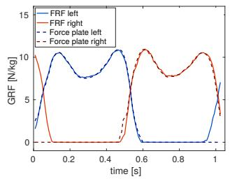

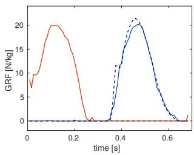  
Figure 4. Qualitative comparison of FRF results for the vertical GRF to force plate data of walking (left) and jogging (right). The sequences have MSE values of $0.091 \, (\text{N/kg})^{2}$ and $0.991 \, (\text{N/kg})^{2}$ , respectively.

GRF compared to ground truth data is used as error measure. We achieve MSE values of $0.085 \, (\text{N/kg})^{2}$ for walking and $1.017 \, (\text{N/kg})^{2}$ for jogging. Corresponding results are qualitatively compared to force plate data in Fig. 4. The left hand side shows the vertical force for walking and the right hand side depicts the equivalent component for jogging. We limit the qualitative presentation of results to vertical components, since they predominantly influence the dynamics of the model. The quality of regressed horizontal components is similar and they are included in the MSE as well.

Note that in this particular jogging sequence the right foot does not hit the force plate. Therefore the measured force is equal to zero and does not represent the true GRF. In this case, our regression can be used for data completion.

Aside from the GRF vectors we need the relative distances of toe and heel contact points to the COP on the force plate, to ensure a realistic force partitioning during the optimization. The MSE of the relative distances r is 0.012 for walking and 0.011 for jogging.

This part of the evaluation does not consider the vertical jumps, since the subjects were able to hit both force plates during jump and landing, providing us with complete force plate data.

## 4.2. Joint torque and force estimation

In this section we evaluate the results of TRF and c-TRF (cf. Sec. 3.3), i.e. the estimated GRFs and joint torques. We assess the performance of the regression forests by comparing to our own implementation of [7] and to the optimization procedures PDO and c-PDO introduced in Sec. 3.2. The quantitative evaluation will include the MSE of GRF and partitioned GRF magnitudes according to the COP, as well as a comparison of computation times $t_c$ . Since there is no ground truth data for joint torques we will analyze the consistency of the resulting curves. In contrast to the evaluation of FRF, all motions performed by the same subject as the considered motion sequence are now excluded from the training set.

The left of Fig. 5 shows GRF regression results for example sequences of all motion types. The corresponding MSE values and computation times for all sequences are summarized in Table 1. The window-wise predictive dynamics optimization (c-)PDO clearly outperforms the method based on [7] regarding MSE of GRF and COP for all motion types. But it suffers from high computation times (> 1 h). To achieve a faster estimation with relatively small error values, c-TRF is the method of choice. In contrast to [7], it is able to estimate characteristic features, such as the drop of vertical GRF values during mid-stance of walking. Furthermore the vertical GRF component stays close to zero during the swing phase (no ground contact of the considered foot) of walking and jogging, while the results of [7] considerably deviate from zero (cf. Fig 5). This discrepancy is due to the sensitivity of the latter method to the distance of contact points to the estimated ground plane.

The COP MSE values demonstrate the effect of our COP regularization on the force partitioning between heel and toe contact points. The values are considerably decreased from PDO to c-PDO and from TRF to c-TRF, respectively. Apart from the limiting of the GRF vector, this regularization is crucial to ensure accurately estimated joint torques. It is noteworthy, that the averaging of the RF regression tends to improve the COP MSE of TRF compared to PDO.

For jogging and jumping, the performances of (c-)TRF and [7] are more similar than for walking. This can be explained by the higher variability of these motion types, that is not sufficiently reflected by the training sets. In order to satisfy the higher variability it is advisable to increase the number of training samples for these motion types to further improve the results in future research.

To convey a qualitative impression of the performance on the whole sets, we illustrate the mean and standard deviation of the estimated vertical GRF via c-TRF and $[7]$ in Fig. 5 on the left. The corresponding curves for the joint torques inferred with c-TRF are shown in Fig. 5 on the right. The torque profiles display a high degree of consistency (small standard deviations) for walking and jogging. In the case of jumping the results are affected by a higher uncertainty concerning the distinction between jump, flight and landing phase, which is reflected in the non-zero GRF during the flight phase. This problem could be approached by employing an additional classification previous to the RF regression, i.e. with a hierarchical RF or by simply increasing the training set. Nevertheless, the MSE values for GRF and COP are lower than those achieved with $[7]$ .

## 4.3. Noise and occlusions

In order to demonstrate the robustness of our method we evaluate the performance on noisy and occluded data. In a first experiment we add gaussian noise to the coordinates q of the walking sequences and analyze the resulting MSE of the inferred GRF (cf. Fig. 6 left). The regression for walking stays stable subjected to gaussian noise with a standard deviation of up to 0.2 deg and with noise smaller than 0.4 deg the results are still better than those achieved with [7] on the original data. Note that the related noise on the velocities $\dot{q}$ is two orders higher, due to the calculation via finite differences.

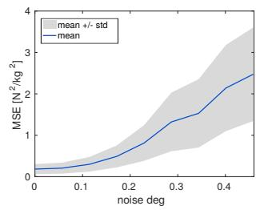

Table 1. MSE values of the estimated GRF and COP and averaged computation times $\bar{t}_{c}$ for the method based on Brubaker et al. [7], the optimization described in Sec. 3.2 (PDO and c-PDO) and for our regression methods (TRF and c-TRF), trained on the sets resulting from PDO and c-PDO, respectively.

<table><tr><td>method</td><td>input</td><td>GRF MSE walking</td><td> $[N^2/kg^2]$  jogging</td><td>jumping</td><td>COP MSE walking</td><td> $[N^2/kg^2]$  jogging</td><td>jumping</td><td> $\bar{t}_c[s]$ </td></tr><tr><td>[7]</td><td>motion</td><td>2.731</td><td>2.914</td><td>5.712</td><td>3.135</td><td>14.096</td><td>7.790</td><td>26</td></tr><tr><td>PDO</td><td>motion, force</td><td>0.052</td><td>0.236</td><td>0.599</td><td>2.350</td><td>3.618</td><td>20.584</td><td></td></tr><tr><td>c-PDO</td><td>motion, force</td><td>0.052</td><td>0.236</td><td>0.598</td><td>0.100</td><td>0.239</td><td>0.136</td><td>4320</td></tr><tr><td>TRF</td><td>motion</td><td>0.180</td><td>2.063</td><td>4.031</td><td>1.644</td><td>7.178</td><td>9.713</td><td></td></tr><tr><td>c-TRF</td><td>motion</td><td>0.182</td><td>1.790</td><td>4.211</td><td>0.540</td><td>1.000</td><td>1.233</td><td>155</td></tr></table>

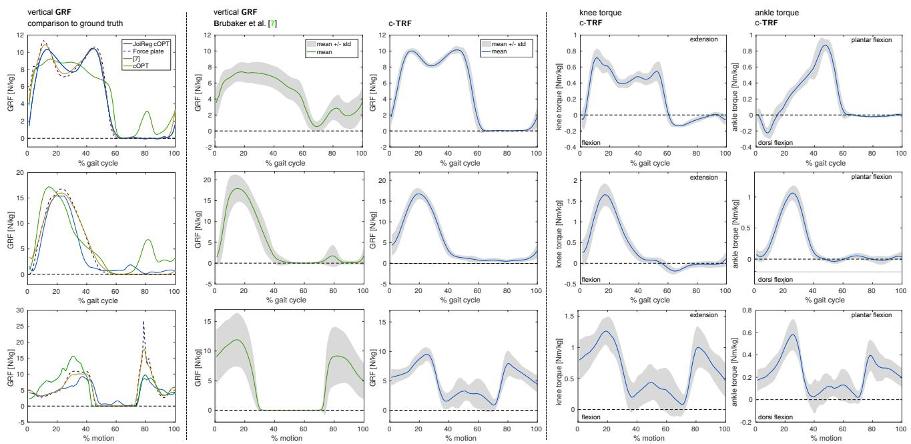  
Figure 5. Left: Comparison of vertical GRF results of different methods to force plate data. The presented c-TRF regressions have GRF MSEs of $0.144\left(N/kg\right)^{2}$ , $1.492\left(N/kg\right)^{2}$ and $3.060\left(N/kg\right)^{2}$ for walking, jogging and jumping (from top to bottom), respectively. Center: c-TRF results compared to vertical GRFs generated with the method based on [7]. Right: c-TRF joint torque estimations.

In a second experiment the joint angles of one leg are occluded, i.e. we remove information about the contact points, the ankle joint and the knee joint. To reconstruct the missing data, we apply an asymmetrical principle component projection [1] of the available parameters to the full parameter space spanned by the vectors $\theta_{1} \ldots \theta_{K}$ (cf. Eq. (11)) of the training set. The resulting mean curves of the vertical GRF for all sequences of walking are depicted in Fig. 6 on the right. We compare c-TRF results to the ground truth. As can be seen, the estimated reaction force is still within a rea-

Figure 6. Left: MSE of estimated GRFs vs. the standard deviation of gaussian noise added to the joint angles. Right: Mean vertical GRF results of c-TRF conducted on walking sequences with one occluded leg.

sonable range of values. The MSEs of GRF and COP are $1.050 (N/kg)^{2}$ and $1.060 (N/kg)^{2}$ , respectively. Considering the plateau-like curve progression, we can conclude that especially the uncertainty in regressed event times, i.e. heel-strike, foot-flat, heel-off and toe-off is increased compared to regressions on the full information. Note that the measured force on one plate is equal to zero during the first and third double support, since our laboratory setup only consists of two plates. The true GRF has to be greater than zero like the regression results.

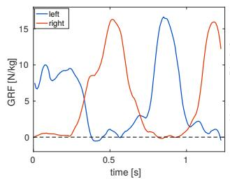

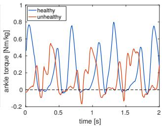  
Figure 7. Left: Regressed vertical GRF for a transition from walking to jogging (cf. Fig. 8). Right: Ankle torques of an asymmetric gait (cf. Fig. 9).

## 4.4. Application to new motions

The division into short windows allows us to infer forces and torques of motions that are not part of the training set. The considered motion types are a transition from walking to jogging and an asymmetric gait. On the level of 3-frame windows both sequences have some similarity to the learned motion classes, making a regression possible.

First, we consider the transition from walking to jogging. For this purpose we train a RF on the combined training set of walking and jogging sequences and perform the same regression as before. In doing so, we rely on the capacity of c-TRF to automatically distinguish between both motion types. The resulting vertical GRF is illustrated in Fig. 7 on the left hand side and frames from the corresponding animation are shown in Fig. 8.

Furthermore we apply c-TRF to an asymmetric limping motion, that was reconstructed from IMU data by $[22]$ . In lieu of the strong drift of the global root position, due to the double integration from acceleration data, the inferred force and torque values stay within a sensible range. This is owed to the translational invariance of the Random Forest predictor parameters $\theta$ . The right hand side of Fig. 7 shows the regressed ankle torques for both legs. The curves exhibit a clear asymmetry with a reduced plantar flexion torque in the unburdened leg. Fig. 9 presents frames, taken from the related animation together with pictures of the scene.

## 5. Discussion

In this work we introduce a learning-based approach for the important and challenging problem of joint torque and contact force estimation from motion. The proposed

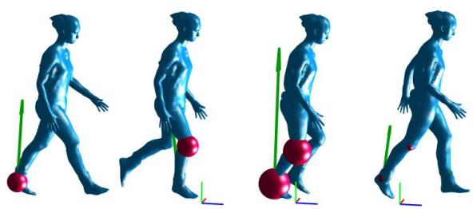

Figure 8. Transition from walking to jogging. The green arrows represent the regressed GRF vectors and the red spheres the magnitudes of the inferred joint torques.  
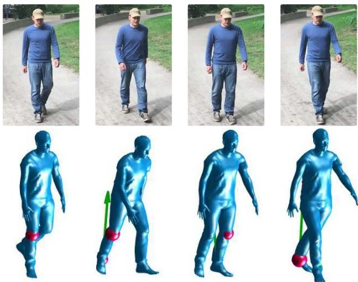  
Figure 9. Regression results for an asymmetric gait reconstructed from IMU data $[22]$ . We are able to infer plausible controls despite the higher imprecision of reconstructed model states (e.g. the exaggerated forward bend in the second frame).

Random Forest regression outperforms the state-of-the-art method $[7]$ regarding MSE of estimated contact properties and is about 30 times faster than the predictive dynamics optimization we used for the generation of our training sets. Although the latter method provides high quality results it needs additional input (constraints for the contact properties) and it cannot perform in real-time, while TRF is in principle applicable to such scenarios. The limiting factors are the optimization of motion parameters $\alpha$ and the prediction by the Random Forest. Both steps can be performed in parallel for every motion window.

We demonstrate the robustness of our method concerning noisy and occluded input data and show the benefit of the sliding-window procedure by applying our method to new motion types, in particular to a transition from walking to jogging and to a 3D reconstruction of limping.

## References

[1] M. Al-Naser and U. Söderström. Reconstruction of occluded facial images using asymmetrical principal component anal-

ysis. Integrated Computer-Aided Engineering, 19(3):273-283, 2012. 7

[2] S. Andrews, I. Huerta, T. Komura, L. Sigal, and K. Mitchell. Real-time physics-based motion capture with sparse sensors. In Proceedings of the 13th European Conference on Visual Media Production (CVMP 2016), CVMP 2016, pages 5:1–5:10. ACM, 2016. 2

[3] W. Blajer, K. Dziewiecki, and Z. Mazur. Multibody modeling of human body for the inverse dynamics analysis of sagittal plane movements. Multibody System Dynamics, 18(2):217–232, 2007. 1, 2

[4] L. Breiman. Random forests. Machine Learning, 45(1):5-32, 2001. 4, 5

[5] C. G. Broyden. The Convergence of a Class of Double-rank Minimization Algorithms 1. General Considerations. IMA Journal of Applied Mathematics, 6(1):76-90, Mar. 1970. 5

[6] M. A. Brubaker and D. J. Fleet. The kneed walker for human pose tracking. In Computer Vision and Pattern Recognition, 2008. CVPR 2008. IEEE Conference on, pages 1–8, June 2008. 1, 2

[7] M. A. Brubaker, L. Sigal, and D. J. Fleet. Estimating contact dynamics. In Computer Vision, 2009 IEEE 12th International Conference on, pages 2389–2396, Sept 2009. 2, 6, 7, 8

[8] R. Byrd, J. Gilbert, and J. Nocedal. A trust region method based on interior point techniques for nonlinear programming. Mathematical Programming, 89(1):149-185, 2000. 4

[9] R. F. Chandler, C. E. Clauser, J. T. McConville, H. M. Reynolds, and J. W. Young. Investigation of inertial properties of the human body. Technical report, Department of Transportation, Report No DOT HS-801 430, Mar 1975. 3

[10] B. J. Fregly, J. A. Reinbolt, K. L. Rooney, K. H. Mitchell, and T. L. Chmielewski. Design of patient-specific gait modifications for knee osteoarthritis rehabilitation. IEEE Transactions on Biomedical Engineering, 54(9):1687–1695, Sept 2007. 1

[11] L. Johnson and D. H. Ballard. Efficient codes for inverse dynamics during walking. In Proceedings of the Twenty-Eighth AAAI Conference on Artificial Intelligence, AAAI'14, pages 343–349. AAAI Press, 2014. 2

[12] X. Lv, J. Chai, and S. Xia. Data-driven inverse dynamics for human motion. ACM Trans. Graph., 35(6):163:1–163:12, Nov. 2016. 2

[13] A. Maksai, X. Wang, and P. Fua. What players do with the ball: A physically constrained interaction modeling. In The IEEE Conference on Computer Vision and Pattern Recognition (CVPR), June 2016. 2

[14] I. Oikonomidis, N. Kyriazis, and A. A. Argyros. Full dof tracking of a hand interacting with an object by modeling occlusions and physical constraints. In 2011 International Conference on Computer Vision, pages 2088–2095, Nov 2011. 2

[15] T.-H. Pham, A. Kheddar, A. Qammaz, and A. A. Argyros. Towards force sensing from vision: Observing hand-object interactions to infer manipulation forces. In The IEEE Conference on Computer Vision and Pattern Recognition (CVPR), June 2015. 2

[16] C. M. Powers. The influence of abnormal hip mechanics on knee injury: a biomechanical perspective. journal of orthopaedic & sports physical therapy, 40(2):42–51, 2010. 1

[17] T. Schmalz, S. Blumentritt, and R. Jarasch. Energy expenditure and biomechanical characteristics of lower limb amputee gait: The influence of prosthetic alignment and different prosthetic components. Gait & Posture, 16(3):255 - 263, 2002. 1

[18] A. L. Schwab and G. M. J. Delhaes. Lecture Notes Multi-body Dynamics B, wb1413. 2009. 3

[19] K. W. Sok, M. Kim, and J. Lee. Simulating biped behaviors from human motion data. ACM Trans. Graph., 26(3), July 2007. 2

[20] H. Soo Park, j.-J. Hwang, and J. Shi. Force from motion: Decoding physical sensation in a first person video. In The IEEE Conference on Computer Vision and Pattern Recognition (CVPR), June 2016. 2

[21] M. Stelzer and O. von Stryk. Efficient forward dynamics simulation and optimization of human body dynamics. ZAMM - Journal of Applied Mathematics and Mechanics / Zeitschrift fr Angewandte Mathematik und Mechanik, 86(10):828–840, 2006. 1, 2

[22] T. von Marcard, B. Rosenhahn, M. Black, and G. Pons-Moll. Sparse inertial poser: Automatic 3d human pose estimation from sparse imus. Computer Graphics Forum 36(2), Proceedings of the 38th Annual Conference of the European Association for Computer Graphics (Eurographics), 2017. 8

[23] M. Vondrak, L. Sigal, and O. C. Jenkins. Physical simulation for probabilistic motion tracking. In Computer Vision and Pattern Recognition, 2008. CVPR 2008. IEEE Conference on, pages 1–8, June 2008. 2

[24] X. Wei, J. Min, and J. Chai. Physically valid statistical models for human motion generation. ACM Trans. Graph., 30(3):19:1–19:10, May 2011. 2

[25] C. R. Wren and A. P. Pentland. Dynamic models of human motion. In In Proceedings of the Third IEEE International Conference on Automatic Face and Gesture Recognition, Nara, Japan, April 1998. 2

[26] Y. Xiang, J. S. Arora, S. Rahmatalla, and K. Abdel-Malek. Optimization-based dynamic human walking prediction: One step formulation. International Journal for Numerical Methods in Engineering, 79(6):667–695, 2009. 1, 2

[27] Y. Xiang, H.-J. Chung, J. H. Kim, R. Bhatt, S. Rahmatalla, J. Yang, T. Marler, J. S. Arora, and K. Abdel-Malek. Predictive dynamics: an optimization-based novel approach for human motion simulation. Structural and Multidisciplinary Optimization, 41(3):465–479, 2010. 1, 2, 3

[28] P. Zell and B. Rosenhahn. Pattern Recognition: 37th German Conference, GCPR 2015, Aachen, Germany, October 7-10, 2015, Proceedings, chapter A Physics-Based Statistical Model for Human Gait Analysis, pages 169–180. Springer International Publishing, 2015. 2

[29] P. Zhang, K. Siu, J. Zhang, C. K. Liu, and J. Chai. Leveraging depth cameras and wearable pressure sensors for full-body kinematics and dynamics capture. ACM Trans. Graph., 33(6):221:1–221:14, Nov. 2014. 2