# 基于物理的视频人体动作捕捉的最优状态动力学估计

Cuong Le1, Viktor Johansson1, Manon Kok2 and Bastian Wandt1

1Department of Electrical Engineering, Linköping University, Sweden 2Delft Center for Systems and Control, Delft University of Technology, The Netherlands

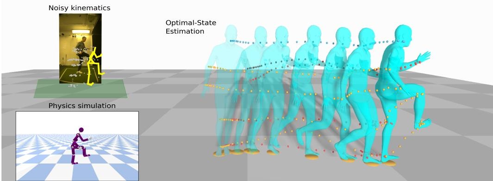  
Figure 1: OSDCap 是一种基于两路输入运动的最优状态动力学估计方法（青色）：一路是来自视频的基于运动学的姿态估计（左上），另一路是由元 PD（比例-微分，Proportional-Derivative）控制器生成的基于物理的仿真（左下）。预测的运动符合物理规律，减少了高频噪声，同时保持了高精度的全局位置。

## 摘要

近年来，基于单目视频的人体动作捕捉取得了显著进展。然而，现代方法通常会产生时间伪影，例如抖动运动的形式，并且难以获得平滑且符合物理规律的运动。显式地以内部力和外部力矩的形式整合物理规律，有助于减轻这些伪影。目前最先进的方法利用自动 PD 控制器来预测力矩和反作用力，以便重新仿真输入的运动学数据，即预定义骨架的关节角度。然而，由于物理模型并不完美，这些方法通常需要简化假设并对输入的运动学数据进行大量的预处理才能获得良好的性能。为此，受神经卡尔曼滤波方法的启发，我们提出了一种在线设置下选择性结合物理模型与运动学观测的新方法。我们开发了一个控制回路作为元 PD 控制器来预测内部关节力矩和外部反作用力，随后进行基于物理的运动仿真。引入循环神经网络来实现卡尔曼滤波器，该滤波器能够注意力感知地平衡运动学输入与仿真运动，从而得出最优状态动力学预测。我们证明了该滤波步骤对于提供在线监督至关重要，有助于平衡各自输入运动的不足，从而不仅对捕获准确的全局运动轨迹非常重要，而且对生成符合物理规律的人体姿态也至关重要。与现有最先进技术相比，所提出的方法在基于物理的人体姿态估计任务中表现优异，并展示了预测动力学的物理合理性。代码可在 § 获取。

## 1 引言

三维人体运动估计是计算机视觉领域一个长期且具有挑战性的研究目标，尤其是在单目场景下，由于其固有的深度歧义性更是如此。先前的方法引入了运动学先验，例如通过增强平滑度、保持骨长恒定或施加对称性约束。然而，由于逐帧预测的不一致性，这些解决方案并不一定会产生符合物理合理性的运动。这促成了一个新研究方向的兴起，该方向将传统的 3D 运动估计与人体骨骼物理模型相结合。这些方法并非直接预测人体姿态，而是估计驱动运动的内部关节力矩和外部作用力。因此，通过采用物理仿真器来获取最终生成的运动 [37, 38, 8, 50, 21]。

然而，由于仿真器绝非现实世界的完美表征，它们会引入不可避免的误差，其中复杂的人体从未被完全建模，而仅仅是通过刚体动力学进行近似 [3]。此外，包括“真值”记录在内的测量数据本身就存在噪声。为了解决这些问题，我们提出了 OSDCap，这是一种将可微物理仿真与我们新颖的神经卡尔曼滤波（neural Kalman filtering）方法相结合的状态感知架构。Fig. 1 展示了我们从含有噪声的运动学估计中预测出的重建姿态，以及从视频中估计出的动力学参数。

OSDCap 是一种可以端到端方式训练的在线滤波与动力学估计方法。具体而言，我们的方法包含两个步骤，从现成的基于视频的 3D 人体姿态估计器所获取的含噪声运动学重建出发：1) 仿真分支，利用 PD 控制器估计关节力矩并计算所产生的运动；2) 自适应滤波阶段，结合仿真阶段的输出与基于视频的运动学输入，以生成优化后的运动。我们遵循以往利用 meta-PD 算法进行力矩计算 [38, 21] 的工作来模拟合理运动。然而，PD 算法的有效性严重依赖于 P 和 D 增益的选择 [38]，以及通常未知的人体运动学链的精确模型。此外，来自单目 3D 运动学姿态估计器的测量值包含大量噪声，最终会导致预测不准确。Shimada 等人 [38] 通过在 PD 控制器中引入额外的偏移项来缓解这些问题。尽管这种方法仍能产生合理的输出运动，但它既缺乏物理可解释性，也与控制理论中的 PD 控制器不一致。我们旨在从根本上解决这一问题，从控制理论中汲取灵感，并提出了一种通过可学习的卡尔曼滤波（Kalman filtering）方法 [36] 来处理不完美 PD 计算的解决方案。所提出的卡尔曼滤波器将仿真运动和含噪声的 3D 姿态估计作为输入，将二者结合，并输出最优状态预测。卡尔曼滤波器有效地将基于 PD 控制器的仿真运动提炼为更加合理和逼真的运动。尽管卡尔曼滤波器修正了来自 3D 姿态估计器不准确的运动学测量值，但它并未考虑人体各部位不同的重量分布。我们针对平均人体体型计算了初始重量分布——即惯性矩阵。然而，与骨骼结构一样，这些都只是近似值，会导致仿真不准确。我们通过在每个时间步预测一个惯性偏置矩阵并将其加到初始惯性矩阵上，来缓解这一问题。

我们在流行的 Human3.6M [15] 数据集以及较新的 Fit3D [7] 和 SportsPose [14] 数据集上展示了我们方法的 3D 重建性能，并将其与近期最先进的基于物理的方法进行了对比。

总之，OSDCap 引入了一种新的基于物理的人体运动与动力学估计方法，该方法利用可学习的卡尔曼滤波器和可学习的惯性预测，不仅能生成合理的运动，还能对外部作用力和内部力矩提供有价值的估计。通过在人体运动估计中提供更高的准确性和可解释性，OSDCap 为弥合计算机视觉与复杂的基于物理的人体运动建模之间的差距迈出了充满希望的一步。

## 2 相关工作

## 2.1 基于运动学的3D人体动作捕捉

单目3D人体动作捕捉是一个得到广泛研究的领域，常见方法大致可分为两类：1）直接从图像预测人体姿态的端到端方法 [39, 29]，以及 2）从2D提升到3D（lifting from 2D）的方法 [1, 26, 28, 12, 4, 30, 42, 2, 10, 44, 22, 47, 43, 31]。近期的研究通过将体积模型拟合到2D/3D线索来解决这一问题，旨在实现逼真的人体动作 [27, 17, 25, 19, 20, 48, 45, 18, 23, 53, 40]。尽管取得了显著进展，但由于单目设置中深度信息的缺失，基于视觉的人体3D姿态估计仍然是一个不适定问题（ill-posed problem）。因此，捕捉到的3D动作往往包含各种形式的不合理现象，包括非自然姿态、抖动或不真实的人体伪影 [46, 8]。

## 2.2 基于物理的3D人体动作捕捉

近期的研究 [37, 50, 46, 8, 21] 将物理定律作为动作重建的约束条件，消除了单目估计所产生的不合理伪影，即抖动、地面穿透以及非自然的人体姿态。

使用强化学习（Reinforcement Learning, RL）进行动作模仿是模拟符合物理规律结果的一种流行方法 [32, 49, 50, 33, 51]。基于RL的方法在奖励函数中施加物理约束，这些约束要么源于人工设计的公式，要么源于物理引擎。基于RL的方法的瓶颈在于，学习到的策略对未见动作的迁移能力较差。

动作优化是基于物理的人体动作捕捉的另一种常用方法。然而，优化问题通常需要可微框架，因此，先前的研究 [34, 37, 46] 并未依赖不可微的物理引擎，而是采用简化的运动方程 [5] 作为模拟动作的动力学约束。近期的更多方法 [13, 9] 则尝试使用进化优化方法 [11] 对不可微仿真进行优化。Gärtner 等人 [8] 实现了 PyBullet [3] 的可微版本，构建了一个带有复杂物理引擎的可优化框架。然而，与基于RL的方案类似，大多数动作优化方案对不同数据分布的适应能力有限，需要在新的动作集合上重新进行优化。

以端到端的方式利用神经网络模型的泛化能力仍然是一个开放的研究方向，这是因为从数据中挖掘物理合理性模式存在较大困难。Rempe 等人 [35] 利用变分自编码器（variational autoencoder, VAE）架构来预测合理的运动，并通过解码器网络近似动力学仿真。参照生物力学文献，这种假设可能会导致不切实际的受力预测。Li 等人 [21] 利用具有可学习参数的元比例微分（meta-PD）控制器进行力矩预测，但额外增加了一个基于根节点残余力的补偿项。Zhang 等人 [52] 实现了一种基于 Transformer 的自编码器来细化运动学输入序列，同时在潜在嵌入中整合了物理约束。然而，Li 等人 [21] 和 Zhang 等人 [52] 都是基于完整运动样本的编码进行预测的，即它们需要已知过去和未来的运动信息，因此限制了该方法在离线设置（可获取未来信息）之外的适用性。Shimada 等人 [38] 同样使用 meta-PD 控制器来计算最优关节力矩，进而生成与视觉运动学估计相匹配的仿真运动。尽管其估计出的姿态具有合理性，但运动在世界坐标系下的全局精度有限，且尚未得到充分解决。

我们的目标是在递归在线设置中，将基于物理的方法（结合 meta-PD 控制器）应用于单目相机系统捕获的运动数据，并将预测拓展到更复杂的实际动作（例如体育运动）。

## 3 方法

本节详细介绍我们提出的方法 OSDCap。我们首先基于 Human3.6M 数据集 [15] 中的统一标准人体配置创建一个平均代理角色（proxy character）B。该角色使用圆和圆柱体来近似人体。此外，我们利用预训练神经网络 TRACE [40] 来获取初始 3D 姿态估计。在没有任何额外先验的情况下，OSDCap 旨在预测关节力矩和外力，以驱动代理角色匹配 TRACE 提供的运动学线索。遵循先前的工作，我们采用一个神经网络来预测元 PD 控制器（meta-PD controller）的参数，进而依次预测关节力矩。尽管相关方法 [38, 21] 仅停留在这一步，但我们注意到，PD 控制器预测给出的运动质量高度依赖于基于视频的运动学估计和代理角色的真实性。由于模型始终只能是对现实世界的近似，这会导致预测不准确，先前的工作通过在 PD 控制器中添加额外的偏移项来对此进行补偿。遗憾的是，这不仅引入了非物理假设，而且通过实验我们发现，该项在 PD 控制器的预测中占据了主要部分。我们旨在通过引入一种受神经卡尔曼滤波器（neural Kalman filter）[36] 启发的新型滤波方法来细化和更新运动状态，从而保持我们方法的物理合理性。此外，在每个时间步，足部接触状态和地面反作用力都直接从运动中估计得出，从而实现对系统动力学的完整描述。图 2 展示了我们方法的概览。

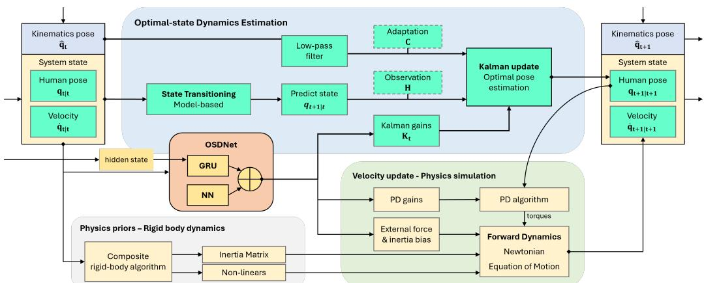  
Figure 2: OSDCap 的主要流程。我们的方法由一个神经网络模型 OSDNet（橙色）和三个处理组件组成。OSDNet 接收当前系统状态，估计卡尔曼增益矩阵、PD 增益、外力和惯性偏置矩阵。最优姿态估计包含针对当前系统状态和输入运动学的卡尔曼滤波。黄色表示算法的状态向量，青色表示处理操作。物理先验模块（灰色）使用复合刚体算法（Composite rigid-body algorithm）和逆动力学（Inverse dynamics）[5] 计算惯性矩阵和非线性力。物理模拟模块（绿色）利用 PD 算法和正向动力学（Eq. 1），基于计算出的最优姿态和物理先验来更新速度。

## 3.1 预备知识 - 刚体动力学

与先前的研究 [34, 37, 38, 46] 类似，我们基于刚体动力学（Rigid Body Dynamics）[5] 施加物理约束，符合牛顿运动方程。对于总共 $N$ 个关键点，完整的人体姿态表示为一个向量 $ { \mathbf { q } } \in \dot { \mathbb { R } } ^ { 6 + 3 N }$，前 6 项编码全局平移和旋转，其余 $3N$ 项编码内部关节角度状态。$\dot { \mathbf { q } } \in \mathbb { R } ^ { 6 + 3 N }$ 为对应的速度向量。捕获的人体姿态的运动动力学应满足牛顿运动方程，表示为

$$
\mathbf {M} (\mathbf {q}) \ddot {\mathbf {q}} = \boldsymbol {\tau} + \boldsymbol {\lambda} - \mathbf {h} (\mathbf {q}, \dot {\mathbf {q}}),\tag{1}
$$

其中 $\mathbf { M } ( q ) \in \mathbb { R } ^ { ( 6 + 3 N ) \times ( 6 + 3 N ) }$ 是由代理角色（proxy character）计算得到的惯性矩阵，$\ddot { \textbf { q } } \in$ $\mathbb { R } ^ { 6 + 3 N }$ 是加速度，$\tau \in \mathbb { R } ^ { 6 + 3 N }$ 是内部关节力矩，$\pmb { \lambda } \in \mathbb { R } ^ { \tilde { 6 } + 3 N }$ 是外力，而 $\mathbf { h } ( \mathbf { q } , \dot { \mathbf { q } } ) \in \mathbb { R } ^ { 6 + 3 N }$ 是包含重力、科氏力（Coriolis force）和离心力的非线性项，使用代理角色上加速度为零的逆动力学计算得到 [6]。我们的目标是估计产生合理运动动力学的两个向量 $\tau$ 和 $\lambda$。

## 3.2 最优状态动力学捕获

所提出的 OSDCap 包含三个主要处理阶段：最优姿态估计、物理先验计算以及基于物理模拟的速度更新。最优姿态估计阶段是一种受 KalmanNet [36] 启发的滤波方法，该方法基于当前系统状态和基于视频的 3D 运动学输入来估计最优输出姿态。物理先验计算根据当前系统状态下的代理角色计算当前惯性矩阵和非线性力。物理模拟阶段使用 PD 算法和基于所估计最优姿态的正向动力学（公式 1）计算下一个速度状态。

最优姿态估计和物理模拟所需的输入由我们的神经网络 OSDNet 估计。OSDNet 由两个模块组成，一个预测用于卡尔曼滤波（Kalman filtering）的卡尔曼增益（Kalman gains），另一个预测用于物理模拟的 PD 增益、外力和惯性偏差（inertia-bias）。

最优姿态估计。如图 2 所示，卡尔曼滤波模块将当前系统状态和基于视频的运动学姿态作为输入。遵循传统卡尔曼滤波器，下一个预测状态由前一个状态计算得出。我们将状态转移阶段定义为

$$
\mathbf {q} _ {t + 1 | t} = \mathbf {q} _ {t | t} + \dot {\mathbf {q}} _ {t | t} \Delta t.\tag{2}
$$

预测的位置状态 $\mathbf { q } _ { t + 1 | t }$ 是受物理约束的身体姿态。观测矩阵 H（Fig. 2）将预测状态 $\mathbf { q } _ { t + 1 | t }$ 映射到观测到的模拟位置状态。C 是一个自适应矩阵，用于缩小来自视频的观测状态与来自物理模拟的观测状态之间的差距。H 和 C 在训练期间与 OSDNet 一同优化，但在推理期间保持不变。根据当前系统状态，卡尔曼状态更新过程执行如下：

$$
\mathbf {q} _ {t + 1 | t + 1} = \mathbf {q} _ {t + 1 | t} + \mathbf {K} _ {t} (\mathbf {C} \hat {\mathbf {q}} _ {t} - \mathbf {H} \mathbf {q} _ {t + 1 | t}),\tag{3}
$$

其中 $\mathbf { K } _ { t }$ 包含在步骤 t 基于当前状态和观测估计出的卡尔曼增益。受 [36] 的启发，卡尔曼增益估计模块实现为门控循环单元（Gated Recurrent Units, GRU），其能够通过 GRU 的隐藏状态在整个模拟运动中传播潜在运动动力学。卡尔曼增益的预测需要有关系统状态动力学的信息 [36]，因此需要将四个额外的动力学特征输入到 OSDNet 的 GRU 中，即：观测（observation）、新息（innovation）、前向演化（forward evolution）和前向更新（forward update）。它们的计算方式如下：

$$
\begin{array}{c} \Delta \text {evolution} = \mathbf {q} _ {t | t} - \mathbf {q} _ {t - 1 | t - 1} \\ \Delta \text {update} = \mathbf {q} _ {t | t} - \mathbf {q} _ {t | t - 1} \\ \Delta \text {innovation} = \mathbf {C} \hat {\mathbf {q}} _ {t + 1} - \mathbf {H} \mathbf {q} _ {t + 1 | t} \\ \Delta \text {observation} = \mathbf {C} \hat {\mathbf {q}} _ {t + 1} - \mathbf {q} _ {t}. \end{array}\tag{4}
$$

出于我们系统的实际原因，我们修改了来自 [36] 的原始设计。在自身遮挡的场景中，带噪声的输入 $\hat { \mathbf { q } } _ { t }$ 通常包含诸如身体形变之类的伪影，并且它们通常会持续一段时间（约 10 帧）。原始设计 [36] 中 $\hat { \mathbf { q } } _ { t }$ 与 $\hat { \mathbf { q } } _ { t - 1 }$ 之间的中间差分不足以对这些伪影进行建模，因为它们可能都包含相同的错误运动学估计。我们如公式 4 所示修改了 ∆observation 的计算，以更好地处理会导致 ∆observation 产生较大响应的误检情况。姿态 $\mathbf { q } _ { t \mid t }$ 是步骤 t 的最优状态，它继承了来自运动学观测的全局平移估计，同时保留了来自物理模拟的人体姿态的物理合理性。

物理仿真。图 2（Fig. 2）中物理仿真阶段的目的是更新能够最准确描述滤波过程动力学特性的速度 $\dot { \mathbf { q } } _ { t \mid t }$。因此，估计的位姿 $\mathbf { q } _ { t + 1 | t + 1 }$ 可用作 PD 算法的目标信号，以计算将预测位姿 $\mathbf { q } _ { t + 1 | t }$ 映射到最优位姿 $\mathbf { q } _ { t + 1 | t + 1 }$ 的关节力矩 $\tau _ { t }$。该关节力矩由 PD 算法预测得到：

$$
\pmb {\tau} _ {t} = \pmb {\kappa} _ {P} (\mathbf {q} _ {t + 1 | t + 1} - \mathbf {q} _ {t + 1 | t}) + \pmb {\kappa} _ {D} \dot {\mathbf {q}} _ {t | t},\tag{5}
$$

其中 $\kappa _ { P } , \kappa _ { D }$ 分别为比例增益和微分增益。受 [38] 的启发，该阶段采用了元 PD 控制器（meta-PD controller），其中 $\kappa _ { P } , \kappa _ { D }$ 是可学习的，并由 OSDNet 估计得出。通过使用滤波后的最优位姿作为目标，无需采用不切实际的时间滤波或优化来修正带有噪声的运动学输入。

此外，外力也是由 OSDNet 估计的，假设外力来源仅来自接触点，其计算方式为：

$$
\pmb {\lambda} _ {t} = \sum_ {c} ^ {2} \mathbf {J} _ {t} ^ {c} \pmb {\rho} _ {t} ^ {c} \mathbf {f} _ {t} ^ {c},\tag{6}
$$

其中 ${ \bf J } _ { t } ^ { c }$ 是将接触点 c 处的线速度映射到所有其他关节角速度的雅可比矩阵，$\rho _ { t } ^ { c }$ 和 $\mathbf { f } _ { t } ^ { c }$ 分别是接触点 c 处的接触概率和线性力向量。这三个向量分别由 OSDNet 进行估计。

惯性估计。由于我们无法获取人体真实的骨骼长度和质量分布，仿真的人体角色与真实人体受试者之间存在认知差距（knowledge gap），由复合刚体算法（composite rigid-body algorithm）计算出的惯性张量是次优的。OSDNet 同样被设计用于估计一个惯性偏差项 $\mathbf { M } _ { t } ^ { b }$ 以缩小这一认知差距。将当前仿真位姿驱动到下一状态所需的加速度按公式 7 计算。

$$
\ddot {\mathbf {q}} _ {t} = (\mathbf {M} (\mathbf {q} _ {t}) ^ {- 1} + \mathbf {M} _ {t} ^ {b}) (\pmb {\tau} _ {t} + \pmb {\lambda} _ {t} - \mathbf {h} (\mathbf {q} _ {t}, \dot {\mathbf {q}} _ {t})),\tag{7}
$$

为了更新系统状态，利用新计算出的加速度 $\ddot { q } _ { t }$ 进行有限插值。更新过程由下式给出：

$$
\dot {\mathbf {q}} _ {t + 1 | t + 1} = \dot {\mathbf {q}} _ {t | t} + \ddot {\mathbf {q}} _ {t} \Delta t,\tag{8}
$$

其中 $\dot { \mathbf { q } } _ { t + 1 | t + 1 }$ 是更新后的系统状态，在重力和接触力的物理约束下表示当前的系统动力学。系统现在返回到公式 2 中的过渡阶段，形成一个递归运行的闭环过程。

## 3.3 目标损失

为了重建最优状态，我们将总目标损失 L 定义为多个损失函数的加权和，形式为

$$
L = \frac {1}{T} \sum_ {t} ^ {T} \left(\omega_ {1} L _ {t} ^ {\mathbf {p} _ {t + 1 | t + 1}} + \omega_ {2} L _ {t} ^ {\mathbf {q} _ {t + 1 | t + 1}} + \omega_ {3} L _ {t} ^ {\mathbf {p} _ {t + 1 | t}} + \omega_ {4} L _ {t} ^ {\mathbf {q} _ {t + 1 | t}} + \omega_ {5} L _ {t} ^ {c} + L _ {t} ^ {\text { reg }}\right),\tag{9}
$$

其中 $\omega _ { 1 } = 0 . 5 , \omega _ { 2 } = 0 . 1 , \omega _ { 3 } = 0 . 7 , \omega _ { 4 } = 0 . 2 , \omega _ { 5 } = 0 . 4$ 为权重因子。最优重建损失 $L _ { t } ^ { \mathbf q _ { t + 1 | t + 1 } }$ 和 $L _ { t } ^ { \mathbf { p } _ { t + 1 | t + 1 } }$ 衡量了估计的最优姿态 $\mathbf { q } _ { t + 1 | t + 1 }$ 及其对应的 3D 关键点（通过正向运动学获得）与真实姿态 $\mathbf { q } _ { t + 1 } ^ { G T }$ 和真实 3D 关键点 $\mathbf { p } _ { t + 1 } ^ { G T }$ 之间的 L1 距离。对预测姿态 $\mathbf { q } _ { t + 1 | t }$ 的监督也以类似方式进行，以确保物理模拟的正确行为。$L _ { t } ^ { c }$ 是接触损失，使用双脚的预测接触概率 $\rho _ { t } ^ { c }$ 与伪真实接触二值标签 $\hat { \rho } _ { t } ^ { c }$ 之间的二元交叉熵度量。我们根据真实 3D 关键点的脚-地距离生成用于训练的真实接触标签。各个单独的损失计算如下：

$$
\begin{array}{l} L _ {t} ^ {\mathbf {p} _ {t + 1 | t + 1}} = \sum^ {N} \| \mathbf {p} _ {t + 1} ^ {G T} - \mathbf {p} _ {t + 1 | t + 1} \|, \quad L _ {t} ^ {\mathbf {q} _ {t + 1 | t + 1}} = \sum^ {6 + 3 N} \| \mathbf {q} _ {t + 1} ^ {G T} - \mathbf {q} _ {t + 1 | t + 1} \|, \\ L _ {t} ^ {\mathbf {p} _ {t + 1 | t}} = \sum^ {N} \| \mathbf {p} _ {t + 1} ^ {G T} - \mathbf {p} _ {t + 1 | t} \|, \qquad L _ {t} ^ {\mathbf {q} _ {t + 1 | t}} = \sum^ {6 + 3 N} \| \mathbf {q} _ {t + 1} ^ {G T} - \mathbf {q} _ {t + 1 | t} \|, \\ L _ {t} ^ {c} = - \sum_ {c = 1} ^ {2} \hat {\rho} _ {t} ^ {c} \log (\rho_ {t} ^ {c}) + (1 - \hat {\rho} _ {t} ^ {c}) \log (1 - \rho_ {t} ^ {c}). \end{array}\tag{10}
$$

通过将部分带噪声的运动学测量值重新引入预测中，引入额外的正则化损失 $L _ { t } ^ { \mathrm { r e g } }$ 有利于确保输出动作的平滑性和合理性。该正则化由三个目标组成：1) $L _ { t } ^ { a c c }$ 为加速度损失，计算为 $\ddot { \mathbf { q } } _ { t }$ 与 $\ddot { \mathbf q } _ { t - 1 }$ 之间的绝对差；2) $L _ { t } ^ { v e l }$ 为速度损失，用于衡量真实动作 $\mathbf { q } _ { t + 1 } ^ { G T }$ 与估计的最优 $\mathbf { q } _ { t + 1 }$ 的一阶差分之间的距离；3) 摩擦力损失 $L _ { t } ^ { f r i c }$ 用于促使脚在与地面接触期间保持在相同位置。在正则化权重为 $\omega _ { 6 } = \mathbf { \bar { 0 } } . 1 4 , \omega _ { 7 } = 0 . 0 3 , \omega _ { 8 } = 0 . 2 8$ 的情况下，$L _ { t } ^ { \mathrm { r e g } }$ 表示为

$$
\begin{array}{l} L _ {t} ^ {\text {reg}} = \omega_ {6} L _ {t} ^ {a c c} + \omega_ {7} L _ {t} ^ {v e l} + \omega_ {8} L _ {t} ^ {f r i c} \\ = \omega_ {6} \sum^ {6 + 3 N} \| \ddot {\mathbf {q}} _ {t} - \ddot {\mathbf {q}} _ {t - 1} \| + \omega_ {7} \sum^ {6 + 3 N} \| \mathbf {q} _ {t + 1} ^ {G T} - \mathbf {q} _ {t} ^ {G T} \| - \| (\mathbf {q} _ {t + 1} - \mathbf {q} _ {t}) \| + \omega_ {8} \sum_ {c = 1} ^ {2} \rho_ {t} ^ {c} \| (\mathbf {p} _ {t + 1} ^ {c} - \mathbf {p} _ {t} ^ {c}) \|. \end{array}
$$

## 4 实验

(11)

## 4.1 数据集

我们在两个人体动作基准数据集上评估了我们的方法。第一个也是主要的数据集是常用的 Human3.6M 数据集 [15]。该数据集包含室内 3D 人体动作捕捉数据，包括 2D 和 3D 关键点、骨骼关节角度以及视频。由 7 名演员表演 15 种不同的动作。遵循先前的研究 [38, 21]，前 5 名受试者（S1、S5、S6、S7、S8）用于训练，后 2 名（S9、S11）用于评估。根据 [37]，仅考虑了存在脚地接触的动作。有关所选序列的详细信息请参见补充文件 C。

第二个数据库是 Fit3D [7]。Fit3D 包含多种健身动作的室内动作捕捉数据。受 [37] 在 Human3.6M 上设置的启发，我们通过从 6 名演员（s03、s04、s05、s07、s08、s10）中提取样本用于训练，并使用 2 名演员（s09、s11）用于评估来划分数据。

由于 Human3.6M 和 Fit3D 的场景设置非常相似，我们还在新数据集 SportsPose [14] 上进行了额外评估，该数据集由基于视频的体育运动动作序列及相应的真实 3D 关键点组成。我们使用该数据集来展示域外（out-of-domain）性能，因为 3D 运动学估计器 TRACE [40] 尚未在其上进行过训练。

## 4.2 实现设置

初始运动观测由 TRACE [40] 生成。按照 [38, 8] 的建议，所有提取的运动均从 50Hz 下采样至 25Hz。样本在第一帧对齐到世界坐标系原点，然后分割为 100 帧的子序列，以便进行批量训练和评估。代理角色是根据 Human3.6M [15] 中提供的骨骼元数据（包括平均骨骼长度和关节角度配置）创建的。惯性矩阵和偏置力（包括重力、科里奥利力和离心力）基于代理角色的状态，使用 RBDL [6] 在线计算。

我们以端到端的方式训练 OSDNet。OSDNet 由三个全连接层组成，随后接六个不同的预测头，分别用于 PD 增益（κ , κ ）、惯性偏置（Mb）、接触概率 $( \rho ^ { c } )$、来自地面的线性外力（λ）以及雅可比矩阵（J）。根据公式 1 和公式 6，这六项负责运动仿真阶段。所提出的最优状态预测模块（参见图 2）中的 GRU 单元将当前系统状态、附加动力学特征（公式 4）及其隐藏状态 $\mathbf { h } _ { \mathrm { g r u } }$ 作为输入。输出是用于卡尔曼更新过程的卡尔曼增益矩阵。有关 OSDNet 架构的详细描述，请参阅补充材料 A。

OSDNet 训练 15 个周期（epoch），基础学习率为 $5 e ^ { - 4 }$，批大小（batch size）为 64。所有训练过程的学习率均按计划在第 10 和第 13 个周期缩小 10 倍。每个模块的各个线性层均使用 LeakyReLU 作为激活函数并采用 Layernorm 进行归一化。我们还在前 5 个周期应用了训练预热（warm-up）策略，在第 5 个周期逐步将学习率提升至基础学习率。这有助于减少训练初期不稳定物理仿真的影响，缓解梯度爆炸。

## 4.3 评估指标

在 Human3.6M [15] 上进行评估存在两种标准协议。这两种协议均用于评估每关节平均位置误差（MPJPE，Mean Per Joint Position Error）。该指标表示重建的关节坐标与所提供的真实 3D 关键点之间的平均欧氏距离。第一种协议直接计算根关节对齐姿态的 MPJPE，而第二种协议首先在姿态之间采用刚性对齐，称为 MPJPE-PA（MPJPE Procrustes Aligned）。由于我们的方法在全局坐标系中估计姿态，我们还额外计算了全局坐标下的 MPJPE-G，即未经逐帧根关节对齐的 MPJPE。除了 MPJPE 的不同变体外，正确关键点百分比（PCK，Percentage of Correct Keypoints）用于衡量与对应真实关节的距离在 150mm 以内的预测关节百分比。与 PCK 不同，CPS 度量 [43] 与 PCK 类似地根据阈值来判断，但仅当一个姿态的所有关节都被正确估计时，才将其判定为正确。为了确保独立于特定阈值，CPS 计算了 1mm 至 300mm 阈值范围内的曲线下面积。为了评估全局平移误差（不考虑姿态之间的差异），我们报告了全局根关节位置（GRP，global root position）误差，该误差仅计算根关节之间的欧氏距离。我们还使用了来自 [19] 的加速度（Accel）指标来衡量输出动作的抖动。Accel 计算为所有序列帧上 3D 关键点之间的二阶差分。

## 4.4 与最先进方法的比较

我们在 Tab. 1 中报告了 OSDCap 以及其他相关工作在不同指标上的定量结果。由于基于动力学的动作捕捉具有较强的新颖性，不同方法的评估协议存在显著差异。在此，我们努力对采用相似评估协议的方法进行系统性梳理，以实现公平的比较。为了尽可能具有可比性，我们遵循了 Shimada et al. [37] 提出的最常用协议。我们在 MPJPE、PCK 和 CPS 指标上优于所有在线（online）方法。对于全局误差 MPJPE-G，我们相比最先进水平有了大幅提升。值得注意的是，DnD [21] 取得了更低的 MPJPE-PA。然而，DnD 的估计依赖于通过时间卷积提取的完整动作序列的编码，假设了显著更多的先验知识，因此不适用于在线场景。此外，它使用了 AMASS [25] 作为额外的训练数据源，因而未遵循 Human3.6M 的标准协议。由于受到高频物理引擎的约束，SimPoE [50] 在 Accel 指标上取得了最佳的平滑度表现。然而，正如 Sec. 1 中所讨论的，仅依赖物理建模可能会导致次优的人体姿态质量。IPMAN-R [41] 在 MPJPE-PA 方面也表现良好。然而，它是一种单图像方法，虽然包含了物理启发式约束（如地面穿透），但并不包含动力学。报告 MPJPE-PA（即基于姿态的刚性对齐后的 MPJPE）是为了保证完整性。尽管它是单图像姿态估计的合理指标，但我们认为，对于基于物理的姿态估计，刚性对齐会扭曲对结果的解释，因为它们移除了关于全局旋转的所有信息。

<table><tr><td>方法</td><td colspan="2">物理 在线</td><td>MPJPE ↓[mm]</td><td>MPJPE-G ↓[mm]</td><td>MPJPE-PA ↓[mm]</td><td>PCK ↑[%]</td><td>CPS ↑[mm]</td><td>GRP ↓[mm]</td><td>Accel ↓ $[mm/s^{2}]$ </td></tr><tr><td>Vnect [27]</td><td>×</td><td>√</td><td>89.6</td><td>-</td><td>62.7</td><td>85.1</td><td>-</td><td>185.1</td><td>-</td></tr><tr><td>HMMR [17]</td><td>×</td><td>√</td><td>79.4</td><td>-</td><td>55.0</td><td>88.4</td><td>-</td><td>231.1</td><td>-</td></tr><tr><td>HMR [16]</td><td>×</td><td>√</td><td>78.9</td><td>-</td><td>54.3</td><td>88.2</td><td>-</td><td>204.2</td><td>-</td></tr><tr><td>TRACE [40]</td><td>×</td><td>√</td><td>78.1</td><td>152.7</td><td>62.5</td><td>88.3</td><td>169.1</td><td>125.9</td><td>19.2</td></tr><tr><td>VIBE [19]</td><td>×</td><td>√</td><td>68.6</td><td>207.7</td><td>43.6</td><td>-</td><td>-</td><td>-</td><td>23.4</td></tr><tr><td>Gärtner 等人 [9]</td><td>√</td><td>×</td><td>84.0</td><td>143.0</td><td>56.0</td><td>-</td><td>-</td><td>-</td><td>-</td></tr><tr><td>DiffPhy [8]</td><td>√</td><td>×</td><td>81.7</td><td>139.1</td><td>55.6</td><td>-</td><td>-</td><td>-</td><td>-</td></tr><tr><td>PhysPT [52]</td><td>√</td><td>×</td><td>52.7</td><td>-</td><td>36.7</td><td>-</td><td>-</td><td>-</td><td>-</td></tr><tr><td>*DnD [21]</td><td>√</td><td>×</td><td>52.5</td><td>-</td><td>35.5</td><td>-</td><td>-</td><td>-</td><td>-</td></tr><tr><td>PhysCap [37]</td><td>√</td><td>√</td><td>97.4</td><td>-</td><td>65.1</td><td>82.3</td><td>-</td><td>182.6</td><td>-</td></tr><tr><td>NeurPhys [38]</td><td>√</td><td>√</td><td>76.5</td><td>-</td><td>58.2</td><td>89.5</td><td>-</td><td>-</td><td>-</td></tr><tr><td>Xie 等人 [46]</td><td>√</td><td>√</td><td>68.1</td><td>-</td><td>-</td><td>-</td><td>-</td><td>85.1</td><td>-</td></tr><tr><td>IPMAN-R [41]</td><td>√</td><td>√</td><td>60.7</td><td>-</td><td>41.1</td><td>-</td><td>-</td><td>-</td><td>-</td></tr><tr><td>SimPoE [50]</td><td>√</td><td>√</td><td>56.7</td><td>-</td><td>41.6</td><td>-</td><td>-</td><td>-</td><td>6.7</td></tr><tr><td>OSDCap</td><td>√</td><td>√</td><td>54.8±0.1</td><td>132.8±1.6</td><td>39.8±0.1</td><td>95.5±0.1</td><td>197.7±0.1</td><td>119.1±1.8</td><td>8.4±0.2</td></tr></table>

Table 1: Human3.6M 数据集 [15] 上的定量对比。相关方法主要分为两类：运动学方法（上部）和基于物理的方法（下部）。此外，仅有 [37, 38, 46, 50] 保留了基于视频的运动学估计的在线预测能力。粗体数字表示各指标上的最佳评估得分。我们的方法在在线方法中取得了 MPJPE 和 PCK 的最优性能（state-of-the-art），并在 GRP 和 Accel 上取得了具有竞争力的结果。请注意，\*DnD [21] 因使用了额外的训练数据而未遵循标准评估协议。

<table><tr><td>数据集</td><td>方法</td><td>MPJPE ↓[mm]</td><td>MPJPE-G ↓[mm]</td><td>MPJPE-PA ↓[mm]</td><td>PCK ↑[%]</td><td>CPS ↑[mm]</td><td>GRP ↓[mm]</td><td>Accel ↓ $[mm/s^{2}]$ </td></tr><tr><td rowspan="2">Fit3D [7]</td><td>TRACE [40]</td><td>85.4</td><td>131.2</td><td>65.2</td><td>85.5</td><td>166.6</td><td>178.1</td><td>20.2</td></tr><tr><td>OSDCap</td><td>58.7</td><td>73.8</td><td>42.6</td><td>96.7</td><td>209.4</td><td>47.2</td><td>8.2</td></tr><tr><td rowspan="2">SportsPose [14]</td><td>TRACE [40]</td><td>97.3</td><td>361.9</td><td>71.1</td><td>60.1</td><td>168.1</td><td>333.0</td><td>15.8</td></tr><tr><td>OSDCap</td><td>71.7</td><td>113.6</td><td>52.4</td><td>68.8</td><td>190.0</td><td>90.2</td><td>10.9</td></tr></table>

Table 2: 在 Fit3D [7] 和 SportsPose [14] 上的评估结果。OSDCap 在所有指标上均大幅超越了运动学基线 TRACE。我们在 SportsPose 的真实关键点上对 OSDCap（在 Human3.6M 上预训练）进行了额外 15 个 epoch 的微调。即使面对来自 SportsPose 噪声极大的输入，得益于卡尔曼滤波（Kalman filtering）过程，OSDCap 仍能保持鲁棒的估计，尤其是在全局平移指标（MPJPE-G 和 GRP）上。

我们还在 Fit3D 数据集 [7] 中更具挑战性的动作上对 OSDCap 进行了额外评估。表 2 展示了实验结果。由于 Fit3D 是在与 Human3.6M 相同的设置下采集的，我们进一步在更新的 SportsPose [14] 数据集上进行了评估，以展示对其他动作领域的泛化能力。我们在运动学基线 TRACE 的基础上取得了大幅提升，特别是在 MPJPE-G 和 GRP 所反映的全局指标上。图 3 说明了 OSDCap 的优势。当遇到来自单目视角的高深度不确定性时，OSDCap 显著减少了噪声和不准确运动学输入的影响，同时保持了相对于真实值的正确估计。左侧的条形表示预测的卡尔曼增益（Kalman gains），其中 y 方向为光轴方向，表明对运动学预测的置信度较低，从而引导卡尔曼滤波器更倾向于物理模拟。图 3b 展示了一个示例（侧视图），OSDCap 通过我们的物理模拟将不自然的倾斜调整为符合物理规律的姿态。

## 4.5 消融实验

## 4.5.1 最优状态估计

我们进行了消融实验，以验证最优状态估计过程对模拟动作的影响。我们从 Human3.6M [15] 中采样了一个数据子集，该子集仅包含相机视角 60457274 下所有受试者的第一个动作类别。S9 和 S11 用于评估，其余用于训练。这种设置限制了训练期间可见的动作类型，从而构建了测试所提方法的合理挑战。表 3 展示了直接平滑方法、PD 控制器的原始模拟结果以及 OSDCap 带来的改进。

<table><tr><td>方法</td><td>#params.</td><td>MPJPE ↓[mm]</td><td>MPJPE-G ↓[mm]</td><td>MPJPE-PA ↓[mm]</td><td>PCK ↑[%]</td><td>GRP ↓[mm]</td><td>Accel ↓ $[mm/s^{2}]$ </td></tr><tr><td>TRACE [40]</td><td>-</td><td>78.4</td><td>153.9</td><td>62.7</td><td>88.1</td><td>128.2</td><td>19.7</td></tr><tr><td>TRACE (median)</td><td>-</td><td>78.2</td><td>153.1</td><td>62.6</td><td>88.2</td><td>127.4</td><td>13.6</td></tr><tr><td>TRACE (Gaussian)</td><td>-</td><td>77.8</td><td>162.4</td><td>62.4</td><td>88.5</td><td>126.7</td><td>6.5</td></tr><tr><td>PD (only)</td><td>8.4M</td><td>87.7</td><td>145.0</td><td>67.7</td><td>82.7</td><td>105.9</td><td>6.4</td></tr><tr><td>PD (Gaussian)</td><td>8.4M</td><td>77.7</td><td>136.0</td><td>61.0</td><td>86.5</td><td>103.2</td><td>5.2</td></tr><tr><td>OSDCap (no bias)</td><td>6.6M</td><td>55.0</td><td>111.9</td><td>40.0</td><td>95.7</td><td>94.9</td><td>9.5</td></tr><tr><td>OSDCap</td><td>7.2M</td><td>54.0</td><td>111.0</td><td>40.0</td><td>95.9</td><td>94.8</td><td>8.7</td></tr></table>

Table 3: 在 Human 3.6M [15] 的一个子集上关于 OSDNet 影响的消融实验。诸如中值平滑或高斯平滑等简单方法无助于姿态的合理性。若没有我们的卡尔曼滤波过程，PD 控制器将无法训练并估计出正确的动力学。我们还研究了惯性偏置 $M ^ { b }$ 的影响，并记录到了一定的性能提升。

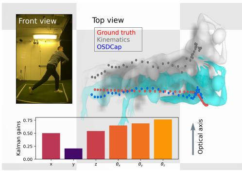  
(a) 不正确的全局平移。

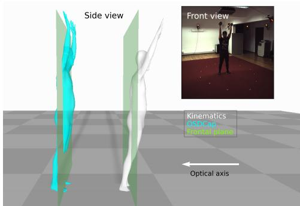  
(b) 不自然的倾斜伪影。  
Figure 3: OSDCap（青色）与运动学输入 [40]（紫色）以及对应真实值姿态（红色）的定性对比结果。左图：OSDCap 在 SportsPose [14] 样本上的滤波结果，其中运动学估计沿相机深度维度非常不准确。由于运动学输入存在错误的平移，y 轴（光轴）处的卡尔曼增益大幅降低。因此，模拟状态被优先采用。右图：来自 Fit3D [7] 的示例，由于深度歧义性导致了不自然的倾斜姿态。与 Fig. 3a 不同，为了更好地进行可视化，这三个姿态被人为分开放置。OSDCap 恢复了符合物理合理性的直立姿态。

用于平滑带噪声输入估计的简单方法采用了时间滤波器，例如中值滤波或高斯滤波。然而，仅仅对信号进行滤波并不能使动作符合物理合理性，不自然的姿态依然存在。如 Tab. 3 所示，简单滤波减少了输入动作的抖动（Accel 测量值降低），但对其他任何指标都没有改善。

为了确保前向动力学过程具有合理的物理约束（与 [37, 38] 不同），我们在计算中引入了外力，这对 PD 控制器构成了更具挑战性的场景。这可以从 Tab. 3 中观察到，即使对输入信号进行了时域滤波并增加了参数数量，PD 控制器仍然难以重建动作。通过使用我们的最优状态估计模块，PD 控制器的性能显著提升，从而为在线人体动作重建取得了最优结果。

## 4.5.2 与经典卡尔曼滤波器的比较

将经典卡尔曼滤波器（Kalman Filter）应用于 OSDCap 面临的最大挑战是调整未知的噪声协方差，包括运动学输入 TRACE [40] 以及 PD 控制器仿真结果的噪声协方差。我们选择的可学习卡尔曼滤波器 [36] 免去了寻找正确噪声协方差矩阵的试错过程，并取得了最佳结果。我们进行了额外的实验，将我们的可学习滤波器替换为传统滤波器，结果如 Tab. 4 所示。

假设噪声协方差随时间恒定且在所有方向上均等，则仿真 PD 控制器的噪声协方差（过程噪声）与运动学输入 TRACE 的噪声协方差（测量噪声）之间的比率决定了卡尔曼滤波器估计的质量。评估结果见 Tab. 4，其中我们在过程噪声和测量噪声之间使用了比率为 100/1、10/1、1/1、1/10、1/100 的恒定噪声协方差。虽然经典卡尔曼滤波器方法略微提升了结果，但很难找到最优结果。

<table><tr><td>方法</td><td>MPJPE ↓[mm]</td><td>MPJPE-G ↓[mm]</td><td>MPJPE-PA ↓[mm]</td><td>PCK ↑[%]</td><td>GRP ↓[mm]</td><td>Accel ↓ $[mm/s^2]$ </td></tr><tr><td>TRACE</td><td>78.4</td><td>153.9</td><td>62.7</td><td>88.1</td><td>128.2</td><td>19.7</td></tr><tr><td>cKF_kin_only</td><td>78.3</td><td>153.0</td><td>63.0</td><td>87.9</td><td>127.4</td><td>7.8</td></tr><tr><td>cKF_100/1</td><td>60.9</td><td>120.7</td><td>43.4</td><td>94.3</td><td>102.0</td><td>7.7</td></tr><tr><td>cKF_10/1</td><td>61.5</td><td>122.6</td><td>43.7</td><td>94.4</td><td>103.0</td><td>9.1</td></tr><tr><td>cKF_1/1</td><td>59.9</td><td>117.6</td><td>43.2</td><td>94.8</td><td>100.1</td><td>6.5</td></tr><tr><td>cKF_1/10</td><td>63.6</td><td>124.0</td><td>44.3</td><td>93.8</td><td>102.7</td><td>11.5</td></tr><tr><td>cKF_1/100</td><td>65.3</td><td>132.3</td><td>44.0</td><td>93.5</td><td>110.2</td><td>9.7</td></tr><tr><td>OSDCap</td><td>54.0</td><td>111.0</td><td>40.0</td><td>95.9</td><td>94.8</td><td>8.7</td></tr></table>

Table 4: 经典卡尔曼滤波（cKF）在 Human 3.6m 数据集消融集上的性能消融实验。由于噪声协方差矩阵未知，我们测试了比率为 100/1、10/1、1/1、1/10、1/100 的常数噪声协方差。同时还评估了仅在运动学输入 TRACE [40] 上应用卡尔曼滤波（cKF\_kin\_only）的性能。

<table><tr><td>方法</td><td>GP ↓[mm]</td><td>GD ↓[mm]</td><td>Friction ↓[mm]</td><td>Velocity ↓[mm/s]</td><td>Foot-skating ↓[%]</td></tr><tr><td>TRACE</td><td>2.6</td><td>12.5</td><td>31.5</td><td>22.4</td><td>37.0</td></tr><tr><td>OSDCap</td><td>5.3</td><td>8.2</td><td>14.6</td><td>12.8</td><td>15.2</td></tr></table>

Table 5: 针对运动学输入 TRACE 和 OSDCap 的额外基于物理的度量。由于地面穿透（GP）指标不能正确反映脚与地面的接触质量，即悬浮在地面上方会被忽略且不产生误差，我们建议使用额外的地面距离（GD）指标。对于脚部滑动（foot-skating），我们遵循 DiffPhy 计算整个序列中包含滑动伪影的帧百分比。

## 4.5.3 额外的基于物理的指标

我们为第 3.3 节中介绍的基于物理的度量提供了额外的指标。结果可见于 Tab. 5。OSDCap 在大多数基于物理的指标上均有助于优化输入的运动学结果。需要注意的是，TRACE [40] 在地面穿透指标上优于我们的方法。其原因在于，在大多数情况下 TRACE 的预测结果悬浮在地面上方，这会导致较低的穿透误差，但这同样被视为不良表现。因此，我们额外提供了地面距离指标（GD），以反映接触期间真实的脚-地接触质量。该数值计算为接触持续时间内脚部接触点与地面之间的平均绝对垂直差异，表示为

$$
\frac {1}{6} \sum_ {c = 1} ^ {6} \rho_ {c} | p _ {c} ^ {O S D} - p _ {c} ^ {G T} |,\tag{12}
$$

其中 $\rho _ { c }$ 是预测的接触二值标签，$p _ { c } ^ { O S D }$ 和 $p _ { c } ^ { G T }$ 是接触的 3D 垂直位置。共考虑了六个接触点，每只脚有三个接触点，分别对应脚后跟、脚部和脚尖。关节配置遵循 Human 3.6M 骨骼 [15]，关节间的骨骼长度在训练期间进行优化，在推理期间保持固定。

## 5 结论

本文提出了 OSDCap，一种基于物理的新方法，用于从单目视频中捕捉并重建基于运动学的人体运动。我们发现，由于物理模型不可避免的缺陷以及带有噪声的测量，以往仅依赖物理模拟的方法会产生次优的运动。这促使我们引入了一种可学习的卡尔曼滤波（Kalman filtering），以细化由 PD 控制器以带噪声的运动学证据为目标模拟出的不合理运动。与基于物理的动作捕捉相关研究相比，所提出的方法在 Human3.6M、Fit3D 和 SportPose 数据集上取得了最先进的结果，特别是在姿态轨迹的全局估计方面。

局限性与未来工作。尽管在全身动力学的高精度预测方面迈出了一步，但我们估计的物理外力仍无法与使用机械测力板直接测量的结果相媲美。然而，我们的方法仅需要单个摄像头（例如来自智能手机），而无需动作捕捉工作室或其他昂贵的硬件（如测力板），即可估计出有意义的力。未来，我们将探索针对手部、足部和体型的精细建模，以实现更逼真的运动重建。

## 致谢与资金披露

本研究得到了由 Knut and Alice Wallenberg Foundation 资助的 Wallenberg Artificial Intelligence, Autonomous Systems and Software Program (WASP)，以及 Delft University of Technology（代尔夫特理工大学）AI Labs 计划下的 Sensor AI Lab 的部分支持。计算资源由位于 C3SE 的 National Academic Infrastructure for Supercomputing in Sweden (NAISS) 以及由 Knut and Alice Wallenberg Foundation 在 National Supercomputer Centre 提供的 Berzelius 资源提供。

## 参考文献

[1] Ching-Hang Chen and Deva Ramanan. 3d human pose estimation = 2d pose estimation + matching. In CVPR, 2017.

[2] Hai Ci, Chunyu Wang, Xiaoxuan Ma, and Yizhou Wang. Optimizing network structure for 3d human pose estimation. In ICCV, 2019.

[3] Erwin Coumans and Yunfei Bai. Pybullet, a python module for physics simulation for games, robotics and machine learning. http://pybullet.org, 2016–2019.

[4] Haoshu Fang, Yuanlu Xu, Wenguan Wang, Xiaobai Liu, and Song-Chun Zhu. Learning pose grammar to encode human body configuration for 3d pose estimation. In AAAI, 2018.

[5] Roy Featherstone. Dynamics of rigid body systems. In Rigid Body Dynamics Algorithms, pages 39–64. Springer US, 2008.

[6] Martin L. Felis. Rbdl: an efficient rigid-body dynamics library using recursive algorithms. Autonomous Robots, 41(2):495–511, 2017.

[7] Mihai Fieraru, Mihai Zanfir, Silviu-Cristian Pirlea, Vlad Olaru, and Cristian Sminchisescu. Aifit: Automatic 3d human-interpretable feedback models for fitness training. In CVPR, 2021.

[8] Erik Gärtner, Mykhaylo Andriluka, Erwin Coumans, and Cristian Sminchisescu. 铰接 3D 人体运动重建的可微动力学（Differentiable dynamics for articulated 3d human motion reconstruction）. In CVPR, pages 13190–13200, 2022.

[9] Erik Gärtner, Mykhaylo Andriluka, Hongyi Xu, and Cristian Sminchisescu. 基于单目视频的基于物理的 3D 人体姿态重建轨迹优化（Trajectory optimization for physics-based reconstruction of 3d human pose from monocular video）. In CVPR, pages 13106–13115, 2022.

[10] Ikhsanul Habibie, Weipeng Xu, Dushyant Mehta, Gerard Pons-Moll, and Christian Theobalt. 利用显式 2D 特征与中间 3D 表示的自然场景人体姿态估计（In the wild human pose estimation using explicit 2d features and intermediate 3d representations）. In CVPR, 2019.

[11] Nikolaus Hansen. CMA 进化策略：比较综述（The CMA Evolution Strategy: A Comparing Review）, pages 75–102. Springer Berlin Heidelberg, Berlin, Heidelberg, 2006.

[12] Mir Rayat Imtiaz Hossain and James J. Little. 利用时序信息进行 3D 人体姿态估计（Exploiting temporal information for 3d human pose estimation）. In ECCV, 2018.

[13] Buzhen Huang, Liang Pan, Yuan Yang, Jingyi Ju, and Yangang Wang. Neural MoCon：用于符合物理规律的人体动作捕捉的神经运动控制（Neural mocon: Neural motion control for physically plausible human motion capture）. In CVPR, pages 6417–6426, 2022.

[14] Christian Keilstrup Ingwersen, Christian Mikkelstrup, Janus Nørtoft Jensen, Morten Rieger Hannemose, and Anders Bjorholm Dahl. SportsPose：动态 3D 运动姿态数据集（Sportspose: A dynamic 3d sports pose dataset）. In IEEE/CVF International Workshop on Computer Vision in Sports, 2023.

[15] Catalin Ionescu, Dragos Papava, Vlad Olaru, and Cristian Sminchisescu. Human3.6M：自然环境中 3D 人体感知的大规模数据集与预测方法（Human3.6m: Large scale datasets and predictive methods for 3d human sensing in natural environments）. IEEE TPAMI, 36(7):1325–1339, 2014.

[16] Angjoo Kanazawa, Michael J. Black, David W. Jacobs, and Jitendra Malik. 人体形状与姿态的端到端恢复（End-to-end recovery of human shape and pose）. In CVPR, 2018.

[17] Angjoo Kanazawa, Jason Y. Zhang, Panna Felsen, and Jitendra Malik. 从视频中学习 3D 人体动力学（Learning 3d human dynamics from video）. In CVPR, 2019.

[18] Jeonghwan Kim, Mi-Gyeong Gwon, Hyunwoo Park, Hyukmin Kwon, Gi-Mun Um, and Wonjun Kim. 采样至关重要：点引导的 3D 人体网格重建（Sampling is Matter: Point-guided 3d human mesh reconstruction）. In CVPR, 2023.

[19] Muhammed Kocabas, Nikos Athanasiou, and Michael J. Black. VIBE：用于人体姿态与形状估计的视频推理（Vibe: Video inference for human body pose and shape estimation）. In CVPR, pages 5253–5263, 2020.

[20] Jiefeng Li, Chao Xu, Zhicun Chen, Siyuan Bian, Lixin Yang, and Cewu Lu. HybrIK：用于 3D 人体姿态与形状估计的混合解析-神经逆运动学解法（Hybrik: A hybrid analyticalneural inverse kinematics solution for 3d human pose and shape estimation）. In CVPR, pages 3383–3393, 2021.

[21] Jiefeng Li, Siyuan Bian, Chao Xu, Gang Liu, Gang Yu, and Cewu Lu. D&D：从动态相机中学习人体动力学（D&d: Learning human dynamics from dynamic camera）. In ECCV, 2022.

[22] Shichao Li, Lei Ke, Kevin Pratama, Yu-Wing Tai, Chi-Keung Tang, and Kwang-Ting Cheng. 采用进化训练数据的级联深度单目 3D 人体姿态估计（Cascaded deep monocular 3d human pose estimation with evolutionary training data）. In CVPR, 2020.

[23] Zhihao Li, Jianzhuang Liu, Zhensong Zhang, Songcen Xu, and Youliang Yan. CLIFF：将全帧位置信息引入人体姿态与形状估计（Cliff: Carrying location information in full frames into human pose and shape estimation）. In ECCV, 2022.

[24] Matthew Loper, Naureen Mahmood, Javier Romero, Gerard Pons-Moll, and Michael J. Black. SMPL: A skinned multi-person linear model. ACM TOG, 34(6):248:1–248:16, 2015.

[25] Naureen Mahmood, Nima Ghorbani, Nikolaus F. Troje, Gerard Pons-Moll, and Michael J. Black. AMASS: Archive of motion capture as surface shapes. In ICCV, pages 5442–5451, 2019.

[26] Julieta Martinez, Rayat Hossain, Javier Romero, and James J. Little. A simple yet effective baseline for 3d human pose estimation. In ICCV, 2017.

[27] Dushyant Mehta, Srinath Sridhar, Oleksandr Sotnychenko, Helge Rhodin, Mohammad Shafiei, Hans-Peter Seidel, Weipeng Xu, Dan Casas, and Christian Theobalt. Vnect: Real-time 3d human pose estimation with a single rgb camera. ACM TOG, 36(4), 2017.

[28] Francesc Moreno-Noguer. 3d human pose estimation from a single image via distance matrix regression. In CVPR, 2017.

[29] Georgios Pavlakos, Xiaowei Zhou, Konstantinos G. Derpanis, and Kostas Daniilidis. Coarse-to-fine volumetric prediction for single-image 3d human pose. In CVPR, 2017.

[30] Dario Pavllo, Christoph Feichtenhofer, David Grangier, and Michael Auli. 3d human pose estimation in video with temporal convolutions and semi-supervised training. In CVPR, 2019.

[31] Jihua Peng, Yanghong Zhou, and PY Mok. Ktpformer: Kinematics and trajectory prior knowledgeenhanced transformer for 3d human pose estimation. In CVPR, pages 1123–1132, 2024.

[32] Xue Bin Peng, Angjoo Kanazawa, Jitendra Malik, Pieter Abbeel, and Sergey Levine. Sfv: Reinforcement learning of physical skills from videos. ACM TOG, 37(6), 2018.

[33] Xue Bin Peng, Yunrong Guo, Lina Halper, Sergey Levine, and Sanja Fidler. Ase: Large-scale reusable adversarial skill embeddings for physically simulated characters. ACM TOG, 41(4), 2022.

[34] Davis Rempe, Leonidas J. Guibas, Aaron Hertzmann, Bryan Russell, Ruben Villegas, and Jimei Yang. Contact and human dynamics from monocular video. In ECCV, 2020.

[35] Davis Rempe, Tolga Birdal, Aaron Hertzmann, Jimei Yang, Srinath Sridhar, and Leonidas J. Guibas. Humor: 3d human motion model for robust pose estimation. In CVPR, pages 11488–11499, 2021.

[36] Guy Revach, Nir Shlezinger, Xiaoyong Ni, Adrià López Escoriza, Ruud J. G. van Sloun, and Yonina C. Eldar. Kalmannet: Neural network aided kalman filtering for partially known dynamics. IEEE Transactions on Signal Processing, 70:1532–1547, 2022.

[37] Soshi Shimada, Vladislav Golyanik, Weipeng Xu, and Christian Theobalt. Physcap: Physically plausible monocular 3d motion capture in real time. ACM TOG, 39(6), 2020.

[38] Soshi Shimada, Vladislav Golyanik, Weipeng Xu, Patrick Pérez, and Christian Theobalt. Neural monocular 3D human motion capture with physical awareness. ACM TOG, 40(4), 2021.

[39] Cristian Sminchisescu. 3d human motion analysis in monocular video techniques and challenges. In IEEE International Conference on Video and Signal Based Surveillance, page 76, USA, 2006. IEEE Computer Society.

[40] Yu Sun, Qian Bao, Wu Liu, Tao Mei, and Michael J. Black. TRACE: 5D Temporal Regression of Avatars with Dynamic Cameras in 3D Environments. In CVPR, 2023.

[41] Shashank Tripathi, Lea Müller, Chun-Hao P. Huang, Omid Taheri, Michael J. Black, and Dimitrios Tzionas. 3d human pose estimation via intuitive physics. In CVPR, pages 4713–4725, 2023.

[42] Bastian Wandt and Bodo Rosenhahn. Repnet: Weakly supervised training of an adversarial reprojection network for 3d human pose estimation. In CVPR, 2019.

[43] Bastian Wandt, Marco Rudolph, Petrissa Zell, Helge Rhodin, and Bodo Rosenhahn. Canonpose: Selfsupervised monocular 3d human pose estimation in the wild. In CVPR, 2021.

[44] Jue Wang, Shaoli Huang, Xinchao Wang, and Dacheng Tao. Not all parts are created equal: 3d pose estimation by modelling bi-directional dependencies of body parts. In ICCV, 2019.

[45] Yufu Wang and Kostas Daniilidis. Refit: Recurrent fitting network for 3d human recovery. In ICCV, 2023.

[46] Kevin Xie, Tingwu Wang, Umar Iqbal, Yunrong Guo, Sanja Fidler, and Florian Shkurti. Physics-based human motion estimation and synthesis from videos. In ICCV, pages 11532–11541, 2021.

[47] Jingwei Xu, Zhenbo Yu, Bingbing Ni, Jiancheng Yang, Xiaokang Yang, and Wenjun Zhang. Deep kinematics analysis for monocular 3d human pose estimation. In CVPR, 2020.

[48] Yingxuan You, Hong Liu, Ti Wang, Wenhao Li, Runwei Ding, and Xia Li. Co-evolution of pose and mesh for 3d human body estimation from video. In ICCV, pages 14963–14973, 2023.

[49] Ri Yu, Hwangpil Park, and Jehee Lee. Human dynamics from monocular video with dynamic camera movements. ACM TOG, 40(6), 2021.

[50] Ye Yuan, Shih-En Wei, Tomas Simon, Kris Kitani, and Jason Saragih. Simpoe: Simulated character control for 3d human pose estimation. In CVPR, pages 7159–7169, 2021.

[51] Ye Yuan, Jiaming Song, Umar Iqbal, Arash Vahdat, and Jan Kautz. Physdiff: Physics-guided human motion diffusion model. In ICCV, pages 16010–16021, 2023.

[52] Yufei Zhang, Jeffrey O. Kephart, Zijun Cui, and Qiang Ji. Physpt: Physics-aware pretrained transformer for estimating human dynamics from monocular videos. In CVPR, pages 2305–2317, 2024.

[53] Wentao Zhu, Xiaoxuan Ma, Zhaoyang Liu, Libin Liu, Wayne Wu, and Yizhou Wang. Motionbert: A unified perspective on learning human motion representations. In ICCV, 2023.

# 补充材料

## A 网络细节

图 4 展示了所提出的 OSDNet 的架构。该网络包含用于估计卡尔曼增益（Kalman gains）、PD 控制器增益、惯性偏置以及外力的多个分支。卡尔曼估计模块接收来自 GRU 和当前状态嵌入的组合输入，输出卡尔曼增益矩阵。通过修改最后一个线性层的偏置，卡尔曼增益矩阵的对角线被初始化为约 0.5。这是由于训练初期 PD 分支的不稳定性，如果卡尔曼增益过低（对运动学流零信任），可能会导致梯度爆炸。GRU 单元的隐藏状态 h 在整个仿真序列中持续更新，并用作下一次预测的输入之一。

与 [38] 类似，我们针对全局平移、全局旋转和关节角对 $\kappa _ { P }$ 和 $\kappa _ { D }$ 进行不同的缩放。$\kappa _ { P }$ 的初始缩放为 [30.0, 14.0, 1.9]，$\kappa _ { D }$ 为 [1.5, 0.1, 0.05]。注意，我们的初始增益远低于 [38]，因为我们希望通过外部反作用力来解释全局运动，从而避免对“不切实际”的残差力的需求。这些缩放比例会随着 OSDNet 的训练进一步优化。

OSDNet 估计惯性偏置矩阵 $\mathbf { M } _ { t } ^ { b }$ 。为了确保惯性矩阵的对称正定（symmetric positive definite, SPD）性，我们估计一个中间矩阵 $\mathbf { M } _ { \mathrm { b a s e } _ { t } } ^ { \ b }$ 并计算 $\mathbf { M } _ { t } ^ { b } = \mathbf { M } _ { \mathrm { b a s e } _ { t } } { } ^ { b } + ( \mathbf { M } _ { \mathrm { b a s e } _ { t } } { } ^ { b } ) ^ { \mathsf { T } }$

OSDNet 的雅可比（Jacobian）分支以当前状态嵌入作为输入，并输出将末端执行器线速度映射到各关节旋转速度的雅可比矩阵。接触与外力分支将当前双足位置和速度作为状态嵌入的额外输入。接触分支的输出通过 sigmoid 函数映射以生成接触概率 $\rho _ { t } ^ { c }$ 。外力分支输出双足的线性反作用力，其垂直轴初始化为代理角色的重力（9.81 ∗ mass）。

自适应矩阵 C 和观测矩阵 H 初始化为单位矩阵。我们在训练过程中对它们进行优化，并在推理期间保持恒定。

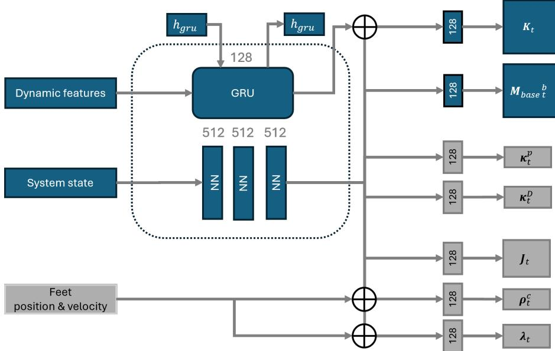  
Figure 4: 所提出的 OSDNet 网络架构。该网络由 3 个大小为 512 的隐藏层组成，用于生成系统状态 ${ \bf \chi } _ { \mathrm { s } }$ 嵌入。基于该状态嵌入，估计惯性偏置矩阵 $\mathbf { M } _ { \mathrm { b a s e } _ { t } } ^ { \quad b } .$、PD 增益 $\kappa _ { P } , \kappa _ { D }$、雅可比矩阵 $\mathbf { J } _ { t } .$、接触概率 $\rho _ { t } ^ { c }$ 以及外力 $\lambda _ { t }$。所提出的尺寸为 128 的 GRU 单元以动力学特征（见第 3.2 节所述）作为输入，卡尔曼增益矩阵 $\mathbf { K } _ { t }$ 通过拼接 GRU 与状态嵌入来估计。隐藏状态 $h _ { \mathrm { g r u } }$ 在每个时间步持续更新。为了更好地估计脚地接触和地面反作用力，我们还将双脚的位置和线速度作为额外输入送入网络。

## B 人体代理模型

仿真代理角色是基于 SMPL 模型 [24] 的身体构型创建的。骨骼长度和重量分布与 Human3.6M [15] 元数据中的“常见人体”相同。图 5 是由球体和圆柱体组成的代理角色的可视化。骨骼长度被视为额外的可学习参数，并在训练过程中与模型一同进行优化。在测试期间，骨骼长度固定为训练阶段学到的参数，即测试时不使用真实的真实骨骼长度（ground truth bone lengths）。

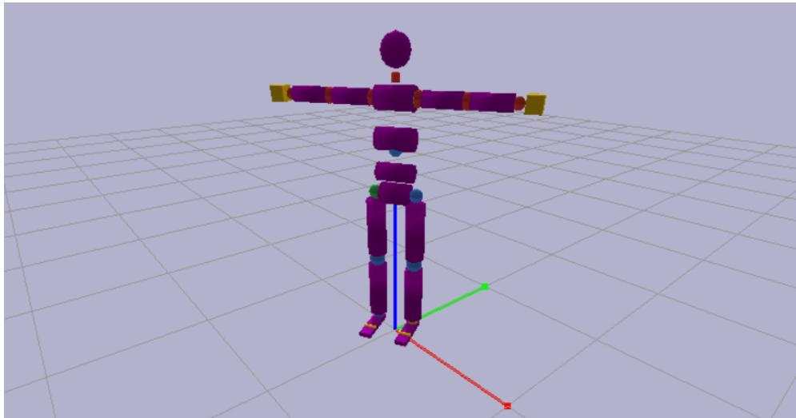  
Figure 5: 本文中使用的仿真代理角色。使用 RBDL 库 [6] 提取惯性矩阵 $M _ { t }$ 和偏置力 $h ( q , \dot { q } )$。

## C 数据集细节

如第 4.1 节所述，我们在 Human3.6M [15]、Fit3D [7] 和 SportsPose [14] 上评估了我们提出的方法。对于 Human3.6M，我们遵循先前的研究 [37, 38, 21]，仅考虑包含脚地接触的动作，将 (S1, S5, S6, S7, S8) 用于训练，(S9, S11) 用于测试。对于 [7]，我们采用相同的协议，仅使用存在脚地接触的动作：(s03, s04, s05, s07, s08, s10) 用于训练，(s09, s11) 用于测试。对于 SportsPose，我们仅考虑在时间步 0 包含人体的序列：(S02, S03, S05, S06, S07, S08, S09) 用于微调，(S12, S13, S14) 用于评估。

使用 TRACE [40] 从数据中提取运动学输入。所有提取出的运动在第一帧时间步都在原点处进行对齐，从而消除了错误标定过程带来的影响。随后，每个动作被等分为 100 帧的子序列，利用批处理进行 OSDNet 的训练。

## D 接触标签

由于所有三个数据集 [15, 7, 14] 均提供了真值接触标签，我们基于真值关键点生成了自己的标注。为了创建接触标签，我们考虑了真值足部 3D 位置。如果足部位置位于地平面上方 10 cm 以内（已对鞋子和不一致的 MoCap 传感器放置进行了补偿），并且相比前一帧移动不超过 2cm，则将其标记为有效接触点。左脚和右脚均采用类似的协议。足-地接触直接由 OSDNet 和自动数据标注进行建模，使用的是训练数据集中的真值 3D 姿态。

## E 全局旋转

为了缓解 Human3.6M [15] 原始欧拉角表示中的万向节死锁（Gimbal lock）问题，我们将所有根节点旋转（状态向量 q 的第 3 到第 6 个自由度）$q _ { t \left| t \right. } )$ 转换为四元数 $q u a t _ { t | t } = ( x , y , z , w )$，

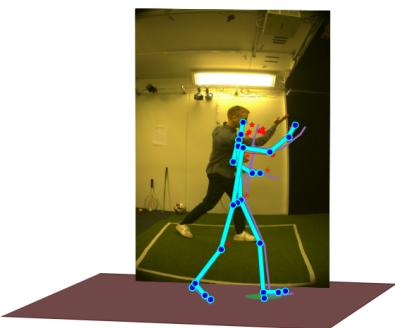  
(a) 网球

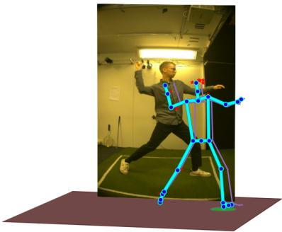  
(b) 棒球

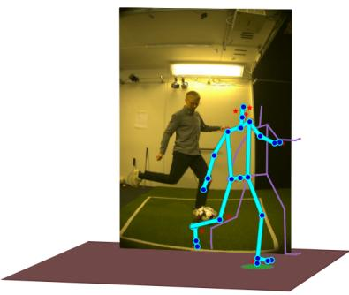  
(c) 足球

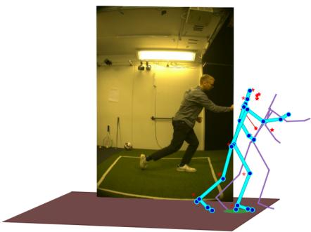  
(d) 排球  
Figure 6: SportsPose [14] 测试数据上的示例结果。这里我们展示了 SportsPose [14] 中具有足-地接触的五个动作类别中的四个。从定性上看，OSDCap 与所提供的真值的匹配程度明显优于运动学输入 TRACE。

实部在最后。由于四元数不是线性表示，四元数差值的计算如下：

$$
\Delta q u a t _ {t | t} = q u a t _ {t + 1 | t + 1} * q u a t _ {t | t} ^ {- 1}.\tag{13}
$$

$\Delta q u a t _ { t | t }$ 是 PD 控制器的输入误差项，用于根据 $\operatorname { E q . } { \dot { 5 } }$ 和 Eq. 1 计算相应的根节点力矩。在给定四元数表示的系统状态向量 $\dot { \mathbf { q } } _ { t } ^ { q u a t }$ 的情况下，从状态向量 $\mathbf { q } _ { t \mid t } ^ { q u a t }$ 到预测状态 $\mathbf { q } _ { t + 1 | t } ^ { q u a t }$ 的有限积分过程（在状态转换阶段）表示为

$$
\mathbf {q} _ {t + 1 | t} ^ {q u a t} = \mathbf {q} _ {t | t} ^ {q u a t} + 0. 5 (\dot {\mathbf {q}} _ {t} ^ {q u a t} * \mathbf {q} _ {t | t} ^ {q u a t}) \Delta t.\tag{14}
$$

## F 计算资源

所提出的 OSDCap 流水线是在配备 40Gb 显存的 NVIDIA-A100 GPU 上进行训练和评估的。平均而言，在每帧运动学估计 [40] 的处理时间之上，OSDCap 仅需额外消耗 0.02 秒。4.5 节中的每个消融实验需要 45 分钟进行训练和评估。在 Human3.6M 上的完整训练和测试大约消耗 2 小时，在 Fit3D 上为 1 小时，在 SportsPose 上为 15 分钟。

此外，我们还在多个随机种子值上训练和评估了 OSDCap，以证明结果的可复现性。Table 1 展示了在 0 到 4 的多个随机种子下的评估结果均值和标准差。由于计算开销过大，我们没有对其他每个实验都报告误差棒。

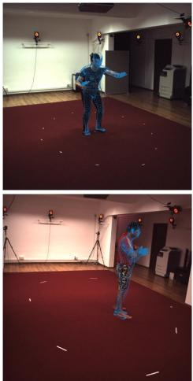

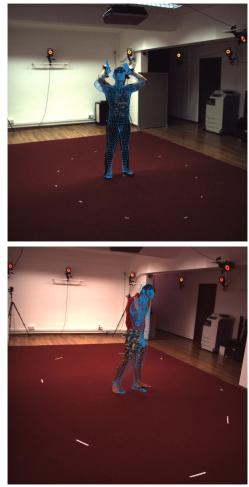

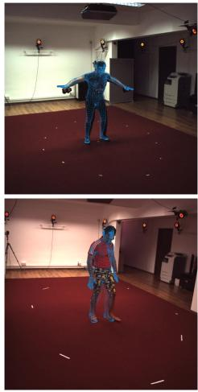

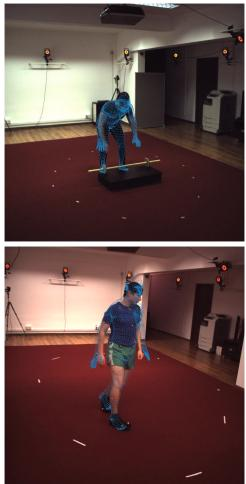  
Figure 7: 将 SMPL 人体模型从 OSDCap 姿态反投影回输入 2D 图像时的定性结果。叠加的 SMPL 模型以稀疏蓝色点云显示，以最大化输入人体姿态的可见度。

## G 附加结果

读者可参考我们的附加补充材料，以更好地可视化 OSDCap 重建结果与运动学输入及真实值（ground truth）的对比。在具有挑战性的 SportsPose 数据集上的一些示例镜头可见 Fig. 6。

估计姿态叠加在 2D 输入图像上的更多可视化效果可见 Fig. 7。重投影误差与基于模型的假设之间始终存在权衡。在我们的方法中，物理模拟采用了比纯基于运动学模型更强的假设。另一方面，如正文中的 Tab. 1 和 Tab. 5 所示，它生成了更合理的动作。

尽管在训练期间重投影并非训练目标，但如 Fig. 7 所示，重投影的姿态与输入图像中的人体吻合良好。微小的偏差是由于代理角色与实际测试人类受试者之间的骨骼长度不匹配所致。未来将对自适应人体体型估计展开研究。