NAIST-IS-MT1151132

硕士学位论文

# 基于表面肌电信号肌肉激活输入的连续手指关节角度估计

Jimson Gelbolingo Ngeo

2013年3月15日

情报科学专攻

情报科学研究科

Nara Institute of Science and Technology（奈良先端科学技术大学院大学）

提交给奈良先端科学技术大学院大学情报科学研究科以部分满足工学硕士学位要求的硕士学位论文 Jimson Gelbolingo Ngeo

论文委员会：

Kazushi Ikeda 教授

（导师）

Tsukasa Ogasawara 教授

（副导师）

Associate Professor Tomohiro Shibata

（副导师）

Assistant Professor Tomoya Tamei

（委员）

# 基于表面肌电信号肌肉激活输入的连续手指关节角度估计∗

Jimson Gelbolingo Ngeo

## 摘要

表面肌电（sEMG）信号因其能极好地反映使用者的运动意图，常被用于许多机器人和康复应用中。然而，在此类应用中存在如机电延迟（EMD）等固有问题。许多研究聚焦于手势的离散分类，但自然的手部运动是连续的。在本论文中，我们提出了一种利用前臂表面肌电信号来预测多个手指关节角度的方法，该方法采用了一种将 EMD 参数化的所谓“EMG-肌肉激活”模型。我们对人工神经网络（ANN）和高斯过程（GP）回归器进行了评估，并将其用于预测两名受试者涉及单个及同时手指屈曲和伸展运动中的关节角度。在 ANN 的情况下，结果显示测量所得的手指关节角度与预测值之间的相关性高达 0.92，总体平均均方根误差为 5% 到 12%。使用高斯过程能给出更好的预测结果，特别是在使用少量训练样本时。我们的结果还表明，与相关研究所采用的传统滤波 sEMG 或基于时域的特征相比，使用所提出的肌肉激活输入时预测效果有所提升。最后，我们利用主成分分析（PCA）对手部和手指运动进行了降维分析。我们的结果表明，有效维度远低于手上理论上具备的 20 个自由度。最后这一部分可能表明手部控制中存在运动协同（motor synergies）。

## 关键词：

表面肌电（Surface EMG），人工神经网络（Artificial Neural Network），高斯过程（Gaussian Process），手指关节角度（Finger Joint Angles），主成分分析（PCA）

## 目录

1 引言 1   
1.1. 手部辅助设备概述 . . . . . . . . . . . . . . . . . . . . . . . . . . . . . . . . . . . . . . . . . . . . . . . . . . . . . . . . 2   
1.2. 相关研究 . . . . . . . . . . . . . . . . . . . . . . . . . . . . . . . . . . . . . . . . . . . . . . . . . . 4   
1.3. 研究动机与目的 . . . . . . . . . . . . . . . . . . . . . . . . . . . . . . . . . . . . . . . . . . . . 5   
1.4. 论文结构概述 ..... 5   
2 手的生物系统 6   
2.1. 手部骨骼结构 ..... 6   
2.2. 手部关节 ..... 7   
2.3. 手部运动 ..... 10   
2.4. 作为控制系统的大脑 ..... 11   
2.5. 与手部运动相关的肌肉 ..... 15   
2.5.1 内在肌 ..... 15   
2.5.2 外在肌 ..... 16   
3 表面肌电信号 19   
3.1. 什么是表面肌电信号？ ..... 19   
3.1.1 运动单位动作电位 ..... 22   
3.1.2 表面肌电生成 ..... 23   
3.1.3 原始表面肌电信号 ..... 24   
3.1.4 影响表面肌电信号的因素 ..... 24   
3.2. 表面肌电信号的检测与记录 ..... 25   
3.2.1 电极 ..... 25   
3.2.2 信号放大与采样 ..... 27   
3.2.3 A/D 转换与肌电采样率 ..... 27

3.3. 肌电信号处理 . . . . . . . . . . . . . . . . . . . . . . 28
3.3.1 全波整流 . . . . . . . . . . . . . . . . . . . 28
3.3.2 平滑 . . . . . . . . . . . . . . . . . . 28
3.3.3 归一化 . . . . . . . . . . . . . . . . 30
3.4. 表面肌电（sEMG）信号的应用 . . . . . . . . . . . . 30
3.5. 表面肌电（sEMG）信号的时域特征 . . . . . . . . . 31
4 基于表面肌电的手指关节角度连续估计 33
4.1. 机电延迟问题 34
4.2. 肌电到肌肉激活度模型 35
4.3. 回归方法 38
4.3.1 人工神经网络 38
4.3.2 高斯过程回归 40
5 实验 44
5.1. 实验设置 44
5.2. 数据采集 47
5.3. 数据预处理 48
6 结果与分析 50
6.1. 基于肌肉激活度输入的手指关节角度预测 50
6.2. 不同肌电特征之间的比较 54
6.3. ANN 与 GP 回归的比较 55
6.4. 手/手指运动的维度分析 57
7 结论 61
致谢 63
参考文献 65
附录 70
A. ANN 与 GP 回归的预测性能 70
B. 样本测试结果中使用的处理后肌电 72
C. PIP 与 DIP 关节角度预测结果 73
D. 应用：手指外骨骼的控制 75

## 图目录

1.1 手部机器人与遥操作设备的示例 . . . . . . . . 3  
2.1 右腕及手部骨骼掌侧视图 . . . . . . . . . . 7  
2.2 右手掌骨与腕骨视图 . . . . . . . . . . . . . 8  
2.3 中指侧视图 . . . . . . . . . . . . . 9  
2.4 手部的总自由度（DOF） . . . . . . 9  
2.5 手部关节坐标系示例示意图 . . . . . 10  
2.6 大脑运动皮层 . . . . . . . . . . . . . 11  
2.7 运动区的激活顺序 . . . . . . . . . . 13  
2.8 从大脑发送的神经控制信息 . . . . . . . 14  
2.9 彭菲尔德（Penfield）运动小人图 . . . . . . . . . 14  
2.10 手部内在肌 . . . . . . . . . 16  
2.11 手部外在肌 . . . . . . . 18  
3.1 去极化与复极化周期示意图 20  
3.2 动作电位 21  
3.3 运动单元募集及其发放频率 22  
3.4 sEMG 信号生成概述 23  
3.5 包含 3 次收缩爆发的原始 EMG 记录示例 24  
3.6 AMBU-Blue Sensors 常规 EMG/ECG 电极 26  
3.7 sEMG 预处理部分的不同阶段 29  
4.1 肌电-机械延迟示意图 34  
4.2 参数 A 引入非线性 37  
4.3 经低通滤波的原始 EMG 记录示例 37  
4.4 前馈人工神经网络结构 39  

5.1 基于肌肉位置的电极放置 ..... 44  
5.2 基于 BA1104 的无线 sEMG 设备 ..... 45  
5.3 动作捕捉摄像机系统设置 ..... 46  
5.4 贴在关节上的 22 个反光标记点 ..... 46  
5.5 显示受试者手部的屏幕截图 ..... 47  
6.1 单关节角度预测结果 ..... 51  
6.2 屈曲运动下的示指关节角度估计 ..... 52  
6.3 自由手部运动下的示指关节角度估计 ..... 53  
6.4 平均相关系数 ..... 54  
6.5 平均归一化均方根误差（NRMSE） ..... 55  
6.6 神经网络与高斯过程的学习曲线 ..... 56  
6.7 基于 214 个样本训练预测的 MCP 关节角度 ..... 57  
6.8 基于 2134 个样本训练预测的 MCP 关节角度 ..... 57  
6.9 手指关节角度数据的 PCA 分析 ..... 59  
6.10 手指关节角速度数据的 PCA 分析 ..... 60  
7.1 ANN 与 GP 回归器的预测性能 ..... 71  
7.2 肌肉激活度由预处理后的 EMG 转换而来 ..... 72  
7.3 实际与预测的 PIP 关节角度 ..... 73  
7.4 实际与预测的 DIP 关节角度 ..... 74  
7.5 基于 sEMG 控制示指外骨骼的应用展示 ..... 75  

## 表格目录

2.1 屈肌 17  
2.2 伸肌 17  
5.1 所选 EMG 通道与目标肌肉 45  
5.2 手指关节正常活动度 49  
6.1 肌肉激活模型参数 52  

## 第 1 章

## 引言

在未来几年中，人类辅助与遥操作技术预计将在改善老龄群体以及残疾人和受伤人群的生活质量与福祉方面发挥重要作用。辅助技术的这种预期增长将受到提升其功能独立性和提供支持需求的推动。例如，辅助机器人设备和脑机接口（brain-machine interface）是正在发展的技术，具有提供不知疲倦支持的潜力，使残障和受伤人群能够获得更多的身体功能与活动能力。

鉴于人手的主导作用——许多日常功能性任务（如触摸、抓握、操作和交流）都是通过双手完成的——手部功能的丧失会极大地影响人类的日常功能与活动能力。手部外骨骼、康复辅助器具和机器人假肢是用于康复受损或受伤手部，乃至替代上肢缺失的常见解决方案。因此，提供一种能够精确复现精细手部运动的方法，可以极大地改进现有的支持设备，特别是在开发有助于手部康复的设备和应用（如手部和手指外骨骼）方面。

本论文的主要目标是构建一个系统，该系统能够通过表面肌电图（surface electromyograph, sEMG）感知人体移动手和手指的意图，并将这些信号转化为有用的手指运动学信息，用于手部生物力学研究以及手部辅助设备的控制。

基于表面肌电信号的控制广泛应用于假肢设备和临床康复应用中。在施加肌张力所产生的任何身体运动中，通过在发力肌肉表面贴附表面电极来读取和记录肌电（electromyographic, EMG）信号。正是由于肌电与施加的运动之间存在这种密切关联，我们才使用肌电来尝试异步解码连续的手部运动学信息，例如手指关节角度。

针对肌电信号的应用已有许多研究，但大部分工作都集中在解码离散的手部运动和辨识有限的手势集合上。由于自然的手部运动是连续的，且运动可能的变化形式是无限的，因此本研究的重点是从 sEMG 信号输入中预测连续的手指关节角度。

我们展示了在此类 sEMG 到运动的应用中所遇到的固有问题，并研究了不同类型的 sEMG 特征，以确定哪些特征最适合预测连续手部运动。我们还探讨了使用不同的机器学习回归技术，例如人工神经网络（artificial neural network）和非参数高斯过程回归（Gaussian process regression），来预测来自用户 sEMG 信号的手指关节角度。

## 1.1. 手部辅助设备概述

机械手辅助设备和遥操作设备是新兴的技术，在革新现代手部康复和假肢应用方面展现出巨大的前景。用于康复的机器人系统可以专注于提供缺失的运动与感知功能，并提供使恢复运动相关功能变得更容易、更快速的环境 [1]。另一方面，机械手假肢和外骨骼能够为缺失或瘫痪的手部提供手部功能、灵巧性以及活动能力。此外，诸如用于虚拟现实应用中的遥操作和触觉设备，在开发新型人机接口方面找到了立足点，这类接口不需要与手中的物理设备进行显式交互，而仅仅依靠移动双手的主观意图即可实现交互。

由于手部在日常生活中发挥着极其重要的作用，因此恢复和康复手部功能受到了广泛关注。手是一个复杂的生物系统，包含许多关节和肌肉，能够执行许多复杂的操纵任务。这就是为什么通过机械支撑或人体接口来复制手部运动，从而恢复和改善手部功能，能够极大地提升现有辅助设备性能的原因。

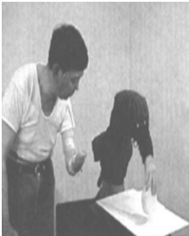  
(a) 机器人机械臂 [2]

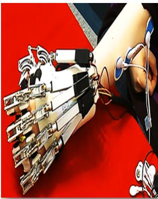  
(b) 香港理工大学（Polytech’s University）手部康复外骨骼 [3]

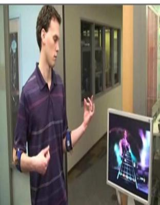  
(c) 基于手势的  
人机接口 [4]  
Figure 1.1: 利用用户自身肌电信号的手部机器人和遥操作系统示例。

目前，已存在能够支持手部和手指功能及康复的机器人设备和康复辅助工具（见 Figure 1.1）。Figure 1.1a 展示了由经前臂截肢者控制的机器人机械臂。研究表明，此类机械臂系统能够辅助截肢患者完成一些基础的桌面操作，例如指向、触摸和抓握物体 [2]。Figure 1.1b 是香港理工大学近期研制的手部康复外骨骼。该设备供手部功能障碍或中风康复期患者佩戴，用于辅助他们完成简单的手部张开和闭合功能性任务。Figure 1.1c 展示了由 Microsoft Research 开发的基于 sEMG 信号的肌-机接口，该接口允许用户玩《吉他英雄》（Guitar Hero）游戏。通常在《吉他英雄》这类游戏中，用户需要手持吉他形状的控制器，但借助该肌-机接口，用户无需吉他即可进行游戏，因为系统会对肌肉信号进行分类以识别手势和手指动作。这种接口在用户无法或不希望与手中实体设备进行显式交互的应用场景中具有良好的应用前景。

除了能够替代、支持和辅助手部功能外，所示所有设备的共同点在于它们均由肌电信号驱动。换句话说，这些设备是通过贴附在患者手臂上的表面肌电（surface electromyography, sEMG）传感器，利用用户自身的肌肉信号进行控制的。

基于表面肌电信号的控制之所以在假肢设备和临床康复应用中得到广泛应用，主要是由于其非侵入性的特点。sEMG 信号是大脑中的运动神经元向肌纤维发送神经冲动时，肌肉收缩过程中产生的随机电信号。

## 1.2. 相关研究

在该领域中已有许多研究工作展开，将 sEMG 信号应用于各种不同的场景中。然而，这些研究大多侧重于辨识有限的手势动作集合，许多此类设备和界面的控制方案仍显得不够自然。因此，本论文不再局限于解码离散的手部动作集合，而是重点研究如何从手部提取的 sEMG 信号中连续解码手指关节角度。

相关研究表明，从 sEMG 信号中提取手指的精细运动信息是可行的。Afshar 和 Matsuoka [5] 利用植入在控制食指的七块肌肉内的细丝肌电（fine-wire EMG），成功估计了食指关节角度。类似地，Shrirao 等人 [6] 能够从表面肌电信号中解码出食指的一个关节角度。他们研究中涉及的手指运动类型为食指在三种不同运动频率（低速、中速和高速）下的周期性屈伸运动。在其研究中，他们采用并评估了不同的神经网络委员会（committees of neural network）模型来预测关节角度。

在较近期的进展中，Smith 等人 [7] 能够在每次仅活动单根手指的情况下，异步解码所有五根手指各自的掌指（metacarpophalangeal, MCP）关节角度。他们的研究在经桡骨截肢患者可用的肌肉区域进行了常规电极放置，并提取了 sEMG 时域特征作为前馈神经网络的输入，以预测 MCP 关节角度。Hioki 等人 [8] 仅使用 4 个 sEMG 通道以及带有时间延迟参数的循环神经网络预测了所有手指关节角度。然而，他们的方法需要过多的参数，这使得在不同受试者之间进行优化和实现变得十分困难。

## 1.3. 研究动机与目的

然而，在许多先前引用的研究 [6][7] 中，sEMG 信号的起始与所施加的运动之间存在并被观察到一定的时间延迟。这种时间延迟被称为滞后或机电延迟（electromechanical delay, EMD）。它通常通过以下方式进行补偿：在进行任何处理之前手动将 sEMG 与关节角度数据重新对齐；或者通过引入时延线，利用 sEMG 的所有当前值和历史值，但这会大大增加输入的数量以及预测器的参数。EMD 会因许多不同因素而异，例如肌肉缩短速度、肌纤维类型和疲劳程度 [6]。在我们的方法中，我们通过使用肌电至肌肉激活模型（EMG-to-Muscle Activation Model）将这种延迟作为参数引入，该参数与其他参数一起通过优化确定。

极少有研究利用 EMG 信号研究和预测超过 5 个手指关节的角度。在本论文中，我们研究了将肌肉激活作为回归器的输入，同时预测全部 15 个手指关节角度的连续屈曲和伸展运动。我们尝试预测每个手指关节的角位置，即掌指关节（metacarpophalangeal, MCP）、近端指间关节（proximal interphalangeal, PIP）和远端指间关节（distal interphalangeal, DIP）。

## 1.4. 论文概述

本论文共分为七章。第 2 章介绍了手部的解剖系统和生物力学功能。第 3 章给出了表面肌电信号生成及其应用背后的概念。第 4 章讨论了我们用于根据 sEMG 信号连续估计手指关节角度的方法。我们讨论了 sEMG 信号的几种特征以及所使用的回归技术。第 5 章解释了实验设置、受试者数据采集和数据预处理。第 6 章展示了使用 EMG 信号的手指关节角度预测器的结果和性能，并包含了手部运动的基本统计数据和降维分析。最后，第 7 章得出了一些结论，并对当前工作未来扩展的应用前景进行了展望。

## 第2章

## 手部生物系统

上肢由三个主要部分组成：手臂、前臂和手。手臂由肩膀向下延伸至肘部。前臂由肘部向下延伸至手腕。最后一部分是手，也是本研究的主要焦点，由前臂以下剩余的部分组成，包括手掌和指（或手指）。

手部解剖结构非常复杂，因为它包含大量的肌肉和关节。它还可以呈现出极多样的姿态和运动范围，从而使手能够执行多种功能和操作 [9]。

## 2.1. 手部骨骼结构

手部骨骼构成了决定手部整体形状的基础支架，并作为手部软组织的稳定基底。手部共有 19 块主要骨骼，主要由两类构成：掌骨和指骨（见 Figure 2.1）。所有这些骨骼均被归类为长骨，其排列方式旨在最大化手部肌肉和肌腱的功能效率 [9]。

每根掌骨对应一根手指，其中拇指的掌骨相对比其余手指的更短。掌骨基底部的间距紧密，但向指端逐渐分散。这种排列决定了手部的形状，并将各手指分离开来，使其能够独立运动 [9]。对于拇指而言，其掌骨位于前侧且旋转了约 90 度，从而产生了相对于其他手指的对掌运动。

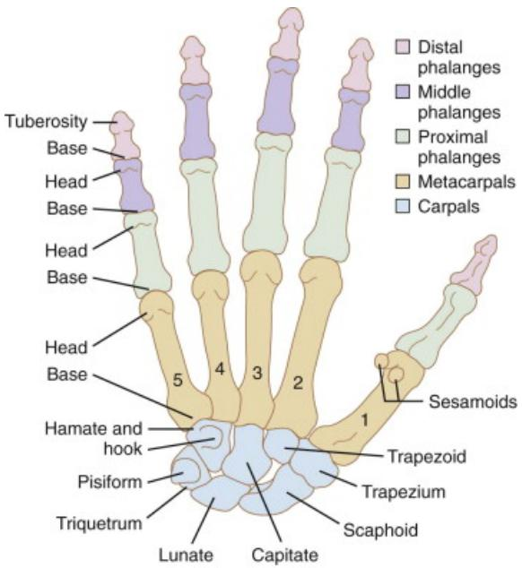  
Figure 2.1: 右手腕及手部骨骼掌面观 [9]

至于指骨，手部大约有 14 块。除拇指仅有两节外，其余各手指均有三节指骨。近节和远节指骨背侧呈弓形弯曲，与掌骨类似。其骨体呈圆柱形，但两侧边缘粗糙，作为手指屈肌腱不同纤维鞘的附着点。

## 2.2. 手部关节

腕掌（carpometacarpal, CMC）关节是将手指连接到腕部的最靠近近端的关节。拇指腕掌关节与其他手指的腕掌关节显著不同，因为它能够允许更复杂且更大范围的运动。另一方面，其余手指的腕掌关节仅允许极少量的受限运动，有时甚至完全不能活动。

内侧的四个关节位于四根掌骨的基底部与远排腕骨之间，在 Figure 2.1 中分别标注为钩骨（hammate）、头状骨（capitate）、小多角骨（trapezoid）和大多角骨（trapezium）。这些关节所允许的运动极微小。示指和中指的腕掌关节不允许活动，而环指和小指的腕掌关节仅允许微量活动。

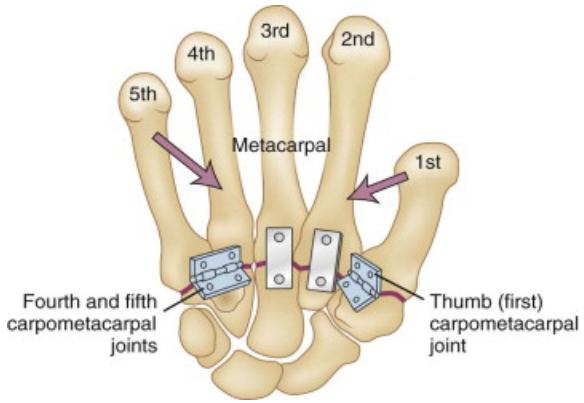  
Figure 2.2: 右手掌骨与腕骨视图 [9]

由于大多角骨（Trapezium）具有浅鞍状的形态，拇指腕掌关节（大多角掌骨关节）比其他手指的腕掌关节具有更大的运动自由度。该关节允许的运动包括屈曲和伸展（拇指穿过手掌移动）、外展和内收（拇指分别远离和靠拢示指），以及旋前和旋后（即对掌和复位）。

掌指（metacarpophalangeal, MCP）关节由近节指骨底和掌骨头构成（见 Figure 2.2）。该关节基部的关节面呈双凹形、较浅，且面积小于掌骨头。指骨的形态似乎允许其在掌骨头上沿任意平面运动。然而，由于软组织的限制，其主动运动仅限于屈伸（flexion and extension）以及外展和内收（abduction and adduction，分别指手指远离和朝向中指的运动）。至于拇指的 MCP 关节，其运动方向与其他手指的 MCP 关节相似，但屈伸运动的自由度较低，外展和内收运动也受到显著限制。

近端指间（proximal interphalangeal, PIP）关节由近节指骨头和中节指骨底构成。这些关节仅允许进行屈伸运动。其屈曲幅度相当可观，而伸展幅度则非常有限。

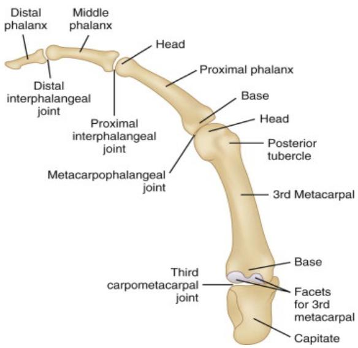  
Figure 2.3: 中指侧视图 [9]

远端指间（distal interphalangeal, DIP）关节由中节指骨头和远节指骨底构成。其允许的运动与 PIP 关节相同，但在运动角度范围上更为有限。

总体而言，如图 Figure 2.4 所示，包括腕部在内的手部总自由度（degrees of freedom, DOF）为 31。其余四指每指各有 4 个自由度，分别来自 MCP、PIP 和 DIP 关节；拇指有 5 个自由度，来自 MCP 和 PIP 关节；另有 4 个来自 CMC 关节；最后 6 个来自腕部，包括腕部的旋转与平移运动。

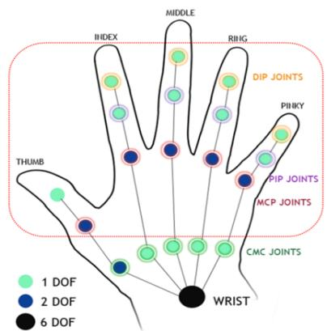  
Figure 2.4: 手部可用的总自由度（DOF） [9]

## 2.3. 手部运动

本研究的核心焦点主要涉及手指运动。在本节中，我们将讨论人类手指可能进行的各种运动类型，其中部分内容已在本章的前文中有过提及。

通常有两种主要的旋转坐标系用于描述关节的旋转：欧拉旋转（Euler rotations）和关节坐标（Joint Coordinate）旋转系统。在欧拉旋转系统中，旋转轴固定在待旋转的物体上。这意味着随着物体的旋转，正交旋转轴也会随之旋转。另一方面，关节坐标轴在物体旋转时保持不变。在本研究中，我们仅使用关节坐标系来描述手指的旋转运动。

作为一个示例，我们在图 2.5 所示的样本关节坐标系中展示了不同类型的手指旋转，该坐标系定义了 x、y 和 z 轴。该图显示了右手掌指关节（MCP joint）的一个样本关节坐标系。x 轴大致从食指延伸至小指，y 轴沿着手指中心向下延伸，而 z 轴与 XY 平面垂直。

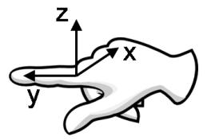

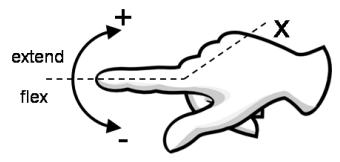  
(b) 屈曲与伸展

(a) 关节坐标系  
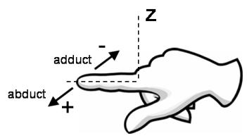  
(c) 外展与内收

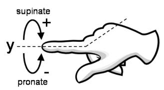  
(d) 旋前与旋后  
Figure 2.5: 手部样本关节坐标系及不同手指旋转的示意图。

如图 2.5 中的 (b) 所示，绕 x 轴的旋转会导致手指的屈曲与伸展。手指屈曲最贴切的描述是手指卷曲握拳，而伸展则是指手指展开并朝向张开手掌的动作。在 (c) 中，绕 z 轴的旋转会产生手指的外展或内收运动。外展最贴切的描述是手指远离其他手指移动，而内收则是手指朝向其他手指移动。最后在 (d) 中，绕 y 轴的旋转会导致手指的旋前或旋后。旋前被描述为从手心向上旋转至手心向下（肘部呈 90 度），而旋后则是从手心向下旋转至手心向上。

## 2.4. 大脑作为控制系统

身体的所有运动均由大脑控制。事实上，运动皮层（motor cortex）是大脑中专门负责所有随意运动功能的规划、控制和执行的区域。它位于额叶后部，分为两个主要区域：4 区（即初级运动皮层）和由前运动区及辅助运动区组成的 6 区（见图 2.6）。

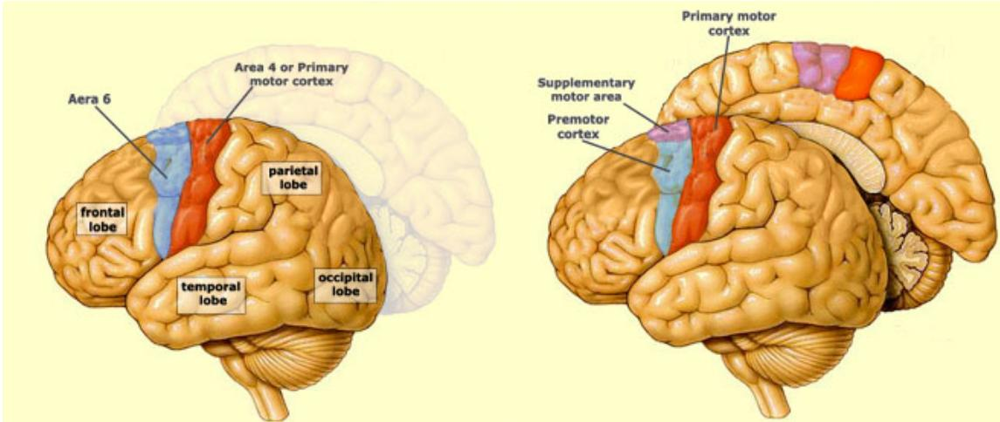  
Figure 2.6: 大脑中的运动皮层 [10]。

运动皮层的区域及其功能可归纳如下：

• 初级运动皮层（The Primary Motor Cortex）——据称包含身体不同部位的躯体局部定位投影（somatotopic representations）。研究表明，刺激大脑的这一部分会在相应身体部位引发高度局部化的肌肉收缩。

• 前运动区（The Premotor Area, PMA）——位于 6 区的外侧部分，据称通过整合感觉信息来帮助引导身体运动，同时它还有助于控制最靠近身体主轴的肌肉。

• 辅助运动区（Supplementary Motor Area, SMA）——位于6区的内侧部分，参与复杂运动的规划以及协调涉及双手的动作。

然而，除了初级运动皮层、PMA 和 SMA 之外，大脑的其他部分也参与了随意运动的产生过程。这些部分总结如下：

• 后顶叶皮层（Posterior Parietal Cortex）——位于顶叶，其功能是接收体感、本体感觉和视觉输入，然后利用这些信息确定身体及目标在空间中的位置等状态 [10]。从而在前运动皮层和运动皮层参与之前，生成即将执行的运动的内部模型。

• 基底神经节（Basal Ganglia）——在运动系统中发挥间接作用。基底神经节的不同结构形成了各种内部回路，用于调节主回路的活动，信息在主回路中穿过运动皮层、PMA 和 SMA。皮层-基底神经节运动回路在决定和控制执行何种运动方面起着非常重要的作用。

• 小脑（Cerebellum）——为了让身体做出任何特定的姿势，所涉及的各个身体节段的基础动作的时序和持续时间都必须受到极其精确的控制。小脑的职责之一就是对身体运动的时序进行这种控制。它通过将自身与运动皮层相连接的回路来实现这一点，并调节运动皮层发送给运动神经元的信号。

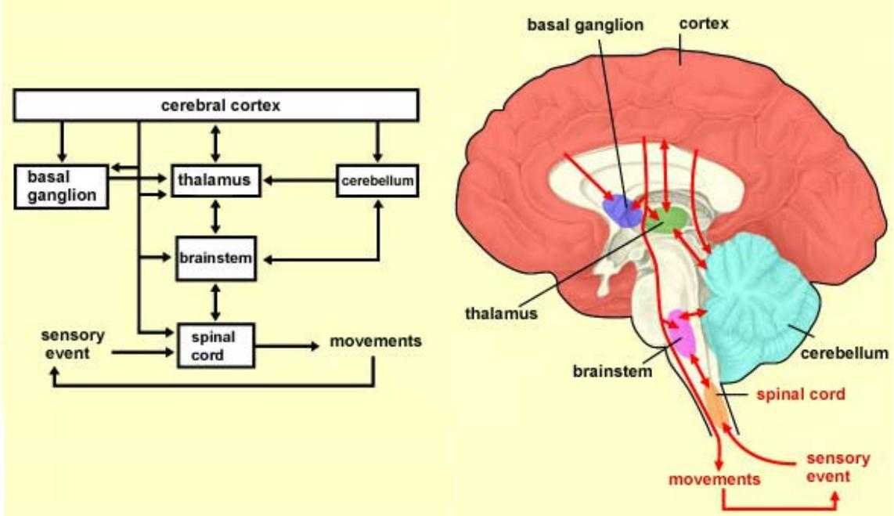  
Figure 2.7: 运动区域的激活序列 [10]。

大脑为发起随意运动所必须进行的信息处理在本质上是分层的，可分为三个步骤。第一步是针对当前情况选择合适的响应。第二步是从物理层面规划运动，即定义执行该任务所需的肌肉收缩序列。最后，第三步是执行运动。

大脑中运动区域的激活序列如图 Figure 2.7 所示。运动皮层发出的控制信息本身是由来自其他皮层区域的信息所触发的。运动皮层还通过充当中继站的丘脑，与基底神经节和小脑等皮层下结构进行密切通信。

一旦运动计划确立，运动冲动就会从初级运动皮层经由运动神经元下行传递至脊髓，激活肌肉以产生运动任务所需的必要收缩和力量（见 Figure 2.8）。初级运动皮层通过运动神经元决定每个肌群必须施加的力量大小，并将该信息发送至肌肉，以驱动身体的不同关节产生规划好的运动。

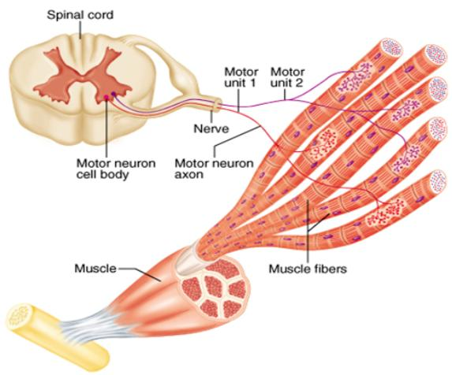  
Figure 2.8: 神经控制信息从大脑发送至肌肉[11]。

关于手部运动的执行，让我们回到运动皮层（motor cortex）的功能，来总体了解手部是如何被控制的。Wilder Penfield 医生在为减轻患者癫痫症状而进行手术时，刺激了大脑皮层的各个区域，以确定不应切除的重要区域。在此过程中，他绘制出了完整的运动皮层图谱，即如图 2.9 所示的运动小人图（motor homunculus）。

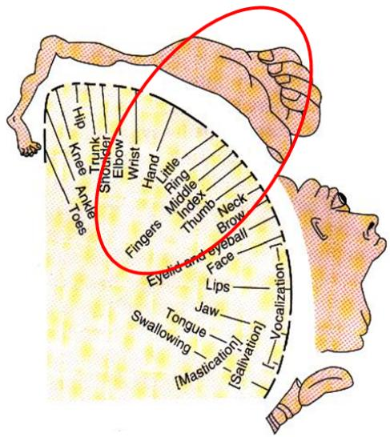  
Figure 2.9: Penfield 运动小人图 [12]。

运动小人图展示了运动皮层分配给控制相应身体部位的肌肉控制量。有趣的是，在这幅图谱中，大脑皮层分配给各个身体部位的区域大小与其物理尺寸并不成正比，而是与其能够执行的动作复杂度成正比。尤其是手部，大脑运动皮层中有近四分之一的区域专门用于控制手部运动。这并不足为奇，因为手部能够快速、灵巧且极高精度地执行非常复杂的任务。

## 2.5. 与手部运动相关的肌肉

肌肉是体内能够产生力量的柔软收缩组织。在任何关节的运动中，肌肉都是主要的执行器（actuator）。肌肉通常通过称为肌腱的纤维组织与骨骼相连。当与某一关节相关的肌肉收缩时，肌腱移动从而驱动该关节运动。

驱动人手运动的肌肉可分为两组：内在肌（intrinsic muscles）和外在肌（extrinsic muscles）。前者位于手掌内部，而后者是位于前臂的长屈肌和长伸肌。

## 2.5.1 内在肌

内在肌是指起止点均位于手内部的小肌肉，通常参与手指的精细运动。它们分为四组：大鱼际肌群（thenar group）、小鱼际肌群（hypothenar group）、蚓状肌（lumbrical group）和骨间肌群（interossei group）。

大鱼际肌群控制拇指运动，位于桡侧。该肌群由拇短展肌（abductor pollicis brevis）、拇短屈肌（flexor pollicis brevis）和拇对掌肌（opponens pollicis）组成。它们主要控制拇指外展、拇指掌骨和近节指骨屈曲以及掌骨对掌运动。

小鱼际肌群控制小指，位于尺侧。该肌群由小指展肌（abductor digiti minimi）、小指屈肌（flexor digiti minimi）和小指对掌肌（opponens digiti minimi）组成。这些肌肉均受尺神经支配，负责小指的外展、掌指关节（MCP 关节）屈曲以及轻微旋转。

蚓状肌群有助于 MCP 关节（掌指关节）的屈曲以及 PIP（近端指间关节）和 DIP（远端指间关节）的伸展。该肌群起自指深屈肌腱的尺侧，或起自该肌所处的两条肌腱之间。示指和中指的蚓状肌由正中神经支配，而小指和环指的蚓状肌则由尺神经支配。

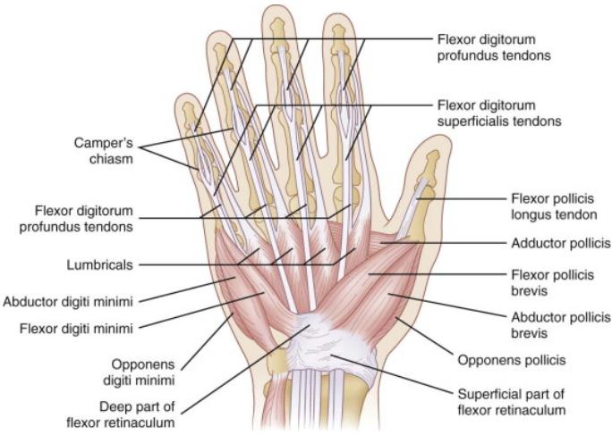  
Figure 2.10: 手部内在肌 [9]。

骨间肌群由 3 块掌侧骨间肌和 4 块背侧骨间肌组成，均由尺神经支配。掌侧骨间肌负责手指的内收运动，而背侧骨间肌则使手指朝向偏离手轴方向外展。

尽管外展和内收等精细手指运动是由手部内在肌完成的，但这些肌肉中有许多体积相对较小且位于手掌深处。探测这些肌肉可能需要更具侵入性的方法或使用高度局域化的电极。因此，在本研究中，未从任何内在肌采集表面 EMG 信号，目标仅集中在所选的手部外在肌上。我们基于这样一个前提：内在肌中包含的部分运动信息已经嵌入在来自外在肌的 EMG 信号中。

## 2.5.2 外在肌

手部外在肌是指起于前臂并止于手部的肌肉。这些肌肉（即指长屈肌和指长伸肌）的肌腹位于前臂内，其长肌腱跨过腕部和手指。

Table 2.1: 屈肌

<table><tr><td>肌肉</td><td>肌群</td><td>侧别</td><td>功能</td></tr><tr><td>桡侧腕屈肌 (Flexor carpi radialis)</td><td>浅层</td><td>前侧</td><td>手部及腕部屈曲</td></tr><tr><td>尺侧腕屈肌 (Flexor carpi ulnaris)</td><td>浅层</td><td>前侧</td><td>⋮</td></tr><tr><td>掌长肌 (Palmaris longus)</td><td>浅层</td><td>前侧</td><td>⋮</td></tr><tr><td>指浅屈肌 (Flexor digitorum superficialis)</td><td>中间层</td><td>前侧</td><td>第 2-5 指屈曲</td></tr><tr><td>指深屈肌 (Flexor digitorum profundus)</td><td>深层</td><td>前侧</td><td>⋮</td></tr><tr><td>拇长屈肌 (Flexor pollicis longus)</td><td>深层</td><td>前侧</td><td>⋮</td></tr></table>

Table 2.2: 伸肌

<table><tr><td>肌肉</td><td>肌群</td><td>侧向</td><td>功能</td></tr><tr><td>桡侧腕长伸肌</td><td>浅层</td><td>后侧</td><td>手和腕的伸展</td></tr><tr><td>桡侧腕短伸肌</td><td>浅层</td><td>后侧</td><td>⋮</td></tr><tr><td>尺侧腕伸肌</td><td>浅层</td><td>后侧</td><td>⋮</td></tr><tr><td>指伸肌</td><td>浅层</td><td>后侧</td><td>第 2-5 指的伸展</td></tr><tr><td>示指伸肌</td><td>深层</td><td>后侧</td><td>⋮</td></tr><tr><td>小指伸肌</td><td>浅层</td><td>后侧</td><td>⋮</td></tr><tr><td>拇长展肌</td><td>深层</td><td>后侧</td><td>拇指的伸展和外展</td></tr><tr><td>拇短伸肌</td><td>深层</td><td>后侧</td><td>⋮</td></tr><tr><td>拇长伸肌</td><td>深层</td><td>后侧</td><td>⋮</td></tr></table>

前臂肌肉结构可分为前侧肌群和后侧肌群。手的前侧是指处于旋后位时可见的一侧，即遵循标准解剖姿势时的前视图。前侧肌群包含屈肌，而后侧肌群包含伸肌。

前臂中的屈肌如表 2.1 所示。根据自皮肤表面起的肌肉深度，它们可分为浅层、中层或深层肌肉。指浅屈肌驱动 PIP 关节，而指深屈肌驱动 DIP 关节。从深层肌肉获取适当的信号比较困难。因此，对 DIP 关节运动的预测或分析变得更加困难。

另一方面，伸肌位于手臂的背侧，列于表 2.2 中。与屈肌类似，它们也可分为浅层、中层或深层肌肉。指伸肌控制中指和无名指的运动，而示指伸肌和小指伸肌分别控制食指和小指。这些肌肉连接到中节和远节指骨，并同时控制 PIP 和 DIP 关节的运动。因此，由于这种共同的肌肉功能，PIP 和 DIP 关节的运动在某种程度上是相互耦合的。与其他手指不同，拇指具有更多的自由度，这反映在用于控制拇指运动的肌肉数量比其他手指更多。

  
Figure 2.11: 手部外在肌 [9]。

## 第 3 章

## 表面肌电信号

受神经信号控制的遥操作系统能够在不同环境中提供无拘束且精确的运动控制 [5]。表面肌电图（sEMG，Surface electromyogram）信号常用于假肢控制和康复辅助应用中，因为这些信号为引起肌肉收缩的生理过程提供了一种简便且无创的获取途径 [13]。sEMG 信号不仅在人机接口中应用时延迟极小，而且已被证明能很好地表征肌肉张力和关节位置。

## 3.1. 什么是表面肌电信号？

Basmijian 和 De Luca 将肌电图（或更普遍称为 EMG）描述为一门涉及肌电信号产生、记录和分析的实验技术。肌电信号是由肌纤维膜状态的生理变化形成的 [14]。

正如第 2.4 节中所讨论的，大脑在整合所有感觉信息后进行运动规划。随后生成运动指令，并通过位于脊髓或脑干中的运动神经元（也称为 α-运动神经元）传输到肌肉。这些运动神经元延伸至肌纤维并在那里分支。由于这种分支，神经中的每个轴突支配多根肌纤维，从而导致肌肉收缩。

运动神经元连同其相关的肌纤维被认为是神经控制肌肉的最小功能单位，并被定义为运动单位（motor unit）。“单位”这一术语概括了这样一种特性，即在神经支配过程中，由特定运动指令控制的所有肌纤维作为一个整体单元协同活动 [15]。Feinstein et. al. 指出，一个运动单位控制 3 到 2000 根肌纤维不等，这取决于控制精细度的要求 [16]。

因此，通过神经控制引起的肌纤维兴奋是肌肉生理学中的一个主要因素。肌纤维具有静息电位（例如当神经未进行传递时），通常在 -80 至 -90 mV 之间。这可以通过肌膜现象来解释，即细胞膜内部产生负离子，外部产生正离子。即使神经未传递冲动来刺激肌纤维，这种差异也会在细胞膜两侧产生电位差。在肌纤维神经支配过程中，肌纤维膜的扩散特性会发生短暂改变，Na+ 离子随之内流。这会导致膜去极化（Depolarization），随后通过主动生理过程中的离子反向交换立即恢复，该过程被称为复极化（Repolarization）。去极化和复极化过程如图 3.1 所示。

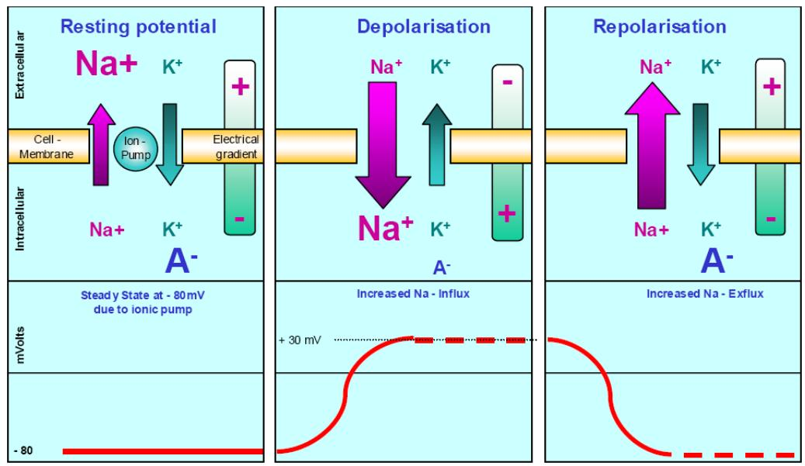  
Figure 3.1: 肌膜兴奋中去极化和复极化循环的示意图 [15]。

由于膜去极化和复极化过程，离子的移动在相邻肌纤维中产生磁场。如果在去极化过程中 $\text{Na}^+$ 内流超过某一阈值水平，将导致动作电位迅速从 -80 mV 变化至 +30 mV，如图 Figure 3.2 所示。动作电位是一种单极电脉冲，它会通过复极化立即恢复，随后在肌膜中经历一段后超极化期。

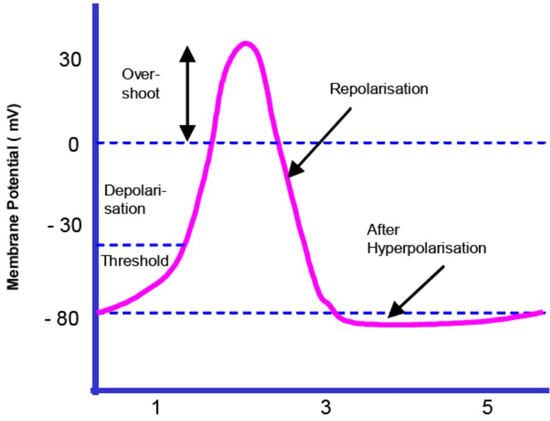  
Figure 3.2: 动作电位 [15]。

EMG（肌电）信号基于肌纤维处的动作电位。动作电位幅值的读数高度依赖于放置在目标肌肉表面上的电极位置。据称其幅值与肌纤维的直径成正比，与肌纤维和电极位置之间的距离成反比。此外，从动作电位产生到电极检测之间的时间间隔高度依赖于肌纤维的传导速度，其范围为 3 至 6 m/s [15]。

## 3.1.1 运动单位动作电位

属于单个运动单位的所有肌纤维动作电位的组合或总和被称为运动单位动作电位（motor unit action potential，MUAP）。这种组合动作电位通常借助电极进行检测和观察。由于目标电极覆盖许多肌纤维，不同运动单位的运动单位动作电位在电学上相互叠加，并被观测为具有正负值对称分布的双极信号。运动单位的重复发放会产生一连串脉冲，称为运动单位动作电位序列（motor unit action potential train，MUAPT）。

影响所观测信号幅度与密度的主要因素有两个：MUAP 的募集和发放频率。这些因素决定并调节肌肉的力输出。由于人体结缔组织和皮肤层对原始信号具有低通滤波效应，分析得到的表面 EMG 信号的发放频率并不能完全反映原始的发放与幅值特征。

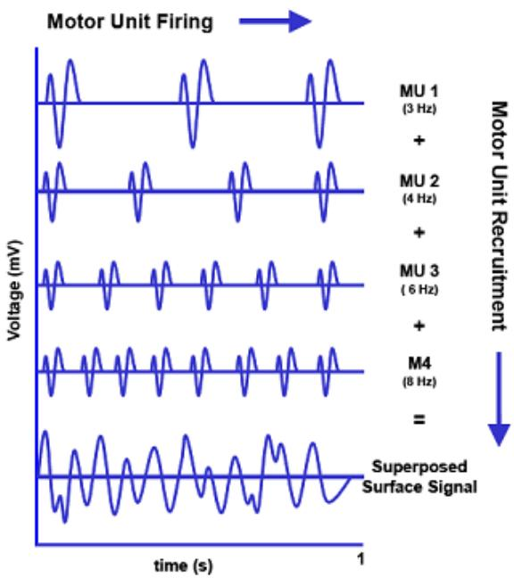  
Figure 3.3: 运动单位的募集及其发放频率对 EMG 信号的调制 [15]。

## 3.1.2 表面肌电信号生成

图 3.4 展示了从脊髓发出的信号传导至目标肌肉并生成表面肌电（sEMG）信号的过程概览。如前所述，肌电信号直接反映了被测肌肉内所检测到的运动单元的募集与放电特性。图中，肌电的多径干涉（multipath interference）是指电极位置区域内所有处于活动状态的运动单元所产生的 MUAPTs 的时空相互作用 [17]。

原始 sEMG 信号也被表示为一个随机过程，这意味着噪声以及其他干扰和信号污染也可能叠加在信号上。

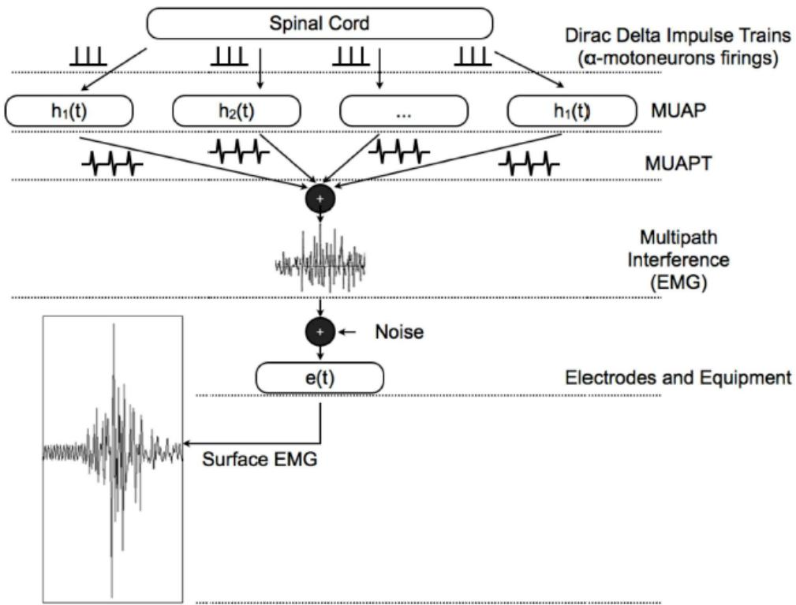  
Figure 3.4: sEMG 信号产生过程概览 [17]。

## 3.1.3 原始表面肌电信号

检测叠加 MUAPs 的未滤波且未经处理的信号被称为原始表面肌电（sEMG）信号。图 3.5 显示了肌肉在进行三次静态收缩时采集的原始 sEMG 记录样本。当肌肉处于放松状态时，可以看到一个或多或少无噪声的 sEMG 基线。通常，我们希望基线尽可能接近或大约为零。基线的理想目标值应在 1 至 2 微伏左右，平均值不应超过 3 至 5 微伏 [15]。

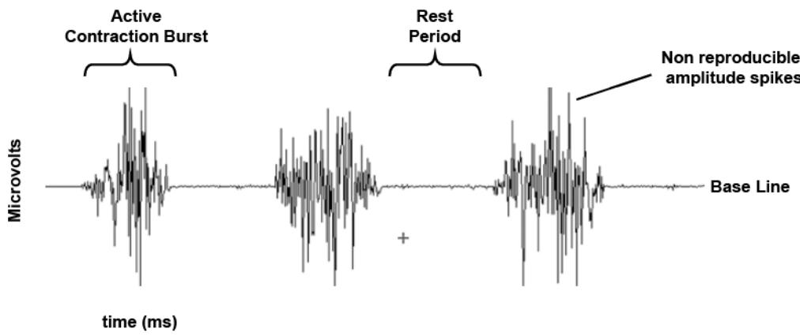  
Figure 3.5: 3 次收缩脉冲的原始肌电记录样本 [15]。

原始 sEMG 信号的另一个显著特征是这些信号在本质上是随机的，或者说原始 sEMG 尖峰具有随机形状。这意味着无法以完全相同的形状重现一段原始 sEMG 记录。通过应用平滑算法或选择合适的幅值参数（例如整流曲线下面积），信号中不可重现的内容可以被消除或至少降至最低。

原始 sEMG 信号的范围可在 +/- 5000 微伏之间，其频率成分通常介于 6 至 500 Hz 之间，大部分频率功率集中在 20 至 150 Hz 之间。然而，在实际应用中，sEMG 信号会被放大，通常在毫伏范围内进行读取。

## 3.1.4 影响表面肌电信号的因素

表面肌电信号通常被描述为含噪信号，因为肌电信号会受到多种外部因素的影响，这些因素会改变其形状和特征。下面列出了其中部分因素：

1. 组织特性 - 人体是良好的电导体，但遗憾的是，电导率会随组织类型、厚度、生理变化和温度而变化。这些条件在不同受试者之间存在很大差异，这阻碍了对基于未处理肌电信号计算得到的肌电幅值参数进行直接的定量比较 [15]。

2. 串扰（Cross Stalks）——相邻肌肉（未与电极直接接触）也可能产生显著量的肌电（EMG）信号。这会导致来自其他来源的信号污染正在研究的目标肌肉。

3. 电极与肌肉位移——在任何与运动相关的研究中，电极、线缆和连接器的移动都是不可避免的。目标肌肉（信号源）与电极（检测位置）之间距离的任何改变都会改变 EMG 读数。运动伪影还会在低频段（小于 10 Hz）产生不必要的噪声。

4. 外部噪声——在电气噪声环境中必须特别注意。其中一种噪声是来自为许多硬件和设备供电的交流电源插座的 50 或 60 Hz 噪声。EMG 设备或其他外部设备的不正确或不良接地也可能引入外部噪声。

5. 电极与放大器——电极和放大器类型的选择至关重要。放大器内部噪声不应超过 5 Vrms。通过精确准备和检查给定的实验室或房间条件，可以最大程度地减少或避免许多硬件因素的影响。

## 3.2. 表面肌电信号的检测与记录

典型的肌电设备包括电极（信号检测）、放大器（信号放大与调节）、模数（A/D）转换器以及记录仪（信号存储）。

## 3.2.1 电极

肌电信号使用不同类型的电极进行检测。电极通常可分为两类：一类使用侵入式或针式 EMG 电极，另一类使用表面电极。在本论文中，由于表面电极的无创特性，我们重点使用后者。表面电极易于操作和维护，但局限在于只能检测浅层肌肉。对于较深层的肌肉，通常首选微丝或针式电极。

表面 EMG 信号通常使用两种类型的配置。第一种是单极配置，每个目标肌肉处仅使用一个电极以及一个公共参考或接地电极。单极配置的空间分辨率较低，并且还会引入许多来自其他肌肉的不必要信号，因为电极与地之间的所有电位都会被采样。第二种是在目标肌肉处使用两个电极的双极配置，本论文便采用了这种配置。双极配置具有更好的空间分辨率和更优的降噪能力，因为放大并读取的是两个单极 EMG 信号之间的差值。两个电极共有的串扰和噪声都会被消除。

对于表面电极，Ag/AgCl 预凝胶电极是最常用的电极，并被推荐用于常规用途（SENIAM）。电极直径（导电区域）通常为 1 cm 或更小。商用一次性电极制造成湿凝胶电极或粘性凝胶电极。通常，湿凝胶电极比粘性凝胶电极具有更好的导电性和更低的阻抗。后者的优势在于在贴附出错时可以重新定位。

电极尺寸和形状、电极间距、目标肌肉上方的电极位置等因素都会影响检测到的 EMG 信号，因此在整个实验过程中应尽可能保持恒定。

  
Figure 3.6: AMBU-Blue Sensors 的常规 EMG/ECG 电极

## 3.2.2 信号放大与采样

在双极电极配置的情况下，EMG 放大器用作差分放大器，具有抑制和消除伪影的显著特性。差分放大检测两个电极之间的电位差，并消除电极中的共模外部干扰。EMG 放大器有时也被称为前置放大器，因为它们放置在电缆中或直接放置在表面电极的顶部，从而可以尽早拦截 EMG 信号。这种放置方式是为了避免放大运动伪影和其他干扰。最重要的放大器特性包括：

1. 增益（Gain）—— 输出电压与输入电压的比值。典型的生物放大器增益在 100 到 10,000 之间。

2. 输入阻抗（Input Impedance）—— 放大器的输入阻抗值应至少为给定电极阻抗的 10 倍。它必须足够高以避免衰减。

3. 共模抑制比（Common mode rejection rate, CMRR）—— 表示差模增益与共模增益之间的关系。CMRR 应尽可能高。2000:1 的 CMRR 表示除了 1/2000 之外的所有工频干扰都将被消除。

4. 频率响应（Frequency Response）—— EMG 放大器的频率范围（带通设置）应从 10 Hz 高通开始，最高达到 500 Hz 低通。

## 3.2.3 A/D 转换与 EMG 采样率

在信号能够在计算机中显示和分析之前，必须将其从模拟电压转换为数字信号（A/D 转换）。A/D 采集板的分辨率必须能够正确转换预期的幅值范围（例如 +/- 5 Volts）。至少 12 位的 A/D 采集板就已足够，它可以将输入信号的电压范围划分为 4095 个区间。

关于采样率的奈奎斯特理论（Nyquist theory）指出，为了正确重构信号，所需的采样率必须是信号预期频率的两倍。对于肌电（EMG）信号，大部分信号功率位于 10 到 500 Hz 之间。因此，为了避免信号丢失，建议采样频率至少为 1000 Hz。使用明显更低的频率设置可能会消除 EMG 中包含的重要信息，并可能导致混叠效应。

## 3.3. EMG 信号处理

原始 EMG 信号包含有关相应目标肌肉神经支配的重要信息。然而，由于原始 EMG 信号具有随机性，且混合了噪声和其他外部信号源，因此它并不能直接提供对信号的任何特定有意义的分析。因此，常用的 EMG 信号典型分析技术是通过使用和分析 EMG 信号的特征来进行的，例如均值、方差、均方根（RMS）、自相关、功率谱密度等。但在提取这些特征之前，在对信号进行此类分析之前，通常会引入一些成熟的处理方法，如整流、滤波与平滑以及归一化。

## 3.3.1 全波整流

在 EMG 信号的整流过程中，所有负幅值都会转换为正值（Figure 3.7b）。通过这种方式，可以轻松获得标准幅值参数，如信号的峰值或最大值、面积以及均值。在整流后的信号中，均值为非零值，这与均值为零的原始 EMG 信号形成对比。整流可以在实时处理中完成，也可以在数据后处理阶段在进行平均、平滑等其他步骤之前完成。

## 3.3.2 平滑

如前所述，EMG 信号本质上是随机的，无法通过其精确形状进行二次重现。为了解决这一问题，通过应用能够勾勒出信号总体趋势或包络的数字或平滑滤波器，将 EMG 的不可重现部分降至最低。例如，应用低通滤波器通常用于从整流后的 EMG 信号中生成线性包络。此类滤波器的一个示例是截止频率为 2 至 6 Hz 的巴特沃斯低通滤波器（Butterworth low-pass filter，2 阶或更高）。使用高阶数字滤波器可用于最小化信号中的相位偏移。在 EMG 信号中引入相位偏移直观上可以看作是增加了不必要的时延。为了解决这个问题，可以使用零相位滤波器来避免信号中产生任何相位偏移。

Figure 3.7b 展示了使用截止频率为 4 Hz 的零相位二阶低通巴特沃斯滤波器滤波后的 sEMG 信号样本。

低通滤波后的肌电（EMG）信号也经常用于表征 EMG-肌力转换关系。尽管穿过肌肉的电信号具有超过 100 Hz 的频率分量，但肌肉产生的力频率要低得多 [18]。因此，为了使 EMG 信号与肌力产生相关性，滤除高频分量是至关重要的。

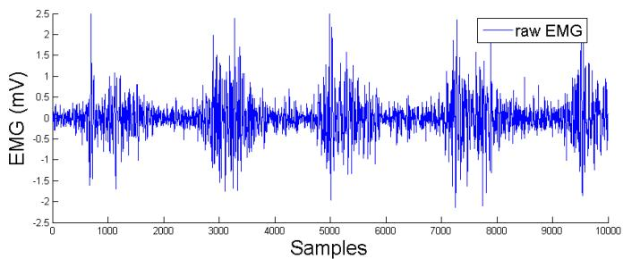  
(a) 原始 sEMG 记录

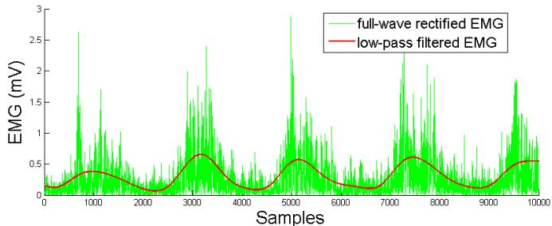  
(b) 整流与滤波后的 sEMG

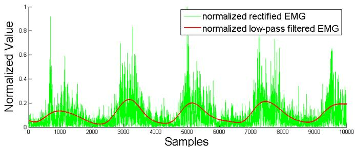  
(c) 归一化、整流与滤波后的 sEMG  
Figure 3.7: sEMG 信号预处理部分的不同阶段。

## 3.3.3 归一化

整流后的 EMG 信号通常通过将瞬时幅值除以目标肌肉在进行最大自主收缩（Maximum Voluntary Contraction, MVC）时获得的值来进行归一化。这是最常用的归一化类型之一，被称为 MVC 归一化。归一化通常用于减少受试者之间以及 EMG 幅值方面的变异性，并获得介于 0 到 1 之间的统一幅值标度，如图 3.7c 所示。这种统一标度值通常表示为最大自主收缩的百分比。

获取目标肌肉最大自主收缩的试验通常在正式测试试验之前进行。MVC 收缩是在静态阻力下进行的。尽管这个过程听起来很容易执行，但在实际实验中，真实的 MVC 值很难获取。未受过训练的正常受试者可能由于不习惯这种发力方式，难以产生真实的 MVC 收缩水平。

由于获取真实 MVC 值的可靠性较低，有时在用于生物反馈治疗的临床环境中，可接受最大发力（Acceptable Maximum Effort, AME）或所有试验中获得的整流 EMG 峰值可用作 MVC 的替代指标。这对于老年受试者和可能难以在 MVC 试验中达到最大发力的损伤患者特别有用。然而，低估真实的 MVC 仍然是一个潜在的重要误差来源。

## 3.4. sEMG 信号的应用

从工程学的角度来看，表面肌电（Surface EMG, sEMG）信号早在 1970 年就已被用作控制系统的输入信号。Saridis et. al. 创建了一个利用 EMG 信号控制假肢手臂的模式识别系统 [19]。他们对多种手部动作进行了分类，例如肘部屈曲、伸展以及腕部旋后和旋前。这一趋势在 90 年代变得更加显著，当时更多的关注点重新转向了神经网络的探索和时间序列分析的应用。在此期间，Kiguchi et al. 利用基于模糊逻辑的神经网络选择，通过来自肩部和上臂区域的 EMG 信号来控制上肢外骨骼 [20]。Huang et. al. 也采用了神经网络并开发了一种多自由度假肢控制系统，能够区分 8 种手部动作，如夹持、抓握以及屈伸 [21]。

即使直到最近，利用 sEMG 信号进行手部动作分类的许多研究仍在被广泛开展。随着更先进的机器学习技术的出现，通过对更少但更具意义的 EMG 通道进行分析，能够分类的手势动作越来越多。更多的实际应用也已落地，用于控制机器人并应用于实际患者，例如中风康复患者等。例如，Tsuji et. al. 使用基于时间循环的神经网络辨识手臂运动，以连续控制机器人机械臂，帮助中风和瘫痪康复患者完成简单的桌面任务 [2]。

在动作复现领域，手势的离散分类已经取得了成功。研究手部与手指分类及模式识别分析的研究人员取得了巨大成果，解码准确率达到 95% 以上，并可对多达 20 余种手势进行分类 [13, 22, 23, 24]。

然而，自然的手部动作并不局限于离散的手势，而是连续且协调的。对于手指无法自如活动的患者所进行的康复任务而言，在更精细的层面上确定手指的位置显得尤为重要。本研究旨在基于 EMG 到肌肉激活模型（EMG-to-Muscle activation model）的输入，同时且连续地预测多个手指的关节角度。下一章将专门阐述手指关节角度的连续估计及所使用的模型。但在进入该部分之前，接下来将讨论对以往许多研究的成功起到了核心作用的常用 EMG 特征。

## 3.5. sEMG 信号的时域特征

研究人员发现，与 EMG 信号的瞬时值相比，EMG 信号的瞬态突发中包含更有用的信息。他们发现 EMG 信号在起始阶段具有显著的结构特征，并且这些特征对于不同类型的肌肉收缩是各不相同的。进一步的研究表明，瞬态 EMG 信号比稳态信号具有更强的分类能力。正因如此，EMG 的时域特征等不同特征常被用于分类问题中。

多年来，基于肌电信号的运动分类取得了巨大成功，其中时域特征得到了广泛应用。它们计算简便，且不需要对信号进行任何复杂的变换。这些特征已应用于许多临床实践、科学研究以及前文提及的诸多相关研究中 [13, 22, 23, 24, 18, 6]。

为了在后文中对比使用不同类型输入（本研究的输入与相关研究的输入）时的关节角度估计性能，我们列出了其中部分特征。遵循传统的延迟考量，在滤波后的 sEMG 信号上应用滑动窗口，我们使用并获得了以下时域特征：

• 绝对值均值（Mean of the Absolute Value, MAV）：

$$
M A V = \frac {1}{N} \sum_ {i = 1} ^ {N} | x _ {i} |\tag{3.1}
$$

• 波形长度（Waveform Length, WL）：

$$
W L = \sum_ {i = 1} ^ {N} \left| x _ {i} - x _ {i - 1} \right|\tag{3.2}
$$

• 威尔逊幅度（Willison Amplitude, WA）：

$$
W A = \sum_ {i = 1} ^ {N} f (| x _ {i} - x _ {i - 1} |)\tag{3.3}
$$

其中，若 $x >$ 阈值（threshold），则 $f ( x )$ 为 1，否则为 0。

• 方差（Variance, VAR）：

$$
V A R = \frac {1}{N - 1} \sum_ {i = 1} ^ {N} (x (i) ^ {2}))\tag{3.4}
$$

这些特征提供了不同的信息，例如与信号幅度、频率、肌肉收缩程度以及运动单元动作电位发放程度相关的信息。这些仅是多年来所使用的众多 EMG 特征中的一小部分。其他重要特征（包括过零率、EMG 的自回归（AR）模型、小波、频率以及基于倒谱的特征）也在多种应用中得到了使用。然而，对其他特征的讨论和使用超出了本论文的范围。关于这些特征更详细的信息已在 Zecca 的著作 [13] 中进行了讨论。

## 第 4 章

# 基于表面肌电信号的手指关节角度连续估计

尽管在20多种手势的离散分类方面取得了成功，但自然的手部运动是连续的，并具有无限种精细手部运动的变化。关于精细手指运动连续预测的研究相对较少，受到的关注也较少。在本章中，我们讨论了基于 EMG（肌电）信号进行此类连续运动估计所涉及的一些固有问题，例如机电延迟（electromechanical delay，EMD）。尽管时域特征已在手势分类中得到广泛应用并取得了巨大成功，但在连续预测的情况下，它们可能无法完全提供最优的预测性能。因此，在本章中，我们还将讨论一种 EMG 到肌肉激活度（EMG-to-Muscle activation）模型，该模型可能会提供更有用且更合适的输入特征。

此外，相关研究提出并讨论了许多用于分类的算法和方法。其中包括线性判别分析（linear discriminant analysis，LDA）、神经网络和支持向量机（support vector machines）。然而，对于连续预测而言，回归分析更为适用。在本文中，我们使用并对比了人工神经网络（artificial neural network，ANN，作为著名的任意函数通用逼近器）和一种以高斯过程（Gaussian Process，GP）形式呈现的非参数贝叶斯方法。本章还提供了神经网络和高斯过程回归器背后的必要理论和简要背景。

## 4.1. Problems of Electromechanical Delay

对于任何预期的运动动作，众所周知，在 sEMG 信号的起始与运动中所产生的力及张力等施加的机械输出之间，存在一个时间延迟，该延迟被称为机电延迟（electromechanical delay，EMD）。在与分段反应时间相关的研究中，EMD 也被称为动作时间（motor time）或动作执行时间（motor execution time）[25]。

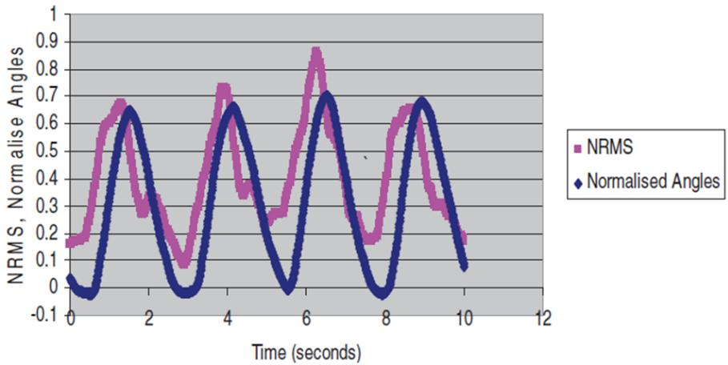  
Figure 4.1: 机电延迟显示为归一化记录角度与均方根滑动窗口 EMG 之间的时间差。

在以往涉及腿部以及手臂的 EMG 相关研究中，均已展示并观察到了 EMD [6, 18]。示例见 Figure 4.1。归一化滤波后的 sEMG 信号（粉色）领先于记录的关节角度（蓝色），这是因为 sEMG 的产生先于任务力量的产生。据报道，EMD 的范围在 10 ms 到约 150 ms 之间，但根据肌纤维类型、肌肉长度、疲劳程度、训练状态以及预期任务的速度而有所不同 [26]。

EMD（机电延迟）是一个具有挑战性的问题，若要建立 EMG 与力量、力矩或运动模式之间有效且有意义的关系，就必须解决这一问题 [26]。研究表明，EMD 会随着特定病理状态而发生不同程度的变化。在脑瘫患者中观察到了相对较短的 EMD，而在前交叉韧带（更常被称为 ACL）重建患者中则观察到了较长的 EMD [25]。然而，在正常条件下的案例或以健康受试者为对象的研究中，通常使用恒定的 EMD 值在记录的动态活动期间对 EMG 与力量或运动相关的时间曲线进行时间对齐。

Vint 等人在其研究中得出结论，无论初始张力水平和力增长率要求如何，EMD 都接近一个相对恒定的值 [26]。他们指出，EMD 与力量或动力学数据的时间对齐主要受到预张力状态和力量发展速率的影响。他们认为，如果目标动作是在非静止条件下执行，或者力量发展速率相对较快，那么引入恒定的时间偏移来对齐 EMG 和动力学数据可能是合理的。假定的 EMD 值应通过尽可能复现收集动力学数据时的条件来确定。

因此，在涉及运动行为的 sEMG 研究中不能忽视 EMD，必须予以相应考虑。

## 4.2. EMG-肌肉激活模型

为了学习能够自动考虑 EMD 的合适滤波信号，我们引入了所谓的 EMG-肌肉激活模型（EMG-to-Muscle Activation model）。EMG 是对在肌肉中传播并引起肌肉激活的电活动的度量。这会导致力量的产生，所使用的模型将 sEMG 信号转换为合适的力量表示。原始 EMG 信号是包含正负值的电压，而肌肉激活度则表示为 0 到 1 之间的数值，对其进行平滑或滤波以表征 EMG 与力量之间的关联方式 [18]。

Zajac 使用一阶递归滤波器对这种肌肉激活动力学进行了建模 [27]。尽管一阶微分方程在表征激活方面表现良好，但 Buchanan 等人创建了一个二阶模型滤波器，能够高效地建模 EMG 与肌肉激活之间的关系 [18]。由于肌纤维由单个动作电位激活，肌肉会产生抽搐响应（twitch response），这种类型的响应可以通过临界阻尼线性二阶微分系统很好地表示，以确定神经激活 $u(t)$：

$$
u (t) = M \frac {\mathrm{d} e ^ {2} (t)}{\mathrm{d} t ^ {2}} + B \frac {\mathrm{d} e (t)}{\mathrm{d} t} + K e (t)\tag{4.1}
$$

其中 M、B 和 K 是定义该二阶系统动力学特性的常数。

由于在实验室环境中，数据是在离散时间间隔下采样的，因此我们采用了其滤波器的近似离散版本，表示为：

$$
u _ {j} (t) = \alpha e _ {j} (t - d) - \beta_ {1} u _ {j} (t - 1) - \beta_ {2} u _ {j} (t - 2)\tag{4.2}
$$

其中 $u _ { j } ( t )$ 为所谓的神经激活（neural activation），$e _ { j } ( t )$ 是肌肉 j 在时间 t 的归一化、整流和滤波后的 EMG。在该模型中，α、$\beta _ { 1 } , \beta _ { 2 }$ 是滤波器的递归系数，d 是机电延迟（EMD）。通过对 α、$\beta _ { 1 }$ 和 $\beta _ { 2 }$ 施加约束条件来保证滤波器的稳定性：

$$
\beta_ {1} = \gamma_ {1} + \gamma_ {2}\tag{4.3}
$$

$$
\beta_ {2} = \gamma_ {1} \cdot \gamma_ {2}\tag{4.4}
$$

$$
| \gamma_ {1} | <   1, | \gamma_ {2} | <   1\tag{4.5}
$$

$$
\alpha - \beta_ {1} - \beta_ {2} = 1\tag{4.6}
$$

在该滤波模型中，神经激活不仅取决于当前的 EMG 水平，还取决于其近期的历史值，即 $u _ { j } ( t )$ 的先前值。在此，神经激活的值被约束在 0 到 1 之间。

此外，研究还表明，尽管某些肌肉具有线性的等长肌电-力量关系（isometric EMG-to-force relationship），但其他肌肉的这种关系是非线性的。为了对神经激活与肌肉激活之间的这种非线性关系进行建模，转换到肌肉激活 $\nu _ { j }$ 的公式如下给出：

$$
v _ {j} = \frac {e ^ {A _ {j} u _ {j} (t)} - 1}{e ^ {A _ {j}} - 1}\tag{4.7}
$$

其中 $A _ { j }$ 是引入 EMG 与肌肉激活之间非线性的参数，约束在 −3 和 0 之间，其中 −3 代表高度指数性，0 代表线性。参数 $A _ { j }$ 基于神经激活对肌肉激活产生的影响如 Figure 4.2 所示。

利用所讨论的模型，预处理后的 EMG 被转换为其肌肉激活动力学，转换后的信号现在已适用，并可用作回归器的连续输入。从原始 EMG 到其预处理滤波形式再到其肌肉激活的转换过程如 Figure 4.3 所示。

肌电-肌肉激活（EMG-to-Muscle Activation）模型不仅解决了肌肉的 EMD 问题，而且仅需少量参数。该滤波器的参数 γ1、γ2、d 以及

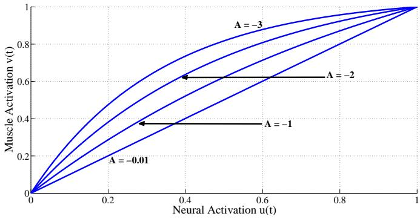  
Figure 4.2: 参数 A 引入了神经激活与肌肉激活之间的非线性。

A 是通过在 Matlab 的 Optimization Toolbox 中使用约束非线性规划，以最小化均方误差代价函数来获取的：

$$
\frac {1}{N} \sum_ {t} (\theta_ {e s t} - \theta_ {t a r g e t}) ^ {2}\tag{4.8}
$$

其中 N 是样本总数，$\theta _ { e s t }$ 和 $\theta _ { t a r g e t }$ 分别是预测和测量的手指关节角度。除了公式 4.3 至 4.6 中给出的约束外，时间延迟参数 d 也被约束在其生理极限内，即 10 到 150 ms 之间。

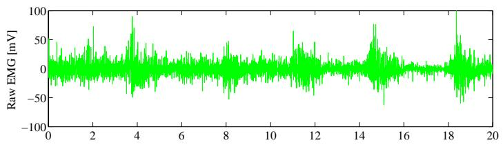

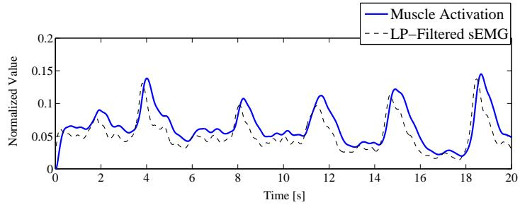  
Figure 4.3: 原始 EMG 记录样本经低通滤波后转换为其肌肉激活形式。

如果我们只需要将 EMG 信号映射到单个手指的关节角度，且训练时间需要非常快，那么对关节角度进行线性估计以获得 $\theta _ { e s t }$ 就足够了。然而，肌肉激活与产生的手指关节角度之间目前还没有明确定义的模型或明确关系。这两者之间的关系通常被假设为非线性的。因此，在本论文中，我们采用人工神经网络和高斯过程（Gaussian Process）作为我们的非线性估计器。

## 4.3. 回归方法

## 4.3.1 人工神经网络

一般来说，神经网络因其能够逼近任意函数而被认为在非线性建模中极具吸引力 [28]。正因如此，我们使用人工神经网络（NN）同时且连续地预测了手指的所有 15 个关节角度：

$$
\boldsymbol {\theta} _ {e s t} (t) = N N (\mathbf {v} (t), \mathbf {w})\tag{4.9}
$$

其中 ${ \bf \theta } _ { e s t } ( t ) \in { \bf R } ^ { 1 5 \times 1 }$ 是预测的手指关节角度，$\mathbf { v } ( t ) \in \mathbf { R } ^ { 8 \times 1 }$ 是肌肉激活输入，w 是代表节点或神经元之间连接的权重参数。

在我们的研究中，使用了一个多层前馈网络。该网络由一个输入层、一个（或多个）隐藏层以及一个单线性输出层组成（见 Figure 4.4）。通常，使用这种类型的人工神经网络属于机器学习中称为监督学习的一类。之所以这样称呼，是因为学习的训练阶段是以这样一种方式进行的：ANN 回归器必须学习如何将每个训练输入向量样本与一个称为目标输出的相关标签相关联。

人工神经网络由神经元的拓扑图组成，每个神经元计算输入的激活函数并将结果发送到输出层。假设一组输入特征用 x 表示，那么前馈神经网络的第一步是根据权重对输入进行变换，并加上特定于每个神经元的偏置因子进行偏移，表示为 $a _ { j }$：

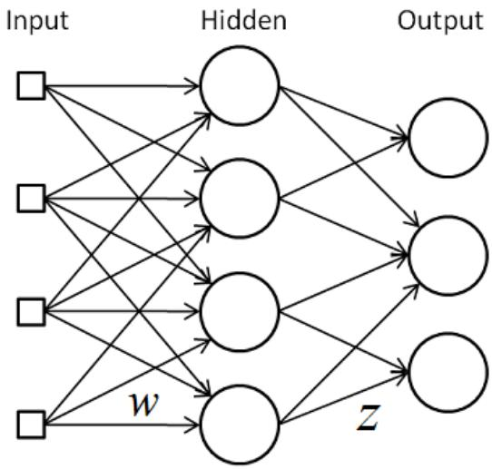  
Figure 4.4: 多层前馈人工神经网络的架构。

$$
a _ {j} = \sum_ {i = 1} ^ {D} \mathrm{w} _ {j i} ^ {(1)} x _ {i} + \mathrm{w} _ {j 0} ^ {(1)}\tag{4.10}
$$

其中 $\textrm { w } _ { j i }$ 是每个神经元的给定权重。这里我们假设拥有一个包含 n 个观测值的数据集 D，表示为 $D = \{ ( x _ { i } , y _ { i } ) \mid i = 1 , . . . , n \}$。然后使用选定的激活函数（如 sigmoid 或 tan-sigmoid 激活函数）对 $a _ { j }$ 进行变换。在本论文中，使用了由 $z _ { j }$ 给出的 tan-sigmoid 激活函数。

$$
z _ {j} = h (a _ {j}) = \frac {e ^ {a _ {j}} - e ^ {- a _ {j}}}{e ^ {a _ {j}} + e ^ {- a _ {j}}}\tag{4.11}
$$

然后，输出（或目标）向量 y 的元素计算如下：

$$
a _ {k} = \sum_ {i = 1} ^ {M} \mathrm{w} _ {k j} ^ {(2)} z _ {j} + \mathrm{w} _ {k 0} ^ {(2)}\tag{4.12}
$$

$$
y _ {k} = a _ {k}\tag{4.13}
$$

已经证明，对于特定的神经网络拓扑结构，在具有合适的权重和偏置集合的情况下，可以精确逼近任何连续函数 [28]。

ANN 的使用包含两个阶段：训练阶段和测试阶段。在训练阶段，ANN 经过训练以在给定特定输入时返回特定输出。训练是通过向 ANN 输入一组训练数据并调整各层之间的参数来完成的。学习问题在于寻找权重 $\textrm { w } _ { j i }$ 的最优组合，使网络输出尽可能接近给定的目标输出。为了实现这一点，训练算法试图最小化目标 t 与预测输出值 y 之间的均方误差，该误差由下式给出：

$$
E = \frac {1}{N} \sum_ {i} (y _ {i} - t _ {i}) ^ {2}\tag{4.14}
$$

在测试阶段，ANN 根据输入在所有层中的传播来返回输出。

在本论文的研究范围内，输入层有 8 个节点，来自每块肌肉的肌肉激活度，而输出层有 15 个节点，由手指关节角度组成。为了训练网络，我们将一组训练数据输入到神经网络中并最小化均方误差函数。最小化误差最常用的方法是使用反向传播算法。但鉴于另一种方法，例如 Levenberg Marquardt (LM) 算法，似乎是训练中等规模前馈神经网络最快的方法。在本论文中，我们使用了 LM 算法。

我们评估了隐藏层中包含不同神经元数量（从 5 到 250 不等）时网络的性能。在使用固定训练集的情况下，我们根据哪种方案在未见过的测试集上产生的平均误差最小，来选择隐藏层中具体的神经元数量。此外，为了避免过拟合，将总数据集划分为训练集和验证集，并在训练迭代过程中应用了早停（early stopping）方法 [29]。

## 4.3.2 高斯过程回归（Gaussian Process for Regression）

在本研究中，我们还评估了采用另一种通用非线性估计器时的手指关节角度估计器性能。在本文中，我们使用了如下式所示的非参数高斯过程（Gaussian Process, GP）回归器：

$$
\mathbf {y} = \mathrm{GP} (m (\mathbf {x}), k (\mathbf {x}, \mathbf {x} ^ {\prime}))\tag{4.15}
$$

其中 x 为输入，y 为来自表示为 $D = \{ ( x _ { i } , y _ { i } ) \mid i = 1 , . . . , n \}$ 的数据集中的估计或预测输出，高斯过程由均值函数 $m ( \mathbf { x } )$ 和协方差函数 $k ( \mathbf { x } , \mathbf { x } ^ { \prime } )$ 决定。结合本文从 EMG 信号预测手指关节角度的目标，我们可以将 x 替换为肌肉激活度输入 v，并将目标 y 替换为关节角度估计值 $\theta _ { e s t }$。

我们引入另一种回归器（即采用高斯过程的这一更为流行的非参数贝叶斯方法）的主要原因在于，我们希望探究从 EMG 信号对手指关节角度（PIP 和 DIP 手指关节角度）的预测是否能得到显著提升。

高斯过程回归与前馈网络有着本质的不同。它并不是通过更新神经元权重来捕捉训练数据中的规律，而是应用贝叶斯推断，在给定所有数据和新输入 x 的情况下，显式计算可能输出值 y 的后验分布 [30, 31]。

形式上，高斯过程生成分布在某一域内的数据，使得值域的任意有限子集均服从多元高斯分布 [32]。对于任意数据集中的 n 个观测值，${ \bf y } = y _ { 1 } , . . . , y _ { n }$ 总可以被视作从某个多元高斯分布中采样得到的单个点。因此，此类数据可以与 GP 相匹配。

通常情况下，假设该匹配 GP 的均值在各处均为零：

$$
m (\mathbf {x}) = 0\tag{4.16}
$$

在这些情况下，将不同观测值联系起来的仅仅是协方差函数 $k ( \mathbf { x } , \mathbf { x } ^ { \prime } )$。常用的选择是由下式给出的高斯或平方指数协方差函数：

$$
k (\mathbf {x}, \mathbf {x} ^ {\prime}) = \sigma_ {f} ^ {2} \exp \left[ \frac {- (\mathbf {x} - \mathbf {x} ^ {\prime}) ^ {2}}{2 l ^ {2}} \right]\tag{4.17}
$$

其中最大允许协方差定义为 $\sigma _ { f } ^ { 2 } .$。在此，$\sigma _ { f }$ 和 l 被称为超参数。若 $\mathbf { x } \approx \mathbf { x } ^ { \prime }$，则 $k ( \mathbf { x } , \mathbf { x } ^ { \prime } )$ 趋近于最大协方差值，这意味着潜在函数 $f ( \mathbf { x } )$ 与 $f ( \mathbf { x } ^ { \prime } )$ 几乎完全相关。若 x 远离 $\mathbf { x } ^ { \prime } .$，则 $k ( { \bf x } , { \bf x } ^ { \prime } ) \approx 0$。因此，例如在对新的 x 值进行插值时，距离较远的观测值所产生的影响微乎其微。超参数 l 控制着 $f ( \mathbf { x } )$ 与 $f ( \mathbf { x } ^ { \prime } )$ 之间间距的影响。

处理数据时通常会考虑噪声。因此，每个观测值 y 都可以被视为通过高斯噪声模型与潜在函数 $f ( x )$ 相关联：

$$
y = f (\mathbf {x}) - \mathsf {N} (0, \sigma_ {n} ^ {2})\tag{4.18}
$$

通常，回归所定义的问题是寻找能够最好地对数据 $D .$ 进行建模的潜在函数 $f ( x )$。为了将噪声纳入协方差函数中，我们可以将 $k ( \mathbf { x } , \mathbf { x } ^ { \prime } )$ 改写为：

$$
k (\mathbf {x}, \mathbf {x} ^ {\prime}) = \sigma_ {f} ^ {2} \exp \left[ \frac {- (\mathbf {x} - \mathbf {x} ^ {\prime}) ^ {2}}{2 l ^ {2}} \right] + \sigma_ {n} ^ {2} \delta (\mathbf {x}, \mathbf {x} ^ {\prime})\tag{4.19}
$$

其中 $\delta \big ( \mathbf { x } , \mathbf { x } ^ { \prime } \big )$ 为 Kronecker Delta 函数。因此，给定 y 的 n 个观测值，目标是预测 $y _ { * }$ 而非实际的 $f _ { * }$，两者的期望值相同，但由于观测噪声的存在而具有不同的方差。为了构建 GP 回归，需要计算所有可能点之间的协方差函数，我们将其表示如下：

$$
K = \left[ \begin{array}{c c c c} k (x _ {1}, x _ {1}) & k (x _ {1}, x _ {2}) & \dots & k (x _ {1}, x _ {n}) \\ k (x _ {2}, x _ {1}) & k (x _ {2}, x _ {2}) & \dots & k (x _ {2}, x _ {n}) \\ \vdots & \vdots & \ddots & \vdots \\ k (x _ {n}, x _ {1}) & k (x _ {n}, x _ {2}) & \dots & k (x _ {n}, x _ {n}) \end{array} \right]\tag{4.20}
$$

$$
K _ {*} = \left[ k (x _ {*}, x _ {1}) \quad k (x _ {*}, x _ {2}) \quad \dots \quad k (x _ {*}, x _ {n}) \right]\tag{4.21}
$$

$$
K _ {* *} = k (x _ {*}, x _ {*})\tag{4.22}
$$

在 GP 建模中，关键假设是数据可以表示为来自多元高斯分布的样本，

$$
\left[ \begin{array}{c} \mathbf {y} \\ y _ {*} \end{array} \right] \sim \mathrm{N} (0, \left[ \begin{array}{c c} K & K _ {*} ^ {\top} \\ K _ {*} & K _ {* *} \end{array} \right])\tag{4.23}
$$

为了预测 $y _ { * }$，我们需要关注条件概率 $p ( y _ { * } \mid \mathbf { y } )$，这意味着在给定训练数据 $y ,$ 的情况下，$y _ { * }$ 的某种预测的可能性有多大。如 [31, 32] 中更详细的解释，该概率服从高斯分布：

$$
y _ {*} \mid \mathbf {y} \sim \mathrm{N} (K _ {*} K ^ {- 1} \mathbf {y}, K _ {* *} - K _ {*} K ^ {- 1} K _ {*} ^ {\top})\tag{4.24}
$$

$y _ { * }$ 的预测值是该概率分布的均值：

$$
\bar {y} _ {*} = K _ {*} K ^ {- 1} \mathbf {y}\tag{4.25}
$$

而估计的不确定性则由其方差表示：

$$
\operatorname{var} \left(y _ {*}\right) = K _ {* *} - K _ {*} K ^ {- 1} K _ {*} ^ {\top}\tag{4.26}
$$

GP（高斯过程）回归的可靠性高度依赖于所选择的协方差函数。当后验概率 $p ( \mathbf { w } \mid \mathbf { x } , \mathbf { y } )$ 最大时，即可获得超参数 w（例如 w = $\big \{ \sigma _ { f } , \sigma _ { n } , l \big \} )$ 的最大后验估计。贝叶斯定理表明，假设对 w 的取值几乎没有先验知识，这相当于最小化由下式给出的负对数似然：

$$
\ln p (\mathbf {y} | \mathbf {x}, \mathbf {w}) = - \frac {1}{2} \mathbf {y} ^ {\top} K ^ {- 1} \mathbf {y} - \frac {1}{2} \ln | K | - \frac {n}{2} \ln 2 \pi\tag{4.27}
$$

通过运行多元优化算法（例如共轭梯度法），或使用精确推断方法，可以获得 w 的良好选择 [31]。

在本论文中，GP 回归是使用 Gaussian Process Regression and Classification Toolbox [33] 实现的。EMG 数据经过重新归一化和标准化处理，使每个特征的均值为 0，标准差为 1。我们使用的输入特征是先前在第 4.2 节中讨论的 8 维肌肉激活特征向量。GP 配置采用了假设为 0 的均值函数。似然函数假设为高斯分布（具有一个超参数 $\textstyle \sigma _ { n } )$），协方差函数为平方指数函数，该函数包含另外两个超参数（特征长度尺度 l 和单位信号标准差 $\sigma _ { f } )$）[31]。文中采用了精确推断方法，我们通过最小化关于超参数的负对数边际似然来对超参数进行优化。

然而在该方法中，每个关节角度都是根据肌肉激活输入进行独立预测的。与使用人工神经网络通过单个网络同时产生所有 15 个关节角度输出不同，在 GP 回归中，为每个手指建立了单独的 GP 模型。在训练阶段，基于同一组训练输入训练了 15 个 GP 回归器。

## 第 5 章

## 实验

为了验证所选EMG特征和回归模型的有效性，进行了涉及sEMG信号以及手部和手指运动记录的实验。本章介绍了实验装置以及受试者所经历的流程、任务和条件。

## 5.1. 实验装置

该系统由无线表面肌电图仪和光学动作捕捉设备组成。表面肌电（sEMG）信号采集自已知对腕部和手指运动有贡献的八块手部外在肌。这些目标肌肉及其与手部或手指运动相关的对应功能列于表 5.1 中。

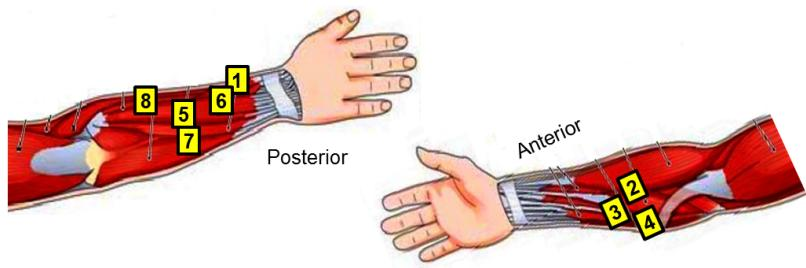  
Figure 5.1: 电极放置基于与手部和手指运动相关的肌肉位置。

Table 5.1: 所选EMG通道及目标肌肉。

<table><tr><td>通道</td><td>目标肌肉</td><td>手/手指运动</td></tr><tr><td>1</td><td>拇长展肌 (Abductor pollicis longus)</td><td>拇指外展</td></tr><tr><td>2</td><td>桡侧腕屈肌 (Flexor carpi radialis)</td><td>腕部、手部屈曲和外展</td></tr><tr><td>3</td><td>指浅屈肌 (Flexor digitorum superficialis)</td><td>第2-5指PIP屈曲</td></tr><tr><td>4</td><td>指深屈肌 (Flexor digitorum profundus)</td><td>第2-5指DIP屈曲</td></tr><tr><td>5</td><td>指伸肌 (Extensor digitorium)</td><td>第2-5指伸展</td></tr><tr><td>6</td><td>示指伸肌 (Extensor indices)</td><td>示指</td></tr><tr><td>7</td><td>尺侧腕伸肌 (Extensor carpi ulnaris)</td><td>腕部伸展和外展</td></tr><tr><td>8</td><td>桡侧腕伸肌 (Extensor carpi radialis)</td><td>腕部和拇指</td></tr></table>

八个来自 AMBU 的双极有源 Ag/AgCl 电极（见 Figure 3.6），极间距为 20 mm，放置在受试者的优势前臂上，如 Figure 5.1 所示。还在受试者的鹰嘴处放置了一个单独的电极作为接地和参考电极。

所使用的 sEMG 设备为带有无线遥测单元 TU-4 的 BA1104 放大器。在 EMG 数据采集过程中，该硬件提供了截止频率为 1 kHz 的高通滤波器。该放大器和遥测单元的配置如 Figure 5.2 所示。所有 sEMG 设备组件均来自 Digitex laboratory co. ltd.。

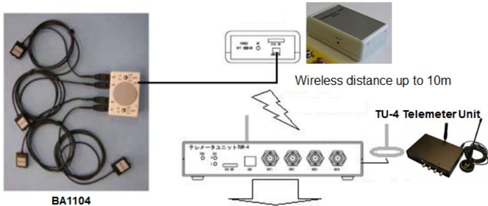  
接入 A/D 转换器的 4 模拟通道记录仪  
Figure 5.2: 无线 sEMG 设备基于 Digitex Laboratory 的 BA1104 生物放大器和无线遥测单元。

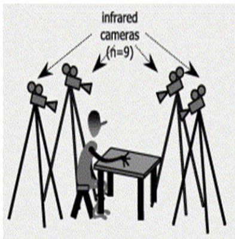  
(a) 相机总体布局

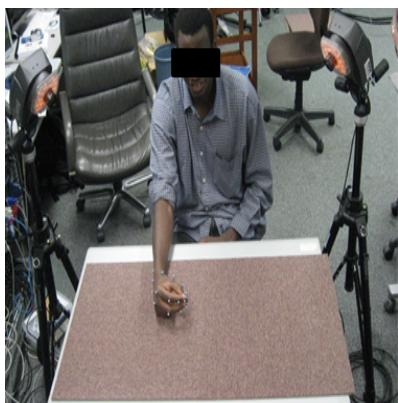  
(b) 包含受试者的示例装置  
Figure 5.3: 用于捕捉手指关节位置的动作捕捉相机系统设置。

在进行手指动作的同时，使用 MAC3D 动作捕捉系统（Motion Analysis Corp.）同步记录手部和手指的运动。摄像机设置如图 5.3 所示。受试者的手上还贴有 22 个用于动作捕捉的被动反光标记点，每个标记点位于手指的各个关节处以及手腕区域的三个位置（见图 5.4）。我们用于动作和 sEMG（表面肌电）信号采集的软件是来自 Motion Analysis 的 Evart 和 Cortex 软件。数据采集的屏幕截图示例见图 5.5。

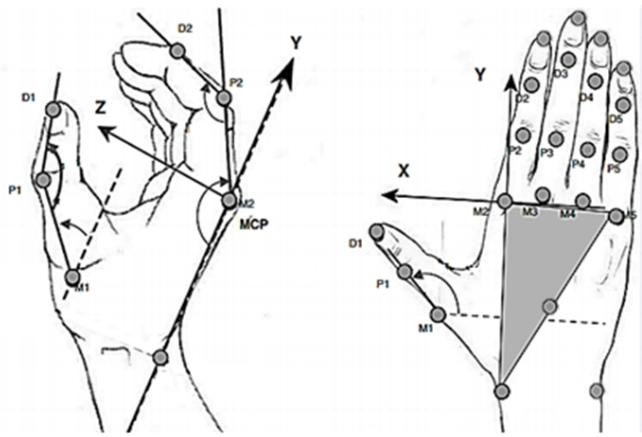  
Figure 5.4: 贴附在手部关节处的 22 个反光标记点。

sEMG 信号以 2 kHz 的频率进行采样，并输入到 A/D 转换器中。手指运动以 200 Hz 的频率进行采样，测量单位为毫米，精度为 0.5 mm，但每次摄像机校准时会有相对变化。在连续记录每个标记点的 x、y、z 位置的同时，还计算了关节位置，即 MCP、PIP 和 DIP 关节角。

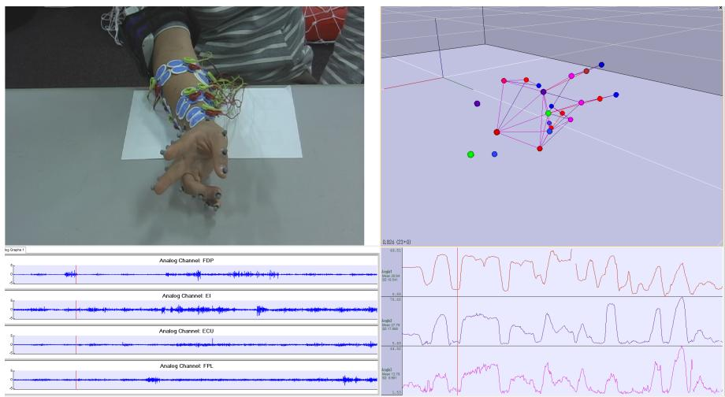  
Figure 5.5: 在同步记录 sEMG 和动作数据时显示受试者手部及相应手部模型的屏幕截图。

## 5.2. 数据采集

招募了两名无已知身体障碍的健康受试者志愿者（男性，平均年龄 25 岁，右利手），他们采取坐姿，手肘以舒适的姿势放置在平面上。每位受试者被要求完成 3 项不同的任务。在实验的第一部分，受试者的任务是一次移动一根手指，在每根手指的屈曲和伸展平面内运动。第二项任务包括受试者同时进行所有手指的屈曲和伸展。最后，在实验的第三部分即最后一部分中，受试者被要求随意且以自己希望的任何方式自由活动任何手指。在实验的这最后一部分中，鼓励受试者进行不规则运动。

第一项任务包括 5 组动作，每根手指各一组。而第二项任务包括 2 组，最后一项任务包括 1 组。总体而言，整个实验共包含 8 组动作任务。每组包含 5 次试验，每次试验持续 20 秒。所有试验按顺序进行，受试者在实验过程中可随时休息。还指示受试者在手指运动时，尽可能将整个手臂保持在中立且放松的位置。

在采集 EMG 数据以及手指运动的动作捕捉之后，还进行了单独的试验以获取各肌肉的最大自主收缩（maximum voluntary contractions, MVC）。受试者还被要求在所有可能的运动平面上弯曲其手部和手指，以尽量诱导前臂所有目标肌肉产生最大收缩。

所有记录数据中的 80% 用于训练回归器，其余 20% 用于测试和验证。每个任务中的所有数据被串联在一起，以构成一个更大的训练和测试数据集。然而，各受试者的数据是分开的，并进行了独立分析。

## 5.3. 数据预处理

原始 sEMG 信号首先被预处理为一种形式，在进一步处理后可用于预测肌肉激活度 [18]。如前所述，sEMG 信号经过整流，并通过分别从每位受试者获取的最大自主收缩（MVC）进行归一化。然而，很难获得真正的 MVC 读数，因此为了确保所有肌肉的归一化处理得当，我们不仅使用 MVC 试验中的最大整流 EMG 值，还使用了整个实验过程中全部数据集的最大整流 EMG 值。

随后，使用截止频率为 4 Hz 的 2 阶低通滤波器对信号进行滤波，类似于 Figure 3.7b 中所示。这一步是在获取肌肉激活度之前完成的，因为肌肉激活度与低频下的肌肉力量高度相关。滤波后的 sEMG 信号随后被下采样至 200 Hz，以与运动数据相匹配。

所有手指均产生了所关注的全部三个关节角。任务被限制为仅在屈曲和伸展平面内移动手指，因此总共只有 15 个关节角具有显著意义。关节角既通过标记点位置计算得出（见 Figure 5.4），同时也使用 Evart 和 Cortex 软件内部的运动分析工具进行了检查和记录。运动数据还应用了截止频率为 10 Hz 的低通滤波器，以消除信号中的任何噪声和抖动。

下表给出了这 15 个关节角各自的运动范围。这些数据基于所记录关节角数据的最小值和最大值。然而，为了在下一章展示图表时标准化并缩放所有关节角数值，我们将每个手指的数据归一化以显示 0 到 1 之间的缩放值。每个关节角数据的归一化是通过从每个样本中减去关节角的最小值并除以范数值（norm value）来完成的。

Table 5.2: 手指关节正常运动范围。

<table><tr><td>手指关节</td><td>运动类型</td><td>理论范围</td><td>测量范围</td></tr><tr><td>拇指 CMC</td><td>过伸/屈曲</td><td>0/55 deg</td><td>0/32 deg</td></tr><tr><td>拇指 MCP</td><td>过伸/屈曲</td><td>-10/55 deg</td><td>0/58 deg</td></tr><tr><td>拇指 IP</td><td>过伸/屈曲</td><td>-15/80 deg</td><td>-5/70 deg</td></tr><tr><td>手指 MCP</td><td>伸展/屈曲</td><td>-45/90 deg</td><td>-30/74 deg</td></tr><tr><td>手指 PIP</td><td>伸展/屈曲</td><td>0/100 deg</td><td>0/80 deg</td></tr><tr><td>手指 DIP</td><td>伸展/屈曲</td><td>0/80 deg</td><td>0/35 deg</td></tr></table>

## 第6章

## 结果与分析

本章展示了使用所提出的 EMG-肌肉激活特征从 sEMG 预测手指关节角度所获得的结果。将所提出的方法与以往相关研究中常用的传统时域特征进行了对比。此外，还展示了基于 ANN 和基于 GP 的回归器的性能，并讨论了二者之间的一些权衡取舍。此外，还对受试手部运动进行了维度分析，包括手部运动的基本统计分析，以帮助我们得出结论：为什么仅使用少量的 EMG 输入就能够预测 15 个手指关节的角度。

## 6.1. 基于肌肉激活输入的手指关节角度预测

如第 4 章所述，使用 EMG-肌肉激活模型作为输入特征来预测连续手指关节角度的主要动机在于，该模型将机电延迟（electromechanical delay，EMD）作为一个参数进行了考虑。在该方法中，EMG 的时间尺度加窗或分段大小不再是一个问题，这与使用时域特征的方法不同。

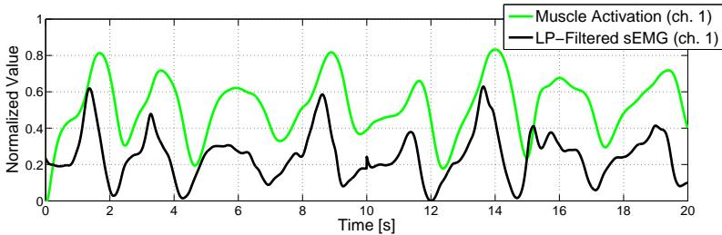  
(a) 来自 Ch. 1 的处理后 EMG 输入信号

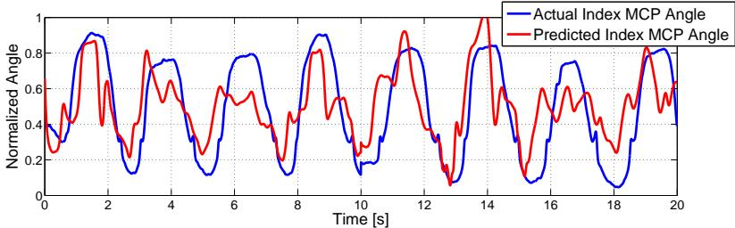  
(b) 基于滤波后 sEMG 输入的预测结果（不含 EMD）

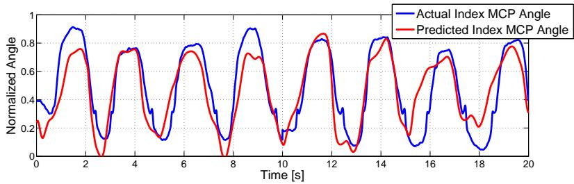  
(c) 基于肌肉激活输入的预测结果（含 EMD）  
Figure 6.1: 使用考虑与不考虑 EMD 的肌肉激活输入进行单关节角度预测的结果。

在 Figure 6.1b 和 Figure 6.1c 中，曲线展示了在周期性屈曲和伸展任务中单个食指关节角度运动的两种预测结果：一种使用低通滤波后的 EMG，另一种使用肌肉激活输入。在此，预测器是由 Figure 6.1a 所示的处理后输入训练而成的 ANN。使用所提出的 EMG-肌肉激活模型不仅在生物学上是合理的，而且还确定了 EMD 的最优估计，并且输入特征只需要极少的参数。通过考虑 EMD，我们可以在 Figure 6.1a 中看到，这使得肌肉激活信号发生平移，从而几乎与运动数据完美对齐。

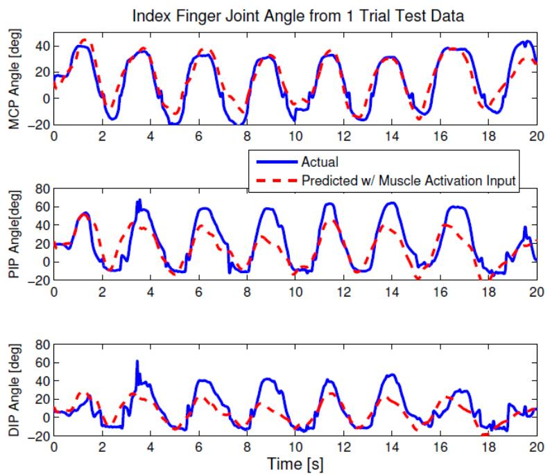  
Figure 6.2: 包含食指屈曲和伸展的 1 次测试试验的食指关节角度估计。

Table 6.1: 肌肉激活模型参数

<table><tr><td>参数</td><td>获得的值</td></tr><tr><td>d</td><td>0.04</td></tr><tr><td> $\gamma_1$ </td><td>-0.9748</td></tr><tr><td> $\gamma_2$ </td><td>-0.9748</td></tr><tr><td> $A_j$ </td><td>-1.26</td></tr></table>

在训练设置中，使用肌肉激活模型获得的参数如 Table 6.1 所示。在神经网络训练完成后，我们同时预测了所有手指关节角度。Figure 6.2 展示了任务 1 中单指屈曲和伸展运动在一次测试试验中的食指关节角度结果。

MCP 角度估计获得了高达 0.92 的相关性，而 PIP 和 DIP 关节角度的估计结果一致，相关性分别约为 0.8 和 0.7。将 sEMG 处理为其肌肉激活动力学特征非常直接。对于该试验，获得的 EMD 为 40 ms，恰当地将 sEMG 起始点与运动数据对齐。该模型非常适用于试验中 EMD 大致相同的恒速运动。

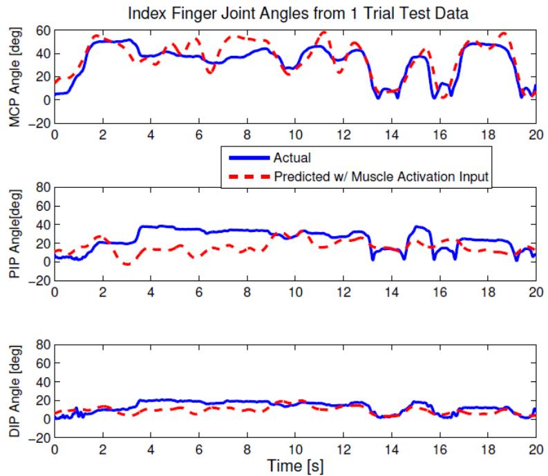  
Figure 6.3: 任务 3 中受试者可任意自由活动时的一次测试试验的食指关节角度估计。预测与测量的 MCP、PIP 和 DIP 角度之间的相关系数分别为 0.88、0.52 和 0.60。

同样，Figure 6.3 展示了涉及手指自由和随机运动时的食指关节预测角度结果。回归器能够相当好地预测食指关节角度，但不如仅一次移动单指时精确。在这次试验中，我们假设 EMD 的变化有所不同。优化步骤从训练数据中选择最佳的可能 EMD 值，但未考虑不同速度引起的 EMD 变化。此外，在之前涉及周期性运动的任务中，另外两个较小关节的角度跟随与 MCP 角度类似的运动，但对于随机运动，情况可能完全不同。我们使用的肌肉激活输入并未提供将各角度相互关联的显式特征。

## 6.2. 不同 EMG 特征之间的比较

我们还想表明，使用肌肉激活输入不仅对 EMD 进行了参数化并予以考虑，而且还提供了更好的估计结果。在此，我们比较了三种输入类型的估计性能：滤波后的 sEMG 信号、sEMG 时域特征以及所提出的肌肉激活模型输入。

我们使用的滤波 sEMG 信号是应用任何变换之前公式 4.2 中的预处理 sEMG 信号 $e _ { j } ( t )$。我们使用的 sEMG 时域特征是前面第 3.5 节中讨论的特征，即每个 sEMG 通道的 MAV、WL、WA 和 VAR。

Figure 6.4 和 Figure 6.5 分别显示了所有测试数据中预测和测量的手指关节角度的平均相关系数和平均总体归一化均方根误差（NRMSE）。我们比较了相关研究所采用的不同输入与本研究所采用的输入（使用肌肉激活度输入特征）的估计性能。两幅图中的结果均来自 5 折交叉验证，以观察估计器的总体统计性能。

我们可以看到，使用所提出的模型获得了更好的估计结果，在所有预测的手指关节角度上均具有更高的相关系数和更小的平均均方根误差（小于 15%），且所有手指关节角度对应的 p 值均小于 0.05。

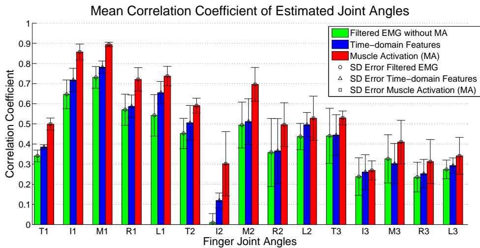  
Figure 6.4: 在三种不同输入（滤波 sEMG、时域特征和肌肉激活度输入）下，预测与测量的手指关节角度的平均相关系数。x 轴字母标签代表拇指、食指、中指、无名指和小指，数字 1、2 和 3 分别代表 MCP、PIP 和 DIP 角度。

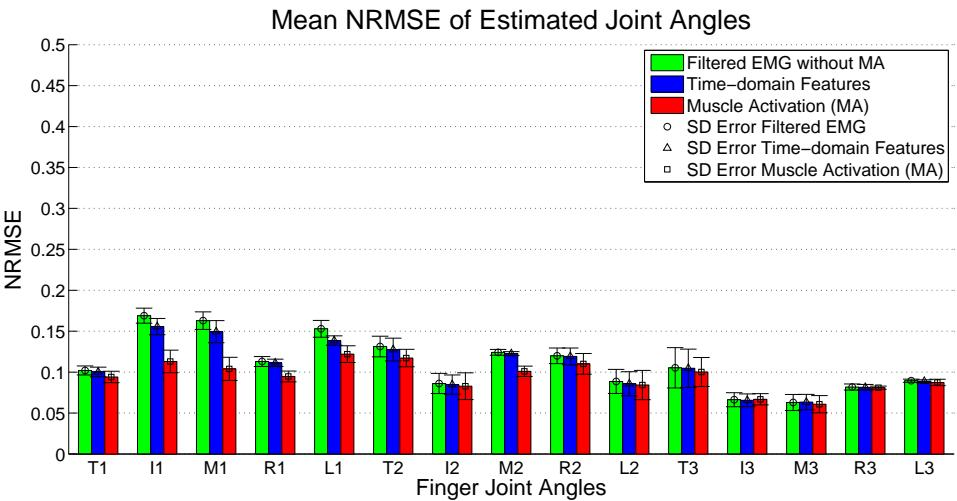  
Figure 6.5: 在所使用的三种不同输入（滤波 sEMG、时域特征和肌肉激活度输入）下，预测与测量的关节角度的平均归一化均方根误差（NRMSE）。x 轴标签代表与 Figure 6.4 相同的手指关节角度对应分配。

对于 MCP 关节角，相关系数可达到 0.8 以上。这表现得十分稳定，并且当运动条件受到约束时（例如仅预测单指运动而非同时和多指运动，或者仅估计周期性运动和匀速运动而非自由非周期性运动），该值甚至可以超过 0.9。

## 6.3. Comparison Between ANN and GP Regression

Figure 6.6 显示了我们所用预测器的全局性能，绘制了训练样本数量变化时所有关节角度的平均 RMSE。有趣的是，GP 仅需 200 个样本就能达到与使用超过 1800 个样本训练的神经网络几乎相当甚至更好的性能。我们还展示了基于 214 个样本训练的 MCP 手指关节角度局部测试样本预测，其中神经网络和 GP 的预测叠加在

Figure 6.7 中，而基于 2134 个样本训练的结果显示在 Figure 6.8 中。

GP（高斯过程，Gaussian Process）在使用极少训练样本的情况下能对关节角度给出更好的预测。然而我们应该指出，尽管 GP 比神经网络更容易处理缺失数据，但随着训练样本规模的增加，前者的计算时间会显著增加。此外，这是因为在高斯过程中每个输出关节角度都是独立建模的。使用神经网络不仅速度快，而且能提供合理的准确度，最适合用于这种基于 sEMG（表面肌电）信号的手指关节角度同步估计。训练 GP 所花费的时间大约是神经网络的 10 倍。

尽管关于 GP 的使用属于初步探索，但在这种使用较少训练样本进行 EMG 到手指关节角度预测的应用中，它展现出了能够给出更佳预测的前景。如果能构建一个更优的模型，通过单一或更少的模型来同时预测输出关节角度，这将是非常理想的，且其性能可能超越神经网络。选择能够最好地拟合 EMG 与手指关节角度之间关系的协方差函数和均值函数，也可以进一步提高估计精度。

神经网络与高斯过程预测器的学习曲线  
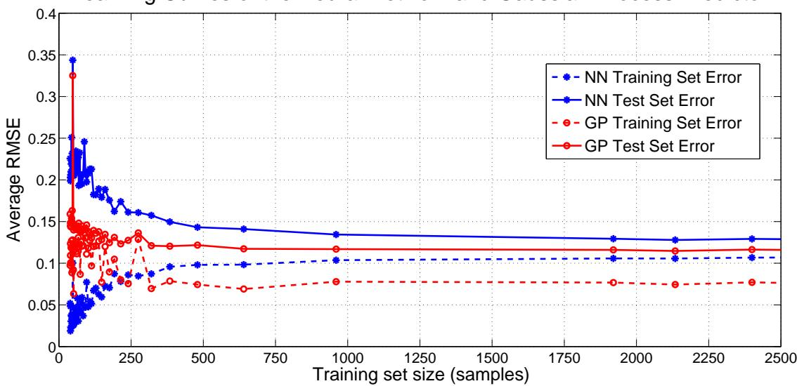  
Figure 6.6: 神经网络与高斯过程回归器的学习曲线。训练样本数量发生变化，而测试数据样本数量保持固定。

基于 214 个训练样本预测与实际的 MCP 关节角度  
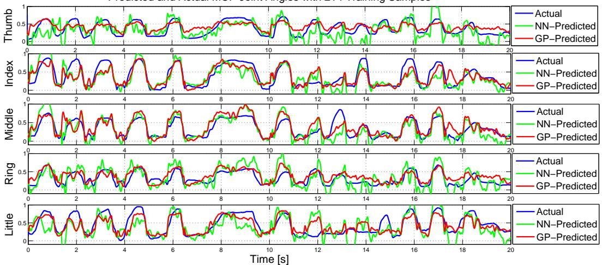  
Figure 6.7: 由 214 个样本训练的 ANN 与 GP 回归器得到的实际和预测 MCP 关节角度。

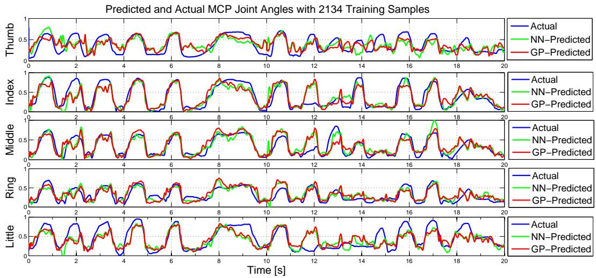  
Figure 6.8: 由 2134 个样本训练的 ANN 与 GP 回归器得到的手指实际和预测 MCP 关节角度。

## 6.4. 手/手指运动的维度分析

在我们提出的方法和先前的结果中，存在一个问题，即我们试图利用前臂 8 路 sEMG 信号的信息，独立预测屈曲和伸展平面内的 15 个手指关节角度。直观上，这可以被视为一个不适定问题（ill-posed problem），因为输出数量多于输入数量。然而，对手/手指运动数据进行的维度分析表明，有效维度小于手部解剖学上可用的总自由度（DOF, degrees of freedom）。换句话说，从解剖学上看，一只手中的五个手指总共包含 15 个关节，大约提供约 20 个自由度（DOF）[34]。然而，在运动过程中这些自由度在多大程度上受到独立控制尚属未知。先前的研究表明，主要由于手部结构的机械约束以及协同作用（synergies）的存在，手部运动的维度少于其最大自由度[34, 35]。

在本研究中，对跨越15维空间的手指关节角度数据集应用了主成分分析（Principal Component Analysis, PCA）。PCA不仅在关节角位置数据上执行，还在关节角速度数据上执行，因为据称角速度与运动指令的驱动力矩更为密切相关 [36]。

Figure 6.9 和 Figure 6.10 中展示的结果表明，前4到6个主成分解释了手部姿态中绝大部分的方差。对角位置和角速度进行的 PCA 分析结果相似。这种相似性印证了以往研究的结论，即人类运动几乎必然是离散的且具有钟形速度曲线，这往往会使位置的方差与速度的方差相关联 [34]。在以往的研究中，主成分（PCs）的存在已被用于论证手部的协同控制 [34, 36]。

此外，通过对手指关节进行相关性分析，结果表明并证实了手指主要关节点角度之间存在高度相关性。Figure 6.9b 证实了同一手指内的 PIP 和 DIP 关节角度之间存在高度相关性。而如图 Figure 6.9c 和 Figure 6.10c 所示，相邻手指的关节角度高度相关。这些相关性结果验证了我们关于手部耦合运动的认知，即人类受试者很难在移动一根手指的同时不在其他一根或多根手指上产生某种程度的非自主运动。

总体而言，手部运动的 PCA 降维和相关性分析表明，手部运动的有效维度确实低于理论上可能的自由度（DOFs）数量。这些结果不仅表明了降维现象，还可能作为手部控制中存在运动协同（motor synergies）的证据。

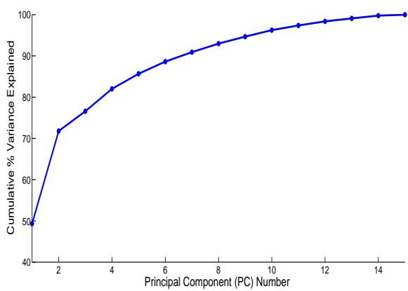  
(a) 关节角度数据通过 PCA 得到的累积方差

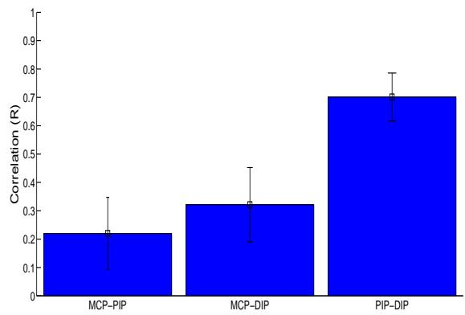  
(b) 同一手指内各关节之间的相关性

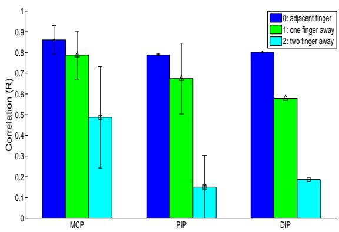  
(c) 跨手指各关节之间的相关性  
Figure 6.9: 关节角度数据的 PCA 以及手指关节之间的相关性。

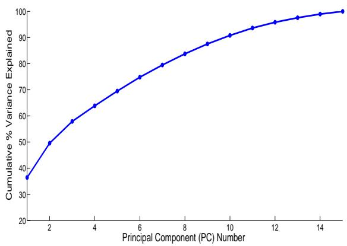  
(a) 关节速度数据通过 PCA 得到的累积方差

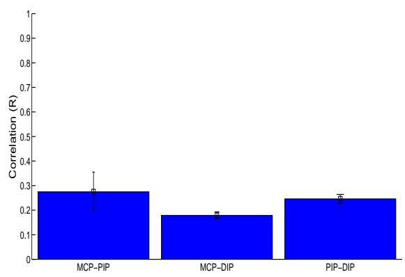  
(b) 同一手指内各关节速度之间的相关性

  
(c) 跨手指各关节速度之间的相关性  
Figure 6.10: 关节速度数据的 PCA 以及手指关节之间的相关性。

## 第7章

## 结论

本论文提出了一种替代且改进的手指关节角度估计方法，该方法采用了一个对电机械延迟（Electromechanical Delay, EMD）进行参数化的肌肉激活模型，这一延迟现象已被众多研究人员所观察到。自动确定该延迟能够改善表面肌电（sEMG）信号与手指关节角度之间的同步性，从而提供更优的估计结果。我们在本研究中表明，在同时估计更多手指关节角度的情况下，本方法使用的输入和参数更少，其结果与以往的研究相当，甚至更优。

总体而言，我们目前的方法捕捉到了手指运动的总体趋势，并能够利用肌肉激活特征以合理的精度预测多个手指关节角度。不过，若能借助可靠的生物力学模型将近端指间（PIP）关节和远端指间（DIP）关节角度与掌指（MCP）关节角度关联起来，提供额外信息，可能会进一步提高估计性能。在利用肌电（EMG）信号预测手指关节角度的监督学习环境中，使用人工神经网络（Artificial Neural Network）可以提供一种黑盒式预测器，该预测器快速且具有适当的可靠性。考虑采用高斯过程回归器（Gaussian Process regressor）的非参数贝叶斯（Bayesian）方法也极具前景，然而，对于使用 sEMG 信号的应用，必须确定并建模合适的协方差函数和均值函数。

鉴于手部的精细运动十分复杂，未来的工作可以包括研究其他因素，例如手指发力以及与涉及手部的灵巧任务相关的不同肌肉激活模式。在本论文中，我们观察到了手指关节之间的高度相关性。这是因为所选的任务仅限于手指的自由运动。然而，在执行更具体、更精细的任务时（例如操作微小物体），情况可能并非如此。已有研究表明，在某些三指协同任务中（如操作一枚小硬币），大拇指和中指是独立主动运动的，而食指在整个操作任务过程中完全处于被动状态 [37]。对于自由运动的手指，我们已经准确地预测了关节角度。然而，对于其他复杂的操作任务，应在所选回归器的使用中考虑并利用手指间的相关性信息。本论文未来的拓展研究应探索更复杂的操作任务，因为任务的选择对于提高关节角度预测的目标精度尤为重要。尽管已经考虑了 EMD 等问题，但根据手指操作任务的不同，EMD 可能会持续变化。因此，本研究可以拓展至考虑动态变化的 EMD，特别是在应用于实时场景时。

我们工作的一些潜在应用包括将所提出的方法应用于机器人假肢手和机器人手指外骨骼的控制中，其中基于 sEMG 的控制策略能够根据患者的运动意图平滑地提供预期位置。我们在附录 D 中简要阐述了如何使用我们提出的方法来预测用户的食指关节角度，并将预测的角度输入以控制定制的手指外骨骼。这只是向我们最终目标迈进的一步，即使用基于 sEMG 的辅助设备控制策略来提供手部和手指康复。未来，探索其他控制策略也将是明智之举，例如“按需辅助”（assist-as-needed）型控制，这种控制不仅适用于康复，而且有望通过使用机器人辅助设备实现最大程度的功能恢复。

## 致谢

首先，我要向我的导师 Kazushi Ikeda 教授和 Tomohiro Shibata 副教授表达最诚挚的感谢，他们在我在 NAIST 的学习期间一直给予我指导和支持。

感谢 Ikeda 教授在 2009 年接纳我作为实习生，并吸收我进入他的实验室成为一名学生。他的指导和慷慨让我得以实现毕生的梦想之一，即完成在日本的学业。能够成为 NAIST 数理信息学实验室（Mathematical Informatics Laboratory）的一员，我感到无比荣幸。

感谢我的导师 Shibata 副教授，对于他的指导和启发，我将永远心存感激，是他让我始终更加努力，并在工作中发挥出最佳水平。他的言语和鼓励总是激励我志存高远、永不放弃。他给予我尝试自己想法的自由，同时在遇到任何困难时总是随时为我提供指导和支持。

我还要非常感谢助理教授 Tomoya Tamei，他是一直与我密切合作的指导老师之一。他对我个人的悉心教导和指导始终如一、充满耐心。如果没有他的指导和一贯支持，这篇论文就无法顺利完成。

感谢助理教授 Takatomi Kubo、Hiroyuki Funaya 和 Kazuho Watanabe，非常感谢你们的所有指导和宝贵意见。正是因为他们的帮助，我才得以克服这项研究中的诸多困难。特别感谢 Kubo 助理教授，他为我的研究提供了不可或缺的建议以及许多极好的见解和视角。

在完成这篇论文的过程中，许多人都给予了我帮助。我想感谢 Lynn，她一直给予我巨大的支持，并始终陪伴在我身边。感谢我的父母和家人，他们不断给予我支持和鼓励，是我人生每个篇章中珍贵的一部分。

我非常荣幸能够在数理信息学实验室（Mathematical Informatics Lab）与如此优秀的人们共事。实验室同窗们让我在 NAIST（奈良先端科学技术大学院大学）的时光真正变得难忘且意义非凡。我特别想感谢我的学长前辈们（Senpais）Chihiro Obayashi、Akihiro Nakamura、Zujie Zhang 以及 Mauricio Burdelis，他们在实验室以及我在日本的生活期间给予了我诸多帮助。

致优秀的菲律宾及国际学生群体，感谢你们的友谊与共度的美好时光，你们的陪伴让我在 NAIST 的生活充满了快乐与回忆。

致我的论文答辩委员会成员：Ikeda 教授、Ogasawara 教授、Shibata 副教授以及 Tamei 助理教授，再次感谢你们付出的时间、耐心以及宝贵的指导意见。

最后，我要感谢日本政府奖学金项目（Japan Government Scholarship Program）以及日本学术振兴会（Japan Society for the Promotion of Science, JSPS）科学研究费补助金对我学业和科研工作提供的资助。如果没有日本政府奖学金，我赴日留学的梦想将无法实现。感谢给予我这次宝贵的机会。

## 参考文献

[1] B. Dellon and Y. Matsuoka, “Prosthetics, exoskeletons, and rehabilitation,” in IEEE Robotics and Automation Magazine, 2007.

[2] O. Fukuda, T. Tsuji, M. Kaneko, and A. Otsuka, “A human-assisting manipulator teleoperated by emg signals and arm motions,” IEEE Transactions on Robotics and Automation, 2003.

[3] K. Tong, X. Hu, K. Fung, X. Wei, W. Rong, and E. Susanto, “An emg-driven exoskeleton hand robotic training device on chronic stroke subjects: Task training system for stroke rehabilitation,” in IEEE International Conference on Rehabilitation Robotics (ICORR), 2011.

[4] S. Saponas, D. Tan, D. Morris, R. Balakrishnan, J. Turner, and J. Landay, “Enabling always-available input with muscle-computer interfaces,” in ACM UIST, 2009.

[5] P. Afshar and Y. Matsuoka, “Neural-based control of a robotic hand: evidence for distinct muscle strategies,” in Proc. 2004 IEEE International Conference on Robotics and Automation, vol. 5, pp. 4633–4638, IEEE, April 2004.

[6] N. Shrirao, N. Reddy, and D. Kosuri, “Neural network committees for finger joint angle estimation from surface emg signals,” Biomedical Engineering Online, vol. 8(2), pp. 1–11, 2009.

[7] R. Smith, F. Tenore, D. Huberdeau, R. Etienne-Cummings, and N. Thakor, “Continuous decoding of finger position from surface emg signals for the control of powered prostheses,” in Proc. 30th Annual International IEEE EMBS Conference, pp. 197–200, IEEE, August 2008.

[8] M. Hioki and H. Kawasaki, “Estimation of finger joint angles from semg using a neural network including time delay factor and recurrent structure,” International Scholarly Research Network (ISRN) Rehabilitation, 2012.

[9] N. Pratt, Anatomy and Kinesiology of the Hand, vol. 1. Elsevier Mosby Philadelphia PA, 6 ed., 2011.

[10] B. Dubuc, “MS Windows NT the brain from top to bottom.” http://thebrain. mcgill.ca, 2002. Accessed: 20/12/2012.

[11] “Motor unit adaptation.” http://kin450-neurophysiology.wikispaces. com/Motor+Unit+Adaptation, 2011. Accessed: 20/12/2012.

[12] W. Penfield and T. Rasmussen, “The cerebral cortex of man; a clinical study of localization of function.,” 1950.

[13] M. Zecca, S. Micera, M. Carrozza, and P. Dario, “Control of multifunctional prosthetic hands by processing the electromyographic signal,” Critical Reviews in Biomedical Engineering, vol. 30, pp. 459–485, 2002.

[14] J. Basmajian and C. De Luca, Muscles Alive - Their Function Revealed by Electromyography, vol. 4. Williams and Wilkins, Baltimore, MD, 1985.

[15] P. Konrad, “The abc of emg - a practical introduction to kinesiological electromyography,” 13430 N. Scottsdale Rd., Suite 104, Scottsdale, AZ 85254, April 2005.

[16] B. Feinstein, B. Lindegard, E. Nyman, and G. Wohlfart, “Morphological studies of motor units in normal human muscles,” Acta Anat, vol. 23, pp. 127–142, 1955.

[17] G. Lisi, “The study of the electromyographic signal for the control of a prosthetic hand,” 2010.

[18] T. Buchanan, D. Lloyd, K. Manal, and T. Besier, “Neuromusculoskeletal modeling: Estimation of muscle forces & joint moments and movements from measurements of neural command,” Journal of Applied Biomechanics, vol. 20(4), pp. 367–395, November 2004.

[19] G. Saridis and T. Gootee, “Emg pattern recognition for a prosthetic arm,” IEEE Transaction on Biomedical Engineering, vol. 29, pp. 403–412, 1982.

[20] K. Kiguchi, T. Tanaka, and F. Toshio, “Neuro-fuzzy control of a robotic exoskeleton with emg signals,” IEEE Transactions on Fuzzy System, vol. 12(4), pp. 481– 490, 2004.

[21] H. Huang and C. Chen, “Development of a myoelectric discrimination system for a multi-degree prosthetic hand,” in Proceeding of the 1999 IEEE International Conference on Robotics and Automation, 1999.

[22] K. Englehart and B. Hudgins, “A robust, real-time control scheme for multifunction myoelectric control,,” IEEE Transactions on Biomedical Engineering, vol. 50, pp. 848–854, 2003.

[23] Y. Huang, K. Englehart, B. Hudgins, and A. Chan, “A gaussian mixture model based classification scheme for myoelectric control of powered upper limb prostheses,” IEEE Transactions on Biomedical Engineering, vol. 52, pp. 1801–1811, 2005.

[24] J. Chu, I. Moon, and M. Mun, “A real-time pattern recognition for multifunction myoelectric hand control,” in Proc. 2005 International Conference on Control, Automation and System, ICCAS, June 2005.

[25] L. Li and B. Baum, “Electromechanical delay estimated by using electromyography during cycling at different pedaling frequencies,” Journal of Electromyography and Kinesiology, 2004.

[26] P. Vint, S. McLean, and G. Harron, “Electromechanical delay in isometric actions initiated from nonresting levels,” Medical and Science in Sports and Exercises, 2001.

[27] K. Manal, R. Gonzalez, D. Lloyd, and T. Buchanan, “A real-time emg-driven virtual arm,” Computers in Biology and Medicine, vol. 32(1), pp. 25–36, 2002.

[28] B. C. Csaji, “Approximation with artificial neural networks,” Faculty of Sciences, Etvs Lornd University, Hungary, 2001.

[29] C. Bishop, Pattern recognition and machine learning, vol. 4. Springer New York, 2006.

[30] M. Frean, M. Lilley, and P. Boyle, “Implementing gaussian process inference with neural networks,” International Journal ofNeural Systems, vol. 16, pp. 321– 327, 2006.

[31] C. Rasmussen and C. Williams, Gaussian Processesfor Machine Learning. MIT Press, Cambridge, MA, USA, 2006.

[32] M. Ebden, “Gaussian processes for regression: A quick introduction,” 2008.

[33] C. Rasmussen and H. Nickisch, “Gaussian processes regression and classification toolbox version 3.1.” http://gaussianprocess.org/gpml/code, September 2010. Accessed: 22/12/2012.

[34] J. Ingram, K. Kording, I. Howard, and D. Wolpert, “The statistics of natural hand movements,” Experimental Brain Research, vol. 188(2), pp. 223–236, 2008.

[35] A. d’Avella, P. Saltiel, and E. Bizzi, “Comnination of muscle synergies in the construction of a natural motor behavior,” Nature Neuroscience, vol. 6, pp. 300– 308, 2003.

[36] E. Todorov and Z. Ghahramani, “Analysis of the synergies underlying complex hand manipulation,” in 26th Annual International Conference of the IEEE EMBS, IEEE, 2004.

[37] M. F. Orlando, A. Dutta, A. Saxena, L. Behera, T. Tamei, and T. Shibata, “Manipulability analysis of human thumb, index and middle fingers in cooperative 3d rotational movements of a small object,” Robotica, vol. FirstView, pp. 1–13, 2 2013.

[38] J. Ngeo, T. Tamei, and T. Shibata, “Continuous estimation of finger joint angles using muscle activation inputs from surface emg signals,” in 34th Annual International Conference of the IEEE EMBS, pp. 2756–2759, IEEE, 2012.

[39] “Biomechanics of the hand.” http://www.bioeng.nus.edu.sg/compbiolab/ projects/hand-biomechanics.html, November 2007. Accessed: 20/12/2012.

[40] J. Ngeo, T. Tamei, and T. Shibata, “Continuous estimation of finger joint angles using inputs from an emg-to-muscle activation model,” in MBE-IEICE Technical Report, vol. 112, pp. 17–22, 2012.

[41] T. Tamei and T. Shibata, “Fast reinforcement learning for three-dimensional kinetic human-robot cooperation with an emg-to-activation model,” Advance Robotics, vol. 25, pp. 563–580, 2011.

[42] C. Antfolk, C. Cipriani, M. Controzzi, M. Carrozza, G. Lundborg, B. Rosen, and F. Sebelius, “Using emg for real-time prediction of joint angles to control a prosthetic hand equipped with a sensory feedback system,” Journal of Medical and Biological Engineering, vol. 30(6), pp. 399–406, 2010.

[43] F. Tenore, A. Ramos, A. Fahmy, S. Acharya, R. Etienne-Cummings, and N. Thakor, “Decoding of individuated finger movements using surface electromyography,” IEEE Transactions on Biomedical Engineering, vol. 56, pp. 1427–1434, 2009.

[44] C. Choi, S. Kwon, W. Park, H. Lee, and J. Kim, “Real-time pinch force estimation by surface electromyography using an artificial neural network,” Medical Engineering and Physics, vol. 32, pp. 429–436, 2010.

[45] I. Nabney, NETLAB: algorithms for pattern recognition, Advances in Pattern Recognition. Springer, Berlin, 2001.

[46] M. Hioki and H. Kawasaki, “Estimation of finger joint angles from semg using a recurrent neural network with time-delayed input vectors,” in IEEE 11th International Conference on Rehabilitation Robotics, pp. 289–294, IEEE, June 2009.

[47] H. Ogino, J. Arita, and T. Tsuji, “A wearable pointing device using emg signals,” Journal ofRobotics and Mechatronics, 2005.

[48] M. H. Schieber, “Muscular production in individuated finger movements: The roles of extrinsic finger muscles,” The Journal of Neuroscience, vol. 15(1), pp. 284–297, 1995.

[49] I. Nabney and C. Bishop, “Netlab neural network software,” Matlab Toolbox, vol. 71, 2003.

## 附录

## A. ANN与GP回归的预测性能

以下图表展示了通过5折交叉验证获得的所有估计关节角度的平均相关系数以及平均归一化均方根误差（NRMSE）。采用对协方差和均值函数具有基本假设的高斯过程（Gaussian Process, GP）能够表现更优并给出更好的估计结果。然而可以观察到，NRMSE值比图6.5中获得的值大得多。其主要原因在于，为了适应计算量远大于ANN的GP，所使用的训练样本显著减少。

  
Figure 7.1: 对比了两种不同回归方法下预测和测量的手指关节角度的平均相关系数与平均NRMSE。x轴字母标签分别代表拇指、食指、中指、无名指和小指，而数字1、2和3分别对应MCP、PIP和DIP关节角。

## B. 样本测试结果中所使用的处理后EMG

此处展示了第6.3节中图6.7和图6.8所示测试数据中获得的整流及归一化EMG信号。EMG信号经过截止频率为4 Hz的零相位Butterworth低通滤波器滤波，随后使用适当的肌肉激活模型进行转换。在该特定测试数据中，肌肉激活模型获得的参数为：$A = - 3 , d = 0 . 0 4 5 , \gamma _ { 1 } = \gamma _ { 2 } = - 0 . 9 5 3 9$。图中y轴的标签对应表5.1中列出的目标EMG通道。

  
Figure 7.2: 使用获得的参数将预处理后的EMG信号转换为肌肉激活度。

## C. PIP 与 DIP 关节角度预测结果

以下各图展示了前面第 6.3 节中讨论的相应预测 PIP 和 DIP 关节角度。在该节中，仅展示了样本测试试验的 MCP 关节角度预测。在此，我们展示了该试验在分别使用 214 和 2134 个样本训练时，所有 5 根手指对应的 PIP 关节角度预测结果。y 轴数值范围为 0 到 1，是相对于 Table 5.2 归一化后的值。

使用 2134 个样本训练的预测与实际 PIP 关节角度  
  
Figure 7.3: 在两种不同训练样本量下，来自 ANN 和 GP 回归器的实际与预测 PIP 关节角度。

在以下各图中，我们展示了针对同一试验，使用 ANN 和 GP 回归器在 214 和 2134 个样本训练下，所有 5 根手指对应的 DIP 关节角度预测结果。

使用 2134 个样本训练的预测与实际 DIP 关节角度  
  
Figure 7.4: 在两种不同训练样本量下，来自 ANN 和 GP 回归器的实际与预测 DIP 关节角度。

## D. 应用：手指外骨骼的控制

在此，我们展示了一个应用示例，其中 sEMG 信号用于预测和控制定制的食指外骨骼。受试者被要求在屈曲和伸展平面内移动其左手食指，同时右手食指由外骨骼利用来自左侧的 EMG 输入进行驱动（Figure 7.5a）。右手手指没有施加任何 EMG 用力，这表明它确实是由外骨骼辅助运动的（Figure 7.5b）。最后，关节角度测试预测结果如图 7.5d 所示，此时 EMG 被转化为肌肉激活度，并作为输入用于预测食指关节角度。蓝色曲线表示从左手食指获得的测量关节角度，红色曲线表示来自回归器的预测关节角度。绿色曲线表示手指外骨骼在右手食指上的驱动运动。

  
(a) 来自左手的肌肉激活度。

  
(b) 来自右手的肌肉激活度

  
(c) 手指外骨骼的屏幕截图

  
(d) 测量与预测的食指关节角度。  
Figure 7.5: 一个展示基于 sEMG 控制食指外骨骼的应用。图中显示了在左手和右手记录的 sEMG，并且机器人由来自预测关节角度的输入指令进行控制。