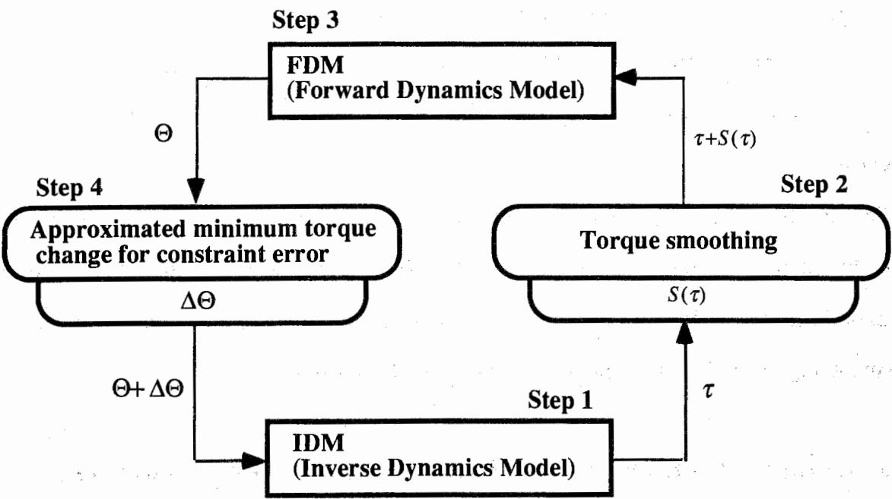
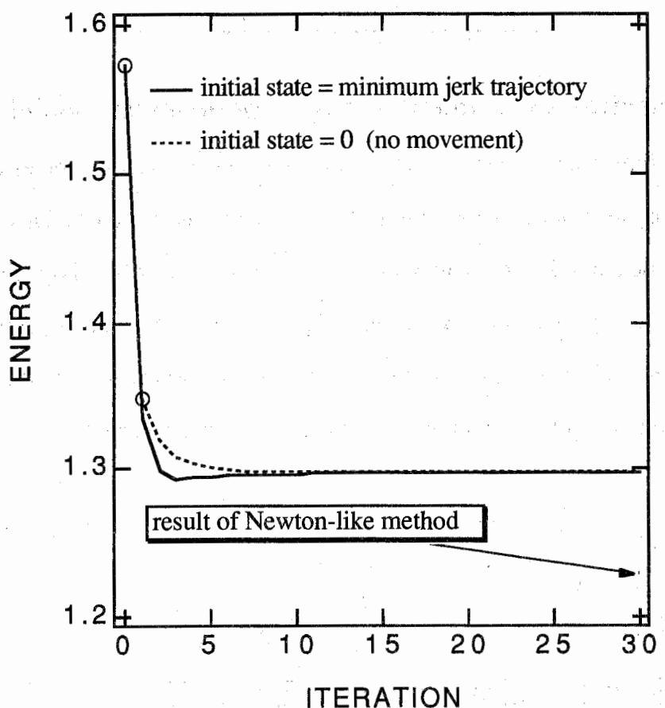
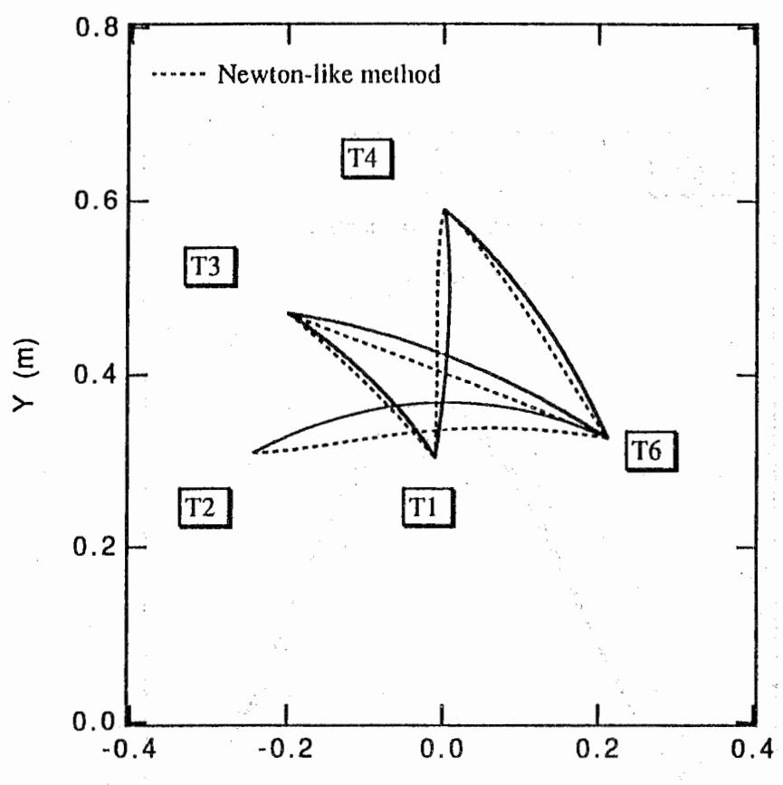
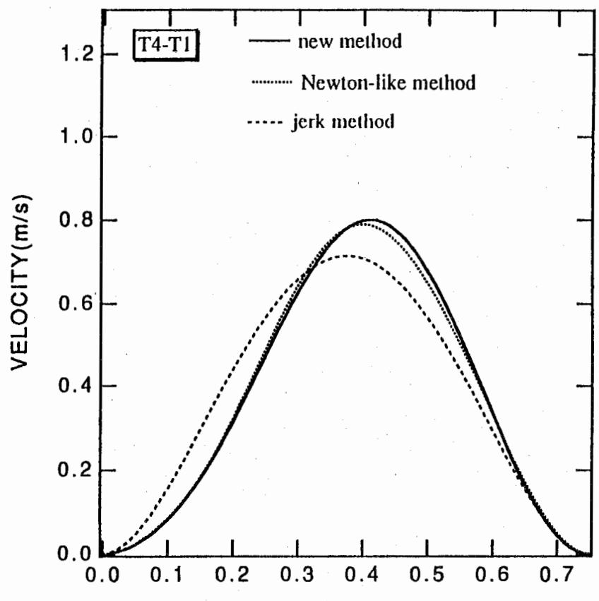
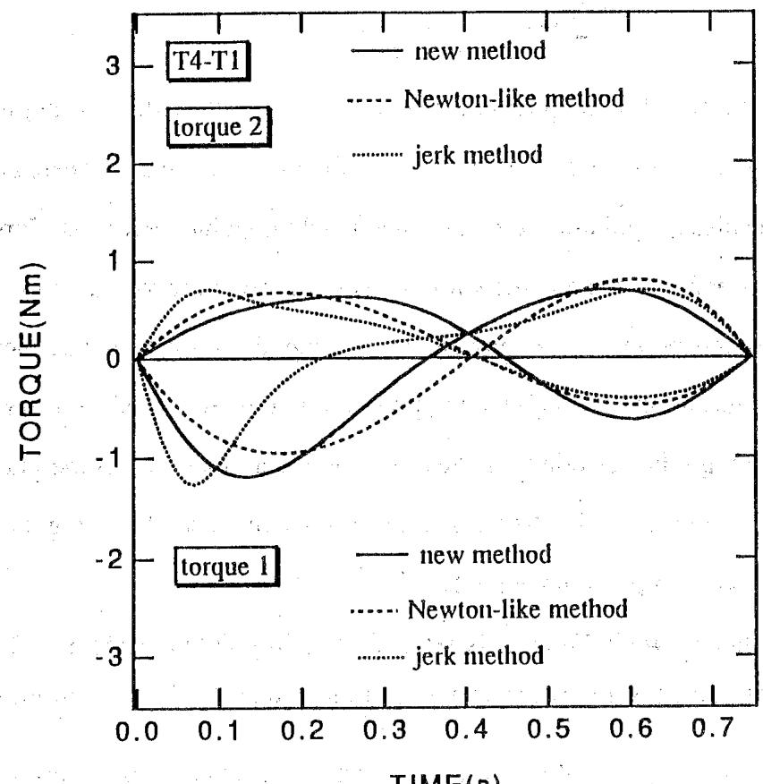
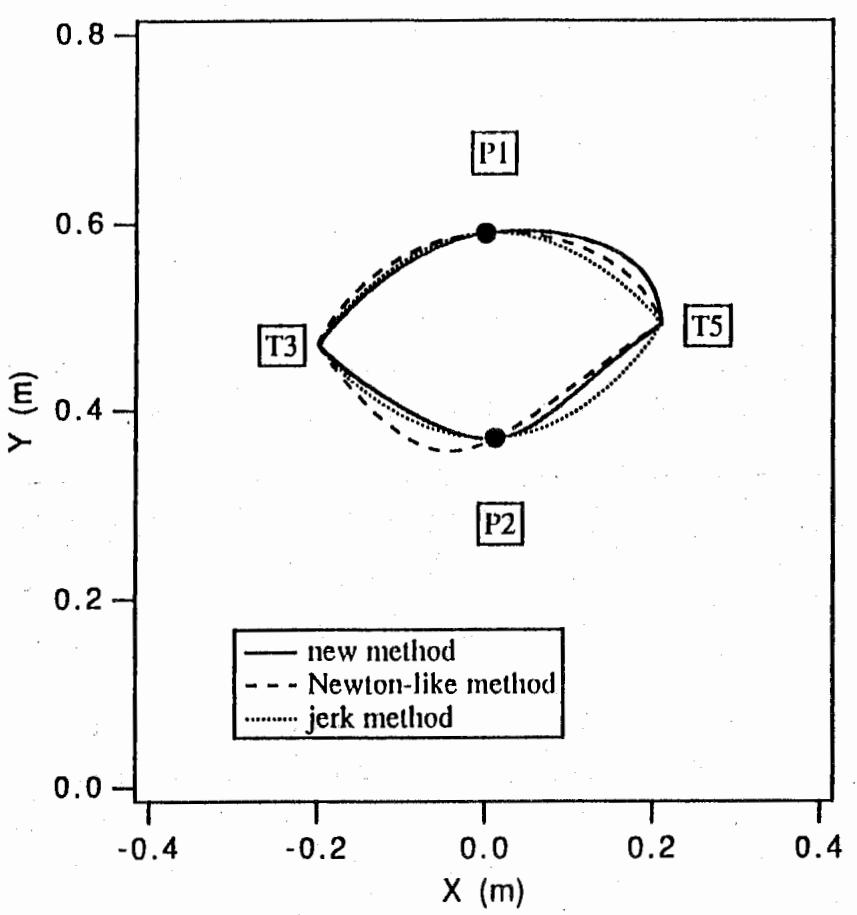
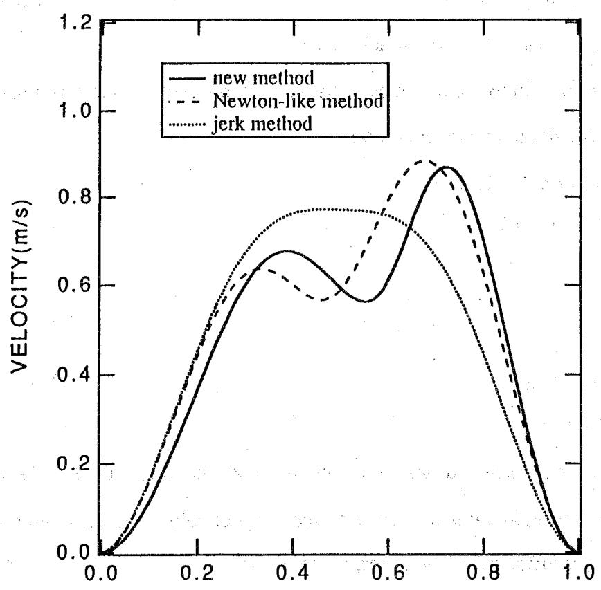
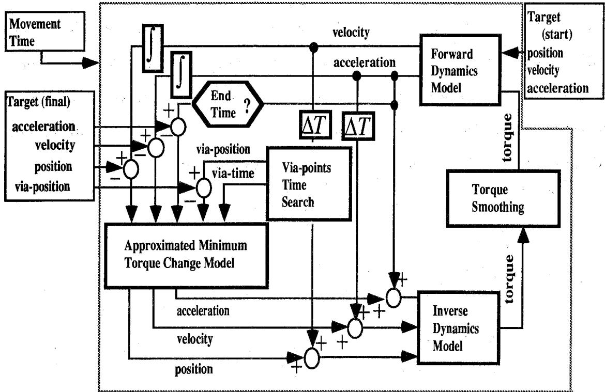

TR-H-001

基于正向和逆动力学模型的手臂轨迹生成神经网络模型

Yasuhiro WADA, Mitsuo KAWATO

## 1992. 5.21

# ATR 人间情报通信研究所

〒619-02 京都府相乐郡精华町光台2-2 07749-5-1011

# ATR Human Information Processing Research Laboratories

2-2, Hikaridai, Seika-cho, Soraku-gun, Kyoto 619-02 Japan

电话：+81-7749-5-1011

传真：+81-7749-5-1008

© (株) ATR 人间情报通信研究所

# 基于正向和逆动力学模型的手臂轨迹生成神经网络模型

Yasuhiro WADA

Mitsuo KAWATO

ATR Human Information Processing Research Laboratories, 2-2 Hikaridai, Seika-cho, Soraku-gun, Kyoto 619-02, Japan Tel +81-7749-5-1044

## 摘要

最小力矩变化模型（minimum torque-change model）能够极好地预测并重现人类的多关节运动数据。然而，目前基于最小力矩变化准则进行轨迹生成的神经网络模型存在三个不足之处：(1) 时间的空间表示，(2) 反向传播是必不可少的，以及 (3) 所需迭代次数过多。因此，我们提出了一种基于最小力矩变化准则的全新轨迹生成神经网络模型。我们的神经网络模型主要利用正向动力学模型、逆动力学模型以及生成近似最小力矩变化轨迹的轨迹生成机制。该模型既不需要时间空间表示，也不需要反向传播。此外，获得近似最优解所需的迭代次数更少。最后，由于我们的神经网络模型是一种求解带边界条件优化问题的新方法，它可以广泛应用于工程领域。

## 关键词

最小力矩变化模型，正向动力学模型，逆动力学模型，优化问题，轨迹生成

## 致谢：

本工作的一部分在 ATR 视听觉机制研究所完成。我们谨向 Y. Uno 博士就本研究展开的讨论表示感谢。我们还要向 ATR 人间情报通信研究所的 Y. Tohkura 博士的鼓励表示感谢。本项工作得到了向 M.K. 提供的 Human Frontier Science Project（人类前沿科学计划）研究资助的支持。

## 1. 引言

为了控制自主运动，必须解决以下三个计算上的不适定问题（ill-posed problems）：(1) 期望轨迹的确定；(2) 期望轨迹的任务空间坐标向身体本体内部坐标的转换；以及 (3) 生成实现期望轨迹的运动指令。解决这些问题的一种方法是引入平滑度性能指标。研究提出了两个经过实验证实的自主运动目标函数。Flash and Hogan (1985) 提出了一种数学模型，即最小加加速度模型（minimum-jerk model）。他们提出，受试者手臂所遵循的轨迹倾向于使整个运动过程中手部位置在笛卡尔坐标空间中的加加速度（jerk，即加速度的变化率）平方的积分最小化。由于他们的模型仅基于运动学，独立于肌肉骨骼系统的动力学，因此通过应用 Euler-Lagrange 方程很容易计算出具有最佳性能的唯一轨迹。已有研究利用循环神经网络（recurrent neural networks）提出了几种可以计算最小加加速度轨迹的硬件模型（Jordan, 1989; Massone and Bizzi, 1989; Hoff and Arbib, 1992）。

基于目标函数必须与动力学相关的思想，Uno, Kawato and Suzuki (1989) 提出了一个能够解释期望轨迹决定的最小力矩变化（minimum torque-change）模型。该模型基于这样一种理论：人类手臂轨迹的确定是为了使力矩变化率平方的时间积分最小化。由于人类手臂或机器人操作臂的动力学是非线性的，因此基于最小力矩变化模型寻找唯一轨迹是一个非线性优化问题。这是一个相当困难的优化问题，一方面是因为平滑度准则表示在运动指令空间中，另一方面，目标点位置、途径点（via-points）和障碍物等运动条件则表示在任务导向坐标系中。因此，使用欧拉-拉格朗日（Euler-Lagrange）方程求解该优化问题的计算量非常大。迄今为止，已有两类硬件模型被提出。Kawato, Maeda, Uno and Suzuki (1990) 提出了级联神经网络，该网络是正向动力学模型（forward dynamics model, FDM）的级联结构，用于根据最小力矩变化模型生成轨迹。相反，Nakamura, Uno, Suzuki and Kawato (1990) 提出了一种使用逆动力学模型（inverse dynamics model, IDM）的最小力矩变化准则神经网络模型。对这些神经网络有三个批评意见：(1) 它们使用了时间的空间表示，(2) 反向传播是必不可少的，(3) 获得最优轨迹需要过多的迭代次数。在本文中，我们提出了一种同时使用 FDM 和 IDM 的轨迹生成新模型。该模型解决了上述三个缺点，并且可以实现为具有生物学合理性的神经网络。所提出的网络模型可应用于广泛的工程领域，因为它是解决带边界条件的一般优化问题的一种新方法。

## 2. 用于手臂最优轨迹生成的神经网络 2.1 最小力矩变化准则

本节简要解释最小力矩变化模型。轨迹生成是一个病态问题（ill-posed problem），因为将手从起点移动到目标点存在无数条可能的轨迹。因此，无法确定唯一的轨迹。然而，人类可以在两个目标之间移动手臂，在无数条轨迹中选择一条轨迹。因此，大脑应该能够通过为该病态问题附加一个合适的准则来计算出唯一解。

Flash and Hogan (1985) 提出了最小加加速度（minimum-jerk）模型，该模型基于运动运动学，独立于肌肉骨骼系统的动力学。他们提出的性能指标是以下二次度量：

$$
C _ {J} = \int_ {0} ^ {t _ {f}} \left\{\left(\frac {d ^ {3} X}{d t ^ {3}}\right) ^ {2} + \left(\frac {d ^ {3} Y}{d t ^ {3}}\right) ^ {2} \right\} d t\tag{1}
$$

这里，$(X,Y)$ 为手部的笛卡尔坐标，$t_{f}$ 为运动时间。Flash and Hogan (1985) 表明，产生最佳性能的唯一轨迹与身体正前方区域内运动的实验数据相吻合。他们的分析完全基于运动的运动学，独立于肌肉骨骼系统的动力学，并且只有在根据体外空间中的手部运动进行表述时才取得成功。

Uno, Kawato and Suzuki (1989) 提出了以下替代的二次性能度量指标。该模型的目标函数与手臂动力学相关：

$$
C _ {T} = \int_ {0} ^ {t _ {f}} \sum_ {j = 1} ^ {M} \left(\frac {d \tau^ {j}}{d t}\right) ^ {2} d t\tag{2}
$$

其中 $\tau^{j}$ 是 $M$ 个执行器中第 $j$ 个执行器产生的力矩，$t_{f}$ 是运动时间。目标函数是力矩变化率平方和在整个运动过程中的积分。最小力矩变化（minimum torque-change）模型能够非常好地预测和生成人体手臂轨迹。该优化问题是寻找使准则 $C_{T}$ 最小化的力矩。然而，基于最小力矩变化获取最优轨迹十分困难，因为必须利用复杂的非线性动力学来确定力矩。也就是说，必须求解一个带有边界条件的非线性优化问题。

对于身体正前方一对目标之间的运动，两种模型的预测结果均接近实验数据。然而，在四种行为情境下，最小力矩变化模型（minimum torque-change model）预测的轨迹与最小加加速度模型（minimum-jerk model）存在显著差异。研究发现，最小力矩变化模型对真实数据的预测效果优于最小加加速度模型 (Uno et al., 1989)。这四种情境如下：(1) 离散点到点运动：起点为向侧面伸直手臂，终点在身体前方；(2) 抵抗弹簧阻力的两点间运动，弹簧一端连接在手上，另一端固定；(3) 受重力影响的垂直运动。在这三种情况下，无论是否存在外力或重力，最小加加速度模型始终预测一条直线路径。另一方面，最小力矩变化模型则预测出一条曲线路径，且这些预测与实验数据相吻合。最后，研究考察了最有说服力的证据：(4) 一对途经点（via-point）运动：具有相同的起点和终点，但指定了互为镜像的途经点。由于最小加加速度模型的目标函数 $C_{J}$ 在平移、旋转和翻转（rolling）下保持不变，因此该模型预测出翻转时具有相同的路径，以及两种子情况下相同的速度剖面（speed profile）。另一方面，最小力矩变化模型预测出两条不同的轨迹。对于凹形路径，速度剖面有两个峰值；然而对于凸形路径，速度剖面仅有一个峰值。这些预测与人体实验数据非常接近 (Uno et al., 1989)。

然而，这两个目标函数 $C_{J}$ 和 $C_{T}$ 密切相关，因为力矩变化率在局部与加加速度（jerk）成正比。如果手臂动力学被近似为质点系统，则这两个性能指标完全相同。

## 2.2 基于正向和逆向模型的最优手臂轨迹生成神经网络

在本节中，提出了一种用于轨迹生成的新型神经网络模型。两目标之间运动的性能指标定义为平滑度约束能量（乘以正则化参数 $\lambda$）与三个硬约束之和：

$$
\begin{array}{r l} E & = \frac {1}{2} \lambda \sum_ {i = 1} ^ {N} \sum_ {j = 1} ^ {M} (\tau_ {i} ^ {j} - \tau_ {i - 1} ^ {j}) ^ {2} + \frac {1}{2} \sum_ {j = 1} ^ {M} (\theta_ {d} ^ {j} - \theta_ {N} ^ {j}) ^ {2} + \frac {1}{2} \sum_ {j = 1} ^ {M} (\dot {\theta} _ {d} ^ {j} - \dot {\theta} _ {N} ^ {j}) ^ {2} \\ & \quad + \frac {1}{2} \sum_ {j = 1} ^ {M} (\ddot {\theta} _ {d} ^ {j} - \ddot {\theta} _ {N} ^ {j}) ^ {2} \end{array}\tag{3}
$$

其中 $\tau_{i}^{j}$ 是 $M$ 个执行器中的第 $j$ 个执行器在时刻 $i$ 产生的力矩。此处的性能指标采用离散时间 $i$ 构建，$N$ 表示终止时刻。令 $\theta$、$\dot{\theta}$ 和 $\ddot{\theta}$ 分别表示关节角的位置、速度和加速度；$\theta_{d}^{j}$、$\dot{\theta}_{d}^{j}$ 和 $\ddot{\theta}_{d}^{j}$ 分别表示第 $j$ 个关节角的期望位置、期望速度和期望加速度。$\theta_{N}^{j}$、$\dot{\theta}_{N}^{j}$ 和 $\ddot{\theta}_{N}^{j}$ 是由神经网络模型预测的第 $j$ 个关节角在终止时刻的位置、速度和加速度。公式 (3) 的第一项仅是最小力矩变化准则 (2) 的离散版本。公式 (3) 的第二、第三和第四项是关于运动条件的硬约束，即运动结束时的期望位置、速度以及

加速度。

在此，能量 $E$（公式 (3)）的梯度下降计算如下：

$$
\begin{array}{r c l} \frac {d \tau_ {i} ^ {j}}{d s} & = & - \frac {\partial E}{\partial \tau_ {i} ^ {j}} \\ & = & \lambda (\tau_ {i + 1} ^ {j} + \tau_ {i - 1} ^ {j} - 2 \tau_ {i} ^ {j}) + \sum_ {k = 1} ^ {M} (\theta_ {d} ^ {k} - \theta_ {N} ^ {k}) \frac {\partial \theta_ {N} ^ {k}}{\partial \tau_ {i} ^ {j}} + \sum_ {k = 1} ^ {M} (\dot {\theta} _ {d} ^ {k} - \dot {\theta} _ {N} ^ {k}) \frac {\partial \dot {\theta} _ {N} ^ {k}}{\partial \tau_ {i} ^ {j}} \\ & & + \sum_ {k = 1} ^ {M} (\ddot {\theta} _ {d} ^ {k} - \ddot {\theta} _ {N} ^ {k}) \frac {\partial \ddot {\theta} _ {N} ^ {k}}{\partial \tau_ {i} ^ {j}} \end{array}\tag{4}
$$

其中 $s$ 表示与运动时间无关的弛豫时间。可以通过公式 (4) 搜索使性能指标 $E$ 最小化的力矩 $\tau_{i}^{j}$。公式 (4) 的第二、第三和第四项表明，需要进行时间反向计算（误差反向传播，error back-propagation）（Rumelhart et al., 1986）来满足期望条件。在最优控制中，这种计算等价于求解欧拉-拉格朗日方程（Euler-Lagrange equation）的伴随方程。然而，如果终止条件得到满足，则不需要时间反向计算（误差反向传播），因为第二、第三和第四项都将归零。因此，如果可以使终止条件误差等于 0，则仅通过平滑力矩（公式 (4) 的第一项）就可以生成轨迹。为简单起见，假设某一时刻的轨迹满足终止条件。在这种情况下，公式 (4) 的弛豫规则，即能量 $E$ 的梯度下降，可表示如下：

$$
\frac {d \tau_ {i} ^ {j}}{d s} = \lambda \left(\tau_ {i + 1} ^ {j} + \tau_ {i - 1} ^ {j} - 2 \tau_ {i} ^ {j}\right)\tag{5}
$$

公式 (5) 给出了用于平滑力矩的操作。使用公式 (5) 更新后的新力矩所生成的轨迹 $(\theta, \dot{\theta}, \ddot{\theta})$ 通常不满足期望的边界条件。因此，生成一个增量补偿轨迹以消除终端条件中的误差。即，按照以下方法生成 $\Delta\Theta$，并获得满足终端条件的轨迹 $\Theta + \Delta\Theta$。轨迹 $\Delta\Theta$ 是通过求解线性优化问题而非非线性优化问题来计算的。在生成 $\Delta\Theta$ 时，被控对象的动力学被近似为一个简单的线性系统。此外，该轨迹通过求解使准则 $C_{T}$ 最小化的线性优化来确定，其终端条件为公式 (5) 所导致的终端条件误差。随后，轨迹 $\Theta + \Delta \Theta$ 满足终端条件。然而，力矩 $\tau$ 和轨迹 $\Theta + \Delta \Theta$ 并不满足原本的非线性机械臂动力学（无论是 FDM 还是 IDM）。在此，FDM 与 IDM 定义为如下方程：

$\mathbf{FDM}:\Theta_{i + 1} = F(\Theta_i,\tau_i)$

IDM : $\tau_{i} = I(\Theta_{i})$

$$
\text { where } \Theta_ {i} = (\theta_ {i} ^ {1}, \theta_ {i} ^ {2}, \dots , \theta_ {i} ^ {M}, \dot {\theta} _ {i} ^ {1}, \dot {\theta} _ {i} ^ {2}, \dots , \dot {\theta} _ {i} ^ {M}, \ddot {\theta} _ {i} ^ {1}, \ddot {\theta} _ {i} ^ {2}, \dots , \ddot {\theta} _ {i} ^ {M}), \tau_ {i} = (\tau_ {i} ^ {1}, \tau_ {i} ^ {2}, \dots \tau_ {i} ^ {M})
$$

因此，利用 IDM 可以获得同时满足终端条件和非线性机械臂动力学的力矩：

$$
\tau_ {i} = I (\Theta_ {i} + \Delta \Theta_ {i})\tag{6}
$$

在该框架中，能量 E 的梯度下降非常容易计算，因为它仅由力矩平滑项（公式 (5)）表示，并且可以避免误差反向传播以及时间空间表示。

上述算法如图 Figure 1 所示。Step 1：使用 IDM 计算满足终端条件和动力学的力矩与关节角度，其中 $\Theta + \Delta\Theta$ 满足终端条件。Step 2：对力矩进行平滑。Step 3：通过 FDM 由 Step 2 中平滑后的力矩生成关节角轨迹。该轨迹不满足终端条件。计算终端条件误差。Step 4：通过求解线性优化问题，获得用于消除终端条件误差的补偿轨迹 $\Delta\Theta$。

通过重复 Step 1 到 Step 4，即可获得基于最小力矩变化的优化轨迹。

任何初始轨迹都可以作为计算的起点。然而，如果它能够很好地逼近最小力矩变化（minimum torque-change）轨迹，则有望实现更快的收敛。因此，使用了两种合理的初始轨迹；一种是基于最小加加速度准则（minimum-jerk criterion，Flash et al., 1985）的轨迹。另一种是 0。当使用 0 作为初始轨迹时，所提出方案在第一次迭代中的 IDM（逆动力学模型）会随时间输出为 0 的力矩。因此，由

  
S : 平滑算子（smoothing operator）

## Figure 1

使用正动力学模型和逆动力学模型进行手臂轨迹生成的神经网络方案。步骤 1 展示了 IDM，其输入为满足边界条件的轨迹，输出为满足手臂非线性动力学的一系列力矩。力矩在步骤 2 中进行平滑处理。终端条件误差使用 FDM 计算（步骤 3）。在步骤 4 中，推导出手臂线性近似动力学模型的最小力矩变化轨迹。步骤 4 的输出是满足原始非线性优化问题边界条件的轨迹。

FDM 在该次迭代中在整个运动时间内保持在初始位置。接着，在 Figure 1 中的“约束误差的近似最小力矩变化”（approximated minimum-torque-change for constraint error）框中，通过求解与非线性问题具有完全相同边界条件的线性优化问题来计算轨迹。

平滑力矩根据下式计算，该式是公式 (5) 的离散版本。

$$
\begin{array}{r l} \tau_ {i} ^ {j} (s + 1) & = \tau_ {i} ^ {j} (s) + \frac {d \tau_ {i} ^ {j}}{d s} \Delta s \\ & = \tau_ {i} ^ {j} (s) + \lambda \left(\tau_ {i + 1} ^ {j} (s) + \tau_ {i - 1} ^ {j} (s) - 2 \tau_ {i} ^ {j} (s)\right), \end{array}\tag{7}
$$

其中 $\Delta s$ 为离散时间的时间步长，且假设等于 1。

在以下部分中，公式 (7) 的迭代被用作平滑操作的示例。选择该操作的原因将在第 5 节中说明。设 k 为迭代计算索引，平滑后的力矩表示如下：

$$
\begin{array}{l} \tau_ {i} ^ {j} (s, k + 1) = \tau_ {i} ^ {j} (s, k) + \lambda \left(\tau_ {i + 1} ^ {j} (s, k) + \tau_ {i - 1} ^ {j} (s, k) - 2 \tau_ {i} ^ {j} (s, k)\right) \\ \tau_ {i} ^ {j} (s + 1) = \tau_ {i} ^ {j} (s, n + 1) \end{array}\tag{8}
$$

其中 $k = 1,2,\dots ,n$

因此，随着迭代计算次数 n 的增加，力矩变得更加平滑。如果该次数非常大，力矩随着时间的推移将趋近于 0。尽管在计算机仿真中使用了上述平滑操作，但我们指出，多种平滑方法均可应用于所提出的算法。

3. 离散点对点运动的计算机仿真
本节展示了将所提出的方法应用于双关节机械臂轨迹生成的结果。在本次仿真中，使用了以下 FDM（正向动力学模型）和 IDM（逆动力学模型）的数学模型。已有研究表明，FDM 和 IDM 均可通过神经网络来实现（Kawato et al., 1987; Kawato et al., 1990; Kawato, 1990; Jordan et al., 1990）。

$$
\begin{array}{r l} \tau_ {1} & = (I _ {1} + I _ {2} + 2 M _ {2} L _ {1} S _ {2} \cos \theta_ {2} + M _ {2} (L _ {1}) ^ {2}) \ddot {\theta} _ {1} \\ & + (I _ {2} + M _ {2} L _ {1} S _ {2} \cos \theta_ {2}) \ddot {\theta} _ {2} \\ & - M _ {2} L _ {1} S _ {2} (2 \dot {\theta} _ {1} + \dot {\theta} _ {2}) \dot {\theta} _ {2} \sin \theta_ {2} + b _ {1} \dot {\theta} _ {1} \end{array}\tag{9}
$$

$$
\begin{array}{r l} \tau_ {2} & = (I _ {2} + M _ {2} L _ {1} S _ {2} \cos \theta_ {2}) \ddot {\theta} _ {1} \\ & + M _ {2} L _ {1} S _ {2} (\dot {\theta} _ {1}) ^ {2} \sin \theta_ {2} + b _ {2} \dot {\theta} _ {2} \end{array}\tag{10}
$$

$M_{i}$、$L_{i}$、$S_{i}$ 和 $I_{i}$ 分别表示连杆 i 的质量、长度、质心到关节的距离以及绕关节的转动惯量。此处使用的物理参数值与 Uno 等人的论文相同（Uno et al., 1989）。$b_{i}$ 和 $\tau_{i}$ 分别表示关节 i 的粘性系数和驱动力矩。关节 1 和关节 2 分别对应于肩关节和肘关节。关节 1 位于 X-Y 坐标系的原点。

在计算机仿真中，使用了两种近似的手臂动力学模型来计算补偿轨迹 $\Delta\Theta$。第一种模型是沿前一次迭代轨迹的线性近似模型。因此，该近似动力学由具有时变系数的线性微分方程描述。在这种情况下，最优轨迹通过应用黎卡提方程（Riccati equation）（Bryson and Ho, 1975）求得。第二种模型是具有时不变参数且关节间无相互作用的简单质点模型。对于该模型，最小力矩变化轨迹等价于关节角坐标空间中的最小加加速度（minimum-jerk）轨迹。第二种模型的近似程度远不如第一种模型。

## 3.1 使用线性近似模型的数值实验

在本节中，使用线性近似模型检验新方法的最优性和收敛性。首先，介绍了使用线性近似模型计算基于最小力矩变化的补偿轨迹的解析计算方法。式 (9) 和式 (10) 通常可表示为式 (11)。

$$
\frac {d}{d t} \dot {\theta} _ {i} = f _ {i} (\theta_ {1}, \theta_ {2}, \dot {\theta} _ {1}, \dot {\theta} _ {2}, \tau_ {1}, \tau_ {2}) \quad (i = 1, 2)\tag{11}
$$

围绕由平滑力矩 $\tau + S(\tau) = (\tilde{\tau}_1, \tilde{\tau}_2)$ 生成的轨迹 $\tilde{\Theta}(t) = (\tilde{\theta}_1, \tilde{\theta}_2, \tilde{\theta}_1, \tilde{\theta}_2, \tilde{\tau}_1, \tilde{\tau}_2)$ 的线性近似方程由公式 (12) 描述。

$$
\begin{array}{r l} \frac {d}{d t} \boldsymbol {X} (t) & = \boldsymbol {A} (t) \boldsymbol {X} (t) + \boldsymbol {B} (t) \boldsymbol {U} (t) \\ \boldsymbol {X} (t) & = (\xi_ {1} (t) \xi_ {2} (t) \dot {\xi} _ {1} (t) \dot {\xi} _ {2} (t) \eta_ {1} (t) \eta_ {2} (t)) ^ {T} \\ \boldsymbol {U} (t) & = (\dot {\eta} _ {1} (t) \dot {\eta} _ {2} (t)) ^ {T} \\ \boldsymbol {A} (t) & = \left( \begin{array}{c c c c c c} 0 & 0 & 1 & 0 & 0 & 0 \\ 0 & 0 & 0 & 1 & 0 & 0 \\ \frac {\partial f _ {1} (\tilde {\Theta})}{\partial \theta_ {1}} & \frac {\partial f _ {1} (\tilde {\Theta})}{\partial \theta_ {2}} & \frac {\partial f _ {1} (\tilde {\Theta})}{\partial \theta_ {1}} & \frac {\partial f _ {1} (\tilde {\Theta})}{\partial \theta_ {2}} & \frac {\partial f _ {1} (\tilde {\Theta})}{\partial \tau_ {1}} & \frac {\partial f _ {1} (\tilde {\Theta})}{\partial \tau_ {2}} \\ \frac {\partial f _ {2} (\tilde {\Theta})}{\partial \theta_ {1}} & \frac {\partial f _ {2} (\tilde {\Theta})}{\partial \theta_ {2}} & \frac {\partial f _ {2} (\tilde {\Theta})}{\partial \theta_ {1}} & \frac {\partial f _ {2} (\tilde {\Theta})}{\partial \theta_ {2}} & \frac {\partial f _ {2} (\tilde {\Theta})}{\partial \tau_ {1}} & \frac {\partial f _ {2} (\tilde {\Theta})}{\partial \tau_ {2}} \\ 0 & 0 & 0 & 0 & 0 & 0 \\ 0 & 0 & 0 & 0 & 0 & 0 \end{array} \right) \\ \boldsymbol {B} (t) & = \left( \begin{array}{c c c c c c} 0 & 0 & 0 & 0 & 1 & 0 \\ 0 & 0 & 0 & 0 & 0 & 1 \end{array} \right) ^ {T} \end{array}\tag{12}
$$

此处，令 $\xi_{1}$、$\xi_{2}$ 分别表示位置，$\dot{\xi}_{1}$、$\dot{\xi}_{2}$ 分别表示速度，$\eta_{1}$、$\eta_{2}$ 分别表示力矩。下标表示关节编号。位置 $\tilde{\theta}_i + \xi_i$、速度 $\tilde{\theta}_i + \dot{\xi}_i$ 以及力矩 $\tilde{\tau}_i + \eta_i$ $(i = 1, 2)$ 满足离散点对点运动的边界条件。

因此，$\mathbf{X}(t)$ 满足以下边界条件。

$$
\xi_ {1} (0) = 0 \quad \xi_ {1} (t _ {f}) = \Delta \theta_ {1}
$$

$$
\dot {\xi} _ {1} (0) = 0 \quad \dot {\xi} _ {1} (t _ {f}) = \Delta \dot {\theta} _ {1}
$$

$$
\xi_ {2} (0) = 0 \quad \xi_ {2} (t _ {f}) = \Delta \theta_ {2}
$$

$$
\dot {\xi} _ {2} (0) = 0 \quad \dot {\xi} _ {2} (t _ {f}) = \Delta \dot {\theta} _ {2}
$$

$$
\eta_ {1} (0) = 0 \quad \eta_ {1} (t _ {f}) = \Delta \tau_ {1}
$$

$$
\eta_ {2} (0) = 0 \quad \eta_ {2} (t _ {f}) = \Delta \tau_ {2}\tag{13}
$$

$\Delta\theta_{1}, \Delta\theta_{2}$ 表示终点处的位置误差，$\Delta\dot{\theta}_{1}, \Delta\dot{\theta}_{2}$ 表示终点处的速度误差，$\Delta\tau_{1}, \Delta\tau_{2}$ 为终点处的力矩误差。这些终端条件误差是由平滑算子 S 引起的。

最小力矩变化模型被表示为如下优化问题：

$$
J = \frac {1}{2} \int (\boldsymbol {U} ^ {T} \boldsymbol {Q} \boldsymbol {U}) d t \quad \rightarrow \quad M i n \quad \boldsymbol {Q} = \left(\begin{array}{l l}1&0\\0&1\end{array}\right)\tag{14}
$$

线性系统的优化问题可以通过应用 Riccati 方程来求解。由此生成了一条补偿轨迹，该轨迹即为近似的最小力矩变化轨迹。

仿真条件如下：(1) 运动时间：0.75(sec) (2) 采样时间：0.01(sec) (3) 轨迹：从 T2 到 T6（初始点和目标点的 x-y 笛卡尔坐标见 Table 1）。(4) 平滑操作的迭代次数：n = 100。最小力矩变化准则的收敛性如图 Figure 2 所示。x 轴为迭代计算次数，y 轴为准则函数值（公式 (2)）。在本次仿真中使用了两个初始值。一个是基于最小加加速度（Flash and Hogan, 1985）的轨迹；另一个等于 0。该问题的最优值可以使用 Newton-like 方法计算，即一种求解两点边值问题的迭代方案（Uno et al., 1989）。假定通过 Newton-like 方法获得了近似最优解。所提出的神经网络模型的准则函数值收敛至最优值附近，并且在少于 10 次迭代内就获得了性能指标的收敛值。两个初始值的收敛值几乎相同。因此，当使用线性近似模型的最小力矩变化解作为补偿轨迹时，所提出的方法可以在极少的迭代次数内为原始非线性手臂动力学生成接近最小力矩变化轨迹的轨迹。

  
Figure 2  
当新提出的方案应用于双关节手臂在身体前方的 T2 - T6 运动时，最小力矩变化准则值的收敛情况。在此仿真中，具有时变参数的线性近似模型被用作计算满足边界条件的补偿轨迹的模型。测试了两种初始轨迹：一种是最小加加速度轨迹；另一种对应于 0（无运动）。两者的结果几乎相同。获得了逼近使用 Newton-like 方法计算的最优解的令人满意的解。

Table 1  
初始目标点与中间点的 X-Y 坐标。

<table><tr><td></td><td>X (cm)</td><td>Y (cm)</td></tr><tr><td>T1</td><td>- 0.92</td><td>30.36</td></tr><tr><td>T2</td><td>-24.33</td><td>30.89</td></tr><tr><td>T3</td><td>-19.94</td><td>47.11</td></tr><tr><td>T4</td><td>0.15</td><td>58.92</td></tr><tr><td>T5</td><td>21.09</td><td>49.33</td></tr><tr><td>T6</td><td>21.24</td><td>32.63</td></tr><tr><td>P1</td><td>0.15</td><td>58.93</td></tr><tr><td>P2</td><td>1.31</td><td>36.96</td></tr></table>

## 3.2 基于质点模型的数值实验

在本节中，采用了一个简单的质点模型。该模型表示为公式 (15)。在此，质点模型（公式 (15)）的最小力矩变化轨迹可表示为关于时间的五次多项式（公式 (16)），该多项式可利用欧拉-拉格朗日方程（Euler-Lagrange equation）轻松导出。由于在这种情况下，力矩变化与关节角度的加加速度（jerk）完全成正比，因此公式 (16) 等价于关节角度坐标空间中最小加加速度准则的最优解。

$$
\eta_ {j} = I _ {j} \ddot {\xi} _ {j}\tag{15}
$$

$$
\xi_ {j} (t) = a _ {0} + a _ {1} t + a _ {2} t ^ {2} + a _ {3} t ^ {3} + a _ {4} t ^ {4} + a _ {5} t ^ {5}\tag{16}
$$

$$
\begin{array}{l} a _ {0} = \xi_ {j} (0) \quad a _ {1} = 0, \quad a _ {2} = 0 \\ a _ {3} = \left\{1 0 (\xi_ {j} (t _ {f}) - \xi_ {j} (0)) - 4 \dot {\xi} _ {j} (t _ {f}) \cdot t _ {f} + \frac {1}{2} \ddot {\xi} _ {j} (t _ {f}) \cdot t _ {f} ^ {2} \right\} / t _ {f} ^ {3} \\ a _ {4} = \left\{- 1 5 (\xi_ {j} (t _ {f}) - \xi_ {j} (0)) + 7 \dot {\xi} _ {j} (t _ {f}) \cdot t _ {f} - \ddot {\xi} _ {j} (t _ {f}) \cdot t _ {f} ^ {2} \right\} / t _ {f} ^ {4} \\ a _ {5} = \left\{6 (\xi_ {j} (t _ {f}) - \xi_ {j} (0)) - 3 \dot {\xi} _ {j} (t _ {f}) \cdot t _ {f} + \frac {1}{2} \ddot {\xi} _ {j} (t _ {f}) \cdot t _ {f} ^ {2} \right\} / t _ {f} ^ {5} \end{array}
$$

其中 $\eta_{j}, \xi_{j}, \dot{\xi}_{j}$ 和 $\ddot{\xi}_{j}$ 分别表示第 j 个关节处的力矩、位置、速度和加速度，I 为连杆的转动惯量。$a_{i} (i=0,\ldots,5)$ 是由运动时间和边界条件（起点和终点的位置、速度及加速度）决定的参数。边界条件与

公式 (13) 相同；但此处给出的是加速度的边界条件而非力矩条件。在本次仿真中，采用数学方程来求解补偿轨迹。然而，已知循环神经网络（recurrent neural network）可以学习近似的最优轨迹（Massone et al., 1989; Jordan, 1989; Hoff et al., 1992）。此外，Hoff and Arbib (1992) 已经表明，利用循环神经网络可以生成严格的最小加加速度轨迹。

仿真条件如下：(1) 运动时间：0.75(sec) (2) 采样时间：0.01(sec) (3) 轨迹：身体前方的五种运动（起点和终点见 Table 1）。本仿真中使用的参数以及获得目标函数极小值所需的迭代次数如 Table 2 所示。五种运动的轨迹、T4-T1 运动的速度曲线以及 T4-T1 运动的力矩曲线分别如 Figures 3、4 和 5 所示。每条轨迹均在少于 5 次迭代中获得。迭代计算过程中在第一个极小值点达到的准则函数值如 Table 3 所示。轨迹的每个目标函数值均接近使用 Newton-like method（拟牛顿法）计算出的最优值。在使用线性近似模型的情况下，获得最小目标函数值的迭代次数几乎相同，且使用线性近似模型计算出的目标函数值更接近最优值。然而，使用质点模型（point-mass model）和线性近似模型计算出的数值差异并不大。所提方法生成的每条轨迹均与使用 Newton-like method 计算出的手部路径相吻合。对于位于身体大致前方的两个目标之间的水平运动，最小力矩变化准则（minimum torque-change criterion）预测的手部路径并非完全笔直，即略微外凸。另一方面，基于最小加加速度模型（minimum-jerk model）的手部路径则是完全笔直的。两种模型也都能预测手部的单峰钟形速度曲线。因此，所提方法生成的手部路径略微外凸（Figure 3）。该方法同样生成了单峰钟形速度曲线（Figure 4）。所提方法产生的力矩更为平滑。$\lambda$ 是平滑算子参数。平滑次数表示平滑操作中的迭代计算次数。迭代次数表示在所提轨迹生成模型中获得目标函数极小值点所需的迭代计算次数。

Table 2  
计算机仿真参数以及计算每种运动的目标函数极小值所需的迭代次数

<table><tr><td>运动</td><td> $\lambda$ </td><td>平滑次数</td><td>迭代次数</td></tr><tr><td>T2-T6</td><td>0.3</td><td>30</td><td>5</td></tr><tr><td>T3-T6</td><td>0.3</td><td>60</td><td>1</td></tr><tr><td>T1-T3</td><td>0.3</td><td>30</td><td>2</td></tr><tr><td>T4-T1</td><td>0.3</td><td>30</td><td>3</td></tr><tr><td>T4-T6</td><td>0.3</td><td>30</td><td>1</td></tr></table>

Table 3  
最小力矩变化准则的值。

<table><tr><td>运动</td><td>提议方法</td><td>类牛顿法</td><td>最小加加速度</td></tr><tr><td>T2-T6</td><td>1.374</td><td>1.229</td><td>1.573</td></tr><tr><td>T3-T6</td><td>1.183</td><td>1.131</td><td>1.184</td></tr><tr><td>T1-T3</td><td> $3.164 \times 10^{-1}$ </td><td> $3.051 \times 10^{-1}$ </td><td> $3.227 \times 10^{-1}$ </td></tr><tr><td>T4-T1</td><td> $1.920 \times 10^{-1}$ </td><td> $1.589 \times 10^{-1}$ </td><td> $2.968 \times 10^{-1}$ </td></tr><tr><td>T4-T6</td><td> $7.515 \times 10^{-1}$ </td><td> $7.156 \times 10^{-1}$ </td><td> $7.814 \times 10^{-1}$ </td></tr></table>

  
X (m)  
Figure 3

离散点对点运动的轨迹。图中展示了使用双关节手臂在身体前方进行的五种运动轨迹。X-Y 坐标系的原点表示关节 1（肩部）的位置。对比了基于最小力矩变化准则的本文提出方法所生成的轨迹与类牛顿法生成的轨迹。与最小加加速度轨迹不同，这两种轨迹都不是直线，而是略微凸起的。

  
TIME(s)  
Figure 4
身体前方 T4 - T1 运动的速度曲线。采用本文提出模型、类牛顿法（相对于最小力矩变化模型的最优曲线）以及最小加加速度模型得到的速度曲线均呈现单峰、钟形的速度轮廓，这与在人类手臂运动中观察到的速度曲线相吻合。本文提出方法的速度曲线与类牛顿法最为相似。因此，该方法能够生成基于最小力矩变化的轨迹。

  
TIME(s)  
Figure 5

身体前方 T4 - T1 运动的力矩曲线。对比了本文提出模型、类牛顿法（相对于最小力矩变化模型的最优曲线）以及最小加加速度模型的力矩曲线。力矩 1 和力矩 2 分别表示肩部和肘部的力矩。本文提出模型和类牛顿法的曲线比最小加加速度模型的曲线更为平滑。

## 4. 途经点运动的扩展

## 4.1 途经点运动的质点模型

将本文提出的方法进行扩展，以生成带有途经点（via-point）的轨迹。在这种情况下，除了离散点对点运动问题之外，还增加了途经点处的位置约束。途经点运动的性能指标定义如下，以替代公式 (3)。文中以仅包含一个途经点的轨迹形成为例进行说明，然而，该方法很容易扩展到具有多个途经点的运动中。

$$
\begin{array}{r l r} {E} & {=} & {\frac {1}{2} \lambda \sum_ {i = 1} ^ {N} \sum_ {j = 1} ^ {M} (\tau_ {i} ^ {j} - \tau_ {i - 1} ^ {j}) ^ {2} + \frac {1}{2} \sum_ {j = 1} ^ {M} (\theta_ {d} ^ {j} - \theta_ {N} ^ {j}) ^ {2} + \frac {1}{2} \sum_ {j = 1} ^ {M} (\dot {\theta} _ {d} ^ {j} - \dot {\theta} _ {N} ^ {j}) ^ {2}} \\ & & {+ \frac {1}{2} \sum_ {j = 1} ^ {M} (\ddot {\theta} _ {d} ^ {j} - \ddot {\theta} _ {N} ^ {j}) ^ {2} + \frac {1}{2} \sum_ {j = 1} ^ {M} (\theta_ {v i a} ^ {j} - \theta_ {V} ^ {j}) ^ {2},} \end{array}\tag{17}
$$

其中 $\theta_{via}^{j}$ 表示第 $j$ 个关节角在中间点处的期望位置。$\theta_{V}^{j}$ 表示第 $j$ 个关节角在 $V$ 时刻（$1 \leq V \leq N-1$）的位置。离散点到点运动与中间点运动之间存在两个区别。首先，起点与中间点之间的运动时间并未给出，而离散点到点运动的运动时间是给定的。其次，通过中间点时刻的速度和加速度约束也未给出。因此，反过来说，如果能够确定通过中间点的时间以及在中间点处的速度和加速度，就可以使用与离散点到点运动相同的方法轻松生成包含中间点的轨迹。

在此，将 Figure 1 所示的算法扩展至中间点运动。在 Figure 1 的步骤 3（FDM）之后，选取补偿轨迹的中间点时间 $V$，以使公式 (17) 中的 $\sum_{j=1}^{M}(\theta_{via}^{j}-\theta_{V}^{j})^{2}$ 达到最小。采用质点模型作为生成补偿轨迹的近似动力学模型。质点模型的最小力矩变化轨迹表示为公式 (16)。因此，如果能够给定起点和中间点处的运动时间、位置、速度和加速度，便可以计算出从起点到中间点的轨迹。通过中间点时从时刻 0 到 $t_{via}$ 的力矩变化准则值表示如下：

$$
J = I ^ {2} \int_ {0} ^ {t _ {\text { via }}} \left(\frac {d \ddot {\xi}}{d t}\right) ^ {2} d t \quad \rightarrow \quad M i n\tag{18}
$$

其中

$$
\xi (0) = \Delta \theta_ {0} \quad \xi (t _ {v i a}) = \Delta \theta_ {v i a}
$$

$$
\dot {\xi} (0) = \Delta \dot {\theta} _ {0} \quad \dot {\xi} (t _ {v i a}) = \Delta \dot {\theta} _ {v i a}
$$

$$
\ddot {\xi} (0) = \Delta \ddot {\theta} _ {0} \quad \ddot {\xi} (t _ {v i a}) = \Delta \ddot {\theta} _ {v i a}
$$

$\Delta\theta_{0}$、$\Delta\dot{\theta}_{0}$ 和 $\Delta\ddot{\theta}_{0}$ 分别表示时刻 0 处边界条件的位置、速度和加速度误差。$\Delta\theta_{via}$、$\Delta\dot{\theta}_{via}$ 和 $\Delta\ddot{\theta}_{via}$ 则表示时刻 V 处的这些误差。然而，此时 $\Delta\dot{\theta}_{via}$ 和 $\Delta\ddot{\theta}_{via}$ 的值尚未确定，将在下文给出。与公式 (16) 类似，公式 (18) 的解由公式 (19) 给出。

$$
\xi (t) = b _ {0} + b _ {1} t + b _ {2} t ^ {2} + b _ {3} t ^ {3} + b _ {4} t ^ {4} + b _ {5} t ^ {5}\tag{19}
$$

其中，若给出上述六个约束条件，即可确定 $b_{i}$ ( $i=0,\ldots,5$ )。在此，质点模型的力矩变化准则函数表示为公式 (20)。由于未给出 $\Delta\dot{\theta}_{via}$ 和 $\Delta\ddot{\theta}_{via}$ 的值，公式 (20) 是经过点时刻的速度和加速度的函数。

$$
\begin{array}{r l} J (\Delta \dot {\theta} _ {v i a}, \Delta \ddot {\theta} _ {v i a}) & = I ^ {2} \int_ {0} ^ {t _ {v i a}} \left(\frac {d \ddot {\xi}}{d t}\right) ^ {2} d t \\ & = I ^ {2} \int_ {0} ^ {t _ {v i a}} \left(6 b _ {3} + 2 4 b _ {4} t + 6 0 b _ {5} t ^ {2}\right) ^ {2} d t \end{array}\tag{20}
$$

为了使 $\Delta\dot{\theta}_{via}$ 和 $\Delta\ddot{\theta}_{via}$ 最小化公式 (20)，以下条件是必要的：

$$
\frac {\partial J}{\partial \Delta \dot {\theta} _ {v i a}} = 0\tag{21}
$$

$$
\frac {\partial J}{\partial \Delta \ddot {\theta} _ {v i a}} = 0\tag{22}
$$

因此，经过点时刻的速度和加速度求解如下：

$$
\Delta \dot {\theta} _ {v i a} = \frac {1}{4 t _ {v i a}} \left(1 0 \Delta \theta_ {v i a} - 1 0 \Delta \theta_ {0} - 6 \Delta \dot {\theta} _ {0} t _ {v i a} - \Delta \ddot {\theta} _ {0} t _ {v i a} ^ {2}\right)\tag{23}
$$

$$
\Delta \ddot {\theta} _ {v i a} = \frac {1}{3 t _ {v i a} ^ {2}} \left(1 0 \Delta \theta_ {v i a} - 1 0 \Delta \theta_ {0} - 1 0 \Delta \dot {\theta} _ {0} t _ {v i a} - 2 \Delta \ddot {\theta} _ {0} t _ {v i a} ^ {2}\right)\tag{24}
$$

也就是说，可以选择途经点时间并计算速度和加速度，从而最小化近似模型的力矩变化准则函数。此外，上述算法可应用于具有多个途经点的轨迹生成。由于该算法仅利用起点的位移、速度和加速度误差即可确定第一个途经点处的速度和加速度误差，因此第二个途经点处的速度和加速度误差也可以类似地由第一个途经点处的误差确定。类似于式 (23) 和 (24) 的方程可以直接推导得出。能够直接推广至多个途经点情况的原因在于，式 (20) 中仅考虑了从起点到第一个途经点的目标函数，而未考虑积分的后半部分。

## 4.2 数值实验

仿真条件如下：(1) 运动时间：1.0(sec) (2) 采样时间：0.01(sec) (3) 起点 T3、终点 T5 以及途经点 P1 或 P2（各点的 x-y 笛卡尔坐标见 Table 1）。平滑迭代次数、平滑参数 $\lambda$ 以及达到目标函数第一个极小值所需的迭代次数见 Table 4。选择笛卡尔坐标系下的最小加加速度（minimum-jerk）轨迹作为初始轨迹。两种运动的轨迹以及 T3-P2-T5 的速度剖面分别如 Figure 6 和 Figure 7 所示。三种方案（本文提出方法、Newton-like method 以及最小加加速度模型）的准则函数极小值见 Table 5。每条轨迹均在少于 5 次迭代内获得，且准则函数的极小值接近使用 Newton-like method 获得的最优值。使用本文方法生成的手部路径与 Newton-like method（最小力矩变化模型）以及最小加加速度模型的手部路径几乎相同。这两种模型都可以预测具有单峰或双峰速度剖面的弯曲手部路径，这取决于途经点的位置。在此情况下，两个途经点 P1 和 P2 相对于连接共同起点与终点的直线呈对称分布。最小加加速度模型预测两种情况具有相同的速度剖面；然而，最小力矩变化模型预测了两种不同的剖面：途经点 P1 的剖面仅有一个峰值；而 P2 的剖面则有两个峰值（Uno et al., 1989）。本文方法预测的途经点 P2 的速度剖面具有两个峰值，如 Figure 7 所示。这些仿真结果表明，所提出的途经点运动方法仅需几次迭代即可基于最小力矩变化准则近似生成穿过途经点的轨迹。我们强调，通过本文方法获得的目标函数值远小于最小加加速度模型的目标函数值（Table 5）。若对比 Table 3 和 Table 5，可以表明新方法在复杂运动中比在简单运动中更为高效。

## Table 4

计算机仿真参数及计算各运动目标函数极小值所需的迭代次数

<table><tr><td>运动</td><td>λ</td><td>平滑次数</td><td>迭代次数</td></tr><tr><td>T3-P1-T5</td><td>0.3</td><td>30</td><td>3</td></tr><tr><td>T3-P2-T5</td><td>0.3</td><td>30</td><td>3</td></tr></table>

$\lambda$ 为平滑算子参数。平滑次数表示平滑操作中的迭代计算次数。迭代次数表示在所提出的轨迹形成模型中为获得目标函数极小值所需的迭代计算次数。

Table 5  
最小力矩变化准则值。

<table><tr><td>运动</td><td>所提方法</td><td>类牛顿法</td><td>最小加加速度</td></tr><tr><td>T3-P1-T5</td><td> $3.850 \times 10^{-1}$ </td><td> $3.168 \times 10^{-1}$ </td><td> $6.709 \times 10^{-1}$ </td></tr><tr><td>T3-P2-T5</td><td> $4.348 \times 10^{-1}$ </td><td> $3.322 \times 10^{-1}$ </td><td> $6.323 \times 10^{-1}$ </td></tr></table>

  
Figure 6
身体前方经过点运动的轨迹（T3 - P1 - T5 和 T3 - P2 - T5）。将基于最小力矩变化准则的所提方法和类牛顿法的轨迹与最小加加速度模型的轨迹进行了比较。这三条轨迹几乎完全一致。

  
时间(s)

## Figure 7

T3-P2-T5 运动的速度剖面。基于最小加加速度准则的速度剖面只有一个峰值，且在 T3-P1-T5 运动中也只有一个峰值。基于最小力矩变化准则的速度剖面在 T3-P1-T5 运动中有一个峰值，但在 T3-P2-T5 运动中具有两个峰值，这与人类手臂运动中观察到的手部轨迹相吻合。因此，在 T3-P1-T5 运动中，基于这两种准则的速度剖面差异不大，但在 T3-P2-T5 运动中则差异显著，如图所示。

## 5. Mathematical considerations of the proposed method for nonlinear optimization problems

在本节中，所提出的网络被表述为一种通用的优化算法，并阐述了该方法的理论框架。第 5.1 节和第 5.2 节从数学角度讨论了将新方法应用于非线性优化问题时的最优性和收敛性。以下讨论针对标量情况，但可以很容易地推广到多变量情况。

首先，我们定义以下在边界条件下最小化准则函数 $J$ 的非线性优化问题：

[非线性优化问题：N]

$$
J = \int \left(\frac {\mathrm{d} u}{\mathrm{d} t}\right) ^ {2} d t \quad \rightarrow \quad M i n\tag{25}
$$

约束条件为

$$
\frac {d x}{d t} = f (x, u),\tag{26}
$$

$$
x (0) = 0, x \left(t _ {f}\right) = x _ {d f},\tag{27}
$$

$$
u (0) = 0, u \left(t _ {f}\right) = 0,\tag{28}
$$

其中 $x$ 和 $u$ 分别表示状态变量和控制变量。$x_{df}$ 和 $t_{f}$ 分别表示期望的终点值和终止时间。假设非线性函数 $f$ 关于 $x$ 和 $u$ 是可微的。

首先，我们通过对第 2 节中提出的神经网络模型进行如下推广，来说明控制变量的迭代规则。我们定义一个逆动力学模型 $G$，它是正向动力学模型 $F$ 的反函数。

$$
G (X) = u,
$$

其中 $(x, \dot{x}) = X = F(u)$

如图 Figure 1 所示，第 $j+1$ 次迭代时的控制变量由 IDM 输出，其输入是通过将第 $j$ 次迭代时平滑力矩生成的轨迹与由近似线性动力学模型生成的补偿轨迹相加计算得到的。因此，第 $j+1$ 次迭代时的控制变量推导如下：

$$
u ^ {j + 1} = G \left(F \left(u ^ {j} + S (u ^ {j})\right) + \Xi\right)\tag{29}
$$

其中 $u^{j} + S(u^{j})$ 为平滑力矩，$\Xi = (\xi, \dot{\xi})$ 是用于补偿由 $u^{j} + S(u^{j})$ 引起的终端条件误差的轨迹，并且是下文定义的线性优化问题的解。对公式 (29) 中的函数 F 在 $u^{j}$ 处进行泰勒展开，可得到以下等式：

$$
u ^ {j + 1} = G \left(F (u ^ {j}) + \frac {\partial F (u ^ {j})}{\partial u} S (u ^ {j}) + o (S (u ^ {j})) + \Xi\right)
$$

对 $G$ 在 $X^j = F(u^j)$ 处进行泰勒展开：

$$
\begin{array}{l} \boldsymbol {u} ^ {j + 1} = \boldsymbol {u} ^ {j} + \frac {\partial G (X ^ {j})}{\partial X} \left(\frac {\partial F (\boldsymbol {u} ^ {j})}{\partial \boldsymbol {u}} S (\boldsymbol {u} ^ {j}) + o (S (\boldsymbol {u} ^ {j}))\right) + \frac {\partial G (X ^ {j})}{\partial X} \Xi \\ = \boldsymbol {u} ^ {j} + S (\boldsymbol {u} ^ {j}) + \frac {\partial G (X ^ {j})}{\partial X} o (S (\boldsymbol {u} ^ {j})) + \frac {\partial G (X ^ {j})}{\partial X} \Xi \end{array}
$$

其中，由于第 $j$ 次和第 $j+1$ 次迭代之间的轨迹变化通常非常小，因此忽略了高于二阶的高阶项。上述等式中的第四项表示为 $-\eta^j$。$\eta^j$ 作为以下线性问题的最优解求得。如果 $S(u^j)$ 很小，则由于 $o(S(u^j))$ 变得极小可忽略，可导出以下等式：

$$
u ^ {j + 1} = u ^ {j} + S (u ^ {j}) - \eta^ {j}
$$

然而，在下文描述的计算机仿真和数学推演中，并未假设 $S(u^j)$ 很小。因此，我们将控制变量的迭代规则定义如下：

$$
u ^ {j + 1} = u ^ {j} + \tilde {S} (u ^ {j}) - \eta^ {j}\tag{30}
$$

其中 $\tilde{S}(u^j)$ 为 $S(u^j) + \frac{\partial G(X^j)}{\partial X} o(S(u^j))$。

注意，以下两条轨迹满足完全相同的边界条件：$\frac{\partial F(u^j)}{\partial u} S(u^j) + o(S(u^j))$

定义线性优化问题以计算补偿边界条件的轨迹。

[线性优化问题：L]

$$
J _ {\eta} = \int \left(\frac {\mathrm{d} \eta}{\mathrm{d} t}\right) ^ {2} d t \quad \rightarrow \quad M i n\tag{31}
$$

约束条件：

$$
\frac {\mathrm{d} \xi}{\mathrm{d} t} = \frac {\partial f (x ^ {j} , u ^ {j})}{\partial x} \xi + \frac {\partial f (x ^ {j} , u ^ {j})}{\partial u} \eta\tag{32}
$$

$$
\xi (0) = 0, \xi (t _ {f}) = \Delta x ^ {j} (t _ {f})\tag{33}
$$

图 1.2.3.4.5.6.7.8.9.10.11.12.13.14.15.16.17.18.19.20.21.22.23.24.25.26.27.28.29.30.31.32.33.34.35.36.37.38.39.40.41.42.43.44.45.46.47.48.49.50.51.52.53.54.55.56.57.58.59.60.61.62.63.64.65.66.67.68.69.70.71.72.73.74.75.76.77.78.79.80.81.82.83.84.85.86.87.88.89.90.91.92.93.94.95.96.97.98.99.100

$$
\eta (0) = 0, \quad \eta (t _ {f}) = \tilde {S} (u ^ {j}) (t _ {f})\tag{34}
$$

此处，$x^j$、$u^j$ 分别是第 $j$ 次迭代时的轨迹和控制变量。$\Delta x^j(t_f)$ 表示将输入 $u^j + S(u^j)$ 施加到非线性动力学方程 (26) 时的终端条件误差。设 $(u^*, x^*)$ 为使准则函数 $J$ 最小化的孤立最优解，设 $(\eta^{*j}, \xi^{*j})$ 为使线性优化问题 $L$ 最小化的孤立最优解。因此，$\xi^{*j}$ 为补偿轨迹。

## 5.1 收敛解的最优性

在本节中，我们将证明所提算法的收敛性等价于解的最优性。首先讨论必要条件：如果 $u^j$ 等于 $u^* (u^j = u^*)$，则 $\eta^{*j}$ 变为等于 $\tilde{S}(u^*) (\eta^{*j} = \tilde{S}(u^j))$，从而迭代收敛。也就是说，如果控制变量等于最优值，则迭代算法式 (30) 收敛。反之，我们接着讨论充分条件：如果 $\tilde{S}(u^j)$ 等于 $\eta^{*j} (\eta^{*j} = \tilde{S}(u^j))$，则 $u^j$ 变为等于 $u^* (u^j = u^*)$。也就是说，如果控制变量收敛，则控制变量 $u^j$ 成为最优解。

最优解附近的线性动力学方程由下式表示：

$$
\frac {\mathrm{d} \xi}{\mathrm{d} t} = \frac {\partial f (x ^ {*} , u ^ {*})}{\partial x} \xi + \frac {\partial f (x ^ {*} , u ^ {*})}{\partial u} \eta\tag{35}
$$

其中，

$$
\xi (0) = 0, \quad \xi (t _ {f}) = \Delta x _ {f} ^ {*}
$$

$$
\eta (0) = 0, \quad \eta (t _ {f}) = \tilde {S} (u ^ {*}) (t _ {f})\tag{36}
$$

显然，上述必要条件等价于以下引理 1。

## [引理 1]

在 $x^{j} = x^{*}$ 处，线性优化问题 [L] 的最优解 $\eta^{*}$ 等于 $\tilde{\mathbf{S}}(u^{*})$。

## 证明

我们采用反证法。假设 [L] 的最优解 $\eta^{*}$ 不等于 $\tilde{S}(u^{*})(\eta^{*} \neq \tilde{S}(u^{*}))$。下文将说明该假设与 $u^{*}$ 是 [N] 的最优解相矛盾。为 [N] 构造以下新的控制变量：

$$
\hat {u} = u ^ {*} + \varepsilon (\tilde {\mathrm{S}} (u ^ {*}) - \eta^ {*}) \quad (| \varepsilon | <   <   1)\tag{37}
$$

若 $\varepsilon$ 较小，则 $\hat{u} - u^{*}$ 可由以 $\varepsilon\big(\tilde{\mathrm{S}}(u^{*}) - \eta^{*}\big)$ 为输入的线性方程 (35) 的解来近似。此外，根据公式 (36)，$\tilde{\mathrm{S}}(u^{*})$ 和 $\eta^{*}$ 的边界条件与 [L] 的边界条件完全相同。因此，$\hat{u}$ 满足边界条件公式 (27) 和 (28)，即 $x(0) = 0$、$x(t_{f}) = x_{df}$、$u(0) = 0$ 以及 $u(t_{f}) = 0$。如果能证明以下不等式，则本证明完成，因为该不等式与 $u^{*}$ 是 [N] 的最优解这一假设相矛盾

$$
\int \left(\frac {\mathrm{d} \hat {u}}{\mathrm{d} t}\right) ^ {2} d t <   \int \left(\frac {\mathrm{d} u ^ {*}}{\mathrm{d} t}\right) ^ {2} d t
$$

忽略 $\varepsilon^2$ 项后可得以下方程。

$$
\begin{array}{r l} \int \left(\frac {\mathrm{d} \hat {u}}{\mathrm{d} t}\right) ^ {2} d t & = \int \left[ \frac {\mathrm{d}}{\mathrm{d} t} \left\{u ^ {*} + \varepsilon (\tilde {\mathrm{S}} (u ^ {*}) - \eta^ {*}) \right\} \right] ^ {2} d t \\ & \cong \int \left(\frac {\mathrm{d} u ^ {*}}{\mathrm{d} t}\right) ^ {2} \mathrm{d} t + 2 \varepsilon \int \frac {\mathrm{d} u ^ {*}}{\mathrm{d} t} \left(\frac {\mathrm{d} \tilde {\mathrm{S}} (u ^ {*})}{\mathrm{d} t} - \frac {\mathrm{d} \eta^ {*}}{\mathrm{d} t}\right) d t \end{array}\tag{38}
$$

设 $I$ 为公式 (38) 右侧第二项的积分。$\varepsilon$ 的符号可以根据 $I$ 的符号来确定。即，

$$
\text { if   } I > 0 \text {   then   } \varepsilon <   0
$$

$$
\text { if   } I <   0 \text {   then   } \varepsilon > 0
$$

由此即可推导出所需的不等式。

此处，若 $I = 0$，由于 $\frac{\mathrm{d}\tilde{\mathrm{S}}(u^*)}{\mathrm{d}t} - \frac{\mathrm{d}\eta^*}{\mathrm{d}t}$ 随时间推移并不恒等于 0（$\because \eta^* \neq \tilde{\mathrm{S}}(u^*)$），在一阶近似下 $\hat{u}$ 也是最优的。因此，在此情况下由于准则函数的一阶变分为 0，$u^*$ 在问题 [N] 中不会成为孤立极值点。（证毕）

以下引理 2 等价于充分条件。

## [引理 2]

若 $\tilde{S}(u^j)$ 等于 $\eta^{*j} (\eta^{*j} = \tilde{S}(u^j))$，则 $u^j$ 等于 $u^*(u^j = u^*)$。

证明

我们再次使用反证法。假设即使在迭代收敛时，控制变量 $u^{j}$ 也不是 [N] 的最优解（$u^{j} \neq u^{*}$）。

为 [L] 构造如下新的控制变量。

$$
\hat {\eta} = \tilde {S} (u ^ {j}) + \varepsilon \left(u ^ {*} - u ^ {j}\right)\tag{39}
$$

首先，将证明 $\hat{\eta}$ 满足 [L] 的边界条件。下一个方程给出了最优解处的动力学方程。

$$
\frac {d x ^ {*}}{d t} = f \left(x ^ {*}, u ^ {*}\right)\tag{40}
$$

方程 (41) 是方程 (40) 在 $u^j$ 附近（其中 $u^* \sim u^j$）的线性近似方程。

$$
\frac {d \xi}{d t} = \frac {\partial f (x ^ {j} , u ^ {j})}{\partial x} \xi + \frac {\partial f (x ^ {j} , u ^ {j})}{\partial u} (u ^ {*} - u ^ {j})\tag{41}
$$

此时，$u^*$ 和 $u^j$ 均满足动力学方程 (26) 的终端条件 $x(t_f) = x_{df}$，因此 $\xi$（即由 $u^*$ 生成的轨迹与由 $u^j$ 生成的轨迹之差）满足条件 $\xi(t_f) = 0$。此外，由于 $\tilde{S}(u^j)$ 满足方程 (33) 的边界条件，故 $\hat{\eta}$ 满足方程 (33) 的边界条件。并且，根据以下条件，$\hat{\eta}$ 满足方程 (34) 的边界条件：

$$
u ^ {*} (0) = u ^ {*} \left(t _ {f}\right) = u ^ {j} (0) = u ^ {j} \left(t _ {f}\right) = 0
$$

利用方程 (42) 并忽略 $\varepsilon^2$ 项，可以推导出方程 (43)。

$$
\frac {\mathrm{d} \hat {\eta}}{\mathrm{d} t} = \frac {\mathrm{d} \tilde {\mathbf {S}} (u ^ {j})}{\mathrm{d} t} + \varepsilon \left(\frac {\mathrm{d} u ^ {*}}{\mathrm{d} t} - \frac {\mathrm{d} u ^ {j}}{\mathrm{d} t}\right)\tag{42}
$$

$$
\int \left(\frac {\mathrm{d} \hat {\eta}}{\mathrm{d} t}\right) ^ {2} d t \cong \int \left(\frac {\mathrm{d} \tilde {\mathrm{S}} (u ^ {j})}{\mathrm{d} t}\right) ^ {2} d t + 2 \varepsilon \int \frac {\mathrm{d} \tilde {\mathrm{S}} (u ^ {j})}{\mathrm{d} t} \left(\frac {\mathrm{d} u ^ {*}}{\mathrm{d} t} - \frac {\mathrm{d} u ^ {j}}{\mathrm{d} t}\right) d t\tag{43}
$$

设 $I$ 为方程 (43) 右侧第二项的积分。与前面的证明类似，$\varepsilon$ 的符号可以根据 $I$ 的符号来确定。

$$
\text { if } I > 0 \text { then } \varepsilon <   0
$$

$$
\text { if   } I <   0 \text {   then   } \varepsilon > 0
$$

因此，得到所需的不等式：

$$
\int \left(\frac {\mathrm{d} \hat {\eta}}{\mathrm{d} t}\right) ^ {2} \mathrm{d} t <   \int \left(\frac {\mathrm{d} \tilde {\mathrm{S}} (u ^ {j})}{\mathrm{d} t}\right) ^ {2} \mathrm{d} t
$$

这与 $\eta^{*j} = \tilde{S}(u^j)$ 是 [L] 的最优解这一基本假设相矛盾。

$$
\text { If   } I = 0, \quad \frac {\mathrm{d} u ^ {*}}{\mathrm{d} t} - \frac {\mathrm{d} u ^ {j}}{\mathrm{d} t}
$$

随时间推移并不恒等于 0。因此，$\eta^{*j}$ 不会成为 [L] 的孤立极值。（Q.E.D）

## 5.2 解的收敛性

本节讨论准则函数的单调收敛性。我们探讨所提出的算法是否在每次迭代中都会使准则函数减小（$J(u^{j+1}) \leq J(u^j)$）。

第 $j+1$ 次迭代时的准则函数通过方程 (30) 计算。

$$
\begin{array}{r l} J (u ^ {j + 1}) - J (u ^ {j}) & = 2 \int \left(\frac {d u ^ {j}}{d t} + \frac {d \tilde {S} (u ^ {j})}{d t}\right) \left(\frac {d \tilde {S} (u ^ {j})}{d t} - \frac {d \eta^ {j}}{d t}\right) d t \\ & - \int \left(\frac {d \tilde {S} (u ^ {j})}{d t} + \frac {d \eta^ {j}}{d t}\right) \left(\frac {d \tilde {S} (u ^ {j})}{d t} - \frac {d \eta^ {j}}{d t}\right) d t \end{array}\tag{44}
$$

此外，第 2、3 和 4 节中的平滑算子 $S$ 在连续时间中表示如下：

$$
u _ {(k + 1)} ^ {j} = u _ {(k)} ^ {j} + \lambda \frac {d ^ {2} u _ {(k)} ^ {j}}{d t ^ {2}} \quad (k = 1, 2, \dots , n \quad \lambda <   1)
$$

其中 $n$ 为平滑次数。对于非常大的 $n$，我们假设 $u^j + \tilde{S}(u^j)$ 非常小。这是收敛的最重要条件。我们注意到，当 [N] 和 [L] 的最优解差异很大时，这并不是一个合理的假设。另一方面，当 $u^j$ 尚未收敛时，则

$$
\tilde {S} (u ^ {j}) - \eta^ {j} \neq 0 \quad (\because \text { Equation   (30) })
$$

此外，由于 $u^{j} - \eta^{j}$ 不小，因此 $\tilde{S}(u^{j}) + \eta^{j} = u^{j} + \tilde{S}(u^{j}) - (u^{j} - \eta^{j})$ 也不小。由于式 (44) 等号右侧的第一项与第二项相比变得可以忽略不计，因此可以将其忽略。

$$
J (u ^ {j + 1}) - J (u ^ {j}) = \int \left(\frac {d \eta^ {j}}{d t}\right) ^ {2} d t - \int \left(\frac {d \tilde {S} (u ^ {j})}{d t}\right) ^ {2} d t
$$

由于 $\eta^{j}$ 对于 [L] 是最优的，因此下列不等式成立

$$
\int \left(\frac {d \eta^ {j}}{d t}\right) ^ {2} d t - \int \left(\frac {d \tilde {S} (u ^ {j})}{d t}\right) ^ {2} d t \leq 0
$$

最后，可以导出表明单调收敛的保证不等式。

$$
J (u ^ {j + 1}) \leq J (u ^ {j})
$$

由于 $J(u)$ 存在下界，因此它收敛到最小值。

## 6. Discussion

开发了一种用于轨迹生成的新型神经网络模型，该模型基本上采用正向动力学模型、逆向动力学模型以及近似最小力矩变化轨迹生成机制。该模型能够解决针对级联网络及其他神经网络的三个棘手批评。它们分别是：(1) 使用了时间的空间表示，(2) 反向传播是必不可少的，以及 (3) 获得最优轨迹需要过多的迭代次数。然而，本模型不使用时间的空间表示。它在迭代计算中不需要反向传播。它仅需要一个近似线性模型和一个作为 FDM 反函数的 IDM 来满足边界条件。此外，如计算机仿真所示，该模型在数次迭代内即可达到最优解。因此，这种新型神经网络模型解决了以往模型的上述三个批评。

在数学证明和计算机仿真中，使用了一种需要多次迭代计算的平滑算子。然而，这种迭代平滑算子并不是必需的，单次型（one-shot type）平滑滤波器可以很容易地被设计出来。

我们强调，整个模型都可以使用神经网络来实现。该模型由五个主要部分组成：正向动力学模型（FDM）、逆向动力学模型（IDM）、近似线性模型、平滑器以及途经点搜索器（via-points seeker）。如前所述，FDM 可以通过 Jordan 循环神经网络（Jordan et al., 1990）来获得。Kawato 等人（Kawato et al., 1987; Kawato, 1990）已经报道了 IDM 可以通过神经网络学习来获得。力矩平滑器和途经点搜索器足够简单，可以作为神经网络来实现。在质点模型（point-mass model）的情况下，最小力矩变化轨迹可以表示为关节角空间中的最小加加速度轨迹（minimum-jerk trajectory）。Hoff 和 Arbib（1992）已经指出，当终点速度和加速度等于 0 时，可以使用循环神经网络获得最小加加速度轨迹。将他们的模型扩展到一般条件是容易的，使得起点和终点的速度与加速度不一定为 0。这些条件在途经点轨迹生成中是必需的。也就是说，在上述条件下的最小加加速度轨迹可以通过以下动力学方程定义：

$$
\frac {d}{d t} \Theta = A \Theta + B \Theta_ {\nu}\tag{45}
$$

$$
\begin{array}{l} \mathbf {A} = \left[ \begin{array}{c c c} 0 & 1 & 0 \\ 0 & 0 & 1 \\ - 6 0 / D ^ {3} & - 3 6 / D ^ {2} & - 9 / D \end{array} \right] \\ \mathbf {B} = \left[ \begin{array}{c c c} 0 & 1 & 0 \\ 0 & 0 & 1 \\ 6 0 / D ^ {3} & - 2 4 / D ^ {2} & 3 / D \end{array} \right] \\ \Theta = (\theta \dot {\theta} \ddot {\theta}) ^ {T} \\ \Theta_ {v} = (\theta_ {v} \dot {\theta} _ {v} \ddot {\theta} _ {v}) ^ {T} \end{array}
$$

其中 $v$ 表示终点，$\theta_{v}$、$\dot{\theta}_{v}$ 和 $\ddot{\theta}_{v}$ 分别定义了终点处给定的位置、速度和加速度。$D$ 代表剩余运动时间。因此，当 $\dot{\theta}_{v}=0$ 且 $\ddot{\theta}_{v}=0$ 时，上述方程对应于 Hoff 和 Arbib（1992）提出的动力学方程。因此，质点模型可以按照 Hoff 和 Arbib 的相同方式使用循环网络获得。轨迹生成的详细模型及其利用神经网络获得的五个主要部分如图 Figure 8 所示。

这种新方法是一种求解带边界条件非线性优化问题的通用方法。它在工程应用中具有多项优势。例如，它在迭代过程中不需要矩阵求逆，能够在短时间内达到最优解，且经过 IDM 后的输出始终满足边界条件和动力学方程。因此，它可以推广到许多其他工程问题中。

  
Figure 8

手臂轨迹生成的神经网络结构。五个主要部分，即正向动力学模型（Forward Dynamics Model）、逆动力学模型（Inverse Dynamics Model）、近似最小力矩变化模型（Approximated Minimum Torque Change Model）、力矩平滑器（Torque Smoother）以及途经点时间搜索（Via-points Time Search），均可实现为神经网络。该图详细展示了信号的流向。所提出神经网络的输入为起始和结束时刻的位置、速度与加速度、运动时间以及途经点位置。满足边界条件的位置、速度和加速度时序历程被输入到逆动力学模型中，模型输出力矩。平滑后的力矩被输入到正向动力学模型中。它输出速度和加速度的时间序列，然后通过与期望值进行对比，计算出终点处的位置、速度和加速度误差。终点处的位置和速度是通过从起始时间到结束时间的积分运算计算得出的。途经点位置和途经点通过时间在途经点时间搜索中求解。所有边界条件误差均输入到近似最小力矩变化模型中。该模型输出补偿轨迹。最后，通过将补偿轨迹与正向动力学模型的输出轨迹相加，计算出满足边界条件的位置、速度和加速度。$\Delta T$ 表示计算中的时间步长。

在未来，将研究该模型在最小肌肉张力变化模型和最小运动指令变化模型中的潜在应用。当 IDM 不是 FDM 的完全逆函数时，将检验所提出模型的有效性。此外，由于在该框架中模式生成与识别之间存在某种对偶性，预计该轨迹生成模型可用作模式识别网络（Kawato, 1989）。

## 参考文献

Bryson, AE. and Ho, YC. (1975). Applied optimal control, Wiley, New York

Flash, T., Hogan, N. (1985). The coordination of arm movements; An experimentally confirmed mathematical model, The Journal of Neuroscience, 5,7, pp. 1688-1703

Hoff, B., Arbib, M.A. (1992). Models of trajectory formation and temporal interaction of reach and grasp, submitted to Journal of Motor Behavior

Jordan, M.I., Rumelhart, D.E. (1990). Forward models: Supervised learning with a distal teacher, MIT Center for Cognitive Science Occasional Paper #40.

Jordan, M.I. (1989). Indeterminate motor skill learning problems. In M. Jeannerod (Ed.), Attention and Performance, XIII. Cambridge, MA; MIT Press.

Kawato, M., Furukawa, K., Suzuki, R. (1987). A hierarchical neural-network model for control and learning of voluntary movement, Biological Cybernetics, 57, pp. 169-185

Kawato, M. (1989). 基于最小力矩变化神经网络模型重新审视言语感知的运动理论 (Motor theory of speech perception revisited from minimum torque-change neural network model), 8th Symposium on future electron devices pp. 141-150

Kawato, M., Maeda, Y., Uno, Y., Suzuki, R. (1990). 基于最小力矩变化准则的级联神经网络模型的手臂运动轨迹生成 (Trajectory formation of arm movement by cascade neural network model based on minimum torque-change criterion), Biological Cybernetics, 62, pp. 275-288

Kawato, M. (1990). 多关节手臂轨迹生成与控制的计算方案与神经网络模型 (Computational schemes and neural network models for formation and control of multijoint arm trajectory), 载于 T.Miller, R.S. Sutton 与 P.J. Werbos (Eds.), Neural networks for control, (pp. 197-228). Cambridge, MA; M.I.T. Press.

Massone, L., Bizzi, E. (1989). 一种用于肢体轨迹生成的神经网络模型 (A neural network model for limb trajectory formation). Biological Cybernetics, 61, pp. 417-425

Nakamura, M., Uno, Y., Suzuki, R., Kawato, M. (1990). 利用逆动力学模型生成手臂运动的最优轨迹 (Formation of Optimal Trajectory in Arm Movement Using Inverse Dynamics Model), Japan IEICE Technical Report, NC89-63 (日文)

Rumelhart, D.E., Hinton, G.E., Williams, R.J. (1986). 通过误差反向传播学习表征 (Learning Representations by Back Propagating Errors), Nature, 323, 9, Oct. pp. 533-536

Uno, Y., Kawato, M., Suzuki, R. (1989). 人类手臂运动中最优轨迹的形成与控制——最小力矩变化模型 (Formation and control of optimal trajectory in human arm movement -minimum torque-change model), Biological Cybernetics, 61, pp. 89 - 101