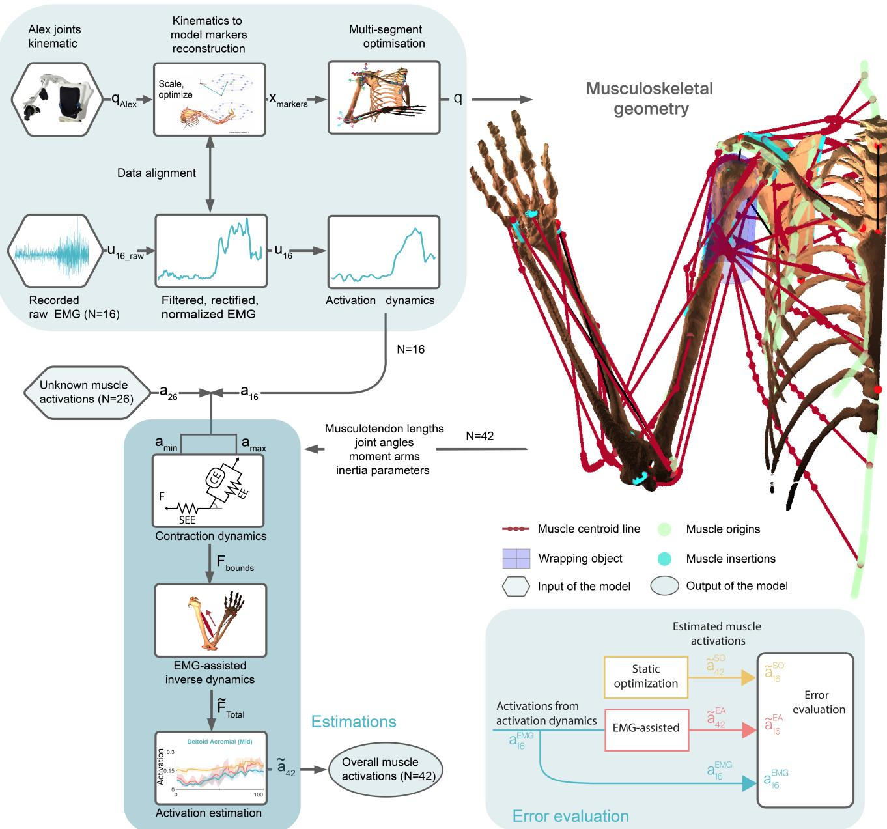
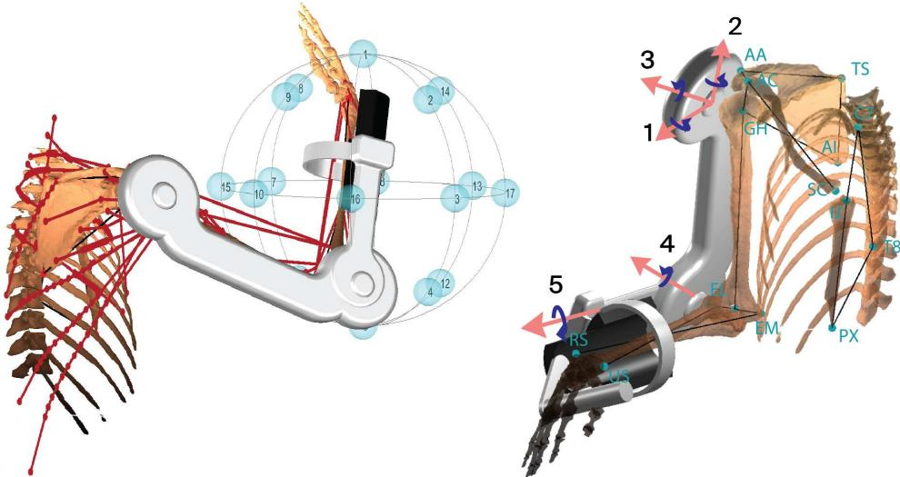
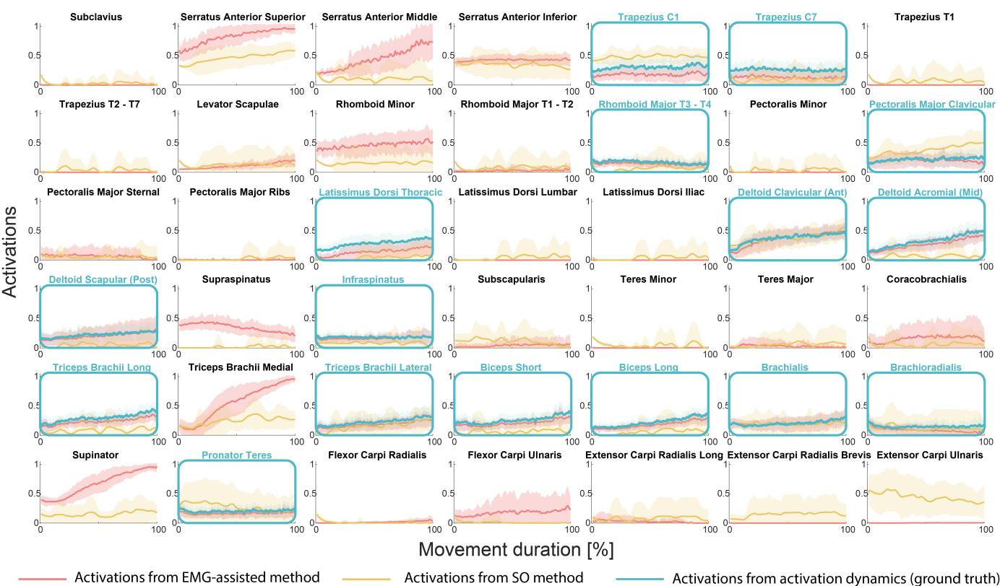
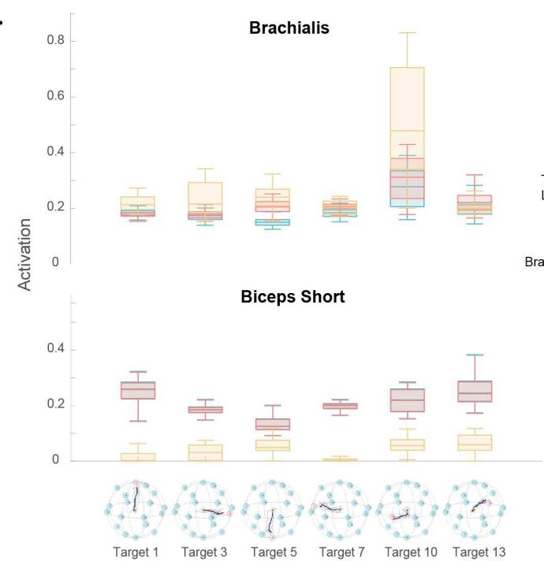
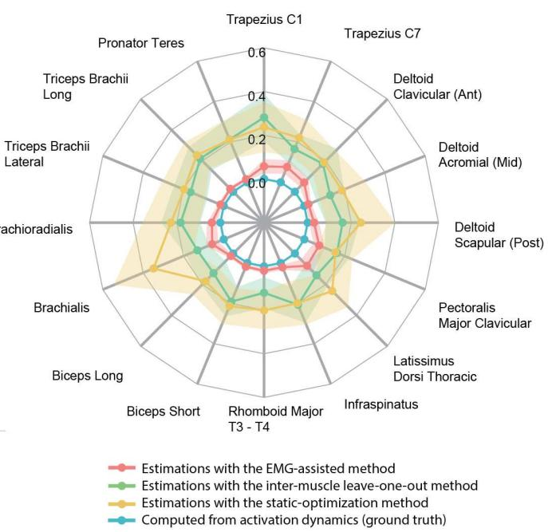

# 用于整体肌肉激活度估计的逼真上肢肌肉骨骼模型

Tristan Barjavel  (  tristan.barjavel@ep .ch ) École Polytechnique Fédérale de Lausanne（洛桑联邦理工学院）

Tommaso Proietti Sant'Anna School of Advanced Studies（圣安娜高等研究学院）

Camilla Pierella

University of Genoa（热那亚大学）

Silvestro Micera

École Polytechnique Fédérale de Lausanne（洛桑联邦理工学院）

## 文章

关键词：生物力学（Biomechanics）、肌电图（EMG）、肌肉激活度（Muscle activations）、肌肉骨骼模型（Musculoskeletal model）、上肢（Upperlimb）

发布日期：2023年5月18日

DOI: https://doi.org/10.21203/rs.3.rs-2802018/v1

许可协议：  本作品基于知识共享署名 4.0 国际许可协议（Creative Commons Attribution 4.0 International License）授权。阅读完整许可协议

附加声明：未报告利益冲突。

# 用于整体肌肉激活度估计的逼真上肢肌肉骨骼模型

Tristan Barjavel1,\*、Tommaso Proietti2、Camilla Pierella3,4 和 Silvestro Micera1,2

1École Polytechnique Fédérale de Lausanne (EPFL)（洛桑联邦理工学院），Bertarelli Foundation Chair in Translational Neuroengineering，Center for Neuroprosthetics and School of Engineering，日内瓦，1202，瑞士

2Scuola Superiore Sant’Anna（圣安娜高等研究学院），Biorobotics Institute and Department of Excellence in Robotics & AI，比萨，56025，意大利

3University of Genoa（热那亚大学），Department of Neurosciences , Rehabilitation, Ophthalmology, Genetics, and Maternal and Children’s Sciences (DINOGMI)，热那亚，16126，意大利

4University of Genoa（热那亚大学），Department Informatics, Bioengineering, Robotics and Systems Engineering (DIBRIS)，热那亚，16126，意大利

通讯作者：tristan.barjavel@epfl.ch

## 摘要

人类上肢能够执行复杂的任务，这归功于中枢神经系统（central nervous system, CNS）控制和调节40多块肌肉激活的能力。深入理解 CNS 为执行这些动作所采取的策略，有助于制定更有效的康复方案。遗憾的是，由于作用于肩部和手臂的肌肉数量庞大，且彼此之间的解剖位置交错，在实际操作中不可能同时记录所有上肢肌肉的肌电（electromyographic, EMG）信号。数值肌肉骨骼模型可以作为获取此类信息的一种有效替代方法。在此，我们开发了一种新型逼真的上肢生物力学模型，该模型结合了少量的实测 EMG 数据（最多 N=16）和逆动力学模型，用以预测整个上肢的肌肉激活情况（N=42）。基于五名健康受试者进行 3D 上肢运动的数据，该 EMG 辅助模型的预测结果与以下内容进行了对比：1) 包含 16 块手臂肌肉的完整 EMG 数据集；2) 完全不使用这些实测 EMG 数据的模型（标准静态优化）。虽然在代入运动动力学后，EMG 辅助法和静态优化法预测的信号在所产生的关节力矩中分别导致了 3.4% 和 2.3% 的误差，但在留一法（leave-one-out）对比中，对于未使用肌肉，EMG 辅助方法展现出了更加符合生理特性的肌肉激活分配方式以及相对于 EMG 信号激活的误差变化。这些结果表明，所提出的肌肉骨骼模型有能力作为评估健康运动数据的工具，并为未来应用该策略分析运动功能障碍个体的运动数据以及比较受试者间的激活行为开辟了道路。

**关键词** 生物力学（Biomechanics），肌电图（Electromyography, EMG），肌肉激活（Muscle activations），肌肉骨骼模型（Musculoskeletal model），上肢（Upper-limb）

## 引言

尽管肌肉骨骼系统复杂且具有冗余性，健康人仍能轻松控制其上肢运动。1967年，Nikolai Bernstein1 提出假说，认为中枢神经系统（CNS）并非独立激活各个肌肉，而是以肌肉协同（muscle synergies）的形式激活肌群，每种协同都指定了一组特定肌肉之间的特定激活平衡。近年来，该假说已得到其他研究团队的测试与证实2–4。要理解 CNS 如何完成复杂任务，需要深入了解不同肌肉的激活方式。由于肌肉解剖位置通常存在重叠且数量庞大，通过肌电图（EMG）同时直接测量多块肌肉（例如上肢肌肉）在大规模应用中通常是不可行的，尤其是在临床环境中。然而，EMG 作为一种准备时间短的非侵入性方法，在很大程度上仍被视为评估肌肉活动状态的金标准。需要注意的是，EMG 记录虽然能够反映肌肉的电活动，但无法提供它们对整体运动的力学贡献，并且会低估仅由肌肉拉长所产生的被动肌力5。肌肉骨骼数值模型可以作为直接探测肌肉的一种行之有效的替代方法6。现有模型主要侧重于估算不同肌肉产生的力，往往忽略了肌肉激活的动力学特征。肌肉力通常是通过结合应用于各关节力矩平衡方程的生理代价函数与约束条件进行优化计算得到的。这些优化准则大多基于与肌肉相关的特性，例如肌肉应力7、肌肉力8以及肌肉能耗9，或是所谓的 min/max 准则10, 11。在少数研究中，EMG 信号已被整合到下肢肌肉骨骼模型12, 13和上肢肌肉骨骼模型14–18中，从而实现了对肌肉共收缩更准确的估算。

在本研究中，我们提出了一种全局快速肌肉激活度估计器（共涉及 42 块肌肉）作为比较和评估工具，该工具通过使用减少数量的记录 EMG 信号（最多 N=16）来改进肌肉协同收缩的估计。该估计器与一个上肢数值肌肉骨骼模型协同工作，该模型结合了以下多种方法：1）最小化肌肉应力平方和，使肌肉之间的负荷均匀分布；2）约束肌力以维持关节盂稳定性并将其值保持在生理边界内；3）最小化计算得到的与实验测得的关节力矩之间的差值平方。生理边界由具有可行激活度的收缩动力学以及可用的记录 EMG 共同定义。该最小化准则不同于以往的模型，在以往使用 OpenSim20 上的 CEINMS 工具箱进行下肢正向动力学研究中，作者大多最小化未记录肌肉的总肌肉激活度，同时保持关节力矩与测量激活度之间的预测误差处于较低水平12, 19。在我们先前的上肢模型16中，最小化是针对力进行的，利用了肌肉力臂底层矩阵的零空间；然而，使用该策略并不总能求得解。与现有技术的另一个不同之处在于，所提供的待最小化代价函数不是像先前提出那样针对特定受试者的12, 19。这一重要特性旨在提高模型进行受试者间比较的能力，其未来目标是分析受试者内部激活演化，从而优化并指导针对特定受试者的康复治疗。

除了不同的最小化准则外，就内部过程（例如肌腱参数估计、刚性腱建模、信号处理以及执行逆动力学的方法）的计算速度和效率而言，我们提出的模型也是我们先前上肢模型16, 21, 22的改进版本。通过处理五名健康受试者使用上肢外骨骼 ALEx RS23 进行 3D 触及运动的数据，对该模型进行了测试和验证。特别是，我们使用我们的模型预测了触及运动期间上肢肌肉的活动，并将其与实验期间记录的可用 EMG 信号进行了比较。这项工作的总体概述如图 Fig. 1 所示。

## 方法

## 数值模型

在这项工作中，我们提出了一个基于现有经过验证的肩部肌肉骨骼模型16, 21, 22派生出的模型，该模型最初开发用于预测肌肉力和关节反作用力。该数值肌肉骨骼模型是在 MATLAB (MathWorks, USA) 中开发的。它使用尸体人体测量数据，但允许通过缩放参数来匹配每个特定受试者的尺寸。可调参数包括：i) 骨骼惯性特性，ii) 骨骼形态，iii) 肌肉构筑；所有这些特征都有助于在未来改进受试者之间、健康/受损肌肉激活的评估21。然而，受试者特定模型需要复杂的建模工作流程24, 25和明确定义的方法，特别是在肌腱参数估计方面。在本研究中，考虑到所记录运动学的性质（所有受试者均使用相同的外骨骼）以及所收集的受试者信息（见下节），采用固定缩放将通用模型匹配到所有受试者，从而使所有受试者在基于其运动和记录的 EMG 26的模型输出评估中具有共同的基准。在原始模型中，考虑了 42 个肌束，跨越 11 个自由度（DOF），包括根据 ISB 建议27在胸部、锁骨、肩胛骨、肱骨、尺骨和桡骨之间建模为球窝关节的胸锁关节、肩锁关节、盂肱关节，以及肘部的屈曲-伸展和旋前-旋后。肌肉用从起点到止点的质心线表示，并附着在定义的包络对象上（Fig. 1）。通过模型在关节水平的角旋转所代表的运动，可以计算出不同的肌腱长度、它们的方向、力臂28以及所有惯性参数。

## 实验设置与记录数据

为验证该模型，我们使用了 5 名健康受试者（4 名女性，1 名男性，60 ± 12 岁，65 ± 11 kg，167 ± 9 cm）在上肢外骨骼（Arm Light Exoskeleton Rehab Station，ALEx RS23, 29）辅助下执行伸展任务时的肌电（EMG）和运动学记录。完整的实验设置及受试者描述可参见其他文献30。机器人评估包括向均匀分布在一个球体（半径 19cm）上的 18 个目标位置执行从中心向外的三维伸展运动。受试者在佩戴 ALEx RS 并保持坐姿的情况下，使用右手执行这些动作 5 次，并且每次都会返回位于目标球体中心的起始位置。受试者正前方的显示器显示了末端执行器位置、球体上的各个目标以及需要到达的具体目标。球形工作空间中心位置的定义为：与受试者的右侧肩峰对齐，且位于显示器与肩峰之间的等距位置（Fig. 2）。

为了测试该模型，所选取的评估目标是沿球心出发的 3 个主方向轴分布的 6 个点，分别对应向上（目标 1）、向下（目标 5）、向左（目标 7）、向右（目标 3）、向前（目标 13）和向后（目标 10）伸展。机器人仅用于在透明模式下记录受试者的运动学数据，即在受试者执行任务时不提供任何助力，仅支撑其自重29。在机器人评估期间，记录了 16 块上肢肌肉的 EMG 信号：三角肌锁骨部/肩峰部/肩胛部（deltoid clavicular/acromial/scapular）、斜方肌 C1/C7（trapeziu C1/C7）、胸大肌锁骨部（pectoralis major clavicular）、背阔肌胸部（latissimus dorsi thoracic）、冈下肌（infraspinatus）、肱三头肌长头/外侧头（triceps brachii long/lateral）、肱二头肌短头/长头（biceps brachii short/long）、肱肌（brachialis）、肱桡肌（brachioradialis）以及旋前圆肌（pronator teres）。EMG 信号采用 AgCl Kendall 表面肌电电极，通过 Desktop DTS 无线系统（Noraxon, USA）以 1.5kHz 采样率进行记录。电极放置遵循欧洲表面肌电图无创肌肉评估建议（European recommendations for surface electromyography for non-invasive assessment of muscles，SENIAM）及解剖学指南31, 32。关于运动学数据，机器人关节角度（肩关节外展、旋转、屈曲，肘关节屈曲，前臂旋前-旋后）以及末端执行器的位置和速度均以 1kHz 频率进行采集。运动学数据采集通过 ALEx RS 在运动开始和停止时发送的触发信号与 EMG 信号记录保持同步。

  
Figure 1. 所提出估计模型的总体概览。在数据初始化过程中，利用记录的运动学数据 $q _ { A L E x }$ 和来自 N=16 块肌肉的肌电（EMG）信号 $u _ { r a w }$ 计算关节角度 q 和肌肉激活度 $a _ { 1 6 }$。这些数据进而作为数值模型和估计框架的输入，以获得整体肌肉激活度 $\tilde { \bf { a } } _ { 4 2 }$，其中波浪号表示估计值。为了量化来自模型的误差（误差评估，$i . e .$ 决定系数和 RMSE），将估计的 16 块肌肉激活度 $\tilde { \mathsf { a } } _ { 1 6 } ^ { E } A$ 与直接从 EMG 测量获得的激活度 $a _ { 1 6 } ^ { E } M G$ 以及未使用 EMG 数据的静态优化结果 $\bar { \mathsf { a } } _ { 1 6 } ^ { S } O$ 进行比较。在肌骨模型示意图中，红线表示最初考虑的 th $^ { 4 2 }$ 块肌肉，从其起点（浅绿）到止点（青色），并以盂肱关节周围表示的一个包络体作为示例。所建模的肌肉包括：锁骨下肌、前锯肌上部/中部/下部、斜方肌 C1-C6/C7/T1/T2-T7、肩胛提肌、小菱形肌/大菱形肌 T1-T2/大菱形肌 T3-T4、胸小肌/胸大肌锁骨部/胸骨部/肋骨部、背阔肌胸部/腰部/髂部、三角肌锁骨部/肩峰部/肩胛部、冈上肌、冈下肌、肩胛下肌、小圆肌/大圆肌、喙肱肌、肱三头肌长头/内侧头/外侧头、肱二头肌短头/长头、肱肌、肱桡肌、旋后肌、旋前圆肌、桡侧腕屈肌/尺侧腕屈肌，以及桡侧腕长伸肌/桡侧腕短伸肌/尺侧腕伸肌。

## 数据初始化

## 将 ALEx 关节运动学与模型标记点匹配

鉴于从 ALEx RS 采集到的运动学数据与肌肉骨骼模型标记点的要求不一致21, 22，必须做出假设以使模型与受试者的运动相匹配。首先，盂肱关节（glenohumeral joint）的位置在工作空间中被视为固定的：手臂和胸部固定在机器人外骨骼上，从而减小了肩部复合体旋转和平移的可能性。此外，肩部旋转机构的设计23采用了远端旋转中心，该中心与盂肱关节中心相对应，使得外骨骼的运动学特征与受试者相似。其次，由于刚性固定限制了运动过程中的平移，受试者手臂相对于机器人外骨骼的位置也是固定的。尽管我们知道这些假设会降低单次试验中肌肉激活预测的准确性，但它们仍能确保每位受试者在不同运动方向和重复动作中所执行的所有可能运动都能够以相似的方式进行数值重建。

机器人运动学数据（关节角度和末端执行器位置）与机器人臂长相结合，使得获取相对于初始肩峰位置的骨骼位置成为可能。具体而言，我们重建了一个线框模型，其中包括设定为固定的盂肱（GH）点，以及解剖标志点桡骨茎突（RS）、尺骨茎突（US）和肘关节外侧与内侧（EL、EM）的估计位置。GH 关节被建模为一个球窝关节，遵循卡尔丹角（Cardan angle）约定和机器人上臂的长度，对应于围绕机器人关节轴 1、2 和 3（分别对应于 X、Y 和 Z 轴）的三种肩部旋转运动：外展、旋转和屈曲。机器人肘部位置可以据此获得，并在通用模型中 EM 和 EL 之间距离的基础上，估算出后者的位置。通过将肘部屈曲/伸展视为围绕 4 号关节（Z 轴）的铰链关节，并结合前臂长度，可获得腕部位置（对应于 5 号关节，Y 轴），并推导出假定靠近腕部旋转轴的 US 点。肘部的旋前/旋后也被视为铰链关节，结合其旋转以及通用模型中的腕部长度，可以从 US 点推导出 RS 点的位置。

该机器人外骨骼在数值上进行了重建，作为验证相对于模型骨骼所获得的点与环节整体位置的验证工具（Fig. 2）。此外，对生成的标记点位置及其对应的骨骼表征进行了线性缩放，以使记录数据与骨骼数值模型相匹配。基于标记点位置估计的结果以及固定 GH 点（盂肱点，Glenohumeral point）的假设，数值模型所需的其余标记点可由原始骨骼位置以及模型其余不同标记点之间的固定距离推导得出。该流程仅在固定 GH 点的假设下有效；对肩带内部动力学的评估使该模型仅限于提供总体概览，因为肩胛骨动力学被低估了。

一旦确定了所有骨骼标志点且机器人的运动学与模型的运动学相匹配，便可按照此前报道的方法21, 22通过多环节优化计算出数值模型的关节角度。这些优化算法利用了最小化测量标记点与其关联骨骼标志点之间距离的方法。运动学数据初始化的输出是肌肉骨骼关节角度、速度和加速度的数据集。

## EMG 信号预处理与激活力学

以 1.5kHz 记录的肌电（EMG）信号按照标准文献29, 30使用 MATLAB 进行了离线处理。EMG 信号首先进行了去趋势处理，然后使用 7 阶巴特沃斯（Butterworth）滤波器在 50-500Hz 范围内进行带通滤波，整流后，再使用截止频率为 10Hz 的 7 阶巴特沃斯滤波器进行低通滤波以获取包络线。为了确保输入到模型肌腱收缩动力学的信号具有较宽的幅度范围，首先通过所有执行动作计算出的中位数对包络线进行归一化，以凸显预期信号并避免噪声引起的高幅度尖峰。对于后文描述的 Hill 型收缩动力学，输入信号激活度应在 0 到 1 之间，这通过使用为每块肌肉记录的经同样滤波的最大自主收缩（maximum voluntary contraction）对 EMG 进行归一化来确保29, 33。在本研究中，出于计算复杂性成本的考虑，记录的运动学和 EMG 数据被插值到 0.01 秒的时间步长。改自33并在该模型的先前工作21中提出，激活度动力学将滤波后的 EMG 信号（即神经兴奋 $u$）与肌肉激活度联系起来。换言之，如果被激活，它对应于肌纤维中肌质网对钙离子浓度的增加；如果去激活，则对应于钙离子的移除。激活度动力学在公式 (1) 中描述，其中 $a$ 为激活度，$u$ 为兴奋度（两者均在 0 到 1 之间），$\tau _ { a c t } , \tau _ { d e a c t }$ 为激活和去激活时间常数。

  
Figure 2. 展示 ALEx RS 外骨骼和肌肉骨骼模型在虚拟环境中执行任务的插图。左图中的蓝色球体是不同的可用目标，红线是模型中表示的肌肉。右图中模型使用的不同骨骼标记显示为蓝色。编号的机器人关节轴及其旋转显示为粉色。

$$
\dot {a} = \frac {u - a}{\tau}, \quad \left\{ \begin{array}{l l} \frac {\tau_ {a c t}}{0 . 5 + 1 . 5 a} & u <   a, \text { activation } \\ \frac {\tau_ {d e a c t}}{0 . 5 + 1 . 5 a} & u \geqslant a, \text { deactivation } \end{array} \right.\tag{1}
$$

## 激活度估计

在此，我们展示了在缺乏记录的 EMG 的情况下对肌肉激活程度的估计。所提出的技术基于逆动力学求解器来确定在每个关节产生力矩所需的力，从而解释受试者所观察到的运动。鉴于该过驱动肌肉骨骼模型（11 个 DOF 对应 42 束肌纤维），力的估计涉及通过静态载荷分配（Static Load Sharing, SLS）方案 $\mathbf { \Gamma } ( \mathrm { S L S } ) ^ { 3 4 , 3 5 }$ 优化各肌肉间的关节净力矩。然而，拮抗肌在关节净力矩中会产生反作用，且 SLS 忽略了肌肉共收缩7, 14–16, 18, 36。本文提出的肌肉骨骼模型通过最小化肌肉应力平方和，并将力约束在由可用 EMG 记录16和肌腱参数（即最大等长肌力、来自肌腱驱动的最小肌腱力）推导出的生理极限内34，从而解决了这一不定问题。整个激活度估计步骤将按以下顺序呈现：首先，介绍收缩动力学和肌腱参数的估计。随后将解释 EMG 辅助的逆动力学以及由此计算出的激活度结果。

## 收缩动力学

肌腱驱动将肌肉状态及其激活程度与产生的力联系起来。采用 Hill 型模型来描述收缩动力学16, 33, 37, 38，该模型由三个不同的元件组成，用于复现肌腱系统的肌力产生功能：收缩元件（contractile element, CE）、被动弹性元件（passive elastic element, PEE）和串联弹性元件（serial elastic element, SEE）。如原始模型21中所述，这些元件中的每一个所产生的力均由依赖于肌肉固有参数的归一化函数定义。由此得出每块肌肉的常微分方程，即公式 2。

$$
F _ {C E} (l _ {C E}, v _ {C E}, a) + F _ {P E E} (l _ {C E}) = F _ {S E E} (l _ {C E}, l _ {M T C})\tag{2}
$$

该模型的输入为肌腱复合体长度（musculotendon length）$l _ { M T C }$ 和激活度 a，以及肌纤维长度和速度，分别为 $l _ { C E }$ 和 $\nu _ { C E }$。此外，尽管该肌肉骨骼模型整合了弹性肌腱模型功能，但为了使整体肌肉力具有更广泛的可能解范围，本文采用了刚性肌腱模型。这将限制误差并避免逆向动力学产生不可行的解，同时显著减少仿真时间——这对于针对大型数据集开展肌肉激活拓展研究而开发的空间模型而言是一个关键要素。在刚性肌腱模型中，肌纤维长度 $l _ { C E }$ 可以直接从肌腱复合体长度 $l _ { M T C }$ 获得，无需额外的优化。除了降低计算成本外，弹性肌腱模型还会增加对完美缩放的生理肌腱参数的依赖性。然而，获取这些参数需要获知受试者的生理肌肉和骨骼长度，或者正如近期文献中常用的做法那样，需要根据输出的目标力矩对这些参数进行优化以拟合训练好的模型12–14, 39。然而，鉴于本模型用于分析训练变化及康复后改善情况的长期目标，如果在康复的早期阶段或结束时执行此类优化，将会导致不同的结果。更重要的是，如果对每次评估都进行此类优化，将导致不同的肌肉参数值，这在现实生活中是不合理的：例如，肌纤维和肌腱长度在康复前后不应发生改变。结合公式 2 和刚性肌腱建模，肌纤维长度及其收缩速度可以直接从肌腱复合体长度和速度中获得，从而得出产生的肌腱复合体力方程如下：

$$
\boldsymbol {f} _ {M T} (a, \tilde {l} ^ {M}, \tilde {v} ^ {M}) = F _ {0} [ a f ^ {L} (\tilde {l} ^ {M}) f ^ {V} (\tilde {v} ^ {M}) + f ^ {P} (\tilde {l} ^ {M}) ] \cos \alpha\tag{3}
$$

其中，$\tilde { l } ^ { M }$ 和 $\tilde { \nu } ^ { M }$ 分别表示由肌肉最佳肌纤维长度和最大收缩速度归一化后的肌纤维长度与速度，$F _ { 0 }$ 为最佳肌纤维长度下的肌肉最大力，$\hat { f } ^ { L } , f ^ { V }$ 和 $f ^ { P }$ 是通过对先前实验数据16进行曲线拟合得到的源自力-长度、力-速度及被动力关系的归一化函数，详见补充材料。

收缩动力学模型为 EMG 辅助逆向动力学中产生的生理肌力提供了边界值。所产生的最小力 $F _ { M T } ^ { l o w }$ 应对应于激活度为 0 时获得的力与被动弹性力之间的最大值，其最大力 $F _ { M T } ^ { u p }$ 则应对应于收缩元件完全激活时的解。为了后续的数学处理并避免数值偏差，较低的激活度被设定为 1e-5。在先前的研究16中，未使用 EMG 数据时的肌力边界介于 0 和菲克常数（Fick constant）k= $3 3 N m ^ { - 2 }$ 乘以肌肉生理横截面积（PCSA）之间，这并未考虑运动过程中的肌肉动力学。然而，在本研究中，它们是基于收缩动力学定义的，这极大地影响了其数值，特别是由于先前被忽略的被动弹性成分。

诸如最大等长肌力、最佳肌纤维长度、羽状角、最大收缩速度和肌腱松弛长度等肌腱参数均改编自 Garner 和 Pandy40 的肌肉骨骼模型，因为我们原始模型的肌肉构型与之相同。利用已报道的方法33, 41, 42，可以获得适用于我们模型中所有可能关节旋转范围内的肌长参数，从而使肌腱作动始终存在解。更确切地说，我们的目标是保持每块肌肉的预测工作范围与另一项研究41中所呈现的一致，这意味着我们保持了归一化最小和最大长度相对于肌肉最佳肌纤维长度的相同比率。这确保了肌肉骨骼模型所有可能运动的解，从而在给定记录与通用模型的缩放下，使不同受试者之间的比较成为可能。

## EMG 辅助逆向动力学

如前所述，肌肉骨骼系统的定义包含了作用于相同自由度的冗余肌肉，这意味着在运动方程中，未知数的数量多于自由度的数量。为了估计过驱动肌肉骨骼模型的肌力，通常会通过静态优化（SO）在肌肉之间进行优化。然而，鉴于拮抗肌的存在，静态优化中拮抗肌之间的协同收缩可能会被忽视，因为它们的净关节力矩会相互抵消。该模型的目标是模拟执行运动时中枢神经系统的肌肉募集准则。

所提出的肌肉骨骼模型通过以下优化解决了负荷分配问题（load-sharing problem）的不确定性。主要的优化准则是减少肌肉疲劳，这体现为减少总肌肉应力平方和 $\Sigma \sigma ^ { 2 4 0 , 4 3 }$，因为该准则已被证明能够提供最佳的肌肉激活度估计44。

因此，待最小化的代价函数为：

$$
C _ {s} = \sum \sigma^ {2} = \boldsymbol {f} ^ {T} P \boldsymbol {f}\tag{4}
$$

其中 σ 为肌肉应力，P 为生理横截面积（PCSA）倒数平方构成的对角矩阵，$f ,$ 为肌肉力大小。

然而，该模型需要考虑诸如肌肉肌腱在给定实际状态下所能产生的最大和最小力等约束条件。这些边界值是通过前面提及的收缩动力学（公式 2）获得的。对于记录了肌电图（EMG）的 16 块肌肉，其推导出的激活度 $a _ { 1 6 r e c }$ ec 是通过补充材料中所述的激活力学21, 33获得的。由于 EMG 记录的个体间变异性45、预处理步骤以及 EMG 信号的多重处理及其归一化，从这些信号中估计出的激活度 ${ \tilde { a } } _ { 1 6 }$ 并未作严格限定。因此允许存在误差，但该误差必须被最小化，其对应的代价函数为：

$$
\hat {E} _ {a _ {E M G}} = \sum | \pmb {a} _ {1 6 r e c} - \tilde {\pmb {a}} _ {1 6} |\tag{5}
$$

做出这一选择是为了在最大化逆动力学可行解的同时，保持受试者内部、肌肉间及动作间比较流程的一致性。这不仅可以弥补 EMG 信号可能存在的不准确性，还能使解适应由运动所定义的整体可行活动。它确保了记录肌肉的激活度与通过激活力学获得的激活度之间的偏差保持在有限范围内。鉴于无约束三维伸展任务记录的动作复杂性，模型的动力学被允许具备一定的灵活性。事实上，在力边界内且满足动作动力学的可行解并不总能被找到。引入这种灵活性还因为鉴于从外骨骼获取的位置集合有限，计算出的肩胛胸壁关节和肩锁关节周围的关节角度可能存在一定的不准确性。

相应的代价函数变为：

$$
\hat {E} _ {J} = \sum \left| W _ {m} \boldsymbol {f} - \boldsymbol {J} _ {\text { torque }} \right|\tag{6}
$$

其中 $\pmb { J } _ { t o r q u e }$ 为满足运动方程的关节力矩，$W _ { m }$ 为力臂矩阵，对应于力臂与力方向向量之间的叉积。该力臂矩阵在惯性坐标系中定义，尺寸为 (11x44)，其与 44 个力大小构成的向量 $\boldsymbol{f}$ 的乘积给出了力作用于关节的合力矩。事实上，尽管研究了 42 块肌肉，但这些要素通过肩胸关节接触约束（$[ W _ { m _ { T S } } W _ { m _ { A I } } ] [ \lambda _ { T S } \lambda _ { A I } ] ^ { T } \ )$）进行了扩充，以确保肩胛骨在胸廓上滑动，正如先前工作16, 21, 22中为该模型所定义的那样。最后，利用估计的激活度进行最小化的总代价函数变为：

$$
\begin{array}{l} A _ {c f} = \hat {E} _ {J} + \alpha \hat {E} _ {a _ {E M G}} + \beta C _ {s} \\ = \sum | W _ {m} \boldsymbol {f} - \boldsymbol {J} _ {\text { torque }} | + \alpha \sum | \boldsymbol {a} _ {\text { rec }} - \tilde {\boldsymbol {a}} | + \beta \boldsymbol {f} ^ {T} P \boldsymbol {f} \end{array}\tag{7}
$$

(8)

$\alpha$ 和 $\beta$ 是通过实验获得的正加权系数，以确保 $\hat { E } _ { J }$ 与 $\hat { E } _ { a _ { E M G } }$ 具有相近数量级的权重。使代价函数最小化的激活度是通过 MATLAB 中的 fmincon 算法获得的。值得注意的是，参数 $\alpha$ 和 $\beta$ 在所有模拟中均保持恒定，因为我们不想在受试者之间以及不同的重复实验之间引入额外的差异来源。为了加快执行速度，收缩动力学产生的力在每个时间步被预先计算为仅与激活度相关的函数，从而极大地降低了 fmincon 算法中的计算开销。

## 模型结果验证

总体而言，研究对比了三种主要方法以评估模型的输出，参见 Fig. 1。第一种方法——静态优化（static optimization）——在计算逆动力学的肌肉边界时未使用任何 EMG（肌电图）数据，因此在肌腱驱动中以 0 或 1 的肌肉激活度作为其边界（分别为下界和上界）。第二种方法——EMG 辅助（EMG-assisted）——对于已记录的肌肉，利用从激活力学（activation dynamics）中获得的激活度来计算肌腱驱动。对于未采集 EMG 的肌肉，其边界则通过 0 或 1 的肌肉激活度获得（使用 16 块肌肉的激活度来估计全部 42 个肌束的激活度）。最后，第三种方法——基于激活力学（from-activationdynamics）——其激活度直接通过记录数据的激活力学计算获得，并代表真实值（ground truth）。然而，这最后一种方法仅适用于记录了 EMG 的 16 块肌肉，因此在接下来的结果中，当对这 16 块肌肉进行评估时，仅采用了静态优化和 EMG 辅助方法所对应的 16 个估计结果。

为了进一步验证估计过程并全面评估其鲁棒性，进行了留一法（leave-one-out）信号对比（包括 16 组 EMG 数据中的 15 组）。为了验证模型的信号输出，并获得估计信号与视为真实值的信号之间相似度的量化指标，还进行了相关性分析。为保证可读性，文中仅展示了代表仿真与对比结果中最具信息量的部分图表；如需查看完整的仿真与结果集，请参阅补充材料。

## 结果

## 特定目标的激活度原始对比

Fig. 3 展示了针对特定触及目标（13），通过静态优化、EMG 辅助方法获得的激活度在各次重复中的平均值，与直接从记录的 EMG 导出的激活度之间的原始对比。每次重复的持续时间均已归一化，从而使激活度显示为动作持续时间百分比的函数。理想情况下，我们期望静态优化模型与 EMG 辅助方法有所不同，以证明建立良好的估计需要 EMG 数据，并展示中枢神经系统在特定运动下通过减少整体应力与激活来执行运动的策略。首先可以观察到的是，所有肌肉随时间变化的激活水平在所有估计激活度之间都是相似且一致的；同样需要指出的是，对于未记录的肌肉，EMG 辅助方法的肌肉激活度估计相比静态优化具有更大的变异性，这表明它能够更好地表征运动过程中的共同收缩（co-contractions）与动态特性。

到达目标 13 时的激活度  
  
Figure 3. 所有 5 名受试者在触及目标 13 时的 5 次重复中估计肌肉激活度的均值（相对于运动时长的百分比）。蓝线对应于具有可用记录 EMG 的肌肉通过激活度动力学（activation dynamics）直接获得的激活度（其名称和边框为蓝色）。红线对应于利用可用 EMG 数据通过本文方法获得的激活度。黄线是在不使用记录的 EMG 的情况下通过该方法获得的激活度，在优化中仅使用肌腱致动（musculotendon actuation）设定边界，下限和上限的激活度分别设为 0 和 1。粗线表示 5 次重复中这些激活度的均值。阴影区域表示其标准差。

## 关节力矩与激活度估计中的误差评估

为了进一步说明估计的总体一致性，在获得的全部激活度集合上，静态优化（static-optimization，SO）方法与 EMG 辅助模型所得激活度之间的决定系数 R2 均值为 0.27 ± 0.28，这表现出较弱但变异性较高、且具有统计学意义的显著相关性（对于 5 名受试者、6 个目标、每个目标 5 次重复，以及跨越肩部、肱骨、尺骨和桡骨的 42 块肌肉，p<0.01）。Table 1 显示了针对每个到达的目标，估计激活度与记录激活度（N=16）之间均方根误差（RMSE）和 R2 的均值，与所使用的方法相对应。EMG 估计方法的总体 RMSE 正如预期低于 SO，总体均值分别为 0.03 ± 0.01 与 0.22 ± 0.04（p<0.01）。在决定系数 R2 上也可以观察到相同的趋势，其与 SO 表现出较弱但显著的相关性（均值为 $0 . 2 1 \pm 0 . 2$，且 p 始终 <0.01）。其较大的标准差表明相关系数具有较高的变异性，这提示某些数据点高度相关，而其他数据点则并非如此。采用 EMG 辅助方法，我们可以观察到强相关的信号，其总体均值为 $0 . 9 1 \pm 0 . 2 1$，中位数为 0.99。值得注意的是，触及目标 5 时的结果显示出

相较于达到的其他目标，静态优化法（static optimization method）在 RMSE 上拟合得更好，但在 R2 上则较低。这对应于向下触及的动作，其原因可以解释为：由于外骨骼的阻力作用及其为实现透明度而进行的重力补偿，执行该运动所需的肌肉力量有所减少，同时静态优化法的激活水平也较低。换言之，在较低的激活值上差异较小，但在其波形形态上的差异更大，这尤其体现了在估计中引入 EMG 数据的必要性。补充材料中也针对每块肌肉的激活度报告了所呈现的数值。此外，还展示了重新计算的关节力矩与满足式 6 代价函数最小化的运动方程力矩之间的误差。此处，为了获得清晰且具可比性的理解，数值表示为每个目标和重复动作中来自运动方程的最大测量关节力矩的百分比。两种方法的这些误差均保持在较低水平，EMG 辅助法平均为 3.39% ± 2.13，静态优化法为 2.33% ± 1.56。我们可以注意到，正如预期的那样，SO 的该值更低（p<0.01），因为收缩动力学对各肌肉力量的约束较少。补充材料中提供了展示估计力矩与来自运动方程力矩对比的图表。

<table><tr><td>触及目标</td><td>1</td><td>3</td><td>5</td><td>7</td><td>10</td><td>13</td><td>总体</td></tr><tr><td>NRMSE 力矩 EMG 辅助</td><td>2.70% ± 1.25</td><td>2.30% ± 0.06</td><td>4.01% ± 3.05</td><td>2.95% ± 1.05</td><td>4.77% ± 2.86</td><td>3.58% ± 1.82</td><td>3.39% ± 2.13</td></tr><tr><td>NRMSE 力矩 静态优化</td><td>1.64% ± 0.42</td><td>1.89% ± 0.45</td><td>2.77% ± 2.21</td><td>1.97% ± 0.52</td><td>3.94% ± 2.31</td><td>1.79% ± 0.42</td><td>2.33% ± 1.56</td></tr><tr><td>RMSE 激活度 EMG 辅助</td><td>0.04 ± 0.01</td><td>0.02 ± 0.00</td><td>0.02 ± 0.00</td><td>0.04 ± 0.01</td><td>0.03 ± 0.01</td><td>0.03 ± 0.01</td><td>0.03 ± 0.01</td></tr><tr><td>RMSE 激活度 静态优化</td><td>0.25 ± 0.04</td><td>0.20 ± 0.03</td><td>0.15 ± 0.02</td><td>0.20 ± 0.03</td><td>0.28 ± 0.07</td><td>0.28 ± 0.04</td><td>0.22 ± 0.04</td></tr><tr><td>R2 EMG 辅助</td><td>0.92 ± 0.05</td><td>0.95 ± 0.04</td><td>0.92 ± 0.04</td><td>0.87 ± 0.10</td><td>0.89 ± 0.05</td><td>0.86 ± 0.06</td><td>0.91 ± 0.05</td></tr><tr><td>R2 静态优化</td><td>0.25 ± 0.24</td><td>0.16 ± 0.19</td><td>0.11 ± 0.15</td><td>0.19 ± 0.19</td><td>0.20 ± 0.20</td><td>0.32 ± 0.25</td><td>0.21 ± 0.22</td></tr></table>

Table 1. 展示了所达到的 6 个目标中每个目标的估计值与记录数据之间的总体误差。首先是在静态优化和 EMG 辅助两种情况下，计算所得力矩与满足运动方程所需力矩之间的误差。数值针对每个目标和重复次数，通过运动方程中的最大力矩进行了归一化。我们可以注意到，SO 的该值更低（p<0.001）。接着报告了每个目标中，由记录的 EMG 所得的激活度与其通过 EMG 辅助方法和 SO 方法估计值之间的 RMS 以及决定系数 R2。正如预期的那样，EMG 辅助（EMG\_assisted）方法表现出更好的拟合度（两种情况下均 p<0.001）。我们可以看到静态优化中较低的 R2 均值表明相关性较弱，较大的标准差表明相关系数具有高度变异性，这提示估计信号在某些数据点上可能与记录信号有一定相关性，但在其他数据点上则不然。值得注意的是，与其他达到的目标相比，目标 5 在两种方法中的拟合度均有所下降。

## 所有目标的平均激活度

验证所获得激活信号的另一种方法是比较它们在特定运动中的激活水平。图 4(a) 展示了两种肌肉相对于所达目标的这些不同激活水平。从图中可以看出，一方面，静态优化（static-optimization）对某些肌肉给出了良好的激活水平估计。另一方面，这也显示了其局限性，即忽略了协同收缩（co-contractions），从而低估了大多数肌肉的激活值。事实上，从静态优化获得的激活水平几乎总是低于 EMG 辅助方法或激活力学（activation dynamics）获得的值。无论如何，EMG 辅助方法相对于直接从激活力学获得的激活提供了具有一致性的结果，这些值之间的差异可以通过以下事实来解释：EMG 辅助估计考虑了运动过程中的几何模型状态和收缩动力学（contraction dynamics），因此除了运动方程的需求外，还取决于肌肉参数。关于估计激活的值，显然预期激活水平与所获得的激活水平之间存在良好的相关性（如表 1 所示，平均 $R 2 = 0 . 8 9 \pm 0 . 2 0$，中位数 $R 2 = 0 . 9 9 ~ \mathrm { , }$）。在所示的图 4(a) 中，对于到达目标 10（涉及肘部屈曲）的所有情况，肱肌均达到了预期的较高激活水平，而在到达目标 5（肘部伸展）时激活水平较低。然而，对于更多用于上矢状面目标（1、10 和 13）的肱二头肌短头而言，这种情况不太明显。对于静态优化，肱二头肌短头的激活被低估且不符合生理预期。看起来，所有产生的协同肌肉力量的组合仍然诱发了导致正确运动的力矩。

## 留一交叉验证（Leave-one-out cross validation）

图 4(b) 展示了一张雷达图（spider map），针对在留一交叉验证中依次移除的每块记录肌肉，显示了直接从激活力学获得的激活与使用全部肌肉 EMG 信号的方法（EMG 辅助方法中 N=16）、使用除所示特定肌肉外的所有可用 EMG 的方法（EMG 辅助方法中 N=15）以及不使用任何 EMG 的方法之间的均方根误差。EMG 辅助方法的平均 RMSE 为

$0 . 0 3 \pm 0 . 0 1$，留一法（leave-one-out）为 $0 . 1 7 \pm 0 . 0 2$，静态优化（static-optimization）为 $0 . 2 2 \pm 0 . 0 8 .$ 这表明使用 EMG 辅助方法对未记录肌肉的激活度估计有轻微改善 $_ { ( \mathrm { p = 0 } . 0 3 ) }$，但最重要的是，它似乎能确保负荷的生理性分配，并提供更多关于肌肉行为的信息，从而更好地洞察实际的协同收缩，且在相同运动内特定估计激活度的变异性更低，这在肱肌与二头肌以及三角肌中尤为显著。

所有受试者和各次重复实验中，触及不同目标时的激活水平：

a.  
  
b.  
所有目标、重复实验和受试者计算激活度的 RMSE

  
Figure 4. (a) 针对所触及目标，直接由激活动力学获得的激活范围（蓝色箱线图）、包含记录 EMG 的模型估计值（红色箱线图）以及未使用记录 EMG 的模型估计值（黄色箱线图）之间的对比。上方的对比针对肱肌，下方针对二头肌（短头）。底部将不同触及目标表示为红色球体，黄色表示起始位置，对应于可达球面的中心。黑线为末端执行器的平均轨迹，较细的蓝线为记录的 5 次重复轨迹。(b) 受试者 2 在所有触及目标和重复实验中计算所得肌肉激活估计值的均方根误差雷达图（spider map）。该图展示了对于每个具有记录 EMG 的肌肉，直接由激活动力学获得的激活度与以下方法之间的误差：红色代表在 EMG 辅助模型中使用所有可用肌肉 EMG 信号的方法（16 块肌肉中的 16 块）；绿色代表在 EMG 辅助模型中使用除该特定肌肉外的所有可用 EMG 的方法（16 块肌肉中使用 15 块）；黄色代表未使用任何 EMG 的方法，对应于静态优化。

## 讨论

本项工作旨在开发一种利用有限的肌电图（EMG）记录数据来估计整体肌肉激活度的工具。鉴于受试者之间的肌肉参数差异以及相同动作下 EMG 信号记录的变异性，本研究的目标并非精确估计每块特定肌肉的激活度，而是在特定任务期间推断整体肌肉激活的模式，其总体数值在 Fig. 3 和 Fig. 4 中突出显示。我们首先使用通用数值模型精确复现了受试者佩戴 ALEx RS 外骨骼执行的轨迹。随后我们表明，EMG 辅助的估计过程使我们能够更清晰地了解整体激活模式。这主要是通过利用记录的 EMG 信号对模型收缩动力学中产生的可能力量施加约束来实现的，从而为负荷分配问题提供了更精确的解集范围，这在另一个 EMG 辅助模型19中也有所体现。如 Fig. 3 中所示，使用 EMG 辅助方法得到的结果是对可能激活度的全面估计。尽管在估计过程中未使用记录 EMG 的静态优化模型计算出的激活度具有相似的均方根误差，平均 RMSE 为 0.22 ± 0.08（Fig. 4(b)），但通过留一法验证展示的 EMG 辅助模型在提供典型激活的整体概览方面仍然更为准确，其余肌肉的平均 RMSE 为 0.17 ± 0.02。更重要的是，我们可以观察到估计中的变异性更小，表明其一致性更好，且不易受到随机波动的影响。这进一步验证了在我们的估计过程中使用记录信号的有效性。尽管此前已有研究证明了使用 EMG 辅助方法对激活信号估计的改善，但据作者所知，这从未在 OpenSim 环境之外以及包含 11 个自由度（DOF）和 42 块不同肌肉的复杂肩部模型上实现过。此外，本文所展示的任务和动作并未限制运动范围和运动平面，而在以往研究上肢激活46或 3 DOF 研究14时通常会有此类限制。

对比中使用的真值（ground truth）是来自记录 EMG 的激活动力学数据19。尽管在 EMG 辅助模型中使用了实验肌肉激活数据，使得该方法在评估中相较于静态优化方法具有优势，但留一法交叉验证的结果（Fig. 4(b)）表明，EMG 辅助模型在不含任何 EMG 相关信息的情况下估计肌肉激活时仍然表现更佳。

尽管我们能够在伸展任务中获得所有肌肉具有合理数值的估计肌肉激活度，但必须强调的是，用于根据兴奋度数值估计力的收缩动力学方程是基于刚性肌腱模型推导而来的。有人可能会认为，如果在收缩动力学中采用顺应性肌腱模型，我们将获得更准确的激活度。虽然事实确实如此，但这会导致需要一个额外的优化过程，以便在每次迭代中获取肌肉的肌纤维长度及其肌腱长度21，而这在实验中不易测定，且需要耗费高昂的计算优化成本47。另一种可能性是如另一项研究48所建议的那样，根据肌腱松弛长度与最佳肌纤维长度的比率使用不同的肌腱模型，但为了验证过程的严谨性，我们希望在所使用的肌肉模型内部保持一致。最后，运动方程中 GH、EL 和 PS 关节所需的力矩与两种优化过程所得力矩之间的最终 nRMSE 保持在较低水平（EMG 辅助和静态优化方法的均值分别为 3.4% 和 2.3%）。尽管我们能够重建锁骨和肩胛骨的运动，但这些都受到了初始假设的限制，因此可能会忽略潜在的运动，从而降低激活度估计的相关性。总体而言，EMG 辅助模型对参与运动的肌肉预测出了更准确的激活度，并表现出更显著的共同收缩。除了作为对比基准而采用了 EMG 辅助模型所用的实验肌肉激活度之外，这还可以解释为 SO 方法仅基于肌肉生理横截面积倒数平方最小化的准则，而忽略了受试者之间可能存在的独特激活模式49。如果能够根据受试者数据对所有肌肉-肌腱参数和转动惯量进行全面缩放（该模型允许这样做21），我们可以预期得到跟踪效果更好的激活度。

在本研究中，我们采集了健康个体的运动数据，所得模型为全面理解中枢神经系统（CNS）控制上肢的策略迈出了有希望的第一步。在未来的应用中，我们将把相同的方法应用于身体残障个体（例如帕金森病、中风）的轨迹数据。能够理解激活模式，甚至在康复场景中比较干预前后的数据，将对该领域具有重要意义，并为患者设计优化治疗方案50或上肢降维控制器开辟新的可能性，正如针对青蛙后肢51或人体下肢52简化模型所实现的那样。泛化激活估计的相关知识还可用于进一步改善假肢终端用户的运动意图解码53，并提升个性化假肢肌电控制效果6。未来，该方法和模型还有望成为供所有人使用的开放工具。

## 结论

本研究展示了一种肌肉骨骼模型的开发与验证，该模型可用于加深我们对上肢运动控制的基础理解。本文提出了一套结合 ALEx RS 外骨骼的实验方案，用于评估执行伸手任务时的整体肌肉活动。我们首先重建了上肢运动，随后结合伸手任务期间记录的 EMG（肌电）信号，展示了我们的模型如何通过 EMG 辅助的负荷分担优化方法来估计整体肌肉激活。该方案及激活估计方法为评估受试者间的肌肉激活行为、潜在相互作用以及协同作用提供了一种工具。本研究应用于健康运动数据，但在未来，我们将针对神经系统疾病患者的运动数据开展研究。这有望助力开发新型神经康复策略、上肢降维控制器、改善假肢终端用户的运动意图解码，并提升个性化假肢肌电控制水平。

## 参考文献

1. Bernste˘in, N. The co-ordination and regulation ofmovements (Pergamon Press, 1967).

2. Mussa-Ivaldi, F. A. & Bizzi, E. Motor learning through the combination of primitives. Philos. Transactions Royal Soc. London. Ser. B: Biol. Sci. 355, 1755–1769, DOI: 10.1098/RSTB.2000.0733 (2000).

3. Bizzi, E. & Cheung, V. C. The neural origin of muscle synergies. Front. Comput. Neurosci. 7, 1–6, DOI: 10.3389/FNCOM. 2013.00051/BIBTEX (2013).

4. D’Avella, A., Saltiel, P. & Bizzi, E. Combinations of muscle synergies in the construction of a natural motor behavior. Nat. Neurosci. 2003 6:3 6, 300–308, DOI: 10.1038/nn1010 (2003).

5. Muraoka, T., Muramatsu, T., Takeshita, D., Kanehisa, H. & Fukunaga, T. Estimation of passive ankle joint moment during standing and walking. J. applied biomechanics 21, 72–84, DOI: 10.1123/JAB.21.1.72 (2005).

6. Sartori, M., Durandau, G., Došen, S. & Farina, D. Robust simultaneous myoelectric control of multiple degrees of freedom in wrist-hand prostheses by real-time neuromusculoskeletal modeling. J. neural engineering 15, DOI: 10.1088/1741-2552/ AAE26B (2018).

7. Cholewicki, J., McGill, S. M. & Norman, R. W. Comparison of muscle forces and joint load from an optimization and emg assisted lumbar spine model: towards development of a hybrid approach. J. biomechanics 28, DOI: 10.1016/0021-9290(94) 00065-C (1995).

8. Kaufman, K. R., An, K. N., Litchy, W. J. & Chao, E. Y. Physiological prediction of muscle forces–i. theoretical formulation. Neuroscience 40, 781–792, DOI: 10.1016/0306-4522(91)90012-D (1991).

9. Happee, R. Inverse dynamic optimization including muscular dynamics, a new simulation method applied to goal directed movements. J. Biomech. 27, 953–960, DOI: 10.1016/0021-9290(94)90267-4 (1994).

10. Rasmussen, J., Damsgaard, M. & Voigt, M. Muscle recruitment by the min/max criterion – a comparative numerical study. J. biomechanics 34, 409–415, DOI: 10.1016/S0021-9290(00)00191-3 (2001).

11. Tamilselvam, Y. K., Ganguly, J., Patel, R. V. & Jog, M. Musculoskeletal model to predict muscle activity during upper limb movement. IEEE Access 9, 111472–111485, DOI: 10.1109/ACCESS.2021.3103438 (2021).

12. Sartori, M., Farina, D. & Lloyd, D. G. Hybrid neuromusculoskeletal modeling to best track joint moments using a balance between muscle excitations derived from electromyograms and optimization. J. Biomech. 47, 3613–3621, DOI: 10.1016/J.JBIOMECH.2014.10.009 (2014).

13. Lloyd, D. G. & Besier, T. F. An emg-driven musculoskeletal model to estimate muscle forces and knee joint moments in vivo. J. Biomech. 36, 765–776, DOI: 10.1016/S0021-9290(03)00010-1 (2003).

14. Assila, N., Pizzolato, C., Martinez, R., Lloyd, D. G. & Begon, M. Emg-assisted algorithm to account for shoulder muscles co-contraction in overhead manual handling. Appl. Sci. 2020, Vol. 10, Page 3522 10, 3522, DOI: 10.3390/APP10103522 (2020).

15. Gagnon, D., Arjmand, N., Plamondon, A., Shirazi-Adl, A. & Larivière, C. An improved multi-joint emg-assisted optimization approach to estimate joint and muscle forces in a musculoskeletal model of the lumbar spine. J. Biomech. 44, 1521–1529, DOI: 10.1016/J.JBIOMECH.2011.03.002 (2011).

16. Sarshari, E. et al. Muscle co-contraction in an upper limb musculoskeletal model: Emg-assisted vs. standard load-sharing. https://doi.org/10.1080/10255842.2020.1814755 24, 137–150, DOI: 10.1080/10255842.2020.1814755 (2020).

17. Kian, A. et al. Static optimization underestimates antagonist muscle activity at the glenohumeral joint: A musculoskeletal modeling study. J. biomechanics 97, DOI: 10.1016/J.JBIOMECH.2019.109348 (2019).

18. Nikooyan, A. A. et al. An emg-driven musculoskeletal model of the shoulder. Hum. Mov. Sci. 31, 429–447, DOI: 10.1016/J.HUMOV.2011.08.006 (2012).

19. Hoang, H. X., Diamond, L. E., Lloyd, D. G. & Pizzolato, C. A calibrated emg-informed neuromusculoskeletal model can appropriately account for muscle co-contraction in the estimation of hip joint contact forces in people with hip osteoarthritis. J. Biomech. 83, 134–142, DOI: 10.1016/J.JBIOMECH.2018.11.042 (2019).

20. Pizzolato, C. et al. Ceinms: A toolbox to investigate the influence of different neural control solutions on the prediction of muscle excitation and joint moments during dynamic motor tasks. J. Biomech. 48, 3929–3936, DOI: 10.1016/J.JBIOMECH. 2015.09.021 (2015).

21. Sarshari, E. A Closed-Loop EMG-Assisted Shoulder Model. Ph.D. thesis, EPFL (2018). DOI: 10.5075/EPFL-THESIS-8658.

22. Ingram, D. Musculoskeletal Model ofthe Human Shoulderfor Joint Force Estimation. Ph.D. thesis, EPFL (2015). DOI: 10.5075/EPFL-THESIS-6497.

23. Lenzo, B., Bergamasco, M. & Salsedo, F. Actuating method and device for human interaction multi-joint mechanisms (WO Patent App, WO2013186701, 2015).

24. Curreli, C., Puccio, F. D., Davico, G., Modenese, L. & Viceconti, M. Using musculoskeletal models to estimate in vivo total knee replacement kinematics and loads: Effect of differences between models. Front. Bioeng. Biotechnol. 9, 611, DOI: 10.3389/FBIOE.2021.703508/BIBTEX (2021).

25. Modenese, L., Ceseracciu, E., Reggiani, M. & Lloyd, D. G. Estimation of musculotendon parameters for scaled and subject specific musculoskeletal models using an optimization technique. J. Biomech. 49, 141–148, DOI: 10.1016/j.jbiomech. 2015.11.006 (2016).

26. Monsabert, B. G. D., Edwards, D., Shah, D. & Kedgley, A. Importance of consistent datasets in musculoskeletal modelling: A study of the hand and wrist. Annals Biomed. Eng. 46, 71, DOI: 10.1007/S10439-017-1936-Z (2018).

27. Wu, G. et al. Isb recommendation on definitions of joint coordinate systems of various joints for the reporting of human joint motion–part ii: shoulder, elbow, wrist and hand. J. biomechanics 38, 981–992, DOI: 10.1016/J.JBIOMECH.2004.05.042 (2005).

28. Ingram, D., Engelhardt, C., Farron, A., Terrier, A. & Müllhaupt, P. Muscle moment-arms: a key element in muscle-force estimation. Comput. methods biomechanics biomedical engineering 18, 506–513, DOI: 10.1080/10255842.2013.818666 (2015).

29. Pirondini, E. et al. Evaluation of the effects of the arm light exoskeleton on movement execution and muscle activities: A pilot study on healthy subjects. J. NeuroEngineering Rehabil. 13, 1–21, DOI: 10.1186/S12984-016-0117-X/FIGURES/7 (2016).

30. Pierella, C. et al. A multimodal approach to capture post-stroke temporal dynamics of recovery. J. neural engineering 17, DOI: 10.1088/1741-2552/AB9ADA (2020).

31. Hermens, H. J., Freriks, B., Disselhorst-Klug, C. & Rau, G. Development of recommendations for semg sensors and sensor placement procedures. J. electromyography kinesiology : official journal Int. Soc. Electrophysiol. Kinesiol. 10, 361–374, DOI: 10.1016/S1050-6411(00)00027-4 (2000).

32. Delagi, E. F. & Perotto, A. Anatomic guidefor the electromyographer : the limbs / by Edward F. Delagi, Aldo Perotto ; with aforeword by Arthur S. Abramson ; illustrated by Hugh Thomas. (Thomas, Springfield, Ill, 1980), 2d ed. edn.

33. Zajac, F. E. Muscle and tendon: properties, models, scaling, and application to biomechanics and motor control. Critical reviews biomedical engineering 17, 359—411 (1989).

34. Terrier, A. et al. A musculoskeletal shoulder model based on pseudo-inverse and null-space optimization. Med. engineering & physics 32, 1050–1056, DOI: 10.1016/J.MEDENGPHY.2010.07.006 (2010).

35. Herzog, W. Force-sharing among synergistic muscles. Exerc. Sport Sci. Rev. 24, 173–202, DOI: 10.1249/ 00003677-199600240-00008 (1996).

36. Collins, J. J. The redundant nature of locomotor optimization laws. J. biomechanics 28, 251–267, DOI: 10.1016/ 0021-9290(94)00072-C (1995).

37. Hill, A. V. The heat of shortening and the dynamic constants of muscle. Proc. Royal Soc. B: Biol. Sci. 126, 136–195, DOI: 10.1098/RSPB.1938.0050 (1938).

38. Arslan, Y. Z., Karabulut, D., Ortes, F. & Popovic, M. B. Exoskeletons, exomusculatures, exosuits: Dynamic modeling and simulation. Biomechatronics 305–331, DOI: 10.1016/B978-0-12-812939-5.00011-2 (2019).

39. Sartori, M., Reggiani, M., Farina, D. & Lloyd, D. G. Emg-driven forward-dynamic estimation of muscle force and joint moment about multiple degrees of freedom in the human lower extremity. PLOS ONE 7, e52618, DOI: 10.1371/JOURNAL. PONE.0052618 (2012).

40. Garner, B. A. & Pandy, M. G. Musculoskeletal model of the upper limb based on the visible human male dataset. Comput. methods biomechanics biomedical engineering 4, 93–126, DOI: 10.1080/10255840008908000 (2001).

41. Garner, B. A. & Pandy, M. G. Estimation of musculotendon properties in the human upper limb. Annals Biomed. Eng. 2003 31:2 31, 207–220, DOI: 10.1114/1.1540105 (2003).

42. Hainisch, R., Gfoehler, M., Zubayer-Ul-Karim, M. & Pandy, M. G. Method for determining musculotendon parameters in subject-specific musculoskeletal models of children developed from mri data. Multibody Syst. Dyn. 28, 143–156, DOI: 10.1007/S11044-011-9289-0/FIGURES/5 (2012).

43. Crowninshield, R. D. & Brand, R. A. A physiologically based criterion of muscle force prediction in locomotion. J. Biomech. 14, 793–801, DOI: 10.1016/0021-9290(81)90035-X (1981).

44. Luis, I., Afschrift, M., Groote, F. D. & Gutierrez-Farewik, E. M. Evaluation of musculoskeletal models, scaling methods, and performance criteria for estimating muscle excitations and fiber lengths across walking speeds. Front. Bioeng. Biotechnol. 10, 1865, DOI: 10.3389/FBIOE.2022.1002731/BIBTEX (2022).

45. Hug, F. Can muscle coordination be precisely studied by surface electromyography? J. electromyography kinesiology : official journal Int. Soc. Electrophysiol. Kinesiol. 21, 1–12, DOI: 10.1016/J.JELEKIN.2010.08.009 (2011).

46. Ashari, M. F., Hanafusa, A. & Mohamaddan, S. Evaluation of upper limb muscle activation using musculoskeletal model with wearable assistive device. Appl. Bionics Biomech. 2022, DOI: 10.1155/2022/8908061 (2022).

47. Millard, M., Uchida, T., Seth, A. & Delp, S. L. Flexing computational muscle: modeling and simulation of musculotendon dynamics. J. biomechanical engineering 135, DOI: 10.1115/1.4023390 (2013).

48. Mousavi, A., Ehsani, H. & Rostami, M. Compliant vs. rigid tendon models: A simulation study on precision, computational efficiency and numerical stability. 2014 21st Iran. Conf. on Biomed. Eng. ICBME 2014 92–97, DOI: 10.1109/ICBME. 2014.7043900 (2011).

49. Buchanan, T. S. & Shreeve, D. A. An evaluation of optimization techniques for the prediction of muscle activation patterns during isometric tasks. J. Biomech. Eng. 118, 565–574, DOI: 10.1115/1.2796044 (1996).

50. Sartori, M., Llyod, D. G. & Farina, D. Neural data-driven musculoskeletal modeling for personalized neurorehabilitation technologies. IEEE transactions on bio-medical engineering 63, 879–893, DOI: 10.1109/TBME.2016.2538296 (2016).

51. Berniker, M., Jarc, A., Bizzi, E. & Tresch, M. C. Simplified and effective motor control based on muscle synergies to exploit musculoskeletal dynamics. Proc. Natl. Acad. Sci. United States Am. 106, 7601–7606, DOI: 10.1073/PNAS. 0901512106/SUPPL\_FILE/0901512106SI.PDF (2009).

52. Neptune, R. R., Clark, D. J. & Kautz, S. A. Modular control of human walking: a simulation study. J. biomechanics 42, 1282–1287, DOI: 10.1016/J.JBIOMECH.2009.03.009 (2009).

53. Mendez, V., Iberite, F., Shokur, S. & Micera, S. Current solutions and future trends for robotic prosthetic hands. Annu. Rev. Control. Robotics, Auton. Syst. 4, 595–627, DOI: 10.1146/ANNUREV-CONTROL-071020-104336 (2021).

## 作者贡献声明

T.B 构思了数值模型相关工作、模型的开发、初稿撰写及图表绘制。T.P 提供了重要见解并参与了最终论文的撰写。C.P 设计了实验方案并进行了实验。S.M 指导了本项研究。所有作者均审阅了手稿。

## 利益冲突

作者声明不存在竞争性利益冲突。

## 补充文件

这是与本预印本相关的补充文件列表。点击下载。

ActivationEstimationsSupplementaryMaterial.pdf