# Scaled Motion Dynamics for Markerless Motion Capture

Bodo Rosenhahn1 1Max-Planck-Institute for Informatics Stuhlsatzenhausweg 85 66271 Saarbr¨ucken, Germany rosenhahn@mpi-inf.mpg.de

Thomas Brox2 2CVPR Goup, University of Bonn R¨omerstr. 164, 53117 Bonn, Germany brox@cs.uni-bonn.de

Hans-Peter Seidel1

## Abstract

This work proposes a way to use a-priori knowledge on motion dynamics for markerless human motion capture (MoCap). Specifically, we match tracked motion patterns to training patterns in order to predict states in successive frames. Thereby, modeling the motion by means of twists al lows for a proper scaling of the prior. Consequently, there is no need for training data of different frame rates or velocities. Moreover, the method allows to combine very different motion patterns. Experiments in indoor and outdoor scenarios demonstrate the continuous tracking offamiliar motion patterns in case ofartificialframe drops or in situa tions insufficiently constrained by the image data.

## 1. Introduction

In this paper, we deal with the task of human pose track ing, also known as motion capturing (MoCap). For this task, one has given a 3D model of the person and at least one calibrated camera view. One is interested in the 3D rigid body motion of the person, i.e. its pose relative to the camera and the joint angles of the limbs, which are modeled by a kinematic chain. In the literature, one can find many promising approaches to tackle this challenge, see [11] for an overview. For other recent works we refer to [3, 10, 7, 18]. These techniques are based on different model representations (e.g. stick or ellipsoidal models) or image features (e.g. depth maps, optic flow, silhouettes) to fit the model to image data.

We build upon a generative, contour-based technique, as the one presented in [13]. In this case, the body model is given as a free-form surface and the pose parameters are determined by matching the projected surface to the person’s contours in the images. The extraction of the person’s contour is coupled to the pose estimation problem by taking the projected surface model as shape prior into account. Object and background intensities are modeled by a local Gaussian distribution, and one basically seeks pose parameters such that the model silhouette optimally separates the intensity distributions of the person and the background. We will briefly review parts of this technique in Sections 2.5, 2.6, and 3.

In this tracking system (and many others, too), the search space of possible pose configurations is not restricted, i.e. all rigid body motions and joint angle configurations are assumed to be equally likely. In fact, this assumption is not true, since, e.g., body parts are not allowed to intersect each other. Using additional a-priori information about familiar pose configurations constrains the search space and helps considerably to handle more difficult scenarios with partial occlusions, background clutter, or corrupted image data.

There are several ways to employ such a-priori knowledge to human tracking. One possibility is to explicitly prevent self-occlusions and to impose fixed joint angle limits, as suggested in [18, 8]. Another option is to directly learn a mapping from the image or silhouette space to the space of pose configurations [15, 1]. In [4], it has been suggested to model a static pose prior via a kernel density. It prefers familiar pose configurations independent of previous states. A very popular strategy for restricting the search space is dimensionality reduction, either by linear or nonlinear projection methods. In [16], the low-dimensional space is obtained via PCA and the motion patterns in this space are structured in a binary tree. Similar to our method, the history of tracked motions is compared to training patterns. However, the method works in the linear subspace and is, in contrast to our technique, not invariant with respect to the velocity. Thus, the set of training patterns must contain the same pattern with different velocities. In [17] it has been suggested to learn a Gaussian mixture of pose configurations in a nonlinear subspace. In [19], Gaussian processes are used for modeling subspace projection and motion dynamics.

The background for dimensionality reduction is the idea that a typical motion pattern like walking should be a rather simple trajectory on a low-dimensional manifold, since all the limb movements are mainly coupled and can therefore be modeled by the mapping between the original, highdimensional, and the low-dimensional space. This mapping is learned from the training samples.

Although dimensionality reduction works well in case of a specific motion pattern, it can become problematic as soon as two rather different motion patterns are in the training set. For instance, the coupling of limb movements for walking and a karate kick will be very different. Consequently, learning a single mapping is not appropriate and one needs a mixture of regressors [9], which is difficult to estimate.

For this reason, we model the motion patterns in the space of the original pose parameters. In particular, we use the pose history from previous frames to retrieve the most similar corresponding pattern in the training data. This match then tells us the most likely configuration in the next frame. Although we work in a higher-dimensional space, we only have to compare patterns. Moreover, our approach has two advantages. Firstly, thanks to a twist representation of motion and staying in the original pose parameter space, we can scale the dynamics of the training data with the velocity from the previous frames. This allows the use of the same motion pattern for different velocities. Secondly, in contrast to many other methods, it allows the training data to consist of completely different motion patterns (e.g. running, cartwheel, flick-flack). We demonstrate these advantages in several experiments including a quantitative com parison to a marker-based tracking system.

## 2. Rigid body motion and velocity

This section recalls mathematical foundations needed for the modeling of motion dynamics and, in particular, the scaling of motion patterns. Instead of using concatenated Euler angles and translation vectors, we propose to use the twist representation of rigid body motions which reads in exponential form [12]:

$$
M = \exp (\theta \hat {\xi}) = \exp \left( \begin{array}{c c} \hat {\omega} & \boldsymbol {v} \\ 0 _ {3 \times 1} & 0 \end{array} \right)\tag{1}
$$

where $\theta \hat { \xi }$ is the matrix representation of a twist $\xi \in s e ( 3 ) =$ $\{ ( \pmb { v } , \hat { \omega } ) | \bar { \pmb { v } } \in \mathbb { R } ^ { 3 } , \hat { \omega } \in \hat { \textbf { \ } } s o ( 3 ) \}$ , with $s o ( 3 ) ~ = ~ \{ A ^ { ' } ~ \in$ $\mathbb { R } ^ { 3 \times 3 } | \pmb { A } = - \pmb { A } ^ { T } \}$ . The Lie algebra $s o ( 3 )$ is the tangential space of all 3D rotations. Its elements are (scaled) rotation axes, which can either be represented as a 3D vector or a

skew symmetric matrix:

$$
\theta \omega = \theta \left( \begin{array}{c} \omega_ {1} \\ \omega_ {2} \\ \omega_ {3} \end{array} \right), \text {with} \| \omega \| _ {2} = 1\tag{2}
$$

$$
\theta \hat {\omega} = \theta \left( \begin{array}{c c c} 0 & - \omega_ {3} & \omega_ {2} \\ \omega_ {3} & 0 & - \omega_ {1} \\ - \omega_ {2} & \omega_ {1} & 0 \end{array} \right).\tag{3}
$$

A twist ξ contains six parameters and can be scaled to θξ for a unit vector $\omega .$ The parameter $\theta \in \mathbb { R }$ corresponds to the motion velocity (i.e., the rotation velocity and pitch). For varying θ, the motion can be identified as screw motion around an axis in space. The six twist components can either be represented as a 6D vector or as a 4 × 4 matrix:

$$
{\theta \xi} = {\theta (\omega_ {1}, \omega_ {2}, \omega_ {3}, v _ {1}, v _ {2}, v _ {3}) ^ {T}, \| \omega \| _ {2} = 1,}\tag{4}
$$

$$
\theta \hat {\xi} = \theta \left( \begin{array}{c c c c} 0 & - \omega_ {3} & \omega_ {2} & v _ {1} \\ \omega_ {3} & 0 & - \omega_ {1} & v _ {2} \\ - \omega_ {2} & \omega_ {1} & 0 & v _ {3} \\ 0 & 0 & 0 & 0 \end{array} \right).\tag{5}
$$

## 2.1. se(3) to SE(3)

To reconstruct a group action $\textbf { \textit { M } } \in \textbf { \textit { S E } } ( 3 )$ from a given twist, the exponential function $M = \exp ( \theta \hat { \xi } ) = $ $\textstyle \sum _ { k = 0 } ^ { \infty } { \frac { ( \theta \hat { \xi } ) ^ { k } } { k ! } }$ must be computed. This can be done efficiently via

$$
\exp (\theta \hat {\xi}) = \left( \begin{array}{c c} \exp (\theta \hat {\omega}) & (I - \exp (\theta \hat {\omega})) (\omega \times v) + \omega \omega^ {T} \boldsymbol {v} \theta \\ 0 & 1 \end{array} \right)
$$

and by applying the Rodriguez formula

$$
\exp (\theta \hat {\omega}) = I + \hat {\omega} \sin (\theta) + \omega^ {2} (1 - \cos (\theta)).\tag{6}
$$

This means, the computation can be achieved by simple matrix operations and sine and cosine evaluations of real numbers. This property was exploited in [3] to compute the pose and kinematic chain configuration in an orthographic camera setup.

## 2.2. SE(3) to se(3)

In [12], a constructive way is given to compute the twist which generates a given rigid body motion. Let $R \in S O ( 3 )$ a rotation matrix and $\scriptstyle t \ \in \ \mathbb { R } ^ { 3 }$ a translation vector for the rigid body motion

$$
M = \left( \begin{array}{c c} R & t \\ 0 & 1 \end{array} \right).\tag{7}
$$

For the case $\mathbf { { \boldsymbol { R } } } = { \boldsymbol { I } } ,$ , the twist is given by

$$
\theta \xi = \theta (0, 0, 0, \frac {\pmb {t}}{\| \pmb {t} \|}), \qquad \theta = \| \pmb {t} \|.\tag{8}
$$

For the other cases, the motion velocity $\theta$ and the rotation axis ω are given by

$$
\theta = \cos^ {- 1} \left(\frac {t r a c e (\boldsymbol {R}) - 1}{2}\right), \omega = \frac {1}{2 \sin (\theta)} \left( \begin{array}{c} r _ {3 2} - r _ {3 2} \\ r _ {1 3} - r _ {3 1} \\ r _ {2 1} - r _ {1 2} \end{array} \right).
$$

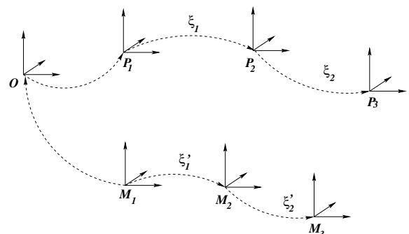  
Figure 1. Transformation of rigid body motions from prior data $P _ { i }$ in a current world coordinate system $M _ { i }$ .

To obtain v, the matrix

$$
{\boldsymbol {A}} = {(I - \exp (\theta \hat {\omega})) \hat {\omega} + \omega \omega^ {T} \theta}\tag{9}
$$

obtained from the Rodriguez formula needs to be inverted and multiplied with the translation vector $\mathbf { \Delta } _ { t , \tiny { \begin{array} { r l } \end{array} } } t ,$

$$
\boldsymbol {v} = \boldsymbol {A} ^ {- 1} \boldsymbol {t}.\tag{10}
$$

This follows from the fact, that the two matrices which comprise A have mutually orthogonal null spaces when θ $^ { \prime } \neq$ 0. Hence, $A v = 0 \Leftrightarrow v = 0 .$

We call the transformation from $S E ( 3 )$ to $s e ( 3 )$ the logarithm, log(M).

## 2.3. Coordinate transformations for RBMs and scaling

The effect of rigid body motions (RBMs) depends on the respective world coordinate system. Hence, to transfer a relative motion from prior poses to the current world coordinate system, there is need to perform a proper coordinate transformation. For example, assume two poses $P _ { 1 }$ and $P _ { 2 } \in S E ( 3 )$ . The relative motion from $P _ { 1 }$ to $P _ { 2 }$ is given by $P _ { 2 } P _ { 1 } ^ { - 1 }$ and the corresponding twist is $\xi _ { 1 } = \log ( P _ { 2 } P _ { 1 } ^ { - 1 } )$ see Figure 1. Points $x _ { i }$ in another coordinate system $M _ { 1 }$ can now be transformed with $x _ { i } ^ { \prime } = \exp ( \xi _ { 1 } ) x _ { i }$ , but this will (in general) not result in the same relative motion. Instead, the points $x _ { i }$ have to be transferred to the world coordinate system $P _ { 1 }$ , transformed with exp(ξ1), and then transferred back to result in $M _ { 2 }$

This coordinate transformation can be represented by adapting the twist $\xi _ { 1 }$ by means of the so-called adjoint transformation [12]: If $\xi _ { 1 } ~ \in ~ s e ( 3 )$ is a twist in coordinate frame $P _ { 1 }$ , then for a transformation $g \in S E ( 3 )$ that transfers coordinates from $P _ { 1 }$ $M _ { 1 } , \xi _ { 1 } ^ { \prime } = g \hat { \xi } g ^ { - 1 }$ is the corresponding twist for the coordinate frame $M _ { 1 }$ . This follows from g exp $\left( { \hat { \xi } } \right) g ^ { - 1 } = \exp \left( g { \hat { \xi } } g ^ { - 1 } \right)$ , for all invertible matrices $g \in \mathbb { R } ^ { 4 \times 4 }$

In our example, $\xi _ { 1 } = \log ( P _ { 2 } P _ { 1 } ^ { - 1 } )$ and the coordinate transformation is given by $\pmb { g } = \pmb { M } _ { 1 } \pmb { P } _ { 1 } ^ { - 1 }$ 1. Thus, the twist in

the coordinate system $M _ { 1 }$ is

$$
\xi_ {1} ^ {\prime} = g \xi_ {1} g ^ {- 1} = M _ {1} P _ {1} ^ {- 1} \xi_ {1} P _ {1} M _ {1} ^ {- 1}\tag{11}
$$

Apart from changing the coordinate system, we will later also be interested in scaling the motion. The advantage of the twist representation is that such a scaling is very straightforward: in order to scale a motion described by $\dot { \xi ^ { \prime } }$ by a factor $\nu \in \mathbb { R }$ , one must simply compute $\xi ^ { \prime \prime } = \nu \xi ^ { \prime }$

This further allows to compute the average motion from $N$ local RBMs by consecutive evaluation of these RBMs, each scaled with $\dot { \nu } = \textstyle { \frac { 1 } { N } }$ . Linear extrapolation of a motion by applying this average motion to the current pose is what we will later call standard prediction (e.g., middle left image of Figure 7).

## 2.4. Kinematic chains

A kinematic chain is modeled as the consecutive evaluation of exponential functions and twists $\xi _ { i }$ are used to model (known)joint locations. A point at an end effector, additionally transformed by a rigid body motion is given as

$$
X _ {i} ^ {\prime} = \exp (\theta \hat {\xi}) (\exp (\theta_ {1} \hat {\xi_ {1}}) \dots \exp (\theta_ {n} \hat {\xi_ {n}})) X _ {i}.\tag{12}
$$

For abbreviation, we will in the remainder of this paper note a pose configuration by the $( 6 + n ) – \mathrm { D }$ vector $\chi =$ $( \xi , \theta _ { 1 } , \dots , \theta _ { n } ) = ( \xi , \Theta )$ consisting of the 6 degrees of freedom for the rigid body motion $\xi$ and the joint angle vector Θ. In the MoCap-setup, the vector $\chi$ is unknown and has to be determined from the image data.

## 2.5. Registration, Pose estimation

Assuming an extracted image contour and the silhouette of the projected surface mesh, the closest point correspondences between both contours are used to define a set of corresponding 3D lines and 3D points. Then a 3D pointline based pose estimation algorithm for kinematic chains is applied to minimize the spatial distance between both contours: For point based pose estimation each line is modeled as a 3D Pl¨ucker line $\bar { L } _ { i } = ( n _ { i } , m _ { i } )$ , with a (unit) direction $n _ { i }$ and moment $m _ { i }$ i [12]. For pose estimation the reconstructed Pl¨ucker lines are combined with the twist representation for rigid motions: Incidence of the transformed 3D point $X _ { i }$ with the 3D ray $L _ { i } = ( n _ { i } , m _ { i } )$ can be expressed as

$$
(\exp (\theta \hat {\xi}) X _ {i}) _ {3 \times 1} \times n _ {i} - m _ {i} = 0.\tag{13}
$$

Since $\exp ( \theta \hat { \xi } ) X _ { i }$ is a 4D vector, the homogeneous component (which is 1) is neglected to evaluate the cross product with $n _ { i }$ . Then the equation is linearized and iterated. Since joints are expressed as special twists with no pitch of the form $\theta _ { j } \hat { \xi _ { j } }$ with known $\hat { \xi _ { j } }$ (the location of the rotation axes is part of the model) and unknown joint angle $\theta _ { j }$ . The constraint equation of an ith point on a jth joint has the form

$$
\left(\exp (\theta \hat {\xi}) \exp (\theta_ {1} \hat {\xi_ {1}}) \dots \exp (\theta_ {j} \hat {\xi_ {j}}) X _ {i}\right) _ {3 \times 1} \times n _ {i} - m _ {i} = 0.\tag{14}
$$

Linearization of this equation leads to three linear equations with $6 + j$ unknowns, the six pose parameters and j joint angles. Collecting enough correspondences yields an overdetermined linear system of equations and allows to solve for these unknowns in the least squares sense. Section 2.1 is applied to reconstruct the group action and the process is iterated for the transformed points.

## 2.6. Silhouette extraction

For finding the silhouette of the person in the image, a level set function $\Phi \in \Omega \mapsto \mathbb { R }$ is employed. It splits the image domain Ω into two regions $\Omega _ { 1 }$ and $\Omega _ { 2 }$ with $\Phi ( x ) > 0$ if $x \in \Omega _ { 1 }$ and $\Phi ( x ) < 0 \mathrm { ~ i f ~ } x \in \Omega _ { 2 }$ . The zero-level line marks the sought contour between both regions.

For an optimum partitioning, we minimize the following energy functional, which is an extended version of the Chan-Vese model [5]:

$$
\begin{array}{l} E (\Phi , p _ {1}, p _ {2}) = - \int_ {\Omega} \big (H (\Phi (x)) \log p _ {1} (I (x)) + \\ \qquad (1 - H (\Phi (x))) \log p _ {2} (I (x)) + \nu | \nabla H (\Phi (x)) | \big)   d x \end{array}\tag{15}
$$

with a weighting parameter $\nu > 0$ and $H ( s )$ being $\mathbf { a } \ \mathbf { r e g - }$ ularized version of the Heaviside (step) function, $\mathrm { e . g . }$ the error function. The probability densities $p _ { 1 }$ and $p _ { 2 }$ measure the fit of an intensity value $I ( x )$ to the corresponding region. These densities are modeled by local Gaussian distributions. The partitioning and the probability densities $p _ { i }$ are estimated according to the expectation-maximization prin ciple.

## 3. Markerless Motion Capture

The motion capturing model in [13] can be described by the following energy, which is sought to be minimized:

$$
\begin{array}{l} E (\Phi , p _ {1}, p _ {2}, \chi) = \\ \underbrace {- \int_ {\Omega} (H (\Phi) \log p _ {1} + (1 - H (\Phi)) \log p _ {2} + \nu | \nabla H (\Phi) |) d x} _ {\text { segmentation }} \\ + \underbrace {\lambda \int_ {\Omega} (\Phi - \Phi_ {0} (\chi)) ^ {2} d x} _ {\text { shape   error }} \end{array}\tag{16}
$$

It consists of the segmentation part, as explained in Sec tion $2 . 6 ,$ and an additional part that states the pose estimation task. By means of the contour Φ, both problems are coupled. In particular, the projected surface model $\Phi _ { 0 }$ acts as a shape prior to support the segmentation [14]. The influence of the shape prior on the segmentation is steered by the parameter $\lambda ~ = ~ 0 . 0 5$ . Due to the nonlinearity of the optimization problem, we use an iterative minimization scheme: first the pose parameters $\chi$ are kept constant while the functional is minimized with respect to the partitioning.

Then the contour is kept constant while the pose parameters are determined to fit the surface mesh to the silhouettes (Section 2.5). A comparable approach for combined segmentation and pose estimation using graph cuts has been presented in [2].

This model does not yet take knowledge about expected motion patterns into account. For this reason, the quality of the results depends on how well the image data determines the solution. In misleading situations, the minimum of the energy above might not be the true pose. Moreover, since we have a local minimization scheme, the system can in general not recover after it has lost track. Therefore, we will now show how one can compute a pose prediction from training data and how one can keep the solution close to this prediction in case the image data is misleading or insufficient, e.g. due to frame drops.

## 3.1. Scaled motion paths

Suppose, we have a set of training samples

$$
\{\widetilde {\chi} _ {i} := (\widetilde {\xi} _ {i}, \widetilde {\theta} _ {1, i}, \dots \widetilde {\theta} _ {n, i}) := (\widetilde {\xi} _ {i}, \widetilde {\Theta} _ {i}) | i = 0 \dots N \}\tag{17}
$$

containing twists $\widetilde { \xi } _ { i }$ relative to some origin and joint angle vectors $\Theta _ { i } ,$ see Section $2 . 4 .$ We further assume the set to be ordered and write this ordered list as $\mathcal { P } = \langle \widetilde { \chi } _ { 0 } \ldots \langle \widetilde { \chi } _ { N } \rangle$ . The pose $\widetilde \chi _ { i + 1 }$ is the successor of $\widetilde { \chi } _ { i }$ and $\langle \widetilde { \chi } _ { i - m + 1 } \ldots \widetilde { \chi } _ { i } \rangle$ denotes a sublist in $\mathcal { P }$ of length m ending at position i. For our experiments we either use samples from the CMU database [6] or data we have previously collected with our system.

Further suppose, we have already tracked m frames of an image sequence (we use $m = 5$ for the experiments). So at the current frame t we are given the list of previously computed poses, $\left. \chi _ { t - m + 1 } \ldots \chi _ { t } \right.$ . We are interested in computing a prediction $\underline { { \boldsymbol { \chi } } } = ( \underline { { \boldsymbol { \xi } } } , \underline { { \Theta } } )$ of the pose at $t + 1$

To this end, we locate the sublist in P that best matches the previous poses $\left. \chi _ { t - m + 1 } \ldots \chi _ { t } \right.$ An illustration is shown in Figure 2. For the matching to be invariant with respect to the velocity of the tracked person, the comparison is performed for different scalings s of $\mathcal { P } .$ . The rescaled data is obtained by linear interpolation and resampling. It is denoted by $\mathcal { P } ^ { s } = \{ \widetilde { \chi } _ { i } ^ { s } : = ( \widetilde { \xi } _ { i } ^ { s } , \widetilde { \theta } _ { 1 , i } ^ { s } , \ldots \widetilde { \theta } _ { n , i } ^ { s } ) | i = 0 \ldots \lceil s N \rceil \}$ In our experiments we scan the interval $[ 0 . 5 \dots 2 ]$ with step size 0 1. The best matching sublist is obtained by

$$
\operatorname{argmin} _ {s, j} \sum_ {v = 0} ^ {m - 1} \left(\sqrt {\sum_ {k = 1} ^ {n} (\theta_ {k , t - v} - \widetilde {\theta} _ {k , j - v} ^ {s}) ^ {2}}\right).\tag{18}
$$

Only the joint angles are taken into account, since the matching should be invariant with respect to the global position of the person.

With the optimum scale and position in the prior set, we directly obtain a predicted joint angle configuration

$$
\underline {{\Theta}} = \Theta_ {t} + \partial \widetilde {\Theta} _ {j + 1} ^ {s} = \Theta_ {t} + (\widetilde {\Theta} _ {j + 1} ^ {s} - \widetilde {\Theta} _ {j} ^ {s}).\tag{19}
$$

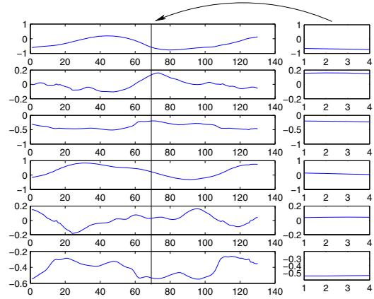  
Figure 2. Left: 6 (out of 20) angles from the prior database (130 out of 260 samples are shown). Right: A query of 5 estimated poses. In this case, the query is matched to position 71 in the database and the derivative at position 72 can be used for predic tion.

We can further predict the global motion of the person from $\widetilde { \xi } _ { j + 1 } ^ { s } .$ The relative motion can be computed via the logarithm in Section 2.2. Additionally, we have to transfer the motion from the coordinate system of the prior data to the current coordinate system. This transfer has been ex plained in Section 2.3.

If $g$ describes the transformation from the coordinate system of the prior to the current coordinate system, the relative motion is given by the twist

$$
\hat {\xi} ^ {\prime} = g \log \left(\exp (\hat {\tilde {\xi}} _ {j + 1} ^ {s}) \exp (\hat {\tilde {\xi}} _ {j} ^ {s}) ^ {- 1}\right) g ^ {- 1}.\tag{20}
$$

We are not completely done yet, since this formulation still assumes a correlation between the spatial velocity of the person and the velocity of the joint angles. However, a larger person runs faster with the same changes in his joint angles than a smaller person. Therefore, it is crucial to rescale the twist to

$$
\underline {{\hat {\xi}}} := \hat {\xi} ^ {\prime} \frac {\nu}{\widetilde {\nu}},\tag{21}
$$

where ν is the average velocity of the last m frames and ν is the velocity of $\hat { \xi } ^ { \prime } .$ . This means, the kind of the predicted motion is determined by the prior data, yet its velocity is determined by the velocity in previous frames.

The prediction $\underline { { \boldsymbol { \chi } } } = ( \underline { { \boldsymbol { \xi } } } , \underline { { \boldsymbol { \Theta } } } )$ can now serve to constrain the estimation of $\chi$ at $t + 1$ by adding the following term to the energy in (16):

$$
E _ {\mathrm{pred}} = (\log (\exp (\underline {{\hat {\xi}}}) \exp (\hat {\xi}) ^ {- 1}), \underline {{\Theta}} - \Theta)\tag{22}
$$

It yields for each parameter in the linear system an addi tional constraint equation that draws the solution towards the prediction. Consequently, the solution is well-defined, even if there is no image data available. In such a case, $\chi = \underline { { \chi } } .$

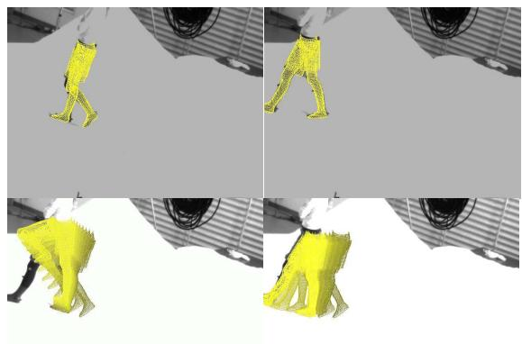  
Figure 3. 25 frame drops of a walking sequence in a lab environment. Top row: Last and fi rst frame before and after the frame drop. Bottom row, left: the standard propagation of the rigid body motion and leg confi guration. Right: The integration of the local rigid body and joint motions allow to maintain the walking dynamics during the frame drops.

## 4. Experiments

The experiments are divided into indoor and outdoor experiments. The indoor experiments allow for a controlled environment and the parallel use of a marker-based tracking system. The marker-based Motion Analysis system with 8 cameras provides kind of a ground truth and enables a quantitative error analysis. The outdoor experiments demonstrate the applicability of our method to a quite tough task: markerless motion capture of high dynamic sporting activities with non-controlled background, changing lighting conditions and full body models.

## 4.1. Indoor experiments

In our indoor experiments we use a parameterized mesh model of legs, represented as free-form surface patches. The training data consisted of walking samples from the same person but captured in different sequences. Figure 3 simulates 25 frame drops (i.e., all image data has been neglected in these frames) while tracking a walking sequence. For the result in the lower left image, the joint angles have been propagated by applying the standard prediction taken from Section 2.3. The velocity is captured quite well, but the natural up-and-down swinging and forward- and backward motion of the legs is not maintained. This can be achieved by applying the local velocities to the training samples, as explained in Section 3.1, see the lower right image in Figure 3.

In the experiment depicted in Figure 4 we added increasing amounts of uniform noise to the sequence (from 0% to 100% and back again). Consequently, the solution is partially not constrained by the image data anymore. The method continues the motion pattern by means of the prediction. The continuation is accurate enough so that the algorithm can proceed tracking when the structures in the images reappear. The errors of the left and right knee are quantified in Figure 5. The black lines are the result of the marker-based Motion Analysis system. The blue lines show the estimated angles. In case of artificial frame drops (no image data) or the dynamic frame drops (increasing noise), they are marked in red. The walking pattern is maintained. In case of the noise, the result is not as smooth, since the image data still influences the result, yet the coarse motion is well estimated. The average errors of the knee angles are 2 58 and 2 83 degrees for the artificial and the dynamic frame drop, respectively.

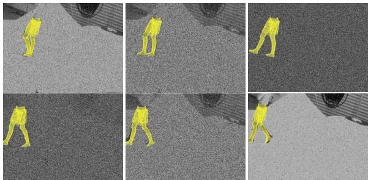  
Figure 4. Dynamic noise during tracking.

<table><tr><td rowspan="16"></td><td rowspan="16">0</td><td rowspan="16">Artificial frame drop</td><td rowspan="16">Frame</td><td rowspan="16">Dynamic frame drop</td></tr><tr></tr><tr></tr><tr></tr><tr></tr><tr></tr><tr></tr><tr></tr><tr></tr><tr></tr><tr></tr><tr></tr><tr></tr><tr></tr><tr></tr><tr></tr></table>

Figure 5. Knee joint angles during tracking including a static frame drop and the dynamic noise from Figure 4.

## 4.2. Outdoor Experiments

In our outdoor experiments we used full body models with 26 degrees of freedom of a male and a female person. The sequences were captured in a four-camera setup (60 fps) with Basler gray-scale cameras. Samples from the CMU database [6] have been employed as training data. Figure 6 shows two examples taken from a running trial (180 frames). The top images visualize the projection of our estimated model in one camera view, the bottom images show the pose result in a virtual environment.

In the experiment shown in Figure 7, we dropped 45 frames. The image in the middle left shows the standard prediction from Section 2.3, the middle right image the predictions with the best fitting motion pattern from the training set. Both outputs do not allow to continue tracking. In the first case, the natural motion pattern is not maintained. In the second case, a good motion pattern is predicted, but not with the right velocity. Only the scaled motion pattern with the best fit, as proposed in Section 3.1, leads to a prediction that is accurate enough to continue tracking after the frame drops (last row in Figure 7).

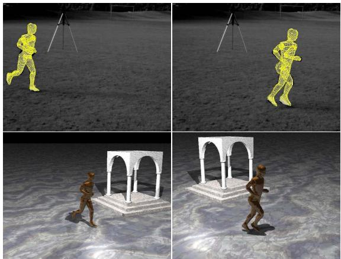  
Figure 6. Example frames of an outdoor jogging sequence: The top images visualize the overlay of our estimated model in one of four cameras, the bottom images show the pose result in a virtual environment.

Figure 8 shows the knee angles for the experiment in Figure 7: The vertical lines indicate the begin and the end of the frame drops. The black lines show the result for the undisturbed image data. The blue lines indicate the result with the frame drops. The motion pattern is maintained and the velocity of the motion is correct. Only the magnitude of the angles is not correct due to differences between the test person and the samples in the CMU data base. The reason is, that the prior data is a running motion of a person (with less bended knee angles), whereas the tracked person is performing a jogging motion (with higher flexed knees).

In Figure 9 we artificially increased the frame rate by taking only every second frame into account, resulting in the doubled velocity. The same prior data is used. Clearly, our approach is invariant to scaling in time.

Figure 10 quantifies the result with four successive frame drops by comparing the outcome of the silhouette based system with (blue and red line) and without frame drops (black line). The parts in red indicate the frames where the image data was missing. Overall, the algorithm is able to temporarily predict the motion pattern without data and track the sequence successfully. During the frame drops, the average absolute difference between the result with and without image data is 7.3 degrees.

We have also tested the same sequence with prior data,

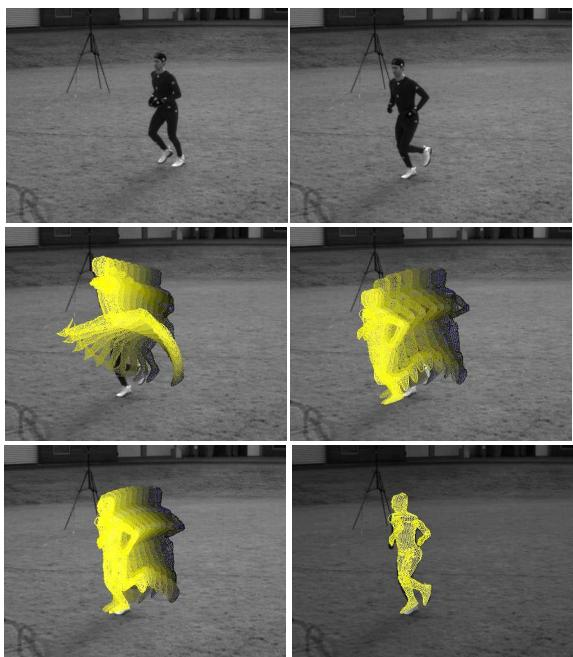

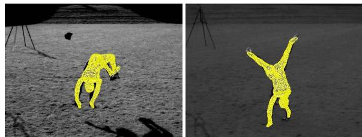

Figure 7. 45 frame drops in a jogging sequence in an outdoor environment. The top left/right: the last frame before and after the frame drops. Middle, left: the standard propagation of the rigid body motion and joint angles. Useless confi gurations are obtained. Middle, right: the RBM-priors without rescaling. The motion pattern is maintained, but too fast. Lower, left: The integration of the scaled RBM-priors. Lower, right: The algorithm can continue tracking successfully.  
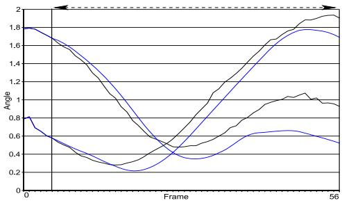  
Figure 8. Angles for the experiment in Figure 7: The (straight) black line indicate the start and end of the prediction. The black values show the knee angles for the undisturbed image data. The blue angles indicate the predicted knee angles during the frame drops. The motion pattern is maintained and the velocity is correct. The magnitude is not correct and can not be determined from the six values taken for prediction.  
Figure 11. Other sequences: Cartwheel-Flick-Flack (left) and Cartwheel (right).

which contained together with the 260 running samples also 500 additional samples from a cartwheel and a flick-flack sequence (see Figure 11). Since only the best matching pattern influences the prediction, the method yields the same result as before and is not confused by additional samples from other motions. In particular, this allows tracking of combined motions by means of mixed motion priors, which is a problem for many alternative approaches.

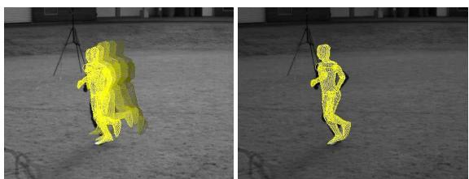  
Figure 9. Synthesized motion, similar to the experiment in Figure 8. Here, we evaluated every second frame of the sequence, resulting in the doubled velocity. The same prior data is used, showing the time invariance of our approach.

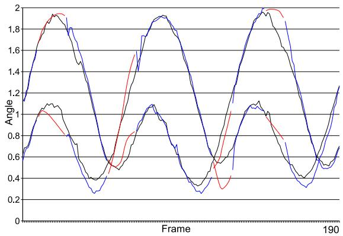  
Figure 10. Knee angles of the jogging sequence. Black: Silhouette based MoCap system. Blue/red: The same sequence without frame drops (blue) and with frame drops (red).

This is demonstrated by a combined card-wheel and flick-flack as shown in Figure 11. Also note the changing lighting, as the sun was shining in the left frame, while it was behind a cloud in the other. Furthermore, the person lost a head-marker which is a problem for marker-based tracking. Figure 12 depicts the tracked motion of the combined card-wheel and flick-flack in a virtual environment. Although the method had to rely on prior samples from two very different motion patterns, the comparison to one of the input views reveals that the motion is captured well.

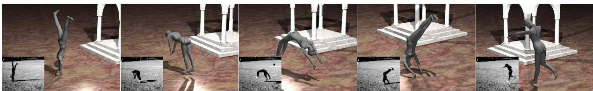  
Figure 12. Some frames of the Cartwheel-Flick-Flack sequence in a virtual environment. The small images show one of the four used camera views.

## 5. Summary

We proposed to employ prior knowledge on familiar motion patterns in human motion estimation by matching tracked motion patterns to patterns in a training set. This allows for a prediction of the pose in the new frame. Thanks to a twist representation of rigid body motions and a scaleinvariant matching, we are able to make this prediction invariant with respect to the choice of the coordinate system and a scaling in time. This means that a certain motion pattern must only be present once in the training set for capturing the motion at different velocities and poses. The experiments showed that our method can continue tracking despite artificial frame drops, where all image data is temporally missing. Moreover, it was demonstrated that it is possible to combine training data of very different motion patterns and to track sequences consisting of two such pat terns.

## References

[1] A. Agarwal and B. Triggs. Recovering 3D human pose from monocular images. IEEE Transactions on Pattern Analysis and Machine Intelligence, 28(1):44–58, Jan. 2006. 1

[2] M. Bray, P. Kohli, and P. Torr. Posecut: Simultaneous segmentation and 3d pose estimation of humand using dynamic graph-cuts. In A. Leonarids, H. Bishof, and A. Prinz, editors, Proc. 9th European Conference on Computer Vision, Part II, volume 3952 of Lecture Notes in Computer Science, pages 642–655, Graz, May 2006. Springer. 4

[3] C. Bregler, J. Malik, and K. Pullen. Twist based acquisition and tracking of animal and human kinematics. International Journal ofComputer Vision, 56(3):179–194, 2004. 1, 2

[4] T. Brox, B. Rosenhahn, U. Kersting, and D. Cremers. Nonparametric density estimation for human pose tracking. In K. F. et al., editor, Pattern Recognition, volume 4174 of LNCS, pages 546–555, Berlin, Germany, Sept. 2006. Springer. 1

[5] T. Chan and L. Vese. Active contours without edges. IEEE Transactions on Image Processing, 10(2):266–277, Feb. 2001. 4

[6] CMU. Carnegie-Mellon Mocap Database. http://mocap.cs.cmu.edu, 2003. 4, 6

[7] P. Fua, R. Pl¨ankers, and D. Thalmann. Tracking and modeling people in video sequences. Computer Vision and Image Understanding, 81(3):285–302, Mar. 2001. 1

[8] L. Herda, R. Urtasun, and P. Fua. Implicit surface joint limits to constrain video-based motion capture. In T. Pajdla and J. Matas, editors, Proc. 8th European Conference on Computer Vision, volume 3022 of Lecture Notes in Computer Science, pages 405–418, Prague, May 2004. Springer. 1

[9] R. A. Jacobs, M. I. Jordan, S. J. Nowlan, and G. E. Hinton. Adaptive mixtures of local experts. Neural Computation, 3:79–87, 1991. 2

[10] I. Mikic, M. Trivedi, E. Hunter, and P. Cosman. Human body model acquisition and tracking using voxel data. Computer Vision, 53(3):199–223, 2003. 1

[11] T. B. Moeslund, A. Hilton, and V. Kr¨uger. A survey of ad vances in vision-based human motion capture and analysis. Computer Vision and Image Understanding, 104(2):90–126, 2006. 1

[12] R. Murray, Z. Li, and S. Sastry. Mathematical Introduction to Robotic Manipulation. CRC Press, Baton Rouge, 1994. 2, 3

[13] B. Rosenhahn, T. Brox, U. Kersting, A. Smith, J. Gurney, and R. Klette. A system for marker-less motion capture. K¨unstliche Intelligenz, 1/2006:45–51, 2006. 1, 4

[14] B. Rosenhahn, T. Brox, and J. Weickert. Three-dimensional shape knowledge for joint image segmentation and pose tracking. International Journal of Computer Vision, 2006. To appear. Available online at springerlink.com. 4

[15] G. Shakhnarovich, P. Viola, and T. Darell. Fast pose estimation with parameter sensitive hashing. In Proc. International Conference on Computer Vision, pages 750–757, Nice, France, Oct. 2003. 1

[16] H. Sidenbladh, M. J. Black, and L. Sigal. Implicit probabilistic models of human motion for synthesis and tracking. In A. Heyden, G. Sparr, M. Nielsen, and P. Johansen, editors, Proc. European Conference on Computer Vision, volume 2353 of LNCS, pages 784–800. Springer, 2002. 1

[17] C. Sminchisescu and A. Jepson. Generative modeling for continuous non-linearly embedded visual inference. In Proc. International Conference on Machine Learning, 2004. 1

[18] C. Sminchisescu and B. Triggs. Estimating articulated human motion with covariance scaled sampling. International Journal of Robotics Research, 22(6):371–391, 2003. 1

[19] R. Urtasun, D. J. Fleet, and P. Fua. 3D people tracking with Gaussian process dynamical models. In Proc. International Conference on Computer Vision and Pattern Recognition, pages 238–245. IEEE Computer Society Press, 2006. 2