# 用于遥操作阻抗的基于视觉的肌肉激活模式近似估计

Hyemin Ahn , Youssef Michel , Graduate Student Member, IEEE,

Thomas Eiband , Graduate Student Member, IEEE, and Dongheui Lee , Senior Member, IEEE

摘要——适当地调节肌肉力量以成功完成给定任务是人类的本能。尽管将这种控制能力转移给机器人一直是研究人员关注的重点，但此前尚未有研究尝试让机器人仅基于视觉观察来学习如何控制阻抗。相反，遥操作阻抗（tele-impedance）的研究通常依赖于 EMG（肌电）传感器等专用设备，与简易 RGB 网络摄像头相比，这些设备的可及性和泛化能力较差。在本文中，我们提出了一种基于近似估计的肌肉激活模式的机器人视觉遥操作阻抗控制系统。这些模式是通过所提出的基于深度学习的模型获得的，该模型使用来自价格低廉的商用网络摄像头的 RGB 图像作为输入。值得注意的是，我们的模型不需要人类在肌肉上贴附任何可见的标记点。实验结果表明，我们的模型能够使机器人模仿人类如何调节肌肉力量以成功完成给定任务。尽管我们的实验侧重于遥操作阻抗控制，但我们的系统也可以为基于视觉的示范学习（learning from demonstration）的改进提供基准，该基准还将融合可变刚度控制的信息以实现成功的任务执行。

关键词——用于视觉感知的深度学习（Deep learning for visual perception），遥控机器人与遥操作（telerobotics and teleoperation），顺应性与阻抗控制（compliance and impedance control）。

## I. 引言

设想你正在教一个机器人如何打开罐子——这需要你在与手部动作同步的同时，适当地对罐子施加力。你基于动作捕捉设备向机器人完整示范了如何移动其末端执行器来执行任务。在这种情况下，如果机器人仅仅调整其末端执行器的轨迹，则该任务将会失败。为了达成目标，它还需要学习何时以及如何调整其末端刚度。在这方面，机器人可以通过使用各种辅助传感器（例如抓握力传感器 [1]、类似操纵杆的设备 [2] 或 EMG 传感器 [3]、[4]）来理解人类如何调整其末端刚度。然而，依赖专用设备可能会成为瓶颈，因为它降低了可及性以及泛化能力。因此，我们认为采用其他经济实惠且通用的传感器（如 RGB 网络摄像头）将是大有裨益的。

在本论文中，我们提出了一个基于视觉的遥阻抗控制（tele-impedance control）框架，该框架仅依赖于无可见标记物的 RGB 图像。我们展示了基于深度神经网络的视觉感知最新进展 [5], [6], [7] 可以作为一个极具吸引力的解决方案，用于构建易用、高可及性且泛化能力强的遥阻抗控制系统。实验结果表明，基于从廉价 RGB 网络摄像头获取的图像输入，我们的框架能够使机器人模仿人类如何调整其末端刚度以成功执行任务。

我们的基于视觉的遥阻抗系统利用对离散肌肉激活模式的近似估计，来调整机器人的末端刚度参数以成功完成任务。为了获得该估计，我们提出了一种基于深度神经网络的模型，该模型可以从人类肢体的简短视频观测中推断出离散的肌肉激活模式。模型输出包括 (1) 肌肉是否被激活，以及 (2) 肌肉激活是处于增加、稳定还是减小状态。尽管这无法提供末端刚度的幅值或方向等详细信息，但我们的模型能够在任务执行过程中获取人类肌肉激活的一般信息。

我们系统的优势如下：

- 无干扰性（Unobtrusive）：它不需要人类在身体部位佩戴任何标记物。

- 高可及性（High accessibility）：它可以应用于任何类型的廉价 RGB 网络摄像头。

- 高泛化能力（High generalization ability）：它还可以成功应用于未参与训练数据收集过程的人类用户。

这些优势通过我们的实验得到了验证，实验包括遥阻抗控制的真实世界机器人演示。我们相信，我们的工作将成为未来基于视觉的阻抗理解与控制研究的基础研究，例如融合了末端执行器位置及刚度信息的基于视觉的示教学习（learning from demonstration）。

## II. 相关工作

人类的特征在于其执行精细物理交互的独特能力，这得益于其调节自身末端力与阻抗的能力。受此启发，并在新一代顺应性力矩控制机器人出现的推动下，多项研究致力于将这种人类交互能力迁移给机器人。例如，[8] 提出了一种基于人类运动控制理论的自适应控制框架。该框架可以自适应调节机器人的前馈力、阻抗和参考轨迹，从而在保持稳定性和效率之间平衡的同时实现最优交互行为。该控制器后来在 [9] 中被扩展用于执行诸如切割和触觉探索等接触任务。此外，也有研究专注于开发交互接口，以在遥操作任务执行期间将人类的可变阻抗控制技能迁移给机器人。具体实现方式包括在 [1] 中使用握力传感器、在 [2] 中使用类似操纵杆的设备来实时捕获人类末端刚度信息，或者通过从人类示范中学习刚度自适应模型 [10]，其目的均是在遥操作期间控制机器人的参考刚度曲线。

沿着同样的思路，利用肌电信号（EMG）在人机之间进行可变阻抗迁移也受到了广泛关注。这受到遥阻抗（tele-impedance）[11] 这一开创性概念的启发，该概念被提出作为标准双边遥操作的一种潜在替代方案。人类操作员通过光学追踪捕获的实时运动指令，以及由 EMG 测量的肌肉激活度所估计的刚度曲线，来控制远端的阻抗控制机器人。类似地，Yang 等人 [3] 在标准双边遥操作中利用 EMG 计算刚度曲线以控制远端机器人，在此过程中操作员接收来自环境的触觉反馈。Peternel 等人 [4] 提出了一种框架，该框架结合使用 EMG、力传感和动作捕捉系统，从人类示范中提取适用于各种接触任务的混合力-阻抗控制策略。

然而，由于这些方法需要昂贵的传感器，其可及性较低且泛化能力较差。应用经济实惠的基于视觉的系统将人类阻抗控制技能传递给机器人，将是该研究领域的一个重大变革。不幸的是，如前所述，目前尚无针对基于视觉的机器人阻抗控制的研究尝试。相反，存在被称为光学肌动描记术（optical myography）的研究，其目标是估计手指运动。为此，[12], [13], [14] 使用固定试验台并将人手臂固定在其上。随后，通过粘贴在受试者前臂上的 10 个 AprilTag 标记点 [12], [13] 或单个无差别标记（即普通贴纸）[14] 获取视觉观测。这些工作还扩展到通过在人手臂正反面使用多个无朝向标记来进行人手手势识别 [15]。光学肌动描记术的优势在于使用了廉价的相机传感器，这使得实验过程比其他使用力或位置传感器的研究更为简便。然而，现有的光学肌动描记术研究需要人类受试者粘贴可见标记，且其中许多研究要求受试者限制其手臂位置。与此相比，我们的系统不需要粘贴任何标记，且人类受试者可以在目标肌肉区域可见的范围内移动手臂。

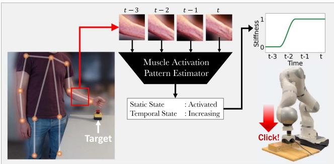  
Fig. 1. 所提出的基于视觉的遥操作阻抗系统工作原理概述。系统首先估计人体姿态以获取目标肢体（即前臂）的图像块。然后，将图像块输入到所提出的肌肉激活模式估计器（MAPE）中，生成静态状态（激活、未激活）和时序状态（增加、稳定、减少）。在此基础上，获得合适的端点刚度分布，机器人通过模仿人类为完成任务而调整自身刚度的方式，控制其端点刚度来执行给定任务。

我们承认，仅依靠图像来获取人类如何控制其阻抗的详细且精确的信息可能存在不可行性。然而，正如我们通过观察某人抬起物体的动作就能判断该物体是否沉重一样，人类能够通过识别肌肉的视觉模式来估计肌肉激活的近似信息 [16]。即使基于图像测量人手臂刚度的精确值具有挑战性，我们也有可能通过图像推断人类是否正在收紧其手臂。这种对肌肉激活模式的近似估计有利于机器人控制其端点刚度，从而正确执行给定任务。

## III. 方法

## A. 总体结构

图 1 展示了所提出系统的工作流程。左侧展示了我们的系统如何获取用于肌肉激活模式识别的视觉输入。基于 RGB 图像，系统首先根据来自 [17] 的轻量级 3D 姿态估计器获取人体姿态信息。在此基础上，系统会在目标肢体所在区域附近自动裁剪出一个正方形图像块。需要注意的是，由于姿态估计器能够定位目标肢体的位置，我们的系统并不要求人体将目标肢体置于特定的图像区域内。我们选择前臂作为目标，因为其肌肉的外观表象能够反映手腕刚度，从而对人体手部的端点刚度产生影响 [18]。在短时间段内收集一组图像块后，将其作为所提出的肌肉激活模式估计器（MAPE）的输入。如图 1 所示，MAPE 会输出两种肌肉激活状态，即静态状态和时序状态。静态状态表示肌肉是否被激活，时序状态则表示肌肉激活程度是处于增加、稳定还是减小状态。这两种状态对于机器人自适应调整其端点刚度以执行任务均必不可少。机器人可以利用静态状态决定是保持未激活（低刚度）还是激活（高刚度），并利用时序状态决定是否准备从未激活状态向激活状态转变。值得注意的是，MAPE 是以监督学习方式进行训练的，其输入来自经济型网络摄像头的 RGB 图像，而静态/时序状态则通过肌电（EMG）传感器进行标注。

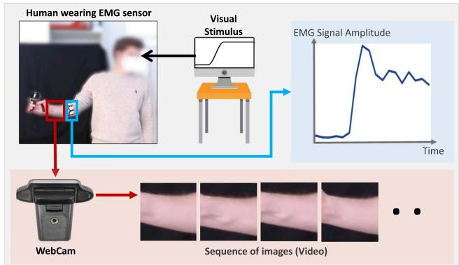  
Fig. 2. 从人类受试者采集数据集的过程说明。在使用经济型 RGB 网络摄像头（红框）采集前臂图像序列的同时，手环式传感器（浅蓝框）也同步采集 EMG 信号。完成该过程后，对采集的原始数据进行适当预处理，从而获得一组由图像、静态状态和时序状态组成的三元组。

为了提升 MAPE 的性能，我们在训练过程中提出了一种额外的方法，即“视觉数据增强”。其目标是对给定的肌肉图像块随机应用多种变换技术，例如旋转、平移、翻转、颜色调整和背景替换。通过这种方式，MAPE 能够学会对光照、人体姿态和背景等不同的图像条件保持鲁棒性。

此外，我们还在训练过程中应用了“视觉校准”（visual calibration）。它通过减少个体肌肉视觉特征的影响，提升了 MAPE 针对不同人类受试者的泛化性能。为此，它会在受试者放松或对肌肉施力时收集其肌肉图像块。随后，当输入来自该受试者的新图像块时，它通过综合考虑该目标受试者的激活和未激活肌肉图像来生成校准后的图像特征。

## B. 数据集

1) 采集：为了训练肌肉激活模式估计器（MAPE），我们构建了一个数据集，该数据集包含观察人类目标肢体（前臂）的图像以及相应的肌肉激活模式离散状态标签。这些标签包括静态状态和时序状态，其中静态状态表示肌肉是否被激活，时序状态表示肌肉激活程度是处于增加、稳定还是减小状态。

为了采集该数据集，我们搭建了如图 2 所示的环境。图中展示了一个网络摄像头（Logitech C920）以及由 Thalmic Labs 制造的名叫 Myo 的手环传感器，该手环在前臂周围布置了 8 个 EMG 传感器。我们要求受试者将其佩戴在靠近肘部的前臂上（参见图 2 中的青色框）。摄像头以 10 fps 的帧率和 $1 9 2 0 \times 1 0 8 0$ 的分辨率观察受试者。图像在黑色背景下采集，以简化数据增强过程（即随机背景）。设置好摄像头后，我们指导受试者紧握握力计施加力量，并与屏幕上显示的视觉刺激保持同步。在此，视觉刺激是一个持续时间为 120 秒、周期为 4 秒的周期性方波信号。我们要求受试者在刺激值为高电平时施加大约为其最大自主收缩（maximum voluntary contraction）[19] 80% 的握力，否则释放握力。根据 [18]，该指令也会影响人体末端刚度。

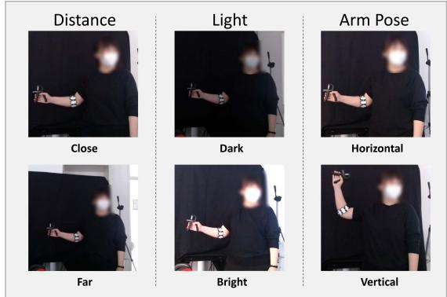  
Fig. 3. 从人类受试者采集数据集时的各种条件示意图。距离、光照和手臂姿态等条件均以两种方式变化，从而使每个受试者的数据采集过程可以至少进行八次。

我们将 $s ( t ) \in R ^ { 8 }$ 表示为由八个通道值组成的 EMG 信号，这些值来自我们的手环传感器 Myo 的八个 EMG 传感器的测量结果。然后，其幅值计算为 $a ( t ) = \| s ( t ) \| _ { 2 }$ 。图 2 中最右侧的图表展示了当人类受试者跟随视觉刺激控制握力时获取的示例 EMG 信号幅值 a(t)。

为了提高模型的泛化能力，我们从六名人类受试者（3 名男性、3 名女性 / 3 名白种人、3 名有色人种 / 年龄范围 28∼44 岁 / 均为正常体型）处采集了数据集。此外，如图 Fig. 3 所示，通过结合以下设置，基于视觉刺激的数据采集过程共进行了 8 次。我们采集了相机与人体之间的两种不同距离，具体为 1 m 和 1.5 m。同时，我们还根据光源强度考虑了两种不同的光照条件。最后，还考虑了两种不同的手臂姿势。

2) 标注：对于采集到的图像，我们根据 [17] 中估计的手腕和肘部姿势裁剪出前臂区域，如图 Fig. 2 中的红框所示。由于我们的目标是根据观察到的肌肉视觉模式来估计肌肉激活，因此我们排除了手部的视觉信息。在训练模型时，该红框内的图像块会经过随机旋转或平移以进行数据增强。

对于每张显示裸露前臂的裁剪图像，我们需要肌肉是否被激活的标签，以及肌肉激活是处于增加、稳定还是减小状态的标签。为了标注这些离散标签，我们利用了采集到的 EMG 信号。我们首先将 EMG 信号重采样至 30 fps，并对信号应用零相位数字滤波 [20]。

为了标注时间 t 的静态状态，我们为预处理后的 EMG 信号幅度定义了一个阈值；若时间 t 的幅度大于给定阈值，则将该状态标记为“激活”。该阈值基于归一化的 EMG 信号幅度 $n ( t )$ 来定义，归一化公式为 $n ( t ) = ( a ( t ) - \operatorname* { m i n } a ( t ) ) / ( \operatorname* { m a x } a ( t ) - \operatorname* { m i n } a ( t ) )$，其中 $a ( t )$ 表示时间 t 的原始 EMG 信号幅度。接着，若 $n ( t )$ 大于 $\delta _ { a c t }$，则静态状态被定义为“激活”，反之亦然。在此，$\delta _ { a c t }$ 是根据受试者肌肉形状随 $n ( t )$ 的变化情况，为每位人类受试者经验性独立选定的。如果某人的肌肉在 $n ( t )$ 大于某一数值后看起来处于激活状态，则将该数值选定为 $\delta _ { a c t }$。

为了标注时序状态，我们通过将线性回归模型拟合到 $n ( t - d ) \sim$ $n ( t + d )$ 来获得 $n ( t )$ 的斜率 $s ( t )$。若 $s ( t ) > \delta _ { i n c }$，则时序状态被定义为“增加”；若 $s ( t ) < \delta _ { d e c }$，则被定义为“减小”；若 $\delta _ { d e c } < s ( t ) < \delta _ { i n c }$，则被定义为“稳定”。阈值 $\delta _ { i n c } , \delta _ { d e c }$ 针对每位受试者进行经验性选取。最终，获得的 (Images, Static State, Temporal State) 数量为 6,764。

## C. 肌肉激活模式估计器 (Muscle Activation Pattern Estimator, MAPE)

我们的肌肉激活模式估计器（MAPE，muscle activation pattern estimator）的目标是根据视觉信息在每个时间戳 $t = 1 \dots T$ 识别肌肉激活模式的近似标签。然而，单张图像无法捕获肌肉激活是否正在增加的时序状态标签。因此，MAPE 接收一个输入 $\mathbf { \bar { \mathbf { V } } } _ { t } \in R ^ { N \times 3 \times H \times \mathbf { \breve { W } } }$，即由 $N$ 帧 $\{ I _ { t - N + 1 } \ldots I _ { t } \}$ 组成的短视频片段。在此，$\pmb { I } _ { t } \in R ^ { 3 \times W \times H }$ 是在时间戳 t 观察裸露前臂的 RGB 图像。

MAPE 基于 $V _ { t }$ 生成两个评分向量 $S _ { t }$ 和 $T _ { t }$，使得：$\mathsf { \bar { [ } } S _ { t } ; T _ { t } ] = \mathsf { M A P E } ( V _ { t } )$，其中 $S _ { t } \in \mathbb { R } ^ { 2 } , T _ { t } \in \mathbb { R } ^ { 3 }$。在此，$S _ { t }$ 表示时间戳 t 处静态状态标签的估计评分。如果 $S _ { t } [ 1 ] < S _ { t } [ 2 ]$（其中 $S _ { t } [ i ]$ 是 $S _ { t }$ 的第 i 个元素），则识别为肌肉处于激活状态。类似地，$T _ { t }$ 表示时间戳 t 处时序状态标签的估计评分。若 arg maxi $T _ { t } [ i ] = 1$，则识别为肌肉激活呈下降趋势。否则，若 arg max $\mathrm { : } T _ { t } [ i ]$ 为 2 或 3，则识别为肌肉激活趋势稳定或呈上升趋势。

Fig. 4 可视化了所提出的基于神经网络的 MAPE 结构。在该图中，假设输入由 4 张图像组成。MAPE 首先基于 ResNet [5] 从 $V _ { t }$ 中提取一组图像特征。令 $h _ { k } \in R ^ { D }$ 表示从构成 $V _ { t }$ 的第 k 张图像 $\scriptstyle { I _ { k } }$ 中提取的特征。在提取由 $\{ h _ { t - N + 1 } \ldots h _ { t } \}$ 组成的 $\pmb { H } _ { t } \in R ^ { N \times D }$ 后，将 $H _ { t }$ 输入到循环神经网络（RNNs）[21] 中。在 $\pmb { H } _ { t }$ 通过 RNNs 之后，所得向量 $v _ { t } \in R ^ { D }$ 通过两个独立的全连接层映射到 $S _ { t }$ 和 $T _ { t }$。

## D. 视觉数据增强

为了训练 MAPE，收集包含三元组 $D = \{ V _ { t } , S _ { t } , T _ { t } \} _ { t = 1 \ldots T }$ 的充足数据集至关重要。为此，如上所述，我们招募了六名人类受试者，并在不同的光照、相机距离和人体姿态条件下收集了数据集。然而，即使我们在数据收集过程中考虑了各种条件，仍然无法保证所收集的数据集是完美的，因为要满足所有可能不同条件之间的多样性是极具挑战性的。

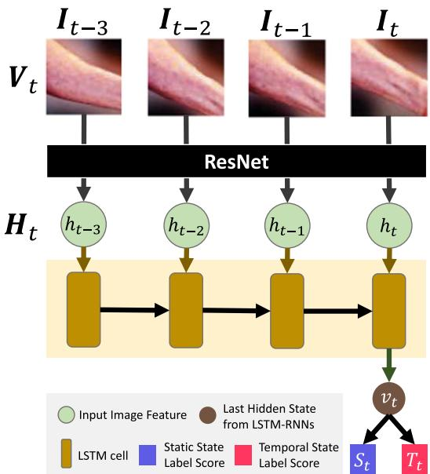

Fig. 4. 肌肉激活模式估计器（MAPE）的结构。  
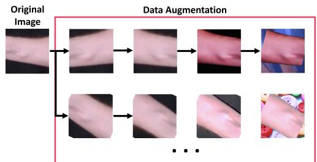  
Fig. 5. 用于提升 MAPE 泛化性能的数据增强流程。在对目标区域（即前臂）附近裁剪出的图像块进行随机旋转或平移后，在水平或垂直方向上对其进行随机翻转。然后，随机调整图像的亮度、对比度和饱和度。最后，将背景替换为来自 https://picsum.photos/ 的各种随机图像。

因此，为了提高模型的泛化性能，我们基于 Fig. 5 所示的以下流程对输入数据 $V _ { t }$ t 进行增强。

1) 获取手腕附近前臂的图像块（参见 Fig. 2 中的红框）。

2) 裁剪红框内的图像，并对裁剪出的图像进行随机旋转和平移。

3) 以 0.5 的概率水平或垂直翻转裁剪出的图像。

4) 随机调整裁剪图像的亮度、对比度和饱和度。

5) 将黑色背景替换为来自 https://picsum.photos/ 的各种随机图像。

第二和第三个步骤是为了弥补我们的数据仅从两种人体姿态中采集的劣势。第四和第五个步骤是为了提高模型在各种光照条件和背景下的泛化性能。整个数据增强过程在每次训练迭代中执行，从而随着迭代次数的增加，可以使用更多随机增强的数据进行训练。

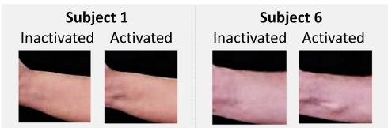  
Fig. 6. 具有不同肌肉形状和形变模式的受试者之间的对比。与受试者 6（Subject 6）相比，受试者 1（Subject 1）的肌肉尺寸更小，且其形变模式的变化也小于受试者 6。此外，结果表明受试者 1 的激活肌肉图像看起来与受试者 6 的未激活肌肉图像相似。

## E. 视觉校准 (Visual Calibration)

然而，即便我们使用增强数据集训练 MAPE，我们发现原始（vanilla）MAPE 有时仍无法获得泛化的结果。Fig. 6 展示了导致泛化失败情况的示例之一。它表明，与 Subject 6 相比，Subject 1 在未激活和激活肌肉之间的视觉模式变化较不明显。此外，Subject 1 激活肌肉的图像看起来与 Subject 6 未激活肌肉的图像相似，而不是与 Subject 6 激活肌肉的图像相似。在这种情况下，如果所提出的原始 MAPE 使用来自 Subject 1 的图像进行训练，由于这种视觉相似性，Subject 6 的“未激活”肌肉图像可能会被识别为“激活”。相反，如果 MAPE 仅基于 Subject 6 的图像进行训练，该模型将难以辨别 Subject 1 的肌肉激活状态，因为其肌肉激活变化不太明显。

基于这一观察，我们得出结论：有必要采用一种能够减少个体肌肉视觉特征影响的额外方法。因此，我们引入了一种名为“视觉校准”（Visual Calibration）的方法，该方法可以提升 MAPE 对不同人类受试者的泛化性能。为此，它首先要求人类受试者释放或施加握力，并收集未激活和激活肌肉的图像。设 ${ \mathbf { } } I _ { i n a c t }$ 和 $\pmb { I } _ { a c t }$ 表示从该过程中收集的未激活和激活肌肉的图像。然后，带有视觉校准的 MAPE 基于 ResNet 从 ${ \mathbf { } } I _ { i n a c t }$ 和 $\pmb { I } _ { a c t }$ 中提取图像特征。设 $h _ { i n a c t }$ 和 $h _ { a c t }$ 表示获取的图像特征。接着，从原始输入 $\mathbf { } V _ { t }$ 中获取的图像特征集合 $H _ { t } = \left\{ h _ { t - N + 1 } \ldots h _ { t } \right\}$ 基于 $h _ { i n a c t }$ 和 $h _ { a c t } .$ 进行校准，从而可以获得 ${ \pmb H } _ { t } ^ { c } = [ h _ { k } - h _ { i n a c t } ; h _ { k } - h _ { a c t } ] _ { k = t - N + 1 , . . . , t }$。最后，校准后的特征 Hct 作为输入提供给 LSTM-RNNs，并获得最终结果 $( S _ { t } , \ T _ { t } )$。Fig. 7 总结了带有视觉校准的 MAPE 的工作流程。请注意，相同的 ResNet 被用于从 $V _ { t } , I _ { i n a c t }$ 和 $\pmb { I } _ { a c t } .$ 中提取特征，从而可以在参数量方面提高效率。

## F. 实现细节

在训练 MAPE 时，我们使用 $V _ { t } \in R ^ { 4 \times 3 \times 1 1 2 \times 1 1 2 }$，其中使用四张尺寸为 $3 \times 1 1 2 \times 1 1 2$ 的图像 $I _ { t - 3 } , I _ { t - 2 } , I _ { t - 1 } , I _ { t }$ 来构建 $\mathbf { } V _ { t }$。在实验中，我们的视频剪辑帧率为 10 fps，因此视频剪辑 $\mathbf { } V _ { t }$ 包含 0.4 s 内的信息。在基于 ResNet-50 从 $V _ { t }$ 中提取一组图像特征 $\pmb { H } _ { t } \in R ^ { 4 \times 2 0 4 8 }$ 后，根据其 $\mathrm { L } 2 \cdot$ 范数大小进行归一化，并输入到隐藏状态维度为 2048 的基于 LSTM 的 RNN 中。当在 MAPE 中加入视觉校准（Visual Calibration）时，LSTM-RNN 的输入为 $H _ { t } ^ { c } = [ h _ { t } - h _ { i n a c t } ; h _ { t } - h _ { a c t } ]$，其中 $h _ { t } , h _ { i n a c t } .$ 和 $h _ { a c t }$ 是基于 L2 范数归一化后的图像特征。在 LSTM-RNN 处理输入 $H _ { t }$ 之后，其最后一个隐藏状态向量变为 $v _ { t } \in \bar { R } ^ { 2 0 4 8 }$，并通过两个独立的全连接层映射到 $S _ { t }$ 和 $T _ { t }$。为了训练原始 MAPE 或带有视觉校准的 MAPE，针对每个 $S _ { t }$ 和 $T _ { t }$ 使用交叉熵损失函数，并采用学习率为 0.0001 的 Adam 优化器 [22]。在每次迭代中，在数据增强后从训练数据集中抽取批次大小为 64 的样本。使用单个 GPU 时，MAPE 的训练过程耗时不到一天。

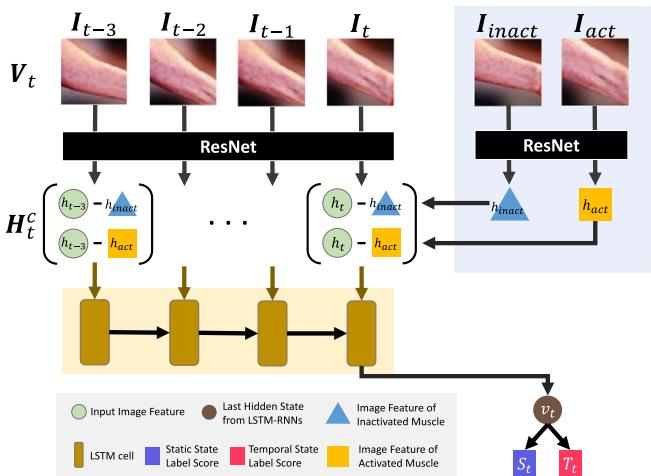  
Fig. 7. 应用视觉校准时所提出的机器激活模式估计器（MAPE）的网络架构。

## IV. 实验

## A. 定性结果

我们用于训练 MAPE 的数据集包含从六位不同人类受试者采集的 RGB 图像以及静态/时序状态标注。在使用来自五位受试者的数据集训练 MAPE 之后，我们通过将未见过的受试者的数据作为输入，获得了如图 8 所示的定性结果。与静态/时序状态标签的真实值相比，估计结果表明，在 MAPE 中结合了视觉校准与数据增强的所提出系统产生了最可靠的结果（见图 8 中的橙色方块）。此外，结果表明未采用视觉校准或数据增强的所提出系统产生的结果可靠性较低（见图 8 中的灰色方块）。请注意，相关的定量结果也将在下一段中展示。基于此，我们认为所提出的视觉校准以及数据增强对于使 MAPE 理解未见过的人类受试者的肌肉形变模式变化至关重要。因此，可以得出结论，所提出的两个辅助过程对于提高我们基于视觉的遥操作阻抗控制系统的泛化能力同样具有重要意义。

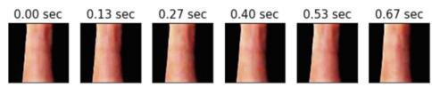

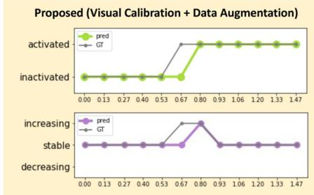

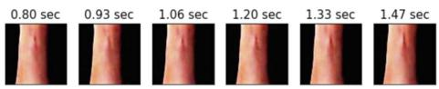

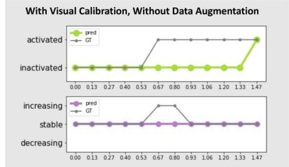

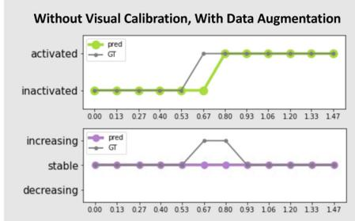

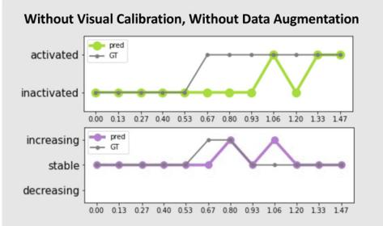  
Fig. 8. MAPE 在训练阶段未见的人类受试者数据集上测试时的定性结果。请注意，输入图像已进行修改以获得更好的可视化效果。结果表明，与其他情况相比，所提出的结合了视觉校准和数据增强的系统能够产生最可靠的估计。

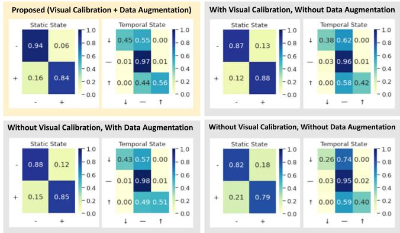  
Fig. 9. 从定量消融实验中获得的混淆矩阵。在静态状态的矩阵中，- 表示未激活状态，+ 表示激活状态。在时序状态的矩阵中，↓ 表示下降状态，— 表示稳定状态，↑ 表示上升状态。结果表明，在同时考虑静态和时序状态估计时，采用视觉校准和数据增强的所提系统表现最佳。

## B. 定量结果

为了衡量 MAPE 的性能，我们根据人类受试者的身份划分数据集，进行了 6 折交叉验证。Fig. 9 展示了所提出的系统在有无视觉校准或数据增强情况下的混淆矩阵。正如定性结果所预期的那样，同时具有视觉校准和数据增强的系统在静态和时序状态估计中均取得了最佳结果。

与静态状态估计的高性能相比，时序状态估计的准确率没有那么高。然而，我们想强调的是，最严重的错误发生在 MAPE 将“上升”与“下降”混淆时。值得注意的是，在使用 MAPE 的本次消融实验的所有情况中均未出现这种情况。当真实标签（ground truth）为“上升”或“下降”时，仅会与“稳定”发生混淆，这可以通过滤波或有限状态机（Finite State Machine, FSM）等后处理技术轻松纠正。有关我们如何使用 FSM 进行后处理的详细信息，请参阅补充材料。

TABLE I  
有无数据增强（DA）和视觉校准（VC）情况下的静态状态估计得分

<table><tr><td rowspan="2"></td><td colspan="2">Proposed</td><td colspan="2">w/o DA</td><td colspan="2">w/o VC</td><td colspan="2">w/o DA&amp;VC</td></tr><tr><td>-</td><td>+</td><td>-</td><td>+</td><td>-</td><td>+</td><td>-</td><td>+</td></tr><tr><td>Precision</td><td>0.937</td><td>0.844</td><td>0.872</td><td>0.882</td><td>0.878</td><td>0.849</td><td>0.817</td><td>0.790</td></tr><tr><td>Recall</td><td>0.886</td><td>0.912</td><td>0.905</td><td>0.842</td><td>0.883</td><td>0.843</td><td>0.835</td><td>0.769</td></tr><tr><td>F1 Score</td><td>0.911</td><td>0.877</td><td>0.888</td><td>0.861</td><td>0.881</td><td>0.846</td><td>0.826</td><td>0.779</td></tr></table>

- 表示未激活，+ 表示已激活。粗体字体表示在对比所提出方法（Proposed）、w/o DA、w/o VC 与 w/o DA & VC 时取得的最高得分。

为了更好地总结性能，我们在表 I 和表 II 中展示了状态估计的精确率（precision）、召回率（recall）和 F1 分数（F1 score）。尽管没有视觉标定或数据增强的系统在精确率或召回率方面有时表现优于所提出的系统，但结果表明所提出的系统在所有情况下的 F1 分数均更高。基于此，我们认为视觉标定和数据增强等辅助方法对于提升 MAPE 的泛化能力至关重要。

## C. 真实世界演示

我们还通过将 MAPE 应用于真实机器人的遥操作阻抗控制（tele-impedance control）中，验证了系统的可扩展性。我们的任务是让机器人能够按下需要足够高刚度才能成功按下的急停按钮。为此，我们的机器人采用了基于我们提出的视觉遥操作阻抗框架的可变刚度。其末端刚度将遵循人类策略，即仅在必要时增加刚度，而在自由运动期间保持顺应以减少代谢消耗 [23]。Fig. 10 展示了我们的系统在真实机器人上的工作方式。我们将机器人的末端执行器移动到按钮上方约 20 cm 处。与此同时，人类受试者单手握拳并将其置于另一个按钮上方约 20 cm 处。然后，我们指示受试者通过垂直向下移动手部朝向按钮来成功按下按钮。由于我们侧重于肌肉激活度估计部分，我们通过向机器人末端执行器发送预编程的以 5 cm/sec 速度朝向按钮垂直向下运动的指令，简化了实验设置。受试者通过跟随机器人的运动来同步自己的动作，以便人类能在机器人按下的同时按下按钮。此外，受试者需要在机器人末端执行器即将按下按钮时适当增加握力。

TABLE II  
在有无数据增强（DA）和视觉标定（VC）情况下的时序状态估计得分

<table><tr><td rowspan="2"></td><td colspan="3">Proposed</td><td colspan="3">w/o DA</td></tr><tr><td>↓</td><td>—</td><td>↑</td><td>↓</td><td>—</td><td>↑</td></tr><tr><td>精确率</td><td>0.448</td><td>0.974</td><td>0.563</td><td>0.379</td><td>0.956</td><td>0.416</td></tr><tr><td>召回率</td><td>0.753</td><td>0.921</td><td>0.770</td><td>0.542</td><td>0.905</td><td>0.680</td></tr><tr><td>F1 分数</td><td>0.561</td><td>0.947</td><td>0.650</td><td>0.446</td><td>0.930</td><td>0.516</td></tr><tr><td rowspan="2"></td><td colspan="3">w/o VC</td><td colspan="3">w/o DA&amp;VC</td></tr><tr><td>↓</td><td>—</td><td>↑</td><td>↓</td><td>—</td><td>↑</td></tr><tr><td>精确率</td><td>0.425</td><td>0.979</td><td>0.508</td><td>0.262</td><td>0.952</td><td>0.404</td></tr><tr><td>召回率</td><td>0.729</td><td>0.916</td><td>0.867</td><td>0.459</td><td>0.895</td><td>0.604</td></tr><tr><td>F1 分数</td><td>0.535</td><td>0.947</td><td>0.641</td><td>0.334</td><td>0.923</td><td>0.484</td></tr></table>

↓ 表示下降，— 表示稳定，↑ 表示上升。粗体表示在对比 Proposed、w/o DA、w/o VC 以及 w/o DA & VC 时的最高得分。

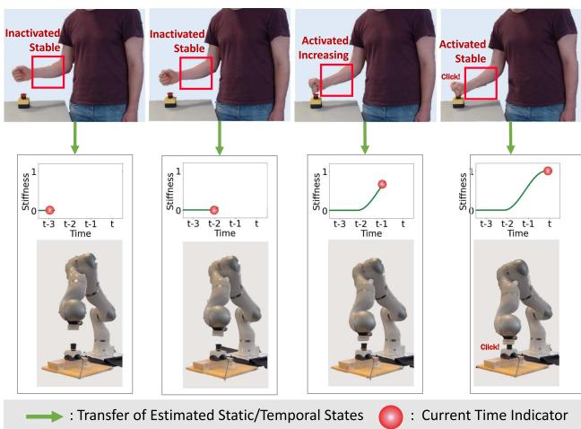  
Fig. 10. 我们在按压按钮任务中的真实演示。当人类受试者同步于预定义的机器人垂直向下运动放下手臂时，我们的系统捕获受试者的前臂区域并估计其静态/时序状态。估计结果被传输给机器人，机器人据此生成合适的刚度曲线。基于此，机器人像人类一样通过自适应调节其末端刚度成功执行任务以完成操作。

每当 MAPE 输出预测时，估计的静态/时序状态信息就会被传输到机器人控制循环中。为了控制机器人的刚度，我们设计了一个有限状态机（Finite State Machine，FSM），它根据输入的静态/时序状态估计执行操作，同时过滤掉 MAPE 预测出的可能存在的噪声状态。根据 FSM 的内部状态，设定机器人在运动方向（相对于机器人基座坐标系的 $z$ 轴）上的笛卡尔刚度。例如，在 Fig. 10 中，当 MAPE 将静态/时序状态估计为“激活”（activated）和“递增”（increasing）时，我们的 FSM 转换到“递增”状态，机器人开始将其刚度曲线从低值平滑增加到高值。当刚度达到最大值时，在静态状态为“激活”且时序状态为“稳定”的情况下，FSM 转移并保持在“高”状态。由此，机器人自适应调节其末端刚度以模仿相同的人类行为，通过施加按下按钮所需的必要力量，使其得以完成任务。

我们的补充视频展示了更多涉及不同受试者的真实世界演示示例，其中包括未参与数据采集过程的受试者。我们的系统可以应用于不同的人体，从而证明了我们系统的泛化能力以及部署在真实世界场景中的可行性。

## V. 讨论与未来工作

在本文中，我们的目标是仅基于 RGB 图像将人类的端点刚度自适应（end-point stiffness adaptation）能力迁移至机器人。为此，我们引入了一个名为肌肉激活模式估计器（muscle activation pattern estimator, MAPE）的模型。基于给定的图像帧，MAPE 能够推断出（1）肌肉处于激活还是未激活状态（静态状态），以及（2）肌肉激活程度是正在增加、保持稳定还是正在减小（时序状态）。为了训练 MAPE，我们在各种条件下从六名人类受试者采集了包含图像、静态状态和时序状态的三元组数据。

然而，由于采集的数据集可能存在偏差，我们还提出了视觉数据增强以及视觉校准。视觉数据增强是指将各种图像变换技术随机应用于输入图像，使 MAPE 能够适应各种条件下的图像。视觉校准旨在减少诸如前臂单个肌肉的大小或可见性等个人因素的影响。我们的实验结果定性且定量地展示了 MAPE 的工作机制，以及视觉数据增强和视觉校准过程对提升 MAPE 性能的显著程度。最后，我们展示了一个解决按按钮任务的真实世界演示，通过应用估计的肌肉激活模式来自适应调整机器人的端点刚度。

我们当前的系统仍有若干待解决的挑战。首先，它无法获得人类刚度的精确测量值。但特别是对于遥阻抗（tele-impedance）应用而言，只要机器人被赋予了适当的阻抗指令，这一点可能并非至关重要。例如在基于 EMG 的遥阻抗中就是如此，其中通常使用比例因子将人臂刚度映射到笛卡尔机器人刚度 [11]。其次，我们的估计仅限于一维刚度估计。对于我们简化的实验场景，这已经足够。然而，更复杂的任务（例如拧螺丝）将需要更复杂的刚度设置，其中需要明确指定刚度椭球（stiffness ellipsoid）的大小和方向。

第三，肢体尺寸、脂肪和体毛等各种不同且独特的个体特征可能会影响肌肉的可见性，进而影响我们 MAPE 的准确性。我们在实验过程中观察到了这些影响，并认为在训练数据中纳入更多样化的个体可以提高我们网络的泛化能力，使其对这些因素更具鲁棒性。第四，当前系统无法区分力与刚度，而肌肉激活度的增加可能是由于力或刚度的增加所致。为了区分力与刚度，[11] 指出需要计算两个解耦子空间，即产生力的子空间和产生刚度的子空间。然而，这种区分并不是本研究的主要重点。相反，我们简化了假设，认为肌肉激活与刚度高度相关。我们的实验结果表明，从经验上看，该假设对于我们的目的是可行的，即为基于视觉的遥阻抗控制（tele-impedance control）提供一种实用且可行的方法。我们相信当前的局限性将在未来的工作中得到补充，并希望进一步强调我们是如何验证基于视觉的肌肉激活模式估计的可行性，以及利用该估计结果成功实现遥阻抗控制的可能性。

最后，我们想强调的是，我们的系统有潜力为现有的基于视觉的示范学习（learning from demonstration, LfD）或模仿学习（imitation learning）研究提供帮助，这些研究在其学习过程中仅考虑了末端执行器轨迹。我们的系统有可能从人类的演示视频中进一步提取端点刚度信息，从而实现更先进的 LfD 方法。我们相信，本研究将成为基于视觉的机器人技能迁移改进研究的基准，该研究还可以考虑人类在执行任务时如何调整刚度。

伦理声明：在本研究开展地德国巴伐利亚州，由于采用了匿名数据收集流程，因此无需伦理委员会的伦理审查和批准 (https://ethikkommission.blaek.de/studien/sonstigestudien/antragsunterlagen-ek-primarberatend-15-bo)（访问日期：2023年6月20日）。

## 参考文献

[1] D. S. Walker, R. P. Wilson, and G. Niemeyer, “User-controlled variable impedance teleoperation,” in Proc. IEEE Int. Conf. Robot. Automat., 2010, pp. 5352–5357.

[2] L. Peternel, T. Petri´c, and J. Babi´c, “Robotic assembly solution by humanin-the-loop teaching method based on real-time stiffness modulation,” Auton. Robots, vol. 42, pp. 1–17, 2018.

[3] C. Yang, C. Zeng, P. Liang, Z. Li, R. Li, and C. Su, “Interface design of a physical human–robot interaction system for human impedance adaptive skill transfer,” IEEE Trans. Automat. Sci. Eng., vol. 15, no. 1, pp. 329–340, Jan. 2018.

[4] L. Peternel, L. Rozo, D. Caldwell, and A. Ajoudani, “一种通过重复感官观测推导机器人任务坐标系控制权的方法,” IEEE Robot. Automat. Lett., vol. 2, no. 2, pp. 719–726, Apr. 2017.

[5] K. He, X. Zhang, S. Ren, and J. Sun, “用于图像识别的深度残差学习,” in Proc. IEEE Conf. Comput. Vis. Pattern Recognit., 2016, pp. 770–778.

[6] C. Szegedy et al., “基于卷积的更深网络,” in Proc. IEEE Conf. Comput. Vis. Pattern Recognit., 2015, pp. 1–9.

[7] S. Xie, R. Girshick, P. Dollár, Z. Tu, and K. He, “用于深度神经网络的聚合残差变换,” in Proc. IEEE Conf. Comput. Vis. Pattern Recognit., 2017, pp. 1492–1500.

[8] C. Yang, G. Ganesh, S. Haddadin, S. Parusel, A. Albu-Schaeffer, and E. Burdet, “稳定和不稳定交互中力和阻抗的类人自适应,” IEEE Trans. Robot., vol. 27, no. 5, pp. 918–930, Oct. 2011.

[9] G. Ganesh, N. Jarrassé, S. Haddadin, A. Albu-Schaeffer, and E. Burdet, “一种用于接触加工和触觉探索的通用仿生控制器,” in Proc. IEEE Int. Conf. Robot. Automat., 2012, pp. 3329–3334.

[10] Y. Michel, R. Rahal, C. Pacchierotti, P. R. Giordano, and D. Lee, “面向接触任务的具有自适应阻抗控制的双边远程操作,” IEEE Robot. Automat. Lett., vol. 6, no. 3, pp. 5429–5436, Jul. 2021.

[11] A. Ajoudani, N. Tsagarakis, and A. Bicchi, “远程阻抗：利用机体-机器接口进行阻抗调节的远程操作,” Int. J. Robot. Res., vol. 31, no. 13, pp. 1642–1656, 2012.

[12] C. Nissler, N. Mouriki, C. Castellini, V. Belagiannis, and N. Navab, “OMG：引入光学肌动描记术作为手部截肢者的新型人机接口,” in Proc. IEEE Int. Conf. Rehabil. Robot., 2015, pp. 937–942.

[13] C. Nissler, N. Mouriki, and C. Castellini, “光学肌动描记术：通过观察前臂检测手指运动,” Front. Neurorobot., vol. 10, 2016. [Online]. Available: https://www.frontiersin.org/articles/10.3389/ fnbot.2016.00003/full

[14] C. Nissler, I. M. Badshah, C. Castellini, W. Kehl, and N. Navab, “通过卷积神经网络改进光学肌动描记术,” in Proc. Myoelectric Controls Symp., 2017, pp. 1–4.

[15] Y. T. Wu, E. Fujiwara, and C. K. Suzuki, “光学肌动描记传感器作为手势预测指标的评估,” IEEE Sensors J., vol. 19, no. 13, pp. 5299–5306, Jul. 2019.

[16] M. E. Huber, C. Folinus, and N. Hogan, “肢体刚度的视觉感知,” in Proc. IEEE/RSJ Int. Conf. Intell. Robots Syst., 2017, pp. 3049– 3055.

[17] D. Osokin, “基于CPU的实时2D多人姿态估计：轻量级OpenPose,” 2018, arXiv:1811.12004. [Online]. Available: https://github.com/Daniil-Osokin/lightweight-human-poseestimation.pytorch

[18] A. Takagi, G. Xiong, H. Kambara, and Y. Koike, “末端刚度大小随强力抓握呈线性增加,” Sci. Rep., vol. 10, no. 1, pp. 1–9, 2020.

[19] B. Peacock, T. Westers, S. Walsh, and K. Nicholson, “Feedback and maximum voluntary contraction,” Ergonomics, vol. 24, no. 3, pp. 223–228, 1981.

[20] F. Gustafsson, “Determining the initial states in forward-backward filtering,” IEEE Trans. Signal Process., vol. 44, no. 4, pp. 988–992, Apr. 1996.

[21] S. Hochreiter and J. Schmidhuber, “Long short-term memory,” Neural Comput., vol. 9, no. 8, pp. 1735–1780, 1997.

[22] D. P. Kingma and J. Ba, “ADAM: A method for stochastic optimization,” in Proc. 19th Int. Conf. Learn. Representations, 2015, pp. 1051–1060.

[23] Y. Li, N. Jarrassé, and E. Burdet, “Versatile interaction control and haptic identification in humans and robots,” in Geometric and Numer. Foundations ofMovements. Berlin, Germany: Springer, 2017, pp. 187–206.