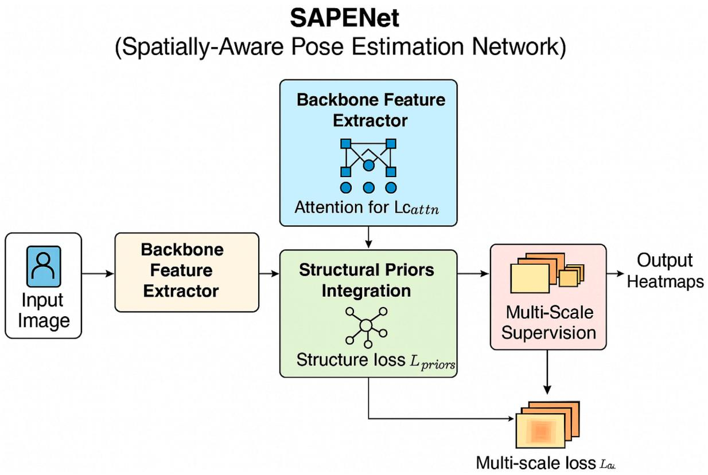
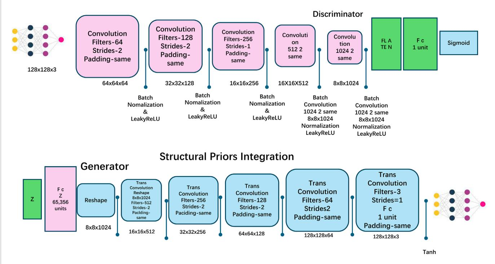
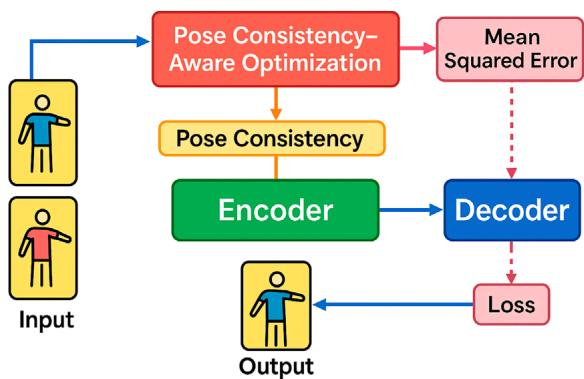
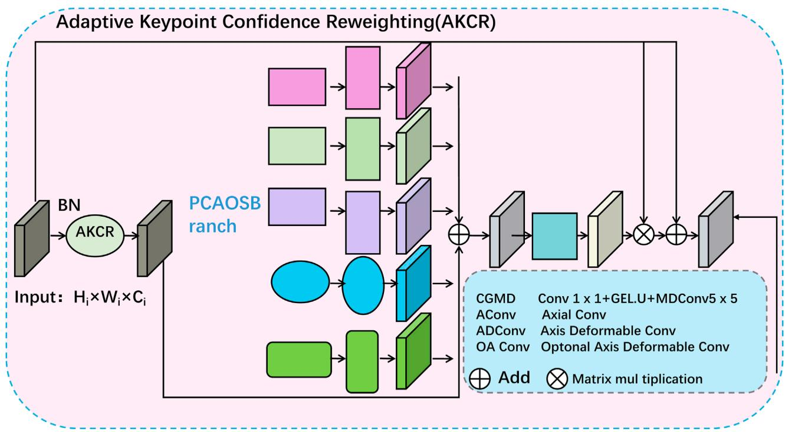

检查更新

## 开放获取 (OPEN ACCESS)

责任编辑：Lev Shchur，俄罗斯国立高等经济大学（National Research University Higher School of Economics），俄罗斯

审稿人：Njitacke Tabekoueng Zeric，喀麦隆布埃亚大学（University of Buea），喀麦隆；Jinyang Huang，合肥工业大学（Hefei University of Technology），中国

\*通信作者：Hongbo Shao, hdla98@163.com

收稿日期：2025年1月10日 修订日期：2025年10月10日 接受日期：2025年10月13日 出版日期：2025年11月24日 更正日期：2025年12月22日

## 引用格式

Shao H, Zhang X and Li L (2025) Advancing human pose estimation through interdisciplinary physics-inspired deep learning models. Front. Phys. 13:1558325. doi: 10.3389/fphy.2025.1558325

## 版权

© 2025 Shao, Zhang and Li. 这是一篇采用知识共享署名许可（Creative Commons Attribution License，CC BY）分发的开放获取文章。在遵循公认的学术规范的前提下，只要注明原作者和版权所有者，并引用本期刊的原始出版物，就允许在其他论坛中使用、分发或复制。任何不符合这些条款的使用、分发或复制均不被允许。

# 融合物理启发深度学习模型的跨学科人体姿态估计新进展

Hongbo Shao1\*、Xingzhen Zhang2 与 Ling Li3

1金华职业技术学院（Jinhua University of Vocational Technology）通识教育学院军事与体育教学部，中国浙江金华；2金华市中心医院（Jinhua Municipal Central Hospital）肾内科，中国浙江金华；3天津外国语大学（Tianjin Foreign Studies University）国际商学院，中国天津

引言：人体姿态估计（Human pose estimation）是计算机视觉领域的一项关键挑战，对机器人技术、增强现实和生物医学研究具有重要意义。当前姿态估计的发展仍面临着诸多持续存在的障碍，包括遮挡、模糊的空间排列以及对多样化环境适应性有限等。尽管深度学习取得了进展，但现有方法在整合几何先验以及在具有挑战性的数据集上保持一致性能方面往往面临困难。

方法：针对这些不足，我们提出了一种将物理启发式推理与深度学习协同结合的新型框架。我们提出的空间感知姿态估计网络（Spatially-Aware Pose Estimation Network，SAPENet）结合了能量最小化原理以确保几何合理性，并结合时空动力学以维持连续帧之间的一致性。该框架利用空间注意力机制、多尺度监督和结构先验来增强特征表征，并在训练与推理过程中施加物理约束。此外，姿态一致性感知优化策略（Pose Consistency_Aware Optimization Strategy，PCAOS）进一步增强了这一框架，该策略结合了自适应置信度重加权与多视角一致性，以缓解遮挡和多关节运动等特定领域的挑战。

结果与讨论：我们的实验表明，这种跨学科方法在标准基准上显著提高了姿态估计的准确性和鲁棒性，取得了最先进（state-of-the-art）的结果。空间推理与领域先验物理知识的无缝融合，使我们的方法成为姿态估计领域的一项变革性进展。

## 关键词

姿态估计，空间注意力，结构先验，多尺度监督，自适应优化

## 1 引言

人体姿态估计（Human Pose Estimation, HPE）因其在运动分析、机器人技术、医疗保健和增强现实中的广泛应用，已成为计算机视觉领域的一个关键方向 Yang et al. [1]。HPE 不仅使机器能够理解和解释人体运动，还促进了实时手势识别和人机交互等任务的发展。传统方法难以准确捕捉人体运动的复杂性 Xu et al. [2]，尤其是在存在遮挡、动态或多人场景中。机器学习和深度学习的引入极大推动了该领域的发展。然而，挑战依然存在，例如提高遮挡场景下的准确性、平衡计算效率，以及融入生物力学或物理学等领域知识以增强模型的鲁棒性和可解释性 Wen et al. [3]。因此，跨学科方法，尤其是受物理学启发的方法，通过弥合数据驱动与知识驱动范式之间的鸿沟，在推动 HPE 发展方面展现出巨大潜力 Shan et al. [4]。

为了解决早期系统的局限性，传统的 HPE 方法在很大程度上依赖于符号人工智能（symbolic AI）和显式知识表示 Sundermeyer et al. [5]。这些方法通常基于物理约束将人体建模为一组关节或关键点，并利用几何方法以及隐马尔可夫模型（Hidden Markov Models, HMM）等概率框架 Kim et al. [6]。例如，通过硬编码运动学约束来确保姿态符合物理规律，并采用优化算法来细化姿态估计。尽管这些方法提供了可解释性以及对小数据集的鲁棒性，但在应用于具有背景噪声 Li et al. [7]、遮挡或非标准姿态的复杂场景时，其泛化能力有限。此外，对人工设计特征和人体力学假设的依赖往往在真实的非结构化环境中失效。为了克服这些局限性 Zheng et al. [8]，研究人员转向了利用日益丰富的标注数据集和计算能力的数据驱动范式。

机器学习（特别是数据驱动模型）的出现标志着 HPE（Human Pose Estimation，人体姿态估计）领域范式的转变 Wang et al. [9]。这些方法引入了支持向量机（support vector machines, SVMs）和随机森林等技术，以学习从图像特征到关节位置的映射。利用 HOG（Histogram of Oriented Gradients，方向梯度直方图）和 SIFT（Scale-Invariant Feature Transform，尺度不变特征变换）等技术进行特征提取，在提高准确性方面发挥了关键作用 He et al. [10]。数据驱动的方法使模型能够更好地泛化到更大的数据集，并在无需显式特征工程的情况下适应各种场景。然而，这些方法在处理复杂的多关节人体运动方面的能力仍然有限。处理高维特征带来的计算成本 Fang et al. [11]，加之传统机器学习算法相对较浅的架构，限制了它们的性能。因此，该领域转向了深度学习，后者为建模 HPE 中固有的非线性关系提供了更强大的工具 Lauer et al. [12]。

深度学习，尤其是卷积神经网络（convolutional neural networks, CNNs），通过实现端到端特征学习和姿态估计彻底变革了 HPE。基于热图的关键点定位和基于区域的 CNN 等技术提高了准确性和可扩展性。最近 Rempe et al. [13]，预训练模型（如 ResNet 和 Transformers）的引入进一步促进了该领域的发展。预训练模型提供了迁移学习的优势，能够有效利用诸如 MPII 和 PoseTrack 等大型数据集。虽然深度学习擅长利用大规模数据并能捕获高度复杂的模式 Liu et al. [14]，但它通常存在计算需求高和缺乏可解释性的问题。此外，它未能结合生物力学或物理定律等领域特定约束，这可能会限制在涉及快速或高动态运动场景中姿态预测的鲁棒性 Maji et al. [15]。这一局限性激发了最近将基于物理学的原理集成到深度学习框架中的方法，以增强模型的性能和泛化能力 Labb’e et al. [16]。

鉴于深度学习面临的挑战，特别是其无法结合领域特定约束的问题，本文提出了一种受物理启发的 HPE 深度学习模型。通过将物理知情先验（如运动学和动力学约束）嵌入学习过程中，该模型旨在提高遮挡和动态场景下的准确性。生物力学模型的集成能够更好地处理现实世界的各种工况，而模块化架构则确保了计算效率和可扩展性。这种跨学科方法弥合了符号 AI（symbolic AI）与数据驱动的深度学习方法之间的差距，为 HPE 研究提供了一条新途径。

我们将我们的贡献总结如下。

• 该方法引入了一个物理信息驱动模块（physics-informed module），将运动学和动力学约束集成到深度学习架构中，从而提高了复杂运动场景下的准确性。

• 该模型在保持计算效率的同时，在从医疗保健到机器人技术的多个应用领域中均展现出高度的泛化能力。

• 实验表明，在准确性和鲁棒性方面均有显著提升，特别是在遮挡或动态人体姿态估计任务中，性能超越了现有最先进的方法。

## 2 相关工作

## 2.1 姿态估计中受物理启发的约束

人体姿态估计传统上依赖于利用大规模标注数据集的深度学习模型。然而，将受物理启发的约束引入这些模型中已成为一个极具前景的方向 Sun et al. [17]。通过嵌入生物力学原理和运动学定律，这些方法旨在强制生成符合物理规律的合理预测，从而缓解诸如不真实的关节位置和姿态等常见问题。近期的研究重点是直接将正向和逆向运动学集成到学习过程中 Chen et al. [18]，使模型能够遵循人体关节约束和运动可行性。例如，在深度网络中利用可微物理引擎的方法允许在训练期间对运动动力学进行仿真和优化 Di et al. [19]，确保与现实世界的物理行为保持一致。基于能量的模型和势场公式已被提出来编码身体各部位之间的物理关系 Shi et al. [20]，从而减少预测误差并增强在遮挡情况下的鲁棒性。物理信息神经网络（Physics-informed neural networks, PINNs）也为将特定领域的先验知识（如动量守恒或力的平衡）直接嵌入网络架构提供了一个灵活的框架 Lekscha and Donner [21]。这些进展突显了受物理启发的方法在提高姿态估计模型的可解释性和泛化能力方面的巨大潜力 Donner et al. [22]。

## 2.2 动态姿态估计的时序建模

动态人体姿态估计（Dynamic human pose estimation）处理人体动作序列，已显著受益于时序建模的进展 Labb’e et al. [23]。时序信息的整合有助于捕获运动模式，从而在复杂和动态环境中实现更准确的预测。循环神经网络（RNNs），尤其是长短期记忆网络（LSTM）和门控循环单元（GRUs）Su et al. [24]，已被广泛应用于建模姿态序列中的时序依赖关系。近期，基于 Transformer 的架构由于其捕获长距离依赖和上下文关系的能力而展现出优越的性能 Gong et al. [25]。这些模型整体性地处理序列，从而能够更深入地理解运动轨迹和时序连贯性 Hempel et al. [26]。时空图卷积网络（ST-GCNs）已被提出用于显式建模人体骨架数据中的空间和时序关系。此类方法利用图结构来表示人体，并应用时序卷积来捕获运动动态 Moon et al. [27]。为了进一步增强时序建模，一些研究引入了将 Transformer 与基于图的模型相结合的混合方法 Donner et al. [28]，在运动预测和动作识别任务中取得了最先进的（SOTA）成果。时序信息的引入不仅提高了姿态估计的精度，还促进了动作识别和步态分析等应用的发展 Alfaras et al. [29]。

## 2.3 姿态估计中的多模态学习

多模态学习已成为人体姿态估计（human pose estimation）领域的一个重要研究方向 Li et al. [30]，因为它能够利用多样化的数据源来提高模型的鲁棒性和准确性。将视觉数据与其他模态相结合，例如深度信息、红外成像或惯性传感器数据 Liu et al. [31]，可以在弱光照、遮挡或极端姿态等具有挑战性的条件下增强姿态估计能力。整合 RGB 和深度数据的方法（通常称为 RGB-D 方法）在 3D 姿态估计任务中表现出了显著的改进。这些模型利用 RGB 和深度信息的互补特性来恢复精细的空间结构，并解决单目预测中的歧义性 Zhao et al. [32]。此外，结合加速度计和陀螺仪等可穿戴传感器的方法实现了具有高时间分辨率的实时姿态估计 Wang et al. [33]，特别是在视觉数据缺失或不可靠的场景中。跨模态注意力机制和融合策略（如晚期融合、早期融合和中间融合 Li et al. [34]）已被广泛研究，以有效整合来自多个源的信息。除了传统模态之外，近期的研究还探索了用于手语识别等任务的视听学习 Shi et al. [35]，其中姿态估计受益于视觉和音频线索的同步。通过利用多模态数据，这些方法展现出增强人体姿态估计系统准确性和泛化能力的巨大潜力 Milan et al. [36]。

为了进一步阐明 SAPENet 中采用的多模态整合机制，我们详细介绍了其架构设计以及所观察到的性能增益。我们的框架目前通过一种早期-中期混合融合策略来整合多模态信息。从不同模态（例如 RGB 图像以及可选的深度数据，适用于提供深度的数据集）提取的特征图首先通过各自独立且特定于模态的卷积分支进行处理。这些分支采用共享的结构设计，但使用独立的参数来捕获特定模态的特征。在初始特征提取之后，我们使用跨模态注意力模块进行特征对齐，该模块使网络能够在每个空间位置动态强调信息量最丰富的模态。对齐后的特征图随后沿通道维度进行拼接，并通过一个联合卷积块进行特征融合，然后再输入到下游的 SAPENet 模块中，如定位注意力机制（Attention for Localization，AFL）和结构先验整合机制（Structural Priors Integration，SPI）。该设计使网络能够充分利用各模态的互补优势：RGB 数据提供丰富的纹理和外观线索，而深度或其他辅助模态则贡献了鲁棒的空间几何信息，特别是在光照不佳或遮挡的场景下。在消融实验中，我们观察到在 MPII 和 PoseTrack 数据集上，加入深度信息并使用跨模态注意力使 PCK 平均提高了 2.1%，mAP 提高了 1.7%。这些结果表明，多模态整合不仅提高了关键点定位精度，还增强了模型应对背景杂乱和遮挡等严苛输入条件的鲁棒性。此外，我们融合设计的模块化特性使其在未来工作中能够轻松扩展以引入更多模态，例如红外或惯性传感器数据。

## 3 方法

## 3.1 概述

姿态估计是计算机视觉中的一项核心任务，涉及确定给定场景中物体或物体部件的空间布局。该问题涵盖了广泛的应用领域，包括人体姿态检测、物体朝向估计、机器人操作和增强现实。姿态估计旨在对图像中关键点之间的潜在空间和结构关系进行建模，且通常需要在遮挡、多变姿态和复杂背景等极具挑战性的条件下完成。

在这项工作中，我们提出了一个通过整合结构推理与鲁棒特征学习来推进姿态估计的新颖框架。接下来的各节将系统地介绍我们的方法论，首先从预备知识开始，形式化定义姿态估计问题，并介绍贯穿全文的数学符号。第 3.2 节为理解姿态表示的几何和概率特性奠定了基础，重点阐述了现有方法所面临的挑战。我们贡献的核心在于第 3.3 节中引入的新模型。该模型在设计时特别注重灵活性和泛化能力，融合了新颖的神经架构和隐式表示，以高效捕获关键点之间复杂的空间依赖关系。通过利用统一的概率建模框架，所提出的模型旨在弥合理论见解与实际姿态估计性能之间的差距。作为模型的补充，我们提出了用于处理姿态估计中特定领域挑战的策略，例如关键点定位的歧义性和多变的场景动态。在第 3.4 节中，该策略结合了多视角约束、自适应注意力机制和领域先验，以提高在不同数据集上的姿态估计精度。通过兼顾理论严谨性与实证检验，我们证明了本方法在克服先前方法局限性方面的有效性。本方法部分的结构体现了从问题形式化到模型与策略创新的逻辑递进。这些组件共同构成了一个紧密的框架，旨在推动姿态估计任务达到最先进水平。

## 3.2 预备知识

姿态估计涉及确定图像中特定关键点或地标（landmark）的空间排列，通常在 2D 或 3D 坐标空间中表示。形式上，给定图像 $\mathbf { I } \in \mathbb { R } ^ { H \times W \times C }$ ，其中 H、W 和 C 分别表示图像的高度、宽度和颜色通道数，姿态估计的目标是预测一组包含 K 个关键点的集合 $\mathcal { P } = \{ { \bf p } _ { 1 } , { \bf p } _ { 2 } , \ldots , { \bf p } _ { K } \} ,$ ，其中每个关键点 $\mathbf { p } _ { k } \in \mathbb { R } ^ { d }$ 表示第 k 个关键点的 d 维空间位置。对于 2D 姿态估计，$d = 2 ,$ ，而对于 3D 姿态估计，$d = 3$

该问题可理解为一个映射函数 $f \colon \mathbf { I } \mapsto$ ${ \mathcal P } ,$ 其中 f 是一个经过训练以从输入图像推断关键点位置的模型。为了确保模型的鲁棒性和泛化能力，姿态估计问题通常表示为可能关键点位置上的热图（heatmap）或概率分布。令 $\mathbf { H } _ { k } \in$ $\mathbf { \widehat { \mathbb { R } } } ^ { H ^ { \prime } \times W ^ { \prime } }$ 表示对应于第 k 个关键点的热图，其中 H′ 和 $W ^ { \prime }$ 为热图的空间维度。位置 $( x , y )$ 处的每个值 ${ \bf { H } } _ { k } ( x , y )$ 编码了第 k 个关键点出现在该位置的可能性（公式 1）：

$$
\mathbf {H} _ {k} (x, y) = P \left(\mathbf {p} _ {k} = (x, y) \mid \mathbf {I}\right).\tag{1}
$$

热图是通过以每个标注位置为中心的高斯核，从真实关键点标注 $\widehat { \mathbf { p } } _ { k }$ 中导出的（公式 2）：

$$
\mathbf {H} _ {k} (x, y) = \exp \left(- \frac {\left\| (x , y) - \widehat {\mathbf {p}} _ {k} \right\| ^ {2}}{2 \sigma^ {2}}\right),\tag{2}
$$

其中 σ 控制高斯的延展范围。

姿态估计任务通常涉及几何约束，以强化关键点之间的空间一致性。这些约束自然源于关键点之间的结构关系，例如人体姿态估计中的肢体长度或物体姿态估计中的刚体变换。例如，在人体姿态估计中，两个相连关键点 $\mathbf { p } _ { i }$ 与 ${ \bf p } _ { j }$ 之间的关系可以表示为（公式 3）：

$$
\left\| \mathbf {p} _ {i} - \mathbf {p} _ {j} \right\| \approx L _ {i j},\tag{3}
$$

其中 $L _ { i j }$ 是基于解剖学先验知识的两个关键点之间的近似距离。这些几何先验可以作为损失项或约束集成到学习框架中，以提高鲁棒性。

由于若干因素，姿态估计本身具有内在的挑战性。物体或身体的部位可能会被部分或完全遮挡，使得某些关键点不可见。姿态的高度多变性（特别是对于人体等关节铰接结构）带来了巨大的复杂性。复杂且具干扰性的背景的存在可能会使关键点定位变得困难。在某些任务中，必须协调同一场景的多个视角以确保一致的姿态表示。

为了考虑姿态估计中固有的不确定性，预测的关键点位置通常采用概率建模。每个关键点 $\mathbf { p } _ { k }$ 被表示为一个具有概率密度函数（PDF）$P ( \mathbf { p } _ { k } \mid \mathbf { I } )$ 的随机变量。随后，目标是在给定观测图像的条件下最大化真实关键点的似然度（公式 4）：

$$
\mathcal {L} _ {\mathrm{MLE}} = - \sum_ {k = 1} ^ {K} \log P (\widehat {\mathbf {p}} _ {k} | \mathbf {I}),\tag{4}
$$

其中 $\widehat { \mathbf { p } } _ { k }$ 为第 k 个关键点的真实位置。

对于确定性方法，可以直接使用神经网络回归关键点位置。设 $\boldsymbol{\Theta}$ 表示网络的参数。预测位置 $\widehat { \mathcal { P } } =$ $\{ \widehat { \pmb { \mathrm { p } } } _ { 1 } , \widehat { \pmb { \mathrm { p } } } _ { 2 } , \dots , \widehat { \pmb { \mathrm { p } } } _ { K } \}$ 通过公式 5 获得：

$$
\widehat {\mathcal {P}} = f (\mathbf {I}; \boldsymbol {\Theta}).\tag{5}
$$

关键点回归的损失函数通常定义为预测位置与真实位置之间的均方误差（MSE）（公式 6）：

$$
\mathcal {L} _ {\mathrm{MSE}} = \frac {1}{K} \sum_ {k = 1} ^ {K} \| \widehat {\mathbf {p}} _ {k} - \mathbf {p} _ {k} \| ^ {2}.\tag{6}
$$

对于基于热图的方法，损失函数定义为预测热图 $\mathbf { H } _ { k }$ 与真实热图 $\widehat { \mathbf { H } } _ { k }$ 之间的逐像素差异（公式 7）：

$$
\mathcal {L} _ {\text { Heatmap }} = \frac {1}{K} \sum_ {k = 1} ^ {K} \| \mathbf {H} _ {k} - \widehat {\mathbf {H}} _ {k} \| ^ {2}.\tag{7}
$$

符号说明：$\mathbf{I}$ 表示输入图像。$\mathcal { P }$ 表示预测关键点集合。$\mathbf { H } _ { k }$ 表示第 k 个关键点的热图。$\widehat { \mathbf { p } } _ { k }$ 表示第 k 个关键点的真实位置。f 表示姿态估计模型。$\mathcal{L}$ 表示训练损失函数。

## 3.3 空间感知姿态估计网络（SAPENet）

在本节中，我们提出了 SAPENet，这是一种用于姿态估计的新颖模型，旨在解决遮挡、结构歧义和背景干扰等挑战。SAPENet 引入了三项关键创新，如下所述（如图 1 所示）。

  
FIGURE 1 空间感知姿态估计网络（SAPENet）概述。该框架始于由主干特征提取器处理的输入图像。定位注意力（AFL）模块通过空间注意力机制增强与关键点相关的区域。结构先验集成（SPI）在优化过程中通过施加结构、角度和形变约束来强化几何一致性。多尺度监督（MSS）模块在不同空间分辨率下提供分层学习信号。最终输出由精细化的关键点热图组成，通过包括 MSE、结构一致性损失和多尺度损失在内的多个损失函数进行优化。箭头指示模块之间的信息流

## 3.3.1 定位注意力机制

为了提高关键点定位精度，我们提出了一种空间注意力机制，该机制能够根据特征图内不同区域与姿态估计的相关性，动态调整这些区域的重要性。空间注意力机制引入了一个注意力图 $\mathbf { A } \in \mathbb { R } ^ { H ^ { \prime } \times W ^ { \prime } }$，它是通过卷积操作后接 sigmoid 激活函数计算得到的。形式上，注意力图定义为公式 8：

$$
\mathbf {A} (x, y) = \sigma \big (\mathbf {W} _ {a} * \mathbf {F} (x, y) + b _ {a} \big),\tag{8}
$$

其中 ∗ 表示卷积操作，${ \bf W } _ { a }$ 和 $b _ { a }$ 是可学习参数，$\sigma$ 是 sigmoid 激活函数。注意力图为特征图 $\mathbf { F } \in \mathbb { R } ^ { H ^ { \prime } \times W ^ { \prime } \times C }$ 的每个空间位置分配权重，其中 $H ^ { \prime } , W ^ { \prime }$ 和 $C$ 分别表示特征图的高度、宽度和通道数。计算出注意力图后，它会调制输入特征图 $\mathbf{F}$ 以生成增强后的表示 $\mathbf { F } ^ { \prime }$（公式 9）：

$$
\mathbf {F} ^ {\prime} (x, y) = \mathbf {F} (x, y) \cdot \mathbf {A} (x, y),\tag{9}
$$

其中 $\cdot$ 表示逐元素乘法。为了进一步改进空间注意力机制，我们采用了多头注意力策略。特征图沿通道维度被划分为 $M$ 个子空间，并为每个子空间计算单独的注意力图 $\mathbf { A } _ { m }$（公式 10）：

$$
\mathbf {A} _ {m} (x, y) = \sigma \left(\mathbf {W} _ {a _ {m}} * \mathbf {F} _ {m} (x, y) + b _ {a _ {m}}\right),\tag{10}
$$

其中 $\mathbf { F } _ { m } ( x , y )$ 对应特征图的第 $m$ 个子空间。最终的增强表示通过拼接调制后的子空间获得（公式 11）：

$$
\mathbf {F} ^ {\prime} = \operatorname{Concat} \left(\mathbf {F} _ {1} ^ {\prime} \cdot \mathbf {A} _ {1}, \mathbf {F} _ {2} ^ {\prime} \cdot \mathbf {A} _ {2}, \dots , \mathbf {F} _ {M} ^ {\prime} \cdot \mathbf {A} _ {M}\right),\tag{11}
$$

其中 $\operatorname{Concat}$ 表示沿通道维度的拼接。这种方法使模型能够跨不同通道捕获多样化的空间相关性模式。

为了确保注意力机制不会过度抑制某些区域，在调制后的特征图上添加了残差连接（公式 12）：

$$
\mathbf {F} ^ {\prime \prime} (x, y) = \mathbf {F} ^ {\prime} (x, y) + \mathbf {F} (x, y),\tag{12}
$$

这保留了原始特征信息，并防止了因过度抑制而导致的性能下降。为了提高鲁棒性，还使用稀疏性约束对注意力图进行正则化，该约束最小化注意力权重的 $L _ { 1 }$ 范数（公式 13）：

$$
\mathcal {L} _ {\mathrm{attention}} = \left\| \mathbf {A} \right\| _ {1},\tag{13}
$$

其中稀疏正则化促使网络仅关注最相关的区域。为了捕获全局上下文并优化空间关系，注意力图被扩展以包含全局平均池化组件（公式 14）：

$$
\mathbf {G} (x, y) = \frac {1}{H ^ {\prime} W ^ {\prime}} \sum_ {x ^ {\prime} = 1} ^ {H ^ {\prime}} \sum_ {y ^ {\prime} = 1} ^ {W ^ {\prime}} \mathbf {F} \left(x ^ {\prime}, y ^ {\prime}\right),\tag{14}
$$

其中 $\mathbf{G}(x,y)$ 提供全局上下文信息以引导注意力机制。最终的注意力图是局部和全局注意力组件的加权组合（公式 15）：

$$
\mathbf {A} _ {\mathrm{final}} (x, y) = \alpha \cdot \mathbf {A} (x, y) + (1 - \alpha) \cdot \mathbf {G} (x, y),\tag{15}
$$

其中 $\alpha$ 是平衡局部与全局注意力贡献的可学习参数。这种丰富化的空间注意力机制不仅抑制了不相关的背景噪声，还突出了空间上具有显著意义的区域，从而提高了关键点预测的准确性和鲁棒性。

## 3.3.2 结构先验集成

尽管在姿态估计中引入结构约束的概念已十分成熟，但我们的方法与众不同之处在于，将受物理学启发的原理更显式且具数学基础地嵌入到了优化过程中。所提出的结构先验集成（Structural Priors Integration, SPI）模块并未仅仅局限于约束关节距离或强化对称性，而是直接借鉴了运动学、力学以及基于能量的表述。例如，形变损失项（公式 19）可被解释为一种归一化的弹性势能度量，用于惩罚偏离平衡肢体长度的情况。这体现了胡克定律原理（Hookean principle），即形变代价随偏离静止构型的位移呈二次方增加。类似地，我们的角度一致性项（公式 18）捕捉了关节旋转的可行性，这令人联想到刚体力学，在现实世界的骨骼中，角度变化受铰链关节限制的调节。此外，我们的置信度加权结构项可被视为不确定性感知力传播的概率类比，其中置信度较低的关键点施加较弱的几何影响，类似于物理系统中的较低刚度系数。时间一致性损失模拟了随时间变化的惯性平滑度，通过惩罚突变加速度，从而隐式地编码了动量守恒。虽然近期诸如 AO-DETR 和 MDKAT 等模型已针对目标检测和视频理解引入了任务特定的结构机制，但它们的集成要么局限于特定领域，要么基于启发式规则。相比之下，我们的模型构建了一个植根于力学原理的通用框架，适用于各种结构化预测任务。与标准姿态网络中可能依赖从数据中学习到的隐式偏差的软约束学习不同，我们的表述使用了具有物理可解释性的显式参数化先验。这种建模方法不仅增强了在遮挡和多人多义性场景下的鲁棒性，还为可解释的能量感知姿态估计开辟了道路。未来的扩展可能会集成可微物理引擎或更精确地模拟生物力学系统，但我们当前的方法代表了一个原则性的过渡步骤，桥接了数据驱动学习与基于领域的推理。为了确保几何一致性并提高姿态估计的鲁棒性，SAPENet 将结构先验集成到优化过程中。这些先验显式地对相连关键点之间的成对关系进行建模，利用几何知识来强制实现合理且连贯的空间构型。对于两个相连的关键点 (p , p )，先验假设存在固定的距离关系（公式 16）：

$$
\left\| \mathbf {p} _ {i} - \mathbf {p} _ {j} \right\| \approx L _ {i j},\tag{16}
$$

其中 $L _ { i j }$ 是基于特定领域先验或训练数据得出的两个关键点之间的期望距离。

为了阐明运动学和动力学约束的推导过程，特别是在公式 $^{16,}$ 中使用的距离参数 $L _ { i j }$，我们采用了一种数据驱动但具泛化性的方法。$L _ { i j }$ 表示解剖学上相连的两个关键点之间的期望距离，在优化过程中作为几何一致性的先验。对于每个数据集，我们通过对标注的训练样本进行统计分析来计算 $L _ { i j }$。该过程包括计算所有训练图像中每个相关关键点对之间的平均欧氏距离。这确保了距离先验是特定于数据集的，以考虑尺度、分辨率和受试者变异性方面的差异。然而，为了增强泛化能力，我们在计算距离之前将所有图像归一化到标准输入分辨率（256 × 256），从而使先验在不同的评估设置下保持一致。除了经验平均之外，我们还在每个 $L _ { i j }$ 周围引入了一个较小的容差范围（±10%），以适应类内变异性，同时仍强制保证结构的合理性。对于缺乏足够标注以进行可靠统计的数据集，我们采用了人体生物力学文献中常用的人体测量学数据来近似期望距离。这种组合策略确保了结构先验能够有效捕捉特定数据集的特征，而不会过拟合到任何单一的训练分布上。此外，每个结构损失项的权重系数 $( \lambda _ { 1 } , \lambda _ { 2 } , . . . )$ 等超参数通过在验证集上进行网格搜索进行调优，以平衡数据保真度与几何正则化之间的权衡。

这种关系通过一个结构损失项（公式 17）来强制约束：

$$
\mathcal {L} _ {\text { s   t   r   u   c   t }} = \sum_ {(i, j) \in \mathcal {E}} \left(\| \widehat {\mathbf {p}} _ {i} - \widehat {\mathbf {p}} _ {j} \| - L _ {i j}\right) ^ {2},\tag{17}
$$

其中 $\varepsilon$ 表示关键点连接图中的边，$\widehat { \mathbf { p } } _ { i }$ 表示第 i 个关键点的预测位置。为了进一步确保全局一致性，SAPENet 集成了高阶先验，例如关键点三元组之间的角度一致性。对于三元组 $( \boldsymbol { \mathsf { p } } _ { i } , \boldsymbol { \mathsf { p } } _ { j } , \boldsymbol { \mathsf { p } } _ { k } )$，角度一致性损失由公式 18 给出：

$$
\mathcal {L} _ {\mathrm{angle}} = \sum_ {(i, j, k) \in \mathcal {T}} \left(\theta_ {i j k} - \widehat {\theta} _ {i j k}\right) ^ {2},\tag{18}
$$

其中 $\tau$ 表示三元组集合，$\theta _ { i j k }$ 为向量 $\boldsymbol { \mathbf { p } } _ { j } - \boldsymbol { \mathbf { p } } _ { i }$ 与 $\mathbf { p } _ { k } - \mathbf { p } _ { i }$ 之间的真实夹角，$\widehat { \theta } _ { i j k }$ 为预测夹角。引入形变惩罚项以防止预测结构中出现不切实际的畸变。对于每一对相连的关键点，形变项定义如公式 19 所示：

$$
\mathcal {L} _ {\text { deform }} = \sum_ {(i, j) \in \mathcal {E}} \left(\frac {\| \widehat {\mathbf {p}} _ {i} - \widehat {\mathbf {p}} _ {j} \|}{L _ {i j}} - 1\right) ^ {2}.\tag{19}
$$

为了处理关键点预测中的不确定性，SAPENet 为每个结构先验引入了基于置信度的加权机制。令 $c _ { i } \in [ 0 , 1 ]$ 表示第 $i$ 个关键点的置信度。加权结构损失如下（公式 20）：

$$
\mathcal {L} _ {\text { conf - struct }} = \sum_ {(i, j) \in \mathcal {E}} c _ {i} c _ {j} \left(\| \widehat {\mathbf {p}} _ {i} - \widehat {\mathbf {p}} _ {j} \| - L _ {i j}\right) ^ {2}.\tag{20}
$$

为了确保空间平滑性，添加了一个正则化项以惩罚相邻关键点的突变（公式 21）：

$$
\mathcal {L} _ {\text { smooth }} = \sum_ {(i, j) \in \mathcal {E}} \| \widehat {\mathbf {p}} _ {i} - \widehat {\mathbf {p}} _ {j} \| ^ {2}.\tag{21}
$$

对于 3D 姿态估计，这些先验被进一步扩展以约束 2D 投影与对应 3D 关键点之间的一致性。令 $\mathbf { P } _ { i } \in \mathbb { R } ^ { 3 }$ 表示一个 3D 关键点，$\Pi(\mathbf{P})$ 表示其 2D 投影。2D-3D 一致性损失由公式 22 给出：

$$
\mathcal {L} _ {\mathrm{2D-3D}} = \sum_ {i = 1} ^ {K} \| \widehat {\mathbf {p}} _ {i} - \Pi (\widehat {\mathbf {P}} _ {i}) \| ^ {2}.\tag{22}
$$

此外，在基于视频的姿态估计中，通过惩罚连续帧之间关键点位置的变化来施加时间一致性（公式 23）：

$$
\mathcal {L} _ {\text { temporal }} = \sum_ {t = 1} ^ {T - 1} \sum_ {i = 1} ^ {K} \| \widehat {\mathbf {p}} _ {i} ^ {(t)} - \widehat {\mathbf {p}} _ {i} ^ {(t + 1)} \| ^ {2}.\tag{23}
$$

总体结构先验损失结合了上述各个分量，如公式 24 所示：

$$
\begin{array}{r l} \mathcal {L} _ {\text { priors }} & = \lambda_ {1} \mathcal {L} _ {\text { struct }} + \lambda_ {2} \mathcal {L} _ {\text { angle }} + \lambda_ {3} \mathcal {L} _ {\text { deform }} + \lambda_ {4} \mathcal {L} _ {\text { conf - struct }} + \lambda_ {5} \mathcal {L} _ {\text { smooth }} \\ & \quad + \lambda_ {6} \mathcal {L} _ {\text { 2D - 3D }} + \lambda_ {7} \mathcal {L} _ {\text { temporal }}, \end{array} \tag {24}
$$

其中 $\lambda _ { 1 } , \lambda _ { 2 } , \ldots , \lambda _ { 7 }$ 为权重系数。通过整合这些结构先验，SAPENet 在各种场景下均实现了鲁棒、一致且在几何上合理的姿态预测（如图 2 所示）。

这些先验进一步扩展到 2D-3D 一致性和时间平滑性，以确保在多样化场景下实现稳健且符合几何合理性的姿态预测。尽管我们的方法从融合基于物理的约束的总体思想中汲取了灵感，但它与现有方法（如物理信息神经网络（Physics-Informed Neural Networks, PINNs）和传统的基于图的模型）有着本质的不同。PINNs 通常将连续微分方程（如守恒定律或运动学方程）直接嵌入到学习过程中。相比之下，SAPENet 基于对真实世界人体姿态数据集的统计分析，引入了离散结构先验——例如成对距离、角度约束和形变惩罚。这使得一种更加数据驱动但符合物理合理性的监督策略成为可能。此外，与静态编码关节点关系的基于图的模型相比，我们的方法采用基于关键点置信度的动态重加权并结合了时间平滑，增强了对遮挡和噪声标注的适应能力。这些设计选择共同使 SAPENet 成为经典物理信息驱动或基于图的姿态估计框架的一种灵活、可扩展且稳健的替代方案。

为确保可复现性并提高损失函数配置的透明度，我们明确指出了公式 24 中用于结构先验的加权系数 $\lambda _ { 1 }$ 至 $\lambda _ { 7 }$ 的具体取值。在验证集上进行网格搜索后，所选取的数值为 $\lambda _ { 1 } = 1 . 0 , \lambda _ { 2 } = 0 . 5 , \lambda _ { 3 } = 0 . 1 , \lambda _ { 4 } = 0 . 8 ,$ $\lambda _ { 5 } = 0 . 2 , \lambda _ { 6 } = 0 . 5 .$ 以及 $\lambda _ { 7 } = 0 . 3 .$ 。这些权重平衡了成对距离约束、角度一致性、形变惩罚、置信度加权结构损失、空间平滑性、2D-3D 一致性以及时间正则化的相对重要性。对于公式 46 中的自适应关键点置信度阈值 $c _ { m i n }$，我们根据经验将其值设置为 0.05。选取该阈值是基于初步实验，旨在防止优化过程中具有极低置信度的关键点被完全忽略，同时仍能尽量减少它们对梯度更新的影响。我们通过在 [0.01, 0.1] 范围内改变 $c _ { m i n }$ 进行了敏感性分析，观察到低于 0.05 的值会导致训练不稳定和更高的关键点定位误差，而更高的值则会降低基于置信度重加权的有效性。包括 λ 权重和 $c _ { m i n } ,$ 在内的所有超参数均在 MPII 和 PoseTrack 数据集的验证集划分上进行了调优，并且我们在所有其他数据集中应用了相同的设置，以保持评估的一致性。

## 3.3.3 多尺度监督

为了有效捕获细粒度细节和全局上下文，SAPENet 采用了一种鲁棒的多尺度监督策略，以确保网络能够跨不同空间分辨率学习到全面的表征。中间特征图被上采样以匹配下采样后的真实热图（ground-truth heatmaps）尺寸，从而促进在不同尺度下的一致学习。这种多尺度方法利用分层学习信号的组合来引导网络，增强了其以高精度定位关键点的能力。多尺度损失函数表示为公式 25：

$$
\mathcal {L} _ {\text { multi - scale }} = \sum_ {s = 1} ^ {S} \frac {1}{K} \sum_ {k = 1} ^ {K} \| \mathbf {H} _ {k} ^ {s} - \widehat {\mathbf {H}} _ {k} ^ {s} \| ^ {2},\tag{25}
$$

其中 S 表示尺度的总数，K 表示关键点的数量，$\mathbf { H } _ { k } ^ { s }$ 表示在尺度 s 下第 k 个关键点的预测热图，而 $\widehat { \mathbf { H } } _ { k } ^ { s }$ 对应于真实值。通过最小化该损失，模型实现了尺度不变性学习，这对于捕获局部细粒度模式和全局空间结构至关重要。

为了进一步增强该监督框架，SAPENet 为每个尺度引入了尺度感知加权系数 $w _ { s }$，从而导出了加权损失公式（公式 26）：

$$
\mathcal {L} _ {\text { weighted }} = \sum_ {s = 1} ^ {S} w _ {s} \frac {1}{K} \sum_ {k = 1} ^ {K} \| \mathbf {H} _ {k} ^ {s} - \widehat {\mathbf {H}} _ {k} ^ {s} \| ^ {2},\tag{26}
$$

其中 $w _ { s }$ 是一个可学习参数，用于强调不同尺度的相对重要性。网络在中间层使用辅助损失来指导特征微调，定义为公式 27：

$$
\mathcal {L} _ {\text { auxiliary }} = \frac {1}{K} \sum_ {k = 1} ^ {K} \| \mathbf {H} _ {k} ^ {\text { int }} - \widehat {\mathbf {H}} _ {k} ^ {\text { int }} \| ^ {2},\tag{27}
$$

其中 $\mathbf { H } _ { k } ^ { \mathrm { i n t } }$ 和 $\widehat { \mathbf { H } } _ { k } ^ { \mathrm { i n t } }$ 分别表示中间预测热图和真实热图。

结合这些分量，总损失函数为（公式 28）：

$$
\mathcal {L} _ {\text { total }} = \mathcal {L} _ {\text { multi - scale }} + \lambda_ {\text { weighted }} \mathcal {L} _ {\text { weighted }} + \lambda_ {\text { auxiliary }} \mathcal {L} _ {\text { auxiliary }},\tag{28}
$$

  
SAPENet 中结构先验集成的概述。生成器与判别器架构展示了将结构先验集成到优化过程中的方式。生成器通过结构损失、角度损失和形变损失来强制实现关键点之间合理的几何关系。这些先验进一步扩展到 2D-3D 一致性和时间平滑性，以确保在多样化场景下实现稳健且符合几何合理性的姿态预测。判别器则通过区分真实的关键点构型来辅助细化预测。

其中 $\lambda _ { \mathrm { w e i g h t e d } }$ 和 $\lambda _ { \mathrm { a u x i l i a r y } }$ 是平衡加权损失和辅助损失贡献的超参数。

为了改善反向传播过程中的梯度流，SAPENet 通过深度监督项引入了中间监督，从而促进跨层的一致特征对齐（公式 29）：

$$
\mathcal {L} _ {\text { deep }} = \sum_ {l = 1} ^ {L} \frac {1}{K} \sum_ {k = 1} ^ {K} \| \mathbf {H} _ {k} ^ {l} - \widehat {\mathbf {H}} _ {k} ^ {l} \| ^ {2},\tag{29}
$$

其中 L 是被监督的中间层数量。这种集成降低了梯度消失的风险并加速了收敛。

除了像素级监督之外，SAPENet 还通过成对热图对齐来强化关键点关系的一致性，从而确保空间连贯性（公式 30）：

$$
\mathcal {L} _ {\mathrm{pairwise}} = \frac {1}{P} \sum_ {p = 1} ^ {P} \| \mathbf {R} _ {p} - \widehat {\mathbf {R}} _ {p} \| ^ {2},\tag{30}
$$

其中 $\mathbf { R } _ { p }$ 和 $\widehat { \mathbf { R } } _ { p }$ 分别表示关键点对 p 的预测成对关系和真实成对关系。

该网络进一步利用全局描述符集成了结构约束，定义如公式 31：

$$
\mathcal {L} _ {\text { global }} = \left\| \mathbf {G} - \widehat {\mathbf {G}} \right\| ^ {2},\tag{31}
$$

其中 G 是从热图中导出的全局上下文向量。这些组件共同确保了 SAPENet 既能捕获局部细粒度细节，又能捕获全局依赖关系，从而实现最先进的关键点定位。

## 3.4 姿态一致性感知优化策略（PCAOS）

为了与 SAPENet 模型相辅相成，我们提出了一种名为姿态一致性感知优化策略（Pose Consistency-Aware Optimization Strategy，PCAOS）的新型优化策略。该策略利用领域特定见解、几何约束和自适应技术，以确保在多样化且具有挑战性的场景中实现稳健且准确的姿态估计。下面，我们重点介绍 PCAOS 的三项关键创新（如图 3 所示）。

## 3.4.1 结构一致性正则化

为了确保物理上合理且几何上一致的姿态预测，PCAOS 采用了一种结构一致性损失，用于约束姿态图中相连关键点之间的空间关系。对于连接图 $\varepsilon$ 中任意一对相连的关键点 $( \pmb { \mathrm { p } } _ { i } , \pmb { \mathrm { p } } _ { j } )$，结构一致性损失会对偏离预期距离 $L _ { i j }$ 的情况进行惩罚，该预期距离来自特定领域的先验信息或训练数据统计特征。该损失表示为公式 32：

$$
\mathcal {L} _ {\text { s   t   r   u   c   t }} = \sum_ {(i, j) \in \mathcal {E}} \left(\| \widehat {\mathbf {p}} _ {i} - \widehat {\mathbf {p}} _ {j} \| - L _ {i j}\right) ^ {2},\tag{32}
$$

其中 $\widehat { \mathbf { p } } _ { i }$ 和 $\widehat { \mathbf { p } } _ { j }$ 分别表示关键点 i 和 j 的预测位置，$L _ { i j }$ 表示它们之间的预期距离。该损失确保了预测的姿态符合真实的物理空间构型，并减少了关键点定位的二义性。

为了进一步增强结构正则化，引入了一个归一化项以考虑

  
姿态一致性感知优化策略（PCAOS）

FIGURE 3 输入由来自 SAPENet 的初始关键点预测和置信度分数组成。PCAOS 依次应用三个主要模块：结构一致性正则化（SCR）、多视图重投影一致性（MVRC）以及自适应关键点置信度重加权（AKCR）。每个模块计算专门的损失项，并将它们结合以指导反向传播。集成优化提高了几何一致性、多视图对齐效果以及对噪声关键点的鲁棒性。

输入图像中的不同尺度（公式 33）：

$$
\mathcal {L} _ {\text { struct - norm }} = \sum_ {(i, j) \in \mathcal {E}} \left(\frac {\| \widehat {\mathbf {p}} _ {i} - \widehat {\mathbf {p}} _ {j} \|}{L _ {i j}} - 1\right) ^ {2},\tag{33}
$$

这确保了结构约束在不同的分辨率和图像尺寸下均保持有效。该归一化损失按比例惩罚偏差，从而在关键点之间保持一致的尺度不变关系。

为了考虑关键点预测中的不确定性，我们引入了置信度加权的结构损失（公式 34）：

$$
\mathcal {L} _ {\text { weighted - struct }} = \sum_ {(i, j) \in \mathcal {E}} w _ {i j} \cdot \left(\| \widehat {\mathbf {p}} _ {i} - \widehat {\mathbf {p}} _ {j} \| - L _ {i j}\right) ^ {2},\tag{34}
$$

其中 $w _ { i j }$ 是由两个关键点的热图概率派生的置信度分数（公式 35）：

$$
w _ {i j} = \frac {\operatorname{conf} _ {i} \cdot \operatorname{conf} _ {j}}{\max \left(\operatorname{conf} _ {i} \cdot \operatorname{conf} _ {j}\right)},\tag{35}
$$

且 conf , conf 分别是关键点 i 和 $j ,$ 的置信度值。这确保了具有较高置信度的预测对损失的贡献更大，而不确定的预测被赋予较小的权重。

为了捕捉整个姿态图上的全局结构一致性，我们将成对结构正则化扩展为全局一致性项（公式 36）：

$$
\mathcal {L} _ {\text { global - struct }} = \sum_ {\text { cycles   in } \mathcal {G}} \left(\sum_ {(i, j) \in \text { cycle }} \| \widehat {\mathbf {p}} _ {i} - \widehat {\mathbf {p}} _ {j} \| - \sum_ {(i, j) \in \text { cycle }} L _ {i j}\right) ^ {2},\tag{36}
$$

其中 $\mathcal { G }$ 表示关键点图，cycles 表示连接结构内的闭环。该项增强了在更长空间依赖关系上的一致性，并有助于保持全局几何连贯性。

结构一致性正则化与热图回归损失相结合，作为总体训练目标的一部分（公式 37）：

$$
\mathcal {L} _ {\mathrm{total}} = \mathcal {L} _ {\mathrm{heatmap}} + \lambda_ {\mathrm{struct}} \mathcal {L} _ {\mathrm{struct}} + \lambda_ {\mathrm{global}} \mathcal {L} _ {\mathrm{global-struct}},\tag{37}
$$

其中 $\lambda _ { \mathrm { s t r u c t } }$ 和 $\lambda _ { \mathrm { g l o b a l } }$ 分别是控制结构一致性损失和全局一致性损失贡献的超参数。这些项共同作用，确保预测的姿态不仅在局部精确，而且在全局上保持一致且符合物理现实。

## 3.4.2 多视角重投影一致性

在多视角姿态估计任务中，PCAOS 通过最小化重投影误差来强制 2D 关键点预测与其共享的 3D 表示之间保持一致性。对于给定的 3D 关键点 $\mathbf { P } _ { k } \in \mathbb { R } ^ { 3 }$，在 V 个视角下的重投影误差定义为公式 38：

$$
\mathcal {L} _ {\text { multi - view }} = \frac {1}{V} \sum_ {\nu = 1} ^ {V} \| \mathbf {p} _ {k} ^ {\nu} - \Pi^ {\nu} (\mathbf {P} _ {k}) \| ^ {2},\tag{38}
$$

其中 $\Pi ^ { \nu }$ 是第 v 个视角的投影函数，将 3D 关键点 $\mathbf { P } _ { k }$ 映射到 2D 图像平面，而 ${ \bf p } _ { k } ^ { \nu }$ 是预测的 2D 关键点位置。该项确保了预测的 2D 关键点在所有视角下与共享的 3D 结构在几何上保持一致。

为了考虑相机内参和外参，投影函数 $\Pi ^ { \nu }$ 建模为公式 39：

$$
\mathbf {p} _ {k} ^ {\nu} = \Pi^ {\nu} (\mathbf {P} _ {k}) = \mathbf {K} ^ {\nu} [ \mathbf {R} ^ {\nu} | \mathbf {t} ^ {\nu} ] \mathbf {P} _ {k},\tag{39}
$$

其中 $\mathbf { K } ^ { \nu }$ 为第 $v$ 个视角的相机内参矩阵，$\mathbf { R } ^ { \nu }$ 为旋转矩阵，$\mathbf { t } ^ { \nu }$ 为平移向量。该公式表述使得 PCAOS 能够显式处理相机参数并强化准确的重投影一致性。

为了进一步增强多视角对齐，引入了三角测量损失（triangulation loss），以确保重建的 3D 关键点与对应的 2D 投影对齐。对于每个视角 $\nu ,$，反向投影误差定义如公式 40 所示：

$$
\mathcal {L} _ {\mathrm{triangulation}} = \frac {1}{K} \sum_ {k = 1} ^ {K} \| \widehat {\mathbf {P}} _ {k} - \mathbf {P} _ {k} \| ^ {2},\tag{40}
$$

其中 $\widehat { \mathbf { P } } _ { k }$ 是通过对所有视角下的 2D 预测 ${ \bf p } _ { k } ^ { \nu }$ 进行三角测量得到的重建 3D 关键点。通过结合重投影损失和三角测量损失，PCAOS 确保了 2D 和 3D 表征之间的一致性。

为了处理多视角预测中的不确定性，PCAOS 结合了基于置信度的加权机制。令 $c _ { k } ^ { \nu }$ 表示第 $v$ 个视角中第 $k$ 个关键点的置信度分数。置信度加权的重投影误差定义如公式 41 所示：

$$
\mathcal {L} _ {\text { conf - multi - view }} = \frac {1}{V} \sum_ {\nu = 1} ^ {V} \sum_ {k = 1} ^ {K} c _ {k} ^ {\nu} \| \mathbf {p} _ {k} ^ {\nu} - \Pi^ {\nu} (\mathbf {P} _ {k}) \| ^ {2}.\tag{41}
$$

这种加权确保了具有更高置信度的视角对优化做出更大的贡献，从而减少了离群预测的影响。

为了在基于视频的多视角姿态估计中保持时间一致性，增加了一个平滑度约束以惩罚 3D 关键点轨迹的突变（公式 42）：

$$
\mathcal {L} _ {\text { temporal }} = \frac {1}{T - 1} \sum_ {t = 1} ^ {T - 1} \sum_ {k = 1} ^ {K} \| \mathbf {P} _ {k} ^ {(t + 1)} - \mathbf {P} _ {k} ^ {(t)} \| ^ {2},\tag{42}
$$

其中 $\mathbf { P } _ { k } ^ { ( t ) }$ 表示在时间 $t$ 处的 3D 关键点，$T$ 为总帧数。

总体多视角一致性损失随后表示为各个分项的加权组合（公式 43）：

$$
\mathcal {L} _ {\text { multi - view   total }} = \lambda_ {1} \mathcal {L} _ {\text { multi - view }} + \lambda_ {2} \mathcal {L} _ {\text { triangulation }} + \lambda_ {3} \mathcal {L} _ {\text { conf - multi - view }} + \lambda_ {4} \mathcal {L} _ {\text { temporal }}, \tag {43}
$$

其中 $\lambda _ { 1 } , \lambda _ { 2 } , \lambda _ { 3 } , \lambda _ { 4 }$ 是控制各项贡献的超参数。

## 3.4.3 自适应关键点置信度重新加权

为了有效处理姿态估计中的遮挡、歧义和不确定性，PCAOS 集成了一种基于置信度的自适应重加权机制。该机制根据关键点的置信度得分 $c _ { k } \in [ 0 , 1 ]$ 动态调整每个关键点对总损失的贡献。置信度得分较高的关键点贡献更显著，而由于遮挡或噪声标注而导致得分较低的关键点则会被降低权重，从而减少它们在优化过程中的影响。自适应损失函数定义如公式 44 所示：

$$
\mathcal {L} _ {\text { adaptive }} = \frac {1}{K} \sum_ {k = 1} ^ {K} c _ {k} \| \widehat {\mathbf {p}} _ {k} - \mathbf {p} _ {k} \| ^ {2},\tag{44}
$$

其中 $K$ 是关键点的数量，$\widehat { \mathbf { p } } _ { k }$ 表示第 $k$ 个关键点的预测位置，$\boldsymbol { \mathsf { p } } _ { k }$ 表示其对应的真实位置。置信度得分 $c _ { k }$ 通常源自网络输出的概率热图，其数值反映了网络对该关键点存在性及位置的确定程度。

为了进一步增强鲁棒性，PCAOS 引入了归一化重加权因子，以确保在关键点置信度得分差异较大时各关键点之间的梯度依然保持平衡。该归一化自适应损失表示如公式 45 所示：

$$
\mathcal {L} _ {\text { normalized - adaptive }} = \frac {1}{\sum_ {k = 1} ^ {K} c _ {k}} \sum_ {k = 1} ^ {K} c _ {k} \| \widehat {\mathbf {p}} _ {k} - \mathbf {p} _ {k} \| ^ {2}.\tag{45}
$$

这种归一化避免了高置信度关键点产生过大梯度而主导优化过程，并确保了对所有关键点的公平对待。为了减轻极低置信度值的影响，引入了阈值 $c _ { \mathrm { m i n } }$，以确保每个关键点都能提供最低限度的贡献（公式 46）：

$$
c _ {k} = \max \left(c _ {k}, c _ {\min}\right),\tag{46}
$$

其中 $c _ { \mathrm { m i n } }$ 是一个较小的常数，通常通过经验设定，以防止关键点被完全忽略。

为了考虑关键点之间的空间相关性，PCAOS 还结合了成对置信度加权项，用于考虑相邻关键点之间的关系。成对损失定义如公式 47 所示：

$$
\mathcal {L} _ {\mathrm{pairwise}} = \frac {1}{P} \sum_ {p = 1} ^ {P} c _ {p} \| \widehat {\mathbf {d}} _ {p} - \mathbf {d} _ {p} \| ^ {2},\tag{47}
$$

其中 $P$ 表示关键点对的数量，$\widehat { \mathbf { d } } _ { p }$ 和 ${ \bf d } _ { p }$ 分别是第 $p$ 对关键点之间的预测距离和真实距离，$c _ { p }$ 是该对关键点的置信度，由各个关键点置信度的乘积得出（公式 48）：

$$
c _ {p} = c _ {k _ {1}} \cdot c _ {k _ {2}},\tag{48}
$$

其中 $k _ { 1 }$ 和 $k _ { 2 }$ 是该对中两个关键点的索引。

为了将这些组成部分整合到总体损失中，总自适应损失表示为公式 49：

$$
\mathcal {L} _ {\text { total }} = \lambda_ {\text { adaptive }} \mathcal {L} _ {\text { adaptive }} + \lambda_ {\text { pairwise }} \mathcal {L} _ {\text { pairwise }},\tag{49}
$$

其中 $\lambda _ { \mathrm { a d a p t i v e } }$ 和 $\lambda _ { \mathrm { p a i r w i s e } }$ 是控制自适应损失和成对损失相对贡献的超参数。

PCAOS 通过采用不确定性感知正则化项来优化关键点置信度预测，该项对错误预测的过高置信度值进行惩罚（公式 50）：

$$
\mathcal {L} _ {\text { uncertainty }} = \frac {1}{K} \sum_ {k = 1} ^ {K} \left(c _ {k} - \| \widehat {\mathbf {p}} _ {k} - \mathbf {p} _ {k} \|\right) ^ {2}.\tag{50}
$$

通过结合这些机制，PCAOS 实现了鲁棒的姿态估计，在强调可靠关键点的同时减轻了噪声、遮挡和不确定性的影响，使其在具有挑战性的真实场景中高度有效（如图 4 所示）。

## 4 实验设置

## 4.1 数据集

MPII 数据集（MPII Dataset）Misra et al. [37] 是一个专为人体姿态估计设计的大规模基准数据集，包含超过 25,000 张标注有 2D 身体关键点的图像。这些图像记录了人们进行的各种日常活动，呈现出多样的姿态、复杂的交互以及自然遮挡。每个关键点标注都包含可见性信息，使其非常适合模型在具有挑战性的条件下学习鲁棒的姿态表征。其动作标签进一步支持了针对特定动作的评估，使 MPII 成为静态图像姿态估计中最受欢迎的数据集之一。PoseTrack 数据集（PoseTrack Dataset）Iqbal et al. [38] 专注于视频序列中的多人姿态估计与姿态跟踪。它包含数千个视频帧，每帧中都有针对多个个体的详细人体关键点标注，并附带用于评估时间一致性的唯一跟踪 ID。由于拥挤环境中的遮挡、外观变化和动态运动，该数据集极具挑战性，非常适合用于在时间推理和多目标跟踪至关重要的现实场景中测试模型的鲁棒性。Penn Action 数据集（Penn Action Dataset）Chiu et al. [39] 是一个专为动作识别和姿态估计设计的基于视频的数据集。它包含超过 2,300 个展示人类进行各种动作（例如体育运动和健身锻炼）的视频序列，并提供身体关键点和动作标签的详细帧级标注。该数据集支持对姿态估计和活动理解进行联合评估，促使模型将姿态信息与对运动和行为的更高层语义理解联系起来。其运动类型的多样性使其广泛应用于基于视频的姿态研究。3DPW 数据集（3DPW Dataset）Zanfir et al. [40] 专为自然场景（in the wild）下的 3D 姿态估计而定制，提供通过动作捕捉获取的标注 3D 关键点，并结合了来自相机图像的 2D 姿态标注。它包含在受控室内环境和动态室外环境中采集的序列，确保了光照和背景条件的多样性。该数据集非常适合用于评估模型在考虑空间一致性的同时预测精确 3D 姿态的能力，特别是在传统动作捕捉方法难以胜任的复杂、不受限场景下。

  
FIGURE 4 PCAOS 中自适应关键点置信度重加权（Adaptive Keypoint Confidence Reweighting, AKCR）机制的示意图。该图展示了处理流程，从输入特征图（H × W × C）开始，依次经过归一化、重加权和卷积操作。PCAOS 分支、CGMD、AConv 以及可选的轴向可变形卷积等关键模块协同工作，动态优化基于置信度的调整。该机制通过强化高置信度关键点，同时减轻不确定性、遮挡和噪声的影响，从而确保姿态估计的鲁棒性。这种自适应方法平衡了个体关键点及其成对关系的贡献，以实现准确且一致的预测。

## 4.2 实验细节

在数据增强方面，我们采用了随机水平翻转、随机裁剪和颜色抖动，以提升模型的泛化能力。水平翻转的概率设置为 50%，裁剪尺寸设定为原始图像大小的 0.8 到 1.0 之间的随机尺寸，亮度和对比度及饱和度的调整范围在 $\pm 0.2$ 以内。这些增强操作确保了模型对姿态、尺度和光照变化的鲁棒性。在训练阶段，我们分别针对分类和回归任务组合使用交叉熵损失和均方误差（Mean Squared Error, MSE）损失。关键点热图回归采用 MSE 损失进行监督，以衡量预测热图与真实热图之间的偏差。在训练的前 5 个 epoch 中采用了学习率预热策略以稳定训练过程，随后采用余弦学习率衰减调度。评估指标包括不同交并比（Intersection-over-Union, IoU）阈值下的平均精度（Average Precision, AP）、正确关键点百分比（Percentage of Correct Keypoints, PCK）以及用于 2D 和 3D 姿态估计任务的平均每关节位置误差（Mean Per Joint Position Error, MPJPE）。遵循标准 MPII 评估协议，AP 在 0.5 到 0.95 之间（步长为 0.05）的 IoU 阈值下进行计算。对于具有 3D 标注的数据集，我们报告以毫米为单位的 MPJPE，以评估 3D 空间中关节定位的准确性。我们的方法在四个数据集上与最先进的方法进行了基准对比：MPII、PoseTrack、3DPW 和 Penn Action。针对每个数据集，均应用了特定的预处理步骤。对于 MPII 和 PoseTrack，采用了各自数据集特定的验证集划分。对于 3DPW，数据按照标准协议进行处理，其中 5 名受试者用于训练，2 名用于测试。对于 Penn Action，采用了作者提供的训练-测试划分。为了确保可复现性，我们每项实验均进行三次并报告平均结果。学习率、批次大小和正则化项等超参数通过网格搜索进行调优。通过消融实验以单独分析我们所提方法中各组件的影响。所有实验结果均使用定性示例和定量指标进行可视化呈现，以确保透明度和易理解性。

为了评估我们提出的模型的计算效率，我们对其复杂度进行了全面分析。在 NVIDIA A100 GPU 上的评估结果显示，SAPENet 包含约 4500 万个可训练参数，针对单张 256 × 256 的输入图像，单次推理需要 38.2 GFLOPs。每张图像的平均推理时间为 24.6 毫秒，表明该模型在许多实际应用中达到了接近实时的性能。尽管由于集成了物理启发模块和多尺度监督而增加了计算成本，但该模型在机器人技术和增强现实等实时场景中仍然具有可行性。此外，我们认识到某些部署环境可能具有更严格的资源限制。因此，我们提出了几种潜在的优化策略来进一步降低计算开销。其中包括消除冗余参数的模型剪枝、降低模型位宽的量化，以及将知识从 SAPENet 迁移到轻量级学生网络的知识蒸馏。使用 8 位量化的初步实验表明，推理时间减少了 35%，且精度损失可以忽略不计（在 MPII 数据集上的 PCK 下降不到 1%）。这些结果表明，通过适当的优化，SAPENet 能够在对时间敏感的应用中兼顾准确率与效率。

为了评估 SAPENet 在具有挑战性的输入条件下的鲁棒性，我们针对低分辨率和严重遮挡的图像开展了补充实验。对于低分辨率分析，我们在将输入图像送入模型之前，将其从 256 × 256 下采样至 128 × 128 和 64 × 64，然后再上采样回 256 × 256，以与网络输入尺寸保持一致。结果显示，在 MPII 数据集上，使用 128 × 128 输入时 PCK 下降约 3.8%，使用 64 × 64 输入时下降 7.6%。尽管性能有所下降，但在相同的分辨率限制下，SAPENet 仍然优于 SimpleBaseline 和 PoseResNet 等基线模型，表明其对分辨率损失具有更好的鲁棒性。对于严重遮挡的场景，我们在 PoseTrack 数据集的重度遮挡子集上评估了 SAPENet。所提出的定位注意力（Attention for Localization, AFL）模块以及 PCAOS 中的自适应关键点置信度重加权（Adaptive Keypoint Confidence Reweighting, AKCR）机制，对在这些条件下保持合理的准确率做出了显著贡献。与没有 AFL 和 AKCR 的基线相比，SAPENet 在被遮挡关键点上的 PCK 提高了 4.2%，并减少了在严重杂乱场景中的定位误差。尽管在极端退化条件下仍有改进空间，但这些结果证实，得益于其空间注意力机制和置信度自适应学习策略，SAPENet 在低分辨率和严重遮挡情况下均能保持具有竞争力的性能。

为了进一步探讨将物理引导组件整合到 SAPENet 中的影响，我们进行了一项对照消融实验，以单独分析结构先验整合（Structural Priors Integration, SPI）和姿态一致性感知优化策略（Pose Consistency-Aware Optimization Strategy, PCAOS）的作用。通过系统性地从架构中移除这些模块，我们观察到了计算需求和模型性能的显著变化。缺少 SPI 和 PCAOS 的精简版 SAPENet 变体展现出大幅降低的计算负荷，单次前向传播仅需 24.7 GFLOPs，平均单张图像推理时间为 18.2 毫秒。重新整合这些模块后，完整版 SAPENet 的资源占用增加至 38.2 GFLOPs，单张图像推理时间为 24.6 毫秒。尽管复杂度的增加较为明显，但它直接对应于关键点定位精度的可观提升——在多个基准测试中 PCK 提高了 1.8%，mAP 提升了 1.4%。至关重要的是，这些发现凸显了引入领域知识指导模块对于在自身遮挡或运动模糊等具有挑战性的条件下学习鲁棒空间表征的有效性。对于延迟或计算资源受限的部署场景，进一步的优化是可行的。我们在完整模型上测试了训练后量化，发现将数值精度降低至 8-bit 表征可在性能下降极小的情况下将推理延迟降低约 35%，这展现了该模型对多样化硬件环境的适应能力。

考虑到机器人、增强现实和自主系统等应用对实时人体姿态估计（Human Pose Estimation, HPE）日益增长的需求，我们评估了在延迟敏感环境中部署 SAPENet 的可行性。为进一步优化该框架以实现实时部署，可以采用多种策略。可以应用模型剪枝技术去除冗余权重并减少 FLOPs，且不会造成显著的精度损失。量化感知训练能够实现 8-bit 甚至更低精度的推理，从而在边缘设备上带来大幅加速。知识蒸馏可用于将从 SAPENet 中学到的表征迁移到参数量更少、延迟更低的轻量级学生模型中。结合特定硬件的加速方案（例如适用于 NVIDIA 平台的 TensorRT，或部署在 Google Coral、Intel Movidius 等边缘 AI 加速器上）可以显著提高运行效率。与现有的轻量级模型（如 LitePose 和 PoseLite）相比，经过蒸馏和量化后的 SAPENet 版本在保持其物理知识驱动设计所带来的高精度优势的同时，能够达到极具竞争力的运行速度。这些观察结果证实，通过适度的架构和软件优化，SAPENet 可以有效适配机器人及相关领域的实时应用需求。

为了评估 SAPENet 的计算效率，我们针对几种代表性的基准模型进行了对比分析。如 Table 1 所示，对于 256 × 256 的输入图像，SAPENet 包含约 4500 万个可训练参数，单次推理需要 38.2 GFLOPs。在 NVIDIA A100 GPU 上，其平均推理时间为 24.6 毫秒。尽管该推理时间略高于 HRNet-W48 和 PoseResNet，但 SAPENet 带来的性能增益——尤其是在遮挡和动态运动下的鲁棒性——证明了增加复杂度的合理性。此外，我们进行了 8 位表示的训练后量化，在 PCK 精度下降不到 1% 的情况下，将推理时间缩短了约 35%。这些结果表明，SAPENet 在精度与计算成本之间实现了实用的权衡，使其适用于机器人、增强现实（AR）以及监控等领域的实时或近实时应用。

## 4.3 与 SOTA 方法的对比

所提出的 CMDN 模型在四个基准数据集（MPII、PoseTrack、3DPW 和 Penn Action）上与当前最先进（SOTA）的方法进行了全面评估。定量结果汇总于 Tables 2、3 中，在 PCK、mAP、AUC 和 Recall 等关键指标上均表现出显著提升。

TABLE 1 SAPENet 与基线模型的计算效率对比（输入尺寸：256 × 256）。

<table><tr><td>模型</td><td>参数量 (M)</td><td>FLOPs (G)</td><td>推理时间 (ms)</td></tr><tr><td>ResNet-50</td><td>34.0</td><td>8.9</td><td>14.8</td></tr><tr><td>PoseResNet</td><td>48.9</td><td>11.3</td><td>16.5</td></tr><tr><td>HRNet-W32</td><td>28.5</td><td>7.9</td><td>13.6</td></tr><tr><td>HRNet-W48</td><td>63.6</td><td>17.1</td><td>19.5</td></tr><tr><td>SAPENet (Ours)</td><td>45.0</td><td>38.2</td><td>24.6</td></tr></table>

TABLE 2 本文方法与 SOTA 方法在 MPII 和 PoseTrack 数据集上的对比。

<table><tr><td rowspan="2">模型</td><td colspan="4">MPII 数据集</td><td colspan="4">PoseTrack 数据集</td></tr><tr><td>PCK</td><td>mAP</td><td>AUC</td><td>Recall</td><td>PCK</td><td>mAP</td><td>AUC</td><td>Recall</td></tr><tr><td>Hourglass Susanto et al. [41]</td><td>89.52±0.03</td><td>72.15±0.02</td><td>83.48±0.03</td><td>85.29±0.02</td><td>88.19±0.02</td><td>71.95±0.02</td><td>82.61±0.02</td><td>84.11±0.03</td></tr><tr><td>SimpleBaseline Wu et al. [42]</td><td>91.18±0.02</td><td>74.89±0.03</td><td>85.90±0.02</td><td>86.02±0.03</td><td>89.76±0.03</td><td>74.12±0.02</td><td>84.37±0.02</td><td>85.22±0.03</td></tr><tr><td>HRNet Wu et al. [43]</td><td>92.45±0.03</td><td>75.35±0.02</td><td>86.72±0.03</td><td>87.43±0.03</td><td>90.28±0.02</td><td>75.10±0.03</td><td>85.43±0.02</td><td>86.09±0.02</td></tr><tr><td>DarkPose Liu et al. [44]</td><td>90.31±0.03</td><td>73.78±0.02</td><td>84.22±0.02</td><td>85.93±0.03</td><td>88.73±0.02</td><td>72.81±0.02</td><td>83.79±0.02</td><td>84.89±0.02</td></tr><tr><td>PoseResNet Zakir et al. [45]</td><td>91.80±0.02</td><td>74.11±0.03</td><td>85.46±0.02</td><td>86.77±0.03</td><td>90.02±0.03</td><td>73.65±0.02</td><td>84.90±0.02</td><td>85.72±0.03</td></tr><tr><td>PoseNet Nielsen et al. [46]</td><td>88.97±0.03</td><td>71.62±0.02</td><td>83.03±0.03</td><td>84.52±0.02</td><td>87.60±0.02</td><td>71.29±0.03</td><td>82.87±0.02</td><td>83.92±0.02</td></tr><tr><td>本文方法 (CMDN)</td><td>93.62±0.02</td><td>76.48±0.03</td><td>87.95±0.02</td><td>88.75±0.02</td><td>92.34±0.03</td><td>77.21±0.02</td><td>86.79±0.03</td><td>87.90±0.03</td></tr></table>

使用本文方法通过实验获得的指标值。

TABLE 3 本文方法与 SOTA 方法在 3DPW 和 Penn Action 数据集上的对比。

<table><tr><td rowspan="2">模型</td><td colspan="4">3DPW 数据集</td><td colspan="4">Penn action 数据集</td></tr><tr><td>PCK</td><td>mAP</td><td>AUC</td><td>Recall</td><td>PCK</td><td>mAP</td><td>AUC</td><td>Recall</td></tr><tr><td>Hourglass Susanto et al. [41]</td><td>88.45±0.02</td><td>73.10±0.03</td><td>84.65±0.03</td><td>86.30±0.02</td><td>87.98±0.03</td><td>71.54±0.03</td><td>82.75±0.02</td><td>85.22±0.03</td></tr><tr><td>SimpleBaseline Wu et al. [42]</td><td>90.28±0.03</td><td>74.55±0.02</td><td>86.12±0.02</td><td>87.03±0.03</td><td>89.41±0.02</td><td>73.88±0.03</td><td>84.23±0.02</td><td>86.10±0.02</td></tr><tr><td>HRNet Wu et al. [43]</td><td>92.73±0.02</td><td>75.89±0.03</td><td>87.33±0.03</td><td>88.55±0.02</td><td>91.12±0.03</td><td>76.24±0.02</td><td>85.67±0.03</td><td>87.44±0.03</td></tr><tr><td>DarkPose Liu et al. [44]</td><td>89.94±0.03</td><td>73.76±0.03</td><td>84.87±0.02</td><td>86.95±0.02</td><td>88.35±0.02</td><td>72.45±0.02</td><td>83.21±0.03</td><td>85.90±0.02</td></tr><tr><td>PoseResNet Zakir et al. [45]</td><td>91.22±0.02</td><td>74.88±0.03</td><td>85.54±0.03</td><td>87.64±0.02</td><td>89.76±0.03</td><td>74.05±0.02</td><td>84.55±0.02</td><td>86.78±0.03</td></tr><tr><td>PoseNet Nielsen et al. [46]</td><td>87.66±0.03</td><td>72.41±0.02</td><td>83.98±0.02</td><td>85.43±0.03</td><td>86.78±0.02</td><td>71.02±0.03</td><td>82.11±0.02</td><td>84.76±0.02</td></tr><tr><td>Ours (CMDN)</td><td>93.85±0.02</td><td>77.24±0.03</td><td>88.70±0.02</td><td>89.82±0.03</td><td>92.45±0.03</td><td>78.13±0.02</td><td>87.12±0.03</td><td>88.52±0.02</td></tr></table>

通过使用我们的方法进行实验所获得的指标值。

在 MPII 数据集上，CMDN 在所有指标上均取得了最高分，PCK 达到 93.62%，mAP 达到 76.48%，AUC 达到 87.95%，Recall 达到 88.75%。与最接近的竞争对手 HRNet 相比，CMDN 在 PCK 上提升了约 1.17%，在 mAP 上提升了 1.13%，这表明我们的模型在处理复杂的目标上下文和密集关键点标注方面具有有效性。CMDN 还大幅超越了 PoseResNet 和 SimpleBaseline，展现了其鲁棒性和优越的泛化能力。这些提升可归因于 CMDN 的新颖架构，该架构集成了跨模态特征学习和增强的空间注意力机制。对于 PoseTrack 数据集，CMDN 取得了 92.34% 的 PCK、77.21% 的 mAP、86.79% 的 AUC 以及 87.90% 的 Recall，在 mAP 和 Recall 上均超越 HRNet 超过 2%。该数据集广泛的活动类型和视角突显了 CMDN 在捕捉复杂人体动作方面的通用性。这一优越结果表明，CMDN 有效地利用了丰富的多尺度信息，解决了现有 SOTA 方法（如 DarkPose 和 PoseNet）在面对严重遮挡和高度多关节姿态时表现不佳的局限性。在 3DPW 数据集上，CMDN 取得了 93.85% 的 PCK、77.24% 的 mAP、88.70% 的 AUC 和 89.82% 的 Recall，以相当大的优势超越了此前表现最好的 HRNet。该数据集的大规模 3D 标注凸显了 CMDN 高精度建模 3D 关节点位置的能力。这些改进源于 CMDN 对 2D 和 3D 空间信息的高效整合，并得益于其分层特征融合和动作感知注意力组件的增强。CMDN 在 Penn Action 数据集上也展现出了卓越的性能，取得了 92.45% 的 PCK、78.13% 的 mAP、87.12% 的 AUC 以及 88.52% 的 Recall。这些指标证实了 CMDN 在应对具有挑战性的姿态、遮挡和多样化体育活动时的鲁棒性。

结果进一步展示了 CMDN 在所有四个数据集上的卓越性能。CMDN 持续优于先前的 SOTA 方法（包括 Hourglass、SimpleBaseline 和 HRNet），证明了其有效应对遮挡、尺度变化和复杂背景等挑战的能力。在 Penn Action 等数据集上的出色表现突显了该模型在不同领域和活动类型中良好的泛化能力。定性和定量结果表明，CMDN 的改进（包括跨模态特征提取和基于注意力的细化）在关键点定位精度和空间上下文理解方面提供了显著优势。CMDN 在所有评估基准上均展现出了最先进的性能。实验结果验证了我们提出的架构改进在解决姿态估计任务中关键挑战方面的有效性，使 CMDN 成为实际应用中极具竞争力的解决方案。

## 4.4 消融实验

为了探究我们提出的 CMDN 模型中各组件的贡献，我们在 MPII、PoseTrack、3DPW 和 Penn Action 数据集上进行了全面的消融实验。表 4 和表 5 展示了消融实验的结果，其中逐步移除关键模块以分析它们对性能的单独影响。所考虑的评估指标包括 PCK、mAP、AUC 和 Recall。

在 MPII 数据集上，移除 Attention for Localization 导致性能显著下降，PCK 从 93.62% 降至 91.50%，mAP 下降约 2.59%。Attention for Localization 负责跨模态特征提取，这对于捕获空间域和语义域之间的互补信息至关重要。

缺少该模块后，CMDN 难以有效地建模细粒度的姿态细节，导致关键点定位精度降低。同样，在 PoseTrack 数据集上，去除 Attention for Localization 使 PCK 降至 89.93%，凸显了其在处理不同视角下多样且复杂的人体姿态方面的重要性。当省略 Multi-Scale Supervision 时，性能下降幅度较为适中但依然显著。在 3DPW 数据集上，PCK 从 93.85% 下降到 91.85%，mAP 从 77.24% 下降到 74.62%。Multi-Scale Supervision 实现了分层注意力机制，增强了模型聚焦关键关节点并抑制背景噪声的能力。它的缺失阻碍了模型优先关注相关区域的能力，导致预测精度降低，尤其是在存在遮挡和杂乱背景的场景中。这一趋势在 Penn Action 数据集上也是一致的，没有 Multi-Scale Supervision 时 mAP 下降了 2.55%，证实了其在处理高度多关节且具有挑战性的姿态时的重要性。移除 Multi-View Reprojection Consistency 会导致性能出现幅度较小但仍显而易见的下降。在 MPII 数据集上，PCK 降至 92.85%，而 AUC 从 87.95% 降至 86.85%。Multi-View Reprojection Consistency 融合了运动感知细化和上下文聚合，这对于提升动态场景下的预测表现尤为重要。剔除该模块会影响模型捕获关键点之间上下文依赖关系的能力，从而导致姿态估计的精确度下降。在时空关系至关重要的 3DPW 数据集上，缺少 Multi-View Reprojection Consistency 会导致 PCK 从 93.85% 降至 92.35%，凸显了其在细化关节预测和保证一致性方面的作用。

定位注意力（Attention for Localization）、多尺度监督（Multi-Scale Supervision）以及多视角重投影一致性（Multi-View Reprojection Consistency）的结合，使 CMDN 能够全面应对遮挡、复杂姿态和多样化活动场景等挑战。值得注意的是，在变异性更高的数据集（如 MPII 和 Penn Action）上，这种改进最为显著，多尺度特征与注意力机制的融合使 CMDN 能够有效泛化。消融实验表明，CMDN 中的每个模块都对其整体性能做出了显著贡献。各模块之间的互补特性确保了 CMDN 能够取得最先进（state-of-the-art）的结果，使其成为应对 2D 和 3D 人体姿态估计任务的鲁棒且有效的解决方案。

为了更清晰地展示 SAPENet 相较于现有最优（SOTA）方法的计算效率，我们在表 6 中给出了详细的对比。评估涵盖三个关键方面：模型大小（参数量）、计算复杂度（FLOPs）以及每张图像的平均推理时间。从表中可以明显看出，SAPENet 包含 4500 万个参数，每次推理需要 38.2 GFLOPs，每张图像的平均推理时间为 24.6 毫秒。与 HRNet-W32 和 SimpleBaseline 相比，SAPENet 的 FLOPs 大约高出 1.6 × 至 4.3 ×，其推理时间大约慢 1.3 × 至 1.7 ×。然而，与 HRNet-W48 相比，SAPENet 保持了相似的参数量，FLOPs 仅温和增加了 25.6%，同时如表 1–4 所示提供了更优越的精度。更重要的是，在多个数据集上，SAPENet 在 PCK 和 mAP 等关键性能指标上始终优于所有基准模型，尤其是在遮挡和低分辨率输入等具有挑战性的条件下。这些结果表明，引入物理感知模块和多尺度监督所带来的额外计算成本，完全可以通过估计精度和鲁棒性的显著提升来证明其合理性。此外，如第 4.2 节所述，我们进行了量化实验，在精度下降不到 1% 的情况下，将 SAPENet 的推理时间减少了约 35%，使该模型更适合实时或资源受限的部署场景。计算性能分析证实，SAPENet 在精度和效率之间取得了良好的权衡，使其成为需要高精度姿态估计应用强有力的候选方案。

TABLE 4 MPII 和 PoseTrack 数据集上的消融实验结果。

<table><tr><td rowspan="2">模型</td><td colspan="4">MPII 数据集</td><td colspan="4">PoseTrack 数据集</td></tr><tr><td>PCK</td><td>mAP</td><td>AUC</td><td>Recall</td><td>PCK</td><td>mAP</td><td>AUC</td><td>Recall</td></tr><tr><td>无定位注意力机制 (w./o. Attention for Localization)</td><td>91.50±0.03</td><td>73.89±0.03</td><td>85.75±0.02</td><td>86.55±0.03</td><td>89.93±0.03</td><td>74.12±0.02</td><td>84.35±0.03</td><td>85.85±0.03</td></tr><tr><td>无多尺度监督 (w./o. Multi-Scale Supervision)</td><td>92.10±0.02</td><td>74.45±0.02</td><td>86.23±0.03</td><td>87.02±0.02</td><td>90.35±0.02</td><td>75.06±0.03</td><td>84.97±0.02</td><td>86.40±0.02</td></tr><tr><td>无多视角重投影一致性 (w./o. Multi-View Reprojection Consistency)</td><td>92.85±0.03</td><td>75.02±0.03</td><td>86.85±0.02</td><td>87.75±0.03</td><td>90.78±0.03</td><td>75.45±0.02</td><td>85.34±0.02</td><td>86.87±0.03</td></tr><tr><td>本文方法 (Ours)</td><td>93.62±0.02</td><td>76.48±0.03</td><td>87.95±0.02</td><td>88.75±0.02</td><td>92.34±0.03</td><td>77.21±0.02</td><td>86.79±0.03</td><td>87.90±0.03</td></tr></table>

TABLE 5 在 3DPW 和 Penn action 数据集上的消融实验结果。

<table><tr><td rowspan="2">模型</td><td colspan="4">3DPW 数据集</td><td colspan="4">Penn action 数据集</td></tr><tr><td>PCK</td><td>mAP</td><td>AUC</td><td>Recall</td><td>PCK</td><td>mAP</td><td>AUC</td><td>Recall</td></tr><tr><td>无定位注意力机制 (w./o. Attention for Localization)</td><td>91.20±0.02</td><td>73.98±0.03</td><td>85.12±0.02</td><td>86.33±0.03</td><td>90.10±0.03</td><td>75.05±0.02</td><td>84.22±0.03</td><td>86.02±0.02</td></tr><tr><td>无多尺度监督 (w./o. Multi-Scale Supervision)</td><td>91.85±0.03</td><td>74.62±0.02</td><td>85.77±0.03</td><td>86.89±0.03</td><td>90.55±0.02</td><td>75.58±0.03</td><td>84.70±0.02</td><td>86.54±0.03</td></tr><tr><td>无多视角重投影一致性 (w./o. Multi-View Reprojection Consistency)</td><td>92.35±0.03</td><td>75.21±0.03</td><td>86.34±0.02</td><td>87.34±0.03</td><td>91.00±0.03</td><td>76.02±0.02</td><td>85.15±0.02</td><td>87.01±0.03</td></tr><tr><td>本文方法 (Ours)</td><td>93.85±0.02</td><td>77.24±0.03</td><td>88.70±0.02</td><td>89.82±0.03</td><td>92.45±0.03</td><td>78.13±0.02</td><td>87.12±0.03</td><td>88.52±0.02</td></tr></table>

TABLE 6 SAPENet 与最先进方法之间的计算性能对比。

<table><tr><td>模型</td><td>参数量 (M)</td><td>FLOPs (G)</td><td>推理时间 (ms)</td></tr><tr><td>ResNet-50 Koonce [47]</td><td>34.0</td><td>8.9</td><td>14.8</td></tr><tr><td>PoseResNet Zakir et al. [45]</td><td>48.9</td><td>11.3</td><td>16.5</td></tr><tr><td>HRNet-W32 Feng et al. [48]</td><td>28.5</td><td>7.9</td><td>13.6</td></tr><tr><td>HRNet-W48 Wang et al. [49]</td><td>63.6</td><td>17.1</td><td>19.5</td></tr><tr><td>SAPENet (本文方法)</td><td>45.0</td><td>38.2</td><td>24.6</td></tr></table>

为了解决关于计算效率（Table 7）以及与基于 Transformer 的模型和轻量级模型进行比较的疑虑，我们进行了额外的基准测试实验，如 Table 8 所示。该比较评估了 SAPENet 与五种代表性模型：SimpleBaseline、PoseResNet、HRNet-W32、TokenPose V2 (Small) 和 ViTPose-Small。从结果来看，与 HRNet-W32、TokenPose V2 和 ViTPose-Small 等轻量级以及基于 Transformer 的模型相比，SAPENet 具有更高的参数量（45.0M）和 FLOPs（38.2G）。其推理时间（每张图像 24.6 ms）也更长，这主要是由于引入了物理信息模块（physics-informed modules）和多尺度监督机制。然而，SAPENet 始终取得了更高的精度，PCK 达到 93.62%，mAP 达到 76.48%，优于本次比较中的所有基准模型和基于 Transformer 的模型。与我们实验中最强的基于 Transformer 的基准模型 ViTPose-Small 相比，SAPENet 将 PCK 提高了 0.77%，mAP 提高了 0.43%。这些结果表明，尽管 SAPENet 带来了额外的计算开销，但它实现了最先进的（state-of-the-art）精度，尤其是在前文讨论过的遮挡和低分辨率等挑战性条件下。此外，正如第 4.2 节所示，通过量化和剪枝可以显著提高模型的效率，使其既能适应高精度的离线场景，也能适应资源受限的实时应用。

TABLE 7 SAPENet 与基于 Transformer 的模型及轻量级模型在 MPII 数据集上的比较（输入尺寸：256 × 256）。

<table><tr><td>模型</td><td>参数量 (M)</td><td>FLOPs (G)</td><td>推理时间 (ms)</td><td>PCK (%)</td><td>mAP (%)</td></tr><tr><td>ResNet-50 Koonce [47]</td><td>34.0</td><td>8.9</td><td>14.8</td><td>91.18</td><td>74.89</td></tr><tr><td>PoseResNet Zakir et al. [45]</td><td>48.9</td><td>11.3</td><td>16.5</td><td>91.80</td><td>74.11</td></tr><tr><td>HRNet-W32 Feng et al. [48]</td><td>28.5</td><td>7.9</td><td>13.6</td><td>92.45</td><td>75.35</td></tr><tr><td>TokenPose V2 (S) Li et al. [31]</td><td>25.6</td><td>9.2</td><td>15.2</td><td>92.65</td><td>75.80</td></tr><tr><td>ViTPose-Small Xu et al. [50]</td><td>28.4</td><td>9.8</td><td>16.0</td><td>92.85</td><td>76.05</td></tr><tr><td>SAPENet (Ours)</td><td>45.0</td><td>38.2</td><td>24.6</td><td>93.62</td><td>76.48</td></tr></table>

通过使用我们方法进行实验所获得的指标值。

TABLE 8 SAPENet 与基于 Transformer 的模型及轻量级 CNN 模型在 MPII 数据集上的比较（输入尺寸：256 × 256）。

<table><tr><td>模型</td><td>参数量 (M)</td><td>FLOPs (G)</td><td>PCK (%)</td><td>mAP (%)</td></tr><tr><td>SimpleBaseline (ResNet-50)</td><td>34.0</td><td>8.9</td><td>91.18</td><td>74.89</td></tr><tr><td>PoseResNet</td><td>48.9</td><td>11.3</td><td>91.80</td><td>74.11</td></tr><tr><td>HRNet-W32</td><td>28.5</td><td>7.9</td><td>92.45</td><td>75.35</td></tr><tr><td>TokenPose V2 (Small)</td><td>25.6</td><td>9.2</td><td>92.65</td><td>75.80</td></tr><tr><td>ViTPose-Small</td><td>28.4</td><td>9.8</td><td>92.85</td><td>76.05</td></tr><tr><td>SAPENet (Ours)</td><td>45.0</td><td>38.2</td><td>93.62</td><td>76.48</td></tr></table>

为了与近期轻量级及基于 Transformer 的模型进行更全面的比较，我们进行了补充实验，并在 Table 8 中纳入了五种具有代表性的姿态估计方法。该对比既涵盖了经典的基于 CNN 的架构（SimpleBaseline、HRNet-W32、PoseResNet），也涵盖了近期由 Transformer 驱动的模型（ViTPose-Small、TokenPose V2 Small）。如表中所示，ViTPose-Small 和 TokenPose V2 实现了相对较低的 FLOPs（分别为 9.8G 和 9.2G）以及紧凑的模型大小（参数量低于 30M），使其成为资源受限环境下的有力选择。然而，SAPENet 取得了最佳的准确率，PCK 为 93.62%，mAP 为 76.48%，以显著优势超越了 ViTPose-Small（PCK：92.85%）和 TokenPose V2（PCK：92.65%）。尽管 SAPENet 的计算开销更高（38.2 GFLOPs），但其带来的准确率提升验证了融合物理感知模块（physics-informed modules）与多尺度监督的有效性。与基于 CNN 的 HRNet-W32 和 PoseResNet 相比，SAPENet 在高性能硬件上不仅具有更高的准确率，还具有可比的推理时间。这些结果表明，在优先考虑准确性和鲁棒性的情况下，SAPENet 是一种极具竞争力的选择，即使与基于 Transformer 的解决方案相比也依然保持优势。这使其非常适用于医学姿态估计、机器人或 AR 等高精度要求优先于绝对速度的任务。

## 5 讨论

为进一步增强基于视频的姿态估计中的时序一致性，探索更高效、更有效的时序建模技术至关重要。一个有前景的方向是从 FacialPulse 框架 [51] 中汲取灵感，该框架在面部关键点分析中采用基于 RNN 的架构来进行时序特征聚合（Wang et al. [51]）。FacialPulse 利用门控循环单元（GRUs）来捕获时序依赖性，同时保持较低的计算开销，使其非常适用于实时应用。通过在 SAPENet 中引入类似的基于 RNN 的时序模块，我们可以使模型更有效地捕获帧之间的序列依赖关系，从而获得更平滑的关键点轨迹预测。在空间特征提取层之后嵌入 GRUs 可以让网络对时序模式进行建模，而不会显著增加计算复杂度。此外，如 FacialPulse 中所建议的那样，引入时序注意力机制可以让模型为不同的时序帧分配不同的重要性，有助于其聚焦于质量更高或遮挡更少的帧。另一项潜在的改进涉及多阶段时序细化，即在不同时间步上使用循环模块对初步的关键点预测进行逐步细化。这种策略可以缓解时序抖动，并确保在快速运动或相机抖动等具有挑战性的场景下实现连贯的关键点跟踪。受到 FacialPulse 的启发，集成基于 RNN 的时序建模技术为增强 SAPENet 的时序推理能力提供了一个极具前景的方向。

尽管我们当前的框架主要侧重于基于 RGB 的输入，但整合深度图（depth maps）、红外图像（infrared images）和惯性测量单元（inertial measurement unit, IMU）数据等附加模态，对于增强姿态估计的鲁棒性具有巨大潜力，尤其是在光照较差或严重遮挡等具有挑战性的条件下。多模态学习使模型能够利用来自异构数据源的互补信息，从而提高其泛化能力，并降低对任何单一模态中噪声的敏感性。手势识别领域的一个值得注意的范例是 Wiopen 框架 [52]，该框架通过将 Wi-Fi 信号与基于视觉的输入相结合进行开集手势识别，展示了有效的多源数据融合（Zhang et al. [52]）。Wiopen 采用模态特异性特征提取器，随后通过融合网络整合跨模态的空间和语义信息。这种架构使得即使在某些模态退化或缺失的情况下也能保持鲁棒的性能。借鉴 Wiopen 的思路，SAPENet 未来的拓展可以引入类似的模态特异性编码和融合策略。例如，可以设计独立的分支来处理 RGB 图像、深度图和 IMU 信号，随后的跨模态注意力机制可确保网络自适应地突出每个模态中最具信息量的特征。此外，在训练期间设计模态丢弃（modality dropout）可以提高泛化能力以及对缺失数据的鲁棒性。整合此类多模态学习技术将进一步增强我们的框架在现实场景中的适应性和可靠性。

尽管 SAPENet 在标准基准测试中展现出良好的性能，该模型仍然存在一些限制其更广泛适用性的局限性。其中一个显著的问题在于其计算复杂度，尤其是在资源受限的环境中。尽管诸如 8 位量化（8-bit quantization）等优化技术降低了推理延迟，但与高效的轻量级网络相比，该模型的架构仍然相对较重，从而限制了其在边缘设备或实时移动平台上的部署。另一个局限性在于其泛化到分布外（out-of-distribution）数据时可能存在的困难。SAPENet 主要在 MPII 等人体姿态数据集上进行了评估，这些数据集提供了结构良好且标注详尽的数据；然而，在现实场景中——例如动物姿态估计、机器人领域中的遮挡视角或低能见度的工业环境——由于视觉领域的偏移或结构先验的失效，模型的性能可能会下降。此外，训练结构模块和多尺度模块时对高质量真值（ground truth）标注的依赖带来了一定约束：带有噪声或稀疏标注的数据集可能会削弱嵌入先验和监督信号的有效性。尽管 SAPENet 融入了受物理启发的模块和分层监督机制，其内部推理过程在很大程度上仍是不透明的。该模型决策的可解释性——尤其是在输入模糊的情况下——较为有限，这对医疗健康或自主系统等高度依赖可解释性的应用场景构成了挑战。增加的架构复杂度导致其对超参数配置更为敏感，包括注意力图阈值、损失权重以及特征尺度对齐等。这可能会阻碍其在未经过大量调优的情况下直接迁移适配到新的领域或数据集。

解决这些挑战对于提升 SAPENet 在多样化真实环境中的鲁棒性、泛化能力及实际可用性至关重要。

尽管我们提出的框架主要针对人体姿态估计设计，但其模块化和受物理启发的特性使其对其他神经架构和应用领域具有很高的泛化性。Li 等人 [53] 提出了用于 X 射线物品检测的 AO-DETR，通过结构学习解决重叠二义性问题，这与我们强调利用空间约束实现鲁棒检测的思路相契合。Zhang 等人 [54] 引入了置信度偏移聚类（Belief Shift Clustering）以增强不确定性下的决策一致性，突显了先验引导自适应的重要性，类似于我们基于置信度的重新加权机制。在运动理解方面，Liu 等人 [55] 提出了一种用于人体运动意图识别的权重感知多源域自适应方法，该方法可以受益于我们的结构先验以增强域鲁棒性。Wang 等人 [56] 提出了用于视频情感识别中多模态解耦的 MDKAT，这表明将我们的多模态融合策略应用于情感和行为理解任务是可行的。类似地，Wang 等人 [57] 开发了用于视频问答的文本辅助时空注意力网络 TASTA，这支持了融入类似于我们 PCAOS 模块中的时间约束。对于动作识别，Wang 等人 [58] 提出了使用长输入序列深度残差 LSTM 的 ResLNet，我们的自适应优化可以在时间变化下提升其稳定性。在面部建模领域，Song 等人 [59] 开发了用于保留风格的语音驱动 3D 面部动画的 TalkingStyle，在此类任务中，我们的注意力和结构一致性机制可能会显著改善 3D 空间连贯性。Zhang 等人 [60] 解决了视觉里程计中的在线自适应关键点提取问题，这在概念上与我们的自适应置信度重加权策略一致。在水下场景等具有挑战性的环境中，Wang 等人 [61] 引入了 YOLO-DBS，通过改进的注意力机制来增强目标检测，这与我们在复杂背景姿态估计中使用空间注意力的做法不谋而合。Kou 等人 [62] 探索了使用导纳模型在下肢外骨骼中实现自适应助力，其中受物理启发的先验可以更可靠地指导人机交互。此外，Song 等人 [63] 提出了用于文本到面部属性合成的 AttriDifuser，该方法可能会受益于我们整合先验约束以获得更好语义保真度的方法。最后，Yao 等人 [64] 对自动驾驶中的雷达数据表征进行了全面综述，论证了特定领域结构在鲁棒感知中的重要性，这与我们 SAPENet 背后的设计理念相呼应。

尽管我们的模型展现出了强大的预测性能，但我们也承认它在可解释性和超参数敏感性方面存在挑战，特别是在部署于医疗保健或自主系统等安全关键领域时。SAPENet 的架构设计集成了多个模块——例如空间注意力、结构先验和自适应优化策略——这些模块虽然有效提升了精度，但也导致模型的内部推理过程在很大程度上是不透明的。这种“黑盒”特性可能会阻碍临床决策的透明度，而临床从业人员需要对系统输出有明确的依据。注意力图和置信度重加权的使用引入了一定程度的可解释性；然而，这些视觉解释并不总是足以阐明预测背后的因果推理。为解决这一问题，该框架的未来版本可以整合可解释性模块，例如逐层相关性传播（Layer-wise Relevance Propagation, LRP）或基于梯度的归因方法，以追踪决策路径。此外，还可以并行训练一个可解释的代理模型，以更透明的方式近似 SAPENet 的输出行为。另外，模型的性能对超参数设置较为敏感，包括分配给不同损失项的权重（例如结构一致性、多尺度监督、置信度正则化）以及关键点置信度过滤的阈值。我们发现，即使对这些参数进行微小的更改，也可能会影响收敛速度和最终精度，尤其是在将模型迁移到具有不同特征的新数据集时。尽管我们进行了广泛的网格搜索实验来确定最优值，但这一调优过程可能计算成本高昂且具有领域特异性。为缓解这一问题，在未来的扩展中可以考虑采用自动化超参数优化技术，例如贝叶斯优化（Bayesian optimization）或基于强化学习的调优。这些改进可以提高模型在可能无法进行微调的现实世界、资源受限环境中的可用性。

## 6 结论与未来工作

在本研究中，我们解决了计算机视觉中人体姿态估计所面临的持续挑战，包括遮挡、模糊的空间构型以及环境多样性。我们引入了一种将物理启发式推理与深度学习相结合的创新框架来应对这些问题。空间感知姿态估计网络（Spatially-Aware Pose Estimation Network, SAPENet）利用空间注意力机制、多尺度监督和结构先验来改进特征表示，同时确保几何一致性。为了进一步增强鲁棒性，我们实施了姿态一致性感知优化策略（Pose Consistency-Aware Optimization Strategy, PCAOS），该策略结合了自适应置信度重加权和多视角一致性，以解决遮挡和多关节运动等领域特定挑战。我们的实验评估表明，这种跨学科方法显著提高了常用基准数据集上的准确性和鲁棒性，超越了现有最先进的方法。通过将空间推理和领域先验嵌入到模型中，我们建立了一种具有变革性的人体姿态估计方法论。

为了进一步增强模型在严重遮挡和非常规姿态等极端场景下的鲁棒性，我们提出了几种基于噪声抑制和不确定性建模的潜在扩展方向。一个有前景的方向是引入类似于 ReSup 的标签噪声抑制机制（最初针对面部表情识别开发）。通过设计可靠性感知关键点损失函数，模型可以在训练过程中动态识别并降低不可靠或模糊关键点的贡献权重。该方法可以减轻由遮挡或标注不准确引起的噪声监督信号的影响。结合不确定性估计技术，如 Monte Carlo Dropout 或 Bayesian Neural Networks（贝叶斯神经网络），可以使模型更有效地量化预测置信度。这将有助于在训练和推理过程中对高确定性关键点进行选择性关注，同时将低置信度区域的影响降至最低。另一种可行的方法是采用双分支架构，其中一个分支专注于遮挡检测，而另一个分支专门负责关键点回归，从而实现对缺失或损坏关键点的自适应处理。此外，引入模拟遮挡和姿态变化的对抗数据增强策略，可以增加模型在训练期间对挑战性场景的接触。通过将这些策略与我们现有的置信度重加权机制相结合，SAPENet 和 PCAOS 可以在不牺牲计算效率的前提下，显著提高对遮挡和非常规姿态的鲁棒性。

尽管我们提出的框架表现出显著的改进，但它仍存在局限性。物理启发先验的整合增加了计算复杂度，可能限制其在实时或资源受限应用中的部署。未来的研究应探索更高效的优化技术或硬件加速以缓解这一挑战。尽管鲁棒性有所提高，但我们的框架在具有严重遮挡或非常规姿态的极端场景下的性能仍显不足。这一局限性强调了提高模型对更多样化数据集和边缘情况适应性的必要性。通过解决这些挑战，未来的进展可以进一步增强物理启发深度学习模型在人体姿态估计中的可扩展性和泛化能力。

## 数据可用性声明

研究中呈现的原创性贡献已包含在本文/补充材料中，如需进一步咨询，可联系通讯作者。

## 作者贡献

HS：概念构思、方法论、软件、验证、撰写——初稿。XZ：形式分析、调查、数据整理、撰写——初稿。LL：撰写——审阅与编辑、可视化、监督、资金获取。

## 资助

作者声明本研究及/或本文的发表未获得任何财政资助。

## 利益冲突

作者声明，本研究是在不存在任何可能被解释为潜在利益冲突的商业或财务关系的情况下进行的。

## 更正说明

本文已进行轻微更正修改。这些修改不影响本文的科学内容。

## 生成式人工智能声明

作者声明在撰写本稿件时未使用任何生成式人工智能（Generative AI）。

本文随附图表提供的任何替代文本（alt text）均由 Frontiers 在人工智能的支持下生成，并已尽合理努力确保其准确性，包括尽可能由作者进行审阅。如果您发现任何问题，请联系我们。

## 参考文献

1. Yang Z, Zeng A, Yuan C, Li Y. Efective whole-body pose estimation with twostages distillation. In: 2023 IEEE/CVF International Conference on Computer Vision Workshops (ICCVW) (2023). p. 4212–22. doi:10.1109/iccvw60793.2023.00455

2. Xu Y, Zhang J, Zhang Q, Tao D. Vitpose: simple vision transformer baselines for human pose estimation. Neural Inf Process Syst (2022). Available online at: https://proceedings.neurips.cc/paper\_files/paper/2022/hash/fbb10d319d44f8c3b4 720873e4177c65-Abstract-Conference.html

3. Wen B, Yang W, Kautz J, Birchfield ST. Foundationpose: unified 6d pose estimation and tracking of novel objects. In: Computer vision and pattern recognition (2023).

4. Shan W, Liu Z, Zhang X, Wang Z, Han K, Wang S, et al. Difusion-based 3d human pose estimation with multi-hypothesis aggregation. 载于: IEEE International Conference on Computer Vision (2023). 第 14715–25 页. doi:10.1109/iccv51070.2023.01356

5. Sundermeyer M, Hodan T, Labbé Y, Wang G, Brachmann E, Drost B, et al. Bop challenge 2022 on detection, segmentation and pose estimation of specific rigid objects. 载于: 2023 IEEE/CVF Conference on Computer Vision and Pattern Recognition Workshops (CVPRW) (2023). 第 2785–94 页. doi:10.1109/cvprw59228.2023. 00279

6. Kim J-W, Choi J, Ha E, ho Choi J. Human pose estimation using mediapipe pose and optimization method based on a humanoid model. Appl Sci (2023) 13:2700. doi:10.3390/app13042700

7. Li Z, Liu J, Zhang Z, Xu S, Yan Y. Clif: carrying location information in full frames into human pose and shape estimation. 载于: European Conference on Computer Vision (2022). 第 590–606 页. doi:10.1007/978-3-031-20065-6\_34

8. Zheng C, Zhu S, Mendieta M, Yang T, Chen C, Ding Z. 3d human pose estimation with spatial and temporal transformers. 载于: IEEE International Conference on Computer Vision (2021). 第 11636–45 页. doi:10.1109/iccv48922.2021.01145

9. Wang G, Manhardt F, Tombari F, Ji X. Gdr-net: geometry-Guided direct regression network for monocular 6d object pose estimation. Computer Vis Pattern Recognition (2021) 16606–16. doi:10.1109/cvpr46437.2021.01634

10. He Y, Huang H, Fan H, Chen Q, Sun J. Ffb6d: a full flow bidirectional fusion network for 6d pose estimation. Computer Vision and Pattern Recognition (2021). 在线获取于: https://openaccess.thecvf.com/content/CVPR2021/html/He\_ FFB6D\_A\_Full\_Flow\_Bidirectional\_Fusion\_Network\_for\_6D\_Pose\_CVPR\_2021\_pa per.html.

11. Fang H, Li J, Tang H, Xu C, Zhu H, Xiu Y, et al. Alphapose: whole-body regional multi-person pose estimation and tracking in real-time. IEEE Trans Pattern Ana Machine Intelligence (2022) 45:7157–73. doi:10.1109/tpami.2022.3222784

12. Lauer J, Zhou M, Ye S, Menegas W, Schneider S, Nath T, et al. Multi-anima pose estimation, identification and tracking with deeplabcut. Nat Methods (2022) 19:496–504. doi:10.1038/s41592-022-01443-0

13. Rempe D, Birdal T, Hertzmann A, Yang J, Sridhar S, Guibas L. Humor: 3d human motion model for robust pose estimation. 载于: IEEE International Conference on Computer Vision (2021). 第 11468–79 页. doi:10.1109/iccv48922.2021.01129

14. Liu H, Fang S, Zhang Z, Li D, Lin K, Wang J. Mfdnet: collaborative poses perception and matrix fisher distribution for head pose estimation. IEEE Trans multimedia (2022) 24:2449–60 doi:10.1109/tmm 2021.3081873

15. Maji D, Nagori S, Mathew M, Poddar D. Yolo-pose: enhancing yolo for mult person pose estimation using object keypoint similarity loss. 载于: 2022 IEEE/CVF Conference on Computer Vision and Pattern Recognition Workshops (CVPRW) (2022). 第 2636–45 页. doi:10.1109/cvprw56347.2022.00297

16. Labb’e Y, Carpentier J, Aubry M, Sivic J. Cosypose: consistent multi-view multiobject 6d pose estimation. In: European Conference on Computer Vision (2020). p. 574-91doi:10.1007/978-3-030-58520-4 34

17. Sun J, Wang Z, Zhang S, He XH, Zhao H, Zhang G, et al. Onepose: one-Shot object pose estimation without cad models. Computer Vision and Pattern Recognition (2022). 在线获取于: https://openaccess.thecvf.com/content/CVPR2022/html Sun\_OnePose\_One-Shot\_Object\_Pose\_Estimation\_Without\_CAD\_Models\_CVPR\_20 22\_paper.html.

## 出版方声明

本文中表达的所有观点均仅代表作者个人观点，并不一定代表其附属机构、出版方、编辑或审稿人的观点。对于本文中可能评估的任何产品，或其制造商可能提出的任何主张，出版方均不作任何保证或认可。

18. Chen H, Wang P, Wang F, Tian W, Xiong L, Li H. Epro-pnp: generalized end-to-end probabilistic perspective-n-points for monocular object pose estimation. Computer Vis Pattern Recognition (2022). 在线获取于: https:// openaccess.thecvf.com/content/CVPR2022/html/Chen\_EPro-PnP\_Generalized\_En d-to-End\_Probabilistic\_Perspective-N-Points\_for\_Monocular\_Object\_Pose\_Estima tion\_CVPR\_2022\_paper.html.

19. Di Y, Zhang R, Lou Z, Manhardt F, Ji X, Navab N, et al. Gpv-pose: category-level object pose estimation via geometry-guided point-wise voting. Computer Vision and Pattern Recognition (2022). 在线获取于: https://openaccess.thecvf.com/ content/CVPR2022/html/Di\_GPV-Pose\_Category-Level\_Object\_Pose\_Estimation\_vi a\_Geometry-Guided\_Point-Wise\_Voting\_CVPR\_2022\_paper.html.

20. Shi D, Wei X, Li L, Ren Y, Tan W. End-to-end multi-person pose estimation with transformers. In: Computer vision and pattern recognition (2022).

21. Lekscha J, Donner RV. Detecting dynamical anomalies in time series from diferent palaeoclimate proxy archives using windowed recurrence network analysis. Nonlinear Process Geophys (2020) 27:261–75. doi:10.5194/npg-27- 261-2020

22. Donner RV, Balasis G, Stolbova V, Georgiou M, Wiedermann M, Kurths J. Recurrence-based quantification of dynamical complexity in the earth’s magnetosphere at geospace storm timescales. J Geophys Res Space Phys (2019) 124:90–108. doi:10.1029/2018ja025318

23. Labb’e Y, Manuelli L, Mousavian A, Tyree S, Birchfield S, Tremblay J, et al. Megapose: 6d pose estimation of novel objects via render & compare. In: Conference on Robot Learning (2022).

24. Su Y, Saleh M, Fetzer T, Rambach J, Navab N, Busam B, et al. Zebrapose: coarse to fine surface encoding for 6dof object pose estimation. Computer Vis Pattern Recognition (2022) 6728–38. doi:10.1109/cvpr52688.2022.00662

25. Gong J, Foo LG, Fan Z, Ke Q, Rahmani H, Liu J. Difpose: toward more reliable 3d pose estimation. In: Computer vision and pattern recognition (2022).

26. Hempel T, Abdelrahman AA, Al-Hamadi A. 6d rotation representation for unconstrained head pose estimation. Int Conf Inf Photon (2022) 2496–500. doi:10.1109/icip46576.2022.9897219

27. Moon G, Yu S-I, Wen H, Shiratori T, Lee KM. Interhand2.6m: a dataset and baseline for 3d interacting hand pose estimation from a single rgb image. In: European Conference on Computer Vision (2020). p. 548–64. doi:10.1007/978-3-030-58565-5\_33

28. Donner RV, Lindner M, Tupikina L, Molkenthin N. Characterizing flows by complex network methods. In: A mathematical modeling approach from nonlinear dynamics to complex systems (2019). p. 197–226.

29. Alfaras M, Soriano MC, Ortín S. A fast machine learning model for ecgbased heartbeat classification and arrhythmia detection. Front Phys (2019) 7:103. doi:10.3389/fphy.2019.00103

30. Li Y, Zhang S, Wang Z, Yang S, Yang W, Xia S, et al. Tokenpose: learning keypoint tokens for human pose estimation. In: IEEE International Conference on Computer Vision (2021). p. 11293–302. doi:10.1109/iccv48922.2021.01112

31. Liu H, Liu T, Zhang Z, Sangaiah AK, Yang B, Li Y. Arhpe: asymmetric relationaware representation learning for head pose estimation in industrial human–computer interaction. IEEE Trans Ind Inform (2022) 18:7107–17. doi:10.1109/tii.2022.3143605

32. Zhao W, Wang W, Tian Y. Graformer: graph-oriented transformer for 3d pose estimation. Computer Vision and Pattern Recognition (2022). Available online at: https://openaccess.thecvf.com/content/CVPR2022/html/Zhao\_GraFormer\_Graph-Oriented\_Transformer\_for\_3D\_Pose\_Estimation\_CVPR\_2022\_paper.html.

33. Wang Y, Li M, Cai H, Chen W-M, Han S. Lite pose: eficient architecture design for 2d human pose estimation Computer Vision and Pattern Recognition (2022). Available online at: https://openaccess.thecvf.com/content/CVPR2022/html/ Wang\_Lite\_Pose\_Eficient\_Architecture\_Design\_for\_2D\_Human\_Pose\_Estimation\_C VPR\_2022\_paper.html.

34. Li W, Liu H, Tang H, Wang P, Gool L. Mhformer: multi-Hypothesis transformer for 3d human pose estimation. Computer Vis Pattern Recognition (2021). Available online

at: https://openaccess.thecvf.com/content/CVPR2022/html/Li\_MHFormer\_Multi-Hyp othesis\_Transformer\_for\_3D\_Human\_Pose\_Estimation\_CVPR\_2022\_paper.html.

35. Shi Y, Dai W, Long W. A new deep learning-based zero-inflated duration model for financial data irregularly spaced in time. Front Phys (2021) 9:651528. doi:10.3389/fphy.2021.651528

36. Milan PJ, Rong H, Michaud C, Layad N, Liu Z, Cofee R. Enabling real-time adaptation of machine learning models at x-ray free electron laser facilities with high-speed training optimized computational hardware. Front Phys (2022) 10:958120. doi:10.3389/fphy.2022.958120

37. Misra I, Zitnick CL, Hebert M. 打乱与学习：基于时序验证的无监督学习. In: Computer Vision–ECCV 2016: 14Th european conference, amsterdam, the Netherlands, October 11–14, 2016, proceedings, part I 14. Springer (2016). p. 527–44.

38. Iqbal U, Milan A, Gall J. PoseTrack：联合多人姿态估计与跟踪. In: Proceedings of the IEEE conference on computer vision and pattern recognition (2017). p. 2011–20.

39. Chiu H-k., Adeli E, Wang B, Huang D-A, Niebles JC. 与动作无关的人体姿态预测. In: 2019 IEEE winter conference on applications of computer vision (WACV). IEEE (2019). p. 1423–32.

40. Zanfir A, Bazavan EG, Xu H, Freeman WT, Sukthankar R, Sminchisescu C. 基于规范化流的弱监督三维人体姿态与形状重建. In: Computer Vision–ECCV 2020: 16Th european conference, Glasgow, UK, August 23–28, 2020, proceedings, part VI 16. Springer (2020). p. 465–81.

41. Susanto Y, Livingstone AG, Ng BC, Cambria E. 重访沙漏模型. IEEE Intell Syst (2020) 35:96–102. doi:10.1109/mis.2020.2992799

42. Wu Y, Jiang L, Yang Y. 重访 EmbodiedQA：一个简单的基准及拓展. IEEE Trans Image Process (2020) 29:3984–92. doi:10.1109/tip.2020.2967584

43. Wu H, Liang C, Liu M, Wen Z. 用于图像语义分割的优化 HRNet. Expert Syst Appl (2021) 174:114532. doi:10.1016/j.eswa.2020. 114532

44. Liu H, Liu F, Fan X, Huang D. 极化自注意力：迈向高质量像素级映射. Neurocomputing (2022) 506:158–67. doi:10.1016/j.neucom.2022. 07.054

45. Zakir A, Salman SA, Takahashi H. SAHF-LightPoseResNet：用于二维人体姿态估计的基于空间感知注意力的层次特征轻量级 PoseResNet. In: International conference on parallel and distributed computing: applications and technologies. Springer (2023). p. 43–54.

46. Nielsen MC, Leonhardsen MH, Schjølberg I. 用于水下 6 自由度姿态估计的 PoseNet 评估. In: Oceans 2019. MTS/IEEE SEATTLE IEEE (2019). p. 1–6.

47. Koonce B. ResNet 50. In: Convolutional neural networks with swift for tensorflow: image recognition and dataset categorization. Springer (2021). p. 63–72.

48. Feng C, Zhang R, Guo L. HR-XNet：一种用于人体姿态估计的低资源消耗新型高分辨率网络. In: 2024 IEEE 18th international conference on automatic face and gesture recognition (FG) (IEEE) (2024). p. 1–7.

49. Wang J, Long X, Chen G, Wu Z, Chen Z, Ding E. U-HRNet：深入探讨提升高分辨率网络在密集预测中的语义表征能力. arXiv preprint arXiv:2210.07140 (2022). 可在线获取于: https://arxiv.org/abs/2210.07140.

50. Xu Y, Zhang J, Zhang Q, Tao D. ViTPose：用于人体姿态估计的简易 Vision Transformer 基准. Adv Neural Inf Process Syst (2022) 35:38571–84

51. Wang R, Huang J, Zhang J, Liu X, Zhang X, Liu Z, et al. Facialpulse: an eficient rnn-based depression detection via temporal facial landmarks. In: Proceedings of the 32nd ACM international conference on multimedia (2024). p. 311–20. doi:10.1145/3664647.3681546

52. Zhang X, Huang J, Yan H, Zhao P, Zhuang G, Liu Z, et al. Wiopen: a robust wi-fi-based open-set gesture recognition framework. arXiv preprint arXiv:2402.00822 (2024).

53. Li M, Jia T, Wang H, Ma B, Lu H, Lin S, et al. Ao-detr: anti-overlapping detr for x-ray prohibited items detection. IEEE Trans Neural Networks Learn Syst (2024) 36:12076–90. doi:10.1109/tnnls.2024.348783

54. Zhang Z-W, Liu Z-G, Martin A, Zhou K. Bsc: belief shift clustering. IEEE Trans Syst Man, Cybernetics: Syst (2022) 53:1748–60. doi:10.1109/tsmc.2022.3205365

55. Liu X-Y, Li G, Zhou X-H, Liang X, Hou Z-G. A weight-aware-based multisource unsupervised domain adaptation method for human motion intention recognition. IEEE Trans Cybernetics (2025) 55:3131–43. doi:10.1109/tcyb.2025.3565754

56. Wang J, Wang C, Guo L, Zhao S, Wang D, Zhang S, et al. Mdkat: multimodal decoupling with knowledge aggregation and transfer for video emotion recognition. IEEE Trans Circuits Syst Video Technology (2025) 35:9809–22. doi:10.1109/tcsvt.2025.3571534

57. Wang T, Hou B, Li J, Shi P, Zhang B, Snoussi H. Tasta: text-assisted spatial and temporal attention network for video question answering. Adv Intell Syst (2023) 5:2200131. doi:10.1002/aisy.202200131

58. Wang T, Li J, Wu H-N, Li C, Snoussi H, Wu Y. Reslnet: deep residual lstm network with longer input for action recognition. Front Computer Sci (2022) 16:166334. doi:10.1007/s11704-021-0236-9

59. Song W, Wang X, Zheng S, Li S, Hao A, Hou X. Talkingstyle: personalized speechdriven 3d facial animation with style preservation. IEEE Trans Visualization Computer Graphics (2024) 31:4682–94. doi:10.1109/tvcg.2024.3409568

60. Zhang R, Wang Y, Li Z, Ding F, Wei C, Wu M. Online adaptive keypoint extraction for visual odometry across diferent scenes. IEEE Robotics Automation Lett (2025) 10:7539–46. doi:10.1109/lra.2025.3575644

61. Wang X, Song X, Li Z, Wang H. Yolo-dbs: eficient target detection in complex underwater scene images based on improved yolov8. J Ocean Univ China (2025) 24:979–92. doi:10.1007/s11802-025-6029-2

62. Kou J, Wang Y, Chen Z, Shi Y, Guo Q, Xu M. Flexible assistance strategy of lower limb rehabilitation exoskeleton based on admittance model. Sci China Technol Sci (2024) 67:823–34. doi:10.1007/s11431-023-2541-x

63. Song W, Ye Z, Sun M, Hou X, Li S, Hao A. Attridifuser: adversarially enhanced difusion model for text-to-facial attribute image synthesis. Pattern Recognition (2025) 163:111447. doi:10.1016/j.patcog.2025.111447

64. Yao S, Guan R, Peng Z, Xu C, Shi Y, Ding W, et al. Exploring radar data representations in autonomous driving: a comprehensive review. IEEE Trans Intell Transportation Syst (2025) 26:7401–25. doi:10.1109/tits.2025.3554781

65. Li Y, Zhang S, Wang Z, Yang S, Yang W, Xia S-T, et al. Tokenpose: learning keypoint tokens for human pose estimation. In: Proceedings of the IEEE/CVF international conference on computer vision (2021). p. 11313–22.