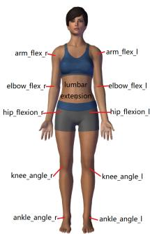
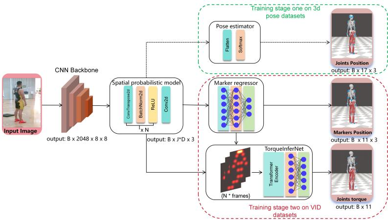

# 迈向基于真实图像的人体逆动力学：用于关节力矩估计的数据集与基准

Chen Chen1 Weifeng Su1 ∗

1北京师范大学-香港浸会大学联合国际学院（Beijing Normal-Hong Kong Baptist University），中国珠海

## 摘要

人体逆动力学是分析人体运动的一项重要技术。以往的研究通常从关节姿态图像、标记点坐标或肌电图（EMG）信号中估计关节力矩，这严重限制了它们在现实场景中的适用性。在这项工作中，我们的目标是直接从真实人体图像中预测人体运动过程中的关节力矩。为了填补这一空白，我们提出了基于视觉的逆动力学数据集（VID），这是首个专门用于从真实人体图像预测关节力矩的数据集。VID 包含 63,369 帧真实人体受试者的同步单目图像、运动学数据和动力学数据。所有数据均经过仔细的同步、细化和人工验证，以确保高质量。此外，我们引入了一个全面的基于真实人体图像的视觉逆动力学基准，包括一种新的基线方法和涵盖三个难度级别的新评估准则：(i) 整体关节力矩估计，(ii) 特定关节分析，以及 (iii) 特定动作预测。我们进一步将我们的 VID-Network 基线结果与其他代表性方法进行了比较，我们的基线方法在几乎所有的评估准则上都取得了最先进（state-of-the-art）的性能。通过发布 VID 及其配套的评估协议，我们旨在为推进基于真实人体图像的生物力学研究奠定基础，并促进在非受限环境中探索人体逆动力学的新方法。项目网址为 https://github.com/MedVisionKitchen/VID-Benchmark。

## 1 引言

人体逆动力学是基于观测到的运动学和外力，计算产生特定人体运动所需的内部关节力矩和力的过程。它涵盖了广泛的应用领域，包括医学、体育、机器人学和康复（LeVeau, 2024）。代表性工作包括运动动作技术分析（Johnson & Ballard, 2014; Yeadon et al., 2006; Lech et al., 2015）、利用假体植入物进行受损关节的手术置换（Kameni Nteutse & Geletu, 2024; STEINER et al., 1989; Hu et al., 2024），以及人形机器人运动控制策略的研究（Koonce et al., 2011; Sulaiman et al., 2024; Liang et al., 2024; Sy Horng Ting et al., 2025）。关节力矩是生物力学研究中的关键要素，因为它表征了构成人体运动基础的力学相互作用。

现有的力矩估计方法通常分为三类：基于表面肌电图（sEMG）的方法 (Buchanan et al., 2005; Paquin & Power, 2018; Gui et al., 2019; Caulcrick et al., 2021)、基于逆动力学（ID）的方法 (Manukian et al., 2023; Johnson & Ballard, 2014; Xiong et al., 2019; Zell & Rosenhahn, 2017) 以及模仿学习方法 (Liu et al., 2024; Luo et al., 2023; Peng et al., 2022; 2021)。第一类方法依赖于 sEMG 设备来采集肌肉电活动，随后将其作为神经网络的输入以进行力矩预测，或者通过正向动力学模型进行处理。基于 ID 的方法需要采集动作捕捉数据，这通常是通过光学动作捕捉系统结合测力板获取的。然后，这些数据被用于牛顿-欧拉（Newton-Euler）动力学公式或数据驱动模型中，以估计关节力矩 (Khalil, 2010; Riemer & Hsiao-Wecksler, 2008)。由于对专业且昂贵设备的依赖，基于 sEMG 和基于 ID 的方法都局限于实验室环境，这使得它们在户外运动或竞技场景中难以实际应用 (Zhang et al., 2023; 2021b)。为了解决这些局限性，研究者提出了基于模仿的方法。这些方法利用基于仿人机器人的仿真来生成成对的运动学和动力学数据，进而用于训练神经网络以学习运动与关节力矩之间的潜在关系（例如逆动力学）。尽管此类方法取得了一定成效，但它们受到仿真数据与真实世界数据之间固有的分布差异的影响，并且仍然依赖于基于标记点（marker-based）的动作输入，限制了其在无约束环境中的适用性。为了克服这些挑战，我们旨在开发一种完全基于真实人体图像的关节力矩估计解决方案，该方案无需实体标记点，并能在现实世界或野外运动场景中实现实际部署。

首先需要解决的问题是数据集。目前，尚无可直接用于视觉生物力学推理的数据。我们从开源数据集 (Uhlrich et al., 2023) 中构建了 VID 数据集。动力学数据由 OpenSim 软件导出。我们投入了大量精力来同步运动学与动力学帧数据并提升数据集质量，最终提供了 63,369 帧真实人体图像以及相应的运动学和动力学标注。

其次，我们提出了一个基线网络（VID Network），旨在纯粹从视觉输入估计关节力矩，而不依赖于动作捕捉或受力数据。由于关节力矩在本质上依赖于关节位置，捕获准确的空间结构对于可靠的预测至关重要。鉴于现有 CNN 网络在三维人体姿态估计方面的出色表现，我们构建了辅助三维姿态估计器和空间概率模型。在第一训练阶段，这些模型在几个大规模三维姿态数据集上进行了预训练。基于该预训练模型，我们设计了标记点回归器（marker regressor）和 TorqueInferNet。标记点回归器使网络能够学习感兴趣的关节姿态。TorqueInferNet 从多帧中将空间概率特征与每帧所选标记点的位置相结合，以预测关节力矩。大量实验表明，我们的方法已经超越了基于标记点的最先进方法。这证明了这种基于真实图像的力矩预测方案是可行的。本文的主要贡献总结如下：

• 数据集：我们引入了 VID，这是一个高质量且经过严格同步的生物力学数据集，包含 63,369 帧真实人体图像以及相应的运动学和动力学标注，可直接用于基于视觉的关节力矩预测。

• 基准：我们建立了首个基于真实人体图像进行力矩预测的基准，包含一套具有三个层级标准的全面评估协议：(i) 总体关节力矩估计，(ii) 特定关节分析，以及 (iii) 特定动作预测。这为未来方法的公平比较提供了标准化基础。

• 基线：我们提出了 VID-Network，这是一个融合了空间概率特征、标记点回归和时序建模的强基线模型，取得了最先进的性能，并验证了直接从真实人体图像进行力矩估计的可行性。

## 2 相关工作

牛顿-欧拉方程（Newton-Euler formulation）。这是解决力矩计算的传统方法，其中广义坐标用于描述机械系统的运动。Arian (Arian et al., 2018) 侧重于通过修改其结构并使用牛顿-欧拉法来分析一种名为 Tripteron 的特殊 3 自由度（3-DOF）并联机器人的运动学和动力学。Luca (De Luca & Ferrajoli, 2009) 提出了一种改进的牛顿-欧拉算法，使动力学计算更简便、更有效，以用于机器人故障检测和控制。该方程表示为：

$$
M (q) \ddot {q} + C (q, \dot {q}) + G (q) = J \lambda + \tau\tag{1}
$$

其中向量 q 表示广义坐标（例如关节角），而 q˙ 和 q¨ 分别表示其一阶和二阶导数，对应于关节速度和加速度。矩阵 $M ( \mathbf { q } )$ 是描述系统质量分布的质量或惯性矩阵。$C ( \mathbf { q } , { \dot { \mathbf { q } } } )$

计入了因运动产生的科里奥利力和离心力效应。$\mathbf { G } ( \mathbf { q } )$ 表示作用在系统上的重力。在等式右侧，$\tau$ 是施加的关节力矩或关节力向量，Jλ 反映了外力或约束力的贡献，其中 J 为雅可比矩阵，λ 为代表这些约束力的拉格朗日乘子向量。该方法需要利用动作捕捉系统获取关节姿态 ${ \bf q } ,$ 并通过数值微分计算出关节速度 $\dot { \mathbf { q } }$ 与加速度 $\ddot { \bf q }$。使用测力台采集地面反作用力，并利用 OpenSim(Delp et al., 2007) 构建包含质量、惯性和连杆结构等参数的人体肌肉骨骼模型。由于受到设备、场地以及数据采集时长等方面的限制，该方法无法快速应用于实时任务中。

深度学习方法。机器学习方法的快速发展显著推动了动力学系统的预测研究。利用传感器收集的信息（包括 sEMG 数据、姿态关键点位置、测力台反作用力等），可以采用机器学习方法来预测人体生物力学。例如，(Zhang et al., 2021a) 提出了一种肌电图（sEMG）驱动的神经肌肉骨骼（NMS）模型和人工神经网络（ANN）模型，用于估计踝关节力矩。当训练数据包含大量且多样化的运动类型时，ANN 模型的表现更佳。一些研究 (Son et al., 2024; Zhang et al., 2020; Wang et al., 2023; Zhang et al., 2022) 使用长短期记忆（LSTM）神经网络和迁移学习来预测下肢关节力矩，该方法适用于日常活动中的各种场景，并为可穿戴设备在运动分析与康复中的应用提供了新思路。(Dinovitzer et al., 2023) 提出了一种结合神经网络与动力学模型的混合方法以及端到端神经网络，用于实时估计人体关节力矩以动态预测人体行走。混合模型在仿真环境中表现出高精度，而端到端神经网络在实际测试中表现更好。然而，混合模型在与训练数据不同的场景中具有更好的泛化能力。(Zell et al., 2020) 通过提出一种弱监督学习框架来解决人体动力学估计问题。该框架的核心思想是利用易于获取的运动数据，并通过弱监督和领域自适应来估计地面反作用力、地面反作用力矩和关节力矩。

动作模仿学习。它是指智能体（agent）通过观察演示数据（通常为关节位置、速度或全身运动学形式）来学习复现人类或专家的运动轨迹的过程。(Kobayashi et al., 2025) 提出了一种用于机械臂自主操作的基于 Transformer 模型的新型模仿学习方法（ILBiT）。(Matsuura et al., 2023) 提出了一项关于仿人机器人模仿学习的研究，重点解决遥操作设备和高负载控制系统的开发问题。基于模仿学习获取的数据来训练神经网络，近期的工作如 ImDy (Liu et al., 2024) 利用该方法收集了长达 150 小时的数据，使用 Transformer 编码器处理输入的运动状态序列，并通过线性头预测关节力矩和地面反作用力。该方法的优势在于能够轻松收集各种动作和持续时间的运动数据，但其缺点是模仿学习与真实运动之间的固有差异给模型泛化带来了挑战。

## 3 视觉逆动力学数据集

如前所述，当前大多数数据集并不非常适合用于从真实人体图像进行力矩预测。造成这一情况的原因之一在于，使用生物力学建模软件处理运动数据需要耗费大量的人力。此外，同步来自不同来源的数据也是一项挑战。部分数据集（Zell et al., 2020; Werling et al., 2024）具备运动学和动力学数据以及姿态图像，但缺乏真实图像；一些数据集（Uhlrich et al., 2023; Mahmood et al., 2019）仅具有真实人体图像和运动学数据，缺乏同步的动力学数据或高质量数据。在本研究中，我们提出了一个基于开源数据集（Uhlrich et al., 2023; Mahmood et al., 2019）构建的优化数据集，实现了从真实图像到生物力学动力学的端到端映射，为该领域的未来研究提供了便利。该数据集通过标注关节速度和力矩得到了扩充，从而形成了更完整的运动学和动力学数据。对比信息如下表 Table 1 所示。我们的数据集具有完整的运动学数据、动力学数据和真实图像。所有数据均经过手动同步和平滑处理，以去除异常值。

Figure 1: 用于力矩评估的关节标注解剖位置。

<table><tr><td>数据集名称</td><td>规模</td><td>运动学</td><td>动力学</td><td>同步</td><td>真实图像</td></tr><tr><td>CMU Mocap (CMU, 2003)</td><td>4.5h</td><td>部分</td><td>部分</td><td>✘</td><td>✘</td></tr><tr><td>AMASS (Mahmood et al., 2019)</td><td>40h</td><td>部分</td><td>部分</td><td>✘</td><td>✘</td></tr><tr><td>OpenCap (Uhlrich et al., 2023)</td><td>8h</td><td>部分</td><td>部分</td><td>✘</td><td>✓</td></tr><tr><td>Imdy (Liu et al., 2024)</td><td>152h</td><td>完整</td><td>完整</td><td>✓</td><td>✘</td></tr><tr><td>AddBiomechanics (Werling et al., 2024)</td><td>70h</td><td>完整</td><td>完整</td><td>✓</td><td>✘</td></tr><tr><td>Ours</td><td>63,369f</td><td>完整</td><td>完整</td><td>✓</td><td>✓</td></tr></table>

Table 1: 现有生物力学相关数据集的对比，包括数据集规模、运动学与动力学数据的完整性与同步性，以及真实图像的可用性。其中，h 表示小时，f 表示帧数。

该数据集包含来自 9 名受试者（包括 4 名男性和 5 名女性）的记录，身高范围为 1.60 m 至 1.85 m。每名受试者进行了七种类型的动作，每次试验以 100 FPS 的采样率提取了约 100 个连续帧。每名受试者身体上共放置了 51 个标记点。使用 OpenSim 软件，手动提取了每一帧的 35 个关节位置和相应的关节力矩。关节角速度使用有限差分法（Finite Difference method）计算。给定离散时间步 $t _ { i }$ 下的一系列关节位置 $\mathbf { x } _ { i } \in \mathbb { R } ^ { 3 }$，关节速度可以通过有限差分进行近似。计算公式为：

$$
\mathbf {v} _ {i} = \frac {\mathbf {x} _ {i + 1} - \mathbf {x} _ {i - 1}}{2 \Delta t},
$$

其中 $\Delta t = t _ { i + 1 } - t _ { i }$ 是帧间时间间隔。为确保数据质量，运动学轨迹使用 SavitzkyGolay 滤波器（Savitzky & Golay, 1964）进行了平滑处理（窗口大小 = 11 帧，多项式阶数 = 3）。超过基于速度的阈值的异常值通过三次样条插值进行校正，且仅应用于短间隙（≤ 5 帧）以保持自然运动的连续性。最终数据集总共包含 63,369 帧同步的视觉、运动学和动力学标注。显然，还提供了许多个人生物信息，例如身高、体重和性别。

## 4 方法

利用收集到的 VID 数据集，我们的目标是通过视觉逆动力学网络以全监督的方式解决人体逆动力学问题。在第一小节中，我们首先介绍数据驱动逆动力学的形式化描述。随后，在第二小节中介绍所提出的 VID 网络（VID Network）。VID 的整体流程如图 2（Figure 2）所示。

## 4.1 形式化

视觉逆动力学任务可以用以下公式表示：

$$
\tau^ {m * t} = \mathrm{VID} (I ^ {t}, P o s ^ {m * t}, V e l c ^ {m * t}, H, M),\tag{2}
$$

其中 $\tau ^ { m * t }$ 是在时间戳 $\mathbf { t }$ 处预测的 m 个关节力矩，$I ^ { t }$ 是在时间戳 t 处人物的视觉图像，$P o s ^ { m * t }$ 是时间戳 t 处的标记点位置，$V e l c ^ { m * t }$ 是时间戳 t 处的标记点速度，H 和 M 分别是受试者的身高和体重。由于我们提出的是一种纯视觉方法，$I ^ { t }$ 是模型的输入，除 $I ^ { \bar { t } }$ 之外的所有运动信息均可用作监督信号。

## 4.2 VID 网络

基线架构。为了构建一个直观且有效的基于真实图像的基线网络，我们采用了现有 3D 人体姿态估计网络中常用的标准设计范式。该范式通常由一个主干特征提取器（ResNet-101）和一个姿态估计器模型组成。该范式已被证明在关节位置估计中行之有效（Cheng et al., 2020; Fabbri et al., 2020; Kang & Lee, 2024），并能为我们的关节力矩预测任务提供有价值的关节空间信息。主干网络基于卷积神经网络构建，该网络在视觉识别任务中已被广泛验证具有强大的性能。空间概率模型由一系列反卷积层以及随后的一个 $1 \times 1$ 卷积层组成。其输出是一组特征，其中每个通道代表图像中特定关节的空间概率分布。此外，姿态估计器将生成的空间特征映射到解剖学关节的 3D 坐标，而标记点回归器则从相同的空间表征中预测外部标记点的位置。标记点的位置更加灵活且符合关节的解剖结构，这对于预测关节力矩至关重要。为了估计关节力矩，我们进一步设计了 TorqueInferNet，将空间特征与预测的标记点坐标相结合，并使用 Transformer Encoder（head=8, dim=128）提取目标帧附近的多个帧来进行预测。

空间概率模型。为了预测每个关节的 3D 空间概率特征，我们设计了一个轻量级头部网络，该网络由一系列反卷积层以及随后的最终预测层组成。头部网络的输入是由主干网络提取的形状为 $\mathbf { \bar { \Gamma } } [ B , 2 0 4 8 , H , \mathbf { \bar { W } } ]$ 的高维特征图。反卷积模块由三个堆叠的转置卷积层组成，每一层的卷积核大小为 $4 \times 4 .$，步长为 2，填充为 1。这些层逐步对特征图进行上采样，并将通道维度降至 256。每个反卷积层后都接有一个批归一化（Batch Normalization）层和一个 ReLU 激活函数。最后，应用一个 $1 \times 1$ 卷积将输出转换为形状为 $[ B , J \cdot D , H ^ { \prime } , W ^ { \prime } ]$ 的张量，其中 J 为关节数量，D 为体素空间特征的深度维度。该输出用于表示每个关节的 3D 空间似然度。

姿态估计器（Pose estimator）。为了从空间概率特征中获取连续的 3D 关节点坐标，我们采用了可微的 soft-argmax 操作（Luvizon et al., 2019）。给定形状为 $[ \bar { B } , J , D , \mathbf { \bar { H } } , W ]$ 的预测空间概率特征，其中 B 为批大小（batch size），J 为关节点数量，$( D , H , W )$ 分别表示深度、高度和宽度维度，我们首先展平空间和深度维度，并沿该轴应用 softmax 函数：

$$
S \tilde {P} F _ {b, j} = \operatorname{Softmax} \left(\text { reshape } (S P F _ {b, j}, [ D \cdot H \cdot W ])\right), \quad \forall b \in [ 1, B ], j \in [ 1, J ]
$$

归一化后的空间概率特征 $S P F _ { b , j }$ 随后被重塑（reshape）回 $[ D , H , W ]$ ，并通过对其他两个维度求和来计算沿每个轴的期望值：

$$
x _ {b, j} = \sum_ {w = 1} ^ {W} w \cdot \sum_ {d = 1} ^ {D} \sum_ {h = 1} ^ {H} S \tilde {P} F _ {b, j} (d, h, w)\tag{3}
$$

$$
y _ {b, j} = \sum_ {h = 1} ^ {H} h \cdot \sum_ {d = 1} ^ {D} \sum_ {w = 1} ^ {W} S \tilde {P} F _ {b, j} (d, h, w)\tag{4}
$$

$$
z _ {b, j} = \sum_ {d = 1} ^ {D} d \cdot \sum_ {h = 1} ^ {H} \sum_ {w = 1} ^ {W} S \tilde {P} F _ {b, j} (d, h, w)\tag{5}
$$

最终的 3D 关节点坐标通过拼接每个关节点的 x、y 和 z 分量获得：

$$
\mathbf {c} _ {b, j} = [ x _ {b, j}, y _ {b, j}, z _ {b, j} ]\tag{6}
$$

该 soft-argmax 操作不仅实现了端到端学习并允许亚体素（sub-voxel）定位精度，同时还保持了可微性。

标记点回归器（Marker regressor）。为了估计附着在身体上的标记点（markers）的 3D 位置，我们设计了一个轻量级回归网络，将空间概率特征映射到标记点坐标。该网络由一个具有两个 128 单元隐藏层的多层感知机（MLP）组成，每层之后均接有 ReLU 激活函数。输出层预测 M 个标记点的 3D 位置，产生大小为 3M 的输出。形式上，该网络学习一个函数 $f : \mathbb { R } ^ { B \times 2 1 \times 3 }  \mathbb { R } ^ { B \times M \times 3 }$ ，其中 M 为标记点的数量。输出被重塑为形状为 $\left[ B , M , 3 \right]$ 的张量，表示每个标记点的预测 3D 坐标。

TorqueInferNet。TorqueInferNet 是一个时序回归网络，旨在利用中心预测（centered prediction）从运动相关特征中预测关节力矩。它将展平的空间概率特征和 3D 标记点位置同时作为输入。给定一个特征为 $\mathbf { x } ~ \in ~ \mathbb { R } ^ { \pmb { \mathring { B } } \times T \times N \times d }$ 的 $T$ 个（默认 T=13）连续帧序列，我们首先将每一帧展平并投影到维度为 $D$ 的紧凑嵌入中，生成词元序列 $\mathbf { z } \in \mathbb { R } ^ { \pm \times \check { T } \times D }$。该序列由带有多头自注意力的 Transformer 编码器处理，以捕获跨帧的长期依赖关系。随后，对应于中间帧的隐藏状态通过全连接层，以回归该时间步的关节力矩：$f : \mathbb { R } ^ { T \times N \times d ^ { \star } }  \mathbb { R } ^ { J }$，其中 J 表示预测的关节数量。

损失项。在训练的第一阶段，我们采用均方误差（Mean Squared Error，MSE）损失来监督预测的 3D 人体姿态与真实标注，记为 $\mathcal { L } _ { \mathrm { p o s e } }$。在第二阶段，我们继续使用 MSE 损失来最小化两个目标：预测标记点坐标与真实值之间的误差，记为 $\mathcal { L } _ { \mathrm { m a r k e r } }$；以及预测关节力矩与真实值之间的误差，记为 $\mathcal { L } _ { \mathrm { t o r q u e } }$。第二阶段用于优化的最终损失是 ${ \mathcal { L } } _ { \mathrm { m a r k e r } }$ 和 ${ \mathcal { L } } _ { \mathrm { t o r q u e } }$ 的加权和，定义为：

$$
\mathcal {L} _ {\text { total }} = \lambda_ {1} \cdot \mathcal {L} _ {\text { marker }} + \lambda_ {2} \cdot \mathcal {L} _ {\text { torque }},\tag{7}
$$

其中 $\lambda _ { 1 }$ 和 $\lambda _ { 2 }$ 是平衡各项贡献的超参数。且它们的和被约束为 1。

## 5 评估

## 5.1 评估设置

为了评估所提出的 VID 网络的有效性，我们进行了广泛的实验。对比方法包括作为最佳混合方法的 Dino (Dinovitzer et al., 2023)，以及最先进的基于模仿学习的方法 ImDy (Liu et al., 2024)。需要指出的是，这两种方法都依赖带标签的运动数据来估计关节力矩，而我们的方法依赖真实图像。VID 数据集按 8:2 的比例划分为训练集和测试集。超参数 $\lambda _ { 1 }$ 和 $\lambda _ { 2 }$ 均设置为 0.5。所有输入图像均调整为 256×256 像素。我们使用 Adam 优化器，初始学习率为 0.001。批大小（batch size）设置为 32，模型共训练 500 个轮次（epoch）。在训练过程中，学习率衰减至 0.0001 以确保收敛并提升优化性能。所有方法均在相同的数据集配置下进行训练和评估。实验在两块 NVIDIA A100 GPU 上进行。

Figure 2: 我们用于从真实人体图像中预测关节力矩的基线网络。在第一阶段，姿态估计器（Pose estimator）和空间概率模型在多个大规模 3D 姿态数据集上进行预训练。在第二阶段，TorqueInferNet 整合由标记点回归器（marker regressor）预测的关节位置信息以及在空间概率模型中编码的空间特征，然后使用 Transformer 编码器（Transformer Encoder）提取目标帧附近的多个帧以预测关节力矩。图中的人物为本文作者。

<table><tr><td>指标</td><td>Dino</td><td>Imdy</td><td>Ours</td></tr><tr><td>mPJE (Nm/kg) ↓</td><td>2.9493</td><td>2.9262</td><td>1.7612</td></tr></table>

Table 2: 在 VID 数据集上的整体性能。各方法在平均单关节力矩误差（mPJE, Nm/kg）方面的对比。越低越好。

## 5.2 评估标准与指标

我们为实验中的三种方法定义了三个新的评估标准：整体性能、特定关节性能和特定动作性能。我们采用平均单关节误差（mean Per Joint Error, mPJE）作为评估指标。根据先前方法（Liu et al., 2024）的设计，mPJE 进一步通过体重进行归一化以对齐不同的受试者。具体计算公式如下式 (8) 所示，其中 N 为关节数量，Jˆ 为预测的关节力矩，J 为真实值（ground truth），$M a s s _ { s u b }$ 为受试者的体重。

$$
\mathrm{mPJE} = (\frac {1}{N} \sum_ {i = 1} ^ {N} \left\| \hat {\mathbf {J}} _ {i} - \mathbf {J} _ {i} \right\| _ {2}) / M a s s _ {s u b}\tag{8}
$$

## 5.3 评估结果与分析

三个评估任务的实验结果如下所示：1）总体定量结果如 Table 2 所示。它是指数据集中所有样本的平均 mPJE，反映了模型的整体性能。Dino 取得了 2.9493 的 mPJE，而 ImDy 取得了更低的 2.9262 的 mPJE。本文提出的方法误差最低，平均每关节误差（mean Per Joint Error，mPJE）达到 1.7612。与表现最佳的基线相比，这代表降低了 1.15，对应于 39.81% 的相对提升。

<table><tr><td rowspan="2">关节类型</td><td colspan="3">mPJE(N.m/kg) ↓</td></tr><tr><td>Dino</td><td>Imdy</td><td>Ours</td></tr><tr><td>hip_flexion_r</td><td>0.4692</td><td>0.4914</td><td>0.2702 (-0.2212)</td></tr><tr><td>hip_flexion_l</td><td>0.3888</td><td>0.3589</td><td>0.2432 (-0.1157)</td></tr><tr><td>lumbar_extension</td><td>0.7811</td><td>0.8147</td><td>0.3326 (-0.4485)</td></tr><tr><td>knee_angle_r</td><td>0.3952</td><td>0.4120</td><td>0.2044 (-0.1908)</td></tr><tr><td>knee_angle_l</td><td>0.2765</td><td>0.2836</td><td>0.2124 (-0.0641)</td></tr><tr><td>arm_flex_r</td><td>0.0464</td><td>0.0486</td><td>0.0307 (-0.0157)</td></tr><tr><td>arm_flex_l</td><td>0.0698</td><td>0.0562</td><td>0.0405 (-0.0157)</td></tr><tr><td>ankle_angle_r</td><td>0.2467</td><td>0.2088</td><td>0.1717 (-0.0371)</td></tr><tr><td>ankle_angle_l</td><td>0.2333</td><td>0.1730</td><td>0.1234 (-0.0496)</td></tr><tr><td>elbow_flex_r</td><td>0.0164</td><td>0.0362</td><td>0.0162 (-0.0002)</td></tr><tr><td>elbow_flex_l</td><td>0.0269</td><td>0.0428</td><td>0.0204 (-0.0065)</td></tr></table>

Table 3: VID 数据集上各特定关节的 mPJE (Nm/kg)，表明我们的方法始终实现最低的误差。

<table><tr><td rowspan="2">动作类型</td><td colspan="3">mPJE(N.m/kg) ↓</td></tr><tr><td>Dino</td><td>Imdy</td><td>Ours</td></tr><tr><td>SitToStand1</td><td>0.2266</td><td>0.2451</td><td>0.1252 (-0.1014)</td></tr><tr><td>STSweakLeg1</td><td>0.2714</td><td>0.2222</td><td>0.1389 (-0.0833)</td></tr><tr><td>squats1</td><td>0.2239</td><td>0.276</td><td>0.1405 (-0.0834)</td></tr><tr><td>squatsAsym1</td><td>0.222</td><td>0.2742</td><td>0.1422 (-0.0798)</td></tr><tr><td>walking1</td><td>0.3419</td><td>0.1722</td><td>0.1299 (-0.0423)</td></tr><tr><td>walking2</td><td>0.3120</td><td>0.1878</td><td>0.1436 (-0.0442)</td></tr><tr><td>walking3</td><td>0.3143</td><td>0.1780</td><td>0.1222 (-0.0558)</td></tr><tr><td>walkingTS1</td><td>0.3023</td><td>0.1657</td><td>0.1840 (+0.0183)</td></tr><tr><td>walkingTS2</td><td>0.2908</td><td>0.1546</td><td>0.2218 (+0.0672)</td></tr><tr><td>walkingTS3</td><td>0.2931</td><td>0.1609</td><td>0.1120 (-0.0489)</td></tr><tr><td>DownJump1</td><td>0.6511</td><td>0.6879</td><td>0.5341 (-0.1538)</td></tr><tr><td>DownJump4</td><td>0.6788</td><td>0.7305</td><td>0.5120 (-0.1668)</td></tr><tr><td>DownJump5</td><td>0.6569</td><td>0.7305</td><td>0.4926 (-0.1643)</td></tr><tr><td>DownJumpAsym3</td><td>0.9330</td><td>1.0242</td><td>0.7769 (-0.1561)</td></tr><tr><td>DownJumpAsym4</td><td>0.6421</td><td>0.7177</td><td>0.4412 (-0.2009)</td></tr><tr><td>DownJumpAsym5</td><td>0.6744</td><td>0.7207</td><td>0.4751 (-0.1993)</td></tr></table>

Table 4: VID 数据集上针对特定动作的 mPJE (Nm/kg)。我们的方法在大多数动作类别中均取得了最低的误差。括号中的数字表示与现有最佳方法相比的改进幅度。

2) 为了全面评估模型在不同关节上的性能，我们报告了每个关节的平均单关节误差（mean Per Joint Error，mPJE）。特定关节性能的定量结果如 Table 3 所示。评估共涉及 11 种关节类型，包括：hip flexion r、hip flexion l、lumbar extension、knee angle r、knee angle l、arm flex r、arm flex l、ankle angle r、ankle angle l、elbow flex r 以及 elbow flex l。这些关节的具体位置如图 Figure 1 所示。IMDY 和 DINO 在这 11 个关节上表现各异，各个关节均展现出各自特定的优缺点。然而，两者的得分差异并不显著。我们的方法在所有关节类型中均取得了更优的预测结果。除 elbow flex r 和 elbow flex l 关节外，我们的方法明显优于其他两种方法。最显著的改善体现在 lumbar extension 上，提升了 0.4485，其次是 hip flexion r，提升了 0.2212。

3) VID 数据集共包含 16 种不同的动作，包括从坐到站的转换、行走、深蹲、跳下等。为了验证模型在不同动作上的性能，我们计算了每个动作的 mPJE 值。特定动作性能的定量结果如 Table 4 所示。Imdy 在行走动作上的表现显著优于 Dino。然而，它在其他类型的动作上表现相对较差。我们将此归因于行走样本的数量较多，这有利于基于 Transformer 的模型——这一现象在先前的研究中也得到了验证。我们的方法在大多数动作类型上仍然取得了最佳性能，尤其是在 DownJump 类别上具有高达 0.2009 的显著优势。然而，它在 walkingTS1 和 walkingTS2 上的表现不及 Imdy。

<table><tr><td colspan="3">消融设置</td><td rowspan="2">mPJE</td></tr><tr><td>姿态估计器（Pose estimator）</td><td>标记点回归器（Marker regressor）</td><td>TorqueInferNet</td></tr><tr><td>✗</td><td>✗</td><td>√</td><td>2.4990</td></tr><tr><td>✗</td><td>√</td><td>√</td><td>2.1179</td></tr><tr><td>√</td><td>✗</td><td>√</td><td>2.2236</td></tr><tr><td>√</td><td>√</td><td>√</td><td>1.7612</td></tr></table>

Table 5: 辅助模块有效性的消融研究。

## 5.4 消融研究

我们设计了一种有效的网络架构，由三个主要模块组成：预训练的姿态估计器（pose estimator）、标记点回归器（Marker regressor）和 TorqueInferNet。通常，将 TorqueInferNet 直接连接到空间概率特征可能代表了一种极简的设计范式。因此，我们旨在探究两个辅助模块（姿态估计器和标记点回归器）对关节力矩预测的影响。消融研究的结果如 Table 5 所示。用于提取关节位置信息的标记点回归器对关节力矩预测具有积极影响。同样，引入姿态估计器带来了 0.15 的性能提升，进一步验证了我们的假设，即预训练增强了骨干网络（backbone network）的空间表征能力。

## 6 结论

在本文中，我们提出了一种基于真实人体图像的逆动力学预测方法，克服了以往方法在应用场景方面的局限性。我们通过从现有开源数据集中手动导出和优化数据构建了 VID 数据集，并进一步用关节力矩和速度标注对其进行了增强。该手动同步的数据集包含 63,369 个高质量帧。利用这一资源，我们开发了一种新颖的端到端神经框架 VID-Network。它包括用于提取解剖关节空间特征的空间概率模型（Spatial Probabilistic Model）、用于估计所需关节坐标的标记点回归器（Marker Regressor），以及能够有效融合空间表征与位置线索以预测关节力矩的 TorqueInferNet。

为了更好地验证所提方法的有效性，我们引入了三个评估标准：(i) 整体关节力矩估计，(ii) 特定关节估计，以及 (iii) 特定动作估计。这些标准使得能够更全面地将模型性能与现有方法进行对比。与以往的方法相比，我们的方法实现了 39.81% 的提升。这表明所提方法建立了一个强有力的基准以供参考。据我们所知，这是首项直接从真实人体图像中估计逆动力学（inverse dynamics）的研究，从而为该任务建立了一个新的基准。更重要的是，它为在更加不受限和实际的场景中应用力矩预测铺平了道路。

尽管本文提供了首个基于真实人体图像的逆动力学基准，但它也为未来的研究开辟了若干途径。有前景的方向包括：(i) 跨受试者泛化（cross-subject generalization），在未见过的受试者上评估模型；(ii) 自然场景（in-the-wild scenarios），将评估扩展到实验室环境之外；以及 (iii) 多模态扩展（multi-modal extensions），结合如 IMU 或 EMG 等互补信号。我们期望 VID 能够作为这些未来基准的基础，推动生物力学和计算机视觉领域更广泛的进步。

## 参考文献

Alaleh Arian, Behzad Danaei, and M Tale Masouleh. Kinematic and dynamic analyses of tripteron, an over-constrained 3-dof translational parallel manipulator, through newton-euler approach. AUT Journal ofModeling and Simulation, 50(1):61–70, 2018.

Thomas S Buchanan, David G Lloyd, Kurt Manal, and Thor F Besier. Estimation of muscle forces and joint moments using a forward-inverse dynamics model. Medicine & Science in Sports & Exercise, 37(11):1911–1916, 2005.

Christopher Caulcrick, Weiguang Huo, Will Hoult, and Ravi Vaidyanathan. Human joint torque modelling with mmg and emg during lower limb human-exoskeleton interaction. IEEE Robotics and Automation Letters, 6(4):7185–7192, 2021.

Yu Cheng, Bo Yang, Bo Wang, and Robby T Tan. 3d human pose estimation using spatio-temporal networks with explicit occlusion training. In Proceedings of the AAAI Conference on Artificial Intelligence, volume 34, pp. 10631–10638, 2020. doi: 10.1609/aaai.v34i07.6689. URL https: //doi.org/10.1609/aaai.v34i07.6689.

CMU. Carnegie mellon university motion capture database. http://mocap.cs.cmu.edu/, 2003.

Alessandro De Luca and Lorenzo Ferrajoli. A modified newton-euler method for dynamic computations in robot fault detection and control. In 2009 IEEE International Conference on Robotics and Automation, pp. 3359–3364, 2009. doi: 10.1109/ROBOT.2009.5152618.

Scott L Delp, Frank C Anderson, Allison S Arnold, Peter Loan, Ayman Habib, Chand T John, Eran Guendelman, and Darryl G Thelen. Opensim: open-source software to create and analyze dynamic simulations of movement. IEEE transactions on biomedical engineering, 54(11):1940– 1950, 2007.

Hannah Dinovitzer, Mohammad Shushtari, and Arash Arami. 用于人体运动动态预测的精确实时关节力矩估计. IEEE Transactions on Biomedical Engineering, 70(8):2289–2297, 2023.

Matteo Fabbri, Fabio Lanzi, Simone Calderara, Stefano Alletto, and Rita Cucchiara. 用于多人 3D 姿态估计的压缩体积热图. In Proceedings of the IEEE/CVF conference on computer vision and pattern recognition, pp. 7204–7213, 2020.

Kai Gui, Honghai Liu, and Dingguo Zhang. 一种实现基于肌电信号（EMG）的机器人外骨骼力矩估计的实用自适应方法. IEEE/ASME Transactions on Mechatronics, 24(2): 483–494, 2019.

Mingyu Hu et al. 单侧经股截肢患者的步态调节：从神经动力学到运动协调. 2024.

Leif Johnson and Dana Ballard. 行走过程中逆动力学的高效编码. In Proceedings of the AAAI Conference on Artificial Intelligence, volume 28, 2014.

Peguy Kameni Nteutse and Abebe Geletu. 基于数学建模的单腿经股假肢行走过程中膝关节力矩动力学研究. Complexity, 2024(1):8891686, 2024.

Taeho Kang and Youngki Lee. 用于第一人称视角热图升维至 3D 姿态的注意力传播网络. In Proceedings of the IEEE/CVF Conference on Computer Vision and Pattern Recognition, pp. 842–851, 2024.

Wisama Khalil. 基于递推牛顿-欧拉技术的机器人动力学建模. In ICINCO2010, 2010.

Masato Kobayashi, Thanpimon Buamanee, Yuki Uranishi, and Haruo Takemura. ILBIT：基于 Transformer 双边控制的位置与力矩信息机器人模仿学习. IEEJ Journal of Industry Applications, 14(2):161–168, 2025.

Philip Koonce, Vasha Dutell, Jose Farrington, Vladimir Sukhoy, and Alexander Stoytchev. 迈向学习解决插入任务：一种利用探索行为和本体感觉的发育方法. In Proceedings of the AAAI Conference on Artificial Intelligence, volume 25, pp. 1798–1799, 2011.

Grzegorz Lech, Wiesław Chwała, Tadeusz Ambrozy, and Stanisław Sterkowicz. 柔道运动员的肌肉力矩及其与技术、战术、竞技水平和年龄组的关系. Journal of human kinetics, 45:167, 2015.

Barney LeVeau. 人体运动生物力学：卫生健康专业的基础与进阶. Routledge, 2024.

Xu Liang, Yuchen Yan, Weiqun Wang, Tingting Su, Guangping He, Guotao Li, and Zeng-Guang Hou. 面向下肢康复机器人的高精度强跟踪能力自适应人机交互力矩估计. IEEE/ASME Transactions on Mechatronics, 2024.

Xinpeng Liu, Junxuan Liang, Zili Lin, Haowen Hou, Yong-Lu Li, and Cewu Lu. ImDy：基于模仿观测的人体逆动力学. arXiv preprint arXiv:2410.17610, 2024.

Zhengyi Luo, Jinkun Cao, Kris Kitani, Weipeng Xu, et al. 实时仿真化身的持久人形控制（Perpetual humanoid control for realtime simulated avatars）. In Proceedings of the IEEE/CVF International Conference on Computer Vision, pp. 10895–10904, 2023.

Daniel Luvizon, David Picard, and Hedi Tabia. 结合间接部件检测与上下文信息的人体姿态回归（Human pose regression by combining indirect part detection and contextual information）. In CVPR, 2019.

Naureen Mahmood, Nima Ghorbani, Nikolaus F Troje, Gerard Pons-Moll, and Michael J Black. AMASS：作为表面形状的动作捕捉档案库（AMASS: Archive of motion capture as surface shapes）. In Proceedings of the IEEE/CVF international conference on computer vision, pp. 5442–5451, 2019.

Mykhailo Manukian, Serhii Bahdasariants, and Sergiy Yakovenko. 用于手臂和手部运动实时逆动力学的人工物理引擎（Artificial physics engine for real-time inverse dynamics of arm and hand movement）. Plos one, 18(12):e0295750, 2023.

Yutaro Matsuura, Kento Kawaharazuka, Naoki Hiraoka, Kunio Kojima, Kei Okada, and Masayuki Inaba. 双足双臂人形机器人全身作业模仿学习系统的开发（Development of a whole-body work imitation learning system by a biped and bi-armed humanoid）. In 2023 IEEE/RSJ International Conference on Intelligent Robots and Systems (IROS), pp. 10374–10381, 2023. doi: 10.1109/IROS55552.2023.10342502.

James Paquin and Geoffrey A Power. 肌电-力矩关系的历史依赖性（History dependence of the emg-torque relationship）. Journal of Electromyography and Kinesiology, 41:109–115, 2018.

Xue Bin Peng, Ze Ma, Pieter Abbeel, Sergey Levine, and Angjoo Kanazawa. AMP：用于风格化基于物理角色控制的对抗运动先验（AMP: Adversarial motion priors for stylized physics-based character control）. ACM Transactions on Graphics (ToG), 40(4):1–20, 2021.

Xue Bin Peng, Yunrong Guo, Lina Halper, Sergey Levine, and Sanja Fidler. ASE：用于物理仿真角色的大规模可复用对抗技能嵌入（ASE: Large-scale reusable adversarial skill embeddings for physically simulated characters）. ACM Transactions On Graphics (TOG), 41(4):1–17, 2022.

Raziel Riemer and Elizabeth T. Hsiao-Wecksler. 改进关节力矩计算：减少运动误差影响的基于优化的逆动力学（Improving joint torque calculations: Optimizationbased inverse dynamics to reduce the effect of motion errors）. Journal of Biomechanics, 41(7):1503–1509, 2008. ISSN 0021-9290. doi: https://doi.org/10.1016/j.jbiomech. 2008.02.011. URL https://www.sciencedirect.com/science/article/pii/ S0021929008000699.

Abraham Savitzky and Marcel JE Golay. 通过简化最小二乘程序进行数据的平滑与求导（Smoothing and differentiation of data by simplified least squares procedures）. Analytical chemistry, 36(8):1627–1639, 1964.

Jongsang Son, Fandi Shi, and William Zev Rymer. 等长收缩期间基于 BiLSTM 从肌音图预测关节力矩：一项概念验证研究（Bilstm-based joint torque prediction from mechanomyogram during isometric contractions: A proof of concept study）. IEEE Transactions on Neural Systems and Rehabilitation Engineering, 32:1926–1933, 2024.

MARK E STEINER, SHELLEY R SIMON, and JEFFREY C PISCIOTTA. 膝关节置换术后步态和最大膝关节力矩的早期变化（Early changes in gait and maximum knee torque following knee arthroplasty）. Clinical Orthopaedics and Related Research (1976-2007), 238:174–182, 1989.

Shifa Sulaiman, AP Sudheer, and Evgeni Magid. 具双冗余臂轮式人形机器人的力矩控制（Torque control of a wheeled humanoid robot with dual redundant arms）. Proceedings of the Institution of Mechanical Engineers, Part I: Journal of Systems and Control Engineering, 238(2):252–271, 2024.

Terence Sy Horng Ting, Yeh Huann Goh, Kar Mun Chin, Yan Kai Tan, Tsung Heng Chiew, Ge Ma, and Chong Keat How. A review of advanced force torque control strategies for precise nut-to-bolt mating in robotic assembly. International Journal of Robotics & Control Systems, 5(1), 2025.

Scott D Uhlrich, Antoine Falisse, Łukasz Kidzinski, Julie Muccini, Michael Ko, Akshay S Chaudhari, Jennifer L Hicks, and Scott L Delp. Opencap: Human movement dynamics from smartphone videos. PLoS computational biology, 19(10):e1011462, 2023.

M. Wang, Z. Chen, H. Zhan, J. Zhang, X. Wu, D. Jiang, and Q. Guo. Lower limb joint torque prediction using long short-term memory network and gaussian process regression. Sensors, 23(23): 9576, 2023. doi: 10.3390/s23239576. URL https://doi.org/10.3390/s23239576.

Keenon Werling, Janelle Kaneda, Tian Tan, Rishi Agarwal, Six Skov, Tom Van Wouwe, Scott Uhlrich, Nicholas Bianco, Carmichael Ong, Antoine Falisse, et al. Addbiomechanics dataset: Capturing the physics of human motion at scale. In European Conference on Computer Vision, pp. 490–508. Springer, 2024.

Baoping Xiong, Nianyin Zeng, Han Li, Yuan Yang, Yurong Li, Meilan Huang, Wuxiang Shi, Min Du, and Yudong Zhang. Intelligent prediction of human lower extremity joint moment: an artificial neural network approach. IEEE Access, 7:29973–29980, 2019.

Maurice R Yeadon, Mark A King, and Cassie Wilson. Modelling the maximum voluntary joint torque/angular velocity relationship in human movement. Journal of biomechanics, 39(3):476– 482, 2006.

Petrissa Zell and Bodo Rosenhahn. Learning-based inverse dynamics of human motion. In Proceedings of the IEEE International Conference on Computer Vision Workshops, pp. 842–850, 2017.

Petrissa Zell, Bodo Rosenhahn, and Bastian Wandt. Weakly-supervised learning of human dynamics. In Computer Vision–ECCV 2020: 16th European Conference, Glasgow, UK, August 23–28, 2020, Proceedings, Part XXVI 16, pp. 68–84. Springer, 2020.

Longbin Zhang, Zhijun Li, Yingbai Hu, Christian Smith, Elena M. Gutierrez Farewik, and Ruoli Wang. Ankle joint torque estimation using an emg-driven neuromusculoskeletal model and an artificial neural network model. IEEE Transactions on Automation Science and Engineering, 18 (2):564–573, 2021a. doi: 10.1109/TASE.2020.3033664.

Longbin Zhang, Zhijun Li, Yingbai Hu, Christian Smith, Elena M. Gutierrez Farewik, and Ruoli Wang. Ankle joint torque estimation using an emg-driven neuromusculoskeletal model and an artificial neural network model. IEEE Transactions on Automation Science and Engineering, 18 (2):564–573, 2021b. doi: 10.1109/TASE.2020.3033664.

Longbin Zhang, Davit Soselia, Ruoli Wang, and Elena M. Gutierrez-Farewik. Lower-limb joint torque prediction using lstm neural networks and transfer learning. IEEE Transactions on Neural Systems and Rehabilitation Engineering, 30:600–609, 2022. doi: 10.1109/TNSRE.2022. 3156786.

Longbin Zhang, Davit Soselia, Ruoli Wang, and Elena M. Gutierrez-Farewik. 基于 EMG 驱动的神经肌肉骨骼模型与 LSTM 网络的关节力矩估计. IEEE Transactions on Neural Systems and Rehabilitation Engineering, 31:3722–3731, 2023.

Yi Zhang, Xiaodong Zhang, Zhufeng Lu, Zhiming Jiang, and Teng Zhang. 一种基于 EMG 和 LSTM 的新型腕关节力矩预测方法. In 2020 10th Institute of Electrical and Electronics Engineers International Conference on Cyber Technology in Automation, Control, and Intelligent Systems (CYBER), pp. 242–245. IEEE, 2020.