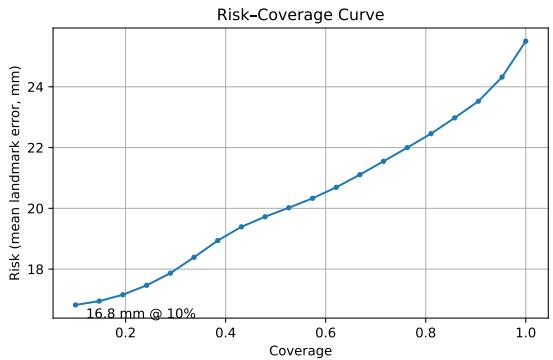

# 面向无标记生物力学的不确定性感知 3D 关键点至解剖学标志点映射

Cesare Davide Pacea,∗, Alessandro Marco De Nunziob,c, Claudio De Stefanoa, Francesco Fontanellaa, Mario Molinaraa

aDepartment of Electrical and Information Engineering, University of Cassino and Southern Lazio, Italy bDepartment of Research and Development, LUNEX, Luxembourg cLuxembourg Health & Sport Sciences Research Institute ASBL, Luxembourg

## 摘要

无标记生物力学（Markerless biomechanics）越来越依赖于从视频中提取的 3D 骨骼关键点，然而下游的生物力学映射通常将这些估计视为确定性的，未提供用于逐帧质量控制的原则性机制。在本研究中，我们探究了将预测不确定性作为置信度量化指标，用于 3D 姿态关键点到 3D 解剖学标志点的映射——这是逆向运动学和肌肉骨骼分析之前的关键步骤。

在一个时序学习框架内，我们同时对源于观测噪声的不确定性以及与模型局限性相关的不确定性进行了建模。利用 AMASS 数据集上同步的动作捕捉真值，我们通过误差-不确定性等级相关性、风险-覆盖率分析以及灾难性离群值检测，在帧级别和关节级别对不确定性进行了评估。

在各项实验中，不确定性估计——尤其是与模型不确定性相关的估计——与标志点误差表现出强单调相关性（Spearman $\rho \approx 0.63$），从而能够选择性地保留可靠帧（在 10% 覆盖率下误差降至 $\approx 16.8$ mm）并准确检测严重失效（针对误差 $> 50$ mm 的情况，ROC-AUC $\approx 0.92$）。在受控的输入退化（包括高斯噪声和模拟关节缺失）情况下，可靠性排序仍保持稳定。相比之下，在此设定下归因于观测噪声的不确定性所提供的额外收益有限，这表明关键点到标志点映射中的主要失效主要是由模型不确定性驱动的。

我们的研究结果确立了预测不确定性可作为无标记生物力学流程中进行自动逐帧质量控制的实用工具。

关键词：无标记生物力学（Markerless biomechanics），3D 姿态估计（3D pose estimation），不确定性量化（Uncertainty quantification），蒙特卡洛 Dropout（Monte Carlo dropout），时序建模（Temporal modeling），可靠性评估（Reliability assessment）

## 1. 引言

人体运动的定量分析越来越依赖于从模式识别和机器学习技术中提取的中间表征，例如骨骼关键点和潜在运动描述符（latent motion descriptors）。这些表征构成了现代无标记流程（markerless pipelines）的基础，使得跨生物力学、康复和手势分析等领域的可扩展分析成为可能。计算机视觉领域的最新进展使得直接从单目或多视角视频中提取 2D 和 3D 人体姿态关键点成为可能，从而大幅降低了在受控实验室环境之外进行运动分析的门槛 [1, 2]。

基于标记的动作捕捉（Marker-based motion capture）因其解剖学依据和空间精度仍是黄金标准，但其成本和基础设施需求限制了可扩展性 [3]。基于姿态估计和运动学重建的无标记替代方案提供了一个极具吸引力的契机，使运动分析得以普及并实现大规模应用 [4, 5]。

尽管取得了这些进展，当前的无标记流程仍存在一个根本性局限：中间姿态表征被视为确定性量 [6]。神经网络通常针对每个关节或关键点输出单个点估计，随后将其传递至下游模块，如解剖标志点回归、逆向运动学或肌肉骨骼模拟。性能评估通常使用在整个序列或数据集上聚合的平均精度指标来汇总 [7]。虽然这些指标在全局层面上具有参考价值，但它们无法捕捉逐帧的可靠性，并且往往掩盖由遮挡、非典型姿势或快速运动引起的局部失效。

这种局限性在生物力学中尤为关键，因为具有临床意义的解释往往依赖于特定运动阶段的精确估计。模型可能表现出较低的平均误差，但在关键步态事件（如离地或膝关节最大屈曲）期间产生严重的离群值。与通过物理标记和信号完整性提供隐式质量指标的基于标记的系统相比，无标记流程缺乏一种规范的机制来区分可靠的解剖学估计与由模型不确定性驱动的幻觉预测（hallucinated predictions）[5]。因此，质量控制通常依赖人工或特定的滤波方法（ad hoc filtering）进行，这削弱了其可扩展性。

因此，一个关键的挑战并非在于提高精度本身，而在于确定何时应该信任某个预测。这需要能够明确量化预测置信度的可靠性感知表征（reliability-aware representations）[8]。在更广泛的机器学习文献中，预测不确定性（predictive uncertainty）已成为应对这一需求的规范框架，通常被分解为反映不可约观测噪声的偶然不确定性（aleatoric uncertainty），以及捕捉由于训练数据有限或有偏而导致模型参数不确定的认知不确定性（epistemic uncertainty）[9, 10]。

然而，不确定性建模在人体运动分析中仍未得到充分探索，尤其是在生物力学解释所需的从姿态关键点到解剖学标志点的映射过程中。事实上，正如上文所述，现有方法主要是确定性的，既没有机制来标记不可靠的帧或关节，也无法在下游分析中支持自动质量控制 [4, 11]。因此，可靠性通常使用静态一致性指标进行回顾性评估，而这些指标难以捕捉无标记点失效模式的时间特性和特定关节特性。

在本研究中，我们探究了在从 3D 姿态关键点到 3D 解剖学标志点的映射中，预测不确定性是否可以作为可靠的逐帧置信度度量。我们并非专注于模型架构的新颖性或精度的微小提升，而是分析了不确定性与真实生物力学误差之间的关系，并评估了不确定性是否能在无标记点流程中实现风险受控的推理。我们在一个时序学习框架中同时对偶然不确定性（aleatoric uncertainty）和认知不确定性（epistemic uncertainty）进行建模，并利用同步动作捕捉真值（ground truth）评估它们的表现。

我们的实验表明，在不同关节和不同时间上，认知不确定性与标志点估计误差呈现出强烈的单调关系，而在该设定下偶然不确定性带来的额外增益有限。这些发现突出了不确定性感知建模对于可靠人体运动分析的重要性，并推动其作为自动质量控制的原则性工具的应用。

本工作的主要贡献可概括如下：

• 一种用于 3D 关键点到标志点映射的不确定性感知框架。

• 不确定性与误差相关性的逐帧分析。

• 风险-覆盖率（risk–coverage）和异常值检测评估。

• 认知不确定性占主导地位的经验证据。

本工作侧重于可靠性而非精度，旨在为可信的大规模无标记点生物力学分析提供方法论基础。

## 2. 相关工作

2.1. 无标记点动作捕捉与生物力学映射

无标记点动作捕捉系统从视频中估计骨骼关键点，并重建用于生物力学分析的 3D 运动 [1, 7]。包括 OpenCap 在内的近期框架已证明在受控条件下与基于标记点的系统具有高度一致性 [4, 3]。

然而，评估通常基于在完整试验中计算的综合精度指标，这掩盖了由遮挡、快速运动或非典型姿态导致的瞬态、特定帧的失效 [5]。因此，在无标记点流程中，逐帧可靠性在很大程度上仍未得到充分表征。

这些系统中的一个关键阶段是从通用三维姿态关键点映射到解剖标志点，以用于逆向运动学和肌肉骨骼分析。现有的标志点估计方法依赖于确定性回归或基于物理的优化，并且通常使用聚合的位置或角度误差进行评估，未能提供逐帧的置信度估计 [11, 4, 12]。

## 2.2. 不确定性建模与可靠性评估

预测不确定性（Predictive uncertainty）是指模型对其自身预测的量化置信程度。在机器学习中，不确定性通常被分解为偶然不确定性（aleatoric uncertainty，反映不可消除的观测噪声）和认知不确定性（epistemic uncertainty，捕捉因有限或有偏差的训练数据导致的数据模型参数不确定性）[9, 10]。成熟的技术包括异方差回归（heteroscedastic regression）、蒙特卡洛随机失活（Monte Carlo dropout）、深度集成（deep ensembles）以及变分推断（variational inference）[13, 14]。

在计算机视觉领域，人体姿态估计中已经对不确定性进行了研究，以提高在分布偏移下的鲁棒性、校准度以及选择性预测能力 [6]。最近，步态分析中也探索了概率公式化方法，以量化关节运动学的置信度并识别不可靠的测试试验或步态。例如，Donahue 等人 [15] 提出了用于临床步态分析的校准不确定性估计，其采用了概率多视图无标记管线，证明了在步态级别上可信度的提升。

然而，现有方法主要在姿态估计或下游运动学总结的层面上发挥作用。将预测不确定性作为逐帧可靠性信号，用于从三维姿态关键点到生物力学定义的解剖标志点的回归，在很大程度上仍未得到探索。特别是，在类 OpenSim 管线中，将基于不确定性的风险–覆盖度（risk–coverage）分析和选择性推断应用于解剖标志点映射方面，受到的关注很少。

本工作通过在关键点到标志点映射阶段显式建模和评估预测不确定性来填补这一空白。我们并非在事后对运动学输出应用不确定性，而是研究其在解剖学重建层面作为可靠性信号的作用，从而在无标记生物力学中实现逐帧的质量控制。

## 2.3. 问题表述与时序映射

令 $\mathbf { x } _ { 1 : T } = \{ \mathbf { x } _ { t } \} _ { t = 1 } ^ { T }$ 表示从视频或动作捕捉数据中提取的三维姿态关键点的时序序列，其中每一帧

$$
\mathbf {x} _ {t} \in \mathbb {R} ^ {K \times 3}, \quad K = 2 0,\tag{1}
$$

表示 $K$ 个骨骼关键点的三维坐标。在此，$K = 2 0$ 对应于在与目标生物力学标记集对齐后，从 AMASS 骨骼表征中保留的三维姿态关键点的数量。

为方便起见，在由时序模型处理之前，每一帧 $\mathbf { x } _ { t }$ 都会被展平，使得 $\mathbf { x } _ { t } \in \mathbb { R } ^ { 3 K }$。

目标输出是一组3D解剖关键点（anatomical landmarks）序列

$$
\mathbf {y} _ {t} \in \mathbb {R} ^ {L \times 3}, L = 4 3,\tag{2}
$$

对应于与生物力学模型兼容的解剖标记点位置。此处，$L \ = \ 4 3$ 表示为了与下游逆运动学（inverse kinematics）模型兼容而采用的解剖关键点配置。该关键点集合包含了源自 AMASS 数据集 [16] 的身体标记点，并添加了额外的填充标记点，以确保在不同受试者和配置之间具有一致的维度。

给定长度为 $T = 6 0$ 的定长输入序列，目标是学习一个时序映射

$$
f _ {\theta}: \mathbb {R} ^ {T \times 3 K} \to \mathbb {R} ^ {T \times L \times 3},\tag{3}
$$

以多对多（many-to-many）的方式预测每一帧的解剖关键点。选择 $T = 6 0$ 对应于数据集采样率（60 Hz）下一秒的时间窗口，在保持计算效率的同时，为稳定的关键点重建提供了充足的运动上下文。

我们采用基于 LSTM 的时序模型作为序列到序列关键点到解剖关键点映射的代表性基线 [17, 4, 11]。

给定展平后的输入序列 $\mathbf { x } _ { 1 : T : }$，网络生成逐帧预测 $\begin{array} { r } { \mu _ { t } ~ = ~ f _ { \theta } ( \mathbf { x } _ { 1 : T } ) _ { t } } \end{array}$，其中 $\pmb { \mu } _ { t } \in \mathbb { R } ^ { L \times 3 }$ 表示在第 t 帧预测的关键点位置。

该模型输出所有帧的预测结果，从而能够进行逐帧可靠性分析。除了点预测 $\pmb { \mu } _ { t } ,$ 之外，该框架还被扩展用于量化预测不确定性，如下文所述。

## 2.4. 不确定性建模

偶然不确定性（Aleatoric uncertainty）.. 为了对依赖于观测的不确定性进行建模，我们采用了异方差回归（heteroscedastic regression）公式 [9, 18]，允许预测方差依赖于输入。在对角协方差假设下，除了预测均值 $\pmb { \mu } _ { t } .$ 之外，网络还会输出一个依赖于输入的对数方差项 log $\pmb { \sigma } _ { t } ^ { 2 } \in \mathbb { R } ^ { L \times 3 }$。

在高斯似然假设下，单帧的负对数似然损失定义为

$$
\mathcal {L} _ {\mathrm{ale}} (t) = \frac {1}{2} \sum_ {l = 1} ^ {L} \sum_ {d = 1} ^ {3} \left(\frac {(y _ {t , l , d} - \mu_ {t , l , d}) ^ {2}}{\sigma_ {t , l , d} ^ {2}} + \log \sigma_ {t, l, d} ^ {2}\right),\tag{4}
$$

其中 $( l , d )$ 分别表示关键点和空间坐标的索引。在训练过程中对对数方差进行截断以保证数值稳定性，且损失在有效关键点和有效帧上取平均。偶然不确定性捕捉了以输入为条件的不可约减的观测噪声。

认知不确定性.. 认知不确定性（Epistemic uncertainty）通过蒙特卡洛（Monte Carlo, MC）Dropout [9, 13] 进行近似。在推理阶段，激活 Dropout 层并执行 $M$ 次随机前向传播，得到预测 $\{ \mu _ { t } ^ { ( m ) } \} _ { m = 1 } ^ { M }$ 。认知方差估计为这些样本的经验方差：

$$
\pmb {\sigma} _ {\mathrm{epi}, t} ^ {2} = \frac {1}{M} \sum_ {m = 1} ^ {M} \left(\pmb {\mu} _ {t} ^ {(m)} - \bar {\pmb {\mu}} _ {t}\right) ^ {2}.
$$

在所有实验中，均使用 $M = 5 0$ 个样本。

总预测不确定性.. 假设偶然分量与认知分量相互独立，总预测方差计算为

$$
\pmb {\sigma} _ {\mathrm{tot}, t} ^ {2} = \pmb {\sigma} _ {\mathrm{epi}, t} ^ {2} + \pmb {\sigma} _ {\mathrm{ale}, t} ^ {2}.
$$

对于帧级分析，使用均值算子跨关键点（landmarks）和空间维度对方差进行聚合，以获得标量不确定性评分。

## 2.5. 可靠性评估

为了评估预测不确定性是否能提供有意义的可靠性信号，我们采用了互补的评估指标。

误差–不确定性相关性.. 逐帧预测误差定义为

$$
e _ {t} = \frac {1}{L} \sum_ {l = 1} ^ {L} \| \mathbf {y} _ {t, l} - \boldsymbol {\mu} _ {t, l} \| _ {2},\tag{5}
$$

并计算 $e _ { t }$ 与相应不确定性评分 $u _ { t }$ 之间的 Spearman 秩相关系数，以评估单调关联性。

风险–覆盖率分析.. 将各帧按不确定性递增排序。对于覆盖率水平 $c \in ( 0 , 1 ]$ ，风险定义为 $\mathrm { R i s k } ( c ) = \mathbb { E } [ e _ { t } \mid u _ { t } \le u _ { c } ]$ ，其中 $u _ { c }$ 保留不确定性最低的前 $c$ 比例的帧。该分析评估了对可靠预测的选择性保留能力。

异常值检测.. 误差超过预定义阈值的帧被视为异常值。将不确定性用作决策变量，并使用 ROC-AUC 和 PR-AUC 指标量化性能。

输入退化.. 为了评估鲁棒性，在推理时向有效的输入关键点中注入具有可配置标准差的零均值高斯噪声。分析由此产生的不确定性行为，以评估在退化条件下可靠性排序是否仍然具有信息量。

## 3. 实验设置

本节介绍用于评估所提出的不确定性感知框架的数据集、预处理步骤、训练配置和评估协议。所有实验均在一致的设置下进行，以确保可复现性以及对预测可靠性的受控分析。

## 3.1. 数据集与预处理

实验在 AMASS 数据集 [16] 上进行，该数据集整合了来自 16 项独立研究的动作捕捉记录，这些记录收集于不同的实验室、受试者、采集协议和动作类型。AMASS 总共包含 1,176 名受试者以及大约 221 小时的动作数据，涵盖了包括行走、跑步、体育运动和其他动态动作在内的广泛活动。这种大规模的聚合在身体形态和动作动态方面提供了显著的多样性，为泛化性和可靠性的真实评估提供了支持。

所有可用的 AMASS 子集均被使用，未按动作类别或序列时长进行过滤。动作序列被分割为 $T = 6 0$ 帧（60 Hz 下为一秒）的固定长度片段。数据在受试者级别进行划分以防止身份泄露，训练集、验证集和测试集采用 80%/10%/10% 的划分比例。重要的是，该划分是在 16 项构成研究中各自独立进行的，从而确保了所有动作来源在训练集、验证集和测试集中的比例代表性。

所有坐标均在度量空间中表示。距离在内部以米为单位计算，并在报告时转换为毫米。

## 3.2. 训练配置

模型使用 AdamW 优化器进行训练，学习率为 $1 \times 1 0 ^ { - 4 }$，权重衰减为 0.05。训练最多运行 200 个周期（epoch），批次大小为 64，并根据验证损失应用早停机制（patience = 10）。超参数是根据验证表现和初步稳定性分析选择的，并在确定性配置和不确定性感知配置之间保持固定，以进行公平比较。

当启用偶然不确定性（aleatoric uncertainty）建模时，训练目标为

$$
\mathcal {L} = \mathcal {L} _ {\mathrm{NLL}} + 1. 0 \mathcal {L} _ {\mathrm{vel}} + 0. 5 \mathcal {L} _ {\mathrm{acc}} + 1. 0 \mathcal {L} _ {\mathrm{angle}} + 1. 0 \mathcal {L} _ {\mathrm{pos}},\tag{6}
$$

其中 $\mathcal { L } _ { \mathrm { N L L } }$ 表示高斯负对数似然，而附加项则用于约束时间平滑度、角度一致性以及关节点级位置精度。设置损失权重以平衡各分量的相对量级，并在所有实验中保持固定。

## 3.3. 蒙特卡洛 Dropout 推理

认知不确定性（epistemic uncertainty）在推理阶段使用 MC Dropout（蒙特卡洛 Dropout）进行估计。在评估期间，重新启用 LSTM 内部的 Dropout 层，同时保持批量归一化（batch normalization）层处于评估模式。使用的 Dropout 率为 0.1。

对于每个输入序列，执行 M = 50 次随机前向传播。预测统计量由生成的样本分布计算得出。Dropout 仅在评估期间应用，不影响训练。

## 3.4. 输入退化实验

为了评估退化输入下的鲁棒性和不确定性行为，在推理时对输入关键点施加受控扰动。

将均值为零、标准差 $\sigma \in \{0, 2.5, 5, 7.5, 10, 15, 20, 30\}$ mm 的高斯噪声独立添加到有效关键点中。

## 3.5. 评估协议

预测精度通过预测地标与真实（ground-truth）地标之间的欧氏距离来衡量。误差按每个关节计算，并在所有地标间取平均以获得逐帧误差，随后在所有帧和序列上进行聚合。

可靠性通过以下指标进行评估：(i) 预测不确定性与真实误差之间的斯皮尔曼等级相关系数（Spearman rank correlation），(ii) 衡量作为保留覆盖率函数的期望误差的风险-覆盖率（risk–coverage）曲线，以及 (iii) 通过 ROC-AUC 和 PR-AUC 量化的异常值检测性能。

注意，预测不确定性的绝对大小并不直接进行解释；相反，我们关注相对于真实误差的相对变化和排序一致性。

## 4. 结果

## 4.1. 基线地标估计精度

我们首先报告了确定性时间模型在 AMASS 测试集上的性能。精度使用平均每关节位置误差（MPJPE）进行评估。

基线模型取得了 21.14 mm 的测试 MPJPE，证实了所提出的时间映射在常规条件下能够产生准确的地标估计。作为参考，测试集中解剖地标轨迹的平均空间范围约为 279 mm（在 20,329 个序列上计算得出），这表明绝对误差大约对应于典型运动幅度的 7.6%。

随后，我们评估了同一模型的异方差（heteroscedastic）变体，该模型经过训练可同时预测地标均值和依赖于输入的方差。为了确保优化的稳定性，异方差模型由预训练的确定性基线进行初始化，并使用基于似然的目标函数进行微调，因为众所周知异方差回归对初始化十分敏感。

使用这种热启动（warm-start）策略，异方差模型取得了 25.51 mm 的测试 MPJPE（≈ 平均运动范围的 9.1%）。尽管与确定性基线相比逐点精度有所下降，但性能仍保持在合理范围内，从而能够对预测不确定性进行有意义的分析。从头开始训练异方差模型始终会导致精度显著降低。

## 4.2. 不确定性作为可靠性信号的定量验证

我们在帧级别分析预测不确定性与真实地标估计误差之间的关系。不确定性估计是通过在推理时结合 MC dropout 的异方差模型获得的。斯皮尔曼等级相关系数用于量化逐帧不确定性与误差之间的单调关系。

认知不确定性（Epistemic uncertainty）与真实解剖标志误差表现出强相关性 $( \rho = 0 . 6 3 )$ ，表明较高的不确定性值与较大的生物力学误差始终相关。相比之下，随机不确定性（aleatoric uncertainty，未展示）的相关性明显较弱，这表明该任务中的可靠性主要受模型不确定性驱动。

为了评估实际效用，我们通过根据认知不确定性对帧进行排序，执行了风险–覆盖度（risk–coverage）分析。Figure 1 显示，随着覆盖度的增加，风险呈现平滑且近似线性的增长，表明帧级可靠性排序良好。仅保留置信度最高的前 10% 的帧可将期望解剖标志误差降低至 16.8 mm（≈ 典型运动范围的 6.0%），相当于相对降低了 34%，证明了不确定性引导选择的实际效用。

  
Figure 1: 根据认知不确定性对帧进行排序所获得的风险–覆盖度曲线。风险的平滑增长表明帧级可靠性排序良好，从而能够实现有效的不确定性引导过滤。

Table 1: 验证集上注入高斯噪声下的鲁棒性。

<table><tr><td>σ (mm)</td><td>平均误差 (mm)</td><td>Spearman ρ</td><td>ROC-AUC</td></tr><tr><td>0.0</td><td>25.70</td><td>0.592</td><td>0.899</td></tr><tr><td>5.0</td><td>25.81</td><td>0.592</td><td>0.899</td></tr><tr><td>10.0</td><td>26.13</td><td>0.594</td><td>0.899</td></tr><tr><td>20.0</td><td>27.39</td><td>0.597</td><td>0.898</td></tr><tr><td>30.0</td><td>29.45</td><td>0.593</td><td>0.896</td></tr></table>

我们进一步评估了不确定性在检测灾难性失效方面的能力，将异常值定义为平均解剖标志误差超过 50 mm 的帧。认知不确定性取得了较强的异常值检测性能（ROC-AUC = 0.92, PR- $\mathrm { A U C } = 0 . 3 9 )$ ，证明了其在识别罕见但严重的失效情况方面的有效性。

我们还探讨了结合随机不确定性和认知不确定性是否能提供互补的可靠性信息。我们发现，与单独使用认知不确定性相比，异方差回归结合 MC dropout 并未改善可靠性指标：Spearman 相关系数、风险–覆盖度表现以及异常值检测性能几乎保持不变。在所有指标上，总不确定性与认知不确定性高度重合。

这些结果表明，关键点到解剖标志（keypoint-to-landmark）映射中的失效案例主要是由模型不确定性驱动的，而非依赖于输入的观测噪声。

## 4.3. 降质条件下可靠性排序的鲁棒性

我们通过在推理阶段向 3D 输入关键点注入幅值递增的零均值高斯噪声，评估了在受控输入退化下基于不确定性的可靠性排序的稳定性。这项在验证集上进行的压力测试，评估了不确定性在观测逐步受损的情况下是否仍能保持其排序能力。

随着噪声从 $\sigma = 0$ 增加到 30 mm，解剖标志点位置和关节角度误差单调增加（我们在 Table 1 中报告了代表性的噪声水平），平均误差从 25.70 mm 上升至 29.45 mm。尽管绝对精度大幅下降，但不确定性与误差之间的关系依然非常稳定：Spearman 相关系数始终保持在 $\rho = 0 . 5 9 2 \mathrm { - } 0 . 5 9 7$ 范围内，这表明可靠帧与不可靠帧的相对排序在很大程度上不受噪声影响。由于误差幅值增大，风险–覆盖率（Risk–coverage）曲线整体上移，但仍保持了其原有形状，证实了不确定性保留了其判别性排序能力。

在所有噪声水平下，异常值检测性能均保持在较高水平（在 σ = 0 时 ROC-AUC = 0.899，在 σ = 30 mm 时为 0.896），仅表现出微小的变化。这种极小的降幅进一步证明，即使在严重扰动下，认知不确定性（epistemic uncertainty）在正常帧与灾难性失效帧之间仍保持着极强的分离能力。

这些结果提供了定量证据，表明认知不确定性可作为一种稳健的可靠性信号，即使在输入关键点严重受损时，也能保持逐帧排序的一致性。

## 5. 讨论

本研究探讨了在无标记生物力学中，将预测不确定性作为可靠性信号，用于将 3D 姿态关键点映射到解剖标志点。尽管我们的实验依赖于基于 LSTM 的时序映射模型（选用该模型是因为它是该领域具有代表性且成熟的解决方案），但研究重点并不在于模型架构的新颖性，而在于不确定性估计是否能有意义地反映真实的生物力学误差，并在实际分析流程中支持逐帧质量控制。

在所有实验中，认知不确定性始终表现为信息量最丰富的组成部分。它与标志点估计误差呈现出较强的单调关系，实现了有效的风险–覆盖率权衡，并能可靠地检测出严重的失效案例。重要的是，这些特性在包括高斯噪声注入在内的受控输入退化下依然保持稳定。这表明认知不确定性提供了逐帧可靠性的稳健排序，而非脆弱或过度自信的置信度评分。

从生物力学角度来看，这些结果与无标记点动作分析（markerless motion analysis）中观察到的常见失效模式一致。较大的标志点误差通常出现在代表性不足或存在歧义的动作姿态中，例如极端的关节屈曲、自遮挡或动作阶段之间的快速过渡。在这些情况下，下游生物力学计算对微小的几何误差尤为敏感。认知不确定性（epistemic uncertainty）与标志点误差之间的强关联表明，即使平均精度保持在可接受范围内，不确定性也可以作为这些生物力学关键失效模式的早期指标。

相比之下，偶然不确定性（aleatoric uncertainty）在认知不确定性之外提供的额外收益有限。将异方差回归（heteroscedastic regression）与 MC Dropout 相结合并未提升相关性、选择性推理或异常值检测性能。应结合实验设置来理解这一发现：输入由重建的 3D 关键点组成，观测噪声相对有限，且主要误差是由模型泛化能力而非传感器级别的变异性引起的。在这种情况下，不确定性主要反映了认知因素，例如对特定姿势或动作动力学的训练覆盖不足。值得注意的是，本研究中考虑的可靠性指标和不确定性–误差分析是与模型无关的（model-agnostic），原则上可以应用于前馈网络或基于 Transformer 的时序架构等替代映射模型中。

本研究的一个局限性在于，不确定性行为仅使用单一时序架构（LSTM）进行了评估。这一选择是有意为之的，因为我们的目标不是进行架构对比，而是评估预测不确定性是否能在关键点到标志点的映射中提供有意义的可靠性信号。此处考虑的不确定性机制是与架构无关的，可以集成到其他序列模型中。

这些发现对无标记点生物力学中的决策制定具有直接意义。不确定性估计可用于自动排除不可靠的片段并在下游分析中对观测值进行加权，而不是对所有帧一视同仁。在临床或大规模研究场景中，这使得从人工质量控制转向基于原则的、不确定性引导的可靠数据筛选成为可能，从而提高了可扩展性和可复现性。

## 6. 结论

我们提出了一个用于将 3D 姿态关键点映射到 3D 解剖标志点的不确定性感知框架，并系统评估了预测不确定性作为无标记点生物力学中可靠性度量的有效性。我们的结果表明，认知不确定性与真实的生物力学误差高度相关，支持有效的风险控制推理，并能可靠地识别灾难性失效。

通过异方差回归对偶然不确定性（aleatoric uncertainty）进行建模，在认知不确定性（epistemic uncertainty）之外带来的额外增益有限，这表明该任务中的失效模式主要是由模型不确定性而非观测噪声驱动的。这些发现表明，在关键点到标志点（keypoint-to-landmark）映射中，仅凭认知不确定性就足以满足实际质量控制的需求。

尽管本研究仅使用单一时间序列架构进行了评估，但所提出的框架并不局限于特定模型。未来的工作将研究其他架构（如基于 Transformer 的模型）中的不确定性行为，并将分析扩展到端到端无标记流水线，以研究跨阶段的不确定性传播。

本研究将预测不确定性确立为无标记动作分析中一种原则性且实用的可靠性信号，并为大规模生物力学流程中具备不确定性感知能力的质量控制奠定了基础。

关于在手稿准备过程中使用生成式人工智能和人工智能辅助技术的声明

在本手稿的准备过程中，作者使用了 ChatGPT 以改善语言表达和可读性。作者对最终内容进行了审阅并承担全部责任。

## References

[1] W. W. Lam, Y. M. Tang, K. N. Fong, A systematic review of the applications of markerless motion capture (mmc) technology for clinical measurement in rehabilitation, Journal of NeuroEngineering and Rehabilitation 20 (2023) 57.

[2] S. Scataglini, E. Abts, C. Van Bocxlaer, M. Van den Bussche, S. Meletani, S. Truijen, Accuracy, validity, and reliability of markerless camera-based 3d motion capture systems versus marker-based 3d motion capture systems in gait analysis: a systematic review and meta-analysis, Sensors 24 (2024) 3686.

[3] M. D’haene, F. Chorin, S. S. Colson, O. Guérin, R. Zory, E. Piche, Validation of a 3d markerless motion capture tool using multiple pose and depth estimations for quantitative gait analysis, Sensors 24 (2024) 7105.

[4] S. D. Uhlrich, A. Falisse, Ł. Kidziński, J. Muccini, M. Ko, A. S. Chaudhari, J. L. Hicks, S. L. Delp, Opencap: Human movement dynamics from smartphone videos, PLoS computational biology 19 (2023) e1011462.

[5] L. Wade, L. Needham, P. McGuigan, J. Bilzon, Applications and limitations of current markerless motion capture methods for clinical gait biomechanics, PeerJ 10 (2022) e12995.

[6] L. Bramlage, M. Karg, C. Curio, Plausible uncertainties for human pose regression, in: Proceedings of the IEEE/CVF International Conference on Computer Vision, 2023, pp. 15133–15142.

[7] M. M. Kappan, E. B. Sandoval, E. Meijering, F. Cruz, A survey on deep learning for 2d and 3d human pose estimation, Artificial Intelligence Review 59 (2026) 32.

[8] J. D. Hauenstein, A. Huebner, J. P. Wagle, E. R. Cobian, J. Cummings, C. Hills, M. McGinty, M. Merritt, S. Rosengarten, K. Skinner, et al., 无标记动作捕捉系统在动作筛查评估中的可靠性, Orthopaedic Journal of Sports Medicine 12 (2024) 23259671241234339.

[9] A. Kendall, Y. Gal, 计算机视觉贝叶斯深度学习中我们需要何种不确定性？, 2017. URL: https://arxiv.org/abs/1703.04977. arXiy:1703.04977.

[10] K. Zou, Z. Chen, X. Yuan, X. Shen, M. Wang, H. Fu, 不确定性估计及其在医学影像中应用的综述, Meta-Radiology 1 (2023) 100003.

[11] A. V. Ruescas-Nicolau, E. Medina-Ripoll, H. de Rosario, J. Sanchiz Navarro, E. Parrilla, M. C. Juan Lizandra, 基于关键点增强的无标记姿态估计深度学习模型：生物力学应用中哪些因素会影响误差？, Sensors 24 (2024) 1923.

[12] B. Horsak, A. Eichmann, K. Lauer, K. Prock, P. Krondorfer, T. Siragy, B. Dumphart, 基于智能手机的无标记动作捕捉量化健康与病理步态下肢关节运动学的同步效度, Journal of Biomechanics 159 (2023) 111801.

[13] Y. Gal, Z. Ghahramani, 作为贝叶斯近似的 Dropout：在深度学习中表示模型不确定性, in: International Conference on Machine Learning, PMLR, 2016, pp. 1050–1059.

[14] W. J. Maddox, P. Izmailov, T. Garipov, D. P. Vetrov, A. G. Wilson, 深度学习中贝叶斯不确定性的简易基线方法, Advances in Neural Information Processing Systems 32 (2019).

[15] S. Donahue, I. Djuraskovic, K. Shah, F. Sinz, R. Chafetz, R. J. Cotton, EMBC 特刊：基于概率多视角无标记动作捕捉实现可靠临床步态分析的校准不确定性, arXiv preprint arXiv:2601.22412 (2026).

[16] N. Mahmood, N. Ghorbani, N. F. Troje, G. Pons-Moll, M. J. Black, AMASS：作为表面形状的动作捕捉数据库, in: International Conference on Computer Vision, 2019, pp. 5442–5451.

[17] S. Hochreiter, J. Schmidhuber, 长短期记忆（Long short-term memory）, Neural computation 9 (1997) 1735–1780.

[18] C. Bishop, 模式识别与机器学习（Pattern recognition and machine learning）, volume 4, Springer New York, 2006.