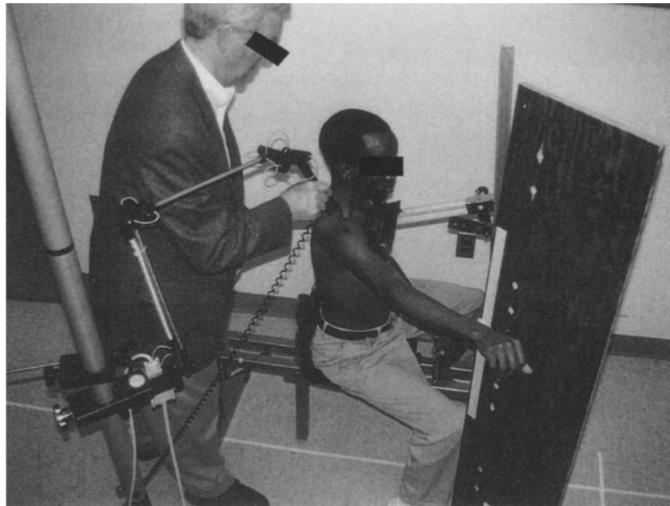
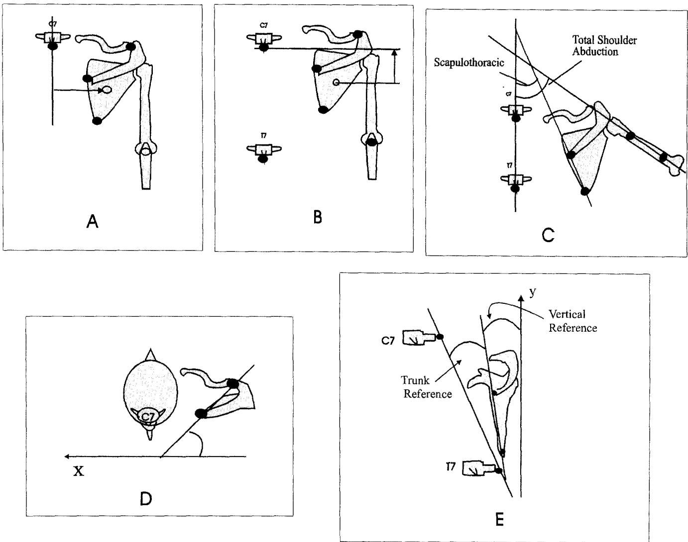
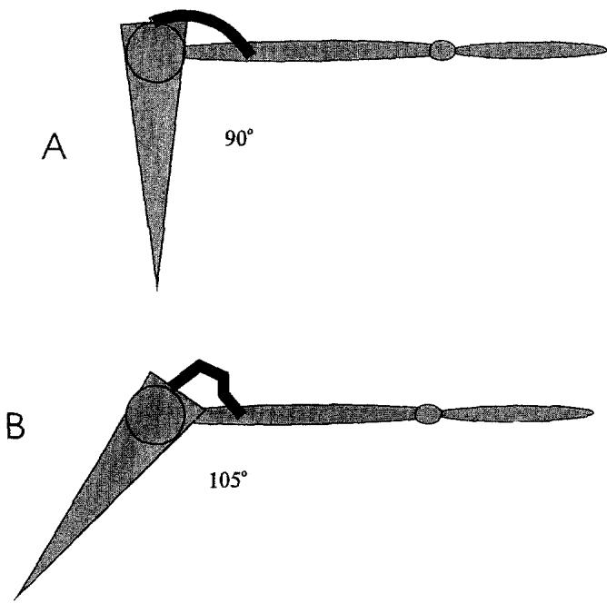

# Thoracic Position Effect on Shoulder Range of Motion, Strength, and Three-Dimensional Scapular Kinematics

Maikutlo Kebaetse, MS, PT, Philip McClure, PhD, PT, OCS, Neal A. Pratt, PhD, PT

ABSTRACT. Kebaetse M, McClure P, Pratt NE. Thoracic position effect on shoulder range of motion, strength, and three-dimensional scapular kinematics. Arch Phys Med Rehabil 1999;80:945-50.

Objectives: To determine the effect of thoracic posture on scapular movement patterns, active range of motion (ROM) in scapular plane abduction, and isometric scapular plane abduction muscle force.

Study Design and Method: Repeated measures design. There were 34 healthy subjects (mean age, 30.2yrs). Each subject was positioned and stabilized while sitting in both erect and slouched trunk postures. In each sitting posture a three-dimensional electromechanical digitizer was used to measure thoracic flexion and scapular position and orientation in three planes. Measurements were taken with the arm (1) at the side, (2) abducted to horizontal in the scapular plane, and (3) at maximum scapular plane abduction. In each posture, isometric abduction muscle force was measured with the arm at the side and abducted to horizontal in the scapular plane.

Results: In the slouched posture, the scapula was significantly more elevated in the interval between 0 to 90° abduction. In the interval between 90° and maximum abduction, the slouched posture resulted in significantly less scapular posterior tilting. There was significantly less active shoulder abduction ROM in the slouched posture (mean difference = 23.6° ± 10.7°). Muscle force was not different between slouched and erect postures with the arm at the side, but with the arm horizontal muscle force was decreased 16.2% in the slouched position.

Conclusion: Thoracic spine position significantly affects scapular kinematics during scapular plane abduction, and the slouched posture is associated with decreased muscle force.

© 1999 by the American Congress of Rehabilitation Medicine and the American Academy of Physical Medicine and Rehabilitation

EVALUATION OF MUSCULOSKELETAL shoulder problems often includes postural assessment. $^{1-5}$ Specific postural assessment for the shoulder complex involves determining spinal alignment and scapular position. Spinal alignment is thought to influence scapular position and both are believed to influence overall shoulder girdle function. $^{1-3,5-7}$ The basis for this relationship between spinal alignment, scapular position,

and shoulder girdle function has been attributed to at least two factors. First, there are numerous muscular connections between the spine, scapula, clavicle, and humerus. Therefore, the position of these various bony segments may directly influence each other via muscular connections. Bony position will influence muscle length and, therefore, influence the ability to generate tension. Secondly, during scapular plane abduction there is a known pattern of integrated movement at the glenohumeral and scapulothoracic joints (commonly called scapulohumeral rhythm). During scapular plane abduction, the scapula must provide a stable base for glenohumeral movements and yet be mobile in order to position the arm throughout its range of motion. $^{5,8}$ The reported ratio of glenohumeral to scapulothoracic movement during shoulder abduction varies but can generally be considered to be 2:1. $^{9,10}$ If scapular position is altered, it seems reasonable to expect that this normal pattern of integrated movement may be affected.

Kendall and colleagues $^{11}$ and Kelley and Clark $^{5}$ have both proposed that increased thoracic flexion (kyphosis) alters the scapulohumeral relationship. These authors further suggest that this posture may lead to shoulder complex muscle weakness and limited glenohumeral joint range of motion (ROM) and thus may result in shoulder impingement pathology.

Most of the literature on the relationship between thoracic spine alignment, scapular position, and shoulder function is based on personal observations and not research data, $^{5,11}$ with a few studies only partially exploring this relationship. $^{4,12,13}$ Culham and Peat $^{12}$ studied the relationship between age, thoracic posture, and scapular position in 91 women. Posture and scapular position were measured using the Isotrak, a three-dimensional electromagnetic tracking device. Results showed that as upper thoracic slope increased (exhibited more anterior tilt) the scapula exhibited more anterior tilt. As age and upper thoracic slope increased, the scapular range of motion and shoulder abduction decreased. Scapular abduction (linear distance between T1 and the center of the scapula) and downward rotation were not affected by age or posture.

Greenfield and colleagues $^{4}$ compared scapular position and spinal posture variables between 30 healthy subjects and 30 patients (matched for age and sex) with shoulder overuse injuries. A flexiruler was used to measure the midthoracic curvature between T2 and T12. Forward head posture was measured by determining (from a lateral view photograph of the subject) the angle between the horizontal and a line from C7 spinous process to the tragus of the ear. Scapular “protraction” (distance from spine to vertebral border of scapula) and “rotation” were calculated from measurements made with a metric ruler. The scapular rotation angle was derived using a trigonometric formula. Their measure of rotation was indirect and potentially flawed because a pure lateral translation of the scapula would have yielded an increased angle of rotation. Passive scapular plane abduction was measured with a standard goniometer. Results showed no significant difference between patients and the healthy subjects except that patients had greater forward head posture (p < .001) and less shoulder scapular plane abduction (p < .001) than the healthy subjects.

In summary, the relationship between thoracic posture and shoulder function is currently based on theories derived from anatomic relationships and clinical observations. The purposes of this study were to determine the effect of thoracic posture on (1) scapular kinematics, (2) active shoulder abduction ROM in the scapular plane and, (3) shoulder abduction muscle force in the scapular plane.

## METHOD

## Design

A repeated measures design was used. All subjects were measured in both slouched and erect sitting postures. For each thoracic posture, scapular position and orientation were recorded with the arm in three different positions: (1) at rest, (2) abduction to the horizontal in the scapular plane and, (3) maximum shoulder abduction in the scapular plane. Isometric shoulder abduction force also was measured with the arm at rest and abducted to the horizontal in each posture.

## Subjects

Thirty-four healthy subjects were selected by convenience, 16 men and 18 women. Subject characteristics were determined by a questionnaire and are summarized in table 1. Subjects were excluded if they had either a history of shoulder pain or injury or a complaint of pain with active or resisted isometric shoulder abduction. All subjects signed an informed consent agreement. This study was approved by the study institution's Committee for the Protection of Human Subjects.

## Instrumentation and Measurements

A custom seat was designed during a pilot study to stabilize subjects for all measurements (fig 1). For scapular position and shoulder abduction ROM measurements, subjects were stabilized anteriorly with a pad positioned against the chest and posteriorly with a lumbar pad. For strength measurements, a posterior interscapular pad was added for further trunk stabilization. During the study, a mild lateral trunk shift was observed occasionally during force measurements but was easily corrected by verbal cuing. A board aligned with the scapular plane of the subject (45° anterior to the frontal plane) provided a guide for the arm so that shoulder abduction occurred in the scapular plane.

The Metrecom Skeletal Analysis System $^{a}$ was used to measure scapular position, shoulder range of motion, and thoracic posture. It is a computerized measuring system consisting of six-degree-of-freedom mechanical linkages instrumented with precision potentiometers. The terminal linkage has a hand-held probe used to digitize skeletal landmarks. The information is transmitted to the computer where it is converted to the x, y, and z coordinates that define the position of the digitized points. From these points, a 3-dimensional position of the scapula can be calculated. We have established the angular errors from this device to be generally less than $2.2^{\circ}$ . $^{14}$ We have previously established the reliability for scapular and shoulder ROM measurements by repeated testing with an interval of at least 1 day between tests (intraclass correlation coefficients .82 to .99). $^{15}$

Table 1: Descriptive Characteristics of Subjects (n = 36)

<table><tr><td></td><td>Mean</td><td>SD</td><td>Range</td></tr><tr><td>Age</td><td>30.2</td><td>8.7</td><td>19-44</td></tr><tr><td>Height (cm)</td><td>172.9</td><td>10.5</td><td>152.4-195.8</td></tr><tr><td>Weight (kg)</td><td>73.3</td><td>18.3</td><td>48.1-117.9</td></tr></table>

Gender: 16 men; 18 women.

  
Fig 1. Subject seated in stabilization frame while being digitized. The arm is maintained in the scapular plane using the board oriented $45^{\circ}$ anterior to the frontal plane.

Scapular positions were determined by digitizing the inferior angle, the root of the spine of the scapular and the acromioclavicular (AC) joint. Subjects were seated in a standard fashion in the custom chair shown in figure 1 and the global reference frame was based in the chair. The X axis was a horizontal line (positive to the subject's left), the Y axis was a pure vertical line (positive superiorly), and the Z axis was the cross product of the X and Y axes, which was a horizontal line positive anteriorly. Orientation and position of the scapula was calculated based on the model shown in figure 2. Medial-lateral (M-L) translation represented the horizontal distance from the center of the scapula to a vertical line passing through the seventh cervical spinous process (C7) (figure 2A). Superior-inferior (S-I) translation represented the vertical distance from the center of the scapula to a horizontal line passing through C7 (figure 2B). The center of the scapula was defined as the midpoint of the three digitized scapular points. Upward rotation represented the angle between the vertical and a line passing through the root of the spine of the scapula and the inferior angle of the scapula (figure 2C). Scapular internal rotation represented the angle between the coronal plane and a line passing through the root of the spine of the scapula and the AC joint (figure 2D). Scapular tilt was described both in reference to the upper thoracic spine (trunk reference) and in reference to the pure vertical (vertical reference). Scapular tilt represented the angle between the coronal plane (vertical reference) or a line passing through C7 and T7 (trunk reference) and a line passing through the inferior angle and the root of the spine of the scapula (figure 2E). To measure humeral position, a plastic splint with two small holes $10\mathrm{cm}$ apart was strapped to the lateral aspect of the arm in alignment with the humeral shaft. The two holes were digitized to represent the humerus. All measurements were taken on the right side with the arm at rest, with the humerus abducted to a horizontal position in the scapular plane and, with maximal scapular plane abduction of the humerus. Thoracic angle (fig 3) was determined by digitizing points 2 inches above and below T2 and points 2 inches above and below T11. The angle between the two vectors formed by these points represented thoracic angle.

The Nicholas Hand-held Dynamometer $^{b}$ was used to measure shoulder abduction force on the dominant arm. Maximum abduction isometric force was measured with the arm at the side and abducted to horizontal in the scapular plane. The dynamometer was placed 1 inch above the ulnar styloid process. The subject was asked to gradually push against the dynamometer, which was held stable by the tester. The test was practiced twice at 50% of maximum effort and once at maximum effort. Each contraction was held for 3 to 5 seconds. The following command was given: "Push, push, harder, harder!" gradually getting louder and louder. Following the practice trials, the average of three trials at maximum effort was recorded. If there was a discrepancy of greater than 2kg in the first three trials, two additional trials were performed and the average of five measurements was used. During the study, intrarater reliability was assessed on 9 subjects (5 women, 4 men) for the muscle force measurement procedure. Two measurement sessions were performed at an interval of 2 to 6 days for all subjects. Intraclass correlation coefficients (3,1) and standard error of measurements were calculated and are shown in table 2. These reflect excellent reliability. $^{16}$

  
Fig 2. (A) Medial-lateral translation calculated as the horizontal distance between C7 and the centroid of the scapula. (B) Superior-inferior translation calculated as the vertical distance between C7 and the centroid of the scapula. (C) Upward rotation: scapulothoracic rotation was the angle between the spine and the medial border of the scapula. Total scapular plane abduction is the angle between the spine and the humerus. (D) Scapular internal rotation: the angle between the coronal plane and a line passing through the root of the spine of the scapula and the AC joint. (E) Scapular tilt: the angle between the coronal plane (vertical reference) or a line passing through C7 and T7 (trunk reference) and a line passing through the inferior angle and the root of the spine of the scapula.

## Procedure

Each subject was randomly seated in the erect or slouched posture, determined by a coin toss. For the erect posture, subjects were asked to straighten their upper back by sitting as straight as they could, and for the slouched posture they were asked to round their upper back as far as possible by slumping. Subjects were stabilized anteriorly and asked to maintain contact with the anterior chest pad at all times. Anatomic landmarks on the vertebral column and at the wrist were marked with adhesive circles prior to digitization. The abduction frame was positioned on the $45^{\circ}$ line and the subject was asked to abduct the arm to horizontal by placing the radial aspect of the wrist against a velcro mark on the frame. A spirit level was placed on the arm to determine the horizontal position. Digitization of the vertebral, scapular, and humeral landmarks was then performed as previously described in each arm position (rest, horizontal, and maximal abduction). Thirtysecond rest periods were allowed between each arm position. The entire process was performed twice so that there were two complete sets of digitized points for each posture and the averages were used for calculations. After the Metrecom measurements for a given posture, the subject was further stabilized posteriorly in the same posture as previously described. Maximum isometric scapular plane abduction muscle force was then measured with the arm by the side and in the horizontal position as previously described. Thirty-second rest periods were allowed between each force measurement. After all measurements were completed for the first posture, subjects were given a 2-minute rest period, after which the entire process was repeated for the second posture. All measurements were performed by the same investigator.

  
Fig 3. Thoracic angle: determined by digitizing points 2 inches above and below T2 and points 2 inches above and below T11. The angle between the two vectors formed by these points represents thoracic angle.

## Data Analysis

Means and standard deviations for thoracic angle, scapular position measurements, active shoulder abduction ROM, and shoulder abduction muscle force were calculated for each sitting posture. The effect of thoracic posture on scapular kinematic variables was assessed with a multivariate analysis of variance (MANOVA) because of the likelihood of intercorrelations between the scapular kinematic variables. Also, the use of one test for all the dependent variables in a particular arm position, rather than multiple separate tests for each variable, helps decrease the probability of type I error. $^{16}$ Significant findings from the MANOVA were followed up with paired contrasts for each dependent variable. The acceptable probability level was set at p < .05. Paired t tests were performed to assess differences between postures for thoracic angle, maximum shoulder abduction ROM, and scapular plane abduction muscle force.

Table 2: Reliability for Muscle Force Measurements

<table><tr><td>Position</td><td>ICC (3, 1)</td><td>95% CI for ICC</td><td>SEM (kg)</td></tr><tr><td colspan="4">Slouch</td></tr><tr><td> $0^{\circ}$ </td><td>.96</td><td>.82-.99</td><td>.65</td></tr><tr><td> $90^{\circ}$ </td><td>.97</td><td>.87-.99</td><td>.31</td></tr><tr><td colspan="4">Erect</td></tr><tr><td> $0^{\circ}$ </td><td>.94</td><td>.76-.99</td><td>.98</td></tr><tr><td> $90^{\circ}$ </td><td>.96</td><td>.85-.99</td><td>.52</td></tr></table>

## RESULTS

Data relating to thoracic angle, maximal shoulder abduction ROM, and scapular plane abduction muscle force are shown in table 3. Mean thoracic angle in the slouched position was significantly more flexed than in the erect position with a mean difference of 12.1°. There was significantly less maximum active shoulder abduction ROM in the slouched posture with a mean difference of 23.6° ± 10.7°. There was no difference in isometric muscle force between thoracic postures with the arm by the side. There was significantly less force in the slouched posture with the arm horizontal with a mean difference of 1.7kg (16.2%).

The MANOVA test (Hotelling's $T^{2}$ ) showed differences between the erect and slouched postures on scapular kinematic variables in each arm position (rest, horizontal, and maximal abduction). The results of follow-up paired comparisons were also significant except for M-L translation at $90^{\circ}$ and maximum shoulder abduction (table 4).

In both postures, the scapula exhibited superior translation with increasing abduction and the scapula was significantly more elevated in the slouched posture in the interval between neutral and $90^{\circ}$ of arm abduction (mean difference $=1.05\pm1.13cm$ ). In the erect posture, the scapula exhibited lateral translation in the interval between neutral and $90^{\circ}$ of arm abduction but returned to the original position in the interval between $90^{\circ}$ and maximum arm abduction. In the slouched posture, the scapula started in an extreme laterally translated position but moved medially in both intervals, ending in the same position as in the erect posture.

As the arm was elevated, the scapula rotated upward. There was no difference in rotation between postures in the interval between neutral and $90^{\circ}$ . In the interval between $90^{\circ}$ and maximum shoulder abduction, however, there was significantly less scapular upward rotation in the slouched posture (mean difference $=9.8^{\circ} \pm 6.6^{\circ}$ ). Scapular internal rotation increased with increasing arm abduction. The scapula was statistically more internally rotated in the slouched posture in both intervals; however, the absolute difference between postures was small. As the arm was abducted, the scapula tilted posteriorly. In the interval between $90^{\circ}$ and maximum shoulder abduction, however, there was significantly less scapular posterior tilting relative to the thoracic spine in the slouched posture (mean difference = $10.2^{\circ} \pm 7.6^{\circ}$ ).

Table 3: Results for Thoracic Position, Maximal Shoulder Abduction ROM, and Muscle Force in the Erect and Slouched Posture

<table><tr><td rowspan="2">Variable</td><td colspan="2">Trunk Erect</td><td colspan="2">Trunk Slouched</td><td rowspan="2">t</td><td rowspan="2">p</td></tr><tr><td>Mean</td><td>SD</td><td>Mean</td><td>SD</td></tr><tr><td>Thoracic Angle (°)</td><td>26.4</td><td>11.5</td><td>38.5</td><td>10.8</td><td>-9.89</td><td>.000</td></tr><tr><td>Max shoulder abduction (°)</td><td>157.5</td><td>10.8</td><td>133.9</td><td>13.7</td><td>12.8</td><td>.000</td></tr><tr><td>Muscle force (kg)</td><td></td><td></td><td></td><td></td><td></td><td></td></tr><tr><td>Neutral</td><td>13.4</td><td>7</td><td>13.3</td><td>6.7</td><td>0.34</td><td>.738</td></tr><tr><td>Horizontal</td><td>10.4</td><td>4.5</td><td>8.7</td><td>3.5</td><td>7.05</td><td>.000</td></tr></table>

Table 4: Descriptive Values Showing the Effect of Posture on Scapular Kinematics

<table><tr><td rowspan="2">Variable/ Arm Position</td><td colspan="3">Trunk Erect</td><td colspan="3">Trunk Slouched</td><td rowspan="2"> $p^*$ </td></tr><tr><td>Mean</td><td>SD</td><td>Range</td><td>Mean</td><td>SD</td><td>Range</td></tr><tr><td colspan="8">S-I translation</td></tr><tr><td>Rest</td><td>103.6</td><td>15.2</td><td>76.0-135.8</td><td>94.8</td><td>15.2</td><td>61.7-132.0</td><td>.002</td></tr><tr><td>Horizontal</td><td>95.4</td><td>14.2</td><td>67.6-130.2</td><td>76.1</td><td>12.9</td><td>55.2-106.0</td><td>.000</td></tr><tr><td>Maximal</td><td>88.6</td><td>16.3</td><td>62.0-118.1</td><td>71.7</td><td>13.7</td><td>49.4-98.2</td><td>.000</td></tr><tr><td colspan="8">M-L translation</td></tr><tr><td>Rest</td><td>114.9</td><td>16.8</td><td>81.0-142.7</td><td>127.4</td><td>16.0</td><td>94.2-151.1</td><td>.000</td></tr><tr><td>Horizontal</td><td>119.3</td><td>13.2</td><td>92.5-147.2</td><td>120.6</td><td>14.2</td><td>94.0-141.3</td><td>.460</td></tr><tr><td>Maximal</td><td>114.7</td><td>11.7</td><td>90.2-141.1</td><td>115.3</td><td>13.5</td><td>92.8-136.1</td><td>.597</td></tr><tr><td colspan="8">Internal rotation</td></tr><tr><td>Rest</td><td>38.1</td><td>5.9</td><td>20.3-50.1</td><td>41.9</td><td>6.2</td><td>24.5-54.3</td><td>.000</td></tr><tr><td>Horizontal</td><td>41.4</td><td>6.5</td><td>23.9-56.9</td><td>44.9</td><td>4.7</td><td>32.2-52.9</td><td>.000</td></tr><tr><td>Maximal</td><td>43.5</td><td>8.5</td><td>22.2-57.1</td><td>49.9</td><td>6.2</td><td>38.7-61.0</td><td>.000</td></tr><tr><td colspan="8">Up rotation</td></tr><tr><td>Rest</td><td>7.8</td><td>6.3</td><td>-11.2-15.5</td><td>12.8</td><td>9.3</td><td>-19.3-23.9</td><td>.000</td></tr><tr><td>Horizontal</td><td>22.8</td><td>5.5</td><td>10.9-37.1</td><td>27.5</td><td>7.8</td><td>12.5-45.8</td><td>.000</td></tr><tr><td>Maximal</td><td>43.1</td><td>7.5</td><td>30.4-58.4</td><td>37.9</td><td>6.5</td><td>22.4-50.0</td><td>.000</td></tr><tr><td colspan="8">Tilt w/trunk</td></tr><tr><td>Rest</td><td>6.7</td><td>3.6</td><td>1.6-15.5</td><td>11.8</td><td>4.3</td><td>1.4-22.9</td><td>.000</td></tr><tr><td>Horizontal</td><td>19.4</td><td>4.6</td><td>9.3-29.3</td><td>25.5</td><td>5.4</td><td>16.1-36.1</td><td>.000</td></tr><tr><td>Maximal</td><td>44.7</td><td>6.8</td><td>34.0-59.0</td><td>40.6</td><td>6.9</td><td>27.9-58.7</td><td>.001</td></tr><tr><td colspan="8">Tilt w/vertical</td></tr><tr><td>Rest</td><td>12</td><td>5.7</td><td>-1.9-20.6</td><td>28.9</td><td>6.6</td><td>11.1-40.4</td><td>.000</td></tr><tr><td>Horizontal</td><td>0.6</td><td>6.3</td><td>-10.4-10.4</td><td>15</td><td>6.2</td><td>0.7-25.3</td><td>.000</td></tr><tr><td>Maximal</td><td>-27.6</td><td>8.7</td><td>-48.1--13.2</td><td>-0.4</td><td>9.3</td><td>-28.0-15.5</td><td>.000</td></tr></table>

Translation values represent absolute vertical (S-I translation) and horizontal (M-L translation) distances (mm) from the center of the scapula to the C7 spinous process.  
\* Obtained from follow-up paired t tests.

## DISCUSSION

## Shoulder Abduction ROM

Thoracic posture clearly affected scapular plane shoulder abduction ROM and muscle force. Scapular kinematics were also affected and help to explain the differences found in ROM and muscle force. Our finding of decreased ROM in the slouch posture compares favorably with the results of Culham, $^{12}$ who concluded that extension of the thoracic spine is necessary for full shoulder ROM after finding that as age and resting upper thoracic slope increased, shoulder abduction decreased. It should be noted, however, that with increasing age there is increasing degenerative changes and soft tissue restriction, $^{17,18}$ which may also explain the limited shoulder abduction in the elderly. It may appear as if the 23.6° decrease in maximum shoulder abduction in the slouched posture was not a true change because as the trunk goes into the slouched position the arm automatically “moves” with the trunk, resulting in less abduction. However, there was a 12.1° increase in thoracic curvature in the slouched posture. Therefore, the 23.6° decrease in shoulder abduction is not completely accounted for by the increase in thoracic flexion in the slouched posture. During maximal shoulder abduction, subjects occasionally seemed to fatigue in both postures while being digitized, resulting in lowering of the arm. The results might therefore reflect slightly lower values for ROM than what might have been obtained without the fatigue.

## Muscle Force

Muscle force was not affected by posture with the arms at neutral. The 16.2% decrease in muscle force at 90° of arm abduction in the slouched posture may be explained by alterations in scapular kinematics. In the slouched posture, there was increased scapular superior translation between neutral and 90° of arm abduction that may have placed the upper trapezius muscle in a shortened position and thus decreased its ability to generate tension. Perhaps more important, the scapula was more anteriorly tilted in the slouched position. This anterior tilt affected the sagittal plane glenohumeral angle which can be obtained by adding 90° of arm abduction to the values for scapular tilt. In the slouched posture the mean glenohumeral angle was 105° compared with 90.6° in the erect posture (fig 4). Therefore, glenohumeral muscles such as the deltoid and supraspinatus were in an excessively shortened position, which would decrease their ability to generate tension. $^{19}$ These explanations are also supported by the fact that no differences in force were found between postures when force was tested with the arm by the side where muscle length may not be affected as much by thoracic posture.

Decreased force at $90^{\circ}$ of arm abduction is of clinical significance because many functional activities are performed at the shoulder level. Hagberg $^{20}$ states that neck and shoulder disorders caused by occupational musculoskeletal stress are common in industrial workers and that a work posture of elevated arms may accelerate shoulder tendon degeneration. Wiker and coworkers $^{21}$ found that industrial workers who use their hands above their heads have significantly increased localized muscle fatigue and postural discomfort even in lightweight assembly tasks. The results of the current study suggest that workers who must function from a position of thoracic flexion while lifting or maintaining static arm position at shoulder level may be at a disadvantage. Excessive thoracic flexion may be a fixed postural deformity, but may also be a transient position induced by the demands of a particular task, such as having to look down while maintaining the arms in a elevated position.

  
Fig 4. (A) In the erect posture the glenohumeral angle in the sagittal plane was $90.6^{\circ}$ . (B) In the slouched posture this angle was $105^{\circ}$ . Weakness in scapular plane isometric abduction force may be explained by excessive shortening of the deltoid and supraspinatus muscles in the slouched position.

## Scapular Kinematics

Altering thoracic posture affected scapular kinematics. The patterns of progressive upward rotation and posterior tilt with shoulder abduction are comparable to those reported by Cole $^{15}$ and Ludewig and colleagues. $^{22}$ They also found that the scapula retracted (externally rotated) as the shoulder was elevated. We found a pattern of slight, progressive scapular internal rotation as the arm was elevated. Differences between scapular internal rotation compared with previous studies may be attributable to testing at extreme end-ranges of thoracic posture and also the use of a wooden frame to maintain the shoulder in the scapular plane during abduction. Subjects seemed to have a tendency to protract the shoulder girdle and keep the arm forward, which may be different than a normal abduction movement without a fixed guide.

The present study shows that the main differences in scapular motion in the slouched posture are that the scapula exhibited (1) more superior translation between neutral and 90° of arm abduction, (2) less upward rotation and less posterior tilt between 90° and maximum abduction, and (3) slightly more internal rotation in all the intervals of abduction. The decreased shoulder abduction ROM in the slouched posture may be attributable to less posterior tilt and less upward rotation of the scapula. In this orientation, the acromion may create a bony block that may cause or contribute to impingement pathology with repetitive overhead activity. $^{23,24}$ Cole $^{15}$ studied scapular kinematics in healthy subjects and those with impingement syndrome during abduction, and found that the impingement group had less scapular posterior tilting from 90° to maximum abduction and decreased total abduction ROM. The results of the present study suggest that this problem may be partially attributable to increased thoracic flexion.

## Limitations

In this study conclusions are drawn on how shoulder muscle force relates to thoracic posture and scapular orientation; however, these variables were not measured simultaneously. Although care was taken to position the arm similarly for these tests, it would be more desirable to measure scapular orientation while force is being measured. Scapular kinematic measurements were taken under static conditions, which may not accurately represent what occurs during dynamic activities. Also, we chose to assess the extremes of thoracic posture, which may not necessarily reflect habitual postures assumed by an average person in many activities of daily living. We do believe that extreme postures are often assumed during more challenging activities or those activities where motion at other joints (knee, hip or lumbar) may be constrained.

## CONCLUSIONS

The effect of thoracic position on scapular kinematics, shoulder abduction ROM, and force at selected levels of shoulder abduction in the scapular plane was investigated. There was decreased scapular upward rotation and posterior tilting and increased superior translation in the slouched (flexed) position. There was decreased muscle force and shoulder abduction ROM in the slouched position, which may be caused by altered scapular kinematics. These findings suggest that thoracic spine positions at rest and during recurrent functional activities need to be considered during evaluation and treatment of shoulder disorders.

## References

1. Bowling RW, Rockar PA, Erhard R. Examination of the shoulder complex. Phys Ther 1986;66:1866-77.

2. Braun BL, Amundson LR. Quantitative assessment of head and shoulder posture. Arch Phys Med Rehabil 1989;70:322-9.

3. Cailliet R. Shoulder pain. Philadelphia (PA): F.A. Davis Company; 1966.

4. Greenfield B, Catlin PA, Coats PW, Green E, McDonald JJ, North C. Posture in patients with overuse injuries and healthy individuals. J Orthop Sports Phys Ther 1995;21:287-95.

5. Kelly MJ, Clark WA. Orthopedic therapy of the shoulder. Philadelphia (PA): J.B. Lippincott Co.; 1995.

6. Kibler WB. Role of scapula in the overhead throwing motion. Contemp Orthop 1991;22:525-32.

7. Perry J. Muscle control of the shoulder. In: Rowe CR, editor. The shoulder. New York: Churchill Livingstone Inc; 1988. p. 1-17.

8. Mosely JB, Jobe FW, Pink M, Perry J, Tibone J. EMG analysis of the scapular muscles during a shoulder rehabilitation program. Am J Sports Med 1992;20:128-34.

9. Inman VT, Saunders JB, Abbott LC. Observations of the function of the shoulder joint. J Bone Joint Surg 1944;26:1-30.

10. Poppen NK, Walker PS. Normal and abnormal motion of the shoulder. J Bone Joint Surg 1976;58A:195-201.

11. Kendall FP, McCreary EK, Provance PG. Muscles—testing and function. 4th ed. Baltimore (MD): Williams & Wilkins; 1993.

12. Culham EG, Peat M. Functional anatomy of the shoulder complex. J Orthop Sports Phys Ther 1993;18:342-50.

13. Solem-Bertoft E, Thuomas K, Westerberg C. The influence of scapula retraction and protraction on the width of the subacromial space. Clin Orthop Rel Res 1993;296:99-103.

14. Michener L, Silfies S, Hutchinson D, McClure P. Accuracy of the metrecom skeletal analysis system for linear and angular measurements [abstract]. J Orthop Sport Phys Ther 1997;25:69.

15. Cole A, McClure P, Pratt N. Scapular kinematics during arm elevation in healthy subjects and patients with shoulder impingement syndrome [abstract]. J Orthop Sports Phys Ther 1996;23:68.

16. Portney LG, Watkins MP. Foundations of clinical research: applications to practice. East Norwalk (CT): Appleton & Lange; 1993.

17. Threlkeld AJ, Currier DP. Osteoarthritis: effects on synovial joint tissues. Phys Ther 1988;68:364-70.

18. Turek SL. Orthopedic principles and their application, Vol. 2. 4th ed. Philadelphia: J.B. Lippincott Company; 1984.

19. Lieber RL, Bodine-Fowlre SC. Skeletal muscle mechanics: implications for rehabilitation. Phys Ther 1993;73:844-56.

20. Hagberg A. Occupational musculoskeletal stress and disorders of the neck and shoulders: a review of possible pathophysiology. Int Arch Occup Environ Health 1984;53:269-78.

21. Wiker SF, Chaffin DB, Langolf GD. Shoulder posture and localized muscle fatigue and discomfort. Ergonomics 1989;32:211-37.

22. Ludewig PM, Cook TM, Nawoczenski DA. Three-dimensional scapular orientation and muscle activity at selected positions of humeral elevation. J Orthop Sports Phys Ther 1996;24:57-65.

23. Flatow EL, Soslowsky LJ, Ticker JB, Pawluk RJ, Hepler M, Ark J, et al. Excursion of the rotator cuff under the acromion: patterns of the subacromial contact. Am J Sports Med 1994;22:779-88.

24. Fu FH, Harner CD, Klein AH. Shoulder impingement syndrome: a critical review. Clin Orthop Rel Res 1991;269:162-73.

## Suppliers

a. Faro Technologies Inc., 125 Technology Park, Lake Mary, FL 32746.

b. Lafayette Instruments, 3700 Sagamore Parkway North, Lafayette, IN 47905.