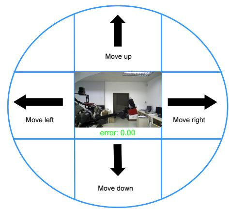
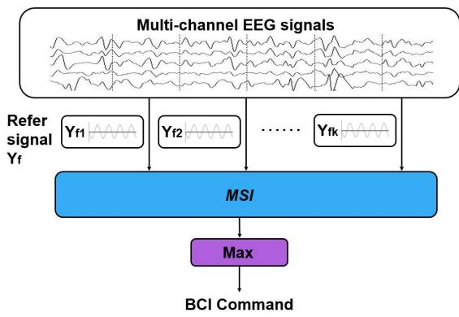
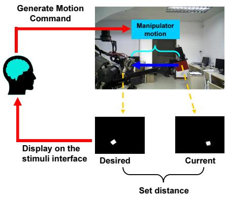
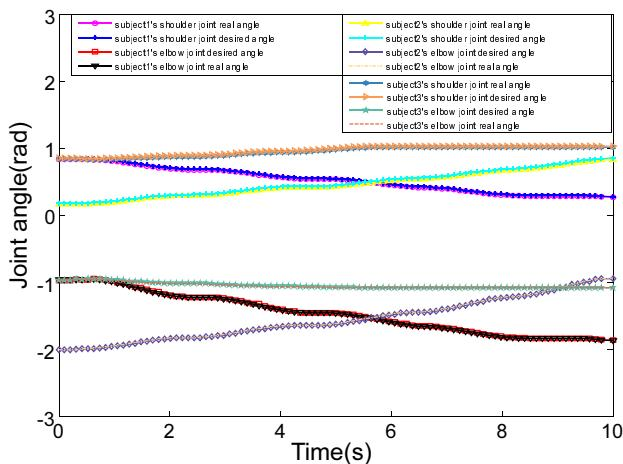
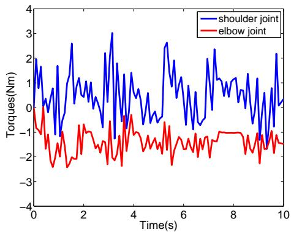
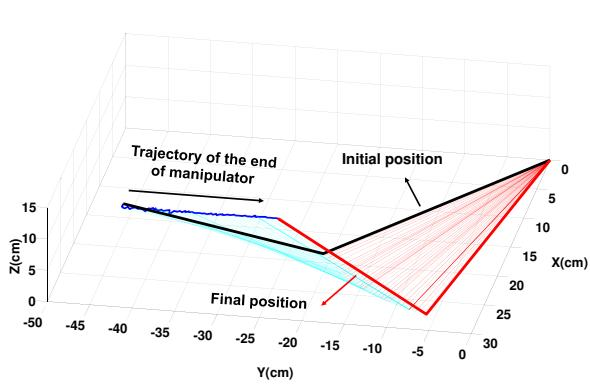
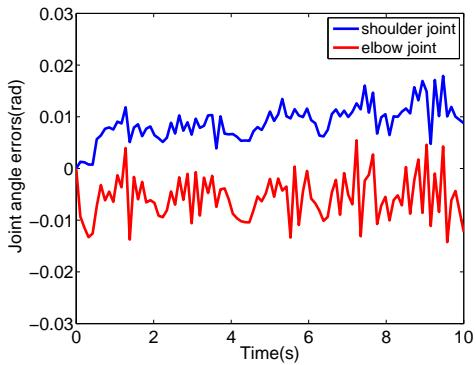
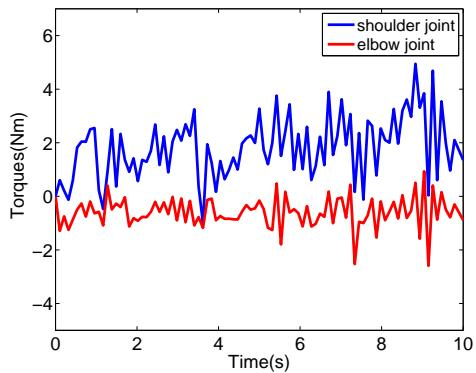
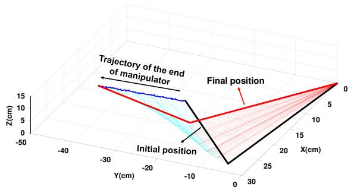
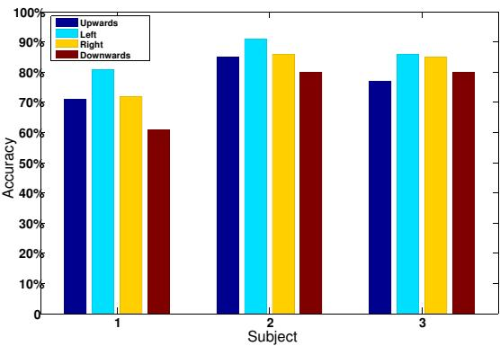

# Brain Machine Interface and Visual Compressive Sensing based Teleoperation Control of an Exokeleton Robot

Shiyuan Qiu, Zhijun Li, Senior Member, IEEE, Wei He, Senior Member, IEEE, Longbin Zhang, Chenguang Yang, Senior Member, IEEE, and Chun-Yi Su, Senior Member, IEEE

Abstract—This paper presents a teleoperation control for an exoskeleton robotic system based on the brain-machine interface (BMI) and vision feedback. Vision compressive sensing, brainmachine reference commands, and adaptive fuzzy controllers in joint-space have been effectively integrated to enable robot performing manipulation tasks guided by human operator’s mind. First, a visual-feedback link is implemented by video captured by a camera, allowing him/her to visualize the manipulator’s workspace and the movements being executed. Then, compressed images are used as feedback errors in a nonvector space for producing SSVEP (Steady-State Visual Evoked Potentials) electroencephalography (EEG) signals, and it requires no prior information on features in contrast to the traditional visual servoing. The proposed EEG decoding algorithm generates control signals for the exoskeleton robot using features extracted from neural activity. Considering coupled dynamics and actuator input constraints during the robot manipulation, a local adaptive fuzzy controller has been designed following Lyapunov synthesis to drive the exoskeleton tracking the intended trajectories in human operator’s mind and to provide a convenient way of dynamics compensation with minimal knowledge of the dynamics parameters of the exoskeleton robot. Extensive experiment studies employing three subjects have been performed to verify the validity of the proposed method.

Keywords: Fuzzy logic system, EEG tele-operation, Visual compress sense, Brain-machine interface, Exoskeleton

## I. INTRODUCTION

Recently, exoskeleton robotics has attracted much attention in the human-robot interaction [1]-[8]. In order to enable patients of neurological injuries and diseases to use their mind to control a device performing certain task, brainmachine interface (BMI) techniques have been developed. The function of the established BMI is usually to detect user’s intention of motion [9]. Recent studies on BMI based control have achieved considerable progress, e.g., EEG-based control prosthetic devices [10], [11], [12], [13].

The core of a BMI system is a direct connection paths in the human or animal brain (or brain cell culture) and established between the external device instead of using the normal output approaches of peripheral nerves and muscles. It transforms EEG signals, which can be acquired from the surface of the scalp, into commands that implement the requirements of user. In most BMI systems, a variety of EEG signals can be used to extract control signals, , e.g., steady-state visual evoked potentials (SSVEPs), P300 evoked potentials, sensorimotor rhythms, motion-onset visual evoked potential and slow cortical potentials. SSVEPs is a kind of periodic evoked potentials induced by rapidly repetitive visual stimulation, especially at frequencies higher than 6 Hz. The strongest response to the visual stimuli includes stimulation frequencies in the range 5 to 20 Hz. The SSVEPs usually occur in the occipital and parietal lobes and its frequency is aligned with the fundamental frequency and harmonics of the frequency-coded stimuli. In an SSVEP-BCI system, user’s intended command, e.g., moving a cursor on a computer screen or controlling a robot arm, can be detected by extracting the frequency information in the SSVEPs signal. In [29], a motor imagery-based switching to open or close an SSVEP-based BCI was presented. In [30], motor imagery and SSVEP signals had been used for continuous control of the direction and speed for a wheelchair, respectively.

In the visual servoing, images are used for locating a feature or landmark associated with coordinates transformation, allowing the visual servoing system to get the position or velocity feedback for the closed-loop system. The system does not need sensors to monitor the movement. However, the performance of conventional visual servoing heavily depends on feature extractions. However, perfect features may not be easy to be extracted and may change during manipulation [22]. Some researchers also studied visual servoing without the feature extraction process. In [23], the similarity of two images was used to define the mutual information which was used to design a controller. In [24], the completed image intensities was utilized as a feature vector to perform feedback control. Although these methods work well, the approach developed in this paper is fundamentally different from them. In this proposed approach, the image is considered as a set in nonvector space (there is no order to each element in the set), which is the advantage through which the random compressive data can be used as the sense feedback.

In this paper, a novel SSVEP-based BMI strategy is developed by utilizing the compressive sense produced by images/compressive data. Because the image or compressive sense is a set, not a vector, the terminology non-vector space sense is used. Additionally, the sense errors can be a complete local image or partial image that can be considered as compressive data, which is the terminology compressive sense. Inside this control system, the sense errors are described in the non-vector space for SSVEP EEG signal. Three crucial steps are essential for the strategy: i) design sense errors in a non-vector space where the local image is used directly as the feedback; ii) use compressive scanning to compress the sample and reconstruct a local image; and iii) replace the complete feedback (local image) with compressed data directly to generate a compressive feedback.

The closed-loop adaptive control designed is used to estimate the system dynamics parameters online to make the exoskeleton’s output more precisely reflecting the subject’s intentions. However, one challenge of exoskeleton robot to be considered is the complex dynamics uncertainty and input saturation. Learning control can be applied to improve the system performance, either repeatedly over a fixed finite time interval, or repetitively (cyclically) over an infinite time interval [40]. Recently, there have been some works [38]–[39], and [41]–[44] in combining adaptive fuzzy and learning control techniques to solve time-varying uncertainties in the robotic mode. Adaptive fuzzy controller is capable of incorporating fuzzy if-then control rules directly into the controllers, and guarantees the global stability of the resulting closed-loop system in the sense that all signals involved are uniformly bounded is developed. Since adaptive fuzzy controller is simple in both designing and applying, we utilize the adaptive fuzzy to approximate the exoskeleton dynamics to achieve stable performance criteria.

It is well known that saturation belongs to one of the most important nonlinearities in various robotic and mechanical systems, and can severely degrade system performance [26], [43]. One of the challenges faced by robotic exoskeleton is the situation when it fails to provide sufficient power due to its saturation limit, which leads to problems like tracking errors. For robotic systems, neglecting the saturation effect makes the system unreliable and puts users into a dangerous condition. It is, therefore, crucial to design a controller which can minimize the saturation effect of the robot motors and maintain stability of the robot. Various methodologies have been presented to solve the problem related to the saturation. In [27], a saturated adaptive robust control strategy was proposed in response to uncertainties in vehicle active suspension systems. In [28], by approximating the un-differentiable saturation model to a tanh function and adding the approximation error to disturbance, the problem of input saturation with both satisfactory transient and steady state responses was solved.

On the other hand, BMI control is quite different from manual control in which little feedback information is often limited as visual signals, and the dynamics of the external device to be controlled differ dramatically from the properties of natural motor control. Great interest has been attracted in the behavior of the proposed BMI system during online closedloop BMI application. In many situations, adaptive control capable of rapid performance acquisition are advantageous. If the initial BMI performance is poor, then subjects may lose interest of the task if performance improves not fast. While adaptive control is able to provide subject with higher BMI performance quickly at initial training session, such that subjects would get more motivated in the task. The adaptive algorithm has a advantage to improve performance to a high level after initial training. When a subject uses a periodic decoder adjustment to account for phenomena that disrupt BMI operation, e.g., electrodes shifts and channel loss, the adaptive algorithm could cut down the required recalibration time such that performance recover more rapidly.

Considering the problems above mentioned, this paper develops a teleoperation control for an exoskeleton robot system based on BMI and vision feedback. Vision compressive sensing, brain-machine reference commands, adaptive fuzzy control have been effectively combined to enable robot performing manipulation tasks guided by human operator’s mind [45]. First, a visual-feedback link is implemented by video captured by a camera, allowing him/her to visualize the manipulator’s workspace and the movements being executed. Then, compressed images are used as feedback errors in a non-vector space for producing SSVEP EEG signals, and it requires no prior information on features which are widely used in traditional visual servoing. The proposed EEG decoding algorithm generates control signals for the exoskeleton robot using features extracted from neural activities. Consider coupled dynamics and actuator input constraints during the robot manipulation, local adaptive fuzzy controller has been designed following Lyapunov synthesis to drive the exoskeleton tracking the intended trajectories in human operator’s mind and to provide a convenient way of dynamics compensation with minimal knowledge of the dynamics parameters of the exoskeleton robot. Extensive experiment studies employing a number of subjects have been carried out to verify the effectiveness of the proposed method.

## II. SYSTEM ARCHITECTURE

The experimental setup and closed-loop BMI-based teleoperation control diagram is illustrated in Fig. 1. The system consists of the manipulation task, bilateral tele-operation based on BMI, and the visual compressive sensing mechanism based on live images, as well as the EEG decoding algorithm based on multivariate synchronization index (MSI).

A robotic exoskeleton has been developed for the experiments in our lab. As shown in Fig. 1, the arm consists of a 5-DOF exoskeleton developed in our lab, which is almost anthropomorphic. The kinematical chain is similar to the upper limb of a human being, but the exoskeleton with purely rotary joints does not include every degrees of freedom (DOF) in human upper limb. There are five revolute joints in the developed exoskeleton, motors 1, 2, 3, 4 and 5 are the motors for shoulder abduction-adduction, shoulder flexion-extension, elbow flexion-extension, forearm pronation supination, and wrist radial-ulnar deviation, respectively. In the developed exoskeleton robot, each joint contains a high resolution encoders (2048 pulse/cycle) and Hall effect sensor used for position sensing. The robotic exoskeleton is developed using DC motors for actuation, and Maxon DC flat brushless motor EC45 is chosen as driver unit. In order to enhance the impedance capability, harmonic transmission drivers are embedded (model SHD-17-100-2SH for the joint Nos. 1 and 2, model SHD-14-100-2SH for the joint Nos. 3 and 4, and CSF-32-50-2A-GR for the joint No. 5). In particular, the motor drivers selected for our exoskeleton are Elmo. The exoskeleton consisting of flat DC motors and harmonic transmissions is roughly 2.0 kg and able to provide a maximum torque of 8Nm.

  
Fig. 1. The developed teleoperation framework based EEG control

The brain acquisition equipment employed is the NeuroScan-NuAmps 40 channel digital EEG recording system, which collects and transforms the brain activity data. The EEG data is sampled at 500Hz. Inside the equipment, a bandpass filter between 0.5 and 40 Hz, and a Notch filter of 50 Hz are taken to decrease the effect of network noise.

It is assumed that subjects wear the EEG equipment and the robotic exoskeleton is capable of reaching positions commanded in its moving area. Rather than the motors in the arm being controlled straightly, the subject simply needed to given motion commands of the end of the exoskeleton through EEG commands. Originally, the arm is in a initial position, with the subject sitting before the visual stimuli on master computer. When the subjects eyes fixate on one of the blinking blocks on the screen, a moving command would be generated. Once an command had been given, the end-effector of the exoskeleton would move according to the command. Simultaneously, visual feedback is used in this system for user to visualize the real position of the end of the exoskeleton. And the position error of the end-effector of the exoskeleton would then showed in the screen. When the error converge to zero, which denotes the end-effector of manipulator reach the desired position, the user should stop fixating on the stimuli screen.

  
Fig. 2. SSVEP stimuli and visual feedback interfaces

## III. BRAIN MACHINE INTERFACE

The system interface of the local server, as shown in Fig. 2, includes SSVEP stimuli and video captured by camera placed on the remote client. The live video of the manipulator station environment is send to the local server via TCP/IP. The system interface is among the BMI stimuli interface with frequencycoded stimuli located at the left, right, top, and bottom sides of the system interface. The size of the visual feedback interface is of 360-pixel width and 270-pixel height. In our experiment, the subjects need to employ EEG signals as control signals to move the end-effector of manipulator to the desired position via Wireless LAN.

All stimuli flash simultaneously on the BMI interface, however, a subject only need to focus attention on the one corresponded to the desired command. For example, when the subject intends to make the end-effector of manipulator move upwards, they need to focus their attention on the top stimuli labeled upwards. When the BMI system detects the frequency of EEG signals is relevant with the top stimuli, it would send a new reference point to the remote manipulator through a TCP/IP channel. The BMI system generate the control signals which present the intention of user and sends it to slave computer. In the similar way, when the subject want to make the end-effector of manipulator move left, he/she need to focus their attention on the top stimuli labeled left. Then the ”move left” command will be generated and sent to remote computer for moving the manipulator.

## A. Visual stimuli

In our system, the SSVEP visual stimuli are presented in four rectangle with different frequency: top (12HZ), left (10HZ), bottom (8.57HZ), right (15HZ) flashing on a 1020- pixel wide and 580-pixel height screen. The top of the screen is labelled as “Upwards” and represent the upwards command; the bottom of the screen is marked as “Downwards” and indicate the downwards command; the left of the screen is labelled as “Left” and represent the move left command; and the right of the screen is marked as “Right” and indicate the move right command.

## B. Signal acquisition

In the experiments, the electrical component of brain activity was acquired by the NeuroScan-NuAmps 40 channel digital EEG recording system, which collected and transformed data. EEG data were acquired online at a 500 Hz sampling rate with a band-pass filter in the range 0.5 to 40 Hz and a 50 Hz notch filter for network noise interference. Impedance of electrodes were kept below 5Ω. Cz is adopted as reference, only the main four electrodes located on the motor area $( P _ { z } , O _ { 1 } , O _ { 2 } , O _ { z } , )$ are taken as the input EEG signals of recognition algorithm. The EEG signals were recorded and processed online using the self-developed software.

## C. Frequency Recognition Algorithm Based On MSI

Recently, many methods have been developed using multiple-channel EEG signals. These algorithms can use data from the plurality of electrodes to improve noise immunity of algorithm and the frequency recognition accuracy. Among them, there are three typical ones. The first is based on a combination of minimum energy (Minimum Energy Combination, MEC) [20]. The MEC utilizes a plurality of electrode signal to reduce number of channels for eliminating noise as far as possible; Because it has the advantage of high detection accuracy, high SNR and no calibration data for noise estimation, the MEC method is a suitable choice in SSVEP system. The second is based on canonical correlation analysis (CCA) [18], [19]. The method makes use of multivariate statistical methods to calculate the correlation coefficient between the EEG signal and reference signal and the frequency of reference signal with the maximum correlation coefficient is served as the output of the algorithm. Compared with the traditional PSD algorithm, the CCA-based method has a better performance. The third one is multivariate synchronization index method [21] based on the S-estimator, which is used as a measure for the synchronization index between the reference signals and the multichannel EEG signals. In the following sections, the frequency detection method based multivariate synchronization index is presented in detail.

The MSI algorithm is the calculation of synchronization index of multi-channel EEG signal and reference signal, which is acquired by the S-estimator algorithm. The frequency recognition process is completed by seeking the maximum synchronization index. The S-estimator is rooted in the entropy of the normalized eigenvalues of the correlation matrix constructed by multichannel signals. In this method, the calculated synchronization index is inversely proportional to the embedding dimension. In other words, the embedding dimension of the signal is maximum for totally uncorrelated data but minimal for perfectly synchronized time series. Due to the variance of an eigen spectrum is associated with the dimensionality, the data embedding dimension is a suitable metrics of synchronization. As above mentioned, the S-estimator can be used to compute the synchronization index for frequency recognition. Like the CCA-based and MEC-based frequency recognition algorithm, the MSI also need to construct a reference signal according to the stimulus frequency.

In the paper, the EEG signals are a matrix X of size $N \times M$ and the reference signals are a matrix Y of size $2 N _ { h } \times M$ where N is the number of channels, M is the number of samples, and $N _ { h }$ is harmonics of the reference signals for the sine and cosine components. The reference signals Y is designed as

$$
Y = \left[ \begin{array}{c} \sin (2 \pi f _ {k} t) \\ \cos (2 \pi f _ {k} t) \\ \cdot \\ \cdot \\ \cdot \\ \sin (2 \pi N _ {h} f _ {k} t) \\ \cos (2 \pi N _ {h} f _ {k} t) \end{array} \right], t = \frac {1}{F _ {s}}, \frac {2}{F _ {s}},..., \frac {M}{F _ {s}}\tag{1}
$$

where $f _ { k }$ is the stimulus frequency, $N _ { h }$ is the number of harmonics, M is the number of sampling points, and $F _ { s }$ is sampling rate. Then, a correlation matrix C is calculated as

$$
C = \left[ \begin{array}{l l} C _ {1 1} & C _ {1 2} \\ C _ {2 1} & C _ {2 2} \end{array} \right]\tag{2}
$$

where

$$
C _ {1 1} = \frac {1}{M} X X ^ {T}\tag{3}
$$

$$
C _ {2 2} = \frac {1}{M} Y Y ^ {T}\tag{4}
$$

$$
C _ {1 2} = \frac {1}{M} X Y ^ {T}\tag{5}
$$

$$
C _ {2 1} = \frac {1}{M} Y X ^ {T}\tag{6}
$$

In order to reduce the influence of autocorrelation of X and Y to the the synchronization calculation, the following linear transformation U is employed as

$$
U = \left[ \begin{array}{c c} C _ {1 1} ^ {- (1 / 2)} & 0 \\ 0 & C _ {2 2} ^ {- (1 / 2)} \end{array} \right]\tag{7}
$$

then, the transformed correlation matrix is:

$$
R = U C U ^ {T}\tag{8}
$$

Let $\lambda _ { 1 } , \lambda _ { 2 } , \ldots , \lambda _ { P }$ be the eigenvalues of matrix R. Then we can calculate the normalized eigenvalues $\lambda _ { i } ^ { ' }$ as follows:

$$
\lambda_ {i} ^ {\prime} = \frac {\lambda_ {i}}{\sum_ {i = 1} ^ {P} \lambda_ {i}} = \frac {\lambda_ {i}}{t r (R)}\tag{9}
$$

Where $P = N + 2 N _ { h }$ . Then, we can obtain the synchronization index S between two sets of signals as follows:

$$
S = 1 + \frac {\sum_ {i = 1} ^ {P} \lambda_ {i} ^ {\prime} \log (\lambda_ {i} ^ {\prime})}{\log (P)}\tag{10}
$$

Next, the synchronization index between the signals from the multiple EEG electrodes and each reference signal Y can be calculated and then we obtain k indices $S _ { 1 } , S _ { 2 } , \ldots , S _ { k }$ Finally, the class was obtained through a criterion of maxima.

## IV. CONTROL STRATEGY BASED ON VISUAL FEEDBACK

In traditional visual servoing, features are first extracted from the image, and then a controller is designed to reduce the position error between the desired and current vectors of features to zero [36]. Traditional visual servoing relies on feature extraction. In most visual servoing literatures, several fiducial markers are used for features so that the tracking of them can be easily achieved [37].

  
Fig. 3. The MSI algorithm

Different from the aforementioned traditional servoing methods, we have developed a method that directly uses the image intensity information. First, the image is considered as a set in this method. Second, we define the difference between sets as the error between the desired and current image sets. Finally, a decoding algorithm for EEG is designed to generates control signals which converge the difference to zero.

The basic control strategy is shown in Fig. 4. First, a desired image is obtained offline. Then, we move the manipulator from the starting position and obtains the initial image. According to the two sets corresponding to the desired image and current image, the human-operator generates moving command to steer the manipulator. Through updating current images, eventually the desired image matches the current image. Then, the user should stop generating the motion command. In this way, the manipulator can be steered to the desired position.

## A. Video Feedback

In this application, Xtion PRO LIVE camera is used to capture video on slave computer and the captured video data is send to master computer for display. Firstly, the slave PC should create a capture window. Then, the window is connected with Xtion PRO LIVE camera, video stream can be captured from camera, and each frame is stored in an array pointer. These data are sent to the master via TCP/IP for display on visual stimuli screen.

## B. Hausdorff distance and Compressive Sensing for Error Feedback

A fundamental issues in the visual feedback is how to define a difference (distance) between two sets or images. To feedback the difference between desired image and current image, namely the distance between two sets, we should define a suitable metric to measure it. The Hausdorff distance is used here. The distance from a point $p \in \mathbb R ^ { n }$ to a set $Q \subset \mathbb { R } ^ { n }$ is $d _ { Q } ( p ) = i n f _ { q \in Q } \lVert q - p \rVert$ , where ∥.∥ indicates the Euclidean norm. The distance from a set $P \subset \mathbb { R } ^ { n }$ to another set $Q \subset \mathbb { R } ^ { n }$ is $d ( P , Q ) = \operatorname* { s u p } _ { p \in P } d _ { Q } ( p )$ , and the distance from Q to P is $d ( Q , P ) = \mathrm { s u p } _ { q \in Q } d _ { P } ( q )$ . Finally, the Hausdorff distance between P and $Q$ can be calculated as follow:

$$
d h (P, Q) = \max \{d (P, Q), d (Q, P) \}\tag{11}
$$

where the difference between two image can be calculated and showed on the stimuli interface for user make a decision to move the manipulator.

Compressive sensing, which has been successfully utilized to pattern recognition [32] and control [33], [34], is a overall framework for acquiring sparse or approximately sparse signals. One of the major results in compressive sensing is that a high dimensional signal signal can be recovered from certain low dimensional linear measurements if it is sparse or sparse in some domain, Therefore, the Hausdorff distance in (11) can still be used, if the original set $K ( t )$ can be recovered from the compressed set $K _ { c } ( t )$ . For an unknown sparse signal $x \in \mathbb { R } ^ { n }$ we can describe the general compressive sensing problem as:

$$
y = A x\tag{12}
$$

where $\boldsymbol { y } ~ \in ~ \mathbb { R } ^ { m }$ is the available linear observations and x is the original high dimension signal and mapped to a low dimensional measurement $y$ by a sensing matrix $A \in \mathbb { R } ^ { m \times n }$

With $m \ < \ n ,$ , (12) is under determined and there exist infinite many solutions. In compressive sensing, the problem is formulated as an optimization problem to minimize the number of nonzero elements in original signal x. In this situation, if the sensing matrix A satisfies specific property that ensure the necessary information in x is retained in $y ,$ it can be successfully recovered from $y .$ That is the restricted isometry property.

Definition 1: [14] A matrix $A \in \mathbb { R } ^ { m \times n }$ satisfies the restricted isometry property (RIP) of order S provided that there exists a constant $\delta _ { S } \in ( 0 , 1 )$ such that:

$$
(1 - \delta_ {S}) \| x \| _ {2} ^ {2} \leq \| A x \| _ {2} ^ {2} \leq (1 + \delta_ {S}) \| x \| _ {2} ^ {2}\tag{13}
$$

for all the S-sparse vectors $x \in \mathbb { R } ^ { n }$ , an S-sparse vector means it has at most S nonzero elements.

To verify a matrix satisfying RIP is computationally complicated, Gaussian matrix, or randomly sampled Fourier matrix have been proved that they satisfy the RIP with very high probability[14]. Therefore, a small set of random Fourier coefficients can be used to reconstruct a time domain sparse signal [35]. Equally, a small set of random samples in the time domain can be employed to reconstruct a sparse signal in the frequency domain.

For our problem, the sensing matrix that can be constructed to satisfy the RIP, is used as image compression. Take the image set for example, we can stack the intensity values of image row by row to obtain the signal $x \in \mathbb { R } ^ { n }$ . Moreover, assume it is sparse in the frequency domain, i.e., the coefficient vector $x ^ { \prime }$ after the discrete cosine transform (DCT) is sparse. Let the DCT matrix be $\Psi \in \mathbb { R } ^ { n \times n }$ , then $x ^ { \prime } = \Psi x$ . Moreover, let $\Phi \in \mathbb { R } ^ { m \times n }$ be a matrix formed by Gaussian matrix with m rows and n columns. Then if $y = \overset { \cdot } { \Phi } x = \Phi \Psi ^ { - 1 } x ^ { ' }$ where y is the compressed set, this corresponds to uniformly sample the pixel intensities at random. The original signal x can be recovered from y if the m satisfies the following lemma:

This article has been accepted for publication in a future issue of this journal, but has not been fully edited. Content may change prior to final publication. Citation information: DOI 10.1109/TFUZZ.2016.2566676, IEEE Transactions on Fuzzy Systems  
  
Fig. 4. Basic working approach of visual based control strategy

Lemma 1: [17] As Φ and Ψ be defined before, the matrix $A = \Phi \Psi ^ { - 1 }$ has a very high probability to satisfy the RIP of order S if

$$
m \geq C \cdot S \cdot (\log n) ^ {4}\tag{14}
$$

where C is a constant independent of m and $n .$

In the above lemma, we can take the matrix A as the sensing matrix for sparse vector $x ^ { \prime } .$ . In this case, $x ^ { \prime }$ can be recovered from y if it is S-sparse and the original signal can be obtained from $x = \Psi ^ { - 1 } x ^ { \prime }$

Once the original signal can be obtained, the distance from current position to goal position can be calculated through current binary image reconstructed on master computer and desired binary image.

## V. LOCAL ADAPTIVE FUZZY CONTROL

## A. Dynamic Modeling

The dynamics of an n-link rigid robotics system with saturation can be described as:

$$
M (q) \ddot {q} + C (q, \dot {q}) \dot {q} + G (q) + f _ {d i s} = S (\tau)\tag{15}
$$

where $q \in \mathbb { R } ^ { n }$ is the coordinates, $\tau \in \mathbb { R } ^ { n }$ is the desired control input (joint torque applied) and $S ( \tau )$ is a saturation limiter to the desired control input τ due to motor’s limitation. $M ( q ) \in$ $\mathbb { R } ^ { n \times n }$ is a symmetric positive definite inertia matrix, $C ( q , \dot { q } ) \in$ Rn×n represents the centripetal and Coriolis torques, $G ( q ) \in$ $\mathbb { R } ^ { n }$ is the gravitational force and $f _ { d i s } \in \mathbb { R } ^ { n }$ represents the external disturbance to the manipulator.

Property 1: [15] The matrix $\dot { M } ( q ) - 2 C ( q , \dot { q } )$ is skewsymmetric.

Property 2: [15] For the matrix M, $M = M ^ { T } > 0$ and it is bounded below and above, such that, $\lambda _ { \operatorname* { m i n } } ( M ) I _ { n \times n } \ \leq$ $M \leq \lambda _ { \operatorname* { m a x } } ( M ) I _ { n \times n } .$ , where $\lambda _ { \mathrm { m i n } }$ and $\lambda _ { \mathrm { m a x } }$ are minimum and maximum eigenvalues of M, $I _ { n \times n }$ is the identity matrix.

Assumption 1: For the continuous disturbance $f _ { d i s i } , ~ ( i =$ $1 , 2 . . . n )$ , there are always smooth, positive semi-definite function $\rho _ { i } ( t )$ and positive constant $c _ { i }$ that

$$
\left| f _ {d i s i} (t) \right| \leq \rho_ {i} (t) + c _ {i}\tag{16}
$$

Assumption 2: The input saturation model can be expressed as:

$$
S (\tau) = \left\{ \begin{array}{l l} S _ {\max} \text {sign} (\tau), & | \tau | \geq S _ {\max} \\ \tau , & | \tau | <   S _ {\max}. \end{array} \right.\tag{17}
$$

with $X \in \mathbb { R } ^ { 1 \times n }$ , we have $S ( X ) = \left\lceil S ( x _ { 1 } ) , S ( x _ { 2 } ) , . . . . S ( x _ { n } ) \right\rceil$

Assumption 3: The desired trajectory for the robotic manipulator is bounded, smooth and continuous.

Notations: Given vector $A , A \in \mathbb { R } ^ { 1 \times n }$ and matrix $B , B \in$ $\mathbb { R } ^ { n \times n } , \| A \| ^ { 2 } = A ^ { T } A$ and $\| B \| ^ { 2 } = \mathrm { t r } ( B ^ { T } B ) . \lambda _ { \operatorname* { m a x } }$ and $\lambda _ { \mathrm { m i n } }$ represent the maximum and minimum eigenvalue of matrices.

## B. Fuzzy Logical Systems

Consider an n-inputs, single-output fuzzy logic system with the product-inference rule, singleton fuzzifier, center average defuzzifier, and Gaussian membership function given by m fuzzy IF–THEN rules $\mathbb { R } ^ { ( j ) } :$ IF $x _ { 1 }$ is $A _ { 1 } ^ { j }$ and . . . and $x _ { n }$ is $A _ { n } ^ { j }$ THEN $y { \mathrm { ~ i s ~ } } W ^ { j } , j =$ $1 , \ldots , m$ , where $\mathbb { R } ^ { j }$ denotes the jth rule, $1 \ \leq \ j \ \leq \ m$ $( x _ { 1 } , x _ { 2 } , \ . . . , x _ { n } ) ^ { T } \in U \subset \mathbb { R } ^ { n }$ and $y \in \mathbb { R }$ are the linguistic variables associated with the inputs and output of the fuzzy logic $\mathrm { s y s t e m } , A _ { i } ^ { j }$ denote the fuzzy sets in $U$ and $W ^ { j }$ signify the fuzzy sets in R. The fuzzy logic system implements a nonlinear mapping from U to R. In this paper, the fuzzy logic system can be describe as follow:

$$
y (x) = \frac {\sum_ {j = 1} ^ {m} y _ {j} (\prod_ {i = 1} ^ {n} \mu_ {A _ {i} ^ {j}} (x _ {i}))}{\sum_ {j = 1} ^ {m} (\prod_ {i = 1} ^ {n} \mu_ {A _ {i} ^ {j}} (x _ {i}))}\tag{18}
$$

where $\boldsymbol { x } = [ x _ { 1 } , x _ { 2 } , . . . , x _ { n } ] ^ { T } , \mu _ { A _ { i } ^ { j } } ( x _ { i } )$ is the membership function of linguistic variable $x _ { i }$ with $\begin{array} { r } { \mu _ { A _ { i } ^ { j } } ( x _ { i } ) = \exp [ - \frac { ( x _ { i } - c _ { i j } ) ^ { 2 } } { \sigma _ { \cdot i } ^ { 2 } } ] } \end{array}$ For clarity, the weight vector can be defined as $\begin{array} { r l } { \dot { W } } & { { } = } \end{array}$ $[ y _ { 1 } , y _ { 2 } , . . . , y _ { m } ] ^ { T }$ and the fuzzy basis function vector can be defined as $S ( x , c , \sigma ) ~ = ~ [ s _ { 1 } , s _ { 2 } , . . . , s _ { m } ] ^ { T } .$ in which $s _ { l } =$ $\begin{array} { r } { \prod _ { i = 1 } ^ { n } \mu _ { A _ { i } ^ { l } } ( x _ { i } ) / [ \sum _ { k = 1 } ^ { m } \prod _ { i = 1 } ^ { n } \mu _ { A _ { i } ^ { k } } ( x _ { i } ) ] , \ c \ = \ [ c _ { 1 } ^ { T } , c _ { 2 } ^ { T } , . . . , c _ { n } ^ { T } ] ^ { T } } \end{array}$ and $\boldsymbol { \sigma } \stackrel { < } { = } [ \sigma _ { 1 } ^ { T } , \sigma _ { 2 } ^ { T } , . . . , \sigma _ { n } ^ { T } ] ^ { T }$ . Then, equation (18) equivalent to

$$
y = W ^ {T} S (x, c, \sigma)\tag{19}
$$

The fuzzy logic system (19) can uniformly approximate any given real continuous function over a compact set with any degree of accuracy. Therefore, for the unknown nonlinear functions $f _ { i } ( x _ { i } ) , \ i = 1 , \ . . . , n $ , the approximation over the compact sets $\Xi _ { i }$ can be given as

$$
f _ {i} (x _ {i}) = W _ {i} ^ {* T} S (x _ {i}) + \epsilon_ {i} (x _ {i}), \forall x _ {i} \in \Xi_ {i} \subset \mathbb {R} ^ {i}\tag{20}
$$

where $S ( x _ { i } )$ is the fuzzy basis vector, $\epsilon _ { i } ( x _ { i } )$ is the approximation error and $W _ { i } ^ { * }$ is an unknown constant parameter vector.

Theorem 1: For any given real continuous function $g ( x )$ on the compact set $U \in \mathbb { R } ^ { n }$ and arbitrary $\epsilon > 0$ , there exists a function $f ( x )$ in the form of (19) such that $\operatorname* { s u p } _ { x \in U } \| g ( x ) -$ $f ( x ) \parallel \leq \epsilon$

Remark 1: The optimal weight vector $W _ { i } ^ { * }$ in (20) is an artificial quantity for analytical purposes only. Typically, $W _ { i } ^ { * }$ is chosen as the value of $W _ { i }$ that minimizes $\epsilon _ { i } ( x _ { i } )$ for all $x _ { i } ~ \in ~ \Xi _ { i }$ where $\Xi _ { i } ~ \subset ~ \mathbb { R } ^ { i }$ is a compact set, i.e., $W _ { i } ^ { * } : =$ arg mi $\begin{array} { r } { \mathrm { n } _ { c \in \mathbb { R } ^ { n } } \left\{ \operatorname* { s u p } _ { x \in \Xi _ { i } } | f _ { i } ( x _ { i } ) - W _ { i } ^ { T } S ( x _ { i } ) | \right\} } \end{array}$ Assumption 4: : On a compact region $\Xi _ { i } \in R ^ { i } , | \epsilon _ { i } ( x _ { i } ) | \leq$ $\boldsymbol { \epsilon } _ { i } ^ { * }$ , where $\epsilon _ { i } ^ { * } > 0$ is unknown bound.

According to the above analysis, the uncertainties of the system are transformed into the estimation of unknown parameters $W _ { i } ^ { * }$ and unknown bounds $\boldsymbol { \epsilon } _ { i } ^ { * }$

## C. Local Adaptive Fuzzy Control

If we let $\begin{array} { r l r l r l } { x _ { 1 } } & { { } \stackrel { } { } = } & { } & { { } [ q _ { 1 } , q _ { 2 } , q _ { 3 } , \dotsc , q _ { n } ] ^ { T } , } & { x _ { 2 } } & { { } \dotsc } \end{array}$ $[ { \dot { q } } _ { 1 } , { \dot { q } } _ { 2 } , { \dot { q } } _ { 3 } . . . . , { \dot { q } } _ { n } ] ^ { T }$ , the robotics dynamics can therefore be expressed as:

$$
\begin{array}{c} \dot {x} _ {1} = x _ {2}, \\ \dot {x} _ {2} = M (x _ {1}) ^ {- 1} [ S (\tau) - f _ {d i s} - G (x _ {1}) - C (x _ {1}, x _ {2}) x _ {2} ] \end{array}\tag{21}
$$

(22)

where $x _ { r }$ denotes to the desired trajectory and the error variables $z _ { 1 }$ and $z _ { 2 }$ are defined as follow:

$$
z _ {1} = x _ {1} - x _ {r},\tag{23}
$$

$$
z _ {2} = x _ {2} - \alpha_ {1}.\tag{24}
$$

where $\alpha _ { 1 }$ is the virtual control to $z _ { 1 }$ . And for the case of n-DOF robot manipulator, $\alpha _ { 1 } \in \mathbb { R } ^ { n } , z _ { 1 } \in \mathbb { R } ^ { n }$ and $z _ { 2 } \in \mathbb { R } ^ { n }$ From definition of $z _ { 1 }$ , we have

$$
\dot {z} _ {1} = z _ {2} + \alpha_ {1} - \dot {x} _ {r},\tag{25}
$$

Consider Lyapunov function candidate $V _ { 1 } ~ = ~ { \textstyle \frac { 1 } { 2 } } z _ { 1 } ^ { T } z _ { 1 }$ . Time derivative of $V _ { 1 }$ is

$$
\dot {V} _ {1} = z _ {1} ^ {T} (z _ {2} + \alpha_ {1} - \dot {x} _ {r}).\tag{26}
$$

If we let $\alpha _ { 1 } = \dot { x } _ { r } - K _ { 1 } z _ { 1 }$ , the above Lyapunov function candidate will then become

$$
\dot {V} _ {1} = - z _ {1} ^ {T} K _ {1} z _ {1} + z _ {1} ^ {T} z _ {2}\tag{27}
$$

Differentiating z2, we have

$$
\dot {z} _ {2} = M (x _ {1}) ^ {- 1} [ S (\tau) - f _ {d i s} - G (x _ {1}) - C (x _ {1}, x _ {2}) x _ {2} ] - \dot {\alpha} _ {1}
$$

where

$$
\dot {\alpha} _ {1} = - K _ {1} \dot {z} _ {1} + \ddot {x} _ {r}\tag{28}
$$

The following auxiliary design system is used to examine the saturation effects

$$
\dot {\zeta} = \left\{ \begin{array}{l l} - K _ {\zeta} \zeta - \frac {| z _ {2} ^ {T} \Delta \tau | + 0 . 5 \Delta \tau^ {T} \Delta \tau}{\| \zeta \| ^ {2}} \zeta + \Delta \tau , & \| \zeta \| \geq \mu \\ 0, & \| \zeta \| <   \mu . \end{array} \right.\tag{29}
$$

where $\Delta \tau = S ( \tau ) - \tau , K _ { \zeta } = K _ { \zeta } ^ { T } > 0 ,$ µ is a small positive value and $\zeta \in \mathbb { R } ^ { n }$ is the state of auxiliary design system.

The proposed model based controller can be presented as

$$
\begin{array}{r l} \tau = & - z _ {1} - K _ {2} (z _ {2} + \zeta) + f _ {d i s} + C (x _ {1}, x _ {2}) \alpha_ {1} + G (x _ {1}) \\ & + M (x _ {1}) \dot {\alpha} _ {1} \end{array}\tag{30}
$$

where the gain matrix satisfies $K _ { 2 } = K _ { 2 } ^ { T } > 0 .$ . Since $\zeta ^ { T } \Delta \tau \leq$ $\begin{array} { r } { \frac { 1 } { 2 } \zeta ^ { T } \zeta + \frac { 1 } { 2 } \bar { \Delta } \tau ^ { T } \Delta \tau } \end{array}$ , we then have $\zeta ^ { T } \dot { \zeta } = - \zeta ^ { T } K _ { \zeta } \zeta - | z _ { 2 } ^ { T } \Delta \tau | -$ $\begin{array} { r } { 0 . 5 \Delta \tau ^ { T } \Delta \tau + \zeta ^ { T } \Delta \tau \ \leq \ - \zeta ^ { T } K _ { \zeta } \zeta - | z _ { 2 } ^ { T } \Delta \tau | + \frac { 1 } { 2 } \zeta ^ { T } \zeta . } \end{array}$ . Time derivative of V˙ will then be

$$
\begin{array}{r l} \dot {V} _ {2} \leq & - z _ {1} ^ {T} K _ {1} z _ {1} + z _ {1} ^ {T} z _ {2} - \zeta^ {T} (K _ {\zeta} - 0. 5 I _ {n \times n}) \zeta - | z _ {2} ^ {T} \Delta \tau | \\ & + z _ {2} ^ {T} \left[ S (\tau) - f _ {d i s} - C (x _ {1}, x _ {2}) \alpha_ {1} (t) - G (x _ {1}) \right. \\ & \left. - M (x _ {1}) \dot {\alpha} _ {1} (t) \right] \end{array} \tag {3}\tag{31}
$$

Since $\tau = S ( \tau ) - \Delta \tau$ , it is clear that $z _ { 2 } ^ { T } S ( \tau ) - z _ { 2 } ^ { T } \Delta \tau \geq$ $z _ { 2 } ^ { T } S ( \tau ) - | z _ { 2 } ^ { T } \Delta \tau |$ . Substituting it into inequality (31)

$$
\begin{array}{c} \dot {V} _ {2} \leq - z _ {1} ^ {T} K _ {1} z _ {1} + z _ {1} ^ {T} z _ {2} - \zeta^ {T} (K _ {\zeta} - 0. 5 I _ {n \times n}) \zeta \\ + z _ {2} ^ {T} \Big [ \tau - f _ {d i s} - C (x _ {1}, x _ {2}) \alpha_ {1} (t) - G (x _ {1}) \\ - M (x _ {1}) \dot {\alpha} _ {1} (t) \Big ] \end{array}\tag{32}
$$

Substituting (30) into (32), we have

(33)

To ensure the closed loop stability, controller parameters $K _ { 1 }$ $K _ { 2 }$ and $K _ { \zeta }$ must fulfill the following criteria: $K _ { 1 } = K _ { 1 } ^ { T } > 0$ $K _ { 2 } = K _ { 2 } ^ { T } > 0$ and $K _ { 2 } - { \textstyle \frac { 1 } { 2 } } I _ { n \times n } > 0 , K _ { \zeta } = K _ { \zeta } ^ { T } > 0$ and $\begin{array} { r } { K _ { \zeta } - \frac { 1 } { 2 } I _ { n \times n } - \frac { 1 } { 2 } K _ { 2 } ^ { T } K _ { 2 } > 0 } \end{array}$ . So $\dot { V } _ { 2 }$ will be negative definite.

However, the controller proposed in (30) may not be realizable since it is difficult to obtain perfect and complete information of the robotic system. In this case, we may not know $M ( x _ { 1 } ) , C ( x _ { 1 } , x _ { 2 } ) , G ( x _ { 1 } )$ and $f _ { d i }$ s exactly. The model based controller we proposed can hardly be implemented without knowing exact values of $M ( x _ { 1 } ) , C ( x _ { 1 } , x _ { 2 } )$ and $G ( x _ { 1 } )$ . To overcome the practical issue faced by this controller, the FLSs are used to estimate the parameters related to the model, e.g. $M ( x _ { 1 } ) , C ( x _ { 1 } , x _ { 2 } ) , G ( x _ { 1 } )$ and $f _ { d i s }$ . We propose

$$
\tau = - z _ {1} - K _ {2} (z _ {2} + \zeta) + \hat {W} ^ {T} R (Z)\tag{34}
$$

where $\hat { W } ~ = ~ \mathrm { b l o c k d i a g } [ \hat { W } _ { i } ^ { T } ] , ~ i ~ = ~ 1 , 2 , \ldots , n ,$ , contains the approximation parameters; $\bar { R ( Z ) } = [ R _ { 1 } ( Z ) , \ldots , R _ { n } ^ { T } ( Z ) ] ^ { T }$ are the fuzzy membership functions. The FLS updating law is defined as

$$
\dot {\hat {W}} _ {i} = - \Gamma_ {i} \Big (R _ {i} (Z) z _ {2, i} + \theta_ {i} \hat {W} _ {i} \Big)\tag{35}
$$

where $z _ { 2 , i } \in R ,$ for $i = 1 , 2 , \ldots , n$ , are the elements of $z _ { 2 }$ The fuzzy system $\hat { W } ^ { T } R ( Z )$ approximates $W ^ { * T } R ( Z )$ defined by

$$
W ^ {* T} R (Z) = C \left(x _ {1}, x _ {2}\right) \alpha_ {1} + G \left(x _ {1}\right) + M \left(x _ {1}\right) \dot {\alpha} _ {1} - \epsilon (Z)\tag{36}
$$

where $\epsilon ( Z ) \in R ^ { n }$ is the approximation error, which is defined in (20), satisfying $| \epsilon ( Z ) | \le \bar { \varepsilon } .$ For simplification, in the paper, we assume that ε¯ is known by estimation beforehand. We choose $K _ { 3 } \geq \bar { \varepsilon }$ and $Z = [ q ^ { T } , \dot { q } ^ { \dot { T } } , \alpha _ { 1 } ^ { T } ] ^ { T }$ are the input variables to the feed-forward approximators.

With the new controller as stated in (34) and substitute it

into (32)

$$
\begin{array}{l} \dot {V} _ {2} \leq - z _ {1} ^ {T} K _ {1} z _ {1} - z _ {2} ^ {T} \left(K _ {2} - I _ {n \times n}\right) z _ {2} + \frac {1}{2} \epsilon^ {T} \epsilon \\ + z _ {2} ^ {T} \tilde {W} ^ {T} R (Z) - \zeta^ {T} \left(K _ {\zeta} - \frac {1}{2} I _ {n \times n} - \frac {1}{2} K _ {2} ^ {T} K _ {2}\right) \zeta \\ + \frac {1}{2} | | f _ {d i s} ^ {*} | | ^ {2} \end{array}\tag{37}
$$

Considering the effect of $\tilde { W }$ into the system’s stability: $V _ { 2 } ^ { * } =$ $\begin{array} { r } { V _ { 2 } + \frac { 1 } { 2 } \sum _ { i = 1 } ^ { n ^ { \bullet } } { \tilde { W } } _ { i } ^ { T } \Gamma _ { i } ^ { - 1 } { \tilde { W } } _ { i } } \end{array}$ where $\tilde { W } = \dot { \hat { W } } - W ^ { * }$ and $\Gamma = \Gamma ^ { \overline { { T } } } >$ 0 is a gain matrix. Time derivative of $V _ { 2 } ^ { * }$ will then be

$$
\begin{array}{c} \dot {V} _ {2} ^ {*} \leq - z _ {1} ^ {T} K _ {1} z _ {1} + \frac {1}{2} | | \epsilon^ {*} | | ^ {2} \\ - \zeta^ {T} \Big (K _ {\zeta} - \frac {1}{2} I _ {n \times n} - \frac {1}{2} K _ {2} ^ {T} K _ {2} \Big) \zeta \\ - z _ {2} ^ {T} \Big (K _ {2} - I _ {n \times n} \Big) z _ {2} + \frac {1}{2} | | f _ {d i s} ^ {*} | | ^ {2} \\ + \sum_ {i = 1} ^ {n} \left(z _ {2, i} \tilde {W} _ {i} ^ {T} R _ {i} (Z) + \tilde {W} _ {i} ^ {T} \Gamma_ {i} ^ {- 1} \dot {\tilde {W}} _ {i}\right) \end{array}
$$

Since $- \tilde { W } _ { i } ^ { T } \hat { W } _ { i } = - \tilde { W } _ { i } ^ { T } ( W _ { i } ^ { * } + \tilde { W } _ { i } ) = - \tilde { W } _ { i } ^ { T } \tilde { W } _ { i } - \tilde { W } _ { i } ^ { T } W _ { i } ^ { * }$ and $- \tilde { W } _ { i } ^ { T } \tilde { W } _ { i } ^ { * } \leq \frac { 1 } { 2 } ( \tilde { W } _ { i } ^ { T } \tilde { W } _ { i } + \tilde { W } _ { i } ^ { * T } \tilde { W } _ { i } ^ { * } )$ , we have $- \tilde { W } _ { i } ^ { T } \tilde { W } _ { i } \stackrel { < } { = }$ $- \frac { 1 } { 2 } { \tilde { W } } _ { i } ^ { T } { \tilde { \tilde { W } } } _ { i } + \bar { \frac { 1 } { 2 } } W _ { i } ^ { * } W _ { i } ^ { * }$ . Substituting the updating law (35) into (38), we have

$$
\begin{array}{r l} & {\dot {V} _ {2} ^ {*} \leq - z _ {1} ^ {T} K _ {1} z _ {1} - z _ {2} ^ {T} \Big (K _ {2} - I _ {n \times n} \Big) z _ {2} + \sum_ {i = 1} ^ {n} \frac {\theta_ {i}}{2} W _ {i} ^ {* T} W _ {i} ^ {*}} \\ & {- \sum_ {i = 1} ^ {n} \frac {\theta_ {i}}{2} \tilde {W} _ {i} ^ {T} \tilde {W} _ {i} - \zeta^ {T} \Big (K _ {\zeta} - \frac {1}{2} I _ {n \times n} - \frac {1}{2} K _ {2} ^ {T} K _ {2} \Big) \zeta} \\ & {\quad + \frac {1}{2} | | \epsilon^ {*} | | ^ {2} + \frac {1}{2} | | f _ {d i s} ^ {*} | | ^ {2} \leq - \kappa V _ {2} ^ {*} + C} \end{array}
$$

where

$$
\begin{array}{l l} \kappa := & \min \Big \{2 \lambda_ {\min} \big (K _ {1} \big), \frac {2 \lambda_ {\min} \big (K _ {2} - I _ {n \times n} \big)}{\lambda_ {\max} (M)}, \\ & 2 \lambda_ {\min} \big (K _ {\zeta} - 0. 5 I _ {n \times n} - \frac {1}{2} K _ {2} ^ {T} K _ {2} \big), \end{array}
$$

$$
\left. 2 \min _ {i = 1, 2} \big (\frac {\theta_ {i}}{2 \lambda_ {\max} (M) \Gamma_ {i} ^ {- 1}} \big) \right\}\tag{38}
$$

$$
{ C : = } { \frac { 1 } { 2 } | | \epsilon ^ { * } | | ^ { 2 } + \frac { 1 } { 2 } | | f _ { d i s } ^ { * } | | ^ { 2 } + \sum _ { i = 1 } ^ { n } \frac { \theta _ { i } } { 2 } W _ { i } ^ { * T } W _ { i } ^ { * } }\tag{39}
$$

To ensure the closed loop stability, controller parameters $K _ { 1 }$ $K _ { 2 } , K _ { \zeta }$ and θ must fulfill the following criteria: $K _ { 1 } = K _ { 1 } ^ { T } >$ $0 , K _ { 2 } \stackrel { \cdot } { = } K _ { 2 } ^ { T } > 0$ and $K _ { 2 } - I _ { n \times n } > 0 , K _ { \zeta } = K _ { \zeta } ^ { T } > 0$ and $\begin{array} { r } { K _ { \zeta } - \frac { 1 } { 2 } I _ { n \times n } - \frac { 1 } { 2 } K _ { 2 } ^ { T } K _ { 2 } > 0 , } \end{array}$ , and $\theta _ { i } > 0 , i = 1 , 2 .$ . So κ will be positive definite. Under these conditions, system boundness is ensured with Lemma.To summarize, we have the following theorem .

Theorem 2: Considering the robotic manipulator system (15) which fulfills Assumption 1 and Assumption 2, with the adaptive fuzzy control law (34), weight updating law (35) and auxiliary system (29). For bounded initial conditions, the closed-loop system signals, $z _ { 1 } \ z _ { 2 } , \ \tilde { W }$ and ζ are semiglobally bounded. Furthermore, tracking error $z _ { 1 }$ converges asymptotically to the compact set $\Omega _ { z _ { 1 } } : = \Big \{ z _ { 1 } \in \mathbb { R } ^ { 2 } | \qquad | | z _ { 1 } \leq \sqrt { D } | | \Big \}$ where $\begin{array} { r } { D = 2 \Big ( V _ { 2 } ^ { * } ( 0 ) + \frac { C } { \kappa } \Big ) } \end{array}$ with κ and C given in (38) and (39).

## VI. EXPERIMENTAL RESULTS

## A. Experimental Setup

To validate the effectiveness of the proposed teleoperation system, three subjects take part in the experiments to control the exoskeleton robot with two joints(shoulder joint and elbow joint). The overall system consist three parts: EEG recognition, visual compressive sensing, and adaptive fuzzy motion control. The EEG recognition is the fundamental part of the whole system which used MSI to recognize the task space command the subject expected to send and the adaptive fuzzy control fulfil the joint space task within our expectations.

The robotic device is based on a real-time low-level controller, which connects to a Windows XP PC, to achieve the nonreal time task by CAN bus. The CAN bus can transmit the force signal to interface between the Win XP environment and the exoskeleton, which is implemented in the XP environment. And the sensors in the robot are used to obtain the position and velocity signals which are needed for control. The maximum baud rate of CANbus is 1 MBit/s, and the maximum sampling rate of sensors used to obtain the position and velocity signal is 5 MHz. Such speed is enough in our system. Meanwhile, to provide communication between all control components, we need to create a software in visual C++ language to execute.

Three participants, all 22-26 years old, participated in the experiments, with two veterans and one green hand. At the beginning of the experiment, the subject is instructed to keep relax and stay motionless. And electrodes used to collect brain signals are put on the surface of the subject’s head. The subjects are requested to control the robotic manipulator by fixating eyes on the flickering diamonds correspond to different task command. The parameters of recognition algorithm in equation 1, are $N _ { h } = 2 , F _ { s } = 5 0 0 , M = 8 0 0 , N = 4$ . Among them, $N _ { h } = 2$ represents the number of harmonics for the sine and cosine components of the reference signals. $F _ { s } ~ = ~ 5 0 0$ represents the sample rate of reference signals is 500Hz. $M = 8 0 0$ represents the length of data chosen and $N = 4$ represents four channel $( P _ { z } , O _ { 1 } , O _ { 2 }$ and $O _ { z } )$ data chosen. In our experiments, the synchronization index in equation 10 is ${ \cal S } = [ S _ { 1 } , S _ { 2 } , S _ { 3 } , S _ { 4 } ]$ , where $S _ { 1 } , S _ { 2 } , S _ { 3 }$ and $S _ { 4 }$ are synchronization indexes between the potential signal evoked by stimuli frequency and the reference signals Y respectively designed by stimuli frequencies of $8 . 6 H z , 1 0 H z , 1 2 H z$ and $1 5 H z$ . For subject1, the average value of synchronization index S is $S 1 = [ 0 . 0 0 4 2 , 0 . 0 4 6 3 , 0 . 0 0 3 8 , 0 . 0 3 3 ]$ , while the value of synchronization index is $S 2 = [ 0 . 0 0 3 2 , 0 . 0 0 4 1 , 0 . 0 0 4 5 , 0 . 0 2 1 5 ]$ in subject2’s experiment and the subject3’s S-index is $S 3 =$ [0.0028, 0.0039, 0.0327, 0.0019].

In this paper, adaptive fuzzy controller can be implemented to approximate the exoskeleton robot whose dynamics are not completely known. In the experiments, for each variable of $Z ,$ define six fuzzy sets with labels $A _ { 1 } ^ { 1 } , A _ { 1 } ^ { 2 } , A _ { 1 } ^ { 3 } , A _ { 1 } ^ { 4 } , A _ { 1 } ^ { 5 }$ , and $A _ { 1 } ^ { 6 }$ , which are characterized by $\begin{array} { r } { \mu _ { A _ { i } ^ { j } } ( q _ { j i } ) = \exp [ - \frac { ( q _ { j i } - c _ { j i } ) ^ { 2 } } { \sigma _ { i i } ^ { 2 } } ] } \end{array}$ with $\sigma _ { j i } = 2 . 0 $ , and the centers $c _ { j i }$ spaced evenly to span the input space $[ - 1 , 1 ]$ . The gain $\Gamma _ { i }$ is defined as $\Gamma _ { 1 } = 1 . 6 ,$ and $\Gamma _ { 2 } = 1 . 2 . ~ \sigma$ is given as $\sigma = 1 5 . 7$ The controller gains $K _ { 1 } =$ diag[22, 3.5], $K _ { 2 } = \mathrm { d i a g } [ 2 2 , 8 1 ] ,$ , For the auxiliary design system, initial $\zeta _ { 0 } = [ 0 . 1 , 0 . 1 ] ^ { T } , \mu = 0 . 0 0 1 , K _ { \zeta } = \mathrm { d i a g } [ 2 0 0 , 2 0 0 ]$ Saturation limits for the two motors are $\phi _ { m a x , 1 } \phi _ { m a x , 2 } ~ = ~$ 8.0A. It should be noted that for the chosen motor, the current is measurable, therefore, the control torque τ is replaced by control current through the motor constant. Therefore, the current is controlled as an input signal.

  
Fig. 5. The trajectory tracking of two joints of exoskeleton by the three subjects.

## B. Experimental Results and Analysis

Three participants took part in the experiments. The experimental results of them are presented in Figs. 6-15 (Figs. 6-8 for the first subject, Figs. 9-11 for the second one and Figs. 12-14 for the third one). The position tracking, position error and input torque of the experiment of the first subject are presented in Figs. 5-7, respectively. From Fig. 5 and Fig. 6, we can observe that the real trajectories are nearly coincide with the expected trajectories, an optimization program to fit a smooth trajectory based on the EEG signals of the subject, with small error. Fig. 8 is the actual trajectory of end-effector in task space, the black broken line in the figure indicates the initial position of the manipulator while the red broken line indicates the final position of the manipulator. In this case, the blue line in the Fig. 8 is behalf of the actual trajectory of the end of the manipulator in the task space. Interested readers can refer to Figs. 9-11 and Figs. 12-14 to get detailed results of the experiments of the other two subjects.

Fig. 16 shows that the average recognition accuracy is about 80%. Note that subject 1 is fresh hand without any experience about visual stimuli in BMI while subject 2 and subject 3 have taken part in such experiment in several times. Therefore, the average recognition accuracy of subject 1, which is nearly about 72%, is less than 86% of subject 2 and 82% of subject 3. However, the recognition accuracy is enough for the subjects to control the manipulator. As illustrated in these figures, even if we don’t know the dynamics of the exoskeleton and external disturbances, we can still achieve the desired performance by the BMI control system.

## VII. CONCLUSIONS

In the paper, a teleoperation system based EEG control framework is developed for robotic exoskeleton performing manipulation tasks. First, a visual-feedback link is implemented by video captured by a camera, allowing him/her to visualize the manipulator’s workspace and the movements being executed. Then, compressed images are used as feedback errors in a non-vector space for producing SSVEP (Steady-State Visual Evoked Potentials) EEG signals, and it requires no prior information on features which are widely used in traditional visual servoing. The proposed EEG decoding algorithm generates control signals for the exoskeleton robot using features extracted from neural activity. Consider coupled dynamics and actuator input constraints during the robot

  
Fig. 6. The trajectory tracking errors of two joints of exoskeleton by the subject No. 1.

  
Fig. 7. The input torques of two joints of exoskeleton by the subject No. 1.

  
Fig. 8. The actual trajectory of two joints of exoskeleton by the subject No. 1.

  
Fig. 9. The trajectory tracking errors of two joints of exoskeleton by the subject No. 2.

  
Fig. 10. The input torques of two joints of exoskeleton by the subject No. 2.

manipulation, local adaptive fuzzy controller has been designed following Lyapunov synthesis to drive the exoskeleton tracking the intended trajectories in human operator’s mind and to provide a convenient way of dynamics compensation with minimal knowledge of the dynamics parameters of the exoskeleton robot. Extensive experiment studies employing three subjects have been executed out to confirm the validity of the proposed method.In our future work, we will seek to enhance the control strategy to achieve faster, more convenient use with the exoskeleton. In addition, in order to apply the proposed method to more conditions, experiments will be extended with more individuals and improved in future work.

  
Fig. 11. The actual trajectory of two joints of exoskeleton by the subject No. 2.

  
Fig. 12. The trajectory tracking errors of two joints of exoskeleton by the subject No. 3.

  
Fig. 13. The input torques of two joints of exoskeleton by the subject No. 3.

## REFERENCES

[1] R. Lu, Z. Li, C.-Y. Su and A. Xue, “Development and learning control of a human limb with a rehabilitation exoskeleton,” IEEE Trans. Ind. Electron.,vol. 61, no. 7, pp. 3776-3785, July 2014.

  
Fig. 14. The actual trajectory of two joints of exoskeleton by the subject No. 3.

  
Fig. 15. Hausdorff distance by three subjects.

  
Fig. 16. The EEG signals classification accuracy of three subjects.

[2] A. M. Dollar, and H. Herr, “Lower extremity exoskeletons and active orthoses: Challenges and state-of-the-art,” IEEE Trans. on Robotics, vol. 24, no. 1, pp. 144-158, 2008.

[3] R. Bogue, “Exoskeletons and robotic prosthetics: a review of recent developments,” Industrial Robot: An International Journal, vol. 36, no. 5, pp. 421-427, 2009.

[4] J. Huang, W. Huo, W. Xu, S. Mohammed , Y. Amirat, “Control of upperlimb power-assist exoskeleton using a human-robot interface based on motion intention recognition,” IEEE Transactions on Automation Science and Engineering, vol. 12, no. 4, pp. 1257-1270, 2015.

[5] K. Kiguchi, Y. Hayashi, “An EMG-based control for an upper-limb power-assist exoskeleton robot,” IEEE Transactions on Systems, Man, and Cybernetics, Part B: Cybernetics, vol. 42, no. 4, pp. 1064-1071, 2012.

[6] K. Kiguchi, S. Kariya, K. Watanabe, K. Izumi, T. Fukuda, “An exoskeletal robot for human elbow motion support-sensor fusion, adaptation, and control,” IEEE Transactions on Systems, Man, and Cybernetics, Part B: Cybernetics vol. 31, no. 3, pp. 353-361, 2001.

[7] K. Kiguchi, T. Tanaka, T. Fukuda, “Neuro-fuzzy control of a robotic exoskeleton with EMG signals,” IEEE Transactions on Fuzzy Systems, vol. 12, no. 4, pp. 481-490, 2004.

[8] J. Huang, X. Tu, J. He, “Design and evaluation of the RUPERT wearable upper extremity exoskeleton robot for clinical and in-home therapies,” IEEE Transactions on Systems, Man, and Cybernetics: Systems, In press, 2015, DOI: 10.1109/TSMC.2015.2497205.

[9] W. He. Y. Zhao, H. Tang, C. Sun, W. Fu, “A Wireless BCI and BMI System for Wearable Robots,” IEEE Transactions on Systems, Man, and Cybernetics: Systems, 2016, In Press, DOI: 10.1109/TSMC.2015.2506618.

[10] M. A. L. Nicolelis, “Actions from thoughts,” Nature, vol. 409, no. 6818, pp. 403-407, 2001.

[11] I. Iturrate, J.M. Antelis, A. Kubler, J. Minguez, “A non-invasive brain-

actuated wheelchair based on a P300 neurophysiological protocol and automated navigation,” IEEE Transactions on Robotics, vol. 25, no. 3, pp. 614-627, 2009.

[12] J. L. S. Blasco, E. Ianez, A. ubeda, J. M. Azorin, “Visual evoked potential-based brain-machine interface applications to assist disabled people,” Expert Systems with Applications, vol. 39, no. 9, pp. 7908- 7918, 2012.

[13] L. R. Hochberg, D. Bacher, B. Jarosiewicz, N. Y. Masse, J. D. Simeral, J. Vogel, S. Haddadin, J. Liu,S. S. Cash, P. van der Smagt, J. P. Donoghue, , “Reach and grasp by people with tetraplegia using a neurally controlled robotic arm,” Nature, vol. 485, no. 7398, pp. 372-375, 2012.

[14] E. Candes and T. Tao, “Near optimal signal recovery from random projections: universal encoding strategies?,” IEEE Trans. Inform. Theory, vol. 52, no.12, pp. 5406-5425, 2006.

[15] Z. Li, J. Li, and Y. Kang, “Adaptive robust coordinated control of multiple mobile manipulators interacting with rigid environments,” Automatica, vol. 46, no. 12, pp. 2028-2034, 2010.

[16] E E. Candes, J. Romberg, and T. Tao, “Robust uncertainty principles: exact signal reconstruction from highly incomplete frequency information,” IIEEE Trans. Inform. Theory, vol. 52, no. 2, pp. 489-509, 2006.

[17] M. Rudelson and R. Vershynin, “On sparse reconstruction from Fourier and Gaussian measurements,” Commun. Pure Appl. Math., vol. 61, no. 8, pp. 1025-1045, 2008.

[18] O. Friman, J. Cedefamn, P. Lundberg, M. Borga, H. Knutsson, “Detection of neural activity in functional MRI using canonical correlation analysis,” Magn Reson Med., vol. 45, no. 2, pp. 323-330, 2001.

[19] Z. Lin, C. Zhang, W. Wu, X. Gao, “Frequency recognition based on canonical correlation analysis for SSVEP-based BCIs,” IEEE Trans Biomed Eng., vol. 54, no. 12, pp. 1172-1176, 2006.

[20] O. Friman, I. Volosyak, A. Graser, “Multiple channel detection of steadystate visual evoked potentials for brainCcomputer interfaces,” IEEE Trans Biomed Eng., vol. 54, no. 4, pp. 742-750, 2007.

[21] Y. Zhang, P. Xu, K. Cheng, D. Yao, “Multivariate synchronization index for frequency recognition of SSVEP-based brain-computer interface,” Journal of Neuroscience Methods, vol. 221, pp. 32-40, 2014.

[22] E. Marchand and F. Chaumette, “Feature tracking for visual servoing purposes,” Robot. Auton. Syst., vol. 52, no. 1, pp. 53-70, 2005.

[23] C. Collewet and E. Marchand, “Photometric visual servoing,” IEEE Trans. Robot., vol. 27, no. 4, pp. 828-834, Aug. 2011.

[24] A. Dame and E. Marchand, “Mutual information-based visual servoing,” IEEE Trans. Robot., vol. 27, no. 5, pp. 958-969, Oct. 2011.

[25] M. Garratt and S. Anavatti, “Non-linear control of heave for an unmanned helicopter using a neural network,” Journal of Intelligent Robotic Systems, vol. 66, no. 4, pp. 495-504, 2012.

[26] M. Chen, S. S. Ge, B. Ren, “Adaptive tracking control of uncertain MIMO nonlinear systems with input constraints, “ Automatica, vol. 47, no. 3, pp. 452-465, 2011.

[27] W. Sun, Z. Zhao, H. Gao, “Saturated adaptive robust control for active suspension systems,” IEEE Trans. Ind. Electron., vol. 60, no. 9, pp. 3889-3896, Sept. 2013.

[28] C. Wen, J. Zhou, Z. Liu, and H. Su, “Robust adaptive control of uncertain nonlinear systems in the presence of input saturation and external disturbance,” IEEE Trans. on Automat. Contr., vol. 56, no. 7, pp. 1672-1678, 2011.

[29] G. Pfurtscheller, T. Solis-Escalante, R. Ortner, P. Linortner, G. R. Muller- Putz, “Self-paced operation of an SSVEP-based orthosis with and without an imagery based brain switch,” IEEE Trans. Neural. Syst Rehabil. Eng., vol. 18, no. 4, pp. 409-414, 2010.

[30] Z. Li, S. Lei, C.-Y. Su and G. Li, “Hybrid brain/muscle-actuated control of an intelligent wheelchair,” 2013 Proceeding of the IEEE International Conference on Robotics and Biomimetics, pp. 19-25, 2013.

[31] J. Duan, Z. Li, C. Yang and P. Xu, “Shared control of a brain-actuated intelligent wheelchair,” The 11th World Congress on Intelligent Control and Automation, pp. 341-346, 2014.

[32] D. Hsu, S. M.Kakade, J. Langford, T. Zhang, “Multi-label prediction via compressed sensing,” Advances in Neural Information Processing Systems, vol. 22, pp. 772-780, 2009.

[33] O. N. Granichin, D. V. Pavlenko, “Randomization of data acquisition and 1-optimization (recognition with compression),” Automation and Remote Control, vol. 71, no. 11, pp. 2259–2282, 2010.

[34] M Wakin, B. Sanandaji, T. Vincent, “On the observability of linea systems from random, compressive measurements,” IEEE Conf. on Decision and Control, Atlanta, Georgia, pp. 4447-4454, 2010.

[35] E. Candes, J. Romberg, T. Tao, “Robust uncertainty principles exact signal reconstruction from highly incomplete frequency information,” IEEETrans. Inform. Theory, vol. 52, no. 2, pp. 489-509, 2006.

[36] H. Xiao, Z. Li, C. Yang, W. Yuan, L. Wang, “RGB-D sensor based visual-target detection and tracking for an intelligent wheelchair robot in indoors environments,” International Journal of Control, Automation and Systems, vol. 13, no. 3, pp.521–529, June 2015.

[37] Y. M. Zhao, Y. Lin, F. Xi, S. Guo, “Calibration-based iterative learning control for path tracking of industrial robots,” IEEE Transactions on Industrial Electronics, vol. 62, no. 5, pp. 2921–2929, 2015.

[38] S. Huang and K. K. Tan, “Intelligent friction modeling and compensation using neural network approximations”, IEEE Transactions on Industrial Electronics, vol. 59 , no. 8, pp. 3342– 3349, 2012 .

[39] R. Lian, “Intelligent controller for robotic motion control”, IEEE Transactions on Industrial Electronics, vol. 58 , no. 11, pp. 5220–5230, 2011.

[40] K. Abidi, J.-X. Xu, “Iterative learning control for sampled-data systems: from theory to practice”, IEEE Transactions on Industrial Electronics, vol. 58, no. 7, pp. 3002–3015, 2011.

[41] C.-L. Hwang, C.-C. Chiang, Y.-W. Yeh, “Adaptive fuzzy hierarchical sliding-mode control for the trajectory tracking of uncertain underactuated nonlinear dynamic systems”, IEEE Transactions on Fuzzy Systems, vol. 22, no. 2, pp. 286-299, 2014.

[42] Z. Li, Q. Ge, W. Ye, P. Yuan, “Dynamic balance optimization and control of quadruped robot systems with flexible joints”, IEEE Transactions on Systems, Man, and Cybernetics: Systems, In press 2015, DOI: 10.1109/TSMC.2015.2504552.

[43] W. He, Y. Dong, C. Sun, “Adaptive neural impedance control of a robotic manipulator with input saturation”, IEEE Transactions on Systems, Man, and Cybernetics: Systems, vol. 46, no. 3, pp. 334-344, 2016.

[44] T. Li, S. Duan, J. Liu, L. Wang, T. Huang, “A spintronic memristor-based neural network with radial basis function for robotic manipulator control implementation”, IEEE Transactions on Systems, Man, and Cybernetics: Systems, vol. 46, no. 4, pp. 582-588, 2016.

[45] Z. Li, W. He, C. Yang, S. Qiu, L. Zhang and C.-Y. Su, “Teleoperation control of an exoskeleton robot using brain machine interface and visual compressive sensing”, The 12th World Congress on Intelligent Control and Automation, Guilin, China, June 12 -17, 2016, in press.

  
Shiyuan Qiu received the B.S. degree in the college of Information Engineering from Guangdong University of Technology, Guangzhou, China, in 2014. He is currently pursuing the master’s degree with the College of Automation Science and Engineering, South China University of Technology, Guangzhou, China. His current research interests include exoskeleton robot and electroencephalograph (EEG) signals processing.

Zhijun Li (M’07-SM’09) received the Dr. Eng. degree in mechatronics, Shanghai Jiao Tong University, P. R. China, in 2002. From 2003 to 2005, he was a postdoctoral fellow in Department of Mechanical Engineering and Intelligent systems, The University of Electro-Communications, Tokyo, Japan. From 2005 to 2006, he was a research fellow in the Department of Electrical and Computer Engineering, National University of Singapore, and Nanyang Technological University, Singapore. From 2007-2011, he was an Associate Professor in the

Department of Automation, Shanghai Jiao Tong University, P. R. China. In 2008 and 2015, he was a visiting scholar in Microsoft Research Asia, Beijing and Department of Advanced Robotics, Italian Institute of Technology, Genoa, Italy. From 2015-2016, He is a visiting professor in Faculty Science and Technology, the University of Macau, Macau, China. Since 2012, he is a Professor in College of Automation Science and Engineering, South China university of Technology, Guangzhou, China. He is serving as an Editor-atlarge of Journal of Intelligent & Robotic Systems, and Associate Editors of several IEEE Transactions. Dr. Li has been the General Chair of the 2016 IEEE International Conference on Advanced Robotics and Mechatronics. Dr. Li’s current research interests include service robotics, tele-operation systems, nonlinear adaptive control, neural network control and optimization, etc.

Wei He (S’09-M’12)(S’09-M’12-SM’16) received his B.Eng. degree from College of Automation Science and Engineering, South China University of Technology (SCUT), China, in 2006, and his PhD degree from Department of Electrical & Computer Engineering, the National University of Singapore (NUS), Singapore, in 2011. He worked as a Research Fellow in the Department of Electrical and Computer Engineering, NUS, Singapore, from 2011 to 2012. He is currently working as a full professor in School of Automation and Electrical Engineering,

University of Science and Technology Beijing, Beijing 100083, China. He has co-authored 1 book published in Springer and published over 100 international journal and conference papers. He is a Senior Member of IEEE. He serves as an Editor of Journal of Intelligent & Robotic Systems and IEEE/CAA Journal of Automatica Sinica Special Issue. His current research interests include robotics, distributed parameter systems and intelligent control systems.

Longbin Zhang received the B.S. degree in automation from Southwest University of Science and Technology, Sichuan, China, in 2014. She is currently pursuing the master’s degree with the College of Automation Science and Engineering, South China University of Technology, Guangzhou, China. Her current research interests include exoskeleton robots and adaptive control.

Chenguang Yang (S’07-M’10-SM’16) received the BEng degree from the College of Automation, Northwestern Polytechnical University, Xi’an, China, in July 2005 and the PhD degree from the Department of Electrical and Computer Engineering, National University of Singapore, Singapore, in March 2010. He also received postdoctoral training in the Department of Bioengineering, Imperial College London, UK from 2009 to 2010. He is a Senior Lecturer with the Zienkiewicz Centre for Computational Engineering, Swansea University, UK. His current research interests include robotics, automation and computational intelligence.

Chun-Yi Su (SM’99) is with the College of Automation Science and Engineering at the South China University of Technology, Guangzhou, P. R. China, on leave from Concordia University, Montreal, Canada. He received his Ph.D. degrees in control engineering from South China University of Technology in 1990. After a seven-year stint at the University of Victoria, he joined the Concordia University in 1998. Dr. Su conducts research in the application of automatic control theory to mechanical systems. He is particularly interested in control of systems involving hysteresis nonlinearities. Dr. Su is the author or coauthor of over 300 publications, which have appeared in journals, as book chapters and in conference proceedings. Dr. Su has served as Associate Editor of IEEE Transactions on Automatic Control and IEEE Transactions on Control Systems Technology, and Journal of Control Theory & Applications. He has been on the Editorial Board of 18 journals, including IFAC journals of Control Engineering Practice and Mechatronics. Dr. Su has also severed for many conferences as an organizing committee member, including General Co-Chair of the 2012 IEEE International Conference on Mechatronics and Automation, and Program Chair of the 2007 IEEE Conference on Control Applications.