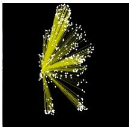
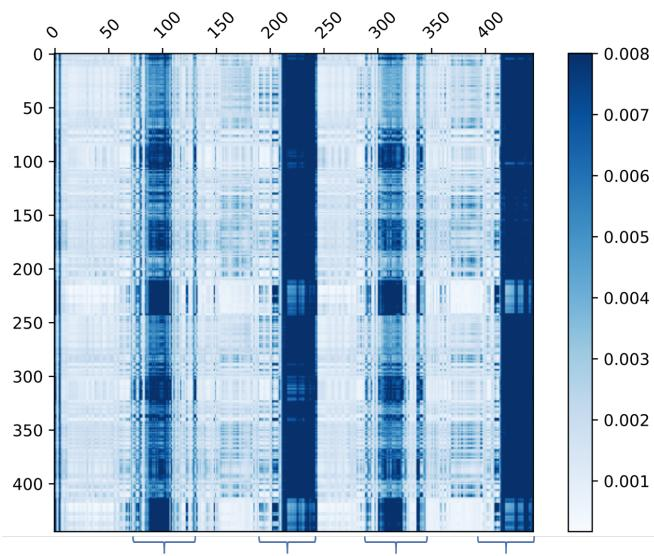
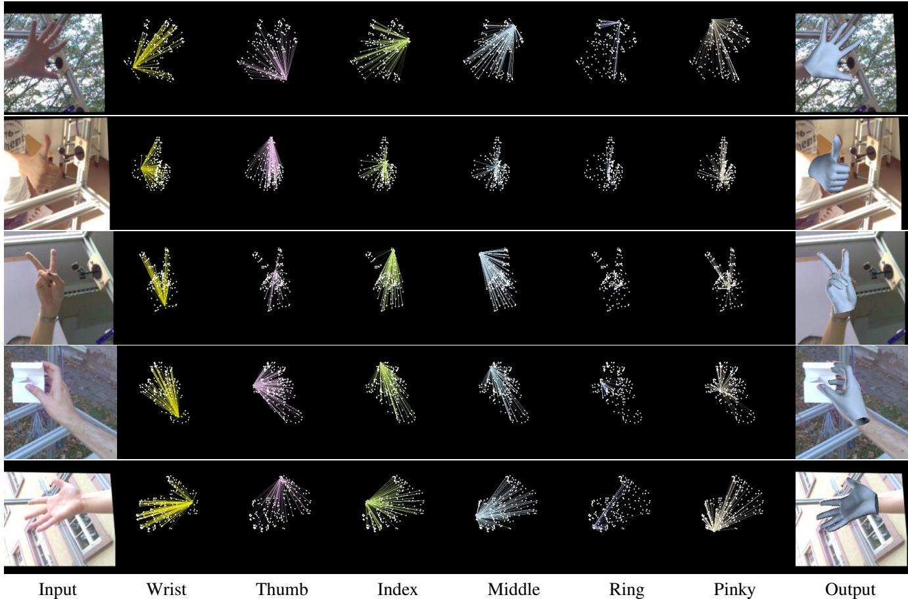
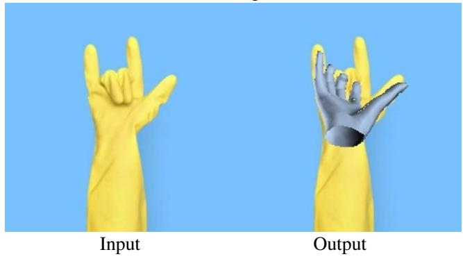
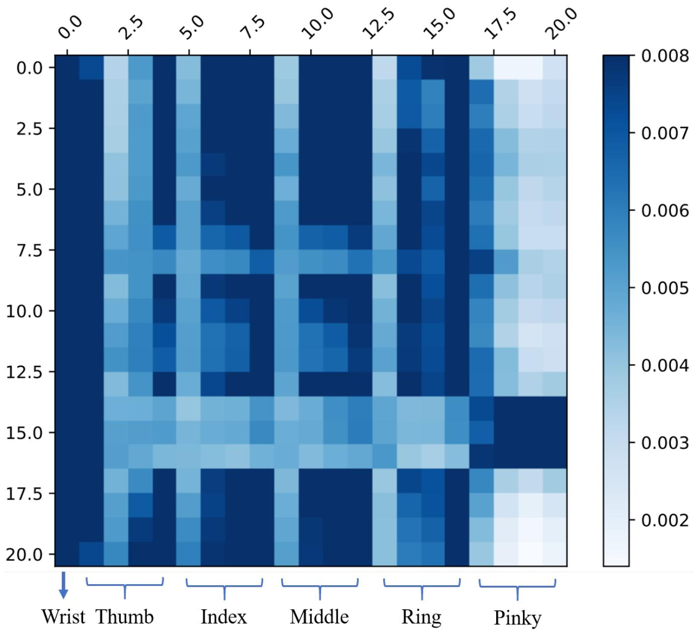
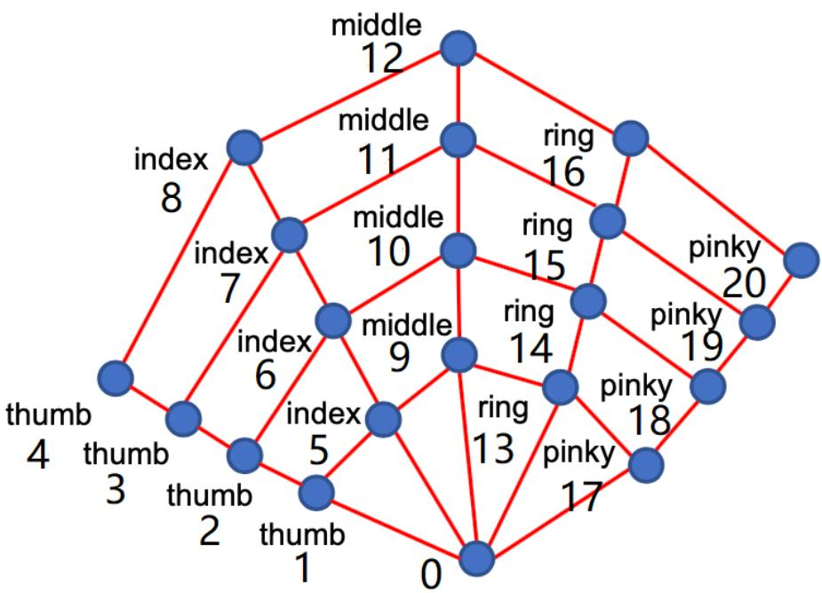

# 端到端人体姿态与网格重建的 Transformer 方法

Kevin Lin（林） Lijuan Wang（王丽娟） Zicheng Liu（刘自诚）

Microsoft（微软）

{keli, lijuanw, zliu}@microsoft.com

## 摘要

我们提出一种新方法，称为 MEsh TRansfOrmer（METRO，网格 Transformer），用于从单张图像重建 3D 人体姿态和网格顶点。我们的方法采用 Transformer 编码器来联合建模顶点—顶点（vertex-vertex）与顶点—关节（vertex-joint）之间的交互，并同时输出 3D 关节坐标和网格顶点。与现有回归姿态与形状参数的方法相比，METRO 不依赖任何参数化网格模型（如 SMPL），因此可以方便地扩展到其他对象，例如手部。我们进一步放宽网格拓扑结构，允许 Transformer 自注意力机制在任意两个顶点之间自由地建立关联，从而能够学习网格顶点与关节之间的非局部关系。通过所提出的掩码顶点建模（masked vertex modeling），我们的方法在处理诸如部分遮挡等具有挑战性的场景时更加鲁棒和有效。METRO 在公开数据集 Human3.6M 和 3DPW 上取得了人体网格重建的最新最优结果。此外，我们展示了 METRO 在野外（in the wild）3D 手部重建任务上的泛化能力，在 FreiHAND 数据集上优于现有的最优方法。代码与预训练模型已在 https://github.com/microsoft/MeshTransformer 公开。

## 1. 引言

从单张图像进行 3D 人体姿态与网格重建由于其在虚拟现实、运动分析、神经退行性疾病诊断等诸多应用中的价值，受到了广泛关注。由于人体复杂的关节运动以及遮挡问题，这是一项具有挑战性的任务。

该领域的近期工作大致可分为两类。第一类方法使用类似 SMPL [29] 的参数化模型，并学习预测形状与姿态系数 [14, 26, 39, 22, 24, 34, 44, 23]。这一路线取得了巨大成功。参数化模型中编码的强先验使其对环境变化具有较高的鲁棒性。该方法的不足之处在于，姿态与形状空间受到用于构建参数化模型的有限样本的限制。为克服这一局限，第二类方法不使用任何参数化模型 [25, 8, 32]。这些方法要么使用图卷积神经网络来建模邻域顶点—顶点的交互 [25, 8]，要么使用 1D 热力图来回归顶点坐标 [32]。这些方法的一个局限在于，它们难以高效地建模非局部的顶点—顶点交互。

  

(a)

  

(b)

  

图 1：METRO 学习身体关节点与网格顶点之间的非局部交互，用于人体网格重建。给定 (a) 中的输入图像，METRO 通过考虑非局部交互来预测人体网格。(b) 展示了被遮挡的手腕关节点与网格顶点之间的注意力，其中颜色越亮表示注意力越强。(c) 为重建得到的网格。

研究人员已经表明，非局部顶点（可能属于身体的不同部位，例如手和脚）之间存在强相关性 [55]。在计算机图形学和机器人学中，已经开发出逆运动学技术 [2]，用于在已知末端执行器（如手尖）位置的情况下，估计铰接形体的内部关节位置。我们认为，学习身体关节和网格顶点之间的相关性（包括短程和长程相关性），对于处理身体形状重建中的挑战性姿态和遮挡问题非常有价值。在本文中，我们提出了一个简单而有效的框架来建模全局的顶点-顶点交互。我们框架的主要组成部分是 transformer。

最近的研究表明，transformer [53] 在自然语言处理中的各种任务上显著提升了性能 [4, 9, 40, 41]。这一成功主要归功于 transformer 的自注意力机制，该机制在建模依赖关系（或交互）方面特别有效，无论它们在输入和输出中的距离如何。在已知依赖关系的情况下，transformer 能够软搜索相关标记，并基于重要特征进行预测 [4, 53]。

在本工作中，我们提出了 METRO——一种具有渐进式降维的多层 Transformer 编码器，用于从给定的输入图像同时重建 3D 身体关节和网格顶点。我们设计了带掩码的顶点建模（Masked Vertex Modeling）目标函数，并采用 transformer 编码器架构，以增强关节和顶点之间的交互。如图 1 所示，METRO 学会发现身体关节和网格顶点之间的短程和长程交互，这有助于更好地重建具有大幅度姿态变化和遮挡的 3D 人体形状。

在多个公开数据集上的实验结果证明，METRO 在学习顶点-顶点和顶点-关节交互方面是有效的，因此在人体网格重建方面大幅优于先前的工作。据我们所知，METRO 是第一种利用 transformer 编码器架构从单张输入图像联合学习 3D 人体姿态和网格重建的方法。此外，METRO 是一个通用框架，可以轻松应用于预测不同的 3D 网格，例如从输入图像重建 3D 手部。

总之，我们做出了以下贡献。

- 我们引入了一种新的基于 transformer 的方法，命名为 METRO，用于从单张图像进行 3D 人体姿态和网格重建。

- 我们设计了带掩码的顶点建模目标函数，并采用多层 transformer 编码器来建模顶点-顶点和顶点-关节交互，以实现更好的重建。

- METRO 在大规模基准数据集 Human3.6M 和具有挑战性的 3DPW 数据集上取得了新的最先进性能。

• METRO 是一个多功能框架，可以轻松实现以预测不同类型的 3D 网格，例如实验中所展示的 3D 手部网格。在论文投稿时，METRO 在 FreiHAND 排行榜上取得了第一名。

## 2. 相关工作

人体网格重建（Human Mesh Reconstruction, HMR）：HMR 是一项重建 3D 人体形状的任务，是近年来活跃的研究课题。虽然早期工作已经展示了使用各种传感器进行令人印象深刻的重建效果，例如深度传感器 [33, 48] 或惯性测量单元 [20, 54]，但研究人员正在探索使用更高效便捷的单目相机设置。然而，由于复杂的姿态变化、遮挡以及有限的 3D 训练数据，从单张图像进行 HMR 是一项困难的任务。

先前的研究提出采用预训练的参数化人体模型，即 SMPL [29]、STAR [35]、MANO [43]，并估计参数化模型的姿态与形状系数用于 HMR。由于直接从输入图像回归姿态与形状系数具有挑战性，最近的工作进一步提出利用各种人体先验，例如人体骨骼 [26, 39] 或分割图 [34]，并探索不同的优化策略 [24, 22, 51, 14] 以及时间信息 [23] 来改善重建效果。

另一方面，研究人员也提出了不采用参数化人体模型，而是直接从输入图像回归 3D 人体形状的方法。例如，研究人员探索了使用 3D 网格 [25, 8]、体积空间 [52] 或占据场（occupancy field）[46, 47] 来表示人体。先前的每项工作都针对其目标应用处理特定的输出表示。在相关文献中，相关研究是 GraphCMR [25]，其旨在使用图卷积神经网络（GCNNs）回归 3D 网格顶点。此外，最近提出的 Pose2Mesh [8] 是一个使用 GCNNs 的级联模型。Pose2Mesh 基于给定的人体姿态表示重建人体网格。

虽然基于 GCNN 的方法 [8, 25] 被设计为基于预先指定的网格拓扑建模相邻顶点之间的交互，但在建模更长距离的交互时效率较低。相比之下，METRO 对关节与网格顶点之间的全局交互进行建模，不受任何网格拓扑的限制。此外，我们的方法使用自注意力机制进行学习，这与先前的研究 [8, 25] 不同。

注意力机制与 Transformer：近期研究 [36, 28, 53] 表明，注意力机制能够提升在多种语言任务上的性能。其核心思想是学习注意力，从而软搜索（soft-search）对预测输出至关重要的输入 [4]。Vaswani 等人 [53] 进一步提出了一种完全基于注意力机制的 Transformer 架构。Transformer 利用多头自注意力实现高度并行化，从而支持高效的训练与推理，并在大规模语言建模中取得了卓越的性能，相关工作可见 BERT [9] 与 GPT [40, 41, 5]。

受神经语言领域近期成功的启发，越来越多的研究开始探索将 Transformer 架构应用于各类视觉任务，例如学习像素分布以用于图像生成 [7, 37] 与分类 [7, 10]，或将目标检测简化为集合预测问题 [6]。然而，3D 人体重建领域尚未沿这一方向展开探索。

  

图 2：所提出框架的整体概览。给定一张输入图像，我们使用卷积神经网络（Convolutional Neural Network, CNN）提取图像特征向量。我们通过将图像特征与每个身体关节点 i 的 3D 坐标 $( x _ { i } , y _ { i } , z _ { i } )$ 以及每个网格顶点 j 的 3D 坐标 $( x _ { j } , y _ { j } , z _ { j } )$ 进行拼接，将人体模板网格添加到图像特征向量中，以此实现位置编码。给定一组关节点查询与顶点查询，我们通过 Transformer 编码器的多层结构进行自注意力运算，并行回归出身体关节点与网格顶点的 3D 坐标。我们采用渐进式降维架构（右图），在层与层之间逐步减小隐藏嵌入的维度。最终层中的每个 token 输出一个关节点或网格顶点的 3D 坐标。每个编码器块包含 4 层和 4 个注意力头。H 表示图像特征向量的维度。

在本研究中，我们提出了一种采用渐进式降维的多层 Transformer 架构，用于回归关节点和网格顶点的三维坐标。

## 3. 方法

图 2 是我们提出的框架概览。它以一张大小为 224 × 224 的图像作为输入，并预测一组人体关节点 J 和网格顶点 V。所提出的框架由两个模块组成：卷积神经网络（Convolutional Neural Network, CNN）和多层 Transformer 编码器（Multi-Layer Transformer Encoder）。首先，我们使用 CNN 从输入图像中提取图像特征向量。接着，多层 Transformer 编码器以该特征向量作为输入，并行地输出人体关节点和网格顶点的三维坐标。下面我们将详细描述每个模块。

## 3.1. 卷积神经网络

在我们框架的第一个模块中，我们采用卷积神经网络（CNN）进行特征提取。该 CNN 在 ImageNet 分类任务 [45] 上进行了预训练。具体而言，我们从最后一个隐藏层提取一个特征向量 X。所提取的特征向量 X 的维度通常为 2048。我们将该特征向量 X 输入到 Transformer 中用于回归任务。

这种通用设计支持人体姿态和网格重建的端到端训练。此外，Transformer 可以轻松受益于大规模预训练的 CNN，例如 HRNets [56]。在我们的实验中，我们对输入特征进行了分析，发现高分辨率图像特征有利于 Transformer 回归人体关节点和网格顶点的三维坐标。

## 3.2. 具有渐进式降维的多层 Transformer 编码器

由于我们需要输出三维坐标，因此不能直接采用现有的 Transformer 编码器架构 [10, 6]，因为它们对所有 Transformer 层都使用恒定维度的隐藏嵌入。受 [18] 通过多个块逐步进行降维的启发，我们设计了一种采用渐进式降维方案的新架构。如图 2 右侧所示，我们使用线性投影在每个编码器层之后降低隐藏嵌入的维度。通过堆叠多个编码器层，该模型可被视为以交替方式进行自注意力和降维。我们的 Transformer 编码器的最终输出向量即为关节点和网格顶点的三维坐标。

如图 2 左所示，Transformer 编码器的输入是人体关节点和网格顶点查询。与位置编码 [53, 25, 13] 的思想一致，我们使用一个模板人体网格来保留输入序列中每个查询的位置信息。具体而言，我们将图像特征向量 $X \in \mathbb { R } ^ { 2 \bar { 0 } 4 8 \times 1 }$ 与每个身体关节点 i 的 3D 坐标 $( x _ { i } , y _ { i } , z _ { i } )$ 进行拼接。这构成了一个关节点查询集合 $\dot { Q _ { J } } = \{ q _ { 1 } ^ { J } , q _ { 2 } ^ { J } , . . . , q _ { n } ^ { J } \}$ ，其中 $q _ { i } ^ { J } \in \mathbb { R } ^ { 2 0 5 1 \times 1 }$ 。类似地，我们对每个网格顶点 j 进行相同的位置编码，并构成一个顶点查询集合 $\mathsf { \bar { Q } } _ { V } = \{ q _ { 1 } ^ { \dot { V } } , q _ { 2 } ^ { V } , \hdots , q _ { m } ^ { V } \}$ ，其中 $q _ { j } ^ { V } \in \mathbb { R } ^ { 2 0 5 1 \times 1 }$ 。

## 3.3. 掩码顶点建模（Masked Vertex Modeling）

先前的工作 [9, 49] 使用掩码语言建模（Masked Language Modeling, MLM）来学习训练语料的语言学特性。然而，MLM 的目标是恢复被掩码的输入，这无法直接应用于我们的回归任务。

为了充分激活我们 Transformer 编码器中的双向注意力，我们为回归任务设计了一种掩码顶点建模（Masked Vertex Modeling, MVM）。我们以随机比例对部分输入查询进行掩码。与像 MLM [9] 那样恢复被掩码的输入不同，我们改为让 Transformer 回归所有关节点和顶点。

为了预测与缺失查询对应的输出，模型将不得不借助其他相关查询。这在思想上类似于模拟遮挡，即部分身体部位不可见。因此，MVM 强制 Transformer 在回归 3D 坐标时考虑其他相关的顶点和关节点，而不考虑它们的距离和网格拓扑结构。这有助于促进关节点和顶点之间的短程和长程交互，从而更好地进行人体建模。

## 3.4. 训练

为了训练 Transformer 编码器，我们在 Transformer 输出之上施加损失函数，并最小化预测值与真值之间的误差。给定一个数据集 $D = \{ I ^ { i } , \bar { V } _ { 3 D } ^ { i } , \bar { J } _ { 3 D } ^ { i } , \bar { J } _ { 2 D } ^ { i } \} _ { i = 1 } ^ { T }$ ，其中 T 是训练图像的总数。$\boldsymbol { I } \in \mathbb { R } ^ { w \times h \times 3 }$ 表示一张 RGB 图像。$\bar { V } _ { 3 D } \in \mathbf { \mathbb { R } } ^ { M \times \bar { 3 } }$ 表示网格顶点的真值 3D 坐标，M 是顶点的数量。$\bar { J } _ { 3 D } \in \mathbb { R } ^ { K \times 3 }$ 表示人体关节点的真值 3D 坐标，K 是一个人的关节点数量。类似地，$\bar { J } _ { 2 D } \in \mathbb { R } ^ { K \times 2 }$ 表示人体关节点的真值 2D 坐标。

设 $V_{3D}$ 表示输出的顶点位置，$J_{3D}$ 表示输出的关节点位置，我们使用 $L_1$ 损失来最小化预测值与真实值之间的误差：

$$
\mathcal { L } _ { V } = \frac { 1 } { M } \sum _ { i = 1 } ^ { M } \big | \big | V _ { 3 D } - \bar { V } _ { 3 D } \big | \big | _ { 1 } ,\tag{1}
$$

$$
\mathcal { L } _ { J } = \frac { 1 } { K } \sum _ { i = 1 } ^ { K } \big | \big | J _ { 3 D } - \bar { J } _ { 3 D } \big | \big | _ { 1 } .\tag{2}
$$

值得注意的是，3D 关节也可以从预测网格中导出。遵循文献 [8, 22, 25, 24] 中的常见做法，我们使用一个预定义的回归矩阵 $G \in \mathbb { R } ^ { K \times M }$，并通过 $J _ { 3 D } ^ { r e g } = G V _ { 3 D }$ 得到回归得到的 3D 关节。与先前工作类似，我们使用 $L _ { 1 }$ 损失来优化 ${ { J } _ { 3 D } ^ { r e g } }$

$$
\mathcal { L } _ { J } ^ { r e g } = \frac { 1 } { K } \sum _ { i = 1 } ^ { K } \left| \left| J _ { 3 D } ^ { r e g } - \bar { J } _ { 3 D } \right| \right| _ { 1 } .\tag{3}
$$

二维重投影（2D re-projection）已被广泛用于增强图像与网格的对齐[22, 25, 24]。此外，它还有助于在图像中可视化重建结果。受先前工作的启发，我们使用估计得到的相机参数将三维关节点投影到二维空间，并最小化二维投影结果与二维真值之间的误差：

$$
\mathcal { L } _ { J } ^ { p r o j } = \frac { 1 } { K } \sum _ { i = 1 } ^ { K } \left| \left| J _ { 2 D } - \bar { J } _ { 2 D } \right| \right| _ { 1 } ,\tag{4}
$$

其中相机参数通过在 Transformer 编码器输出之上添加一个线性层来学习得到。

为了进行大规模训练，为了获得更好的泛化能力，理想的做法是同时利用 2D 与 3D 训练数据集。正如文献 [34, 22, 25, 24, 23, 8, 32] 中所探讨的，我们采用一种混合训练策略，利用不同的训练数据集，无论其是否具有成对的图像-网格标注。我们的总体目标函数写作：

$$
\mathcal { L } = \alpha \times ( \mathcal { L } _ { V } + \mathcal { L } _ { J } + \mathcal { L } _ { J } ^ { r e g } ) + \beta \times \mathcal { L } _ { J } ^ { p r o j } ,\tag{5}
$$

其中 $\alpha$ 和 $\beta$ 是每个训练样本的二元标志，分别表示 3D 和 2D 真值（ground truth）的可用性。

## 3.5. 实现细节（Implementation Details）

我们的方法能够处理任意大小的网格。然而，受当前硬件的内存限制，我们的 Transformer 处理的是一个粗网格：（1）我们使用一个粗模板网格（431 个顶点）进行位置编码，Transformer 输出一个粗网格；（2）我们使用可学习的多层感知机（Multi-Layer Perceptrons, MLPs）将粗网格上采样到原始网格（SMPL 人体网格拓扑为 6890 个顶点）；（3）Transformer 和 MLP 以端到端的方式联合训练；需要注意的是，粗网格通过采样算法 [42] 对原始网格进行两次子采样得到 431 个顶点。正如文献 [25] 所讨论的，先学习粗网格再上采样的实现方式有助于降低计算量。它还有助于避免原始网格中由顶点空间局部性带来的冗余，从而使训练更加高效。

## 4. 实验结果（Experimental Results）

我们首先展示我们的方法在 Human3.6M 和 3DPW 数据集上优于此前最先进的人体网格重建方法。然后，我们提供消融

<table><tr><td rowspan="2">Method</td><td colspan="3">3DPW</td><td colspan="2">Human3.6M</td></tr><tr><td>MPVE↓</td><td>MPJPE↓</td><td>PA-MPJPE↓</td><td>MPJPE↓</td><td>PA-MPJPE↓</td></tr><tr><td>HMR [22]</td><td>一</td><td>一</td><td>81.3</td><td>88.0</td><td>56.8</td></tr><tr><td>GraphCMR [25]</td><td></td><td>一</td><td>70.2</td><td>一</td><td>50.1</td></tr><tr><td>SPIN [24]</td><td>116.4</td><td></td><td>59.2</td><td>一</td><td>41.1</td></tr><tr><td>Pose2Mesh [8]</td><td>一</td><td>89.2</td><td>58.9</td><td>64.9</td><td>47.0</td></tr><tr><td>I2LMeshNet [32]</td><td>一</td><td>93.2</td><td>57.7</td><td>55.7</td><td>41.1</td></tr><tr><td>VIBE [23]</td><td>99.1</td><td>82.0</td><td>51.9</td><td>65.6</td><td>41.4</td></tr><tr><td>METRO (Ours)</td><td>88.2</td><td>77.1</td><td>47.9</td><td>54.0</td><td>36.7</td></tr></table>

**Table 1: 在 3DPW 和 Human3.6M 数据集上与最先进方法的性能比较。**

为非局部交互和模型设计提供研究思路与启示。最后，我们展示了我们的模型在手部重建任务上的泛化能力。

## 4.1. 数据集

遵循文献 [34, 22, 25, 24, 23, 8, 32] 的做法，我们使用 3D 和 2D 训练数据进行混合训练。下面分别描述每个数据集。

**Human3.6M** [21] 是一个带有 2D 和 3D 标注的大规模数据集。每张图像中都有一个受试者执行不同的动作。由于许可证问题，真实 3D 网格不可用。因此，我们使用 [8, 32] 中提供的伪 3D 网格（pseudo 3D meshes）进行训练。这些伪标签是通过使用 SMPLify-X [38] 进行模型拟合得到的。为了公平比较，我们使用 Human3.6M 中提供的真实 3D 姿态标签进行评估。遵循常见设置 [50, 25, 22]，我们使用受试者 S1、S5、S6、S7 和 S8 的数据训练模型，并使用受试者 S9 和 S11 的数据测试模型。

**3DPW** [54] 是一个带有 2D 和 3D 标注的室外图像数据集。其训练集包含 22K 张图像，测试集包含 35K 张图像。遵循此前的最先进方法 [23]，我们在 3DPW 上进行实验时使用 3DPW 的训练数据。

**UP-3D** [26] 是一个室外图像数据集。其 3D 标注通过模型拟合得到，训练集包含 7K 张图像。

**MuCo-3DHP** [31] 是基于 MPI-INF-3DHP 数据集 [30] 合成的一个数据集。它将训练数据与多种真实世界背景图像合成在一起，包含 200K 张训练图像。

**COCO** [27] 是一个带有 2D 标注的大规模数据集。我们还使用 [24] 中提供的伪 3D 网格标签，这些标签通过 SMPLify-X [38] 拟合得到。

**MPII** [1] 是一个带有 2D 姿态标签的室外图像数据集。其训练集包含 14K 张图像。

**FreiHAND** [61] 是一个 3D 手部数据集。其训练集包含 130K 张图像，测试集包含 4K 张图像。我们在这个数据集上展示了我们模型的泛化能力，使用其提供的数据集进行训练，并在其在线服务器上进行评估。

## 4.2. 评估指标

我们使用以下三个标准指标报告结果。这三个指标的单位均为毫米（millimeter, mm）。

**MPJPE**：平均逐关节位置误差（Mean-Per-Joint-Position-Error, MPJPE）[21] 是用于评估人体 3D 姿态的指标 [22, 24, 8]。MPJPE 测量真实关节与预测关节之间的欧氏距离。

**PA-MPJPE**：PA-MPJPE，也称为重建误差（Reconstruction Error）[60]，是该任务的另一个指标。它首先使用普氏分析（Procrustes analysis, PA）[12] 进行 3D 对齐，然后计算 MPJPE。PA-MPJPE 常用于评估 3D 重建 [60]，因为它衡量的是重建结构本身的误差，而与尺度以及刚性姿态（即平移和旋转）无关。

**MPVE**：平均逐顶点误差（Mean-Per-Vertex-Error, MPVE）[39] 测量真实顶点与预测顶点之间的欧氏距离。

## 4.3. 主要结果

我们在 3DPW 和 Human3.6M 数据集上将 METRO 与之前最先进的方法进行比较。遵循文献 [23, 24, 22, 25] 的做法，我们使用三维与二维训练数据进行混合训练。结果如表 1 所示。我们的方法在这两个数据集上均优于先前的工作。

首先，我们关注 transformer 在 3DPW 野外（in-the-wild）三维重建中的表现。如表 1 左侧三列所示，我们的方法优于 VIBE [23]，而 VIBE 此前是该数据集上最先进的方法。值得注意的是，VIBE 是一种基于视频的方法，而我们的方法是基于图像的方法。

此外，我们在 Human3.6M 的室内场景下对性能进行了评估。我们遵循先前工作 [24, 32] 的设置，在训练模型时未使用 3DPW 数据。

  

图 3：本方法的可视化结果。给定一张输入图像（左），METRO 在进行人体网格重建（右）时考虑了关节点与顶点之间的非局部交互。我们可视化了指定关节点与所有其他顶点之间的自注意力机制，其中颜色越亮表示注意力越强。我们观察到 METRO 在关节点与顶点之间发现了丰富的、依赖于输入的交互关系。

结果如表 1 右栏第二列所示。我们的方法取得了更佳的重建性能，尤其在 PA-MPJPE 指标上表现突出。

Human3.6M 和 3DPW 这两个数据集具有不同的挑战。3DPW 中的场景存在更严重的遮挡。Human3.6M 中的场景较为简单，其挑战更多在于如何准确估计人体形状。METRO 在两个数据集上均表现良好，这一事实表明它既对遮挡具有鲁棒性，又具备精确的人体形状回归能力。

## 4.4. 消融实验

**掩码顶点建模（Masked Vertex Modeling）的有效性：** 由于我们为 Transformer 设计了一个掩码顶点建模目标，一个有趣的问题是该目标是否有用。表 2 展示了在 Human3.6M 上的消融实验结果。我们观察到，掩码顶点建模显著提升了结果。此外，我们研究了应当掩码多少比例的查询令牌（query token）。我们改变了最大掩码比例，表 3 展示了对比结果。随着训练中掩码查询数量的增加，性能有所提升。然而，如果掩码超过 30% 的输入查询，收益便不再明显。这是因为大量查询缺失会使训练变得更加困难。

<table><tr><td></td><td>MPJPE↓</td><td>PA-MPJPE↓</td></tr><tr><td>w/o MVM</td><td>61.0</td><td>39.1</td></tr><tr><td>w/MVM</td><td>54.0</td><td>36.7</td></tr></table>

表 2：掩码顶点建模（Masked Vertex Modeling, MVM）目标函数的消融研究，在 Human3.6M 上评估。

<table><tr><td>Max Percentage</td><td>0%</td><td>10%</td><td>20%</td><td>30%</td><td>40%</td><td>50%</td></tr><tr><td>PA-MPJPE</td><td>39.1</td><td>37.6</td><td>37.5</td><td>36.7</td><td>38.2</td><td>37.3</td></tr></table>

表 3：掩码顶点建模（Masked Vertex Modeling）目标的消融研究，使用不同百分比的掩码查询，在 Human3.6M 上进行评估。变量 n% 表示我们从输入查询中随机掩码 0% 到 n% 的查询。

<table><tr><td>Method</td><td>PA-MPVPE↓</td><td>PA-MPJPE↓</td><td>F@5 mm ↑</td><td>F@15 mm ↑</td></tr><tr><td>Hasson et al [22]</td><td>13.2</td><td></td><td>0.436</td><td>0.908</td></tr><tr><td>Boukhayma et al. [25]</td><td>13.0</td><td></td><td>0.435</td><td>0.898</td></tr><tr><td>FreiHAND [24]</td><td>10.7</td><td></td><td>0.529</td><td>0.935</td></tr><tr><td>Pose2Mesh [8]</td><td>7.8</td><td>7.7</td><td>0.674</td><td>0.969</td></tr><tr><td>I2LMeshNet [32]</td><td>7.6</td><td>7.4</td><td>0.681</td><td>0.973</td></tr><tr><td>METRO (Ours)</td><td>6.3</td><td>6.5</td><td>0.731</td><td>0.984</td></tr></table>

Table 4: 与当前最先进方法的性能比较，在 FreiHAND 在线服务器上评估。METRO 以大幅度超越了之前的最先进方法。

非局部交互（Non-local Interactions）：为了进一步理解 METRO 在学习关节与网格顶点之间交互的作用，我们在 transformer 中对自注意力进行了分析。

图 3 展示了自注意力与网格重建的可视化结果。在图 3 的每一行中，我们展示了输入图像，以及某一指定关节与所有网格顶点之间的自注意力。颜色越亮表示注意力越强。在第一行中，人物被严重遮挡，右侧身体部位不可见。当我们预测右腕的位置时，METRO 关注了相关的非局部顶点，尤其是头部和左手上的顶点。在最下面一行中，人物身体大幅弯曲。对于头部位置的预测，METRO 关注了脚和手（最下面一行的第 6 列）。这在直觉上是合理的，因为手和脚的位置为身体姿态、进而为头部位置提供了强烈的线索。此外，我们观察到模型会根据输入图像进行自注意力。如图 3 的第二行所示，在预测右腕位置时，METRO 更多地关注右脚，这与其他三行中的注意力不同。

我们进一步对非局部交互进行定量分析。我们从 3DPW 测试集中随机采样 5000 张图像，并估计一个整体的自注意力图。它是最后一个 transformer 层中所有注意力头的平均注意力权重。我们在图 4 中可视化了 14 个身体关节与 431 个网格顶点之间的交互。每个像素显示了自注意力的强度，其中颜色越深表示注意力越强。请注意，前 14 列是身体关节，其余表示网格顶点。我们观察到 METRO 对前臂和小腿上的顶点给予了强烈的注意力。这与逆运动学文献 [2] 一致，其中链接图形的内部关节能根据末端执行器的位置进行估计。

输入表示（Input Representations）：我们通过使用不同的 CNN 主干网络来研究我们的 transformer 架构的行为。我们在此实验中使用 ResNet50 [16] 和 HRNet [56] 的变体。所有主干网络都在 ImageNet [45] 的 1000 类图像分类任务上进行了预训练。对于每个主干网络，我们提取一个全局图像特征向量 $X \in \mathbb{R}^{2048\times1}$，并将其输入到 transformer 中。在表 5 中，我们观察到我们的 transformer 在使用 ResNet50 主干网络时取得了具有竞争力的性能。随着我们增加 HRNet 中高分辨率特征图的通道数，我们观察到了进一步的性能提升。

图 4：身体关节与网格顶点之间自注意力的可视化。横轴和纵轴分别对应查询和预测输出。从左起前 14 列对应身体关节，其余列对应网格顶点。每一行展示第 j 个查询对第 i 个输出的注意力权重 $w _ { i , j }$。颜色越深表示注意力越强。

<table><tr><td>Backbone</td><td>MPJPE↓</td><td>PA-MPJPE↓</td></tr><tr><td>ResNet50</td><td>56.5</td><td>40.6</td></tr><tr><td>HRNet-W40</td><td>55.9</td><td>38.5</td></tr><tr><td>HRNet-W64</td><td>54.0</td><td>36.7</td></tr></table>

表 5：不同骨干网络的分析，在 Human3.6M 上进行评估。所有骨干网络均在 ImageNet 上进行了预训练。我们观察到，增加 HRNet 高分辨率特征图中的滤波器数量有利于网格回归。

  

图5：我们的方法在 FreiHAND 测试集上的定性结果。我们可视化了指定关节点与所有网格顶点之间的自注意力（self-attention），其中颜色越亮表示注意力越强。METRO 是一个多功能框架，可以轻松扩展到三维手部重建任务中。

推广到野外 3D 手部（in-the-wild）：METRO 能够预测任意关节点和顶点，不依赖于邻接矩阵和参数化系数。因此，METRO 在其他物体的网格重建中具有高度的灵活性和通用性。为了展示这一能力，我们在 FreiHAND [61] 上进行了实验。我们在 FreiHAND 上从头开始训练模型，并在 FreiHAND 在线服务器上评估结果。表 4 显示了与先前工作的对比。METRO 以较大优势超越了此前的最先进方法。在不使用任何外部训练数据的情况下，METRO 在论文提交时在 FreiHAND 排行榜上取得了第一名1。

图 5 展示了我们的非局部（non-local）交互定性结果。在附录中，我们对 3D 手部关节点提供了进一步的分析，并表明 METRO 中学习的自注意力与逆运动学（Inverse Kinematics）[2] 一致。

## 5. 结论

我们提出了一个简单而有效的网格 Transformer 框架，用于从单张输入图像重建人体姿态和网格。我们提出了掩码顶点建模（Masked Vertex Modeling）目标，以学习身体关节点和网格顶点之间的非局部交互。实验结果表明，我们的方法在 3DPW、Human3.6M 和 FreiHAND 数据集上推进了最先进的性能。

详细的分析表明，性能提升主要归因于 METRO 中学习的与输入相关的非局部交互，这使得无论网格拓扑如何，预测都能基于重要关节点和顶点进行。我们进一步展示了所提方法推广到 3D 手部重建的能力。

## 参考文献

[1] Mykhaylo Andriluka, Leonid Pishchulin, Peter Gehler, 和 Bernt Schiele. 二维人体姿态估计：新基准与最先进分析（2D Human Pose Estimation: New Benchmark and State of the Art Analysis）。收录于 CVPR, 2014. 5

[2] Andreas Aristidou, Joan Lasenby, Yiorgos Chrysanthou, 和 Ariel Shamir. 计算机图形学中的逆运动学技术综述（Inverse Kinematics Techniques in Computer Graphics: A Survey）。收录于 Computer Graphics Forum, 2018. 1, 7, 8, 12

[3] Anurag Arnab, Carl Doersch, 和 Andrew Zisserman. 利用时间上下文进行野外 3D 人体姿态估计（Exploiting Temporal Context for 3D Human Pose Estimation in the Wild）。收录于 CVPR, 2019. 11

[4] Dzmitry Bahdanau, Kyunghyun Cho, 和 Yoshua Bengio. 通过联合学习对齐和翻译的神经机器翻译（Neural Machine Translation by Jointly Learning to Align and Translate）。收录于 ICLR, 2015. 2

[6] Nicolas Carion, Francisco Massa, Gabriel Synnaeve, Nicolas Usunier, Alexander Kirillov, 和 Sergey Zagoruyko. 使用 Transformer 进行端到端目标检测（End-to-End Object Detection with Transformers）。收录于 ECCV, 2020. 3

[7] Mark Chen, Alec Radford, Rewon Child, Jeff Wu, Heewoo Jun, Prafulla Dhariwal, David Luan, 和 Ilya Sutskever. 从像素进行生成式预训练（Generative Pretraining from Pixels）。收录于 ICML, 2020. 2

[8] Hongsuk Choi, Gyeongsik Moon, and Kyoung Mu Lee. Pose2mesh: 基于图卷积网络从 2D 人体姿态恢复 3D 人体姿态与网格. In: ECCV, 2020. 1, 2, 4, 5, 7, 11, 17

[9] Jacob Devlin, Ming-Wei Chang, Kenton Lee, and Kristina Toutanova. BERT: 用于语言理解的深度双向 Transformer 预训练. In: NAACL, 2019. 2, 4, 11

[11] Georgios Georgakis, Ren Li, Srikrishna Karanam, Terrence Chen, Jana Kosecka, and Ziyan Wu. 分层运动学人体网格恢复. In: ECCV, 2020. 11

[12] John C Gower. 广义 Procrustes 分析. Psychometrika, 1975. 5, 13

[13] Thibault Groueix, Matthew Fisher, Vladimir G Kim, Bryan C Russell, and Mathieu Aubry. 3D-Coded: 基于深度形变的 3D 对应关系. In: ECCV, 2018. 3

[14] Peng Guan, Alexander Weiss, Alexandru O Balan, and Michael J Black. 从单张图像估计人体形状与姿态. In: ICCV, 2009. 1, 2

[15] Riza Alp Guler and Iasonas Kokkinos. HoloPose: 野外场景下的整体 3D 人体重建. In: CVPR, 2019. 11

[16] Kaiming He, Xiangyu Zhang, Shaoqing Ren, and Jian Sun. 用于图像识别的深度残差学习. In: CVPR, 2016. 7

[17] Yihui He, Rui Yan, Katerina Fragkiadaki, and Shoou-I Yu. 极线 Transformer. In: CVPR, 2020. 11

[18] Geoffrey E Hinton and Ruslan R Salakhutdinov. 利用神经网络降低数据维度. Science, 2006. 3, 12

[19] Lin Huang, Jianchao Tan, Ji Liu, and Junsong Yuan. HandTransformer: 用于 3D 手部姿态估计的非自回归结构化建模. In: ECCV, 2020. 11

[20] Yinghao Huang, Manuel Kaufmann, Emre Aksan, Michael J. Black, Otmar Hilliges, and Gerard Pons-Moll. 深度惯性姿态估计：从稀疏惯性测量实时重建人体姿态. ACM Transactions on Graphics, 37(6):185:1–185:15, Nov. 2018. 2

[21] Catalin Ionescu, Dragos Papava, Vlad Olaru, and Cristian Sminchisescu. Human3.6M: 自然环境下 3D 人体感知的大规模数据集与预测方法. IEEE Transactions on Pattern Analysis and Machine Intelligence, 36(7):1325–1339, 2014. 5

[22] Angjoo Kanazawa, Michael J Black, David W Jacobs, and Jitendra Malik. 人体形状与姿态的端到端恢复. In: CVPR, 2018. 1, 2, 4, 5, 7, 11

[23] Muhammed Kocabas, Nikos Athanasiou, and Michael J. Black. VIBE: 用于人体姿态与形状估计的视频推理. In: CVPR, 2020. 1, 2, 4, 5, 11

[24] Nikos Kolotouros, Georgios Pavlakos, Michael J Black, and Kostas Daniilidis. 通过环路内模型拟合学习重建 3D 人体姿态与形状. In: ICCV, 2019. 1, 2, 4, 5, 7, 11

[25] Nikos Kolotouros, Georgios Pavlakos, and Kostas Daniilidis. 用于单张图像人体形状重建的卷积网格回归. 载于 CVPR, 2019. 1, 2, 3, 4, 5, 7, 11, 12, 14

[26] Christoph Lassner, Javier Romero, Martin Kiefel, Federica Bogo, Michael J Black, and Peter V Gehler. 团结众人：闭合 3D 与 2D 人体表征之间的回路. 载于 CVPR, 2017. 1, 2, 5

[28] Yankai Lin, Shiqi Shen, Zhiyuan Liu, Huanbo Luan, and Maosong Sun. 基于实例选择性注意力的神经关系抽取. 载于 ACL, 2016. 2

[29] Matthew Loper, Naureen Mahmood, Javier Romero, Gerard Pons-Moll, and Michael J Black. SMPL：一种蒙皮多人线性模型. ACM Transactions on Graphics, 34(6):248, 2015. 1, 2

[30] Dushyant Mehta, Helge Rhodin, Dan Casas, Pascal Fua, Oleksandr Sotnychenko, Weipeng Xu, and Christian Theobalt. 使用改进 CNN 监督的野外单目 3D 人体姿态估计. 载于 3DV, 2017. 5

[31] Dushyant Mehta, Oleksandr Sotnychenko, Franziska Mueller, Weipeng Xu, Srinath Sridhar, Gerard Pons-Moll, and Christian Theobalt. 基于单目 RGB 的单次多人 3D 姿态估计. 载于 3DV, 2018. 5

[32] Gyeongsik Moon and Kyoung Mu Lee. I2L-MeshNet：面向从单张 RGB 图像精确估计 3D 人体姿态与网格的图像到线素预测网络. 载于 ECCV, 2020. 1, 4, 5, 7, 11, 12, 13, 14

[34] Mohamed Omran, Christoph Lassner, Gerard Pons-Moll, Peter Gehler, and Bernt Schiele. 神经人体拟合：统一深度学习与基于模型的人体姿态与形状估计. 载于 3DV, 2018. 1, 2, 4, 5

[35] Ahmed A A Osman, Timo Bolkart, and Michael J. Black. STAR：一种稀疏训练的关节化人体回归器. 载于 ECCV, 2020. 2

[36] Ankur P Parikh, Oscar Tackstr ¨ om, Dipanjan Das, and Jakob¨ Uszkoreit. 用于自然语言推理的可分解注意力模型. arXiv 预印本 arXiv:1606.01933, 2016. 2

[37] Niki Parmar, Ashish Vaswani, Jakob Uszkoreit, Lukasz Kaiser, Noam Shazeer, Alexander Ku, and Dustin Tran. Image Transformer. 载于 ICML, 2018. 2

[38] Georgios Pavlakos, Vasileios Choutas, Nima Ghorbani, Timo Bolkart, Ahmed A. A. Osman, Dimitrios Tzionas, and Michael J. Black. 富有表现力的人体捕捉：从单张图像获取 3D 手部、面部与身体. 载于 CVPR, 2019. 5

[39] Georgios Pavlakos, Luyang Zhu, Xiaowei Zhou, and Kostas Daniilidis. 从单张彩色图像学习估计 3D 人体姿态与形状. 载于 CVPR, 2018. 1, 2, 5

[40] Alec Radford, Karthik Narasimhan, Tim Salimans, and Ilya Sutskever. 通过生成式预训练提升语言理解能力（Improving language understanding by generative pre-training）. 技术报告, 2018. 2

[41] Alec Radford, Jeffrey Wu, Rewon Child, David Luan, Dario Amodei, and Ilya Sutskever. 语言模型是无监督多任务学习者（Language models are unsupervised multitask learners）. 技术报告, 2019. 2

[42] Anurag Ranjan, Timo Bolkart, Soubhik Sanyal, and Michael J Black. 使用卷积网格自编码器生成三维人脸（Generating 3d faces using convolutional mesh autoencoders）. 发表于 ECCV, 2018. 4

[43] Javier Romero, Dimitrios Tzionas, and Michael J. Black. 具身之手：手与身体的联合建模与捕获（Embodied hands: Modeling and capturing hands and bodies together）. SIGGRAPH Asia, 2017. 2

[44] Yu Rong, Ziwei Liu, Cheng Li, Kaidi Cao, and Chen Change Loy. 深入探索野外三维人体重建中的混合标注（Delving deep into hybrid annotations for 3d human recovery in the wild）. 发表于 ICCV, 2019. 1

[46] Shunsuke Saito, Zeng Huang, Ryota Natsume, Shigeo Morishima, Angjoo Kanazawa, and Hao Li. PIFu：用于高分辨率着装人体数字化的像素对齐隐式函数（Pifu: Pixel-aligned implicit function for high-resolution clothed human digitization）. arXiv 预印本 arXiv:1905.05172, 2019. 2

[47] Shunsuke Saito, Tomas Simon, Jason Saragih, and Hanbyul Joo. PIFuHD：用于高分辨率三维人体数字化的多层像素对齐隐式函数（Pifuhd: Multi-level pixel-aligned implicit function for high-resolution 3d human digitization）. 发表于 CVPR, 2020. 2

[48] Daeyun Shin, Zhile Ren, Erik B Sudderth, and Charless C Fowlkes. 基于多层深度与极线 Transformer 的三维场景重建（3d scene reconstruction with multi-layer depth and epipolar transformers）. 发表于 ICCV, 2019. 2

[49] Wilson L Taylor. "完形填空程序"：一种衡量可读性的新工具（"cloze procedure": A new tool for measuring readability）. Journalism Quarterly, 1953. 4

[50] Bugra Tekin, Artem Rozantsev, Vincent Lepetit, and Pascal Fua. 从运动补偿序列中直接预测三维人体姿态（Direct prediction of 3d body poses from motion compensated sequences）. 发表于 CVPR, 2016. 5

[51] Hsiao-Yu Tung, Hsiao-Wei Tung, Ersin Yumer, and Katerina Fragkiadaki. 运动捕获的自监督学习（Self-supervised learning of motion capture）. 发表于 NeurIPS, 2017. 2

[52] Gul Varol, Duygu Ceylan, Bryan Russell, Jimei Yang, Ersin Yumer, Ivan Laptev, and Cordelia Schmid. BodyNet：三维人体形状的体素推断（Bodynet: Volumetric inference of 3d human body shapes）. 发表于 ECCV, 2018. 2

[53] Ashish Vaswani, Noam Shazeer, Niki Parmar, Jakob Uszkoreit, Llion Jones, Aidan N Gomez, Łukasz Kaiser, and Illia Polosukhin. 注意力机制就是你所需的一切（Attention is all you need）. 发表于 NeurIPS, 2017. 1, 2, 3, 12

[54] Timo von Marcard, Roberto Henschel, Michael Black, Bodo Rosenhahn, and Gerard Pons-Moll. 利用 IMU 与运动相机在野外恢复准确的三维人体姿态（Recovering accurate 3d human pose in the wild using imus and a moving camera）. 发表于 ECCV, 2018. 2, 5

[55] Jiang Wang, Zicheng Liu, Ying Wu, and Junsong Yuan. 基于深度摄像头挖掘动作元集合用于动作识别（Mining actionlet ensemble for action recognition with depth cameras）. 发表于 CVPR, 2012. 1

[57] Yuanlu Xu, Song-Chun Zhu, and Tony Tung. DenseRAC：通过密集渲染与比较的联合三维姿态与形状估计（DenseRAC: Joint 3D pose and shape estimation by dense render-and-compare）. 发表于 ICCV，2019. 11

[58] Wang Zeng, Wanli Ouyang, Ping Luo, Wentao Liu, and Xiaogang Wang. 基于密集对应关系的三维人体网格回归（3D human mesh regression with dense correspondence）. 发表于 CVPR，2020. 11

[59] Tianshu Zhang, Buzhen Huang, and Yangang Wang. 从单张彩色图像估计物体遮挡下的人体形状与姿态（Object-occluded human shape and pose estimation from a single color image）. 发表于 CVPR，2020. 11

[61] Christian Zimmermann, Duygu Ceylan, Jimei Yang, Bryan Russell, Max Argus, and Thomas Brox. FreiHand：用于从单张 RGB 图像进行手部姿态与形状无标记捕捉的数据集（FreiHand: A dataset for markerless capture of hand pose and shape from single RGB images）. 发表于 ICCV，2019. 5, 8

## APPENDICES 附录

<table><tr><td rowspan="2">Method</td><td colspan="3">3DPW</td><td colspan="2">Human3.6M</td></tr><tr><td>MPVE↓</td><td>MPJPE↓</td><td>PA-MPJPE↓</td><td>MPJPE↓</td><td>PA-MPJPE↓</td></tr><tr><td>HMR [22]</td><td>一</td><td>一</td><td>81.3</td><td>88.0</td><td>56.8</td></tr><tr><td>GraphCMR [25]</td><td></td><td>一</td><td>70.2</td><td>一</td><td>50.1</td></tr><tr><td>SPIN [24]</td><td>116.4</td><td>一</td><td>59.2</td><td>一</td><td>41.1</td></tr><tr><td>Pose2Mesh [8]</td><td>一</td><td>89.2</td><td>58.9</td><td>64.9</td><td>47.0</td></tr><tr><td>I2LMeshNet [32]</td><td></td><td>93.2</td><td>57.7</td><td>55.7</td><td>41.1</td></tr><tr><td>VIBE [23]</td><td>99.1</td><td>82.0</td><td>51.9</td><td>65.6</td><td>41.4</td></tr><tr><td>HoloPose [15]</td><td>一</td><td>一</td><td>一</td><td>60.2</td><td>46.5</td></tr><tr><td>Arnab et al. [3]</td><td>一</td><td>一</td><td>72.2</td><td>77.8</td><td>54.3</td></tr><tr><td>DenseRaC [57]</td><td>一</td><td>一</td><td></td><td>一</td><td>48.0</td></tr><tr><td>Zhang et al. [59]</td><td>一</td><td>一</td><td>72.2</td><td>一</td><td>41.7</td></tr><tr><td>Zeng et al. [58]</td><td>一</td><td>一</td><td>一</td><td>60.6</td><td>39.3</td></tr><tr><td>HKMR [11]</td><td>一</td><td>一</td><td>一</td><td>59.6</td><td>43.2</td></tr><tr><td>METRO (Ours)</td><td>88.2</td><td>77.1</td><td>47.9</td><td>54.0</td><td>36.7</td></tr></table>

Figure 6: 在 3DPW 和 Human 3.6M 数据集上的比较中加入参考文献（HKMR [11]、Zeng 等人 [58]、Zhang 等人 [59]、DenseRaC [57]、Arnab 等人 [3]、HoloPose [15]）。

## A. 附加参考文献（Additional Reference）

我们希望加入额外的参考文献（HKMR [11]、Arnab 等人 [3]、Zeng 等人 [58]、Zhang 等人 [59]、DenseRaC [57]、HoloPose [15]）。

在新增的参考文献中，HKMR [11] 通过利用一种预定义的层次化运动学结构来回归 SMPL 参数，该结构由一条根链以及对应 5 个末端执行器（头、左臂、右臂、左腿、右腿）的 5 条子链组成。

Holo-Pose [15] 估计人体关节的旋转角度，并将其作为先验来指导基于部位的人体网格重建。

Zeng 等人 [58] 设计了连续的 UV 映射图（continuous UV map），以保持网格顶点之间的相邻关系。

Zhang 等人 [59] 通过将该任务建模为 UV 映射图修复（UV-map inpainting）问题来处理遮挡场景。

由于 3DPW 是一个相对较新的基准数据集，大多数文献报告的是在 Human3.6M 上的结果，而非 3DPW 上的结果。

我们已将他们在 Human3.6M 上的结果添加到表 6 中。

可以看出，我们的方法以很大的优势优于所有先前的工作。

最近，研究人员正在将 Transformer 模型探索应用于其他 3D 视觉任务，例如多视角人体姿态估计 [17] 和基于点云的手部姿态估计 [19]。

我们鼓励读者开展这些研究以进行更深入的探索。

## B. 实现细节与计算资源（Implementation Details and Computation Resource）

我们使用 PyTorch 和 Huggingface Transformer 库开发了 METRO。

我们在配备 8 块 NVIDIA V100 GPU（32GB 显存）的机器上进行训练，使用的批量大小（batch size）为 32。

每个 epoch 耗时 32 分钟，我们共训练了 200 个 epoch。

总体而言，我们的训练共耗时 5 天。

我们使用 Adam 优化器，并采用阶梯式学习率衰减。

我们将 Transformer 和 CNN 主干网络的初始学习率均设为 $1 \times 1 0 ^ { - 4 }$。

学习率在第 100 个 epoch 时衰减为原来的 1/10。

我们的多层 Transformer 编码器采用随机初始化，CNN 主干网络则使用 ImageNet 预训练权重进行初始化。

我们遵循 [25, 24] 的做法，在训练过程中应用标准的数据增强。

我们使用配备单块 NVIDIA P100 GPU（16GB 显存）的机器来评估模型的运行速度。

当批量大小为 1 时，我们的运行速度约为 12 fps。

当批量大小为 32 时，运行速度可提升至约 24 fps。

表 7 展示了 METRO 中各模块的详细信息。

对于我们的掩码顶点建模（masked vertex modeling），我们遵循 BERT [9] 的做法，通过使用一个预定义的特殊 [MASK] 标记（在我们的设定中为一个 2051 维的浮点值向量）来替换随机选中的输入查询。

<table><tr><td>Model</td><td>Dimensionality Reduction Scheme</td><td>PA-MPJPE↓</td></tr><tr><td>Transformer [53]</td><td> $( H + 3 )  3$ </td><td>208.7</td></tr><tr><td>METRO</td><td> $( H + 3 )  H / 2  3$ </td><td>192.1</td></tr><tr><td>METRO</td><td> $( H + 3 )  H / 2  H / 4  3$ </td><td>43.8</td></tr><tr><td>METRO</td><td> $( H + 3 )  H / 2  H / 4  H / 8  3$ </td><td>36.7</td></tr></table>

表 6：在 Human3.6M 验证集上评估的不同降维方案的性能比较。请注意，为保证公平比较，所有 Transformer 变体具有相同的隐藏层总数（12 层）。$H = 2048$

<table><tr><td colspan="2">CNN (HRNet-W64)</td><td>Transformer</td></tr><tr><td># Parameters</td><td>128M</td><td>102M</td></tr><tr><td>Inference time</td><td>52.05 ms</td><td>28.22 ms</td></tr></table>

表 7：每张图像的参数数量和推理时间。运行速度通过使用批量大小 1 来估算。

<table><tr><td>Positional Encoding</td><td>PA-MPJPE↓</td></tr><tr><td>Sinusoidal [53]</td><td>37.5</td></tr><tr><td>Ours</td><td>36.7</td></tr></table>

表 8：不同位置编码方案的比较，在 Human3.6M 验证集上评估。

## C. 渐进式维度缩减（Progressive Dimensionality Reduction）

由于我们在 Transformer 架构中逐步缩减隐藏层大小，一个有趣的问题是这种渐进式维度缩减方案是否有用。我们对不同方案进行了消融研究，表 6 给出了对比结果。在表 6 中，"(H+3)→3" 这一行对应于使用一次从 H+3 到 3 的线性投影的基线方法。结果较差。"(H+3)→H/2→3" 这一行是另一种基线方法，在整个网络中保持较小的维度。结果同样不佳。我们的发现是，大步长（陡峭）的维度缩减对 3D 网格回归效果不佳。我们的渐进式方案受 [18] 启发，该工作通过多个模块逐步进行维度缩减。

## D. 位置编码（Positional Encoding）

由于我们的位置编码不同于传统方式，有人可能会想：如果使用正弦函数 [53] 而非模板网格会怎样。我们已将我们的方法与使用正弦函数的传统位置编码进行了对比，表 8 给出了结果。我们看到使用正弦函数的效果略差。这可能是因为直接对坐标进行编码使得学习 3D 坐标回归更加高效。

## E. 定性结果（Qualitative Results）

图 8 展示了在具有挑战性的场景下，与之前的基于图像的最先进方法 [32, 25] 的定性对比。这些方法仅使用单帧作为输入。在第一行中，受试者正在大幅度弯曲身体。先前的方法难以重建该受试者正确的人体形状。相比之下，我们的方法重建出具有正确姿态的合理人体网格。在第二行中，受试者被车辆遮挡。我们看到先前的方法对遮挡较为敏感，未能生成正确的人体网格。相比之下，我们的方法在这种遮挡场景下表现更为鲁棒。在最后一行中，受试者正坐在椅子上。与之前的最先进方法相比，我们的方法重建出了更好的人体网格。

图 9 展示了我们的方法在 3D 手部重建上的定性结果。在不对网络架构进行任何修改的情况下，我们的方法在手部上效果良好，并且对遮挡具有鲁棒性。它展示了我们的方法的优势，即可以轻松扩展到其他类型的物体。

## F. 手部关节点的非局部交互（Non-local Interactions of Hand Joints）

我们进一步对模型所学的手部关节之间的非局部交互（non-local interactions）进行了定量分析。我们从 FreiHAND 测试集中随机采样 1000 个样本，并估计出一个整体的自注意力（self-attention）图。图 10 展示了 21 个手部关节之间的交互。该图共有 21 行和 21 列。像素 (i, j) 表示手部关节 i 对关节 j 关注的注意力大小。颜色越深，表示注意力越强。我们可以看到，腕关节（第 0 列）受到所有关节强烈的关注。直观上，腕关节扮演着手部运动学树（kinematics tree）中「根节点」的角色。此外，第 4、8、12 和 16 列也受到许多其他关节强烈的关注。这些列分别对应拇指、食指、中指和无名指的指尖。这些指尖是末端执行器（end effectors）[2]，可用于在逆向运动学（inverse kinematics）中估计内部关节的位置。另一方面，小指的指尖仅受到无名指上各关节的关注。这可能是因为小指不如其他手指活跃，其运动相比其他手指与无名指的相关性更强。

<table><tr><td>Method</td><td>PA-MPVPE↓</td><td>PA-MPJPE↓</td><td>F@5 mm↑</td><td>F@15 mm ↑</td></tr><tr><td>I2LMeshNet [32]</td><td>7.6</td><td>7.4</td><td>0.681</td><td>0.973</td></tr><tr><td>METRO</td><td>6.7</td><td>6.8</td><td>0.717</td><td>0.981</td></tr><tr><td>METRO + Test time augmentation</td><td>6.3</td><td>6.5</td><td>0.731</td><td>0.984</td></tr></table>

表 9：测试时增强在 FreiHAND 测试集上的有效性。

## G. FreiHAND 上的测试时增强

我们在 FreiHAND 实验中探索了测试时增强，但在 Human3.6M 与 3DPW 实验中没有使用测试时增强。对于给定的测试图像，我们对其施加不同的旋转与缩放变换；随后将这些变换后的图像输入到我们的模型中，并对所得结果取平均，以获得最终的输出网格。为了计算平均的三维网格，我们执行三维对齐（即普氏分析（Procrustes analysis）[12]）来对输出网格进行归一化。如表 9 所示，我们通过实验观察到，该做法有助于在 FreiHAND 测试集上将 PA-MPVPE 提升 0.4。

## H. 局限性

由于 METRO 是一种数据驱动的方法，当测试样本与训练数据差异很大时，其表现可能不佳。我们在图 7 中展示了一些从互联网上下载的测试图像失败案例。第一，如图 7(a) 所示，我们观察到，当目标体型与已有训练数据（即 SMPL 风格的数据）差异很大时，我们的方法可能无法忠实地重建被试的肌肉轮廓。第二，如图 7(b) 所示，由于训练集中并不存在戴手套数据，我们的模型无法重建出正确的网格。最后，所提出的方法是一种针对特定网格（mesh-specific）的方法。如果将我们预训练的右手模型应用于左手图像，如图 7(c) 所示，模型将无法取得良好的效果。如何为不同的三维物体开发一个统一的模型，是一项有意义的研究方向。

(a) 示例1

(b) 示例 2

  

(c) Example3  
图 7：失败案例。当测试样本与训练数据差异很大时，METRO 的表现可能不佳。

  

GraphCMR [25]  
I2L-M [32]  
本文方法

图 8：我们的方法与其他基于单帧方法之间的定性比较。我们的方法对具有挑战性的姿态和遮挡更具鲁棒性。

  

图 9：我们的方法在 FreiHAND 测试集上的定性结果。我们的方法可以轻松扩展到三维手部网格的重建。

  

图 10：手部关节之间自注意力的可视化。共有 21 行和 21 列，对应 21 个手部关节。像素 (i, j) 表示关节 i 对关节 j 的注意力强度。颜色越深表示注意力越强。21 个关节的定义如图 11 所示。

  

图 11：手部关节的定义。该图改编自 [8]。