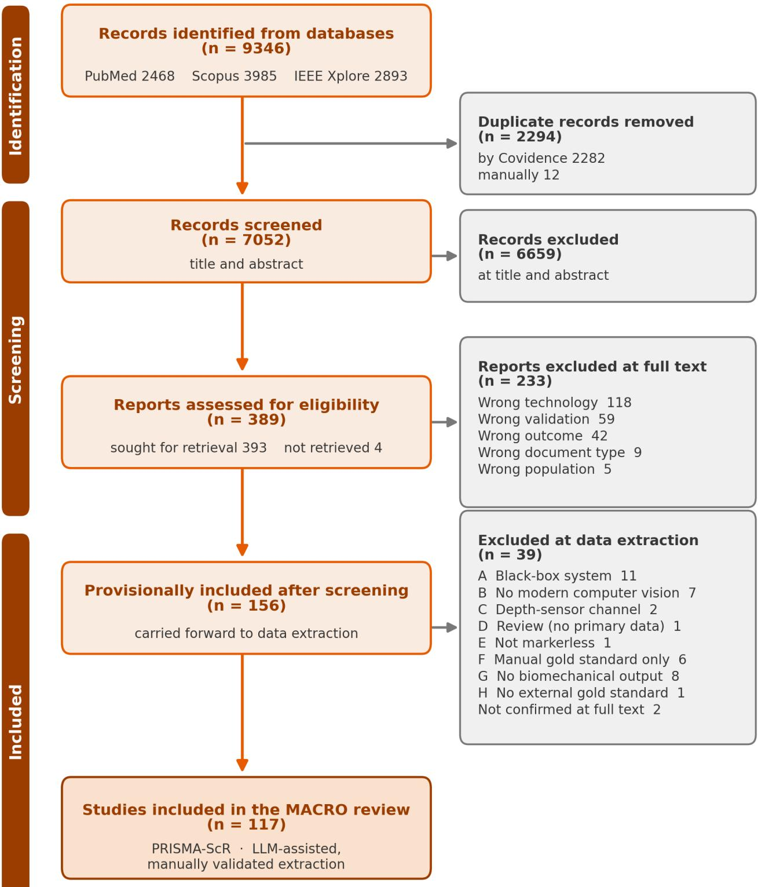
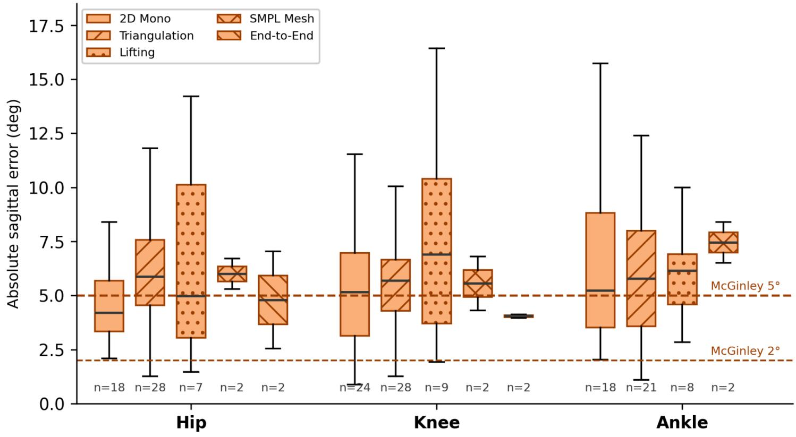
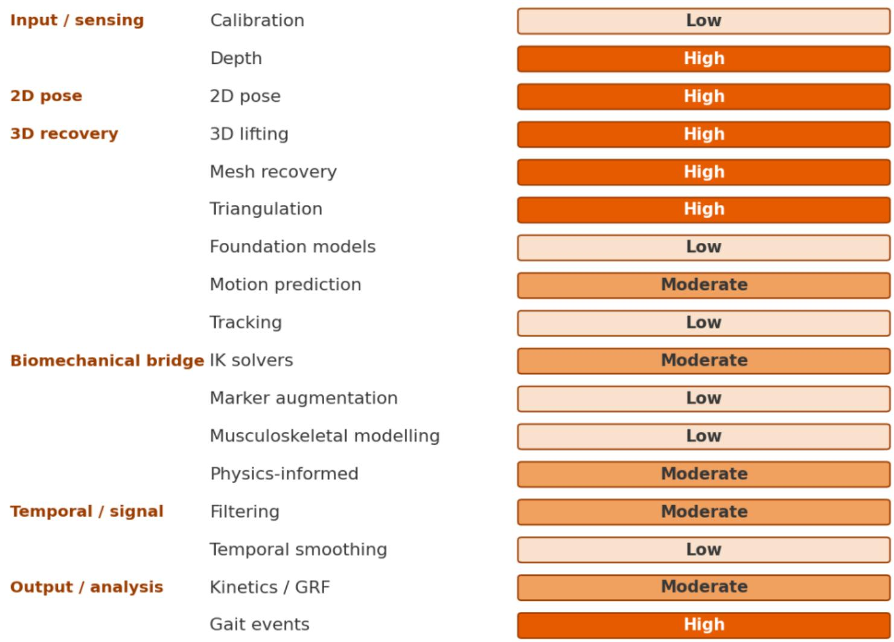
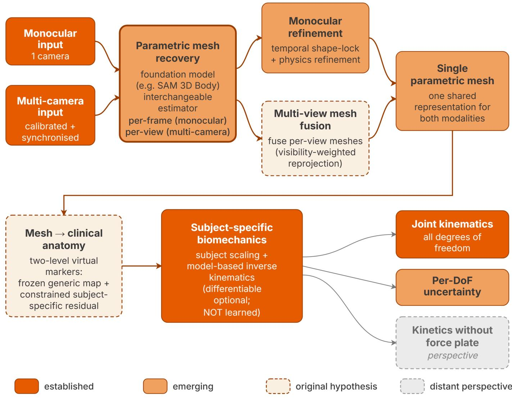

# 基于视频的无标记运动捕捉在临床与康复生物力学中的应用：一项 PRISMA-ScR 范围综述——验证架构、临床就绪度与新兴方法

Florian Delaplace florian.delaplace@unice.fr

Frédéric Chorin

Centre Hospitalier Universitaire de Nice

Raphael Zory Laboratoire Motricité Humaine Éducation Sport Santé

## 研究论文

关键词：无标记运动捕捉、姿态估计、生物力学、步态分析、深度学习、范围综述、临床转化、OpenSim

发布日期：2026 年 7 月 31 日

DOI: https://doi.org/10.21203/rs.3.rs-10431606/v1

许可协议：本作品采用 Creative Commons Attribution 4.0 International License（知识共享署名 4.0 国际许可协议）。阅读完整许可协议

附加声明：未报告任何竞争性利益冲突。

## 摘要

## 背景。

基于视频的无标记运动捕捉（video-based markerless motion capture）有望摆脱光电系统在成本、场地以及皮肤标记物方面的限制，特别契合临床与康复场景的应用需求。然而，经过验证的处理流程能否提供临床上可接受的生物力学结果，以及这些流程与底层计算机视觉研究之间的关联，仍不明确。

## 方法。

我们依据 PRISMA 范围综述扩展版（PRISMA extension for Scoping Reviews）开展了一项范围综述，研究方案已预先注册，并对 PubMed、Scopus 和 IEEE Xplore 进行了检索（2015 年 1 月至 2026 年 2 月；计算机视觉部分的检索更新至 2026 年 7 月）。研究采用双层设计：以经过验证的生物力学研究作为主语料库，并辅以一个经过策展但刻意保持非穷举性的计算机视觉新兴工作语料库，仅作定性使用。我们对研究特征、处理流程架构、验证方法及关节角度精度进行了图表化梳理（charting）。

## 结果。

我们共纳入 117 项研究，其中大多数于 2024 年及以后发表，且在实验室环境下以健康成人步行为研究对象。各处理流程在单目与多相机模态下形成了五种架构家族；多数研究报告的是未经生物力学优化的原始关节角度。矢状面下肢的一致性集中在 5 至 6° 左右，总体尚未达到临床可接受水平；而离平面（out-of-plane）运动学、动力学以及病理性或老年人群则很少得到验证。新兴的计算机视觉构件（基础模型网格恢复、可微逆运动学、基于视频的动力学估计）在已验证研究中几乎未见应用。

## 结论。

基于视频的无标记动作捕捉（markerless motion capture）尚未能与基于标记点的动作捕捉（marker-based motion capture）系统在临床关节运动学中互换使用，并且在康复最迫切需要它的地方——老年与病患人群、离面运动学及动力学——几乎未经验证。将这一证据缺口映射到新兴的计算机视觉进展上，我们提出假设生成性的设计指南（而非经过验证的方法），旨在引导下一代流程迈向可及的、具有临床意义的运动分析。

## 1. 背景

三维动作捕捉三十多年来一直是生物力学研究与临床步态分析的基石。光电式、基于标记点的动作捕捉（marker-based motion capture，MBMC）系统（Vicon、Qualisys 与 OptiTrack）仍是关节运动学测量的事实上的金标准，在受控实验室条件下已记录到亚毫米级的空间精度与亚度级的关节角度精度 [1]。然而，其在高预算学术与临床研究实验室之外的推广应用一直受到三重障碍的制约：资本成本（每套系统数万至数十万欧元）、空间（需配备受控照明的专用捕捉空间）以及运营开销（标记点放置、软组织伪影（soft-tissue artefact）、后处理人工）。即便是一套搭建良好的光电式系统，其精度更多受限于软组织伪影——即皮肤标记相对于骨骼的位移 [2–3]——而非其硬件本身；因此，去除皮肤标记正是基于视频的方法的吸引力所在。

与此同时，过去十年间，仅依靠 RGB 视频进行人体姿态估计的计算机视觉（computer vision，CV）技术——即所谓"无标记动作捕捉（markerless motion capture，MMC）"范式——得到了快速发展 [4]。从基础的二维姿态估计器（OpenPose [5]、BlazePose [6]、HRNet [7]）到多视角三角化流程（Pose2Sim [8]、OpenCap [9]），再到近期通过深度神经网络实现的单目三维重建（MotionBERT [10]、BioPose [11]、OpenCap Monocular [12]），该领域已产出一整套广泛的算法方法。其潜在收益包括设备成本降低一至三个数量级、可部署于临床或家庭场景，以及与科研和常规临床使用均兼容的工作流程。

然而，这一技术前景尚未转化为连贯的临床现实。当前关于生物力学领域中无标记运动捕捉（markerless motion capture, MMC）的文献呈现出显著的异质性：不同的算法流派并存，对于何种架构在特定临床或研究问题中更优尚无共识；各研究报告的精度指标相差可达一个数量级；与矢状面相比，临床上重要的关节平面（额状面、横状面）在文献中被系统性低报；针对病理人群的验证仍然稀缺。这些不足具有直接的临床意义。最少被报告的额状面与横状面偏差——诸如膝外翻、髋关节内旋、骨盆倾斜、画圈步态与剪刀步态——恰恰是定义常见神经性步态障碍的特征 [13]，因此，一条仅能将矢状面分辨率控制在五到六度以内的流水线，完全可能遗漏康复临床医生需要追踪的关键体征。此外，大量前沿计算机视觉研究几乎仅出现在预印本平台（arXiv）与计算机视觉会议论文集中。将这些新发表的算法构建模块整合进流水线、依据参考标准进行验证、然后发表结果，这一切都需要时间，因此可以预期：在最新的计算机视觉进展进入经过验证的生物医学文献之前，将不可避免地存在相当长的时间滞后。本综述旨在审视这一预期。

该证据库的广度、异质性与快速演进，使得元分析式的综合变得不切实际，甚至可能产生误导：各研究在研究设计、报告指标、金标准设备与目标人群方面的差异，使得推断性元分析（加权效应量估计）无法开展；因此，我们采用描述性方式综述证据，给出中位数、范围与比例，而非合并效应量。一项遵循 PRISMA-ScR（Preferred Reporting Items for Systematic Reviews and Meta-Analyses extension for Scoping Reviews）和 Joanna Briggs Institute（JBI）方法学框架开展的范围综述（scoping review），因而成为描绘该证据图景更为合适的工具。

关于无标记生物力学的既有综述大体上仅梳理了各类架构并报告了其精度 [4, 14]；其中仍存在两方面的空白：其一，对已临床验证的领域与将塑造其下一代发展的、快速演进的计算机视觉（computer vision）前沿之间如何衔接的论述；其二，从单纯描述迈向具体的、以证据为支撑的设计方向的进一步推进。我们通过刻意地连接两套鲜有交集的文献——临床生物力学与计算机视觉——来同时回应上述两个空白。在常规的范围综述（scoping review）之外，我们提出了一种双层设计。MACRO 层构成对生物医学数据库（PubMed、Scopus、IEEE Xplore）进行的正式 PRISMA 筛选，并产出已针对外部生物力学金标准对无标记运动捕捉（markerless motion capture, MMC）流水线进行经验性验证的研究语料库。MICRO 层构成一个互补的、经过策展的语料库，其来源有二：在系统检索中因仅涉及流水线中的单一组件而非完整验证流水线而被剔除的已发表记录，以及对近期 arXiv 预印本与计算机视觉会议论文集进行的有针对性扫描，用于揭示支撑下一代 MMC 流水线的技术构件。MICRO 在设计上即为非穷尽性，且被定性地使用，旨在识别并刻画新兴的技术族系而非估算其体量，但明确地弥补了预印本阶段的 CV 研究与其最终被生物医学数据库收录之间存在的结构性时滞。

本范围综述围绕两个研究问题展开。

RQ1（MACRO）：当前已发表的、基于视频的无标记运动捕捉流水线用于生物力学分析时，其架构、验证结果以及临床适用性如何？

RQ2（MICRO）：在计算机视觉文献（2024–2026）中，通过一项刻意设计的非系统性前沿扫描所识别出的、可能塑造下一代 MMC 流水线、但尚未进入同行评审生物医学出版物的技术构件有哪些？

综合两者，我们进一步提炼出一套针对临床可部署的无标记流水线的、基于证据的设计指南，覆盖两种部署模式（单目单相机、可在临床或外场部署；以及多相机、实验室级），将 MACRO 已验证研究的经验教训与 MICRO 的最新技术水平相结合。第三条线索具有明确的前瞻性：以视角与研究议程的形式呈现，提供扎根于本综述所记录的空白之中的、生成假说的方向，而非一项已验证的方法。

## 2. 方法

## 2.1 研究设计与方案

本范围综述依据 PRISMA-ScR 指南 [15] 与 JBI 范围综述方法学框架 [16] 开展。综述方案已在开放科学框架（Open Science Framework, OSF, doi: 10.17605/OSF.IO/TBYPC）前瞻性注册；完整的 PRISMA-ScR 核查清单见附加文件 1。选择范围综述设计而非系统综述基于两点原因：第一，所纳入文献在研究设计、验证方法学与所报告指标上存在显著异质性，难以进行有意义的荟萃合并；第二，我们明确的目标是对快速演化的证据图景（包括其新兴技术边缘）进行映射与特征描述，而非估计合并效应量。

## 2.2 信息来源与检索策略

我们在三个生物医学与工程数据库（PubMed、Scopus 与 IEEE Xplore）中检索了 2015 年 1 月至 2026 年 2 月间发表的研究，最后一次数据库检索执行于 2026 年 2 月 4 日。检索策略结合了受控词表（PubMed 使用 MeSH）与自由词，覆盖无标记动作捕捉、基于视频的姿态估计以及生物力学验证。完整检索式见附加文件 2（附录 A）。

为补充正式的生物医学检索，我们将本系统综述与算法式前沿扫描相结合：即第二个有意为之的非穷尽性语料库（MICRO 语料库），用于汇集新兴的计算机视觉工作。

其来源有二：系统检索中仅涉及单一流程组件的筛选记录；以及对近期计算机视觉文献的有针对性扫描，即 arXiv（主要为 cs.CV 类别）以及主要视觉与学习会议（CVPR、ICCV、ECCV、WACV、NeurIPS）的会议论文集，限定在 2024–2026 年，以纳入尚未被生物医学数据库收录的方法。

其构建细节见第 2.6 节。

MICRO 语料库以定性方式使用，旨在揭示技术构件块与新兴方法族群，而非估计其流行程度。

计算机视觉扫描与系统检索分开执行，并更新至 2026 年 7 月，晚于 2026 年 2 月的生物医学检索截止日期，因此有少量近期预印本晚于 MACRO 检索。

## 2.3 纳入与排除标准

纳入与排除标准采用人群-概念-情境（Population-Concept-Context, PCC）框架表述，并对 MACRO 语料库设有明确的纳入与排除标准。

## 纳入标准

研究纳入标准如下：(i) 评估基于视频输入（单摄像头或多摄像头）的无标记运动捕捉流水线；(ii) 报告相对于外部生物力学参考基准的定量验证结果（Vicon、Qualisys、OptiTrack、BTS/MIQUS、Motion Analysis、Nokov 或同类光电运动捕捉系统；用于动力学测量的测力台；或在少数情况下，使用仪器化的 IMU 系统）；(iii) 报告经验性的关节角度、时空参数或动力学精度指标（RMSE、MAE、相关系数或 ICC）；(iv) 聚焦于生物力学运动分析，而非通用姿态检测或活动识别。

## 排除标准

应用了八项预先设定的排除标准（A–H）：

1. A. 黑箱系统：商业化或专有化的流水线，其姿态估计模型未予明确或公开，例如 Theia3D、Captury 与 KinaTrax。排除此类系统的原因是，即使 Theia3D 尤其在临床上部署最为广泛，其姿态估计模型也无法被刻画或复现；在该标准下共排除十一项研究。

2. B. 无现代计算机视觉：仅采用人工数字化或经典（基于非深度学习）计算机视觉方法。

3. C. 深度传感器通道：以深度或 RGB-D 模态（如 Kinect）作为主要三维机制的研究予以排除，因为本综述关注的是基于 RGB 视频的流水线，尽管此类设备在康复临床中仍然常见。

4. D. 综述类研究，无原始数据。

5. E. 非无标记：流水线输入使用了附着于人体的实体标记点。

7. G. 无生物力学输出：仅报告中间指标（mean-per-joint-position error, MPJPE，其评估的是关键点位置而非关节角度），未报告关节角度、时空参数或动力学结果。

9. H. 无外部参考基准：仅报告内部的重测信度，未与任何独立的参考系统进行比较。

对于 MICRO 语料库，无论验证状态如何，只要研究涉及流水线处理中的至少一个组件（2D 姿态估计、3D 提升、三角化、网格恢复、逆运动学、步态事件检测、时序建模、物理信息方法或信号处理），均予以考虑。

## 2.4 研究筛选流程

标题与摘要筛查以及全文评估均依据纳入排除标准，由两名评审者独立使用 Covidence 系统综述软件完成。任何阶段的分歧均由第三位资深评审者裁定。全文排除按宽泛的原因类别进行标注（错误的技术类别、验证问题、结果问题、文献类型、受试群体或未能获取报告）；而通过全文审查、在数据提取核验阶段却未满足 A–H 预设标准的研究，则在该后续阶段予以排除（图 1）。

## 2.5 数据提取

我们在 Microsoft Excel 中开发了一个结构化提取模板，包含 7 个工作表和 90 余个数据字段，涵盖六个领域：

**一般特征**（General characteristics）：研究编号、完整标题、第一作者、年份、论文类型、样本量、受试者人口统计学信息、目标人群、运动任务、服装。

**视频输入规格**（Video input specifications）：摄像机数量、布置位置、摄像机类型、分辨率、采集频率、标定程序、同步方式、环境条件。

**计算机视觉处理**（Computer vision processing）：二维姿态估计算法（2D pose algorithm）、骨干网络架构、训练策略、训练数据集、三维重建方法、流程名称、遮挡处理、滤波策略、标记增强、实时性能。

**生物力学处理**（Biomechanical processing）：生物力学软件、运动学方法、骨骼模型、缩放步骤、动力学/力学计算。

**全局与时空步态验证**（Global and spatiotemporal validation）：金标准系统（gold standard）、已验证的结局类别、报告指标、全局运动学误差与相关性、时空步态误差、作者结论。

**关节级别验证**（Joint-level validation）：逐关节 × 逐平面的均方根误差（RMSE）与相关性：骨盆、髋、膝、踝 × 矢状面、冠状面、水平面。

第七个工作表将各研究的架构分类汇总为分析所使用的 5 类分类法。

## 基于大语言模型的数据提取

数据提取由作者完成，大语言模型仅作为辅助性的错误暴露步骤使用，而非作为数据来源的最终记录。第一作者定义了结构化模板（117 项研究共约 90 个字段）。为加快从异构来源（自由文本、表格、图形、扫描版 PDF）对模板进行的首轮填充，每项研究均由一个大语言模型（Claude Opus 4.7）进行处理。随后，由来自不同厂商的第二个模型（Google Gemini）独立地重新提取并交叉核对表格，作者针对两者之间的每一处分歧均依据源 PDF 进行了裁决。在裁决之前，两个模型在约 10,500 个字段中存在 156 处分歧（117 项研究共约 90 个字段），原始一致率约为 98.5%。由于该模板混合了数值型、类别型与自由文本字段，未计算单一的机会校正一致性系数。在所有验证环节中，共应用了 385 处单元格级别的更正（多于 156 处模型分歧，因为部分错误为两个模型所共有，仅在与源 PDF 对照时才被识别），这些更正主要为数值转录错误以及按关节或按平面的错位，另有较少部分的架构或金标准分类错误。此外还识别并更正了两处模型报告了来自所引用先前研究的数值而非论文自身数值的情况。作为最终的内部一致性检查，第一作者直接从源文档中手动重新提取了随机 20% 的纳入研究（采用计算机随机数生成器选取）；该样本中的所有字段均与表格完全一致（数值与分类标签完全相同）。此最终一轮并非独立于初次提取；独立性依托于上述双模型、跨厂商的裁决流程。因此，这些数值属于机器辅助、人工核验之结果，作者对所提取的数据集承担全部责任。

## 2.6 数据综合

综合分析按三个层次层级展开。

## 描述性分析

首先从时间趋势、人群特征、样本量、运动任务与采集环境等方面对 MACRO 语料库进行了特征描述。

架构映射。117 项 MACRO 研究被归入一个包含五个族系的架构分类法（2D Monocular、Multi-view Triangulation、Monocular Lifting 2D→3D、Body Mesh Recovery/SMPL、End-to-End Direct），并配有五个非互斥的叠加变体（+IK/MSK、+Marker Augmentation、+Temporal Deep Learning、+Physics、Geometric Only）。对每个族系，我们报告其技术组件（骨干网络、姿态估计器、生物力学软件）的分布，以及按关节和解剖平面的验证结果。以 McGinley 误差带（2° 及以下为可接受，2° 至 5° 为合理，高于 5° 可能产生误导）作为具有临床相关性的基准，对关节角度误差进行了汇总。

技术分解。MICRO 语料库分两步构建。首先，在数据库筛选过程中识别出的那些仅描述单一流水线组件、而非经过金标准验证的完整流水线的记录（符合排除标准 F 和 G），予以保留并归入 17 个流水线步骤分块（3D 抬升、网格恢复、2D 姿态、物理信息方法、三角测量、步态事件、深度信息、逆运动学（IK）求解器、滤波、运动预测、标记点增广、跟踪、肌肉骨骼建模、时间平滑、基础模型、动力学以及标定；图 6，第 3.4 节）。

其次，我们在每个分块内进一步检索，重点瞄准近期的 arXiv 预印本和计算机视觉会议论文（2024–2026 年），以捕捉生物医学筛选中尚未出现的新兴最先进方法；随后将每种新兴方法回溯到它能够升级的对应 MACRO 架构族。

因此，MICRO 语料库是经过精心策划的，并刻意保持非穷尽性。arXiv（cs.CV）和会议扫描截至 2026 年 7 月；完整的记录清单、每条条目的来源以及各分块的计数（附加文件 6）均在附加文件 5 中给出。

该 MICRO 扫描位于 PRISMA-ScR 范围之外，后者仅管辖系统性的 MACRO 语料库。完整的构建协议和各分块的可复现查询见附加文件 7。

最后，MACRO-MICRO 桥接分析针对五个架构族中的每一个，明确了 MICRO 语料库中相应的技术构件，以及经过验证的生物医学文献与新兴计算机视觉最先进技术之间的主要分歧点（第 3.5 节）。

## 3. 结果

## 3.1 纳入语料库的描述

在三个数据库中识别的 9,346 条记录中，去除 2,294 条重复记录，对 7,052 条标题与摘要进行了筛选；排除 6,659 条，评估了 393 篇全文报告，其中 237 篇在全文阶段被排除，另有 39 篇在根据标准 A–H 进行数据提取核验时被排除，最终得到 117 项纳入研究（图 1）。117 项纳入研究的时间跨度为 2015 年 1 月至 2026 年 2 月；各项研究的特征见附加文件 3。

近年的发表量加速增长：约六成的研究发表于 2024 年及之后（图 2a）。

证据基础较窄。受试者绝大多数为健康成年人。临床或病理性人群（卒中、帕金森病、脑瘫、脊髓损伤）仅出现在少数研究中（约 19%），而儿童或老年人队列则更为罕见（图 2b）。

步态是占主导地位的运动任务，存在于一半以上的语料库中；跑步、坐起、跳跃落地和蹲踞占其余的大部分（图 2c）。样本量较小，受试者人数中位数为 17 人（图 2d）。

人口统计学偏差和小样本限制了单项验证研究的泛化能力。

验证几乎总是使用光电标记系统作为参照（约 83% 的研究；图 2e）。仪器化步道、测力台和公共数据集覆盖其余部分。数据采集仍以实验室为基础：117 项研究中有 100 项在实验室进行，16 项在临床运动分析室进行，家庭或户外采集几乎不存在（各仅一项）。因此，在光学实验室之外进行分析的验证证据仍然缺乏。

技术配置证实了该领域处于研究原型阶段（表 1）。采集方面，45% 的研究使用单个摄像头，29% 使用两个摄像头，设备多为机器视觉摄像头（40%）或消费级智能手机（26%）。校准在略少于一半的研究中缺失（53 项），其余使用棋盘格进行校准。二维姿态估计约有半数研究使用 OpenPose 系列，其中包括 OpenCap 的部署——其二维后端（默认为 OpenPose，或可选 HRNet）通常未被报告。其次是 MediaPipe 和 BlazePose [6]。三维重建在多视角三角测量与纯二维分析之间大致平分。单体三维提升、网格拟合和端到端回归各占一小部分。生物力学处理方面，63% 的研究使用自定义代码（Python 或 Matlab），略多于四分之一的研究（33 项）使用基于 OpenSim 的建模，其中 13 项使用了即开即用的 OpenCap 智能手机流水线，20 项直接使用 OpenSim。117 项研究中有 8 项（7%）报告了实时运行。离线后处理是常态。

表 1  
纳入语料库的技术配置（n = 117）。

<table><tr><td>Variable / category</td><td>n (%)</td></tr><tr><td>Number of cameras</td><td></td></tr><tr><td>1</td><td>53 (45%)</td></tr><tr><td>2</td><td>34 (29%)</td></tr><tr><td>3-4</td><td>13 (11%)</td></tr><tr><td>5-9</td><td>11 (9%)</td></tr><tr><td>&gt;=10</td><td>4 (3%)</td></tr><tr><td>Benchmark / varies</td><td>2 (2%)</td></tr><tr><td>Camera type</td><td></td></tr><tr><td>Industrial / machine-vision</td><td>47 (40%)</td></tr><tr><td>Smartphone</td><td>30 (26%)</td></tr><tr><td>Webcam</td><td>14 (12%)</td></tr><tr><td>Action cam / DSLR / RGB</td><td>16 (14%)</td></tr><tr><td>Other / not reported</td><td>5 (4%)</td></tr><tr><td>Tablet</td><td>5 (4%)</td></tr><tr><td>Calibration</td><td></td></tr><tr><td>None (monocular)</td><td>53 (45%)</td></tr><tr><td>Checkerboard</td><td>38 (32%)</td></tr><tr><td>Other / not specified</td><td>20 (17%)</td></tr><tr><td>Bundle adjustment / dot-matrix</td><td>3 (3%)</td></tr><tr><td>Wand</td><td>3 (3%)</td></tr><tr><td>2D pose estimator</td><td></td></tr><tr><td>OpenPose / OpenCap family</td><td>57 (49%)</td></tr><tr><td>MediaPipe / BlazePose</td><td>17 (15%)</td></tr><tr><td>Other named DL detectors (AlphaPose, YOLO, PifPaf, HRNet, MMPose, Detectron2, ViTPose...)</td><td>17 (15%)</td></tr><tr><td>Custom / unspecified DL</td><td>7 (6%)</td></tr><tr><td>DeepLabCut</td><td>6 (5%)</td></tr></table>

<table><tr><td rowspan=1 colspan=1>Variable / category                                                                                                       n (%)</td></tr><tr><td rowspan=1 colspan=1>None / end-to-end                                                                                                        5 (4%)</td></tr><tr><td rowspan=1 colspan=1>Proprietary / SDK                                                                                                          5 (4%)</td></tr><tr><td rowspan=1 colspan=1>Multi-estimator benchmark                                                                                            3 (3%)</td></tr><tr><td rowspan=1 colspan=1>Architecture (3D recovery)</td></tr><tr><td rowspan=1 colspan=1>2D Monocular (no explicit 3D)                                                                                        47 (40%)</td></tr><tr><td rowspan=1 colspan=1>Multi-view triangulation                                                                                                 44 (38%)</td></tr><tr><td rowspan=1 colspan=1>Monocular lifting (2D-&gt;3D)                                                                                             19 (16%)</td></tr><tr><td rowspan=1 colspan=1>Body mesh / SMPL                                                                                                       4 (3%)</td></tr><tr><td rowspan=1 colspan=1>End-to-end / direct                                                                                                        3 (3%)</td></tr><tr><td rowspan=1 colspan=1>Biomechanical software</td></tr><tr><td rowspan=1 colspan=1>Custom code (Python/Matlab)                                                                                       74 (63%)</td></tr><tr><td rowspan=1 colspan=1>OpenSim-based modelling                                                                                             33 (28%)</td></tr><tr><td rowspan=1 colspan=1>via OpenCap (smartphone app)                                                                                      13 (11%)</td></tr><tr><td rowspan=1 colspan=1>OpenSim directly                                                                                                           20 (17%)</td></tr><tr><td rowspan=1 colspan=1>None (2D angles)                                                                                                          8 (7%)</td></tr><tr><td rowspan=1 colspan=1>Other MSK (Visual3D, CusToM, AnyBody)                                                                        2 (2%)</td></tr><tr><td rowspan=1 colspan=1>Real-time capability</td></tr><tr><td rowspan=1 colspan=1>No (post-process)                                                                                                        192%)</td></tr><tr><td rowspan=1 colspan=1>Yes / near real-time                                                                                                       8 (7%)</td></tr><tr><td rowspan=1 colspan=1>Not specified                                                                                                                2 (2%)</td></tr></table>

## 3.2 核心流水线架构

每条流水线属于五种互斥的架构族之一，按部署模态进行分组（图 3）。全文始终区分三个术语：模态（从单视角即单目，或从多个同步视角进行重建）、族（上述五种架构之一）以及覆盖层（任何族均可添加的可选细化模块）。单目模态涵盖四个族，其主要区别在于如何获得三维信息：二维单目直接从二维关键点计算关节角度（47 项研究，40%）[17–63]；单目提升从这些检测结果回归三维姿态（19 项，16%）[64–81, 86]；人体网格恢复拟合参数化全身网格，而非稀疏骨架（4 项，3%）[11, 82–84]，其代表 BioPose [11] 是通过 IEEE Xplore 检索获得的 WACV 2025 同行评审论文；端到端直接则直接从图像回归关节角度（3 项，3%）[85, 87–88]。多相机模态以多视角三角化为主，通过对来自多台已标定相机的射线求交来重建三维关节位置（44 项，38%）[8–9, 89–130]。两种模态在数量上有所不同（73 项与 44 项研究），更重要的是在能力上也存在差异（第 3.3 节）。模态并不等同于实际相机数量。许多单视角流水线仅将额外相机用于对比或标定，而有一项端到端研究使用了多视角输入，因此各族的划分依据是架构而非相机数量（表 1）。

二维单目与三角化已较为成熟且仍在增长（自 2024 年以来分别为 27 项和 30 项研究）。单目提升出现于 2021 年之后，目前仍在扩展。网格恢复是最新的加入者：所有基于 SMPL 的研究均出现在 2024 年或之后。端到端回归曾短暂出现，但未能持续。

近期三角化研究的增长得益于 Pose2Sim 和 OpenCap 等即用型多视角工具的发布。

架构是一种共享的流水线骨架，可在之上叠加可选的优化模块，而不是一种固定的方法。五种互不排斥的叠加模块被编码：带肌骨建模的反向运动学（inverse kinematics with musculoskeletal modelling）、虚拟标记点增强（virtual-marker augmentation）、深度学习时序平滑（deep-learning temporal smoothing）、基于物理的优化（physics-based optimisation）以及动力学输出（kinetics output，即地面反作用力或关节力矩）。大多数流水线的优化很少。略少于三分之二（117 项中的 73 项）不使用任何叠加模块，直接报告原始几何角度，仅有 28 项组合使用了两种或更多叠加模块。优化集中在多视角类别中。带肌骨建模的反向运动学是最常见的叠加模块（36 项研究，占 31%），44 项三角测量研究中有 27 项采用了它，并且这些研究几乎涵盖了所有虚拟标记点增强流水线（即 OpenCap 模式）。相比之下，47 项二维单目研究中的 46 项仍然仅使用几何方法，而基于 OpenSim 的使用（包括 OpenCap）几乎仅限于三角测量。因此，严肃的肌骨建模位于多相机一侧，而单目一侧虽具有最大的部署潜力，却大多停留在原始二维角度层面。

## 3.3 计量学验证

### 3.3.1 参考标准

约 83% 的研究以基于光电标记点的系统作为验证参照，最常用的为 Vicon、Qualisys、OptiTrack、BTS 或 Nokov。少数研究使用了仪器化步道（GAITRite、Zeno/PKMAS）、测力台、公共动作捕捉数据集，或在极少数情况下使用平面 X 光摄影。这些参考系统本身并非没有误差：它们存在软组织伪影（soft-tissue artefact），即皮肤标记相对于骨骼的运动 [2]，这为任何无标记系统相对于它们的一致性设定了上限。尽管如此，光电捕捉仍然是生物力学事实上的参考标准。最近的一项无标记研究甚至发现其自身的不一致性至少与该伪影相当 [117]，因此这两种范式在精度上并不能干净地区分开来。

### 3.3.2 关节角度精度与临床阈值

矢状面下肢一致性在中位绝对误差约 5 至 $6^{\circ}$ 附近聚集，涵盖髋、膝、踝和骨盆四个关节，彼此相差均在约 1° 以内（表 2）。研究间离散度较大（四分位距约 3 至 8°）。我们将一致性结果与 McGinley 等为三维步态运动学所提出的误差区间作为参照基准：$2^{\circ}$ 及以下的误差被普遍视为可接受，2 至 $5^{\circ}$ 之间的误差视为合理但需在解读时加以考量，而高于 $5^{\circ}$ 的误差则可能误导临床判断 [131]。这些数值是基于标记点（marker-based）的可靠性参考值。由于参考系统本身亦具有可重复性误差，在矢状面以外可达约 $5^{\circ}$，接近此水平的一致性部分受限于参考系统自身的噪声，因此更宜解读为「尚未达到基于标记点的可靠性」水平，而非「在临床中不可用」。可接受误差并非单一常数，它取决于具体的临床问题以及所测量偏差的幅度，故以区间形式而非单一阈值予以报告。在矢状面下肢估计中，仅约 6% 落入 $2^{\circ}$ 可接受区间，约 37% 落入 2 至 $5^{\circ}$ 合理区间；而若分别考察，约一半的矢状面下肢估计在仅以均方根误差衡量时超过 $5^{\circ}$（中位数 5.0°），在仅以平均绝对误差衡量时亦约一半超过 $5^{\circ}$（中位数 5.0°）。综合所有报告的指标，结论亦相仿（约 57%）。这正是 McGinley 等认为误差可能误导临床判断的临界水平（图 5）。值得关注的是这种规律本身，而非具体比例——多数已发表的流水线即便在其表现最佳之处，仍超过 $5^{\circ}$ 的警示阈值。在康复语境下，五到六度的误差与临床医生希望在恢复过程或治疗剂量调整中所追踪的运动学变化处于同一量级，例如脑性瘫痪（cerebral palsy）中蹲伏步态（crouch posture）的逐步缓解，或脑卒中（stroke）后僵硬膝（stiff-knee）与划圈（circumduction）步态的改善，因此处于该误差水平的工具可能掩盖真实的临床变化。

### 3.3.3 按架构划分的精度

我们按架构族绘制了矢状面误差（图 4）。两个最具代表性的族——2D Monocular $( \mathsf { n } = 4 7 )$ 与 Multi-view Triangulation（n = 44）——表现相近，下肢误差中位数约为 4 至 $6 ^ { \circ }$。Monocular Lifting（n = 19）表现较差，下肢误差中位数约为 6 至 $7 ^ { \circ }$，且研究间离散度最大。这与深度模糊性一致：单相机无法完全分辨朝向或远离 ${ \mathrm { i t } } ,$ 的运动，因此从单一视图回归三维姿态本质上难于多台已标定相机的三角化。Body Mesh Recovery 与 End to-End Direct 各仅有四项或更少的研究，不足以进行比较，仅以描述性方式呈现。没有一族在误差中位数上达到 $2 ^ { \circ }$ 的可接受区间，因此临床精度差距是整个领域的共性，而非某一薄弱架构所致。

## 3.3.4 平面覆盖与矢状面报告偏差

主要局限性部分在于所报告的内容，部分在于根本可测的内容。平面外运动学几乎仅来自多视图族，原因有二：2D Monocular 族根本无法恢复平面外旋转，因为它不产生三维估计；而单目三维族与三角化虽能恢复，却大多未予报告。在架构 × 关节 × 平面图（附加文件 4）中，额状面与横状面单元格主要由三角化填充（例如髋部额状面 n = 13，髋部横状面 n = 10），而每个单目族仅填充单一矢状面列。报告不均衡现象显著。对于膝关节，65 项研究报告了矢状面误差，而额状面仅 5 项、横状面仅 3 项；髋关节（57 / 17 / 12）与踝关节（49 / 4 / 1）也呈现相同模式。在额状面与横状面数值存在之处，它们既更稀少也更大（例如踝部额状面约 9°）。与若干临床问题最相关的平面——包括膝内翻与膝外翻、髋部旋转以及足部前进角——恰恰是验证最少的。

## 3.3.5 时空参数与动力学验证

时空参数（步行速度、步长、步态周期）在约三分之一的研究（34%）中得到了验证，其一致性高于关节角度，反映了它们对关键点噪声的敏感性较低。针对测力板的动力学验证——包括地面反作用力或关节力矩——仅在九项研究中有报告。该领域主要验证矢状面下肢运动学。如第 3.4 与 3.5 节所详述，平面外运动学与动力学在很大程度上仍未被检验。

表 2
按解剖平面的关节角度验证（与光电参考系统的绝对一致性）。

<table><tr><td>Joint</td><td>Plane</td><td>n studies</td><td>Median (errorl (°)</td><td>IQR (°)</td><td> $\leq 5 ^ { \circ } \left( \% \right)$ </td></tr><tr><td>Pelvis</td><td>Sagittal</td><td>5</td><td>5.2</td><td>3.4-6.1</td><td>40</td></tr><tr><td>Pelvis</td><td>Frontal</td><td>3</td><td>4.0</td><td>2.0-4.9</td><td>一</td></tr><tr><td>Pelvis</td><td>Transverse</td><td>3</td><td>3.1</td><td>2.0-3.3</td><td>一</td></tr><tr><td>Hip</td><td>Sagittal</td><td>57</td><td>5.5</td><td>3.6-7.1</td><td>47</td></tr><tr><td>Hip</td><td>Frontal</td><td>17</td><td>4.3</td><td>3.0-5.2</td><td>76</td></tr><tr><td>Hip</td><td>Transverse</td><td>12</td><td>5.7</td><td>4.4-7.0</td><td>33</td></tr><tr><td>Knee</td><td>Sagittal</td><td>65</td><td>5.6</td><td>3.7-7.0</td><td>40</td></tr><tr><td>Knee</td><td>Frontal</td><td>5</td><td>4.8</td><td>3.1-12.8</td><td>60</td></tr><tr><td>Knee</td><td>Transverse</td><td>3</td><td>5.9</td><td>2.4-9.5</td><td>一</td></tr><tr><td>Ankle</td><td>Sagittal</td><td>49</td><td>5.9</td><td>3.6-8.4</td><td>43</td></tr><tr><td>Ankle</td><td>Frontal</td><td>4</td><td>9.0</td><td>5.9-10.3</td><td></td></tr><tr><td>Ankle</td><td>Transverse</td><td>1</td><td>11.1</td><td>n/a</td><td>一 一</td></tr><tr><td colspan="2">widespread reporting heterogeneity; per-metric breakdowns are provided in Additional file 3. Restricting to the two principal metrics leaves this shortfall unchanged: about half of sagittal lower-limb estimates exceed 5° under root-mean-square error alone (median 5.0°) and under mean absolute error alone</td><td>Note: marked under-reporting outside the sagittal plane (e.g. knee: 65 sagittal vs 5 frontal vs 3 transverse). The final column reports the proportion within the 5° error level (McGinley acceptable-to- reasonable range; see Section 3.3.2). Cells based on fewer than five studies are indicative only. Reported agreement metrics pool bóth root-mean-square error and mean absolute error owing to</td><td></td><td></td><td></td></tr></table>

## 3.4 技术解构（MICRO）

为识别下一代流水线背后的计算机视觉构件，我们汇集了互补的 MICRO 语料库，包含 572 条 arXiv 与会议记录，并将其归入 17 个流水线步骤模块。由于该语料库是策展式（curated）而非系统性的（Methods），图 6 以相对活跃度（低、中、高）而非原始计数来刻画每个模块，我们也不计算 MACRO 与 MICRO 之比。

一个定性信号值得记述，但需谨慎对待。我们筛选的记录集中于 2024 与 2025 年，且基础模型（foundation-model）模块几乎全部出现在 2024 年之后。由于该语料库是经策展并通过反向引用（backward citation）进行种子构建的，这种时间上的近源性部分反映了我们的抽样方式，而非该领域本身的真实状况，因此我们仅将其视为一种粗略、定性的提示——提示新型计算机视觉方法与经过验证的生物医学工作之间的采纳时滞——而非一项量化测度。该滞后更为确凿的证据，在于这些新兴模块在验证语料库（Section 3.5）中近乎缺席。

作为对应于流水线各阶段的工具箱（见图 7；完整的方法列表、各自针对的阶段、所做贡献及其成熟度详见 Additional file 5），当前技术水平几乎为每个模块都提供了候选升级方案 [132–150]。在输入阶段，单目度量深度估计与三维几何模型以及无靶标多相机自标定方法正趋于成熟 [174–176]；而通过相机运动、重力或学习得到的视场线索进行世界坐标系锚定，则有助于从单个相机以度量尺度定位主体——这一问题目前仅得到部分解决 [133, 177]。在二维姿态方面，实时与 Transformer 主干网络 [151–153] 正在取代主导 MACRO 语料库的 OpenPose 一代方法。三维恢复方面，多个方法家族并存：单目升维 [10, 154]；基于 SMPL 家族的基础模型网格恢复 [155–157, 172]，其将流水线围绕密集参数化网格重构，并提供对解剖标志点的访问能力 [158]；全身网格到角度的逆运动学 [171]；多人与多视图网格拟合 [169, 173]；以及通向 OpenSim 的经典三角测量法 [8]。在生物力学衔接模块，虚拟标志点增广 [159] 以及可微或神经逆运动学 [160–162]，并结合缩放与逆动力学 [168] 正在涌现。动力学模块在姿态估计下游利用物理信息或学习驱动的模型估计地面反作用力与关节力矩 [163]，其输出在 MACRO 文献中鲜有验证。在重建之上，出现了融合多模态生物力学基础模型 [146] 与逐自由度不确定性量化 [164] 的分析层，开始应对临床部署对可靠性的要求。若干近乎完整的流水线通过组合上述模块而非引入新模块：BioPose [11]、OpenCap Monocular [12] 与便携式生物力学实验室（Portable Biomechanics Laboratory）[170]，后者报告的精度被其作者描述为从手持视频即可达到临床可接受的水平。

## 3.5 MACRO-MICRO 衔接

将五个已验证的方法家族映射到新兴模块（见图 8），可逐家族描绘出转化前沿。当前仅有多视图三角测量在主动引入新兴模块：经由 OpenCap 谱系，它已吸纳了虚拟标志点增广与结合肌肉骨骼建模的逆运动学，少数研究还触及视频动力学。四个单目家族几乎只采用了二维姿态估计与直接几何角度计算，除此之外几无进展。横跨全部五个家族，网格恢复、可微逆运动学、视频动力学以及以人为本的基础模型基本上是缺位的。因此该映射图的右侧几近空白：那些最有可能改变临床能力的模块，恰恰是被采用得最少的。

四个模块界定了这一差距。其一，基础模型网格恢复（foundation-model mesh recovery）可为单目流程提供密集、可按解剖结构寻址的表征，但在已验证研究中尚付阙如。其二，可微分与神经逆运动学本可取代脆弱的事后逆运动学（IK），目前也仅在 MICRO 中有所体现。其三，视频驱动的动力学是 MACRO 中最少被服务到的输出项（第 3.3.5 节），却是 MICRO 中的活跃模块。其四，以人为中心的基础模型尚未被纳入已验证研究。这些模块共同构成了一条以网格为中心的流程，也界定了第 5 节所提出框架的设计空间。

## 4. 讨论

## 4.1 主要发现总结

本范围综述将视频无标记动作捕捉在生物力学领域已验证的文献（即 MACRO 语料库）与新兴的计算机视觉前沿（即策展后的 MICRO 语料库）进行了对比。有五项发现值得关注。该领域尚处年轻且增长迅速阶段，多数纳入研究发表于过去两年。其证据基础较为狭窄：受试者多为健康成人，主要在实验室中接受步态测试，样本量小，且几乎不涉及实时或实验室外的应用。其方法可归结为两大模态（单目与多相机）中的五种架构家族，但大多数流程未施加任何生物力学优化，仅报告原始的几何角度。计量学性能未能达到该领域所声称的与基于标记点方法相当的水平：矢状面下肢一致性虽总体超过 McGinley 等人所认为的、可能导致临床误判的误差水平，但离面（out-of-plane）运动学与动力学却鲜少被评估。最有可能改变这一局面的构建模块——即基础模型网格恢复、可微分逆运动学与视频动力学——在计算机视觉中虽属活跃方向，却在已验证的生物力学研究中几乎缺席，这与计算机视觉创新与其经确认的生物医学应用之间所预期的滞后一致。

## 4.2 各模态的成熟度与临床转化

两种模态在可部署性与计量学完备性之间各有所长。多视图三角化是通向全面三维生物力学的更成熟路径。它是唯一能够常规报告额状面与水平面运动学的家族，并且集中了逆运动学与肌骨建模流程，尤其是使关节角度具备可解释性的 OpenCap 系列方法。该模态仍局限于实验室，且需要多台经过同步与标定的相机。单目方案仅使用单一相机且无需标定，在临床应用点（point of care）上具有远高于前者的可部署性。然而，大多数二维单目研究止步于原始几何角度（第 3.2 节），且单目提升至三维的误差最大（下肢误差中位数约为 6° 至 7°）。因此，临床可接受性的差距属于整个领域的问题，而非由某一薄弱架构所致。步速等时空参数则吻合良好

在参考系统方面，但论点更窄：对于大多数流程而言，声称其可与基于标记点的关节运动学互换还为时过早。

## 4.3 动力学——下一个前沿

经过验证的文献中，服务最不充分的输出是动力学。地面反作用力和关节力矩与关节负荷、平衡及跌倒风险的联系最为直接，但仅有九项研究通过测力台对它们进行了验证。可以论证的是，动力学在临床上比单纯的运动学更具可操作性。一个新兴的 MICRO 模块正是针对这一空白：从视频进行物理信息驱动的与学习得到的力和力矩估计；生成式基础模型如今已能以接近实验室的精度从运动学估计地面反作用力 [163]。首个单相机到肌肉骨骼动力学的流程已经出现 [12]。因此，无测力台的动力学仍处于早期且尚未成熟的阶段。它比矢状面关节角度精度的渐进提升具有更高的潜在临床价值，但验证成本也高得多，因为其在运动学误差之上又叠加了逆动力学建模误差，并且最难在稳态步态之外的场景进行验证。

## 4.4 已验证文献中的空白

三方面空白界定了转化前沿。第一个是平面覆盖。离平面（out-of-plane）运动学鲜有报告（以膝关节为例，矢状面 65 项 vs 额状面 5 项 vs 水平面 3 项），因此许多临床问题最相关的测量反而最缺乏验证，而且即便报告了，其误差也更大。第二个是人群。临床与病理队列较为罕见，老年人和儿童队列更为稀少，尽管这些群体恰恰最能从可及性更高的运动分析中获益。第三个是运行条件。实时分析（占研究的 7%）以及居家或野外采集（几乎缺失）仍基本未被涉及，尽管两者都是在实验室之外进行分析的前提条件。弥合这些空白比进一步对健康成人的矢状面步态进行基准测试更为优先。

## 4.5 本综述的优势与局限

本综述有两个主要优点。它将已注册的 PRISMA-ScR 方案与覆盖三个数据库的广泛检索相结合，并采用双层设计，将已验证文献置于其底层计算机视觉研究的演进脉络之中。同时存在若干局限性。由于设计上的原因，综述排除了黑箱商业系统（第 2.3 节），其中包括临床部署最广泛的 Theia3D，以及在康复领域仍然常见的 RGB-D 深度传感器；因此，研究结论刻画的是已验证的开放架构证据基础，而非完整的已部署临床现状。MICRO 文献集是经过策展的、非穷尽性的，其区块计数反映的是筛选与发表量，而非生物力学重要性，我们仅以定性方式加以使用。数据提取采用了大语言模型辅助流程，并辅以跨厂商核查与仲裁机制，通过对 20% 随机纳入研究进行人工重新提取进行验证；最终仅报告清洗后的数值，排除有符号偏差、速度衍生以及错误指标的条目。作为一项范围综述，本综合分析为结构化叙事性的，而非荟萃分析，且未正式评估偏倚风险。我们以 McGinley 等人的误差区间作为基准：2° 或以下可接受，2 至 $5^{\circ}$ 合理，高于 $5^{\circ}$ 可能造成误导 [131]；可接受误差最终取决于具体应用，因此该区间分析仅作为参考点，而非绝对截止值。

## 4.6 对临床实践与康复研究的启示

目前可用的输出取决于测量类型（表 3）。时空参数（如步行速度、步长和步态时间）与参考系统高度一致，适用于监测、筛查与远程评估；尤其是步行速度，在老年人中被描述为第六生命体征 [165]。矢状面关节角度可用于总体定性趋势分析，但不适用于需要在 3 至 5° 以下分辨力作出判断的决策，例如追踪微小的康复变化。额状面与水平面角度以及所有动力学指标仍处于研究级别，尚未在临床使用中得到充分验证。

Table 3  
无标记运动捕捉输出的临床就绪度。

<table><tr><td>Readiness tier</td><td>Outputs</td><td>Appropriate use</td></tr><tr><td>Ready for clinical use</td><td>Spatiotemporal parameters (walking speed, step length, step time)</td><td>Monitoring, screening and remote assessment</td></tr><tr><td>Ready for screening and trends</td><td>Sagittal-plane joint angles (gross flexion-extension)</td><td>Qualitative trend tracking; not decisions needing resolution below three to five degrees</td></tr><tr><td>Research-grade only</td><td>Frontal- and transverse-plane joint angles; force-plate-free kinetics; pathological-gait profiling</td><td>Not to be used for clinical decisions</td></tr></table>

安全性论点源自该领域的结构特征。最具部署可行性的工具——单目相机流水线——恰恰也是最粗糙的，因为 47 篇中有 46 篇仅报告了几何角度的原始值。因此，部署可行性与验证就绪程度呈反向关系：一款廉价且易于获取的单目工具，恰恰可能在尚未对其所支撑的临床决策进行充分验证之前，便已进入临床。

健康成年人的验证结果无法迁移至患者群体。病理性步态破坏了这些流水线赖以构建的假设：助行器、矫形器与手杖等辅助器具；非典型的身体形态；震颤、痉挛与运动障碍等不随意运动；以及大幅度的离面偏差，如划圈步态与交叉步态。在脑瘫性偏瘫或蹲伏步态患者身上，5° 的健康成年人误差并非一个安全先验。所需的是针对特定人群的验证，而非仅仅增加样本量。每一项干扰因素都会破坏某一具体假设：辅助器具与矫形器会遮挡或位移姿态估计所依赖的关键点；不随意运动违反了用于对轨迹进行去噪的时序平滑先验；最显著的病理性偏差出现在额状面与横切面，而恰恰是这些系统估计最差的平面，因此临床信号与测量误差落在同一平面内。

有三项实际风险需要关注。姿态估计的训练与验证数据偏向于年轻、瘦削、浅肤色的成年人群体，这与本综述所记录的偏向一致；因此，在代表性最弱的群体中，性能可能更差，这构成公平性方面的担忧。临床视频与家庭视频引入了标记实验室中并不存在的隐私与知情同意问题。此外，治理必须确保验证工作领先于部署。

## 5. 面向临床可部署无标记生物力学的未来设计指南

本节实现第三个目标：将经过验证的 MACRO 经验教训与新兴的 MICRO 模块转化为可在临床上部署的流程（pipeline）的设计指南（design guidelines）。这些方向是用于生成假设的（hypothesis-generating），并非已验证的方法，每一条都与第 3 节和第 4 节中记录过的某个差距相对应，而非在此重述。有一条原则统辖所有方向。对于目标临床人群——老年与病理队列——可推广性（generalisability）必须来自那些具有普遍性的东西：解剖学（anatomy）、力学（mechanics）和受试者特异性模型（subject-specific model），而非来自在排除了这些人群的群体上学习得到的先验（priors）。因此，该方向将已成熟的组件（受试者特异性的 OpenSim 缩放与逆运动学，以及基于物理的精修）与新兴组件（密集网格恢复；可微的、基于模型的逆运动学；逐自由度的不确定性度量）以及一些在已验证生物力学中尚未经过检验的组件（多视图网格融合与两层网格-解剖对应）相结合。任何习得先验都被置于一个阶段，使其误差可针对图像进行检查，且组件可被替换，从而最终保真度依赖于受试者特异性的解剖学与力学。所有组件均来自已发表文献，并且具有公开代码，可公开获取。本视角（perspective）不提出任何专有系统。我们提炼出五条指南（Fig. 9）。

首先，我们提出以密集参数化网格（dense parametric mesh）作为前端：每帧恢复一个密集参数化人体网格，而非稀疏关键点，并采用在已验证语料库（validated corpus）中尚不存在的人体网格基础模型（human-mesh foundation models）（例如 SAM 3D Body [155] 及其实时变体 [166]，建立于 Sapiens 系列 [153] 之上，其向临床标志点的迁移由 MedSapiens [167] 加以证明）。密集网格承载了节段朝向与离面旋转（out-of-plane rotation），而这正是已验证的单目家族很少报告的内容。其估计器继承了健康人群偏置，但此风险是有界的：估计器是可互换的组件，会随模型多样化而改进；并且网格误差是局部的、可针对图像进行检查的，不同于习得运动学模型内部的隐性回归。本条针对第 3.5 节的第一个差距：网格恢复在 MICRO 中存在，但在所有已验证的 MACRO 研究中均缺失。

第二，我们处理从网格到临床定义解剖结构的这一步骤。参数化网格并不具备临床定义的关节中心，而从固定的网格位置读取虚拟标记会把通用且可标定的网格到解剖结构的偏移与较小的个体差异混在一起。因为一至两厘米的不精确配准可能引入五至十度的关节角度误差，这对非典型人群尤为重要——他们的临床有意义的偏差本身就很小。我们提出一种两级对应关系：一种通用网格到标志点的映射，在带标注的参考体上标定一次后即固定，再加上一个小的、强正则化的受试者特异性残差，其中骨性标志点的约束比软组织标志点更紧。神经定位场（Neural Localizer Fields）[158] 通过允许在网格上查询任意解剖点，使这一方案可行。这弥补了 MICRO 留下的一个空白：虚拟标记是从固定位置读取的，没有进行非典型人群所需的标定。

第三，关节运动学推断应当是受试者特异性的、基于模型的，而不是习得的。这可以说是对临床转化最具决定意义的选择。存在三种方案。习得型神经逆运动学从一个针对群体训练的网络预测角度（BioPose [11]、Fast Neural IK [162]）；其泛化能力受限于训练分布。可微逆运动学（differentiable inverse kinematics）是同样的基于模型的求解，但以可微形式实现，因此缩放、配准和逆运动学通过梯度下降进行联合优化（Differentiable Biomechanics [160]、JAX-IK [161] 以及 AddBiomechanics [168]，后者还求解逆动力学）；可微并不意味着习得。经典的基于模型的求解（OpenSim）在解剖约束下逐受试者拟合关节角度，不进行群体训练。对老年人群和病理人群而言，这一区别可能具有决定性意义：在健全人运动上习得的逆运动学可能向其训练模式回归，从而掩盖测量本应捕捉的病理偏差。因此，我们建议关节运动学推断建立在受试者特异性的、基于模型的逆运动学之上（可选择性地使其可微），而非建立在习得型映射之上。这弥补了第 3.5 节的第二个空白——在该节中，可微和神经逆运动学仅出现在 MICRO 中，而习得型求解能否迁移到目标人群仍未可知。

第四，我们区分两种部署模态。在单目情形（单相机，部署性最高）下，通过一个固定节段长度的时序形态锁定（temporal shapelock），将逐帧网格在每个试验中合并为单一形态；由于软组织伪影（soft-tissue artefact）同样会改变基于标记点的节段长度，形态锁定估计在这一维度上有可能接近基于标记点的采集所具备的一致性，这是一个可检验的假说 [117]。随后，一个基于物理的精化阶段（足部接触、抗漂移、平滑）用以对抗单目漂移，沿袭 OpenCap Monocular [12] 的路线。在多相机情形下，我们并非对稀疏关键点进行三角化，而是通过可见性加权重投影（visibility-weighted reprojection）将单一网格联合拟合至所有已标定视图；固定的拓扑结构使视图间对应天然存在，并允许多个视图直接观测节段长度。这一受 MAMMA [169] 启发的网格融合路线，在经过验证的生物力学研究中基本尚未探索，其所假设的增益（遮挡鲁棒性、出平面恢复）仍有待测试（第 3.3.4 和 4.2 节中所列空白）。

第五，我们转向输出、动力学与不确定性。两种模态都瞄准所有自由度上的关节运动学。无测力台的动力学是该方向上验证最少的输出（第 3.3.5 节），仍是遥远的前景：生成式基础模型（generative foundation models）已能够从运动学估计地面反作用力 [163]，但其向非典型临床队列的泛化尚未经过测试；并且，如同学习型逆运动学，它们需要覆盖老年人群与病理人群的训练数据，才能在相关场景中可靠工作。逐自由度不确定性（per-degree-of-freedom uncertainty）在已验证文献中几乎缺位，却是一项更直接且临床上不可或缺的补充，因为测量是否可靠决定着临床决策；使用归一化流（normalizing flows）的概率位姿估计（Wehrbein 等 [164]）提供了一条路线。二者皆属第 3.3.5 节所识别的最缺乏验证的输出之列。

## 6. 结论

基于视频的无标记运动捕捉已快速走向成熟，但现有经过验证的证据尚不足以支持其与基于标记点的系统在临床关节运动学上的可互换性。与临床生物力学最为相关的若干能力——出平面运动学、动力学，以及在真实世界条件下针对病理性人群和老年人群的验证——恰恰是发展最不充分的；而能够应对这些问题的计算机视觉进展，尚未进入经过验证文献的视野。我们把上述已记录的限制提炼为基于证据的设计指南，每条都把一项空白映射到对应的崭新模块，作为有待检验的视角呈现，而非作为已验证的方法给出。未来的进展将依赖于标准化的、具有生物力学根基的评估——报告关节角度而非关键点位置误差；依赖于在临床上重要的人群与场景中进行验证；以及依赖于缩短计算机视觉创新与生物医学验证之间的滞后。

## Declarations

伦理审批与参与同意。

不适用（对已发表文献的二次分析）。

出版同意。

不适用。

## Competing interests.

作者声明不存在竞争性利益。

## Funding.

FD 由 Université Côte d'Azur 运动科学博士院（Doctoral School ED SMH，Sciences du Mouvement Humain）提供的博士奖学金资助。本工作部分由 PRESAGE 项目（法国国家科研署，ANR-23-PAVH-0002）资助，该项目为综述提供了包括 Covidence 系统综述平台在内的资源。资助方在本综述的设计、实施、分析或报告过程中均未发挥作用。

## Author Contribution

F.D.：概念化、方法学、软件、形式分析、调查、数据管理、可视化、撰写——初稿。E.P.：调查（在 Covidence 上独立、盲法进行研究的筛选与遴选）、撰写——审阅与修改。F.C.：撰写——审阅与修改。R.Z.：验证（对筛选分歧的裁决）、监督、经费获取、撰写——审阅与修改。所有作者均阅读并批准了最终稿件。

## Acknowledgements.

不适用。

## Data Availability

方案与完整的提取数据集可在开放科学框架（Open Science Framework）存储库中获取（DOI 10.17605/OSF.IO/TBYPC）；提取表以机器可读的补充数据 1（Supplementary Data 1）文件形式提供。

## References

1. Windolf M, Götzen N, Morlock M. 视频运动捕捉系统的系统准确度与精密度分析：以 Vicon-460 系统为例. J Biomech. 2008;41(12):2776–80. https://doi.org/10.1016/j.jbiomech.2008.06.024.

2. Leardini A, Chiari L, Della Croce U, Cappozzo A. 使用立体摄影测量法进行人体运动分析. 第 3 部分：软组织伪影评估与补偿. Gait Posture. 2005;21(2):212–25. https://doi.org/10.1016/j.gaitpost.2004.05.002.

3. Baker R. 康复中的步态分析方法. J Neuroeng Rehabil. 2006;3(1):4. https://doi.org/10.1186/1743-0003-3-4.

4. Colyer SL, Evans M, Cosker DP, Salo AIT. Sports Med Open. 2018;4(1):24. https://doi.org/10.1186/s40798-018-0139-y. 基于视觉的运动分析演进综述及面向无标记系统开发的先进计算机视觉方法集成.

5. Cao Z, Hidalgo G, Simon T, Wei SE, Sheikh Y. OpenPose：使用部位亲和力场进行实时多人二维姿态估计. IEEE Trans Pattern Anal Mach Intell. 2021;43(1):172–86. https://doi.org/10.1109/TPAMI.2019.2929257.

6. Bazarevsky V, Grishchenko I, Raveendran K, Zhu T, Zhang F, Grundmann M. BlazePose：设备端实时人体姿态跟踪. arXiv:2006.10204. 2020.

7. Sun K, Xiao B, Liu D, Wang J. 用于人体姿态估计的深度高分辨率表征学习. 见：IEEE/CVF 计算机视觉与模式识别会议论文集 (CVPR). 2019. 第 5686–5696 页. https://doi.org/10.1109/CVPR.2019.00584

8. Pagnon D, Domalain M, Reveret L. Pose2Sim：用于三维无标记运动学分析的端到端工作流程——第1部分：鲁棒性。Sensors。2021;21(19):6530. https://doi.org/10.3390/s21196530.

9. Uhlrich SD, Falisse A, Kidzinski L, Muccini J, Ko M, Chaudhari AS, et al. OpenCap：从智能手机视频中获取人体运动动力学。PLoS Comput Biol。2023;19(10):e1011462. https://doi.org/10.1371/journal.pcbi.1011462.

10. Zhu W, Ma X, Liu Z, Liu L, Wu W, Wang Y. MotionBERT：从统一视角学习人体运动表征。见：2023 IEEE/CVF 国际计算机视觉会议（ICCV）。2023. 第 15039–15053 页。https://doi.org/10.1109/iccv51070.2023.01385

11. Koleini F, Saleem MU, Wang P, Xue H, Helmy A, Fenwick A. BioPose：基于单目视频的生物力学准确三维姿态估计。见：2025 IEEE/CVF 冬季计算机视觉应用会议（WACV）。IEEE；2025. arXiv:2501.07800 [cs.CV]。

12. Gilon S, Miller EY, Uhlrich SD. OpenCap Monocular：基于单段智能手机视频的三维人体运动学与肌骨动力学。arXiv:2603.24733 [cs.CV]。2026。

13. Balaban B, Tok F. 脑卒中患者的步态障碍。PM R。2014;6(7):635–42. https://doi.org/10.1016/j.pmrj.2013.12.017.

14. Lam WWT, Tang YM, Fong KNK. 无标记运动捕捉（MMC）技术在康复临床测量中的应用系统综述。J Neuroeng Rehabil。2023;20(1):57. https://doi.org/10.1186/s12984-023-01186-9.

15. Tricco AC, Lillie E, Zarin W, O'Brien KK, Colquhoun H, Levac D, et al. PRISMA 范围综述扩展（PRISMA-ScR）：清单与说明。Ann Intern Med。2018;169(7):467–73. https://doi.org/10.7326/M18-0850.

16. Peters MDJ, Marnie C, Tricco AC, Pollock D, Munn Z, Alexander L, et al. 范围综述实施方法的最新指导。JBI Evid Synth。2020;18(10):2119–26. https://doi.org/10.11124/jbies-20-00167.

17. Young F, Mason R, Morris R, Stuart S, Godfrey A. 基于物联网的单智能手机摄像头无标记跑步步态评估。Sensors。2023;23(2):696. https://doi.org/10.3390/s23020696.

18. Verhoeven M, Zandvoort CS, Dominici N. 从有标记到无标记：验证 DeepLabCut 用于成人和初学走路幼儿的二维矢状面步态分析。J Biomech。2025;186:112708. https://doi.org/10.1016/j.jbiomech.2025.112708.

19. Takeda I, Yamada A, Onodera H. 人工智能辅助运动捕捉在医学中的应用：无标记与被动标记运动捕捉的比较研究。Comput Methods Biomech BioMed Eng。2020;24(8):864–73. https://doi.org/10.1080/10255842.2020.1856372.

20. Stenum J, Rossi C, Roemmich RT. 基于姿态估计的二维视频人体步态分析。PLoS Comput Biol。2021;17(4):e1008935. https://doi.org/10.1371/journal.pcbi.1008935.

21. Molteni LE, Andreoni G. 比较无标记运动分析与光电系统在测量下肢步态运动学方面的准确性. Bioengineering. 2025;12(4):424. https://doi.org/10.3390/bioengineering12040424.

22. Sabo A, Gorodetsky C, Fasano A, Iaboni A, Taati B. Zeno 仪器化步道与基于视频的步态特征在帕金森病成人中的同时效度. IEEE J Translational Eng Health Med. 2022;10:1–11. https://doi.org/10.1109/jtehm.2022.3180231.

23. Panconi G, Grasso S, Guarducci S, Mucchi L, Minciacchi D, Bravi R. 用于步态分析的 DeepLabCut 自定义训练模型与优化函数. Sci Rep. 2025;15(1):2364. https://doi.org/10.1038/s41598-025-85591-1.

24. Ota M, Tateuchi H, Hashiguchi T, Ichihashi N. 使用人体姿态跟踪算法验证跑步机行走与跑步过程中步态分析系统的有效性. Gait Posture. 2021;85:290–7. https://doi.org/10.1016/j.gaitpost.2021.02.006.

25. Moro M, Marchesi G, Odone F, Casadio M. 基于计算机视觉与深度学习的脑卒中幸存者无标记步态分析：一项初步研究. 载于：第 35 届 ACM 应用计算年度研讨会论文集，2020，第 2097–2104 页. https://doi.org/10.1145/3341105.3373963

26. Menychtas D, Petrou N, Kansizoglou I, Giannakou E, Grekidis A, Gasteratos A, 等. 手动标记、二维姿态估计算法与三维标记系统之间的步态分析比较. Front Rehabilitation Sci. 2023;4:1238134. https://doi.org/10.3389/fresc.2023.1238134.

27. Mehdizadeh S, Nabavi H, Sabo A, Arora T, Iaboni A, Taati B. 视频中人体姿态跟踪在测量老年人步态参数方面的同时效度：使用多跟踪器、多视角与多行走方向的初步分析. J Neuroeng Rehabil. 2021;18(1):139. https://doi.org/10.1186/s12984-021-00933-0.

28. Lonini L, Moon Y, Embry K, Cotton RJ, McKenzie K, Jenz S, 等. 临床评估中用于脑卒中幸存者步态分析的基于视频的姿态估计：一项概念验证研究. Digit Biomarkers. 2022;6(1):9–18. https://doi.org/10.1159/000520732.

29. Ino T, Samukawa M, Ishida T, Wada N, Koshino Y, Kasahara S, 等. 使用单个摄像机同时测量双下肢运动学的基于人工智能的步态分析的有效性. Sensors. 2023;23(24):9799. https://doi.org/10.3390/s23249799.

30. Lambricht N, Englebert A, Nguyen AP, Fisette P, Pitance L, Detrembleur C. 跑步服装对使用 OpenPifPaf 在跑步机跑步过程中基于智能手机的二维关节运动学评估准确性的影响. Sensors. 2025;25(3):934. https://doi.org/10.3390/s25030934.

31. Lambricht N, Englebert A, Pitance L, Fisette P, Detrembleur C. 使用智能手机视频与姿态检测量化前交叉韧带康复关键功能任务中的表现与关节运动学. Knee. 2025;52:171–8. https://doi.org/10.1016/j.knee.2024.11.006.

32. John K, Stenum J, Chiang CC, French MA, Kim C, Manor J, et al. 使用姿态估计在跑步机步行与地面步行中对卒中后患者进行基于视频的步态分析的准确性. Phys Ther. 2023;104(2):pzad121. https://doi.org/10.1093/ptj/pzad121.

33. Ino T, Samukawa M, Ishida T, Wada N, Koshino Y, Kasahara S, et al. 基于OpenPose的运动分析在落地垂直跳跃测试中测量膝外翻的有效性与可靠性. J Sports Sci Med. 2024;515–25. https://doi.org/10.52082/jssm.2024.515.

34. Dunn M, Kennerley A, Murrell-Smith Z, Webster K, Middleton K, Wheat J. 视频帧插值在无标记单摄像头步态分析中的应用. Sports Eng. 2023;26(1):22. https://doi.org/10.1007/s12283-023-00419-3.

35. Drazan JF, Phillips WT, Seethapathi N, Hullfish TJ, Baxter JR. 走出实验室：无标记运动捕捉准确量化垂直跳跃中的矢状面运动学. J Biomech. 2021;125:110547. https://doi.org/10.1016/j.jbiomech.2021.110547.

36. Boldo M, Di Marco R, Martini E, Nardon M, Bertucco M, Bombieri N. 关于单摄像头无标记系统在地面步态监测中可靠性的研究. Comput Biol Med. 2024;171:108101. https://doi.org/10.1016/j.compbiomed.2024.108101.

37. Andreoni G, Molteni LE. 无标记运动分析与光电系统在测量下肢步态运动学方面的精度对比. Lect Notes Comput Sci. 2024;3–15. https://doi.org/10.1007/978-3-031-61063-9\_1.

38. Anderson JT, Stenum J, Roemmich RT, Wilson RB. 使用姿态估计的无标记视频步态分析在有和无神经发育障碍幼儿中的验证. Front Digit Health. 2025;7. https://doi.org/10.3389/fdgth.2025.1542012.

39. Aleksic J, Kanevsky D, Mesaroš D, Knezevic OM, Cabarkapa D, Bozovic B, et al. 自动反向垂直跳跃分析的验证：无标记姿态估计与三维标记运动捕捉系统的对比. Sensors. 2024;24(20):6624. https://doi.org/10.3390/s24206624.

40. Yagi K, Sugiura Y, Hasegawa K, Saito H. 使用单目RGB摄像头在家中进行步态测量. Gait Posture. 2020;76:136–40. https://doi.org/10.1016/j.gaitpost.2019.10.006.

41. Tahara AK, Chinaglia AG, Monteiro RLM, Bedo BLS, Cesar GM, Santiago PRP. 使用基于像素的无标记机器学习方法预测步行道时空参数. Brazilian J Motor Behav. 2025;19(1):e462. https://doi.org/10.20338/bjmb.v19i1.462.

42. Francia C, Donno L, Chiosso S, Palotti G, Tarabini M, Galli M. 用于AI无标记三维下肢运动分析的双摄像头系统. Lecture Notes in Computer Science. 2025;:303–312. https://doi.org/10.1007/978-3-031-97781-7\_22

43. Yamamoto M, Shimatani K, Hasegawa M, Kurita Y, Ishige Y, Takemura H. 使用OpenPose评估佩戴支具的各种步态模式中时空参数与下肢关节运动学参数的准确性. IEEE Trans Neural Syst Rehabil Eng. 2021;29:2666–75. https://doi.org/10.1109/tnsre.2021.3135879.

44. Wade L, Needham L, Evans M, McGuigan P, Colyer S, Cosker D, et al. 二维冠状面与矢状面无标记运动捕捉的检验：对无标记应用的意义. PLoS ONE. 2023;18(11):e0293917. https://doi.org/10.1371/journal.pone.0293917.

45. Kim J, Kim R, Byun K, Kang N, Park K. 使用人体姿态估计评估帕金森病患者的时空与运动学步态参数：近冠状面与侧面视图的对比. PLoS ONE. 2025;20(1):e0317933. https://doi.org/10.1371/journal.pone.0317933.

46. Balci IC, Sayin I, Salturk S, Gursoy R, Ozsoy U, Dogru HC, et al. 生物力学运动分析中无标记技术的可靠性评估：性能比较. Front Sports Act Living. 2026;7. https://doi.org/10.3389/fspor.2025.1712332.

47. Hii CST, Gan KB, Zainal N, Mohamed Ibrahim N, Azmin S, Mat Desa SH, et al. 基于无标记姿态估计模型的自动化步态分析. Sensors. 2023;23(14):6489. https://doi.org/10.3390/s23146489.

48. Ge F, Wu C, Ge F, Xu S, Xiao J. OpenPose用于测量膝骨关节炎患者动态步行视频中HKA角度的可靠性与有效性. Sci Rep. 2025;15(1). https://doi.org/10.1038/s41598-025-09627-2.

49. Asaeda M, Onishi T, Ito H, Miyahara S, Mikami Y. 基于机器学习姿态估计的单腿下落着地膝外翻角度计算的可靠性与有效性. Heliyon. 2024;10(17):e36338. https://doi.org/10.1016/j.heliyon.2024.e36338.

50. Haberkamp LD, Garcia MC, Bazett-Jones DM. 人工智能人体姿态估计模型测量单腿下蹲运动学的有效性. J Biomech. 2022;144:111333. https://doi.org/10.1016/j.jbiomech.2022.111333.

51. Washabaugh EP, Shanmugam TA, Ranganathan R, Krishnan C. 开源姿态估计方法测量步态运动学准确性的比较. Gait Posture. 2022;97:188–95. https://doi.org/10.1016/j.gaitpost.2022.08.008.

52. Gao X, Cheng X, Jiao Y, Reading S, Zhang Y. 能否通过基于视频的步态分析识别步态偏差？BlazePose姿态估计算法的验证. 2025 47th Annual International Conference of the IEEE Engineering in Medicine and Biology Society (EMBC). 2025:1– 5. https://doi.org/10.1109/embc58623.2025.11254531

53. Kumthekar PS, Sharma A, Malla S, Richardson RT, Morales AW, Nguyen H et al. 开发上肢运动分析移动应用与云计算的初步研究. 2024 IEEE Cloud Summit. 2024:24–27. https://doi.org/10.1109/cloud-summit61220.2024.00011

54. Nishizawa K, Oba Y, Yamada K, Tanaka I, Tsumugiwa T, Yokogawa R, Watanabe T. 步态分析系统在物理治疗中的临床效用评估：基于姿态估计技术的方法. 收录于：2024年SICE控制系统国际研讨会（SICE ISCS）. 日本东广岛；2024年. 第107–110页.

55. Hii CST, Gan KB, You HW, Zainal N, Ibrahim NM, Azmin S 等人. 基于姿态估计模型的冠状面步态分析. 2023年第二届IEEE国家生物医学工程会议（NBEC）. 2023年:第1–6页. https://doi.org/10.1109/nbec58134.2023.10352623

56. Irfan M, Suryadevara NK. 基于智能手机视觉传感器的可靠步态测量. IEEE Sens J. 2025;25(1):第1487–94页. https://doi.org/10.1109/jsen.2024.3487541.

57. Ceriola L, Taborri J, Donati M, Rossi S, Patanè F, Mileti I. 用于人体运动学测量的无标记动作捕捉系统比较分析. IEEE Sens J. 2024;24(17):第28135–44页. https://doi.org/10.1109/jsen.2024.3431873.

58. Kidziński Ł, Yang B, Hicks JL, Rajagopal A, Delp SL, Schwartz MH. 深度神经网络实现基于单摄像头视频的定量运动分析. Nat Commun. 2020;11(1). https://doi.org/10.1038/s41467-020-17807-z.

59. Hwang W, Shim D, Kim J, Oh KR, Chung SG, Beom J, 等人. 基于二维姿态估计的坐起功率作为老年人肌肉力量的指标. J Cachexia Sarcopenia Muscle. 2026;17(1):e70208. https://doi.org/10.1002/jcsm.70208.

60. Irfan M, Suryadevara NK, Biswas R, Gaddam A. 使用无标记系统进行运动学步态分析以确定关节角度. Lecture Notes Networks Syst. 2024年:第551–9页. https://doi.org/10.1007/978-981-97-2671-4_42.

61. Talaa S, Jilbab A, El Yousfi Alaoui MH, Ihssane K. 无标记膝关节角度测量：基于计算机视觉的步态分析进展. Lecture Notes in Networks and Systems. 2025年:第103–112页. https://doi.org/10.1007/978-3-031-94623-3_9

62. Ang YH, Chan CK, Yap SC, Toa CK, Tran P, Goh SK. 用于远程康复的无标记人体运动分析：深蹲案例研究. Adv Sci Technol Innov. 2024年:第249–59页. https://doi.org/10.1007/978-3-031-52303-8_18.

63. Tsintzira K, Smyrli A, Mastrogeorgiou A, Papadopoulos E. 基于最小人体模型的低成本无标记步态分析. 2025年IEEE第25届国际生物信息学与生物工程会议（BIBE）. 2025年:第558–562页. https://doi.org/10.1109/BIBE66822.2025.00099

64. Natraj S, Messmer T, Fujii Y, Suzuki K, Riener R, Eriks-Hoogland I, 等人. 用于可扩展远程步态运动学评估的三维姿态估计. npj Digit Med. 2025;9(1):第37页. https://doi.org/10.1038/s41746-025-02211-y.

65. Zhu X, Boukhennoufa I, Liew B, Gao C, Yu W, McDonald-Maier KD, 等人. 用于步态评估的单目三维人体无标记姿态系统. Bioengineering. 2023;10(6):第653页. https://doi.org/10.3390/bioengineering10060653.

66. Mercadal-Baudart C, Liu CJ, Farrell G, Boyne M, Gonzalez Escribano J, Smolic A, 等. 基于单摄像头无标记三维姿态估计的运动量化（Exercise quantification from single camera view markerless 3D pose estimation）. Heliyon. 2024;10(6):e27596. https://doi.org/10.1016/j.heliyon.2024.e27596.

67. Lagomarsino B, Massone A, Odone F, Casadio M, Moro M. 基于视频的无标记评估颈脊髓损伤后双侧上肢运动活动（Video-based markerless assessment of bilateral upper limb motor activity following cervical spinal cord injury）. Comput Biol Med. 2025;196:110908. https://doi.org/10.1016/j.compbiomed.2025.110908.

68. Carrasco-Plaza J, Cerda M. 单目相机三维人体姿态估计在临床应用中的评估（Evaluation of Human Pose Estimation in 3D with Monocular Camera for Clinical Application）. Commun Comput Inform Sci. 2022;121–34. https://doi.org/10.1007/978-3-030-98457-1\_10.

69. Barzyk P, Zimmermann P, Stein M, Keim D, Gruber M. 反向跳跃中髋、膝、踝关节运动学的AI智能手机无标记运动捕捉（AI-smartphone markerless motion capturing of hip, knee, and ankle joint kinematics during countermovement jumps）. Eur J Sport Sci. 2024;24(10):1452–62. https://doi.org/10.1002/ejsc.12186.

70. Barzyk P, Boden AS, Howaldt J, Stürner J, Zimmermann P, Seebacher D, 等. 促进脑卒中患者临床步态分析应用的步骤：一种基于单台2D RGB智能手机视频的步态分析系统的验证（Steps to Facilitate the Use of Clinical Gait Analysis in Stroke Patients: The Validation of a Single 2D RGB Smartphone Video-Based System for Gait Analysis）. Sensors. 2024;24(23):7819. https://doi.org/10.3390/s24237819.

71. Azhand A, Rabe S, Müller S, Sattler I, Heimann-Steinert A. 基于单目视频的算法提供高效度和可靠度的步态参数（Algorithm based on one monocular video delivers highly valid and reliable gait parameters）. Sci Rep. 2021;11(1). https://doi.org/10.1038/s41598-021-93530-z.

72. Wang H, Su B, Lu L, Jung S, Qing L, Xie Z, 等. 通过单摄像头和计算机视觉实现无标记步态分析（Markerless gait analysis through a single camera and computer vision）. J Biomech. 2024;165:112027. https://doi.org/10.1016/j.jbiomech.2024.112027.

73. Ueno R. 无需标定的单目视觉步态肌肉骨骼仿真（Calibrationless monocular vision musculoskeletal simulation during gait）. Heliyon. 2024;10(11):e32078. https://doi.org/10.1016/j.heliyon.2024.e32078.

74. Hulleck AA, AlShehhi A, El Rich M, Khan R, Katmah R, Mohseni M, 等. BlazePose-Seq2Seq：利用常规RGB相机进行鲁棒步态评估（BlazePose-Seq2Seq: Leveraging Regular RGB Cameras for Robust Gait Assessment）. IEEE Trans Neural Syst Rehabil Eng. 2024;32:1715–24. https://doi.org/10.1109/tnsre.2024.3391908.

75. Wang XM, Smith DT, Zhu Q. 基于网络摄像头的三维关节活动度评估机器学习方法（A webcam-based machine learning approach for three-dimensional range of motion evaluation）. PLoS ONE. 2023;18(10):e0293178. https://doi.org/10.1371/journal.pone.0293178.

76. He R, You Z, Zhou Y, Chen G, Diao Y, Jiang X, 等. 一种用于帕金森病步态检测的新型多层次三维姿态估计框架——基于单目视频（A novel multi-level 3D pose estimation framework for gait detection of Parkinson's disease using monocular video）. Front Bioeng Biotechnol. 2024;12. https://doi.org/10.3389/fbioe.2024.1520831.

77. Liang S, Zhang Y, Diao Y, Li G, Zhao G. 使用三维无标记姿态估计算法的步态分析系统的信度与效度（The reliability and validity of gait analysis system using 3D markerless pose estimation algorithms）. Front Bioeng Biotechnol. 2022;10. https://doi.org/10.3389/fbioe.2022.857975.

78. Lin ZY, Lyu B, van der Fernandez JC, Seth A, Zhang X. 基于生物力学模型与合成训练数据的视频三维运动学估计. 2024 年 IEEE/CVF 计算机视觉与模式识别研讨会（CVPRW）. 2024;:1441–1450. https://doi.org/10.1109/cvprw63382.2024.00151

79. Pappas MC, Boughanem DJ, Baudendistel ST, Chen S, Liu S, Acevedo GT 等. 基于视频的帕金森病临床步态分析：一种使用冠状面视频与机器学习的新方法. 2024 年第 46 届 IEEE 医学与生物工程学会国际年会（EMBC）. 2024:1–4. https://doi.org/10.1109/embc53108.2024.10781504

80. Rode D, Dunkel A, Willi R, Wolf P, Xiloyannis M, Riener R. 用于临床运动分析的单目人体姿态估计模型评估. Sci Rep. 2025;15(1):38767. https://doi.org/10.1038/s41598-025-22626-7

81. Athama A, Srivastava A, Huang S, Wang K, Li Y, Zhai X 等. 用于医疗保健应用的无线单摄像机无标记动作捕捉系统. 2025 年 IEEE 高性能计算与通信国际会议（HPCC）. 2025;:694–700. https://doi.org/10.1109/hpcc67675.2025.00106

82. Huang T, Ruan M, Huang S, Fan L, Wu X. 使用无标记与基于标记的动作捕捉进行步态下肢运动学与关节力矩计算的比较. Front Bioeng Biotechnol. 2024;12:1280363. https://doi.org/10.3389/fbioe.2024.1280363

83. Horsak B, Simonlehner M, Quehenberger V, Dumphart B, Wegscheider P, Kranzl A 等. 模拟病理步态中单目三维无标记步态分析的有效性与可靠性：与 OpenCap 的对比研究. J Biomech. 2025;193:112986. https://doi.org/10.1016/j.jbiomech.2025.112986

84. Hou H, Zhao S, Fan Z, Jin W, Zhu J, Ruan L 等. 基于非同步摄像机的无标记运动捕获系统. Lecture Notes in Computer Science. 2025;:567–78. https://doi.org/10.1007/978-981-95-2098-5\_48

85. Nguyen KX, Zheng L, Hawke AL, Carey RE, Breloff SP, Li K 等. 基于深度学习的多视图全身运动学估计. Comput Vis Image Underst. 2023;235:103780. https://doi.org/10.1016/j.cviu.2023.103780

86. Li J, Wang Z, Wang C, Su W. GaitFormer：通过单个低成本 RGB 摄像机利用双流时空视觉 Transformer 进行临床步态分析. Knowl Based Syst. 2024;295:111810. https://doi.org/10.1016/j.knosys.2024.111810

87. Kumar KS, Jamsrandorj A, Kim J, Mun KR. 使用深度学习方法基于视觉系统预测下肢运动学. 2022 年第 44 届 IEEE 医学与生物工程学会国际年会（EMBC）. 2022;:177–181. https://doi.org/10.1109/embc48229.2022.9871577

88. Bittner M, Yang WT, Zhang X, Seth A, van Gemert J. 迈向单摄像机人体三维运动学. Sensors. 2023;23(1):341. https://doi.org/10.3390/s23010341

89. Salehi M, Taheri A, Choi S, Kim JH. 使用移动设备评估无标记运动捕捉在职业提举任务中测量三维关节运动学的表现. Appl Ergon. 2026;134:104743. https://doi.org/10.1016/j.apergo.2026.104743.

90. Verheul J, Hughes O, Hitchens L, Atherton T, Sauter T, Radwan A, et al. 用于跑步的无标记运动捕捉：全身、关节和肌肉运动学的有效性与可靠性. J Biomech. 2026;195:113133. https://doi.org/10.1016/j.jbiomech.2025.113133.

91. Zago M, Luzzago M, Marangoni T, De Cecco M, Tarabini M, Galli M. 使用视觉骨架化和立体视觉进行人体运动的三维跟踪. Front Bioeng Biotechnol. 2020;8:181. https://doi.org/10.3389/fbioe.2020.00181.

92. Turner JA, Chaaban CR, Padua DA. OpenCap的验证：用于重返运动任务中下肢运动学的低成本无标记运动捕捉系统. J Biomech. 2024;171:112200. https://doi.org/10.1016/j.jbiomech.2024.112200.

93. Torvinen P, Ruotsalainen KS, Zhao S, Cronin N, Ohtonen O, Linnamo V. 在跑台上滑行滑雪时三维无标记运动捕捉系统准确性的评估. Bioengineering. 2024;11(2):136. https://doi.org/10.3390/bioengineering11020136.

94. Pagnon D, Domalain M, Reveret L. Pose2Sim：用于三维无标记运动学的端到端工作流程——第二部分：准确性. Sensors. 2022;22(7):2712. https://doi.org/10.3390/s22072712.

95. Needham L, Evans M, Cosker DP, Colyer SL. 一种新型无标记运动分析系统的开发、评估与应用：理解精英钢架雪车运动员的推送启动技术. PLoS ONE. 2021;16(11):e0259624. https://doi.org/10.1371/journal.pone.0259624.

96. Martis P, Kosutska Z, Kranzl A. 迈向理解基于智能手机的无标记步态分析的方向性限制：一项初步研究. Sensors. 2024;24(10):3091. https://doi.org/10.3390/s24103091.

97. Needham L, Evans M, Wade L, Cosker DP, McGuigan MP, Bilzon JL, et al. 全自动无标记运动捕捉工作流程的开发与评估. J Biomech. 2022;144:111338. https://doi.org/10.1016/j.jbiomech.2022.111338.

98. Moro M, Marchesi G, Hesse F, Odone F, Casadio M. 无标记与基于标记的步态分析对比：一项概念验证研究. Sensors. 2022;22(5):2011. https://doi.org/10.3390/s22052011.

99. Lim W. 基于网络摄像头和OpenPose的无标记运动捕捉系统. Int J Hum Mov Sports Sci. 2022;10(5):900–5. https://doi.org/10.13189/saj.2022.100505.

100. Lima YL, Collings T, Hall M, Bourne MN, Diamond LE. 使用OpenCap无标记运动捕捉应用程序在下蹲、原地跳、跳跃和侧步过程中躯干和下肢运动学的有效性与可靠性. J Sports Sci. 2024;42(19):1847–58. https://doi.org/10.1080/02640414.2024.2415233.

101. Kakavand R, Ahmadi R, Parsaei A, Edwards WB, Komeili A. 骑行中 OpenCap 与基于标记的动作捕捉系统在运动学与动力学方面的对比研究. Comput Biol Med. 2025;192:110295. https://doi.org/10.1016/j.compbiomed.2025.110295.

102. Horsak B, Prock K, Krondorfer P, Siragy T, Simonlehner M, Dumphart B. 试次间变异性在三维无标记动作捕捉中高于基于标记的动作捕捉：对数据后处理与分析的影响. J Biomech. 2024;166:112049. https://doi.org/10.1016/j.jbiomech.2024.112049.

103. Horsak B, Eichmann A, Lauer K, Prock K, Krondorfer P, Siragy T, 等. 基于智能手机的无标记动作捕捉系统在量化健康与病理性步态下肢关节运动学方面的同时效度. J Biomech. 2023;159:111801. https://doi.org/10.1016/j.jbiomech.2023.111801.

104. Harrison SM, Cohen RCZ, Starkey SC, Greenwood J, Cheong E, Nguyen K, 等. Ergomechanic 无标记动作捕捉系统在站立、深蹲与步行下肢运动学评估中的应用. J Biomech Eng. 2025;147(12):121003. https://doi.org/10.1115/1.4069821.

105. Emmerson J, Needham L, Williams S, Colyer S. 一种无标记动作捕捉系统在测量网球击拍机械做功方面的评估. J Sports Sci. 2025;44(10):1348–60. https://doi.org/10.1080/02640414.2025.2555096.

106. D'Haene M, Chorin F, Colson SS, Guérin O, Zory R, Piche E. 一种基于多姿态与深度估计的三维无标记动作捕捉工具在定量步态分析中的验证. Sensors. 2024;24(22):7105. https://doi.org/10.3390/s24227105.

107. de Borba EF, Storniolo JL, Cerfoglio S, Capodaglio P, Cimolin V, Peyré-Tartaruga LA, 等. 步行速度对基于智能手机的无标记步态分析系统可靠性的影响. Sensors. 2025;25(20):6474. https://doi.org/10.3390/s25206474.

108. D'Antonio E, Taborri J, Palermo E, Rossi S, Patane F. 基于 OpenPose 库的无标记步态分析系统. 2020 IEEE 国际仪器与测量技术大会（I2MTC）. 2020;:1–6. https://doi.org/10.1109/i2mtc43012.2020.9128918

109. D'Antonio E, Taborri J, Mileti I, Rossi S, Patane F. 基于 OpenPose 与两个 RGB 网络摄像头的三维无标记步态分析系统的验证. IEEE Sens J. 2021;21(15):17064–75. https://doi.org/10.1109/jsen.2021.3081188.

110. D'Antonio E, Taborri J, Palermo E, Rossi S, Patane F. 一种用于三维步态分析的低成本无标记系统特性研究. 2020 IEEE 国际医学测量与应用研讨会（MeMeA）. 2020;:1–6. https://doi.org/10.1109/memea49120.2020.9137236

111. Bertozzi F, Brunetti C, Maver P, Palombi M, Santini M, Galli M, 等. IMU 与基于手机的无标记系统在认知挑战性落地任务下肢运动学中的同时效度. J Biomech. 2025;191:112883. https://doi.org/10.1016/j.jbiomech.2025.112883.

112. Bak SY, Ahn J, Choi H, Lee S, Lim W, Kim HD. 无标记运动捕捉系统测量髋关节活动度的效度及其与身体特征的相关性：一项初步研究. Sens Mater. 2025;37(3):965. https://doi.org/10.18494/sam5489.

113. Bae K, Lee S, Bak SY, Kim HS, Ha Y, You JH. 过顶深蹲中深度学习无标记运动捕捉系统的同时效度与测试信度. Sci Rep. 2024;14(1). https://doi.org/10.1038/s41598-024-79707-2.

114. Ahn J, Choi H, Lee H, Kim SW, Lee J, Kim HD. 基于新型多 RGB 传感器的三关节连续运动分析同步测量关节角度的同时效度与测试内信度：一项初步研究. Appl Sci. 2023;14(1):73. https://doi.org/10.3390/app14010073.

115. Verheul J, Robinson MA, Burton S. 借助 OpenCap 迈向基于场地的地面反作用力估计与评估. J Biomech. 2024;166:112044. https://doi.org/10.1016/j.jbiomech.2024.112044.

116. Wang J, Xu W, Wu Z, Zhang H, Wang B, Zhou Z, 等. 基于智能手机的无标记系统在膝骨关节炎患者下肢运动学测量中的评估. J Biomech. 2025;181:112529. https://doi.org/10.1016/j.jbiomech.2025.112529.

117. Bousigues S, Naaim A, Robert T, Muller A, Dumas R. 无标记不一致性的影响至少与基于标记的软组织伪影的影响相当. J Biomech. 2025;182:112566. https://doi.org/10.1016/j.jbiomech.2025.112566.

118. Templin T, Riehm CD, Eliason T, Hulburt TC, Kwak ST, Medjaouri O, 等. 在大样本队列中使用三维无标记运动捕捉评估下落垂直跳的运动学与动力学. Front Bioeng Biotechnol. 2024;12. https://doi.org/10.3389/fbioe.2024.1426677.

119. Ho MY, Kuo MC, Chen CS, Wu RM, Chuang CC, Shih CS, 等. 基于开源云端平台并由半监督学习赋能的步态病理分析——PathoOpenGait. IEEE J Biomedical Health Inf. 2024;28(2):1066–77. https://doi.org/10.1109/jbhi.2023.3340716.

120. Chen L, Zheng Y, Gong Z, Wang D. 基于视频三维姿态估计的步态异常检测. Med Biol Eng Comput. 2025;63(9):2651–63. https://doi.org/10.1007/s11517-025-03339-5.

121. Fukushima T, Blauberger P, Guedes Russomanno T, Lames M. 人体姿态估计在体育运动捕捉中的潜力：一项验证研究. Sports Eng. 2024;27(1). https://doi.org/10.1007/s12283-024-00460-w.

122. Svetek A, Morgan K, Burland J, Glaviano NR. OpenCap 在功能性任务中下肢运动学的验证. J Biomech. 2025;183:112602. https://doi.org/10.1016/j.jbiomech.2025.112602.

123. Hu B, Wang J, Xu W, Li T, Nie Y, Li K. 用于骨关节炎精确下肢运动学分析的双摄像头无标记运动捕捉系统. Ann Biomed Eng. 2025;53(11):2949–65. https://doi.org/10.1007/s10439-025-03859-z.

124. Vafadar S, Skalli W, Bonnet-Lebrun A, Assi A, Gajny L. 一种基于深度学习的新型无标记动作捕捉系统用于步态研究的评估. Gait Posture. 2022;94:138–43. https://doi.org/10.1016/j.gaitpost.2022.03.008.

125. Yeom S, Jeong B, Lee J, Hyung SK, Kim H, Chang E, 等. 无标记动作捕捉系统（OpenCap）在过头深蹲运动学中的验证. Meas Phys Educ Exerc Sci. 2025;30(1):49–62. https://doi.org/10.1080/1091367x.2025.2512361.

126. Todesca D, Fabiocchi D, Farías Fuentes J, Giulietti N, Carnevale M, Giberti H. 用于骑行者姿态分析的实时无标记与光电三维人体姿态估计系统比较. 2025 IEEE International Conference on Metrology for eXtended Reality, Artificial Intelligence and Neural Engineering (MetroXRAINE). 2025:417–422. https://doi.org/10.1109/metroxraine66377.2025.11340187

127. Zhang C, Li Y, Ye W, Huang G. 基于 OpenSim 的无标记视觉人体运动学分析. 2024 IEEE 5th International Conference on Pattern Recognition and Machine Learning (PRML). 2024:443–450. https://doi.org/10.1109/prml62565.2024.10779779

128. Liang Y, Qi S, Xu T, Hu Y. 基于多 RGB 摄像机的老年人运动能力三维步态分析. 2023 29th International Conference on Mechatronics and Machine Vision in Practice (M2VIP). 2023:1–5. https://doi.org/10.1109/m2vip58386.2023.10413409

129. Zhang L, Sidarta A, Wu TL, Jatesiktat P, Wang H, Li L, 等. 迈向结合无标记动作捕捉与机器学习的增强版计时起立行走测试在平衡与步态评估中的临床应用. IEEE J Biomedical Health Inf. 2025:1–9. https://doi.org/10.1109/JBHI.2025.3543095.

130. Shah EEZ, Mustansar Z. 基于动作捕捉技术的仰卧起坐过程中膝关节运动学生物力学研究. 2025 27th International Multitopic Conference (INMIC). 2025:1–4. https://doi.org/10.1109/inmic65900.2025.11348465

131. McGinley JL, Baker R, Wolfe R, Morris ME. 三维运动学步态测量的可靠性：一项系统综述. Gait Posture. 2009;29(3):360–9. https://doi.org/10.1016/j.gaitpost.2008.09.003.

132. Soesilo TH, Gunaratne PN, Tamura H. 基于立体相机与 RTMPose 的实时多人三维关键点检测系统开发. 载于：2025 年人工智能与机器人国际会议（ICAROB2025）论文集. 日本大分：ALife Robotics；2025. 第 593–596 页.

133. Wang Y, Wang Z, Liu L, Daniilidis K. TRAM：从野外视频中恢复三维人体的全局轨迹与运动. arXiv:2403.17346 [cs.CV]. 2024.

134. Bermuth D, Poeppel A, Reif W. RapidPoseTriangulation：毫秒级多视角多人全身人体姿态三角化. arXiv:2503.21692 [cs.CV]. 2025.

135. Janampa S, Pattichis M. DETRPose：用于多人姿态估计的实时端到端 Transformer 模型. arXiv:2506.13027 [cs.CV]. 2025.

136. Mehraban S, Iaboni A, Taati B. FastHMR：通过令牌与层合并以及扩散解码加速人体网格恢复（Accelerating Human Mesh Recovery via Token and Layer Merging with Diffusion Decoding）. arXiv:2510.10868 [cs.CV]. 2025.

137. Cho H, Choi G, Choi JAJAHR. 截肢关节感知的 3D 人体网格恢复（Amputated Joint Aware 3D Human Mesh Recovery）. arXiv:2509.19939 [cs.CV]. 2025.

138. Zheng Z, Yang L, Pan J, Zhu H. 基于 Mamba 驱动拓扑融合的单目 3D 人体姿态估计（Mamba-Driven Topology Fusion for Monocular 3D Human Pose Estimation）. arXiv:2505.20611 [cs.CV]. 2025.

139. Bright J, Chen Y, Zelek JS. DreamPose3D：用于 3D 人体姿态估计的提示学习幻觉扩散（Hallucinative Diffusion with Prompt Learning for 3D Human Pose Estimation）. arXiv:2511.09502 [cs.CV]. 2025.

140. Han B, Huang Y, Gao P, HyperDiff. 超图引导扩散模型用于 3D 人体姿态估计（Hypergraph Guided Diffusion Model for 3D Human Pose Estimation）. arXiv:2508.14431 [cs.CV]. 2025.

141. Armstrong K, Rodrigues A, Willmott AP, Zhang L, Ye X. 人体姿态估计与人体网格恢复在从视频中提取临床相关运动数据方面的验证（Validation of Human Pose Estimation and Human Mesh Recovery for Extracting Clinically Relevant Motion Data from Videos）. arXiv:2503.14760 [cs.CV]. 2025.

142. Pemasiri A, Goan E, Lichtwark G, Schuster R, Kelly L, Fookes C. 生物力学精确的步态分析：一种用于无标记步态参数估计的 3D 人体重建框架（Biomechanically Accurate Gait Analysis: A 3D Human Reconstruction Framework for Markerless Estimation of Gait Parameters）. arXiv:2603.02499 [cs.CV]. 2026.

143. Guo C, L'Erario G, Romualdi G, Leonori M, Lorenzini M, Ajoudani A 等. 通过稀疏 IMU 进行人体全身运动学预测的物理信息学习（Physics-Informed Learning for Human Whole-Body Kinematics Prediction via Sparse IMUs）. arXiv:2509.25704 [cs.CV]. 2025.

144. Kinfu KA, Vidal R. 通过补丁选择实现人体姿态估计的高效视觉 Transformer（Efficient Vision Transformer for Human Pose Estimation via Patch Selection）. arXiv:2306.04225 [cs.CV]. 2023.

145. Fang H, Cai J, Wang X, Yang W. 超越静态帧：用于人体姿态估计的时序聚合-恢复视觉 Transformer（Temporal Aggregate-and-Restore Vision Transformer for Human Pose Estimation）. arXiv:2603.05929 [cs.CV]. 2026.

146. Yang R, Kennedy A, Cotton RJ. BiomechGPT：迈向临床相关运动任务的生物力学流畅多模态基础模型（Towards a Biomechanically Fluent Multimodal Foundation Model for Clinically Relevant Motion Tasks）. arXiv:2505.18465 [cs.CV]. 2025.

147. Cotton RJ, Leonard T, BiomechAgent:. 通过代码生成智能体进行 AI 辅助的生物力学分析（AI-Assisted Biomechanical Analysis Through Code-Generating Agents）. arXiv:2602.06975 [cs.CV]. 2026.

148. Katsu J 等. GRF-MV：基于单目视频的地面反作用力估计（Ground Reaction Force Estimation from Monocular Video）. 收录于：BMVC 2024 研讨会（ANIMA）。2024.

149. Han X, Senderling B, To S, Kumar D, Whiting E, Saito J. GroundLink：统一人体运动与地面反作用力动态的数据集（A Dataset Unifying Human Body Movement and Ground Reaction Dynamics）. arXiv:2310.03930 [cs.CV]. 2023.

150. Hossain MSB, Choi H, Guo Z, Yoo S, Song MK, Shin H, 等. 通过增强关节运动学的时空建模从智能手机视频进行知识驱动的膝关节力矩与地面反作用力估计（Knowledge transfer-driven estimation of knee moments and ground reaction forces from smartphone videos via temporal-spatial modeling of augmented joint kinematics）. PLoS ONE. 2025;20(11):e0335257. https://doi.org/10.1371/journal.pone.0335257.

151. Jiang T, Lu P, Zhang L, Ma N, Han R, Lyu C 等. RTMPose：基于 MMPose 的实时多人姿态估计（real-time multi-person pose estimation based on MMPose）. arXiv:2303.07399. 2023.

152. Xu Y, Zhang J, Zhang Q, Tao D. ViTPose：用于人体姿态估计的简单视觉 Transformer 基线（simple vision transformer baselines for human pose estimation）. 神经信息处理系统进展（NeurIPS）。2022. arXiv:2204.12484.

153. Khirodkar R, Bagautdinov T, Martinez J, Zhaoen S, James A, Selednik P 等. Sapiens：人类视觉模型基础模型。arXiv:2408.12569 [cs.CV]. 2024.

154. Huang Y, Liu J, Xian K, Qiu RC. PoseMamba：基于双向全局-局部时空状态空间模型的单目三维人体姿态估计。arXiv:2408.03540 [cs.CV]. 2024.

155. Yang X, Kukreja D, Pinkus D, Sagar A, Fan T, Park J 等. SAM 3D Body：鲁棒的全人体网格恢复。arXiv:2602.15989 [cs.CV]. 2026.

156. Shin S, Kim J, Halilaj E, Black MJ. WHAM：基于精确三维运动的世界锚定人体重建。arXiv:2312.07531 [cs.CV]. 2023.

157. Shen Z, Pi H, Xia Y, Cen Z, Peng S, Hu Z 等. 基于重力-视角坐标的世界锚定人体运动恢复。arXiv:2409.06662 [cs.CV]. 2024.

158. Sárándi I, Pons-Moll G. 用于连续三维人体姿态与形状估计的神经定位场。arXiv:2407.07532 [cs.CV]. 2024.

159. Gozlan Y, Falisse A, Uhlrich S, Gatti A, Black M, Chaudhari A. OpenCapBench：连接姿态估计与生物力学的基准。arXiv:2406.09788 [cs.CV]. 2024.

160. Unger T, Sal Moslehian A, Peiffer JD, Ullrich J, Gassert R, Lambercy O 等. 用于上肢脑卒中康复无标记运动捕捉的可微生物力学：与光学运动捕捉的比较。arXiv:2411.14992 [cs.CV]. 2024.

161. Voss H, Kopp S. JAX-IK：用于生成虚拟人体角色多约束运动的实时逆运动学。arXiv:2507.00792 [cs.CV]. 2025.

162. Tolpin D, Kagarlitsky S. 面向人体运动的快速神经逆运动学。arXiv:2506.17996 [cs.CV]. 2025.

163. Tan T, Van Wouwe T, Werling K, Liu CK, Delp S, Hicks J 等. GaitDynamics：用于分析人类行走与跑步的生成式基础模型。Nat Biomed Eng. 2026. https://doi.org/10.1038/s41551-025-01565-8.

164. Wehrbein T, Rudolph M, Rosenhahn B, Wandt B. 基于归一化流的单目三维人体姿态概率估计。发表于：IEEE/CVF 国际计算机视觉会议论文集（ICCV）. 2021. arXiv:2107.13788 [cs.CV].

165. Fritz S, Lusardi M. 白皮书：步行速度——第六大生命体征。J Geriatr Phys Ther. 2009;32(2):2–5. https://doi.org/10.1519/00139143-200932020-00002.

166. Yang T, He S, Jing H, Yang J, Liu Z, Zou C 等. Fast SAM 3D Body：加速 SAM 3D Body 实现实时全人体网格恢复。arXiv:2603.15603 [cs.CV]. 2026.

167. Elbatel M, Wang A, Liu K, Mouheb K, Almar-Munoz E, Lin L 等. MedSapiens：以姿态为切入点重新思考医学影像标志点检测。arXiv:2511.04255 [cs.CV]. 2025.

168. Werling K, Bianco NA, Raitor M, Stingel J, Hicks JL, Collins SH 等. AddBiomechanics：通过序贯优化自动完成人体运动数据的模型缩放、逆运动学与逆动力学。PLoS ONE. 2023;18(11):e0295152. https://doi.org/10.1371/journal.pone.0295152.

169. Cuevas-Velasquez H, Yiannakidis A, Shin S, Becherini G, Höschle M, Tesch J 等. MAMMA：无标记自动多人运动动作捕捉（MAMMA: Markerless & Automatic Multi-Person Motion Action Capture）. arXiv:2506.13040 [cs.CV]. 2025.

170. Peiffer JD, Shah K, Djuraskovic I, Anarwala S, Abdou K, Patel R 等. 便携式生物力学实验室：手持智能手机的临床可及运动分析（Portable Biomechanics Laboratory: Clinically Accessible Movement Analysis from a Handheld Smartphone）. arXiv:2507.08268 [cs.CV]. 2025.

171. Li J, Bian S, Xu C, Chen Z, Yang L, Lu C. HybrIK-X：用于全身网格恢复的混合解析-神经逆运动学（HybrIK-X: Hybrid Analytical-Neural Inverse Kinematics for Whole-body Mesh Recovery）. arXiv:2304.05690 [cs.CV]. 2023.

172. Wang Y, Sun Y, Patel P, Daniilidis K, Black MJ, Kocabas M. PromptHMR：可提示的人体网格恢复（PromptHMR: Promptable Human Mesh Recovery）. arXiv:2504.06397 [cs.CV]. 2025.

173. Fiche G, Weinzaepfel P, Bregier R, Baradel F. Multi-HMR 2：以相机为中心的多人检测、网格恢复与跟踪（Multi-HMR 2: Multi-Person Camera-Centric Human Detection, Mesh Recovery and Tracking）. arXiv:2606.14841 [cs.CV]. 2026.

174. Wang R, Xu S, Dong Y, Deng Y, Xiang J, Lv Z 等. MoGe-2：具有度量尺度与清晰细节的精确单目几何（MoGe-2: Accurate Monocular Geometry with Metric Scale and Sharp Details）. arXiv:2507.02546 [cs.CV]. 2025.

175. Piccinelli L, Sakaridis C, Yang Y-H, Segu M, Li S, Abbeloos W, Van Gool L. UniDepthV2：更简洁的通用单目度量深度估计（UniDepthV2: Universal Monocular Metric Depth Estimation Made Simpler）. arXiv:2502.20110 [cs.CV]. 2025.

176. Lee SE, Nishino K, Nobuhara S. SteerPose：基于关节运动的同时外参相机标定与匹配（SteerPose: Simultaneous Extrinsic Camera Calibration and Matching from Articulation）. arXiv:2506.01691 [cs.CV]. 2025.

177. Patel P, Black MJ. CameraHMR：将人体与透视对齐（CameraHMR: Aligning People with Perspective）. arXiv:2411.08128 [cs.CV]. 2024.

## 图

  

图 1

PRISMA-ScR（系统综述与荟萃分析优先报告条目——范围综述扩展版，Preferred Reporting Items for Systematic reviews and Meta-Analyses extension for Scoping Reviews）研究识别、筛选与纳入流程图。

  

图 2  
纳入语料库概述（n = 117）：$\widehat{\mathbf{\xi}}_{\mathbf{\alpha}}$ 发表年份；$\mathbf{b},$ 研究人群；$\pmb{c},$ 运动任务；$\pmb{d},$ 样本量；e，金标准参考；$\pmb{f},$ 采集环境。

  

图 3  
五种无标记动作捕捉（markerless motion-capture）架构及其共享的流水线（pipeline）阶段。

图 4 各核心架构下的矢状面下肢关节误差

  

图 5

在 $5^{\circ}$ 误差水平（McGinley 可接受至合理范围）内的研究比例，按架构、关节和平面分类。每个单元格基于贡献该架构、关节和平面的研究计算得出。

  

图 6

精选 MICRO 池在 17 个流水线步骤块中的定性活跃度。阴影表示在非系统性、经过精选的池子中代表性的相对水平（低、中、高）；它反映的是筛选与精选工作量，而非领域规模或生物力学重要性，不应被读作一个度量值。

## 输入

## MoGe-2

## UniDepth v2

## SteerPose

## 2D 姿态

## RTMPose

## ViTPose

## Sapiens

## 三维恢复

## 抬升

## 网格 / SMPL

## 全身逆运动学

## 多人物

## 多视图网格

## SynthPose

## 生物力学桥梁

## AddBiomechanics

## 可微逆运动学

## 快速神经逆运动学

## 多视图经典方法

## 输出

## GaitDynamics

## Wehrbein

## BiomechGPT

## 图 7

前沿工具箱：针对每个流水线阶段的候选升级方案（每个阶段选择一个代表性方案，并非穷举）。集成流水线（BioPose、OpenCap Monocular、Portable Biomechanics Laboratory）由其中若干块组合而成，将在正文中讨论。

拟议框架（第 5 节）的设计空间

<table><tr><td></td><td>2D pose</td><td>Marker aug.</td><td>IK/ MSK</td><td>Mesh recovery</td><td>Diff./ neuraÍ IK</td><td>Kinetics (video)</td><td>Foundation</td></tr><tr><td>2D Monocular</td><td></td><td></td><td></td><td></td><td></td><td></td><td></td></tr><tr><td>Triangulation</td><td></td><td></td><td></td><td></td><td></td><td></td><td></td></tr><tr><td>Lifting</td><td></td><td></td><td></td><td></td><td></td><td></td><td></td></tr><tr><td>Body Mesh (SMPL)</td><td></td><td></td><td></td><td></td><td></td><td></td><td></td></tr><tr><td>End-to-End</td><td></td><td></td><td></td><td></td><td></td><td></td><td></td></tr><tr><td colspan="8">established rare / emerging</td></tr></table>

图 8
经过验证的架构（MACRO）与新兴构建模块（MICRO）之间的映射关系。

  

图 9

## Supplementary Files

Additionalfile1PRISMAScRchecklist.docx

Additionalfile2Searchstrategy.docx

Additionalfile7MICROmethods.docx

Additionalfile3Extractiontable.xlsx

Additionalfile4medianerrorbyarchitecture.png

Additionalfile6MICROblocks.png

Additionalfile5MICROcorpus.xlsx