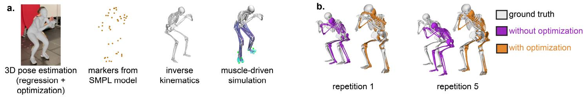

# OPENCAP MONOCULAR：从单部智能手机视频获取人体运动动力学

Scott D. Uhlrich1,2\*, Shardul Sapkota1, Antoine Falisse1, Scott L. Delp1 1Stanford University, Stanford, CA; 2University of Utah, Salt Lake City, UT \*Corresponding author's email: suhlrich@stanford.edu

引言：能够便捷地测量人体运动的运动学与动力学特征，有望改善神经系统和肌肉骨骼疾病的预防与治疗。使用基于标记点的运动捕捉系统测量运动所需的时间和专业知识，限制了其在临床和大规模研究中的推广应用。我们最近开发了 OpenCap，这是一款利用两部智能手机视频估计运动学与动力学的开源软件 [1]。OpenCap 及其他无标记点运动捕捉技术 [2] 将运动分析的时间与成本门槛降低了若干数量级 [1]；然而，这些技术需要多台摄像机。如果我们能够从单个视频中达到类似的精度，那么全球超过 40 亿智能手机用户都将能够使用三维运动捕捉。计算机视觉领域在从单个视频估计人体网格（human mesh）全局姿态方面取得了进展 [3]，但这些算法并非为生物医学应用而设计，也未基于生物医学效用进行评估。本研究旨在开发并评估一套从单个视频估计常见人体运动（步行与下蹲）运动学与动力学的流程。

方法：我们在此介绍 OpenCap Monocular，它结合了三维人体姿态估计、生物力学建模和动态肌肉骨骼仿真，能够从单目视频中估计运动学和动力学参数（图1a）。我们在步态和下蹲试验上对该流程进行了评估，受试者为一名33岁女性，同步采集了与正前方成45°角的视频、基于标记点的运动捕捉数据以及测力台数据[1]。首先，我们使用 WHAM[3]——一种先进的基于回归的三维姿态估计算法——估计脚部接触概率以及 SMPL 模型[4]的全局姿态。以 WHAM 结果作为初始猜测，我们进行两阶段优化以求解相机参数和全局人体姿态。第一阶段优化在假定相机固定且受试者身高已知的前提下，通过最小化重投影误差求解相机参数和 SMPL 形态参数（即人体测量学参数）。固定相机和 SMPL 参数后，第二阶段优化通过最小化重投影误差、接触期间的脚部位置方差以及关节速度来求解全局 SMPL 姿态。随后，我们从 SMPL 顶点中提取解剖学标志点，对肌肉骨骼模型[1]进行缩放，并使用 OpenSim 4.4[5]运行逆向运动学。我们生成肌肉驱动的动态仿真，跟踪运动学以估计地面反力[1,6]。为评估准确性，我们计算 OpenCap Monocular 与基于标记点的运动捕捉和测力台之间的平均绝对差，并对各试验取平均。

图1：(a) 从视频估计运动学和动力学的 OpenCap Monocular 流程。(b) 在基于回归的姿态估计之后进行姿态优化，可减少五次下蹲重复过程中的漂移（平移误差从96毫米降至46毫米）。

  

结果与讨论（Results & Discussion）：对于步行和深蹲动作，OpenCap Monocular（单目 OpenCap）在运动学（kinematics）方面相对于基于标记点的运动捕捉（marker-based motion capture）和测力台（force plates）的平均绝对差异分别为 6.6° 和 37 mm（骨盆位移（pelvis translation）），在反作用力（reaction forces）方面为 7.7% 体重（Table 1）。步行时的关节角度差异（5.6°）与双目 OpenCap 系统（5.2°）、一套八摄像机的无标记点运动捕捉系统（5°）[2] 以及一套 17 传感器 IMU 套装（5°）[7] 相当；然而，位移差异（27 mm）大于双目 OpenCap（7 mm）。步行时的地面反作用力精度（内外方向：1.3% 体重，前后方向：4.9%，垂直方向：21.5%）低于双目 OpenCap（1.5–11.1% 体重）[1] 和 IMU（1.7–9.3% 体重）[8]，这可能是由于骨盆位移误差较大所致。姿态优化（pose optimization）有效降低了基于回归的姿态估计模型（regression-based pose estimation model）所产生的漂移（drift）（Figure 1b）。

Table 1: OpenCap 与基于标记点的动作捕捉之间的平均绝对差异。运动学差异在 24 个旋转自由度和 3 个平移自由度上取平均值，地面反作用力在三个方向上取平均值。

<table><tr><td rowspan=1 colspan=1></td><td rowspan=1 colspan=1>Kinematics (rotations, °)</td><td rowspan=1 colspan=1>Kinematics (translations, mm)</td><td rowspan=1 colspan=1>Ground forces (% bodyweight)</td></tr><tr><td rowspan=1 colspan=1>Opencap Monocular</td><td rowspan=1 colspan=1>6.6</td><td rowspan=1 colspan=1>37</td><td rowspan=1 colspan=1>7.7</td></tr><tr><td rowspan=1 colspan=1>OpenCap two-camera</td><td rowspan=1 colspan=1>4.9</td><td rowspan=1 colspan=1>7</td><td rowspan=1 colspan=1>4.2</td></tr></table>

研究意义　OpenCap 单目（Monocular）在两项活动中对单个个体的运动学与动力学估计精度与双相机 OpenCap 相当，但略差；仍需在不同个体与不同活动间进一步验证。基于单段视频的生物力学分析将极大地拓展我们在家庭、临床与户外场景中量化运动的频率与便捷程度。在生物力学评估的语境下开展严谨分析，是这一拓展过程中不可或缺的一步。

参考文献：[1] Uhlrich et al.（2023），PLoS Comput Biol 19(10)。[2] Kanko et al.（2021），J Biomech 127。[3] Shin et al.（2024），Proc CVPR。[4] Loper et al.（2015），Proc SIGGRAPH Asia。[5] Seth et al.（2018），PLoS Comput Biol 14(7)。[6] Falisse et al.（2019），J R Soc Interface 16。[7] Al Borno et al.（2022），J Neuroeng Rehabil 19(11)。[8] Karatsidis et al.（2019），Med Eng Phys 65。