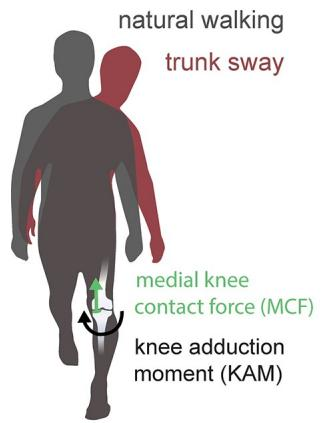
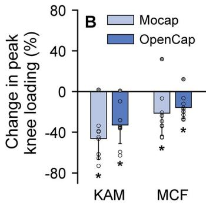
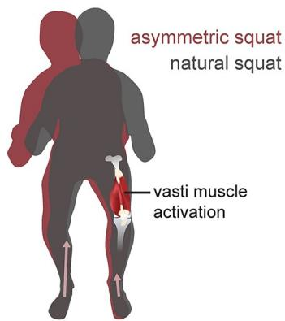
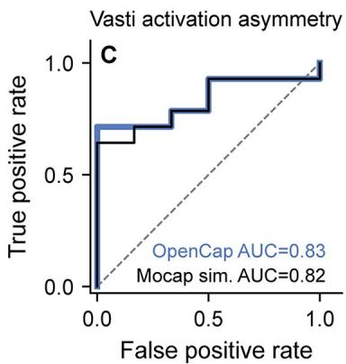
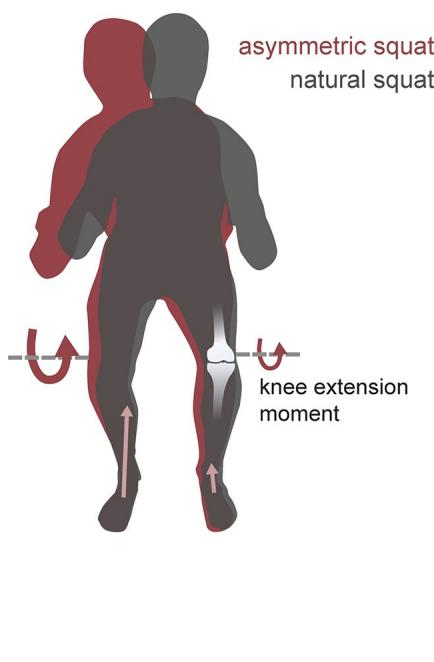
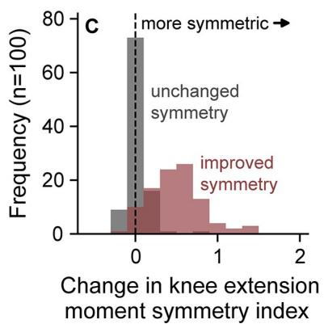

# OpenCap：从智能手机视频中获取人体运动动力学

Scott D. UhlrichID1☯\*, Antoine FalisseID1☯\*, Łukasz Kidziński1☯, Julie Muccini2, Michael Ko2, Akshay S. Chaudhari2,3, Jennifer L. Hicks1, Scott L. Delp1,4,5

开放获取（OPEN ACCESS）

引用信息：Uhlrich SD, Falisse A, Kidziński Ł, Muccini J, Ko M, Chaudhari AS, et al. (2023) OpenCap: Human movement dynamics from smartphone videos. PLoS Comput Biol 19(10): e1011462. https://doi.org/10.1371/journal.pcbi.1011462

1 美国加利福尼亚州斯坦福大学 生物工程系（Departments of Bioengineering, Stanford University, Stanford, California, United States of America），2 美国加利福尼亚州斯坦福大学 放射科（Radiology, Stanford University, Stanford, California, United States of America），3 美国加利福尼亚州斯坦福大学 生物医学数据科学系（Biomedical Data Science, Stanford University, Stanford, California, United States of America），4 美国加利福尼亚州斯坦福大学 机械工程系（Mechanical Engineering, Stanford University, Stanford, California, United States of America），5 美国加利福尼亚州斯坦福大学 骨科外科系（Orthopaedic Surgery, Stanford University, Stanford, California, United States of America）

编辑：Alison L. Marsden，斯坦福大学（Stanford University），美国

收稿日期：2023 年 2 月 1 日

接受日期：2023 年 8 月 24 日

发表日期：2023 年 10 月 19 日

同行评审历史：PLOS 认识到同行评审过程中透明化的益处；因此，我们使所有同行评审内容及作者回复能够与最终发表的文章一同发布。本文的编辑历史可在此查阅：https://doi.org/10.1371/journal.pcbi.1011462

版权：© 2023 Uhlrich et al. 本文章采用 Creative Commons Attribution License 协议开放获取，允许在注明原作者及来源的前提下以任何媒介进行不受限制的使用、分发与复制。

数据可用性声明：实验室验证和田野研究的数据可在 https://simtk.org/projects/opencap 获取。可识别的视频数据已在实验室验证研究中共享。提供可识别视频的参与者 ☯ 这些作者对本工作贡献相同。

\* suhlrich@stanford.edu（SDU）；afalisse@stanford.edu（AF）

## 摘要

人体运动动力学（human movement dynamics）指标能够预测诸如损伤风险或肌肉骨骼疾病进展等结果。然而，由于所需的成本、时间与专业知识门槛过高，这些指标很少被纳入大规模研究或临床实践中。本文介绍并验证了 *OpenCap*——一个利用两台或多台智能手机拍摄的视频来同时计算人体运动学（即运动）与动力学（即力）的开源平台。*OpenCap* 利用姿态估计算法从视频中识别身体关键点；利用深度学习与生物力学模型估计三维运动学；并基于物理仿真（physics-based simulations）来估计肌肉激活与肌肉骨骼动力学。*OpenCap* 的网页应用使用户能够采集同步视频，并可视化自动在云端处理的运动数据，从而无需专用硬件、软件与专业知识。我们证明 *OpenCap* 能准确预测肌肉激活、关节负荷与关节力矩等动态指标，可用于疾病风险筛查、干预效果评估、组间运动差异分析以及为康复决策提供依据。此外，我们通过一项 100 人的现场研究展示了 *OpenCap* 的实用价值：一位临床医生使用 *OpenCap* 估计肌肉骨骼动力学的速度比基于实验室的方法快 25 倍，成本不到其 1%。通过使人体运动分析变得大众化，*OpenCap* 可以加速生物力学指标融入大规模研究、临床试验与临床实践。

## 作者摘要（Author summary）

分析人体如何运动、如何协调肌肉、以及何种力作用于肌肉骨骼系统，对于研究神经-肌肉-骨骼系统疾病（neuro-musculoskeletal conditions）至关重要。传统上，测量这些量需要昂贵的实验室设备、训练有素的专家以及数小时的分析工作。因此，高质量的人体运动指标很少

被共享。被拍摄者提供了发布这些视频的书面同意。源代码可在 https://github.com/stanfordnmbl/opencap-core （存档于 Zenodo：https://doi.org/10.5281/ zenodo.7419967 ）以及 https://github.com/ stanfordnmbl/opencap-processing （存档于 Zenodo：https://doi.org/10.5281/zenodo.7419973 ）获取，采用宽松的开源许可证（Apache 2.0）；用户可通过访问 https:// opencap.ai 使用我们的网页与移动应用来运行该软件。这些应用以及为其提供支持的云计算服务，在可预见的将来将对研究社区免费开放。

资助（Funding）：SDU、AF、LK、JM、ASC、JLH 和 SLD 获得了美国国立卫生研究院（National Institutes of Health，https://www.nih.gov；资助编号 1P41EB027060-01A1）以及吴蔡人类表现联盟（Wu Tsai Human Performance Alliance，https://humanperformancealliance.org）的资助。ASC 和 MK 获得了飞利浦医疗（Philips Healthcare，https://www.usa.philips.com/healthcare）和美国国立卫生研究院（National Institutes of Health，https://www.nih.gov；资助编号 1R01AR077604-01）的资助。资助方在研究设计、数据采集与分析、发表决策以及稿件准备方面均未发挥作用。

利益冲突（Competing interests）：本人已阅读本期刊的政策规定，本稿件作者存在以下利益冲突：SDU 和 AF 是 Model Health, Inc. 的联合创始人，该公司支持本文所述开源软件的非学术性商业用途。OpenCap 作为该开源软件的云端学术版本，托管于斯坦福大学（Stanford University），在可预见的未来将继续免费向学术研究界开放。其他作者无利益冲突需要声明。

并被纳入临床实践和大规模研究中。基于计算机视觉的方法能够利用标准视频定位人体关节，为基于实验室的运动分析提供了一种颇具前景的替代方案。然而，这些方法能否为生物医学研究和临床实践提供充足信息尚不清楚。本文介绍 OpenCap——一款基于网页的开源软件工具，可通过智能手机视频计算人体运动的运动学量（例如关节角度）及其背后的肌肉骨骼力学（例如肌肉力）。OpenCap 将计算机视觉、机器学习与肌肉骨骼仿真的最新进展相结合，使运动分析摆脱了对专用硬件、软件和专业知识的依赖，从而得以广泛普及。我们将 OpenCap 与基于实验室的测量结果进行了验证，并展示了其在疾病风险筛查、干预疗效评估以及为康复决策提供依据等方面的应用价值。最后，我们着重强调 OpenCap 如何在真实环境中实现大规模的人体运动研究。

## 引言（Introduction）

评估人体运动的动力学（即肌肉骨骼力）和控制对于理解和治疗肌肉骨骼及神经肌肉疾病非常重要。例如，骨关节炎关节的负荷可预测骨关节炎的进展 [1]；从椅子上起身时肌肉在下肢关节周围产生的力矩分布与老年人的跌倒有关 [2–4]；执行高难度任务时左右肢体之间肌肉力和地面反作用力的不对称性与关节手术后的功能结局有关 [5–7]。尽管这些指标很有用，但在临床实践中很少测量运动的动力学指标。相反，视觉化的运动评估或仅需基本仪器（如秒表或量角器）的一般功能性测试被用于指导临床决策，并作为临床试验的结局指标。

运动的动力学定量分析能够比视觉评估和简单的功能性测试提供更深入且更具可重复性的见解；然而，这种分析资源密集，这阻碍了它在大规模研究和临床实践中的应用。传统上，运动分析需要一个配备价值超过 150,000 美元设备的固定实验室空间（图 1，上排）。运动学指标（例如关节角度）通过基于标记点的动作捕捉系统来测量，该系统使用八台或更多专用摄像头捕捉贴在受试者身上的标记点的三维（3D）轨迹。动态指标（例如关节力矩和功率），也称为动力学，可以通过额外测量安装在地板下方的测力台的地面反作用力来估算。肌肉骨骼建模与仿真工具 [8–10] 结合运动学、动力学以及来自肌电图的肌肉激活测量，以支持对运动控制和肌肉骨骼负荷（例如肌肉协调和关节力）的更深入研究。这种全面的运动分析在小型研究之外很少使用，因为对单一受试者的数据采集、处理，以及（可选的）生成动力学肌肉骨骼仿真，通常需要训练有素的专家花费数天时间。

纳入数百名受试者的运动动力学研究已经阐明了可预测损伤风险或手术结局的生物力学标志物 [11–13]。然而，这一规模的研究既昂贵又罕见——生物力学研究中纳入的受试者数量中位数在 12 到 21 人之间 [14,15]。因此需要低成本、可扩展且准确的工具，以便在数量多出几个数量级的个体身上、于其自然环境中估算运动动力学。现代数据科学技术随后可以利用这些大规模数据集来

## Mocap：基于标记点的运动分析

  

图 1. 基于标记的动作捕捉（Mocap）与基于视频（OpenCap）的人体运动动力学分析对比。（上排）基于标记的运动分析通常在动作捕捉实验室中进行，一项全面的肌肉骨骼动力学研究通常需要专家投入两天以上的时间，并使用价值超过 \$150,000 的设备。（下排）OpenCap 能够在不到 10 分钟的人工操作时间内完成肌肉骨骼动力学研究，且所需设备价值低于 \$700（假设用户需要购买新的移动设备）。OpenCap 可在任何可访问互联网的环境中使用，仅需要至少两台 iOS 设备（例如 iPhone 或 iPad）。（右栏）OpenCap 能够估计运动学、动力学和肌肉肌腱参数，其中许多参数此前只能通过基于标记的动作捕捉和测力台分析获得。

https://doi.org/10.1371/journal.pcbi.1011462.g001

探索运动在健康与疾病中的作用，从而促进定量运动生物标志物的识别与临床转化。

用于估算运动学（kinematics）的移动工具已被开发出来，但大多数仍然过于昂贵且耗时，难以用于大规模研究以及临床转化，并且没有任何工具能够实现对运动动态（dynamics）的全身分析。惯性测量单元（inertial measurement units）是这些工具中使用最为广泛的一类，可以较为准确地估算运动学参数 [16]，但商用传感器仍然价格昂贵，穿卸耗时，并依赖专有算法。基于物理的肌肉骨骼系统仿真领域的最新进展，已经能够从基于惯性测量单元的动作捕捉中估算动力学 [17,18]，但这些算法并未公开，且尚未在小型可行性研究之外得到推广应用。

使用运动学相机进行测量是另一种颇有潜力的方法，这得益于人体姿态估计算法的最新进展 [19,20]。开源的二维（2D）姿态估计算法（例如 OpenPose [21]）已使二维运动学分析成为可能 [22]，并且可以为预测运动学与动力学指标的机器学习模型提供输入 [23,24]。尽管这些机器学习模型在特定应用中非常有用，但它们可能无法泛化到其训练数据中未涵盖的其他指标、任务和人群。另一种可能具有更强泛化能力的方法是，对姿态估计算法在多段视频中识别的身体关键点（例如关节中心）进行三角测量 [25–30]，并结合肌肉骨骼模型与基于物理的仿真对这些三维位置进行跟踪。然而，这些算法所识别出的稀疏三维关键点并不能完整地表征所有身体节段的平移与旋转；因此，尚不清楚这些关键点是否足够具有表达能力与准确性，从而能够支撑运动研究。商用无标记运动捕捉系统能够较为准确地估算运动学参数 [31]，但它们通常

需要多台摄像机与专有软件，并依赖专用计算资源。智能手机摄像头的普及性使得无需购买昂贵专用设备即可实现基于运动的视频捕捉，不过前提在于，能够准确估算运动学参数。然而上述分析能否通过少量不准确、缺乏硬件同步的设备实现，待开展的分析也尚不明确。如果能够解决从智能手机视频中准确计算运动学与动力学的难题，则智能手机与可穿戴设备有望成为在运动学与动力学分析方面获得实用结果的新途径。未来基于智能手机与可穿戴设备有望成为推动多种在运动学与动力学分析方面获得实用结果的新途径。未来基于智能手机与可穿戴设备有望成为推动多种在运动学与动力学分析方面获得实用结果的新途径。未来基于智能手机与可穿戴设备有望成为推动多种在运动学与动力学分析方面获得实用结果的新途径。

我们在此介绍 OpenCap，这是一款开源、基于网页的软件，可供研究社区免费使用，用于从两部或多部智能手机拍摄的视频中估算人体运动的 3D 运动学与动力学参数（图 1，下排）。OpenCap 融合了计算机视觉与肌肉骨骼模拟领域数十年的研究进展，使运动动力学分析无需依赖专用硬件、软件或专业知识即可开展。我们首先将 OpenCap 估算得到的运动学与动力学指标，与基于标记点的动作捕捉及测力台所计算的金标准进行对比验证。接下来，我们探讨 OpenCap 估算的动力学指标是否具有足够精度，可用于疾病风险筛查、干预效果评估、群体间运动差异研究以及康复进展跟踪。在实验室中完成这些指标的验证后，我们将着重展示 OpenCap 如何帮助临床医生在真实世界场景下对大样本人群进行运动动力学测量。

## 结果

## 使用 OpenCap 进行数据采集

使用 OpenCap 完成一次数据采集的准备工作耗时不到五分钟，所需器材包括两台 iOS 设备（iPhone、iPad 或 iPod）、两个三脚架、一块标定棋盘格（用普通打印机打印即可），以及另一台用于运行 OpenCap 网页应用的设备（例如笔记本电脑）。在将 iOS 设备与网页应用配对后，用户将在系统引导下依次完成相机标定、数据采集以及 3D 运动学的可视化。运动学参数通过深度学习模型与 OpenSim 中的逆运动学（inverse kinematics）[8,10] 从视频中估算，动力学参数则采用基于物理的肌肉骨骼模拟方法进行估算（图 2，S1 Movie）。OpenCap 利用可扩展的服务器架构，通过云计算完成数据处理。

## 与实验室金标准的对比验证

我们在 10 名健康受试者组成的队列中，针对多种活动（行走、深蹲、从椅子上站起以及下蹲跳），使用两部 iPhone 将 OpenCap 与基于标记点的动作捕捉系统及测力台分析进行了对比验证。OpenCap 估算的关节角度的平均绝对误差（MAE）为 4.5°，地面反作用力的 MAE 为体重的 6.2%，关节力矩的 MAE 为「体重×身高」的 1.2%（表 1；更多验证内容见方法：验证部分；S1 附录中的 S1–S4 表以及图 A–L）。

## 疾病风险筛查：行走过程中的膝关节负荷

我们随后探究了 OpenCap 是否具有足够的精度来估算关节负荷指标，从而用于筛查有内侧膝骨关节炎快速进展风险的个体，并评估非手术干预的疗效。我们首先评估了 OpenCap 估算早期站立相膝关节内翻力矩峰值的准确性，该指标可预测内侧膝骨关节炎的快速进展 [1]。十名健康个体分别以自然步态（即采用自我选择的策略）和一种通常能降低膝关节内翻力矩的躯干摆动步态矫正方式行走 [32]。OpenCap 预测了早期站立相膝关节

  

地面反作用力（MAE）

iOS 应用程序同步视频采集

  

Web 应用程序数据采集与可视化

  

基于视频的可扩展云计算生物力学分析

图2 | OpenCap 由一个智能手机应用程序、一个 Web 应用以及云计算构成。为了采集数据，用户需要在两台或更多 iOS 设备上打开应用程序，并将其与 OpenCap Web 应用进行配对。Web 应用使用户能够在 iOS 设备上同时录制视频，并可视化所得的三维（3D）运动学结果。在云端，使用开源的姿态估计算法从多视角视频中提取二维关键点。通过对关键点速度进行互相关运算来对视频进行时间同步，并通过三角测量这些同步后的二维关键点来计算三维关键点。这些三维关键点随后被转换为一个更全面的三维解剖标记集，转换过程借助一个在大型运动捕捉数据集上训练的循环神经网络（LSTM）。然后，利用逆运动学以及一个具有生物力学约束的肌肉骨骼模型，从标记轨迹中计算三维运动学。最后，使用跟踪三维运动学的肌肉驱动动力学仿真来估算动力学指标。

https://doi.org/10.1371/journal.pcbi.1011462.g002

表1 | 与实验室级运动捕捉和测力台相比，OpenCap 在运动学和动力学方面的平均绝对误差（MAE）。

<table><tr><td rowspan=1 colspan=1>Kinematics (MAE)</td><td rowspan=1 colspan=1>Walking</td><td rowspan=1 colspan=1>Squat</td><td rowspan=1 colspan=1>Sit-to-stand</td><td rowspan=1 colspan=1>Drop jump</td><td rowspan=1 colspan=1>Mean</td></tr><tr><td rowspan=1 colspan=1>Rotations (n = 18) [°]</td><td rowspan=1 colspan=1>4.1 (2.3–6.6)</td><td rowspan=1 colspan=1>4.1 (1.8–7.2)</td><td rowspan=1 colspan=1>4.7 (1.7–10.3)</td><td rowspan=1 colspan=1>5.1 (2.3–8.6)</td><td rowspan=1 colspan=1>4.5</td></tr><tr><td rowspan=1 colspan=1>Translations (n = 3) [mm]</td><td rowspan=1 colspan=1>12.3 (6.8–19.6)</td><td rowspan=1 colspan=1>12.3 (5.8–18.4)</td><td rowspan=1 colspan=1>13.2 (5–20.3)</td><td rowspan=1 colspan=1>11.5 (6.3–16.5)</td><td rowspan=1 colspan=1>12.3</td></tr></table>

<table><tr><td rowspan=1 colspan=1>Vertical [%BW]</td><td rowspan=1 colspan=1>8.2 (7.5%)</td><td rowspan=1 colspan=1>6.4 (20.0%)</td><td rowspan=1 colspan=1>5.7 (13.4%)</td><td rowspan=1 colspan=1>25.2 (13.8%)</td><td rowspan=1 colspan=1>11.4 (13.7%)</td></tr><tr><td rowspan=1 colspan=1>Anterior-posterior [%BW]</td><td rowspan=1 colspan=1>2.1 (6.7%)</td><td rowspan=1 colspan=1>1.3 (37.5%)</td><td rowspan=1 colspan=1>1.9 (31.0%)</td><td rowspan=1 colspan=1>8.9 (17.3%)</td><td rowspan=1 colspan=1>3.5 (23.1%)</td></tr><tr><td rowspan=1 colspan=1>Medio-lateral [%BW]</td><td rowspan=1 colspan=1>1.1 (17.1%)</td><td rowspan=1 colspan=1>5.7 (85.4%)</td><td rowspan=1 colspan=1>3.2 (110.5%)</td><td rowspan=1 colspan=1>5.3 (29%)</td><td rowspan=1 colspan=1>3.8 (60.5%)</td></tr></table>

<table><tr><td rowspan=1 colspan=1>All degrees of freedom (n = 15) [%BW*ht]</td><td rowspan=1 colspan=1>0.75 (0.20–1.32, 19%)</td><td rowspan=1 colspan=1>0.97 (0.11–1.93, 45%)</td><td rowspan=1 colspan=1>0.68 (0.13–1.09, 60%)</td><td rowspan=1 colspan=1>2.50 (1.15–5.90, 25%)</td><td rowspan=1 colspan=1>1.22 (37%)</td></tr></table>

每个动作的误差在试次和受试者间（n = 10）取平均，所报告的均值是对各动作和自由度求平均后的结果（骨盆位置和姿态六个[仅运动学]，腰椎三个，每侧髋关节三个，每侧膝关节一个，每侧踝关节两个）。力以百分比体重（BW）表示，力矩以百分比体重×身高（ht）表示。运动学和关节力矩的误差以自由度上的均值和极差表示，此外，动力学误差还以占极差百分比的平均绝对误差（MAE）形式给出。运动学和动力学的均方根误差见 S2–S4 表。由 OpenCap 和 Mocap 估计的平均运动学、地面反作用力和关节力矩波形见 S1 附录中的图 A–L。

  

图3. 步行期间膝关节内侧负荷。我们评估了 OpenCap 估算膝关节内收力矩（knee adduction moment, KAM）的准确性，KAM 是衡量膝关节内侧负荷并可预测膝关节骨关节炎进展的指标，以及在改变步行模式后膝关节负荷如何变化。受试者（n = 10）以自然步态和躯干摆动步态修正两种方式行走。（A）与使用基于标记的动作捕捉与测力台（Mocap）所进行的分析相比，OpenCap 估算的早期支撑期峰值 KAM 的 $r ^ { 2 } = 0 . 8 0$ 。KAM 经体重（bodyweight, BW）和身高（height, ht）归一化处理。（B）图中展示了从自然步态到躯干摆动步态行走期间，峰值 KAM 与峰值内侧接触力（medial contact force, MCF，膝关节内侧负荷更为全面的衡量指标）变化的受试者均值（柱状图）和标准差（误差棒，圆形标记表示各受试者）$( ^ { * } P < . 0 5 )$。OpenCap 检测到了峰值 KAM 和 MCF 的降低（P < .006，t 检验和 Wilcoxon 符号秩检验），这与 Mocap 测得的结果一致（P < .016，t 检验）。此外，OpenCap 还正确识别出 Mocap 估算中未降低 KAM 或 MCF 的那一位个体（实心圆形标记）。

https://doi.org/10.1371/journal.pcbi.1011462.g003

OpenCap 的膝内收力矩估计值与基于标记点的运动捕捉（marker-based motion capture）和测力台（force plates）相比，$r^{2}=0.80$（r：皮尔逊相关系数），MAE 为 0.30% 体重×身高（图 3）。这一误差小于一系列用于检测膝骨关节炎症状及进展的阈值（0.5–2.2% 体重×身高 [1,33–35]）。我们随后评估了 OpenCap 是否能估计由躯干摆动（trunk sway）调整所引起的早期支撑相峰值膝内收力矩以及峰值内侧接触力的变化——后者是一个更全面的负荷指标，常被作为膝骨关节炎干预的靶点 [36,37]。在群体层面，OpenCap 捕捉到了躯干摆动步态调整所引起的早期支撑相峰值膝内收力矩和峰值内侧接触力的预期下降（下降 16–33%，$P < .006$；t 检验和 Wilcoxon 符号秩检验，n = 10，图 3B）。基于标记点的运动捕捉和测力台也检测到同方向的显著变化（下降 21–46%，$P < .016$；t 检验，n = 10）；关于这些统计检验的更多细节可参见 S1 附录中的表 A。对于该样本量，OpenCap 在显著性水平 α = .05 下检测这些预期群体差异的几率为 92%（跨检验平均的事后检验功效），而基于标记点的运动捕捉和测力台为 77%。在个体层面，OpenCap 正确预测了由躯干摆动引起的两种峰值负荷指标的方向性变化（9 名个体下降，1 名个体上升）。OpenCap 能够准确估计步行过程中的膝关节负荷及其变化，表明它可被用于识别可能面临疾病快速进展风险的内侧膝骨关节炎患者，并评估步态调整在个体层面和群体层面的效果 [38,39]。

## 检测组间差异：坐起动作（sit-to-stand）中的动力学差异

我们随后探究了 OpenCap 是否可用于研究青年人与老年人之间常见的运动动力学差异。从椅子上起身的策略随年龄变化，并与不同的肌肉力量需求相关 [2]。老年人通常采用躯干前屈（trunk flexion）增加的起身策略，从而将肌肉需求从

  

图 4. 从椅子上站起时下肢关节力矩的分布。为了评估 OpenCap 检测动力学组间差异的能力，我们计算了下肢关节力矩的组间差异，这些差异常见于年轻人与老年人从椅子上站起的过程中。受试者（n = 10）采用自然站立以及增加躯干前屈的方式进行测试——后者是膝关节伸肌无力者所使用的策略，可将肌肉需求转移至髋关节伸肌和踝关节跖屈肌。（A）展示了跨受试者的均值（条形）与标准差（误差线），空心圆点代表每位受试者，针对的是从自然站姿到躯干前屈条件下膝关节伸、髋关节伸与踝关节跖屈力矩的变化，该变化在起立阶段上取平均（$^ { * } P < . 0 5$）。力矩以体重百分比（BW）乘以身高（ht）进行归一化。OpenCap 识别出了关节力矩的变化（P = .004–.024，t 检验），这些变化在使用运动捕捉与测力台（Mocap）时也被识别出来（P = .001–.002，t 检验）。（B）展示了每位受试者在每种条件下起立阶段平均的膝关节伸力矩值。OpenCap 估计的膝关节伸力矩与使用运动捕捉和测力台数据作为输入的仿真结果（Mocap）相比，$\stackrel { \smile } { r ^ { 2 } } = 0 . 6 5$。

https://doi.org/10.1371/journal.pcbi.1011462.g004

膝伸肌向髋伸肌和踝跖屈肌转移 [40]；该策略与较低的功能性肌肉力量相关 [4]，而后又与跌倒风险相关 [3]。我们通过让十名健康个体先以自然方式从椅子上起立五次、再以增加的躯干屈曲方式起立五次，来模拟不同年龄组之间起立策略的差异（图 4）。在群体水平上，OpenCap 估计在起立阶段取平均时，从自然条件到躯干屈曲增加条件之间，膝关节伸展力矩的预期减小 $( P = . 0 2 4 , \mathrm { t }$ test, n = 10)，以及髋关节伸展（P = .020，t 检验，n = 10）和踝关节跖屈力矩的增加 $\left( P = . 0 0 4 , \mathrm { t } \mathrm { t e s t } , \mathrm { n } = 1 0 \right)$。这些变化的方向与运动捕捉和测力台所测得的结果一致（P = .002–.003，t 检验，n = 10）；关于这些统计检验的更多细节可参见 S1 附录中的表 B。对于该样本量，OpenCap 在显著性水平 alpha = .05 下检测出这些预期条件间差异的几率为 65%（跨检验平均的事后功效），而运动捕捉与测力台的几率为 89%。OpenCap 还以 $r ^ { 2 } = { }$ 0.65 和 MAE = 5.5Nm（0.47%体重×身高）预测了峰值膝关节伸展力矩，与基于标记点的运动捕捉和测力台相比。该误差与中年成人在六年内发生的平均力量损失相当（0.93Nm/年 [41]，详见 S1 附录）。综上，这些发现表明 OpenCap 可用于研究年轻人与老年人之间运动动力学的差异，并可识别出膝伸肌力量较低、可能受益于肌肉强化干预的个体 [2]。

## 指导康复：下蹲过程中的肌肉激活不对称性

最后，我们探讨了 OpenCap 能否准确估计与康复进展相关的肌肉力量测量指标。恢复双下肢间膝伸肌力量生成的对称性通常是膝关节手术后康复的目标，而在康复出院前识别持续的不对称性可避免较差的功能结局 [5,6,42]。为模拟术后不对称性，我们指导这十名健康个体先以自然方式完成五次下蹲，然后通过减少其左脚下的力量以不对称方式完成

  

图 5. 深蹲过程中股肌群（vasti）激活的不对称性。为了评估 OpenCap 在为康复决策提供参考方面的实用性，我们试图识别下肢间股肌群（vasti）功能的不对称性，以反映康复不完全并关联术后功能性结局较差。受试者（n = 10）先自然地进行深蹲，然后在指导下减小左脚施力以非对称方式完成深蹲。（A, B）图中展示了通过肌电图（EMG）测得以及使用 OpenCap 估计所得的左腿（未负重）股肌群激活在受试者间的均值（实线）与标准差（阴影）。肌肉激活值经每位受试者及每种测量方式的最大值进行归一化。（C）OpenCap 识别出左、右腿之间股肌群峰值激活的不对称性（基于 EMG 定义的不对称性以及临床相关的对称性阈值），其受试者工作特征曲线下面积（AUC）为 0.83，准确率为 75%。这与使用基于标记点的运动捕捉和测力台数据作为输入的仿真结果（Mocap sim.，AUC = 0.82，准确率 = 70%）性能相近。

https://doi.org/10.1371/journal.pcbi.1011462.g005

（图 5）。由于肌肉激活比肌肉力更易于直接测量，我们将通过肌电图测得的股四头肌（膝关节伸肌）激活与 OpenCap 估计的激活进行了比较。我们使用肌电图和具有临床相关性的对称性指数阈值 [43] 1.15 来定义真实激活的不对称性。OpenCap 在最优对称性指数阈值 1.13 处将深蹲分类为对称或不对称的受试者工作特征曲线下面积（AUC）为 0.83，准确率为 75%（图 5），这与使用动作捕捉和测力台数据的仿真性能（AUC = 0.82，准确率 = 70%）相近。

## 实验室外的动态分析

为了展示 OpenCap 在真实世界条件下的实用性，我们把这部分康复跟踪分析扩展到了一项现场研究。一位并非运动分析专家的临床医生使用 OpenCap 评估了社区中 100 名受试者在完成自然和不对称深蹲时的膝关节伸力矩对称性。平均而言，每个受试者的设置和数据采集耗时五分钟；对于单个深蹲，运动学和动力学分别在单个服务器上自动计算耗时 2 分钟和 35 分钟。总体而言，100 名受试者的数据采集共耗时 8 小时，计算在 32 线程 CPU 上共耗时 31 小时（动力学计算进行了并行化）。在使用条件指令（即自然或不对称）作为真实标签的情况下，OpenCap 对膝关节峰值伸力矩的估计在最优对称性指数阈值 1.33 处可以区分对称与不对称条件，AUC = 0.90，准确率 = 85%（图 6A 和 6B）。OpenCap 还检测到了受试者从不对称条件到自然条件在膝关节峰值伸力矩对称性方面的自身内改善，在最优阈值 0.26 处 AUC = 0.93，准确率 = 89%（图 6C 和 6D）。综合来看，我们的实验室和现场研究表明，Open-Cap 能够检测股四头肌发力中的不对称性，这可能有助于指导康复决策，并且能够追踪在康复过程中预期出现的对称性改善。

  

图 6. 实验室外的动态分析。为了展示 OpenCap 在追踪康复进展方面的实际效用，我们在一项由临床医生主导的现场实验中招募了 100 名参与者。参与者执行了对称深蹲和非对称深蹲，在非对称深蹲中要求他们减小左脚下的受力，这可能导致左右膝关节伸展力矩之间的不对称。我们首先评估了 OpenCap 作为筛查工具来识别峰值膝关节伸展力矩不对称的效用。（A）图中展示了两种深蹲条件下膝关节伸展力矩对称性指数的分布，对称性指数大于一表示与右腿相比，左腿（未负重）的峰值膝关节伸展力矩较低。（B）OpenCap 的对称性指数估计在自然深蹲与非对称深蹲之间进行分类，受试者工作特征曲线下面积（AUC）为 0.90，准确率为 85%。然后我们评估了 OpenCap 在检测康复过程中可能随时间发生的峰值膝关节伸展力矩对称性变化方面的效用。（C）图中展示了对称性指数在非对称条件与自然条件之间的平均差异（即假设随时间改善的对称性；红色）以及对称性指数在非对称条件下三次试次之间的平均差异（即假设随时间不变的对称性；灰色）的分布。（D）OpenCap 在从非对称条件到自然条件的对称性改善检测中，$\Delta \mathrm { U C } = \dot { 0 } . 9 3$（相对于 (C) 中的未改善分布有所改善），准确率为 89%。

## 讨论

本研究描述了 OpenCap，这是一个结合计算机视觉与肌肉骨骼仿真、通过智能手机视频量化人体运动动力学的平台。我们表明，OpenCap 对若干研究和临床应用具有足够的准确性。OpenCap 在估计不同条件之间动态测量值变化时，与金标准技术（0.77–0.89）具有相近的统计效力（0.65–0.92）；它估计的动态测量值能够以 $r^{2}=0.65–0.80$ 预测与骨关节炎和跌倒风险相关的不良结局；它估计的动态测量值能够以 75–89% 的分类准确率辅助康复决策。我们的现场研究展示了 OpenCap 如何使临床医生和研究人员能够在现场和大规模人群中分析运动动力学。

OpenCap 降低了分析运动动力学的成本、时间和专业门槛。OpenCap 的硬件成本在 40 至 700 美元之间，取决于用户是否需要购买新的 iOS 设备（图 1）。这比传统运动捕捉实验室设备便宜约 215 倍，并且不需要专门的实验室空间。

使用 OpenCap 测量运动动力学的动手时间为设置移动设备的时间加上执行动作的时间（图 1，下排）。在我们现场数据采集过程中，每位参与者 5 分钟的动手时间比在运动捕捉实验室中进行类似分析（约 2 小时）少约 25 倍。OpenCap 不需要专门的软件或专业知识，这弥合了计算机视觉、生物力学和临床运动科学社区之间的鸿沟。大多数计算机视觉算法需要计算机科学知识才能运行，大多数仿真工具需要生物力学知识才能操作，但 OpenCap 自动化了这些过程，使这些领域的进展更容易被临床医生和研究人员所获取。自 OpenCap 发布一年来，已有超过 2,000 名来自不同领域的研究人员使用它收集了数万次运动试验。OpenCap 还符合斯坦福大学（Stanford University）对使用高风险数据（例如受保护的健康信息）的基于云的系统安全要求，并确保端到端数据加密。为进一步方便使用，我们在配套网站（https://opencap.ai/）上提供了教程和示例。

我们的结果证明了 OpenCap 作为筛查工具和为康复决策提供信息的潜在临床价值。未来研究可以测试 OpenCap 筛查运动员非接触性韧带损伤风险的能力 [11,44]，或预测脑瘫患者手术疗效的能力 [12,13]。OpenCap 的评估也可能足够快，从而将运动筛查纳入常规临床护理，使临床医生能够随时间跟踪功能，并在受伤或手术后根据伤前基线评估康复状态 [45]。我们调查了 OpenCap 在估计若干具有临床意义的指标方面的准确性；我们鼓励针对其他活动、人群和关注指标开展进一步的验证研究，以评估 OpenCap 的准确性是否足以在超出我们所探讨范围的用例中为决策提供依据。

通过支持大规模、实验室外的研究，OpenCap 可以加速运动学研究。OpenCap 以与运动捕捉和测力台分析相似的统计效能检测出条件间的差异，但所需时间大幅减少。这种准确性和效率使需要数百名参与者的前瞻性损伤风险研究更具可行性，使将运动动力学纳入通常仅使用步态计的人群规模健康研究成为可能（例如，骨关节炎倡议研究 [46] 或英国生物样本库 [47]），并有助于开发用于临床试验的更敏感的功能结局指标。通过自动计算运动学参数，OpenCap 不易受到不同实验者在运动捕捉标记放置方面差异所引入的误差的影响 [48]。这可以降低多中心研究中的变异性 [49]，并使运动数据能够被汇编成同质化、可共享的数据集，供机器学习社区使用。重要的是，OpenCap 的便携性将使那些由于时间和地理限制而经常在运动学研究中代表性不足的人群得以纳入研究。

OpenCap 利用机器学习来提高基于视频的运动学估计的保真度，并采用基于物理建模的方法来保持泛化能力（图 2）。我们将一个适用于时间序列数据的深度学习模型与一个受约束的生物力学模型相结合，从仅凭自身不足以刻画三维运动学的视频关键点出发，估计三维运动学。我们的深度学习模型从常见计算机视觉数据集（例如 COCO [50]）中所标注的稀疏视频关键点出发，预测一组全面的解剖学标记点。与直接使用视频关键点相比，将预测出的解剖学标记点与我们的生物力学模型结合使用，在所有自由度上平均将运动学精度提高了 3.4˚（见方法与 S2 Table）。这些改进在髋关节屈曲、骨盆倾斜和腰椎屈曲自由度上最为显著（改进幅度为 4.9–32.6˚），因为这些自由度在髋部与肩部之间的视频关键点较为稀疏，容易产生较大的角度误差。此外，深度学习模型的架构提供了时间一致性，使 OpenCap 对短暂的遮挡或关键点误识别具有更强的鲁棒性。最后，尽管问题建模存在一定的任务相关调优，但肌肉驱动的动力学仿真在估计动力学方面比端到端的机器学习方法具有更好的泛化能力。这使我们能够研究不同运动的动力学，而无需针对每种活动训练数据。

OpenCap 运动学和动力学估计的精度与最先进的无标记运动捕捉方案相当。OpenCap 的运动学误差（下肢自由度均方根误差[RMSE]范围：2.0–10.2˚）与基于惯性测量单元（inertial measurement unit）的方法所报告的误差（步行、跑步和日常活动的 RMSE：2.0–12˚ [18,51–57]）以及商用和学术视频系统（八个摄像头，步行、跑步和骑行活动的 RMSE：2.6–11˚ [31,58]）相当。此外，OpenCap 与基于标记点的运动捕捉之间的关节角度误差，与基于标记点的运动捕捉中由皮肤运动伪影所引起的误差相当。例如，使用皮肤贴附标记点计算的膝关节屈曲角度，相对于使用骨钉安装标记点测量的角度，可产生高达 8˚ 的均方根误差 [59]，这超过了 OpenCap 与基于皮肤标记点的运动捕捉之间膝关节屈曲角度的 4.2˚ 均方根误差（S2 Table）。由于用作真值的基于皮肤标记点的运动捕捉方法本身存在误差，要显著提升无标记与基于标记点的运动捕捉系统之间的一致性可能颇具挑战。此外，与大多数基于惯性测量单元的方法不同，OpenCap 估计全局平移（例如骨盆位移），从而能够估计全身指标，如质心轨迹。有趣的是，当使用超过两个摄像头时，运动学估计并未显著改善（参见 Methods 和 S2 Table），这表明两个摄像头足以分析本研究所涉及的活动。据我们所知，此前还没有仅从视频计算全身动力学的先例；然而，OpenCap 的动力学估计与基于惯性测量单元的方法相当。例如，OpenCap 在步行期间地面反作用力（1.5–11.1% 体重）和下肢关节力矩（0.3–1.7% 体重*身高）预测的均方根误差（S3 和 S4 Tables）与使用一套 17 个传感器的惯性测量单元所得结果相当（分别为 1.7–9.3% 体重和 0.5–2.2% 体重*身高 [18,60]）。OpenCap 还预测了步行期间第一膝内收力矩峰值，其精度比专门训练用于从视频可提取的标记点位置预测该指标的机器学习模型高出 44% [24]。

OpenCap 将姿态检测算法的输出转化为研究人体运动的有价值洞察。我们设计 OpenCap 以集成不同的姿态检测算法，在测试不同算法时，我们发现运动学结果仅有微小差异（见方法与 S1 和 S2 表）。随着近年来从单视角 [26,30,61,62] 和多视角 [26–30] 视频中进行关节中心估计的进展，我们预期 OpenCap 在估计运动学和动力学方面的准确性将随着更精确的姿态估计算法的发布而得到提升。通过共享我们的数据和源代码，我们鼓励研究人员使用我们的数据对其模型进行基准测试，并通过为其模型添加支持来促进 OpenCap 的发展。

我们的研究存在若干局限性。首先，我们通过让健康个体模拟与病理或治疗相关的不同运动模式，来测试 OpenCap 估计具有信息价值的动态测度的能力。尽管模拟的运动与目标人群中所报告的运动相似（见方法：应用与统计），且 OpenCap 能够区分这些模拟条件之间动力学的差异，但未来仍需在目标人群中验证这些测度。此外，一些动力学测度与临床结局之间的关系已在

文献；然而，在大多数情况下，告知临床决策所需的这些指标的估计精度水平是未知的，因为确立这些阈值需要资源密集型的纵向研究。在可能的情况下，我们将 OpenCap 的精度与具有临床意义的阈值（例如膝关节内收力矩）进行了比较。我们希望 OpenCap 的易用性能够促成更多纵向研究，从而确立动力学指标的临床效用以及所需的测量精度。其次，我们没有测量使用 OpenCap 获得的测量值的可重复性。然而，根据以往使用无标记运动捕捉并采用类似方法的可重复性研究 [49]，我们预计 OpenCap 在运动学测量上的可重复性与基于标记的运动捕捉相当，甚至更好，但不会更差。未来需要进一步研究以证实这一说法并评估动力学评估的可重复性。第三，用于增强我们三维标记集的深度学习模型可能无法泛化到其训练活动分布之外的活动。我们使用标准 OpenSim 运动学数据生成了该模型的训练数据，因此未来可以将更多数据集纳入训练集。此外，评估动力学需要一些依赖于任务的用户输入，这是任何基于优化的肌肉驱动模拟的一个局限性。我们提供了针对多种活动表现良好的优化问题公式。总体而言，如果未来应用要求高精度而非泛化能力，则可以通过对深度学习模型和优化问题公式进行任务特定调优，从而可能提高 OpenCap 的精度。

总之，OpenCap 使非专家能够以比之前使用基于标记的运动捕捉和测力台所需时间少一个数量级、成本少几个数量级的方式来分析人体运动动力学。我们期望 OpenCap 将推动大规模人体运动研究、运动数据集的共享以及运动生物标志物向临床实践的转化。

## 方法

## 伦理声明

本研究方案由斯坦福大学（Stanford University）机构审查委员会（IRB00000351）批准并监督。我们按照该批准方案及相关指南和法规开展实验。所有参与者在参与之前均提供了书面知情同意。被公开分享可识别视频的参与者同意分享这些视频。

## 设计

OpenCap包含若干步骤，用于从视频中估计运动动力学。这些步骤包括相机标定、视频采集与处理、标记点位置估计、运动学估计，以及生成基于物理的运动动力学模拟。该流程在Python（v3.7.10）中实现。OpenCap的Web应用程序引导用户完成每个步骤，并使用云端实例进行计算（图2）。

相机标定。OpenCap使用一个十五参数的针孔相机模型（https://github.com/smidm/camera.py）对iOS设备相机进行建模，并使用OpenCV [63]计算参数。在每次数据采集开始时，OpenCap从一个由我们创建的、收录了近期iOS设备的数据库中加载与每台设备相机硬件和录制设置相关的预计算内参（主点、焦距和畸变参数）。随后，Web应用程序引导用户将棋盘格放置在所有相机的视野内，OpenCap便自动从单张棋盘格图像计算外参（相机相对于全局坐标系的变换）。我们使用一块720×540 mm的精密制造棋盘格来为数据库中的每台设备预计算相机内参（关于手机内参的同机型与跨机型测试细节，见S1 Appendix）。在每次数据采集中，将一张打印在A4纸上并固定于平整表面的210×175 mm棋盘格用于计算外参即可满足需要。我们发现，与使用精密制造棋盘格相比，使用打印棋盘格进行相机标定所得到的运动学差异极小（见S1 Appendix）。

视频采集与姿态估计。完成标定后，用户可通过Web应用程序同时在所有设备上录制视频。视频以720×1280像素的分辨率、60 Hz的帧率录制，并将相机对焦距离设定为固定值。

随后，对所录制的视频采用视频姿态检测算法进行处理。OpenCap目前支持两种算法：OpenPose [21]和HRNet [64–67]。选择这两种算法是出于其性能以及它们都包含足部关键点。对于每个视频的每一时间帧，两种算法均会返回人体关键点的二维（2D）位置，以及一个介于0到1之间的置信度分数，用以表示算法对该关键点位置的置信度。其中，二十个人体关键点被纳入后续分析（颈部、中髋、左右肩、左右髋、左右膝、左右踝、左右足跟、左右小趾与拇趾、左右肘与左右腕）。Open-Cap实现了用于处理2D关键点位置（例如处理关键点遮挡）以及通过关键点速度的互相关对跨视频进行时间同步的自定义算法（细节见S1 Appendix）。

三角测量与标记集增强

OpenCap 对同步的二维视频关键点位置进行三角测量，以计算三维位置。OpenCap 使用直接线性变换（Direct Linear Transformation）算法进行三角测量 [68]，并以对应的关键点置信度分数作为权重，在最小二乘问题中调整各相机的贡献 [58]。将基于视频三角测量得到的三维关键点位置用于生物力学分析存在两个主要局限。首先，视频关键点集合不足以完全定义所有身体段自由度的运动学。使用带有生物力学关节约束的模型追踪这些有限的关键点可在一定程度上缓解此问题，但并非对所有身体段都有效。例如，髋部和肩部的关键点不足以稳健地确定矢状面的髋关节、骨盆和腰椎运动学。其次，大多数姿态估计算法逐帧地识别关键点，因此得到的三维关键点轨迹在物理上往往不真实，特别是在出现误识别或被遮挡关键点的情况下。

为克服这些局限，我们训练了两个长短期记忆（Long Short-Term Memory, LSTM）网络，根据 20 个三角测量得到的视频关键点的三维位置来预测 43 个解剖标记的三维位置。这组解剖标记与基于标记的动作捕捉中常用的标记集相对应 [69]，以便稳健地确定三维关节运动学。我们选择 LSTM 网络是因为它们利用时间序列数据，这可能提高输出标记位置轨迹的时间一致性。我们训练了两个 LSTM 网络：一个手臂模型，根据 7 个手臂和躯干关键点的位置预测 8 个手臂标记的位置；一个身体模型，根据 15 个下肢和躯干关键点的位置预测 35 个身体标记的位置。两个模型还都将身高和体重作为输入。为训练网络，我们从已发表生物力学研究 [70–79] 中 108 小时经 OpenSim 处理的动作捕捉数据中合成了成对的三维视频关键点与三维解剖标记（数据集生成的详细信息见 S1 附录）。我们将数据划分为训练集（\~80%）、验证集（\~10%）和测试集（\~10%）。训练之前，我们将每个标记的三维位置相对于根标记（髋部关键点的中点）表示，按受试者身高对三维位置进行归一化，以 60 Hz 进行采样，将数据分割为时长 0.5 s 的非重叠时间序列，并根据先前报道的关键点误差范围 [24,26,29] 在视频关键点位置的每个时间步上添加高斯噪声（标准差：18 mm）。对于两个模型，我们都使用 ……

随机搜索（random search）。在测试集上，身体模型和手臂模型的 RMSE 分别为 8.0 和 15.2 mm（模型架构和训练的详细信息参见 S1 Appendix）。在实际应用中，OpenCap 使用这两个 LSTM 网络，根据以骨盆根部（root）为原点的三维视频关键点来预测以骨盆根部为原点的手臂和身体解剖标志点位置，然后将根部关键点位置叠加到所有预测位置上。

基于物理的建模与仿真。在标定完成后，OpenCap 的网页应用程序会引导用户以中立站立姿势录制受试者。OpenCap 利用从该中立姿势估计得到的解剖标志点位置，通过 OpenSim 的 Scale 工具将一个肌肉骨骼模型缩放到受试者的人体测量学尺寸。OpenCap 使用 Lai 等人 [69,80] 提出的肌肉骨骼模型，并根据 Uhlrich 等人 [79] 的方法修改了髋外展肌（hip abductor）的肌肉路径。该肌肉骨骼模型包含 33 个自由度（地面坐标系下的骨盆 [6 个]、髋关节 [2×3]、膝关节 [2×1]、踝关节 [2×2]、跖趾关节 [2×1]、腰椎 [3]、肩关节 [2×3] 和肘关节 [2×2]）。需要注意的是，由于足趾上没有附着标志点，因此无法获得跖趾关节运动学的可靠估计。不过在生成跟踪仿真（tracking simulations）时仍会包含跖趾关节，因为对该关节进行建模可以改善肌肉驱动仿真中膝关节的力学特性 [81]。该肌肉骨骼模型由驱动下肢自由度的 80 块肌肉，以及驱动腰椎、肩和肘自由度的 13 个理想力矩执行器（torque motor）共同驱动。地面反作用力（即外力）通过附着于模型足部节段的六个脚–地接触球来建模 [82,83]。使用 Raasch 模型 [84,85] 来描述肌肉的激活–激发耦合（excitation-activation coupling），并使用 Hill 型肌肉模型 [86,87] 来描述肌肉–肌腱动力学以及肌力对肌纤维长度和速度的依赖关系。骨骼运动采用牛顿刚体动力学以及对柔顺 Hunt-Crossley 脚–地接触的光滑近似来建模 [88,89]。理想力矩执行器的动力学采用一阶延迟时间的线性一阶近似来描述 [83]。为了提高计算速度，肌肉–肌腱长度、速度以及力臂被定义为关节位置和速度的多项式函数 [90]。多项式系数通过对 5000 个随机变化的下肢姿势运行 OpenSim Muscle Analysis 工具所得输出拟合而成。肌肉以九阶或更低阶的多项式表示，与原始模型相比，肌肉–肌腱长度和力臂的 RMSE 低于 1.5 mm。

在标定（scaling）之后，用户可以通过 OpenCap 的网页应用程序录制任何动作。然后，OpenCap 利用从录制视频中估计出的解剖标志点位置和 LSTM 网络，通过 OpenSim 的逆运动学（Inverse Kinematics）工具与已标定的肌肉骨骼模型来计算关节运动学。用户可以在网页应用程序中可视化所生成的三维运动学结果。

最后，OpenCap 可以通过对关节运动学进行肌肉驱动的跟踪模拟来估计动力学。这些跟踪模拟被表述为最优控制问题，旨在识别使代价函数最小化（且满足描述肌肉与骨骼动力学约束）的肌肉激发信号。代价函数 $J ( \mathbb { E } \mathbb { q } 1 )$ 包括肌肉激活（a）的平方项，以及腰部、肩部和肘关节处理想力矩电机的激发 $( e _ { t m } )$ 的平方项。它还包括跟踪项（即模拟数据与参考数据之间的平方差），具体包括跟踪实验关节位置 $( \tilde { q } ) .$ 、关节速度 $( \tilde { \dot { q } } )$ 和关节加速度 $( \tilde { \ddot { q } } )$。

$$
J = \int _ { t _ { 0 } } ^ { t _ { f } } w _ { 1 } a ^ { 2 } + w _ { 2 } e _ { t m } ^ { 2 } + w _ { 3 } \| \tilde { q } - q \| _ { 2 } ^ { 2 } + w _ { 4 } \| \tilde { \dot { q } } - \dot { q } \| _ { 2 } ^ { 2 } + w _ { 5 } \| \tilde { \dot { q } } - \ddot { q } \| _ { 2 } ^ { 2 } d t ,\tag{ð1Þ}
$$

其中 t₀ 和 t_f 分别是初始时间和终止时间，w_i（i=1,...,5）为权重，t 为时间。实验关节位置、速度和加速度采用四阶零滞后巴特沃斯（Butterworth）滤波器（步态试验默认截止频率为 12 Hz，非步态试验为 30 Hz）进行低通滤波处理。每个代价项按经验确定的权重进行缩放。为避免奇异弧（singular arcs）[91]，在代价函数上附加一个惩罚函数，其余控制变量保持不变 [83,92]。需要注意的是，最优控制问题的构建可针对所研究的活动进行调整，以纳入基于活动的先验知识，例如调整代价函数、约束条件和滤波器设置（见 S1 附录）。最优控制问题采用 Python 和 CasADi [93]（v3.5）构建，使用直接配点法（direct collocation）以及肌肉与骨骼动力学的隐式表达 [83]。采用算法微分（algorithmic differentiation）计算导数 [92]，并使用 IPOPT [94] 求解所得非线性规划问题，收敛容差设为 1e-4（其余设置保持默认）。

实际考虑。OpenCap 的结果可能受环境和实验因素的影响。为最大限度提高结果的准确性，我们建议用户遵循若干最佳实践。首先，当参与者在视频中清晰可见时，姿态估计模型表现最佳。可以通过穿戴相互之间以及与背景形成对比的衣物来增强可见度。例如，蓝色的裤子和白色的鞋子在黑色地板上的效果优于黑色的裤子和黑色的鞋子在黑色地板上。建议参与者穿着紧身衣物，以便于关节的检测。虽然这些注意事项可能会改善 OpenCap 的性能，但为了最好地代表实验室外的数据采集条件，我们并未要求本研究的参与者穿着特定颜色的衣物。还可以通过避免视野内过度亮度并选择简洁背景来增强参与者的可见度。

其次，当所有身体节段在任何时候都至少被两台摄像机捕捉到时，OpenCap 表现最佳。OpenCap 可以处理身体节段的短暂遮挡，但建议通过优化摄像机的位置来尽量减少遮挡。当使用两台摄像机进行受试者位移较小的活动（如深蹲、坐立转换和下落跳跃）时，建议将摄像机放置在与受试者面向方向大约 ±45˚ 的位置。对于步行等类活动，将两台摄像机放置在与受试者行走方向约 ±30˚ 的位置可以减少遮挡并增加采集容积的长度。

第三,在使用两台相机时,当受试者在采集区域的同一位置同时进入两台相机的视野,并在同一位置同时退出两台相机的视野时,采集区域的尺寸最大。例如,在为步行活动摆放相机时,参与者可以站在采集区域应当开始的位置,然后调整两台相机,使参与者恰好在该位置进入两台相机的视野。

第四,受试者与相机之间的距离会影响姿态估计模型的精度。我们建议选择合适的距离,使受试者的关节点在录制视频中清晰可辨。在距相机 2–10 m 处进行动作效果良好;然而,在 10 m 处要获得精确的运动学数据,可能需要使用更高分辨率的姿态估计设置(即 HRNet 或 OpenPose 高精度设置)。此外,外参标定误差会随距标定板位置的距离增加而增大。在标定板放置位置附近进行活动,或使用更大的标定板,可以缓解这些问题。我们同样建议不要将相机放置在距受试者 2 m 以内的位置,因为当受试者在视野中占据较大比例时,一些常用的姿态估计模型往往会失效。

最后,我们建议用户经常访问我们的网站 opencap.ai,我们会在该网站上提供最佳实践和有关新功能的更新。在 OpenCap 发布后的一年内,我们为其添加了多项功能,包括支持不同的肌肉骨骼模型(musculoskeletal models)、以不同帧率及横屏模式录制视频,以及交互式数据绘图。

## 验证

参与者与实验。为了将 OpenCap 与金标准的运动学与动力学测量结果进行对比验证,我们在运动捕捉实验室中对十名健康成年人进行了测量(性别:6 名女性和 4 名男性;年龄 = 27.7±3.8 [23-25] 岁;体重 = 69.2±11.6 [59.0–92.9] kg;身高 = 1.74±0.12 [1.60–1.96] m;均值 ± 标准差 [范围])。在数据采集过程中,参与者被要求以自然方式(即自我选择的方式)和修改后的方式完成四项活动:i) 自然步行以及带躯干摆动修改的步行(躯干向支撑腿一侧横向倾斜),ii) 自然完成五次下蹲,然后以非对称方式完成(左脚下方用力减小),iii) 自然完成五次坐立起,然后以增加躯干屈曲的方式完成(起立时向前倾斜),以及 iv) 自然完成三次下落跳跃,然后以非对称方式完成(落地时左脚下方用力减小)。

实验数据。我们使用光学运动捕捉、测力台和肌电图测量了真实运动学数据、地面反作用力和肌肉活动。八摄像头运动捕捉系统（Motion Analysis Corp., Santa Rosa, CA, USA）以 100 Hz 的频率追踪 31 个反光标记的位置，这些标记双侧放置于第 2 和第 5 跖骨头、跟骨、内外踝、内外股骨髁、髂前上棘和髂后上棘、胸锁关节、肩峰、肱骨内外上髁、桡骨和尺骨茎突，以及 C7 椎骨。此外还使用了 20 个辅助标记用于辅助环节追踪。地面反作用力通过三块埋地式测力台（Bertec Corp., Columbus, OH, USA）以 2000 Hz 的频率同步测量。无线肌电电极（Delsys Corp., Natick, MA, USA）以 2000 Hz 的频率测量股外侧肌和股内侧肌的肌肉活动（来自其他 14 块下肢肌肉的肌电数据随数据集一同共享，但此处不作分析）。我们使用 OpenCap 从五部智能手机（iPhone 12 Pro, Apple Inc., Cupertino, CA, USA）录制视频。手机放置在距地面 1.5 m、距测力台中心 3 m 的位置，角度分别为 ±70°、±45° 和 0°，其中 0° 面向受试者。除非另有说明，验证结果仅使用两个 ±45° 相机。在 OpenCap 的相机标定步骤中，使用了一块精密制造的 720×540 mm 棋盘格来计算外参。

标记、力和肌电数据使用四阶零相位巴特沃斯滤波器进行滤波。标记和力数据进行低通滤波（行走：6 Hz，深蹲：4 Hz，坐-站：4 Hz，下落跳：30 Hz）。这些频率选定为保留傅里叶变换后的标记轨迹 99.7% 累积信号功率的频率 [95]。肌电数据进行带通滤波（30–500 Hz）、整流，然后低通滤波（6 Hz）。肌电数据被归一化至最大激活试验，包括最大高度跳跃、冲刺以及踝关节背屈、膝关节屈曲、髋关节外展的等长和等速练习 [96]。

运动学与动力学。基于实验室（后文简称为 Mocap）的运动学和动力学数据通过 OpenSim 4.3 从测得的标记和测力台数据中估算得出。我们使用与 OpenCap 相同的建模与仿真流水线来缩放肌肉骨骼模型并从测得的标记数据估算关节运动学（参见方法：设计：基于物理的建模与仿真）。然后使用 OpenSim 的逆动力学工具，根据关节运动学（以与测力台数据相同的频率滤波）和测力台数据估算关节动力学。

OpenCap 的运动学和动力学数据是使用两个 45° 摄像机和 HRNet 姿态检测算法估算得到的。该设置兼具简洁性、良好性能以及可接受的开源软件许可。该方案是通过敏感性分析选定的，该分析研究了不同摄像机配置（两台、三台和五台摄像机）和姿态检测算法（采用默认设置的 OpenPose、采用高精度设置的 OpenPose，以及 HRNet）对预测的解剖标志点位置和关节运动学的影响。有关敏感性分析和姿态检测算法设置的详细信息，请参见 S1 附录以及方法：验证：验证结果。

误差分析。我们通过量化解剖标志点位置、关节运动学、地面反作用力和关节动力学方面的误差，评估了 OpenCap 相对于动捕（Mocap）的性能。

我们使用每个标志点的平均误差（欧氏距离）来量化三维解剖标志点位置的误差。我们报告了 17 个解剖标志点的误差，包括 C7 椎骨，以及左右肩峰、髂前上棘和髂后上棘、股骨内上髁和外上髁、内踝和外踝、跟骨，以及第二和第五跖骨头。在进行误差分析之前，我们通过消除使标志点位置平均差异（对所有标志点和时间步取平均）最小化的时间延迟，然后将此平均位置偏移从 OpenCap 位置中减去，对 Mocap 和 OpenCap 的位置数据进行了同步和对齐。

我们使用平均绝对误差（MAE）来量化三维关节运动学的误差。我们报告了 18 个旋转自由度（骨盆旋转 [3]、髋关节 [2x3]、膝关节 [2x1]、踝关节 [2x2] 和腰椎 [3]）以及 3 个平移自由度（骨盆平移）的误差。

我们使用按体重归一化的 MAE 来量化三维地面反作用力的误差。我们还将误差表示为每个试验中测量信号范围的百分比。在量化误差之前，我们使用与测量地面反作用力相同的滤波器对来自 OpenCap 的地面反作用力进行了滤波（参见方法：验证：实验数据）。

我们使用按体重乘以身高归一化的 MAE 来量化三维关节动力学的误差。我们报告了 15 个旋转自由度（髋关节 [2x3]、膝关节 [2x1]、踝关节 [2x2] 和腰椎 [3]）的误差。值得注意的是，虽然由逆动力学（Inverse Dynamics）估算的关节力矩被视为金标准，但它们包含非物理的骨盆残余力和力矩，用于补偿基于模型的运动学与测量得到的地面反作用力之间的不一致。相比之下，肌肉驱动仿真具有动力学一致性，不包含骨盆残差。因此，逆动力学与 OpenCap 估算的关节力矩之间的差异并不能完全归因于 OpenCap 流程中的误差。

验证结果。在双相机 HRNet 配置下，跨标记与活动平均的标记误差为 32 毫米。我们的敏感性分析表明，OpenCap 的精度在不同姿态检测器及增加相机的情况下保持一致。在使用高精度设置和默认设置的 OpenPose 时，标记误差分别为 31 毫米和 35 毫米。使用三台相机并未提升精度，而使用五台相机则略微降低了误差（HRNet 下为 29 毫米）。在双相机 HRNet 配置下，上肢（39 毫米）和骨盆（38 毫米）的标记误差大于下肢（27 毫米）。敏感性分析的详细结果见 S1 Table。

在双相机 HRNet 配置下，跨自由度与活动平均的运动学 MAE 在 18 个旋转自由度上为 4.5˚（范围 = 1.7–10.3˚），在 3 个平移自由度上为 12.3 毫米（范围 = 5–20.3 毫米）（Table 1）。我们的敏感性分析显示，在使用高精度设置和默认 OpenPose 设置时（分别为 4.3˚ 和 4.7˚），以及在增加相机时（改善幅度小于 0.3˚），运动学误差相近。我们还研究了使用视频关键点代替解剖标记来估计关节运动学的影响。在双相机 HRNet 配置下，使用视频关键点代替解剖标记时，运动学误差平均变差 3.4˚。这主要是由于腰椎伸展、骨盆倾斜和髋关节屈曲自由度处出现了 12.1–39.2˚ 的误差，原因在于该视频关键点标记集用于区分这些关节旋转的信息有限。敏感性分析的详细结果见 S2 Table。使用 OpenCap 和 Mocap 估计的平均运动学波形见 S1 Appendix 中的图 A–D。

跨方向与活动平均的地面反作用力 MAE 为 6.2% 体重。在垂直方向上为 11.4% 体重，前后方向上为 3.5% 体重，内外方向上为 3.8% 体重（Table 1）。跨自由度与活动平均的关节力矩 MAE 为 1.2% 体重 × 身高（Table 1）。详细结果见 S3 和 S4 Tables，使用 OpenCap 和 Mocap 估计的平均地面反作用力和关节力矩波形见 S1 Appendix 中的图 E–L。

## 应用与统计

我们评估了 OpenCap 在三个代表临床应用场景的任务中估计与肌肉骨骼病理学相关的动力学指标的能力。除非另有说明，这些分析均在方法：验证（Validation）部分所述的 10 名受试者数据集上进行。所有统计分析均在 Python（v3.7.10）中使用 scipy [97]（v1.5.4）、statsmodels [98]（v0.13.2）和 pingouin [99]（v0.5.2）软件包完成。我们使用 r2、MAE、双侧配对 t 检验（alpha = .05）以及双侧 Wilcoxon 符号秩检验，对测量模态内和测量模态间的条件进行了比较。在进行 t 检验之前，我们使用 Shapiro-Wilk 检验检验正态性，并使用 Wilcoxon 符号秩检验对非正态分布数据进行比较。为防止多重比较导致第一类错误膨胀，我们使用 Benjamini-Hochberg 方法 [100] 控制错误发现率，并报告校正后的 P 值。我们使用样本量、alpha = .05 和观察到的效应量对 t 检验和 Wilcoxon 符号秩检验的事后检验功效进行了评估。我们使用 AUC 以及在使真阳性率减去假阳性率最大化的阈值下的二分类准确率，来评估分类任务的性能。除非另有说明，数值以均值 ± 标准差表示。

在第一个应用中，我们评估了步行过程中膝关节内收力矩峰值和膝关节内侧接触力峰值。参与者以自然方式行走并采用躯干摆动（trunk sway）步态干预方式行走，该步态通常会改变膝关节内侧的载荷分布 [32]。在躯干摆动条件下，参与者平均比自然条件下多摆动 15˚ 的躯干，这与步态干预研究中报道的 10–13˚ 躯干摆动幅度相近 [32][101]。我们使用 OpenSim 中的关节反作用力分析（Joint Reaction Analysis）工具在站立相前半段计算两个载荷指标的峰值（详见 S1 附录），该工具以运动学数据、地面反作用力以及肌肉力作为输入。对于 OpenCap，我们使用肌肉驱动动力学仿真（muscle-driven dynamic simulation）的输出进行该分析；而对于 Mocap（动捕），我们使用 OpenSim 静态优化（Static Optimization）工具来估算肌肉力。我们对 Mocap 数据采用静态优化方法，因为该方法常被用于估算低频任务（如步行）中的膝关节接触力，并且对步态干预引起的接触力变化较为敏感 [102]。我们首先评估 OpenCap 估算膝关节内收力矩峰值的精度，以及该精度在不同步态模式和个体之间的差异。对于每种步行条件，我们将每位受试者三次试验中的膝关节内收力矩峰值取平均，并采用 r2 和 MAE 在 OpenCap 与 Mocap 之间进行比较。随后，我们判断 OpenCap 是否能够像 Mocap 一样检测出两种载荷指标在步态干预下产生的群体差异。对于每种测量方式，我们使用双侧配对 t 检验或 Wilcoxon 符号秩检验来评估相对于基线的变化，并计算各检验的事后检验功效（post-hoc power）。最后，我们以 Mocap 估算值作为真值（ground truth），评估 OpenCap 是否能正确识别每位受试者膝关节载荷指标峰值的增大或减小。

在第二个应用中，我们评估了从 40 cm 高的椅子起立过程中的下肢关节力矩。参与者以自然姿势站立以及以增大躯干屈曲的角度站立，后者可将肌肉力量需求从膝关节伸肌转移到髋关节伸肌和踝关节跖屈肌 [40]。在增大躯干屈曲条件下，参与者以 $1 4 2 { \pm } 8 ^ { \circ }$ 的躯干屈曲角度站立，这与有功能性受限的老年人队列中报告的 $4 7 ^ { \circ }$ 角度相近 [103]。对每个条件的三次重复，我们在起立阶段对髋关节伸、膝关节伸和踝关节跖屈力矩取平均值，然后对这些值在三次重复间取平均。为了评估 OpenCap 在条件之间检测组别变化的能力，我们使用双侧配对 t 检验比较了 OpenCap 和 Mocap 从基线到躯干前倾条件下的力矩变化。随后我们对每种测量方式进行了事后功效分析（post-hoc power analysis）。为了确定 OpenCap 在该动作中识别膝关节伸力矩较低个体的能力，我们使用 $\hat { r } ^ { 2 }$ 和 MAE 比较了 OpenCap 和 Mocap 对每位参与者在每个条件下平均膝关节伸力矩的测量结果。

在第三个应用中，我们评估了深蹲过程中膝关节伸肌肌肉激活的左右肢对称性。参与者以自然姿势和不对称姿势进行深蹲，后者可引发不对称的膝关节伸肌力量产生 [7]。我们首先进行了一项实验室内的实验，以将通过肌电图测得的股四头肌（vastii muscle，膝关节伸肌）峰值激活与 OpenCap 和 Mocap 估计的峰值激活进行比较。由于这些条件下肌肉力量没有变化，条件间肌肉激活的变化是肌肉力量变化的一个更易测量的替代指标。对于 OpenCap，肌肉激活是肌肉驱动追踪模拟（muscle-driven tracking simulations）的输出，而对于 Mocap，肌肉激活则使用 OpenSim 的 Static Optimization 工具进行估计。我们首先对股内侧肌（vastus medialis）和股外侧肌（vastus lateralis）的激活取平均值，然后提取一次深蹲（从站立到再次站立）过程中的峰值。我们在左腿和右腿之间计算了股四头肌峰值激活对称性指数（公式 2），并对每个条件下的三次重复取平均值：

$$
s y m m e t r y i n d e x = 1 - \frac { a _ { \mathrm { i n v o l v e d } } - a _ { \mathrm { u n i n v o l v e d } } } { a _ { \mathrm { u n i n v o l v e d } } } ,\tag{ð2Þ}
$$

其中 $a_{\mathrm{involved}}$ 是左侧股四头肌的峰值激活（在非对称条件下左脚下的力减小），$a_{\mathrm{uninvolved}}$ 是右侧股四头肌的峰值激活。当左侧股四头肌峰值激活低于右侧股四头肌峰值激活时，对称指数大于一，这正是在非对称条件下所预期的。平均来看，与自然条件相比，参与者在非对称条件下做深蹲时，由肌电图测得的对称指数增加了 0.53±0.32；这与在全膝关节置换术后一个月个体身上报告的股四头肌力量不对称性增加 0.51 相似 [104]。我们通过 AUC 和分类准确率来确定 OpenCap 区分对称与非对称深蹲的能力，其对称性的真实标签基于肌电图确定的、对称指数阈值（1.15）来判定，该阈值用于预测前交叉韧带手术后的功能性缺陷 [43]。我们还针对来自 Mocap 的模拟肌肉激活计算了 AUC 和准确率。

最后，我们进行了一项实地研究，由一名临床医生在实验室外使用 OpenCap 评估了 100 名受试者的膝关节伸展力矩对称性（性别：41 名女性和 59 名男性；年龄 = 29.6±9.2 [18-67] 岁；体重 = 69.2±12.0 [50–109] 千克；身高 = 1.74±0.09 [1.45–1.97] 米；均值 ± 标准差 [范围]）。我们使用了一块打印在 A4 纸上并固定于有机玻璃板的 210×175 毫米棋盘格标定板进行相机标定。受试者完成自然深蹲和不对称深蹲。所有受试者在参与前均签署了书面知情同意书。研究方案由斯坦福大学（Stanford University）的机构审查委员会批准并监督（IRB00000351）。我们按照该批准方案及相关指南和法规开展了实验。首先，我们评估了 OpenCap 检测峰值膝关节伸展力矩存在左右腿间不对称的深蹲动作的能力。对于每位受试者，我们针对每个动作条件计算三次重复的峰值膝关节伸展力矩，计算峰值膝关节伸展力矩对称性指数（公式 2），并在每个条件下对各次重复取平均值。为确定分类性能，我们计算了 AUC 和准确率，其中真实标签为指令条件（即自然 [假定为对称] 深蹲与不对称深蹲）。其次，我们评估了 OpenCap 检测不同条件之间膝关节伸展力矩对称性变化的能力，模拟检测随时间推移预期发生的对称性改善的能力。为模拟对称性的改善，我们用受试者在自然条件下各次重复的对称性指数平均值减去其在不对称条件下各次重复的对称性指数平均值（正值代表对称性的改善）。为模拟对称性不变，我们计算了不对称深蹲各次重复之间对称性指数差异的所有组合的平均值。我们使用已知类别（即对称性改善或对称性不变）作为真实标签，计算了该对称性变化指标的 AUC 和准确率。

## 补充信息

S1 Appendix. 补充方法与结果。（PDF）

S1 Table. OpenCap 与运动捕捉系统之间每个标记点位置的误差。每个标记点、活动、相机组合以及姿态检测算法的平均逐标记点误差已列出。

（XLSX）

S2 Table. OpenCap 与运动捕捉系统之间运动学的误差。每个自由度、活动、相机组合以及姿态检测算法的平均绝对误差（MAE）和均方根误差（RMSE）已列出。

（XLSX）

S3 Table. OpenCap 与测力台之间地面反作用力的误差。使用双相机 HRNet 设置时，每个活动的平均绝对误差（MAE）、均方根误差（RMSE）以及占范围百分比形式的平均绝对误差（MAPE）已列出。

（XLSX）

S4 表。OpenCap 与基于动作捕捉和测力台的反向动力学之间的关节力矩误差。表中针对每个动作和自由度，使用两相机 HRNet 配置展示了平均绝对误差（MAE）、均方根误差（RMSE）以及以活动范围百分比表示的平均绝对误差（MAPE）。

（XLSX）

S1 影片。OpenCap 的研究动机、技术原理与影响概述。我们首先介绍当前基于实验室方法估算人体运动动力学的价值与局限性；随后展示一次 OpenCap 数据采集过程，并说明它如何克服实验室方法在成本、时间和专业技能方面的限制；最后，我们展示 OpenCap 的精度，并讨论它如何推动大规模运动研究以及运动生物标志物的临床转化。

（MP4）

## 作者贡献

概念化（Conceptualization）：Scott D. Uhlrich、Antoine Falisse、Łukasz Kidziński、Jennifer L. Hicks、Scott L. Delp。

数据管理（Data curation）：Scott D. Uhlrich、Antoine Falisse、Łukasz Kidziński、Julie Muccini。

形式分析（Formal analysis）：Scott D. Uhlrich、Antoine Falisse、Łukasz Kidziński。

经费获取（Funding acquisition）：Akshay S. Chaudhari、Jennifer L. Hicks、Scott L. Delp。

调查研究（Investigation）：Scott D. Uhlrich、Antoine Falisse、Łukasz Kidziński、Julie Muccini。

方法论（Methodology）：Scott D. Uhlrich、Antoine Falisse、Łukasz Kidziński、Jennifer L. Hicks、Scott L. Delp。

项目管理（Project administration）：Jennifer L. Hicks、Scott L. Delp。

资源（Resources）：Jennifer L. Hicks、Scott L. Delp。

软件（Software）：Scott D. Uhlrich、Antoine Falisse、Łukasz Kidziński、Michael Ko。

指导监督（Supervision）：Jennifer L. Hicks、Scott L. Delp。

验证（Validation）：Scott D. Uhlrich、Antoine Falisse。

可视化（Visualization）：Scott D. Uhlrich、Antoine Falisse、Łukasz Kidziński。

撰写初稿（Writing – original draft）：Scott D. Uhlrich、Antoine Falisse。

撰写审阅与编辑（Writing – review & editing）：Scott D. Uhlrich、Antoine Falisse、Łukasz Kidziński、Julie Muccini、Michael Ko、Akshay S. Chaudhari、Jennifer L. Hicks、Scott L. Delp。

## 参考文献

1. Miyazaki T, Wada M, Kawahara H, Sato M, Baba H, Shimada S. 动态负荷可预测膝关节内侧间室骨关节炎患者的影像学疾病进展（Dynamic load at baseline can predict radiographic disease progression in medial compartment knee osteoarthritis）。Ann Rheum Dis. 2002; 61: 617–622. https://doi.org/10.1136/ard.61.7.617 PMID: 12079903

2. Smith SHL, Reilly P, Bull AMJ. 一种肌肉骨骼建模方法：解释老年人因肌肉募集与运动策略变化导致的坐起困难（A musculoskeletal modelling approach to explain sit-to-stand difficulties in older people due to changes in muscle recruitment and movement strategies）。J Biomech. 2020; 98: 109451. https://doi.org/10.1016/j.jbiomech.2019.109451 PMID: 31685221

3. Moreland JD, Richardson JA, Goldsmith CH, Clase CM. 老年人肌力减弱与跌倒：系统综述与荟萃分析（Muscle weakness and falls in older adults: a systematic review and meta-analysis）。J Am Geriatr Soc. 2004; 52: 1121–1129. https://doi.org/10.1111/j.1532-5415.2004.52310.x PMID: 15209650

4. Van der heijden MMP, Meijer K, Willems PJB, Savelberg HHCM. 限制坐起动作的肌肉：肌力减弱的实验模拟（Muscles limiting the sit-to-stand movement: an experimental simulation of muscle weakness）。Gait Posture. 2009; 30: 110–114. https://doi.org/10.1016/j.gaitpost.2009.04.002 PMID: 19419871

5. Christiansen CL, Bade MJ, Judd DL, Stevens-Lapsley JE. 全膝关节置换术后坐立转换期间的负重不对称与损伤及功能性活动能力的关系（Weight-bearing asymmetry during sit-stand transitions related to impairment and functional mobility after total knee arthroplasty）. Arch Phys Med Rehabil. 2011; 92: 1624–1629. https://doi.org/10.1016/j.apmr.2011.05.010 PMID: 21839986

6. Briggs RA, Houck JR, Drummond MJ, Fritz JM, Lastayo PC, Marcus RL. 坐立任务中识别的不对称性可解释髋部骨折后的身体功能（Asymmetries Identified in Sit-to-Stand Task Explain Physical Function after Hip Fracture）. J Geriatr Phys Ther. 2018; 41: 210–217. https://doi.org/10.1519/JPT.0000000000000122 PMID: 28252470

7. Dai B, Butler RJ, Garrett WE, Queen RM. 利用地面反作用力预测前交叉韧带重建术后膝关节动力学不对称（Using ground reaction force to predict knee kinetic asymmetry following anterior cruciate ligament reconstruction）. Scand J Med Sci Sport. 2014; 24: 974–981. https://doi.org/10.1111/sms.12118 PMID: 24118495

8. Seth A, Hicks JL, Uchida TK, Habib A, Dembia CL, Dunne JJ, et al. OpenSim：模拟肌肉骨骼动力学和神经肌肉控制以研究人类和动物运动（OpenSim: Simulating musculoskeletal dynamics and neuromuscular control to study human and animal movement）. PLoS Comput Biol. 2018; 14: e1006223. https://doi.org/10.1371/journal.pcbi.1006223 PMID: 30048444

9. Pizzolato C, Lloyd DG, Sartori M, Ceseracciu E, Besier TF, Fregly BJ, et al. CEINMS：一个用于研究不同神经控制方案对动态运动任务中肌肉兴奋和关节力矩预测影响的工具箱（CEINMS: A toolbox to investigate the influence of different neural control solutions on the prediction of muscle excitation and joint moments during dynamic motor tasks）. J Biomech. 2015; 48: 3929–3936. https://doi.org/10.1016/ j.jbiomech.2015.09.021 PMID: 26522621

10. Delp SL, Anderson FC, Arnold AS, Loan P, Habib A, John CT, et al. OpenSim：用于创建和分析运动动态模拟的开源软件（OpenSim: Open-source software to create and analyze dynamic simulations of movement）. IEEE Trans Biomed Eng. 2007; 54: 1940–1950. https://doi.org/10.1109/TBME.2007.901024 PMID: 18018689

11. Hewett T, Myer G, Ford K, Heidt R, Colosimo A, McLean S, et al. 膝关节神经肌肉控制和膝外翻负荷的生物力学测量可预测女性运动员前交叉韧带损伤风险：一项前瞻性研究（Biomechanical measures of neuromuscular control and valgus loading of the knee predict anterior cruciate ligament injury risk in female athletes a prospective study）. Am J Sports Med. 2005; 33: 492–501. https://doi.org/10.1177/ 0363546504269591 PMID: 15722287

12. Rajagopal A, Kidziński Ł, McGlaughlin AS, Hicks JL, Delp SL, Schwartz MH. 基于回顾性观察临床数据估计手术改善脑瘫患儿步行能力的效果量（Estimating the effect size of surgery to improve walking in children with cerebral palsy from retrospective observational clinical data）. Sci Rep. 2018; 8: 16344. https://doi.org/10.1038/s41598-018-33962-2 PMID: 30397268

13. Rajagopal A, Kidziński Ł, McGlaughlin AS, Hicks JL, Delp SL, Schwartz MH. 步态中术前腓肠肌长度可预测脑瘫患儿腓肠肌延长术后的结局（Pre-operative gastrocnemius lengths in gait predict outcomes following gastrocnemius lengthening surgery in children with cerebral palsy）. PLoS One. 2020; 15: e0233706. https://doi.org/10.1371/journal.pone.0233706 PMID: 32502157

14. Knudson D V. 选定生物力学和运动科学期刊中的署名与抽样实践（Authorship and sampling practice in selected biomechanics and sports science journals）. Percept Mot Skills. 2011; 112: 838–844. https://doi.org/10.2466/17.PMS.112.3.838-844 PMID: 21853773

15. Oliveira AS, Pirscoveanu CI. 探讨跑步生物力学时样本量与采集步数的影响。Sci Rep. 2021; 11: 3083. https://doi.org/10.1038/s41598-021-82876-z PMID: 33542463

16. Weygers I, Kok M, Konings M, Hallez H, De Vroey H, Claeys K. 基于惯性传感器的下肢关节运动学：方法学的系统综述。Sensors. 2020; 20: 673. https://doi.org/10.3390/s20030673 PMID: 31991862

17. Dorschky E, Nitschke M, Seifer AK, van den Bogert AJ, Eskofier BM. 利用肌肉骨骼模型的最优控制从惯性传感器数据估计步态运动学与动力学。J Biomech. 2019; 95: 111147. https://doi.org/10.1016/j.jbiomech.2019.07.022 PMID: 31472970

18. Karatsidis A, Jung M, Schepers HM, Bellusci G, de Zee M, Veltink PH, 等. 基于肌肉骨骼模型的步态条件下逆动力学分析：使用惯性动作捕捉。Med Eng Phys. 2019; 65: 68–77. https://doi.org/10.1016/j.medengphy.2018.12.021 PMID: 30737118

19. Desmarais Y, Mottet D, Slangen P, Montesinos P. 无标记动作捕捉中三维人体姿态估计算法综述。Comput Vis Image Underst. 2021; 212: 103275. https://doi.org/10.1016/J.CVIU.2021.103275

20. Mathis A, Mamidanna P, Cury KM, Abe T, Murthy VN, Mathis MW, 等. DeepLabCut：使用深度学习对用户自定义身体部位进行无标记姿态估计。Nat Neurosci. 2018; 21: 1281–1289. https://doi.org/10.1038/s41593-018-0209-y PMID: 30127430

21. Cao Z, Hidalgo G, Simon T, Wei S, Sheikh Y. OpenPose：使用部位亲和力场实现实时多人二维姿态估计。IEEE Trans Pattern Anal Mach Intell. 2021; 43: 172–186. https://doi.org/10.1109/TPAMI.2019.2929257 PMID: 31331883

22. Stenum J, Rossi C, Roemmich RT. 使用姿态估计的二维视频人体步态分析。PLoS Comput Biol. 2021; 17: e1008935. https://doi.org/10.1371/journal.pcbi.1008935 PMID: 33891585

23. Kidziński Ł, Yang B, Hicks JL, Rajagopal A, Delp SL, Schwartz MH. 深度神经网络使单摄像头视频的定量运动分析成为可能。Nat Commun. 2020; 11: 4054. https://doi.org/10.1038/s41467-020-17807-z PMID: 32792511

24. Boswell MA, Uhlrich SD, Kidziński Ł, Thomas K, Kolesar JA, Gold GE, 等. 一种神经网络：利用可从二维视频分析获取的解剖学标志点预测骨关节炎患者的膝关节内收力矩。Osteoarthr Cartil. 2021; 29: 346–356. https://doi.org/10.1016/j.joca.2020.12.017 PMID: 33422707

25. Joo H, Simon T, Li X, Liu H, Tan L, Gui L, 等. Panoptic Studio：用于社交动作捕捉的大规模多视图系统。发表于：2015 年 IEEE 国际计算机视觉会议（ICCV）。IEEE；2015 年。第 3334–3342 页。https://doi.org/10.1109/ICCV.2015.381

26. Iskakov K, Burkov E, Lempitsky V, Malkov Y. 人体姿态的可学习三角化。发表于：2019 年 IEEE/CVF 国际计算机视觉会议（ICCV）。IEEE；2019 年。第 7717–7726 页。https://doi.org/10.1109/ICCV.2019.00781

27. Tu H, Wang C, Zeng W. VoxelPose：迈向野外环境下的多相机三维人体姿态估计。European Conference on Computer Vision (ECCV)。Springer-Verlag；2020，第 197–212 页。https://doi.org/10.1007/978-3-030-58452-8_12

28. He Y, Yan R, Fragkiadaki K, Yu SI. 极线 Transformer（Epipolar Transformers）。2020 IEEE/CVF Conference on Computer Vision and Pattern Recognition (CVPR)。IEEE；2020，第 7776–7785 页。https://doi.org/10.1109/CVPR42600.2020.00780

29. Nakano N, Sakura T, Ueda K, Omura L, Kimura A, Iino Y, 等. 使用 OpenPose 与多摄像机进行三维无标记运动捕捉精度评估。Front Sport Act Living。2020；2：50。https://doi.org/10.3389/fspor.2020.00050 PMID：33345042

30. Reddy ND, Guigues L, Pishchulin L, Eledath J, Narasimhan SG. TesseTrack：端到端可学习的多人体铰接式三维姿态跟踪。2021 IEEE/CVF Conference on Computer Vision and Pattern Recognition (CVPR)。IEEE；2021，第 15185–15195 页。https://doi.org/10.1109/CVPR46437.2021.01494

31. Kanko RM, Laende EK, Davis EM, Selbie WS, Deluzio KJ. 基于标记和无标记运动捕捉的步态运动学同步评估。J Biomech。2021；127：110665。https://doi.org/10.1016/j.jbiomech.2021.110665 PMID：34380101

32. Mü ndermann A, Asay JL, Mü ndermann L, Andriacchi TP. 内外侧躯干摆动增加对步态力学的影响。J Biomech。2008；41：165–170。https://doi.org/10.1016/j.jbiomech.2007.07.001 PMID：17678933

33. Mü ndermann A, Dyrby CO, Hurwitz DE, Sharma L, Andriacchi TP. 针对不同程度膝骨关节炎患者减轻内侧间室负荷的潜在策略：降低步行速度。Arthritis Rheum。2004；50：1172–1178。https://doi.org/10.1002/art.20132 PMID：15077299

34. Mü ndermann A, Dyrby CO, Andriacchi TP. 内侧间室膝骨关节炎患者的继发性步态改变：步行过程中踝、膝、髋负荷增加。Arthritis Rheum。2005；52：2835–2844。https://doi.org/10.1002/art.21262 PMID：16145666

35. Amin S, Luepongsak N, McGibbon CA, LaValley MP, Krebs DE, Felson DT. 老年人膝关节内收力矩与慢性膝痛的发生。Arthritis Care Res。2004；51：371–376。https://doi.org/10.1002/art.20396 PMID：15188321

36. Walter JP, D'Lima DD, Colwell CW, Fregly BJ. 膝关节内收力矩降低并不能保证步态过程中内侧接触力的减小。J Orthop Res。2010；28：1348–1354。https://doi.org/10.1002/jor.21142 PMID：20839320

37. Brandon SCE, Brown MJ, Clouthier AL, Campbell A, Richards JD, Deluzio KJ. 肌肉与外力对骨关节炎支具降低膝内侧负荷的贡献。Knee。2019；26：564–577。https://doi.org/10.1016/j.knee.2019.04.006 PMID：31097362

38. Uhlrich SD, Silder A, Beaupre GS, Shull PB, Delp SL. 与非个性化方法相比，受试者特异性的足内/足外步态修正能更大程度地降低膝关节较大的内收力矩峰值。《生物力学杂志》（J Biomech）. 2018; 66: 103–110. https://doi.org/10.1016/j.jbiomech.2017.11.003 PMID: 29174534

39. Felson DT, Parkes M, Carter S, Liu A, Callaghan MJ, Hodgson R, 等. 预筛选后外侧楔形鞋垫对疼痛性膝关节内侧骨关节炎的疗效：一项随机临床试验。《关节炎与风湿病》（Arthritis Rheumatol）. 2019; 71: 908–915. https://doi.org/10.1002/art.40808 PMID: 30615299

40. van der Kruk E, Silverman AK, Reilly P, Bull AMJ. 因年龄相关的坐起到站立和坐起到行走能力下降而产生的代偿。《生物力学杂志》（J Biomech）. 2021; 122: 110411. https://doi.org/10.1016/j.jbiomech.2021.110411 PMID: 33915476

41. Larsson L, Karlsson J. 作为年龄与骨骼肌特征函数的等长与动态耐力。《斯堪的纳维亚生理学报》（Acta Physiol Scand）. 1978; 104: 129–136. https://doi.org/10.1111/j.1748-1716.1978.tb06259.x PMID: 152565

42. Myer GD, Sugimoto D, Thomas S, Hewett TE. 年龄对神经肌肉训练降低女性运动员前交叉韧带损伤有效性的影响：一项荟萃分析。《美国运动医学杂志》（Am J Sports Med）. 2013; 41: 203–215. https://doi.org/10.1177/0363546512460637 PMID: 23048042

43. Schmitt LC, Paterno MV, Hewett TE. 前交叉韧带重建术后股四头肌力量不对称对恢复运动时功能表现的影响。《骨科运动物理治疗杂志》（J Orthop Sports Phys Ther）. 2012; 42: 750–759. https://doi.org/10.2519/jospt.2012.4194 PMID: 22813542

44. Anz AW, Bushnell BD, Griffin LP, Noonan TJ, Torry MR, Hawkins RJ. 职业棒球投手扭矩与肘部损伤之间的相关性。《美国运动医学杂志》（Am J Sports Med）. 2010; 38: 1368–1374. https://doi.org/10.1177/0363546510363402 PMID: 20400752

45. Wellsandt E, Failla MJ, Snyder-Mackler L. 肢体对称性指数可能高估前交叉韧带损伤后的膝关节功能。《骨科运动物理治疗杂志》（J Orthop Sports Phys Ther）. 2017; 47: 334–338. https://doi.org/10.2519/jospt.2017.7285 PMID: 28355978

46. Song J, Semanik P, Sharma L, Chang RW, Hochberg MC, Mysiw WJ, 等. 使用加速度计评估膝骨关节炎患者的体力活动：来自骨关节炎倡议的数据。《关节炎护理与研究》（Arthritis Care Res）. 2010; 62: 1724–1732. https://doi.org/10.1002/acr.20305 PMID: 20806273

47. Sudlow C, Gallacher J, Allen N, Beral V, Burton P, Danesh J, 等. 英国生物样本库：用于识别中老年各类复杂疾病病因的开放获取资源。《公共科学图书馆·医学》（PLOS Med）. 2015; 12: e1001779. https://doi.org/10.1371/journal.pmed.1001779 PMID: 25826379

48. Gorton GE, Hebert DA, Gannotti ME. 12家运动分析实验室间运动学变异性的评估。《步态与姿势》（Gait Posture）. 2009; 29: 398–402. https://doi.org/10.1016/j.gaitpost.2008.10.060 PMID: 19056271

49. Kanko RM, Laende E, Selbie WS, Deluzio KJ. 无标记运动捕捉步态运动学的会话间可重复性。J Biomech. 2021; 121: 110422. https://doi.org/10.1016/j.jbiomech.2021.110422 PMID: 33873117

50. Lin T-Y, Maire M, Belongie S, Hays J, Perona P, Ramanan D, et al. Microsoft COCO：上下文中的常见物体。计算机视觉–ECCV 2014。Springer；2014。第 740–755 页。https://doi.org/10.48550/arXiv.1506.01497

51. Bolink SAAN, Naisas H, Senden R, Essers H, Heyligers IC, Meijer K, et al. 使用惯性测量单元评估步态、坐立转换和上步转换过程中骨盆方向角度的有效性：与光电运动捕捉系统的比较。Med Eng Phys. 2016; 38: 225–231. https://doi.org/10.1016/j.medengphy.2015.11.009 PMID: 26711470

52. Nüesch C, Roos E, Pagenstert G, Mündermann A. 跑步机行走与跑步关节运动学的测量：基于惯性传感器的系统与基于摄像头的系统之间的比较。J Biomech. 2017; 57: 32–38. https://doi.org/10.1016/j.jbiomech.2017.03.015 PMID: 28366438

53. Schepers M, Giuberti M, Bellusci G. Xsens MVN：使用惯性传感对人体运动的一致性跟踪。Xsens Technol Tech Rep. 2018。https://doi.org/10.13140/RG.2.2.22099.07205

54. Konrath J, Karatsidis A, Schepers H, Bellusci G, de Zee M, Andersen M. 使用惯性运动捕捉估计日常生活活动中的膝关节内收力矩和关节接触力。Sensors. 2019; 19: 1681. https://doi.org/10.3390/s19071681 PMID: 30970538

55. Mavor MP, Ross GB, Clouthier AL, Karakolis T, Graham RB. 用于军事任务的 IMU 套装的验证。Sensors. 2020; 20: 4280. https://doi.org/10.3390/s20154280 PMID: 32751920

56. Al Borno M, O'Day J, Ibarra V, Dunne J, Seth A, Habib A, et al. OpenSense：一个用于基于惯性测量单元对长时间下肢运动学进行测量的开源工具箱。J Neuroeng Rehabil. 2022; 19: 22. https://doi.org/10.1186/s12984-022-01001-x PMID: 35184727

57. Slade P, Habib A, Hicks JL, Delp SL. 一种用于实时测量三维人体运动的开放源码可穿戴系统。IEEE Trans Biomed Eng. 2022; 69: 678–688. https://doi.org/10.1109/TBME.2021.3103201 PMID: 34383640

58. Pagnon D, Domalain M, Reveret L. Pose2Sim：三维无标记体育运动学端到端工作流程——第 2 部分：精度。Sensors. 2022; 22: 2712. https://doi.org/10.3390/s22072712 PMID: 35408326

59. Cappozzo A, Catani F, Leardini A, Benedetti MG, Della Croce U. 运动过程中骨骼在空间中的位置与方向：实验性伪影。Clin Biomech. 1996; 11: 90–100. https://doi.org/10.1016/0268-0033(95)00046-1 PMID: 11415604

60. Karatsidis A, Bellusci G, Schepers HM, de Zee M, Andersen MS, Veltink PH. 仅使用惯性运动捕捉估计步态期间的地面反作用力与力矩。Sensors. 2017; 17: 75. https://doi.org/10.3390/s17010075 PMID: 28042857

61. Hu W, Zhang C, Zhan F, Zhang L, Wong TT. 条件有向图卷积用于三维人体姿态估计. 第29届ACM国际多媒体大会论文集. 美国计算机协会; 2021. 第602–611页. https://doi.org/10.1145/3474085.3475219

62. Shan W, Lu H, Wang S, Zhang X, Gao W. 通过相对信息编码提升三维人体姿态估计的鲁棒性与精度. 第29届ACM国际多媒体大会论文集. 美国计算机协会; 2021. 第3446–3454页.

63. Bradski G. OpenCV库. Dr Dobb's软件工具杂志. 2000.

64. Ren S, He K, Girshick R, Sun J. Faster R-CNN：基于区域提议网络的实时目标检测. 神经信息处理系统进展. Curran Associates公司; 2015.

65. Sun K, Xiao B, Liu D, Wang J. 用于人体姿态估计的深度高分辨率表示学习. 2019年IEEE/CVF计算机视觉与模式识别会议(CVPR). IEEE; 2019. 第5693–5703页. https://doi.org/10.48550/arXiv.1902.09212

66. Jin S, Xu L, Xu J, Wang C, Liu W, Qian C, et al. 野外全身人体姿态估计. 计算机视觉–ECCV 2020. Springer出版社; 2020. 第196–214页. https://doi.org/10.48550/arXiv.2007.11858

67. Zhang F, Zhu X, Dai H, Ye M, Zhu C. 用于人体姿态估计的分布感知坐标表示. 2020年IEEE/CVF计算机视觉与模式识别会议(CVPR). 2020. 第7091–7100页. https://doi.org/10.1109/CVPR42600.2020.00712

68. Hartley RI, Sturm P. 三角化. 计算机视觉与图像理解. 1997; 68: 146–157. https://doi.org/10.1006/CVIU.1997.0547

69. Rajagopal A, Dembia CL, DeMers MS, Delp DD, Hicks JL, Delp SL. 用于肌肉驱动的人体步态模拟的全身肌肉骨骼模型. IEEE生物医学工程汇刊. 2016; 63: 2068–2079. https://doi.org/10.1109/TBME.2016.2586891 PMID: 27392337

70. Arnold EM, Hamner SR, Seth A, Millard M, Delp SL. 肌纤维长度和速度如何影响人类在不同速度步行和跑动时的肌力产生. 实验生物学杂志. 2013; 216: 2150–2160. https://doi.org/10.1242/jeb.075697 PMID: 23470656

71. Dembia CL, Silder A, Uchida TK, Hicks JL, Delp SL. 模拟理想辅助装置以降低负重行走的代谢成本. PLOS ONE. 2017; 12: e0180320. https://doi.org/10.1371/journal.pone.0180320 PMID: 28700630

72. Afschrift M, van Deursen R, De Groote F, Jonkers I. 老年人对内外侧扰动响应中跨步策略使用增加与胫骨前肌反应性活动改变相关. 步态与姿势. 2019; 68: 575–582. https://doi.org/10.1016/j.gaitpost.2019.01.010 PMID: 30654320

73. Swinnen W, Mylle I, Hoogkamer W, DE Groote F, Vanwanseele B. 改变步频会改变跑步中地面接触和腿部摆动阶段的平均关节功率及功率分布. 医学科学与运动锻炼. 2021; 53: 2111–2118. https://doi.org/10.1249/MSS.0000000000002692 PMID: 33935233

74. Swinnen W, Hoogkamer W, De Groote F, Vanwanseele B. 习惯性足着地模式不影响跑步时模拟小腿三头肌的代谢能量消耗. J Exp Biol. 2019; 222: jeb212449. https://doi.org/10.1242/jeb.212449 PMID: 31704899

75. Thompson-Kolesar JA, Gatewood CT, Tran AA, Silder A, Shultz R, Delp SL, 等. 年龄影响前交叉韧带损伤预防项目参与后的生物力学变化. Am J Sports Med. 2018; 46: 598–606. https://doi.org/10.1177/0363546517744313 PMID: 29281799

76. Thompson JA, Tran AA, Gatewood CT, Shultz R, Silder A, Delp SL, 等. 损伤预防项目对青春期前女子足球运动员的生物力学效应. Am J Sports Med. 2017; 45: 294–301. https://doi.org/10.1177/0363546516669326 PMID: 27793803

77. Falisse A, Van Rossom S, Jonkers I, De Groote F. 基于肌电驱动优化估计膝关节驱动器受试者特异性Hill模型的肌腱参数. IEEE Trans Biomed Eng. 2017; 64: 2253–2262. https://doi.org/10.1109/TBME.2016.2630009 PMID: 27875132

78. Uhlrich SD, Kolesar JA, Kidziński Ł, Boswell MA, Silder A, Gold GE, 等. 个体化提升足部进展角度调整在内侧膝骨关节炎患者中的生物力学效能. J Biomech. 2022;144. https://doi.org/10.1016/j.jbiomech.2022.111312 PMID: 36191434

79. Uhlrich SD, Jackson RW, Seth A, Kolesar JA, Delp SL. 受肌骨模拟启发的肌肉协调再训练降低膝关节接触力. Sci Rep. 2022; 12: 9842. https://doi.org/10.1038/s41598-022-13386-9 PMID: 35798755

80. Lai AKM, Arnold AS, Wakeling JM. 为什么在我的模拟中拮抗肌被共同激活？用于分析人体运动任务的一个肌骨模型. Ann Biomed Eng. 2017; 45: 2762–2774. https://doi.org/10.1007/s10439-017-1920-7 PMID: 28900782

81. Falisse A, Afschrift M, De Groote F. 足趾建模有助于三维预测性行走模拟中站立相膝关节的真实力学. PLoS One. 2022; 17: e0256311. https://doi.org/10.1371/journal.pone.0256311 PMID: 35077455

82. Lin YC, Pandy MG. 由直接配点法生成的人体运动三维数据追踪动态优化模拟. J Biomech. 2017; 59: 1–8. https://doi.org/10.1016/j.jbiomech.2017.04.038 PMID: 28583674

83. Falisse A, Serrancolí G, Dembia CL, Gillis J, Jonkers I, De Groote F. 复杂肌骨模型的快速预测模拟表明多样的健康与病理步态可源自相似的控制策略. J R Soc Interface. 2019; 16: 20190402. https://doi.org/10.1098/rsif.2019.0402 PMID: 31431186

84. Raasch CC, Zajac FE, Ma B, Levine WS. 最大速度蹬骑中的肌肉协调. J Biomech. 1997; 30: 595–602. https://doi.org/10.1016/s0021-9290(96)00188-1 PMID: 9165393

85. De Groote F, Pipeleers G, Jonkers I, Demeulenaere B, Patten C, Swevers J, et al. 基于生理学的步态逆向动力学分析：潜力与展望. *Comput Methods Biomech Biomed Engin*. 2009; 12: 563–574. https://doi.org/10.1080/10255840902788587 PMID: 19319704

86. Zajac FE. 肌肉与肌腱：特性、模型、缩放规律及其在生物力学与运动控制中的应用. *Crit Rev Biomed Eng*. 1989; 17: 359–411. PMID: 2676342

87. De Groote F, Kinney AL, Rao A V., Fregly BJ. 求解肌肉冗余问题的直接配点最优控制问题公式评估. *Ann Biomed Eng*. 2016; 44: 2922–2936. https://doi.org/10.1007/S10439-016-1591-9 PMID: 27001399

88. Sherman MA, Seth A, Delp SL. Simbody：用于生物医学研究的多体动力学. *Procedia IUTAM*. 2011; 2: 241–261. https://doi.org/10.1016/j.piutam.2011.04.023 PMID: 25866705

89. Serrancoli G, Falisse A, Dembia C, Vantilt J, Tanghe K, Lefeber D, et al. 受试者-外骨骼接触模型标定可实现准确的交互力预测. *IEEE Trans Neural Syst Rehabil Eng*. 2019; 27: 1597–1605. https://doi.org/10.1109/TNSRE.2019.2924536 PMID: 31247556

90. Van Den Bogert AJ, Geijtenbeek T, Even-Zohar O, Steenbrink F, Hardin EC. 用于人体运动与肌肉功能生物力学分析的实时系统. *Med Biol Eng Comput*. 2013; 51: 1069–1077. https://doi.org/10.1007/s11517-013-1076-z PMID: 23884905

91. Betts JT. 基于非线性规划的最优控制与估计实用方法. 第 2 版. 宾夕法尼亚州费城：SIAM；2010.

92. Falisse A, Serrancolı´ G, Dembia CL, Gillis J, De Groote F. 算法微分提升基于 OpenSim 的人体运动轨迹优化的计算效率. *PLoS One*. 2019; 14: e0217730. https://doi.org/10.1371/journal.pone.0217730 PMID: 31622352

93. Andersson JAE, Gillis J, Horn G, Rawlings JB, Diehl M. CasADi：用于非线性优化与最优控制的软件框架. *Math Program Comput*. 2019; 11: 1–36. https://doi.org/10.1007/S12532-018-0139-4/TABLES/3

94. Wa¨chter A, Biegler LT. 大规模非线性规划内点滤波线搜索算法的实现. *Math Program*. 2006; 106: 25–57. https://doi.org/10.1007/S10107-004-0559-Y

95. Winter DA. 人体运动的生物力学与运动控制. 第 3 版. 新泽西州霍博肯：John Wiley and Sons Inc.；2005.

96. Suydam SM, Manal K, Buchanan TS. 将肌电信号相对于爆发式任务而非等长或等速任务进行归一化的优势. *J Appl Biomech*. 2017; 33: 189–196. https://doi.org/10.1123/jab.2016-0146 PMID: 27918690

97. Virtanen P, Gommers R, Oliphant TE, Haberland M, Reddy T, Cournapeau D, et al. SciPy 1.0：Python 科学计算的基础算法. *Nat Methods*. 2020; 17: 261–272. https://doi.org/10.1038/s41592-019-0686-2 PMID: 32015543

98. Seabold S, Perktold J. Statsmodels：Python 中的计量经济学与统计建模. 第 9 届 Python 科学会议论文集. 2010. pp. 92–96. https://doi.org/10.25080/majora-92bf1922- 011

99. Vallat R. Pingouin：Python 中的统计学. 开源软件杂志（J Open Source Softw）. 2018; 3: 1026.

100. Benjamini Y, Hochberg Y. 控制错误发现率：一种实用且强大的多重检验方法. 皇家统计学会杂志 B 辑（J R Stat Soc B）. 1995; 57: 289–300. https://doi.org/10.2307/2346101

101. Hunt MA, Simic M, Hinman RS, Bennell KL, Wrigley T V. 一种降低膝关节负荷的步态再训练策略的可行性：通过实时生物反馈引导躯干前倾增大. 生物力学杂志（J Biomech）. 2011; 44: 943–947. https://doi.org/10.1016/j.jbiomech.2010.11.027 PMID: 21144522

102. Kaneda JM, Seagers KA, Uhlrich SD, Kolesar JA, Thomas KA, Delp SL. 静态优化能否检测步态改变所引起的膝关节内侧峰值接触力的变化？生物力学杂志（J Biomech）. 2023;152. https://doi.org/10.1016/j.jbiomech.2023.111569 PMID: 37058768

103. Scarborough DM, McGibbon CA, Krebs DE. 功能受限的老年人的起立策略. 康复研究与开发杂志（J Rehabil Res Dev）. 2007; 44: 33–41. https://doi.org/10.1682/jrrd.2005.08.0134 PMID: 17551856

104. Christiansen CL, Bade MJ, Weitzenkamp DA, Stevens-Lapsley JE. 单侧全膝关节置换术后 1 个月预测负重不对称的因素：一项横断面研究. 步态与姿势（Gait Posture）. 2013; 37: 363–367. https://doi.org/10.1016/j.gaitpost.2012.08.006 PMID: 22980137