# MotionAGFormer：利用 Transformer-GCNFormer 网络提升三维人体姿态估计

Soroush Mehraban1,2、Vida Adeli1,3、Babak Taati1,2,3

1KITE Research Institute（KITE 研究所），2Institute of Biomedical Engineering（生物医学工程研究所），University of Toronto（多伦多大学），3Department of Computer Science（计算机科学系），University of Toronto（多伦多大学）

{soroush.mehraban, vida.adeli}@mail.utoronto.ca，babak.taati@uhn.ca

## 摘要

近年来，基于 Transformer 的方法在三维人体姿态估计中表现出色。然而，它们采用整体性视角，通过对所有关节之间的全局关系进行编码，未能精确捕捉局部依赖关系。本文提出了一种新颖的注意力-GCNFormer（Attention-GCNFormer，AGFormer）块，通过两条并行的 Transformer 与 GCNFormer（GCNFormer）流来分通道处理。我们所提出的 GCN-Former 模块充分利用相邻关节之间的局部关系，输出与 Transformer 输出互补的新表示。通过以自适应方式融合这两种表示，AGFormer 展现出更好地学习底层三维结构的能力。通过堆叠多个 AGFormer 块，我们以四种不同变体形式提出 Motion-AGFormer，可根据速度与精度的权衡加以选择。我们在两个流行的基准数据集 Human3.6M 与 MPI-INF-3DHP 上对模型进行了评估。MotionAGFormer-B 取得了当前最优结果，P1 误差分别为 38.4 mm 和 16.2 mm。值得注意的是，与此前在 Human3.6M 数据集上表现最优的模型相比，它仅使用了四分之一的参数量，且计算效率高出三倍。代码与模型已在 https://github.com/TaatiTeam/MotionAGFormer 开源。

## 1. 引言

三维人体姿态估计是一个具有重要研究价值与广泛应用前景的活跃研究方向，应用范围涵盖增强现实 [21] 与虚拟现实 [26]、自动驾驶车辆 [2, 9, 43]、人机交互 [27] 等众多领域。鉴于如此广泛的应用范围，对精度更高、计算效率更优的姿态估计模型的需求也在持续增长。在大多数实际场景中，姿态序列是以二维形式采集的，这主要归因于标准 RGB 相机的普遍使用。因此，如何将这些二维序列有效地提升至三维空间，已成为该领域中一项关键挑战。精确的三维人体姿态估计能够提取关于人体运动的丰富时空信息，并有助于更深入地理解各类活动与交互行为。近期提出的三维姿态提升模型充分利用人体运动固有的时空一致性来提高三维姿态预测的精度。然而，尽管已取得显著进展，仍然存在若干亟待解决的重要挑战。

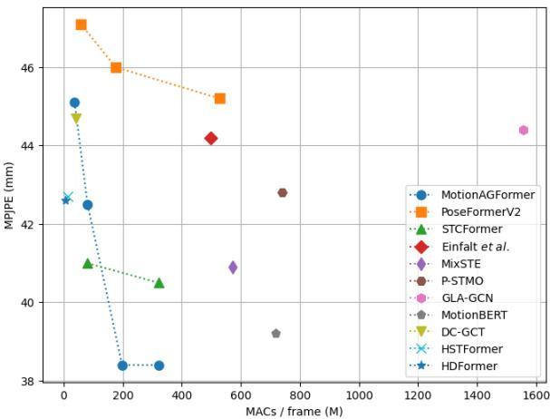  

图 1. 近期姿态提升（pose uplifting）方法在 Human3.6M [14] 上的比较（数值越低越好）。MACs/frame 表示每个输出帧的乘累加运算次数。所提出的 MotionAGFormer 提供了不同的变体，并在保持计算效率的同时取得了更优的结果。

Transformer 架构 [41] 最初是为自然语言处理（NLP）任务设计的，已被适配到各种计算机视觉问题中，包括人体姿态估计。其捕捉长程依赖的能力以及其内在的自注意力机制使其成为该领域一个有前景的候选方法。然而，仅依赖标准的 Transformer 所采用的全局注意力机制，对于姿态估计任务而言可能并非最优。人体运动天然具有局部空间和时间依赖结构。

一个主要的关注点是对随时间变化的骨架关系建模。现有方法主要依赖 Transformer 架构或基于图的模型。虽然 Transformer 擅长捕捉长期依赖关系，但图模型擅长捕捉局部依赖关系。因此，存在一种统一架构的机会，可以将 Transformer 的全局视角与图模型的局部精确性整合在一起。

此外，对实现最先进（State-of-the-Art, SOTA）精度的追求往往导致开发具有大量参数的日益复杂的模型。这类模型尽管精度良好，但在计算效率和快速响应至关重要的实际应用中往往变得不实用。此外，近期模型中一种主流方法是从一帧序列中仅预测中央帧的单个 3D 姿态。这种方法看似高效，但由于需要重复处理多个重叠序列，会带来计算冗余。因此，我们转而采用一种精简的推理策略以最优地利用序列数据。该方法通过在单次前向传播中预测输入的完整 3D 序列来最小化冗余。

在本文中，我们引入了 MotionAGFormer，一种专为 3D 人体姿态估计设计的 Transformer-图混合架构。其核心在于，MotionAGFormer 利用 Transformer 的力量捕捉全局信息，同时采用图卷积网络（Graph Convolutional Networks, GCNs）来整合局部空间和时间关系。我们采用自适应融合来聚合来自 Transformer 流和图流的特征。通过这样做，我们确保了对人体运动的平衡而全面的表示，从而在 3D 姿态估计中实现了更高的精度（见图 1）。

总之，本文的主要贡献如下：

• 新颖设计：我们提出了 MotionAGFormer 模型，其中引入了一个新的 GCNFormer 模块，该模块在表示人体姿态序列中固有的局部依赖关系方面表现出色。

• 高效性与灵活性：i) 我们的 MotionAGFormer 因其轻量化的特性以及相比以往 SOTA 方法参数更少、速度更快而脱颖而出，同时不牺牲精度。ii) 鉴于需求的多样性，我们提供 MotionAGFormer 的不同变体，使用户能够根据其特定需求在精度和速度之间做出平衡的选择。

- 最先进性能（State-of-the-Art, SOTA）：MotionAGFormer 在两个具有挑战性的数据集 Human3.6M 和 MPI-INF-3DHP 上取得了 SOTA 表现。

## 2. 相关工作

三维人体姿态估计（3D Human Pose Estimation）。当前解决该问题的方法可以从两个角度来理解。从一个角度看，模型可以根据输入视频进行分类，可以是多视角（multi-view）或单目（monocular）。依赖多视角输入的模型 [7, 15, 34, 35, 48] 需要同时使用来自不同角度的多台相机，这在实际场景中可行性较低。从另一个角度看，根据方法论，这些模型可以分为直接三维估计方法或二维到三维提升方法。直接三维估计方法 [31, 32, 39, 52] 从视频帧中无需任何中间步骤即可推断出三维坐标系中的关节点。受近年来精确的二维姿态估计模型的快速发展与广泛可用性启发，更多近期的二维到三维提升方法首先使用现成的二维姿态检测器 [4, 28, 38]，然后将二维坐标提升到三维空间 [40, 47, 50, 51, 53]。在本工作中，我们采用二维到三维提升方法，以单目视频作为输入。

基于 Transformer 的方法。Transformer [41] 在不同的视觉任务 [10, 37, 45, 54] 中已展现出令人瞩目的成果。在 3D 人体姿态估计领域，PoseFormer [51] 是首个纯粹基于 Transformer 的模型。PoseFormerV2 [50] 通过采用频域表示来提升计算效率，同时也使其对噪声数据中的突变动作具有更强的鲁棒性。MHFormer [20] 通过提出一个学习多个合理姿态假设的模块，解决了自遮挡与深度歧义问题。P-STMO [36] 提出了掩码姿态建模（masked pose modeling），并通过对模型进行自监督预训练来降低最终误差。Enfalt 等人 [11] 通过利用掩码令牌建模（masked token modeling）来降低计算复杂度。StridedFormer [19] 将 Transformer 编码器前馈网络中的全连接层替换为跨步卷积（strided convolutions），从而逐步缩减序列长度并高效地提升中心帧。与上述仅对序列中心帧估计 3D 姿态的模型不同，MixSTE [47] 为输入序列中的每一帧都提供了 3D 估计。STCFormer [40] 通过将相关性学习分离为空间和时间两个组成部分来降低计算复杂度。HSTFormer [33] 提出了层级式 Transformer 编码器，以更好地捕获时空相关性。除了常用的关节-关节（joint-joint）注意力之外，HDFormer [3] 还引入了骨骼-关节（bone-joint）和超骨骼-关节（hyperbone-joint）交互。一些工作利用输出的运动表示来完成多种任务。MotionBERT [53] 将为 3D 人体姿态估计任务所学习的模型进行微调，以应用于动作识别和 3D 人体网格恢复等任务，而 UPS [12] 则同时训练了一个统一的模型用于动作识别、3D 姿态估计和早期动作预测。

图卷积网络（Graph Convolutional Network）。基于 GCN 的方法在基于骨架的动作识别领域 [5, 18, 22] 已取得了显著成功。尽管它们在 3D 人体姿态估计 [6,8,42,49] 中具有较高的计算效率，但与基于 Transformer 的同类方法相比，它们通常无法展现出具有竞争力的误差。这主要是因为它们仅关注局部关节。最近，GLA-GCN [44] 提出了一种自适应的 GCN 方法以利用全局表示。通过采用跨步设计来缩减其时间范围，他们在保持更轻内存占用的同时，针对多种基于 Transformer 的模型取得了具有竞争力的 3D 人体姿态估计结果。然而，该所提出模块在提取全局表示方面的有效性仍不及注意力模块。

混合方法。这类方法使用不同的模块来捕捉输入序列的不同方面，目前尚未被广泛探索。最近，DC-GCT [16] 提出了基于 GCN 的局部约束模块，以及基于自注意力的全局约束模块，以同时利用输入序列的局部和全局依赖关系。然而，由于其模型被设计为同时处理单个输入帧与帧序列，它并未对时间维度与空间维度加以区分。因此，与基于 Transformer 的方法相比，它在取得有竞争力的结果方面存在不足。

## 3. 方法

## 3.1. 预备知识

本节我们首先回顾 MetaFormer [46] 的概念，它构成了我们编码器的核心。MetaFormer 可以被描述为 Transformer 架构 [41] 的一种推广形式，其中注意力模块被替换为任何能够在 token 之间转换信息的混合器。具体而言，对于输入 $\check { X } \in \mathbb { R } ^ { N \times C }$，其中 $N$ 表示 token 数量，$C$ 表示嵌入维度，token 混合器可以形式化地表示为

$$
Y = { \mathrm { T o k e n M i x e r } } ( { \mathrm { N o r m } } ( X ) ) + X ,\tag{1}
$$

其中 Norm(·) 表示一种归一化方法，例如批量归一化或层归一化 [1,13]，TokenMixer(·) 表示一个在 token 之间融合信息的模块。我们的方法使用两个并行的 token mixer：多头自注意力（Multi-head Self-Attention, MHSA）和图卷积网络（Graph Convolutional Networks, GCNs）[17]，它们各自对信息变换过程做出独特的贡献。

## 3.2. 总体架构

我们的目标是将一个 2D（像素坐标）骨架序列提升为精确的 3D 姿态序列。为此，我们提出了 MotionAGFormer 架构，它同时使用注意力（Transformer）和图卷积（GCNFormer）来提升运动序列。该架构的概览如图 2a 所示。

模型接收一个带置信度分数的 2D 输入序列 $\mathbf { X } \in \mathbb { R } ^ { T \times J \times 3 }$，其中 $T$ 和 $J$ 分别表示帧数和关节数。然后，它使用一个线性投影层将每一帧中的每个关节映射为一个 $d$ 维特征 $\mathbf { F } ^ { ( 0 ) } \in \mathbb { R } ^ { T \times J \times d }$。接着，将一个空间位置嵌入 $\mathbf { P _ { p o s } ^ { s } } \in \bar { \mathbb { R } ^ { 1 \times J \times d } }$ 加到这些 token 上。这里需要强调的是，我们的模型并未忽略时间 token 的顺序，因为该信息在 GCNFormer 流中得到了保留（详见消融实验 4.5 的进一步讨论）。

在位置嵌入之后，我们使用 N 个 AGFormer 块（第 3.3 节）来计算 $\mathbf { F } ^ { ( i ) } ~ \in ~ \mathbb { R } ^ { T \times J }$ ×d $( i \ = \ 1 , . . . , N )$，以有效捕捉骨架序列的底层 3D 结构。最后，我们通过应用一个线性层和 tanh 激活函数将 $\bar { \mathbf { F } } ^ { ( N ) }$ 映射到更高维度，以计算运动语义 $\mathbf { M } \in \dot { \mathbb { R } } ^ { T \times J \times d ^ { \prime } }$，并使用一个回归头来估计 3D 姿态 $\hat { \textbf { P } } \in \mathbb { R } ^ { T \times J \times 3 }$。提升损失包含位置 $\left( L _ { 3 D } \right)$ 和速度 $( L _ { \Delta \mathbf { P } } )$ 两项，定义如下：

$$
\begin{array} { r l } & { L _ { 3 D } = \Sigma _ { t = 1 } ^ { T } \Sigma _ { j = 1 } ^ { J } \Vert \hat { \mathbf { P } } _ { t , j } - \mathbf { P } _ { t , j } \Vert , } \\ & { L _ { \Delta \mathbf { P } } = \Sigma _ { t = 2 } ^ { T } \Sigma _ { j = 1 } ^ { J } \Vert \Delta \hat { \mathbf { P } } _ { t , j } - \Delta \mathbf { P } _ { t , j } \Vert , } \end{array}\tag{2}
$$

其中 $\Delta \hat { \mathbf P } _ { t } = \hat { \mathbf P } _ { t } - \hat { \mathbf P } _ { t - 1 } , \Delta \mathbf P _ { t } = \mathbf P _ { t } - \mathbf P _ { t - 1 }$。然后，总提升损失被定义为

$$
{ \cal L } = { \cal L } _ { 3 D } + \lambda _ { \Delta \mathbf { P } } { \cal L } _ { \Delta \mathbf { P } } ,\tag{3}
$$

其中常数系数 $\lambda _ { \Delta \mathbf { P } }$ 用于平衡位置精度与运动平滑度。

## 3.3. AGFormer 模块

AGFormer 模块采用双流架构。每个流由两个组件组成：空间 MetaFormer（图 2b）和时间 MetaFormer（图 2c）。空间 MetaFormer 将各个身体关节点视为不同的标记（token），从而有效捕捉单帧内的帧内关系（intra-frame relationships）。而时间 MetaFormer 则将每一帧视为单一标记，以此捕捉跨帧的帧间关系（inter-frame relationships）。两个流之间的关键区别在于其标记混合器（token mixer）类型。其中一个流使用 Transformer，另一个流则使用 GCNFormer。

Transformer 流。该流采用空间多头自注意力（Spatial Multi-Head Self-Attention，S-MHSA）来捕捉空间关系，随后使用时间多头自注意力（Temporal Multi-Head Self-Attention，T-MHSA）来捕捉时间关系。S-MHSA 定义为

$$
\begin{array} { r } { \mathrm { S } \mathrm { - } \mathbf { M H S A } ( \mathbf { Q _ { s } } , \mathbf { K _ { s } } , \mathbf { V _ { s } } ) = \mathrm { C o n c a t } ( \mathrm { h e a d _ { i } } , . . . , \mathrm { h e a d _ { h } } ) { \mathbf { W _ { s } } } ^ { ( O ) } , } \\ { \mathrm { h e a d _ { i } } = \mathrm { s o f t m a x } ( \frac { \mathbf { Q _ { s } } ^ { ( i ) } ( \mathbf { K _ { s } } ^ { ( i ) } ) ^ { T } } { \sqrt { d _ { k } } } ) \mathbf { V _ { s } } ^ { ( i ) } , } \end{array}\tag{4}
$$

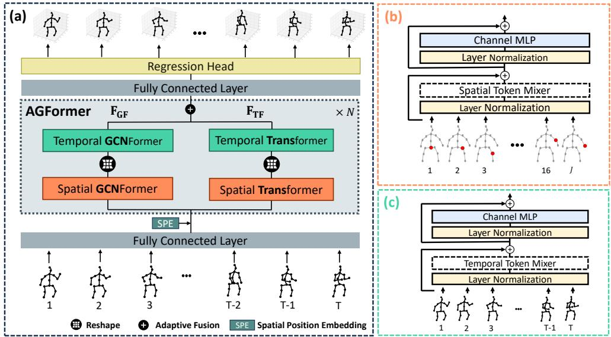  

图 2. (a) MotionAGFormer 是一种新颖的架构，包含 N 个双流时空块，其中一条流采用 Transformer，另一条流利用 GCNFormer。(b) 空间 MetaFormer。每个输入 token 表示人体的一个关节。(c) 时间 MetaFormer。输入 token 是姿态序列的帧。

其中 ${ \bf W _ { s } } ^ { ( O ) }$ 是一个投影参数矩阵，$h$ 是并行注意力头的数量，$d _ { k }$ 是 $\mathbf { K _ { s } }$ 的特征维度。为了计算查询矩阵 $\mathbf { Q _ { s } }$、键矩阵 $\mathbf { K _ { s } }$ 和值矩阵 $\mathbf { V _ { s } }.$，我们有

$$
\mathbf { Q _ { s } } ^ { i } = \mathbf { F _ { s } } \mathbf { W _ { s } } ^ { ( Q , i ) } , \mathbf { K _ { s } } ^ { i } = \mathbf { F _ { s } } \mathbf { W _ { s } } ^ { ( K , i ) } , \mathbf { V _ { s } } ^ { i } = \mathbf { F _ { s } } \mathbf { W _ { s } } ^ { ( V , i ) } ,\tag{5}
$$

其中 $\mathbf { F _ { s } } \in \mathbb { R } ^ { B T \times J \times d }$ 是空间特征，$\mathbf { W _ { s } } ^ { ( Q , i ) }$、$\mathbf { W _ { s } } ^ { ( K , i ) }$、$\mathbf { W _ { s } } ^ { ( V , i ) }$ 是投影矩阵，$B$ 是批量大小。S-MHSA 的输出随后被送入一个多层感知机（MLP），接着经过残差连接与层归一化（LayerNorm）处理。至此完成第一个 MetaFormer，即空间 Transformer（Spatial Transformer）。

接下来，我们将 $\mathbf { F _ { s } }$ 变形为 $\mathbf { F _ { T } } \in \mathbb { R } ^ { B J \times T \times d }$，以准备每个关节点的时间特征，作为 T-MHSA 的输入。这里我们有

$$
\begin{array} { r } { \mathrm { { T } - M H S A ( { \mathbf { Q } } _ { T } , { \mathbf { K } } _ { T } , { \mathbf { V } } _ { T } ) } = \mathrm { { C o n c a t } } ( \mathrm { { h e a d } } _ { \mathrm { { i } } } , . . . , \mathrm { { h e a d } _ { h } } ) { \mathbf { W } } _ { \mathbf { T } } { \mathbf { \Lambda } } ^ { ( O ) } , } \\ { \mathrm { { h e a d } } _ { \mathrm { { i } } } = \mathrm { { s o f t m a x } } ( \frac { { \mathbf { Q } } _ { \mathbf { T } } { \mathbf { \Lambda } } ^ { ( i ) } ( { \mathbf { K } } _ { \mathbf { T } } { \mathbf { \Lambda } } ^ { ( i ) } ) ^ { T } } { \sqrt { d _ { k } } } ) { \mathbf { V } } _ { \mathbf { T } } { \mathbf { \Lambda } } ^ { ( i ) } , } \end{array}\tag{6}
$$

其中 ${\bf Q}_T$、${\bf K}_T$ 和 ${\bf V}_T$ 的计算方式与公式 (5) 类似。

GCNFormer 流。与聚合全局信息的 Transformer 流不同，GCNFormer 流专注于骨架序列中存在的局部时空关系。尽管局部信息对 Transformer 也可用，但加入这条并行流使模型能够更有效地平衡局部信息与全局信息的整合（见消融分析 4.5）。我们 GCNFormer 中使用的定制化 GCN 模块 [24] 定义如下：

$$
G C N ( \mathbf { F } ^ { ( \mathbf { i } ) } ) = \sigma ( V ^ { l } + \mathrm { N o r m } ( \tilde { D } ^ { - \frac { 1 } { 2 } } \tilde { A } \tilde { D } ^ { - \frac { 1 } { 2 } } \mathbf { F } ^ { ( \mathbf { i } ) } W _ { 1 } + \mathbf { F } ^ { ( \mathbf { i } ) } W _ { 2 } ) .\tag{7}
$$

其中 $\tilde{A} = A + I_N$ 表示添加自连接后的邻接矩阵，$I_N$ 为单位矩阵，$\tilde{D}_{ii} = \Sigma_j \tilde{A}_{jj}$ 定义为 $\tilde{A}$ 对角线上元素之和，$W_1, W_2$ 表示各层特有的可训练权重矩阵。激活函数 $\sigma(\cdot)$（如 ReLU）将被施加，并配合批量归一化（Batch Normalization）[13]。GCN 的输出随后被送入一个 MLP，再经过残差连接和层归一化（LayerNorm）。

Spatial GCNFormer 与 Temporal GCNFormer 的区别在于其邻接矩阵与输入特征。输入特征与 Transformer 流的输入特征类似。在 Spatial GCNFormer 中，邻接矩阵表示人体拓扑结构（图 3a）。而在 Temporal GCNFormer 中，我们利用 $\text{Sim}(\ddot{F}_T^{t_i}, F_T^{t_j}) = (\ddot{F}_T^{t_i})^T F_T^{t_j}$ 计算单个关节在不同时间帧之间的相似度，并选取 K 个最近邻作为图中相连的节点（图 3b）。因此，Temporal GCNFormer 中的图拓扑由习得的节点特征所决定。

自适应融合（Adaptive Fusion）。与 MotionBERT [53] 类似，我们采用自适应融合来聚合 Transformer 与 GCNFormer 两路流所提取的特征。其定义如下：

$$
\mathbf { F } ^ { ( i ) } = \alpha _ { T F } { } ^ { ( i ) } \circ \mathbf { F } _ { \mathbf { T F } } { } ^ { ( i - 1 ) } + \alpha _ { G F } { } ^ { ( i ) } \circ \mathbf { F } _ { \mathbf { G F } } { } ^ { ( i - 1 ) } ,\tag{8}
$$

其中 $\mathbf{F}^{(i)}$ 表示在第 $i$ 层提取的特征嵌入（feature embedding），$\odot$ 表示逐元素乘法（element-wise multiplication），$\mathbf{F}_{TF}^{(i-1)}, \mathbf{F}_{GF}^{(i-1)}$ 分别表示在第 $i-1$ 层提取的 Transformer 流（Transformer stream）和 GCNFormer 流（GCNFormer stream）的特征。自适应融合权重 $\alpha_{TF}$ 和 $\alpha_{GF}$ 为

  

图 3. GCNFormer 模块拓扑结构。(a) 空间 GCN-Former（spatial GCN-Former）以人体骨骼作为其底层拓扑结构。(b) 时间 GCNFormer（temporal GCNFormer）使用 K 近邻（K-Nearest Neighbor, K-NN）算法，通过评估每个关节在整段时间范围内的最高相似度来确定连接边（如图中的左手腕和右脚踝）。经过 K 近邻处理后，每一行与 K 列相连。

被定义为（defined as）

$$
\alpha _ { T F } { } ^ { ( i ) } , \alpha _ { G F } { } ^ { ( i ) } = \mathrm { s o f t m a x } ( W \cdot \mathrm { C o n c a t } ( { \bf F } _ { { \bf T F } } { } ^ { ( i - 1 ) } , { \bf F } _ { { \bf G F } } { } ^ { ( i - 1 ) } ) ) ,\tag{9}
$$

其中 W 是一个可学习的线性变换。

## 4. 实验

我们在两个大规模 3D 人体姿态估计数据集上评估所提出的 Motion-AGFormer 的性能，即 Human3.6M [14] 和 MPI-INF-3DHP [25]。

## 4.1. 数据集与评估指标

Human3.6M 是一个广泛使用的室内 3D 人体姿态估计数据集。它包含 360 万帧视频帧，由 11 位受试者执行 15 种不同的日常活动。为确保公平评估，我们遵循标准方法，使用受试者 1、5、6、7 和 8 的数据训练模型，然后在受试者 9 和 11 的数据上进行测试。遵循先前的工作 [40, 50]，我们使用两种评估协议。第一个协议（记为 P1）使用平均关节位置误差（Mean Per Joint Position Error, MPJPE），以毫米为单位，在对齐其根关节（骶骨）后度量估计姿态与真实姿态之间的误差。第二个协议（记为 P2）度量 Procrustes-MPJPE，其中真实姿态与估计姿态通过刚性变换进行对齐。

MPI-INF-3DHP 是另一个大规模数据集，在三种不同设置下采集：绿幕、非绿幕和室外环境。遵循先前的工作 [40, 50]，将平均关节位置误差（MPJPE）、正确关键点百分比（Percentage of Correct Keypoint, PC）（在 150 mm 阈值范围内）以及曲线下面积（Area Under the Curve, AUC）作为评估指标。

## 4.2. 实现细节

模型变体。我们构建了模型的四种不同配置，如表 1 所概述。我们的基础模型，称为 MotionAGFormer-B，在准确估计与计算成本之间取得了平衡。其余变体根据其参数规模和计算需求进行命名，每个变体的选择可基于应用需求，例如在实时处理或更精确的估计之间进行选择。运动语义维度为 $d ^ { \prime } = 5 1 2$ ，每个 MLP 的扩展层为 $\alpha = 4 ,$ 注意力头数为 $h = 8 ,$ ，GCNformer 流中的时间邻居数为 $k = 2 .$ ，所有实验均采用上述设置。

表 1. MotionAGFormer 模型变体的详细信息。N：层数。d：隐藏层大小。T：输入帧数。

<table><tr><td>Method</td><td>N</td><td>d</td><td>T</td><td>Params</td><td>MACs</td></tr><tr><td>MotionAGFormer-XS</td><td>12</td><td>64</td><td>27</td><td>2.2 M</td><td>1.0 G</td></tr><tr><td>MotionAGFormer-S</td><td>26</td><td>64</td><td>81</td><td>4.8M</td><td>6.6 G</td></tr><tr><td>MotionAGFormer-B</td><td>16</td><td>128</td><td>243</td><td>11.7 M</td><td>48.3 G</td></tr><tr><td>MotionAGFormer-L</td><td>26</td><td>128</td><td>243</td><td>19.0 M</td><td>78.3 G</td></tr></table>

实验设置。我们的模型使用 PyTorch [30] 实现，并在配备两块 NVIDIA A40 GPU 的设备上运行。我们沿用 [50, 53] 的方法，在训练和测试阶段均采用水平翻转数据增强。在模型训练方面，我们将每个 mini-batch 设为 16 个序列。网络参数使用 AdamW [23] 优化器进行优化，共训练 90 个 epoch，权重衰减设为 0.01。初始学习率设为 5e-4，采用指数学习率衰减策略，衰减因子为 0.99。在 Human3.6M 数据集上，我们沿用 [53] 的方法，使用 Stacked Hourglass [29] 的 2D 姿态检测结果与 2D 真值。对于 MPI-INF-3DHP 数据集，沿用对比基线方法 [40, 50] 中类似的做法，采用 2D 真值标注。

## 4.3. 在 Human3.6M 上的性能对比

我们在 Human3.6M 数据集上将 MotionAGFormer 与其他模型进行了对比。为了保证公平比较，仅纳入了未在额外数据上进行预训练的模型结果。如表 2 所示，结果表明 MotionAGFormer-L 在估计的 2D 姿态下取得了 38.4 mm 的 P1 误差，在 2D 真值姿态下取得了 17.3 mm 的 P1 误差。值得注意的是，与此前的 SOTA 方法（MotionBERT [53]）相比，MotionAGFormer-L 在计算量和参数量均约为其一半的情况下，仍分别将精度提高了 0.8 mm 和 0.5 mm。在对比 Base 与 Large 变体时可以发现，MotionAGFormer-L 在存在噪声数据的情况下与 MotionAGFormer-B 具有相同的 P1 误差，而在使用 2D 真值数据时，误差则下降了 2.1 mm。此外，

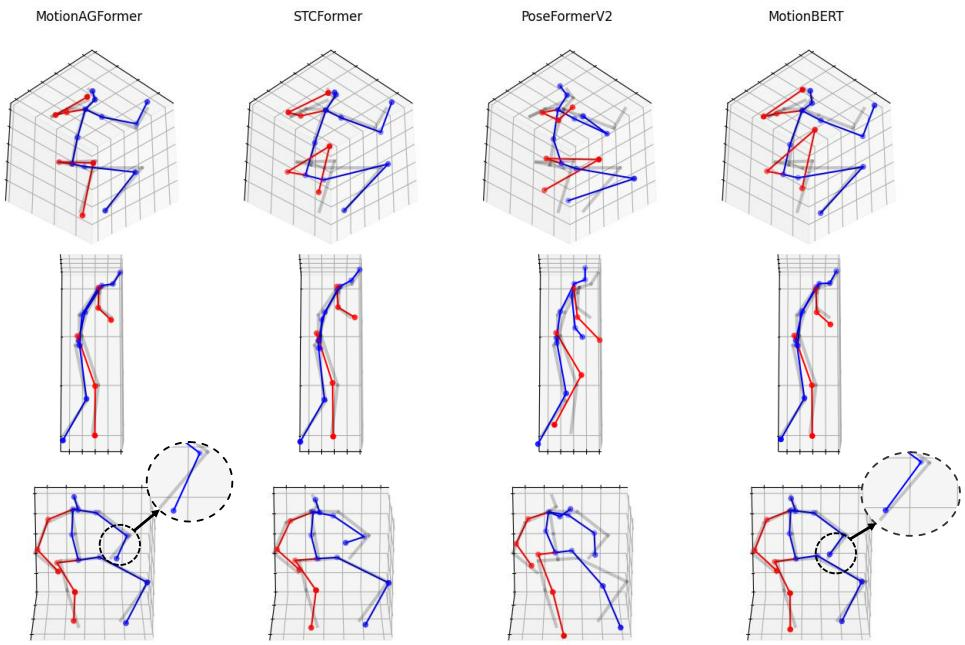  

(a)  
(b)  
(c)  
图 4. MotionAGFormer 与 STCformer [40]、PoseFormerV2 [50] 和 MotionBERT [53] 的定性比较。半透明的灰色骨架为真实 3D 姿态，蓝色表示躯干及身体左侧部分，红色表示估计身体的右侧部分。

表 2：在 Human3.6M 上的定量比较。T：输入帧数。CE：仅估计中心帧。P1：MPJPE 误差（mm）。P2：P-MPJPE 误差（mm）。P1†：基于二维真值的 P1 误差。（\*）表示使用 HRNet [38] 进行二维姿态估计。最佳与次佳分数分别以粗体和下划线标出。各动作的详细结果请参阅补充材料。

<table><tr><td>Method</td><td>T</td><td>CE</td><td>Param</td><td>MACs</td><td>MACs/frame</td><td>P1↓/P2↓</td><td>P1†↓</td></tr><tr><td>*MHFormer [20] CVPR&#x27;22</td><td>351</td><td>√</td><td>30.9 M</td><td>7.0 G</td><td>7,096M</td><td>43.0/34.4</td><td>30.5</td></tr><tr><td>MixSTE [47] CVPR’22</td><td>243</td><td>X</td><td>33.6 M</td><td>139.0 G</td><td>572M</td><td>40.9/32.6</td><td>21.6</td></tr><tr><td>P-STMO [36] ECCV’22</td><td>243</td><td>√</td><td>6.2 M</td><td>0.7 G</td><td>740 M</td><td>42.8/34.4</td><td>29.3</td></tr><tr><td>Stridedformer [19] TMM&#x27;22</td><td>351</td><td>√</td><td>4.0 M</td><td>0.8 G</td><td>801 M</td><td>43.7/35.2</td><td>28.5</td></tr><tr><td>Einfalt et al. [11] WACV&#x27;23</td><td>351</td><td>√</td><td>10.4 M</td><td>0.5 G</td><td>498M</td><td>44.2/35.7</td><td></td></tr><tr><td>STCFormer [40] CVPR’23</td><td>243</td><td>X</td><td>4.7 M</td><td>19.6 G</td><td>80 M</td><td>41.0/32.0</td><td>21.3</td></tr><tr><td>STCFormer-L [40] CVPR’23</td><td>243</td><td>X</td><td>18.9 M</td><td>78.2 G</td><td>321 M</td><td>40.5/31.8</td><td></td></tr><tr><td>PoseFormerV2 [50] CVPR’23</td><td>243</td><td>√</td><td>14.3 M</td><td>0.5 G</td><td>528M</td><td>45.2/35.6</td><td></td></tr><tr><td>UPS [12] CVPR’23</td><td>243</td><td>√</td><td></td><td></td><td></td><td>40.8/32.5</td><td></td></tr><tr><td>GLA-GCN [44] ICCV’23</td><td>243</td><td>√</td><td>1.3 M</td><td>1.5 G</td><td>1,556 M</td><td>44.4/34.8</td><td>21.0</td></tr><tr><td>MotionBERT [53] ICCV&#x27;23</td><td>243</td><td>X</td><td>42.5 M</td><td>174.7 G</td><td>719 M</td><td>39.2/32.9</td><td>17.8</td></tr><tr><td>HDFormer [3] IJCAI&#x27;23</td><td>96</td><td>X</td><td>3.7 M</td><td>0.6 G</td><td>6M</td><td>42.6/33.1</td><td>21.6</td></tr><tr><td>HSTFormer [33] arXiv&#x27;23</td><td>81</td><td>X</td><td>22.7 M</td><td>1.0 G</td><td>13M</td><td>42.7/33.7</td><td>27.8</td></tr><tr><td>DC-GCT [16] arXiv&#x27;23</td><td>81</td><td>√</td><td>3.1 M</td><td>41 M</td><td>41 M</td><td>44.71-</td><td></td></tr><tr><td>MotionAGFormer-XS</td><td>27</td><td>X</td><td>2.2 M</td><td>1.0 G</td><td>37M</td><td>45.1/36.9</td><td>28.1</td></tr><tr><td>MotionAGFormer-S</td><td>81</td><td>X</td><td>4.8M</td><td>6.6 G</td><td>81 M</td><td>42.5/35.3</td><td>26.5</td></tr><tr><td>MotionAGFormer-B</td><td>243</td><td>X</td><td>11.7 M</td><td>48.3 G</td><td>198 M</td><td>38.4/32.6</td><td>19.4</td></tr><tr><td>MotionAGFormer-L</td><td>243</td><td>X</td><td>19.0 M</td><td>78.3 G</td><td>322 M</td><td>38.4/32.5</td><td>17.3</td></tr></table>

MotionAGFormer-S 相比基线方法仅输入三分之一的帧数，却仍能在 P1 误差上超越其中大多数方法。同样地，MotionAGFormer-XS 的性能与 PoseTransformerV2 相当，尽管其输入信息量仅为其九分之一（27 帧 vs. 243 帧），参数量也少了约七倍。

## 4.4. 在 MPI-INF-3DHP 上的性能对比

在 MPI-INF-3DHP 数据集上评估我们的方法时，由于视频序列较短，我们将 base 和 large 变体修改为使用 81 帧。在所有变体中，我们的方法在 MPJPE 指标上始终优于其他方法。值得注意的是，large 变体以 85.3% 的 AUC 和 16.2 mm 的 P1 误差取得了卓越结果，在 AUC 上以 1.4%、在 P1 误差上以 6.9 mm 的显著优势超越最佳模型。然而，其 PCK 为 98.2%，比对比模型的 PCK 性能低 0.5%（表 3）。

表 3. 在 MPI-INF-3DHP 上的定量对比。T：输入帧数。最佳和次佳分数分别以粗体和下划线标示。

<table><tr><td>Method</td><td>T</td><td>PCK↑ AUC↑</td><td>MPJPE↓</td></tr><tr><td>MHFormer [20]</td><td>9</td><td>93.8 94.4</td><td>63.3 58.0</td></tr><tr><td>MixSTE [47] P-STMO [36]</td><td>27 81</td><td>66.5 75.8</td><td>54.9 32.2</td></tr><tr><td>Einfalt et al. [11]</td><td>81</td><td>97.9 95.4 67.6</td><td>46.9</td></tr><tr><td>STCFormer [40]</td><td>81</td><td>98.7 83.9</td><td>23.1</td></tr><tr><td>PoseFormerV2 [50]</td><td></td><td></td><td></td></tr><tr><td></td><td>81</td><td>97.9 78.8</td><td>27.8</td></tr><tr><td>GLA-GCN [44]</td><td>81</td><td>98.5 79.1</td><td>27.7</td></tr><tr><td>HSTFormer [33]</td><td>81</td><td>97.3 71.5</td><td>41.4</td></tr><tr><td>HDFormer [3]</td><td>96</td><td>98.7 72.9</td><td>37.2</td></tr><tr><td>MotionAGFormer-XS</td><td>27</td><td>98.2 83.5</td><td>19.2</td></tr><tr><td>MotionAGFormer-S</td><td>81</td><td>98.3 84.5</td><td>17.1</td></tr><tr><td>MotionAGFormer-B</td><td>81</td><td>98.3 84.2</td><td>18.2</td></tr><tr><td>MotionAGFormer-L</td><td>81</td><td>98.2 85.3</td><td>16.2</td></tr></table>

4.5. 消融研究

一系列消融研究在 Human3.6M 数据集上进行，以探索 AGFormer 块的不同设计选择。

初始的消融研究探讨了 AGFormer 块的数量和模型宽度对 P1 误差的影响。如表 4 所示，趋势总体上倾向于采用更深但更窄的模型。有趣的是，一个具有 16 个 AGFormer 块且宽度为 128 的模型与一个具有 12 个 AGFormer 块且宽度为 256 的模型表现出相近的性能，而前者使用的内存和计算资源大约是后者的三分之一。

消融研究的第二部分探讨了 AGFormer 块中图流（graph stream）的替代模块。结果如表 5 所示。从 GCNFormer 切换到 GCN 块会使 P1 误差增加 0.7 mm。类似地，将时间 GCNFormer（Temporal GCNFormer）替换为 TCN，在使用 GCN 时 P1 误差增加 0.2 mm，在使用 GCNFormer 时增加 0.9 mm。最后，将 GCN 替换为 CTR-GCN [5] 会使 P1 误差增加 2.5 mm。我们假设这是因为 CTR-GCN 在训练过程中对每个通道的拓扑结构进行了持续的细化。因此，每个关节不仅从其直接相邻关节获取信息，还从所有其他关节获取信息。这阻碍了为 Transformer 流生成互补信息。

为了探索位置嵌入对最终性能的影响，我们进行了如表 6 所示的一系列实验。令人惊讶的是，在空间位置嵌入之外加入时间位置嵌入会使 P1 误差增加 0.6 mm。如第 3.2 节所述，这一结果源于 GCNFormer 流的非置换等变性（non-permutation equivariant）。与 Transformer 不同，我们的网络固有地维护着帧的时间顺序。但是，如图 5 所示，与仅使用空间位置嵌入（0.94 mm）相比，加入时间位置嵌入会带来更好的加速度误差（0.88 mm）。

最后，为了验证所提出的 AGFormer 块的有效性，表 7 展示了替代块。使用 GCNFormer 时，观察到的 P1 误差为 57.5 mm，这表明其准确捕捉底层 3D 序列结构的能力有限。然而，一种涉及 GCNFormer 和 Transformer 的混合方法带来了显著的改进，与单独使用 Transformer 相比，P1 误差减少了 5.2 mm。此外，这两个模块的串行融合不如它们的并行集成有效。

表 4. 通过改变 AG-Former 块数量和通道数进行的 P1 误差比较。d：每个 AGFormer 块中的通道数。d′：回归头之前的通道数。在所有实验中 T 保持为 243。

<table><tr><td>Layers</td><td> $d$ </td><td> $\overline { { d ^ { \prime } } }$ </td><td>Param</td><td>MACs</td><td>P1</td></tr><tr><td>5</td><td>512</td><td>512</td><td>58M</td><td>252.8 G</td><td>39.2</td></tr><tr><td>4</td><td>256</td><td>512</td><td>11.7 M</td><td>54.G G</td><td>40.2</td></tr><tr><td>6</td><td>256</td><td>512</td><td>17.5 M</td><td>81.64 G</td><td>39.6</td></tr><tr><td>8</td><td>256</td><td>512</td><td>23.3 M</td><td>108.6 G</td><td>39.5</td></tr><tr><td>10</td><td>256</td><td>512</td><td>29.1 M</td><td>135.7 G</td><td>38.6</td></tr><tr><td>12</td><td>256</td><td>512</td><td>34.9 M</td><td>162.7 G</td><td>38.4</td></tr><tr><td>14</td><td>256</td><td>512</td><td>40.7 M</td><td>189.7 G</td><td>38.6</td></tr><tr><td>16</td><td>128</td><td>512</td><td>11.7 M</td><td>64.7 G</td><td>38.4</td></tr><tr><td>16</td><td>128</td><td>256</td><td>11.7 M</td><td>64.5 G</td><td>38.7</td></tr><tr><td>16</td><td>128</td><td>1024</td><td>11.7 M</td><td>64.9 G</td><td>39.2</td></tr><tr><td>26</td><td>64</td><td>512</td><td>4.8M</td><td>39.5 G</td><td>39.5</td></tr></table>

表 5. 在 AGFormer 块的图流中使用替代模块时的 P1 误差比较。

<table><tr><td>GCN</td><td>TCN</td><td>GCNFormer</td><td>CTR-GCNFormer</td><td>P1</td></tr><tr><td>√</td><td>-</td><td>1</td><td>1</td><td>39.1</td></tr><tr><td>√</td><td>√</td><td>-</td><td>1</td><td>39.3</td></tr><tr><td>1</td><td>√</td><td>√</td><td>-</td><td>39.7</td></tr><tr><td>-</td><td>1</td><td>-</td><td>√</td><td>40.9</td></tr><tr><td>-</td><td>一</td><td>√</td><td>-</td><td>38.4</td></tr></table>

## 4.6. 定性分析（Qualitative Analysis）

MotionAGFormer-B 的验证通过使用时序 GCNFormer 的邻接矩阵以及三维人体姿态估计的可视化来进行。用于验证的实例从 Human3.6M 的评估集中随机选取。

  

图 5. 使用不同类型位置嵌入（positional embedding）时的加速度误差。使用时间位置嵌入（temporal positional embedding）可获得 0.88 毫米的误差，且相比空间位置嵌入（spatial positional embedding）、不使用嵌入以及同时使用两种嵌入的方法收敛更快，后三者分别达到 0.94 毫米、0.90 毫米和 0.97 毫米。

定性比较。图 4 将 MotionAGFormer-B 与近期方法进行了对比，包括 STCFormer [40]、PoseFormerV2 [50] 和 Motion-BERT [53]。根据设计，2D 检测器的置信度分数仅被纳入 MotionBERT 和 MotionAGFormer-B。总体而言，MotionAGFormer-B 在所有三个样本上的重建结果均优于 PoseFormerV2 和 STCFormer，同时保持与 MotionBERT 相当的性能。具体而言，在图 4a 中，MotionAG-Former 与其他方法相比展现出与真值更优的对齐；在图 4b 中，其对齐略优；而在图 4c 中，其对齐略逊于 Motion-BERT。

时序邻接可视化。时序 GCNFormer 的邻接矩阵在图 6 中可视化。在初始层中，各个关节呈现出不同的邻接矩阵，由于关节位置随时间变化，这些矩阵在不同序列间应有所差异。然而，随着模型深度的推进，它似乎学习到一种表示，其中每个关节最接近其在相邻帧中的自身状态。因此，这导致了与相邻帧之间形成连接。

## 5. 结论

我们提出了 MotionAGFormer，这是一种利用 GCNFormer 捕获复杂局部关节关系，并将其与有效捕获全局关节相互依赖关系的 Transformer 相结合的新方法。这种融合增强了模型理解输入 2D 序列中固有 3D 结构的能力。此外，Motion-AGFormer 提供了多种可适应的变体，允许在速度和精度之间选择最优平衡。实证评估表明，我们的方法在 Human3.6M 和 MPI-INF-3DHP 上超越了其他方法。

  

图 6. Human3.6M 数据集中一条随机序列在三个不同关节上的时间邻接矩阵，分别位于第一层（左侧）、中间层（中部）和最后一层（右侧）。K-NN 中的 K 设为 2。

表 6. 使用不同位置嵌入时的 P1 误差比较。

<table><tr><td>Temporal Embedding</td><td>Spatial Embedding</td><td>P1</td></tr><tr><td>1</td><td>-</td><td>39.3</td></tr><tr><td>-</td><td>√</td><td>38.4</td></tr><tr><td>√</td><td>-</td><td>38.9</td></tr><tr><td>√</td><td>√</td><td>40.5</td></tr></table>

表 7. 不同 MetaFormer 集成的对比。所有模型均使用我们的 MotionAGFormer-B 配置在 Human3.6M 上训练。

<table><tr><td>Method</td><td>P1</td></tr><tr><td>GCNFormer only</td><td>57.5</td></tr><tr><td>Transformer only</td><td>43.6</td></tr><tr><td>GCNFormer → Transformer (Sequential)</td><td>39.1</td></tr><tr><td>Transformer → GCNFormer (Sequential)</td><td>38.9</td></tr><tr><td>Transformer - GCNFormer (Parallel)</td><td>38.4</td></tr></table>

## 参考文献

[1] Jimmy Lei Ba, Jamie Ryan Kiros, and Geoffrey E Hinton. 层归一化（Layer normalization）. arXiv 预印本 arXiv:1607.06450，2016. 3

[2] Peter Bauer, Arij Bouazizi, Ulrich Kressel, and Fabian B Flohr. 面向自动驾驶的弱监督多模态三维人体姿态估计（Weakly supervised multi-modal 3d human body pose estimation for autonomous driving）. 发表于 2023 年 IEEE 智能车辆研讨会（IV），第 1–7 页。IEEE，2023. 1

[4] Yilun Chen, Zhicheng Wang, Yuxiang Peng, Zhiqiang Zhang, Gang Yu, and Jian Sun. 用于多人姿态估计的级联金字塔网络（Cascaded pyramid network for multi-person pose estimation）. 发表于 IEEE 计算机视觉与模式识别会议论文集，第 7103–7112 页，2018. 2

[5] Yuxin Chen, Ziqi Zhang, Chunfeng Yuan, Bing Li, Ying Deng, and Weiming Hu. 面向基于骨架的动作识别的逐通道拓扑细化图卷积（Channel-wise topology refinement graph convolution for skeleton-based action recognition）. 发表于 IEEE/CVF 国际计算机视觉会议论文集，第 13359–13368 页，2021. 3, 7

[6] Hongsuk Choi, Gyeongsik Moon, and Kyoung Mu Lee. Pose2Mesh：用于从二维人体姿态恢复三维人体姿态与网格的图卷积网络（Pose2Mesh: Graph convolutional network for 3d human pose and mesh recovery from a 2d human pose）. 发表于 计算机视觉–ECCV 2020：第 16 届欧洲会议，英国格拉斯哥，2020 年 8 月 23–28 日，论文集第七部分，第 769–787 页。Springer，2020. 3

[7] Sungho Chun, Sungbum Park, and Ju Yong Chang. 用于三维人体姿态与形状估计的可学习人体网格三角剖分（Learnable human mesh triangulation for 3d human pose and shape estimation）. 发表于 IEEE/CVF 计算机视觉应用冬季会议论文集，第 2850–2859 页，2023. 2

[8] Hai Ci, Chunyu Wang, Xiaoxuan Ma, and Yizhou Wang. 面向三维人体姿态估计的网络结构优化（Optimizing network structure for 3d human pose estimation）. 发表于 IEEE/CVF 国际计算机视觉会议论文集，第 2262–2271 页，2019. 3

[9] Phillip Czech, Markus Braun, Ulrich Kreßel, and Bin Yang. 使用行为特征的在线行人轨迹预测（On-board pedestrian trajectory prediction using behavioral features）. 发表于 2022 年第 21 届 IEEE 机器学习与应用国际会议（ICMLA），第 437–443 页。IEEE，2022. 1

[11] Moritz Einfalt, Katja Ludwig, and Rainer Lienhart. 提升与上采样：使用 Uplifting Transformer 的高效三维人体姿态估计（Uplift and upsample: Efficient 3d human pose estimation with uplifting transformers）. 发表于 IEEE/CVF 计算机视觉应用冬季会议（WACV）论文集，2023 年 1 月. 2, 6, 7, 12

[12] Lin Geng Foo, Tianjiao Li, Hossein Rahmani, Qiuhong Ke, and Jun Liu. 统一的姿态序列建模（Unified pose sequence modeling）. 发表于 IEEE/CVF 计算机视觉与模式识别会议论文集，第 13019–13030 页，2023. 2, 6, 12

[13] Sergey Ioffe and Christian Szegedy. 批量归一化（Batch Normalization）：通过减少内部协变量偏移加速深度网络训练（Accelerating Deep Network Training by Reducing Internal Covariate Shift）。发表于 International Conference on Machine Learning，第 448–456 页，pmlr，2015 年。3, 4

[14] Catalin Ionescu、Dragos Papava、Vlad Olaru 和 Cristian Sminchisescu. Human3.6m：用于自然环境中三维人体感知的大规模数据集与预测方法（Human3. 6m: Large Scale Datasets and Predictive Methods for 3D Human Sensing in Natural Environments）。IEEE 模式分析与机器智能汇刊（IEEE Transactions on Pattern Analysis and Machine Intelligence），第 36 卷第 7 期，第 1325–1339 页，2013 年。1, 5

[15] Karim Iskakov、Egor Burkov、Victor Lempitsky 和 Yury Malkov. 人体姿态的可学习三角化方法（Learnable Triangulation of Human Pose）。发表于 IEEE/CVF 国际计算机视觉会议论文集（Proceedings of the IEEE/CVF International Conference on Computer Vision），第 7718–7727 页，2019 年。2

[16] Hongbo Kang、Yong Wang、Mengyuan Liu、Doudou Wu、Peng Liu 和 Wenming Yang. 图像与视频中三维人体姿态估计的双链约束方法（Double-Chain Constraints for 3D Human Pose Estimation in Images and Videos）。arXiv 预印本 arXiv:2308.05298，2023 年。3, 6

[17] Thomas N Kipf 和 Max Welling. 基于图卷积网络的半监督分类（Semi-Supervised Classification with Graph Convolutional Networks）。arXiv 预印本 arXiv:1609.02907，2016 年。3

[18] Jungho Lee、Minhyeok Lee、Dogyoon Lee 和 Sangyoun Lee. 用于基于骨架动作识别的层次分解图卷积网络（Hierarchically Decomposed Graph Convolutional Networks for Skeleton-Based Action Recognition）。arXiv 预印本 arXiv:2208.10741，2022 年。3

[19] Wenhao Li、Hong Liu、Runwei Ding、Mengyuan Liu、Pichao Wang 和 Wenming Yang. 利用带步幅 Transformer 挖掘时间上下文以进行三维人体姿态估计（Exploiting Temporal Contexts with Strided Transformer for 3D Human Pose Estimation）。IEEE 多媒体汇刊（IEEE Transactions on Multimedia），第 25 卷，第 1282–1293 页，2022 年。2, 6, 12

[20] Wenhao Li、Hong Liu、Hao Tang、Pichao Wang 和 Luc Van Gool. MHFormer：用于三维人体姿态估计的多假设 Transformer（Multi-Hypothesis Transformer for 3D Human Pose Estimation）。发表于 IEEE/CVF 计算机视觉与模式识别会议论文集（Proceedings of the IEEE/CVF Conference on Computer Vision and Pattern Recognition, CVPR），第 13147–13156 页，2022 年。2, 6, 7, 12

[21] Huei-Yung Lin 和 Ting-Wen Chen. 基于单目三维姿态估计的人体交互增强现实（Augmented Reality with Human Body Interaction Based on Monocular 3D Pose Estimation）。发表于 International Conference on Advanced Concepts for Intelligent Vision Systems，第 321–331 页，Springer，2010 年。1

[22] Ziyu Liu、Hongwen Zhang、Zhenghao Chen、Zhiyong Wang 和 Wanli Ouyang. 基于骨架动作识别中图卷积的解耦与统一（Disentangling and Unifying Graph Convolutions for Skeleton-Based Action Recognition）。发表于 IEEE/CVF 计算机视觉与模式识别会议论文集（Proceedings of the IEEE/CVF Conference on Computer Vision and Pattern Recognition），第 143–152 页，2020 年。3

[23] Ilya Loshchilov 和 Frank Hutter. 解耦的权重衰减正则化方法（Decoupled Weight Decay Regularization）。arXiv 预印本 arXiv:1711.05101，2017 年。5

[24] Cheng Luo、Siyang Song、Weicheng Xie、Linlin Shen 和 Hatice Gunes. 学习基于多维边缘特征的面部动作单元关系图用于面部动作单元识别（Learning Multi-Dimensional Edge Feature-Based AU Relation Graph for Facial Action Unit Recognition）。arXiv 预印本 arXiv:2205.01782，2022 年。4

[25] Dushyant Mehta、Helge Rhodin、Dan Casas、Pascal Fua、Oleksandr Sotnychenko、Weipeng Xu 和 Christian Theobalt. 利用改进的 CNN 监督在野外进行单目三维人体姿态估计（Monocular 3D Human Pose Estimation in the Wild Using Improved CNN Supervision）。发表于 2017 年国际三维视觉会议（2017 International Conference on 3D Vision, 3DV），第 506–516 页，IEEE，2017 年。5

[26] Dushyant Mehta、Srinath Sridhar、Oleksandr Sotnychenko、Helge Rhodin、Mohammad Shafiei、Hans-Peter Seidel，

Weipeng Xu, Dan Casas, and Christian Theobalt. VNect: Real-time 3d human pose estimation with a single rgb camera. ACM Transactions on Graphics (TOG), 36(4):1–14, 2017. 1

[27] Tewodros Legesse Munea, Yalew Zelalem Jembre, Halefom Tekle Weldegebriel, Longbiao Chen, Chenxi Huang, and Chenhui Yang. 人体姿态估计的进展：应用于二维人体姿态估计模型的综述与分类. IEEE Access, 8:133330–133348, 2020. 1

[28] Alejandro Newell, Kaiyu Yang, and Jia Deng. 堆叠沙漏网络用于人体姿态估计. 发表于：计算机视觉–ECCV 2016：第14届欧洲会议，荷兰阿姆斯特丹，2016年10月11–14日，会议论文集，第八部分 14，第483–499页。施普林格（Springer），2016年。 2

[29] Alejandro Newell, Kaiyu Yang, and Jia Deng. 堆叠沙漏网络用于人体姿态估计. 发表于：计算机视觉–ECCV 2016：第14届欧洲会议，荷兰阿姆斯特丹，2016年10月11–14日，会议论文集，第八部分 14，第483–499页。施普林格（Springer），2016年。 5

[31] Georgios Pavlakos, Xiaowei Zhou, and Kostas Daniilidis. 用于三维人体姿态估计的序数深度监督. 发表于：IEEE 计算机视觉与模式识别会议论文集，第7307–7316页，2018年。 2

[32] Georgios Pavlakos, Xiaowei Zhou, Konstantinos G Derpanis, and Kostas Daniilidis. 单图像三维人体姿态的由粗到精体素预测. 发表于：IEEE 计算机视觉与模式识别会议论文集，第7025–7034页，2017年。 2

[33] Xiaoye Qian, Youbao Tang, Ning Zhang, Mei Han, Jing Xiao, Ming-Chun Huang, and Ruei-Sung Lin. HSTFormer：用于三维人体姿态估计的分层时空变换器. arXiv 预印本 arXiv:2301.07322，2023年。 2, 6, 7, 12

[34] N Dinesh Reddy, Laurent Guigues, Leonid Pishchulin, Jayan Eledath, and Srinivasa G Narasimhan. TesseTrack：端到端可学习的多人铰接式三维姿态跟踪. 发表于：IEEE/CVF 计算机视觉与模式识别会议论文集，第15190–15200页，2021年。 2

[35] Edoardo Remelli, Shangchen Han, Sina Honari, Pascal Fua, and Robert Wang. 通过相机解耦表示的轻量级多视图三维姿态估计. 发表于：IEEE/CVF 计算机视觉与模式识别会议论文集，第6040–6049页，2020年。 2

[36] Wenkang Shan, Zhenhua Liu, Xinfeng Zhang, Shanshe Wang, Siwei Ma, and Wen Gao. P-STMO：用于三维人体姿态估计的预训练时空多对一模型. 发表于：计算机视觉–ECCV 2022：第17届欧洲会议，以色列特拉维夫，2022年10月23–27日，会议论文集，第五部分，第461–478页。施普林格（Springer），2022年。 2, 6, 7, 12

[37] Weijie Su, Xizhou Zhu, Chenxin Tao, Lewei Lu, Bin Li, Gao Huang, Yu Qiao, Xiaogang Wang, Jie Zhou, and Jifeng Dai. 通过最大化多模态互信息迈向一体化预训练（Towards all-in-one pre-training via maximizing multi-modal mutual information）。载于：IEEE/CVF 计算机视觉与模式识别会议论文集，第 15888–15899 页，2023 年。2

[38] Ke Sun, Bin Xiao, Dong Liu, and Jingdong Wang. 用于人体姿态估计的深度高分辨率表征学习（Deep high-resolution representation learning for human pose estimation）。载于：IEEE/CVF 计算机视觉与模式识别会议论文集，第 5693–5703 页，2019 年。2, 6, 12

[39] Xiao Sun, Bin Xiao, Fangyin Wei, Shuang Liang, and Yichen Wei. 积分人体姿态回归（Integral human pose regression）。载于：欧洲计算机视觉会议（ECCV）论文集，第 529–545 页，2018 年。2

[40] Zhenhua Tang, Zhaofan Qiu, Yanbin Hao, Richang Hong, and Ting Yao. 基于时空交叉注意力机制的 3D 人体姿态估计（3D human pose estimation with spatiotemporal criss-cross attention）。载于：IEEE/CVF 计算机视觉与模式识别会议论文集，第 4790–4799 页，2023 年。2, 5, 6, 7, 8, 12, 13

[41] Ashish Vaswani, Noam Shazeer, Niki Parmar, Jakob Uszkoreit, Llion Jones, Aidan N Gomez, Łukasz Kaiser, and Illia Polosukhin. 注意力机制就是你所需的一切（Attention is all you need）。神经信息处理系统进展，第 30 卷，2017 年。1, 2, 3

[42] Jingbo Wang, Sijie Yan, Yuanjun Xiong, and Dahua Lin. 基于运动引导的视频 3D 姿态估计（Motion guided 3d pose estimation from videos）。载于：欧洲计算机视觉会议，第 764–780 页。Springer，2020 年。3

[43] Julian Wiederer, Arij Bouazizi, Ulrich Kressel, and Vasileios Belagiannis. 用于自动驾驶车辆的交通指挥手势识别（Traffic control gesture recognition for autonomous vehicles）。载于：2020 年 IEEE/RSJ 智能机器人与系统国际会议（IROS），第 10676–10683 页。IEEE，2020 年。1

[44] Bruce X. B. Yu, Zhi Zhang, Yongxu Liu, Sheng hua Zhong, Yan Liu, and Chang Wen Chen. GLA-GCN：用于单目视频 3D 人体姿态估计的全局-局部自适应图卷积网络（GLA-GCN: Global-local adaptive graph convolutional network for 3d human pose estimation from monocular video），2023 年。3, 6, 7, 12

[45] Jiahui Yu, Zirui Wang, Vijay Vasudevan, Legg Yeung, Mojtaba Seyedhosseini, and Yonghui Wu. CoCa：对比描述器是图文基础模型（CoCa: Contrastive captioners are image-text foundation models）。arXiv 预印本 arXiv:2205.01917，2022 年。2

[46] Weihao Yu, Mi Luo, Pan Zhou, Chenyang Si, Yichen Zhou, Xinchao Wang, Jiashi Feng, and Shuicheng Yan. 视觉任务中你真正需要的是 MetaFormer（MetaFormer is actually what you need for vision）。载于：IEEE/CVF 计算机视觉与模式识别会议论文集，第 10819–10829 页，2022 年。3

[47] Jinlu Zhang, Zhigang Tu, Jianyu Yang, Yujin Chen, and Junsong Yuan. MixSTE：用于视频 3D 人体姿态估计的 Seq2seq 混合时空编码器（MixSTE: Seq2seq mixed spatio-temporal encoder for 3d human pose estimation in video）。载于：IEEE/CVF 计算机视觉与模式识别会议（CVPR）论文集，第 13232–13242 页，2022 年 6 月。2, 6, 7, 12

[48] Zhe Zhang, Chunyu Wang, Weichao Qiu, Wenhu Qin, and Wenjun Zeng. Adafuse：用于野外精确人体姿态估计的自适应多视图融合（Adafuse: Adaptive multiview fusion for accurate human pose estimation in the wild）。国际计算机视觉杂志（International Journal of Computer Vision），第 129 卷：第 703–718 页，2021 年。2

[49] Long Zhao, Xi Peng, Yu Tian, Mubbasir Kapadia, and Dimitris N. Metaxas. 用于三维人体姿态回归的语义图卷积网络（Semantic Graph Convolutional Networks for 3D Human Pose Regression）。收录于：IEEE/CVF 计算机视觉与模式识别会议论文集（Proceedings of the IEEE/CVF Conference on Computer Vision and Pattern Recognition），第 3425–3435 页，2019 年。3

  

图 7. 在 Human3.6M 数据集上，与其他模型在 MPJPE（毫米）方面的逐关节误差比较。"L" 和 "R" 分别表示左和右。

[50] Qitao Zhao, Ce Zheng, Mengyuan Liu, Pichao Wang, and Chen Chen. PoseFormerV2: 探索频域以实现高效且鲁棒的 3D 人体姿态估计. 发表于 IEEE/CVF 计算机视觉与模式识别会议 (CVPR) 论文集, 第 8877–8886 页, 2023 年 6 月. 2, 5, 6, 7, 8, 13

[51] Ce Zheng, Sijie Zhu, Matias Mendieta, Taojiannan Yang, Chen Chen, and Zhengming Ding. 基于时空 Transformer 的 3D 人体姿态估计. 发表于 IEEE/CVF 国际计算机视觉会议 (ICCV) 论文集, 第 11656–11665 页, 2021. 2

[52] Kun Zhou, Xiaoguang Han, Nianjuan Jiang, Kui Jia, and Jiangbo Lu. HEMlets Pose: 学习以部位为中心的热图三元组用于精确的 3D 人体姿态估计. 发表于 IEEE/CVF 国际计算机视觉会议 (ICCV) 论文集, 第 2344–2353 页, 2019. 2

[53] Wentao Zhu, Xiaoxuan Ma, Zhaoyang Liu, Libin Liu, Wayne Wu, and Yizhou Wang. MotionBERT: 学习人体运动表示的统一视角. 发表于 IEEE/CVF 国际计算机视觉会议 (ICCV) 论文集, 2023. 2, 4, 5, 6, 8, 12, 13

[54] Zhuofan Zong, Guanglu Song, and Yu Liu. 协同混合分配训练的 DETR. arXiv 预印本 arXiv:2211.12860, 2022. 2

## 附录

## A. Human3.6M 上的额外结果

## A.1. 逐动作结果

为了评估我们所提方法在每个动作上的有效性，表 8 给出了我们的方法与其他方法在 Human3.6M 数据集上 P1 和 P2 误差的对比结果。在 Direction、Discuss、Eating、Greet、Purchase、Sitting、Sitting Down、Smoke、Wait 和 Walk Dog 等多种动作上，与现有方法相比，我们所提方法在 P1 误差方面表现更优。对于其余动作，我们的方法取得了次优的结果。

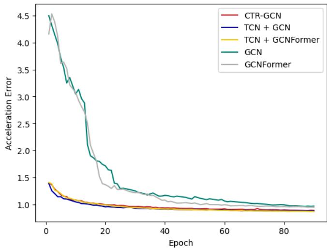  

图 8. 为捕获局部时间依赖性（local temporal dependencies）而设计的不同替代模块之间的加速度误差比较。

## A.2. 各关节误差对比

图 7 展示了 MotionAGFormer-B、MotionBERT、STCFormer 和 StridedFormer 在 Human3.6M 基准数据集上的各关节对比结果。STC-Former 在髋部（hips）关节上表现出轻微的性能优势；而对于肩部（shoulders）关节，MotionAGFormer 略优于 MotionBERT，并显著优于其他模型。在自由度（DoF）为 2 的关节（包括膝部和肘部）上，MotionBERT 通常优于 MotionAGFormer，并且与其他模型之间存在明显差距。然而，对于自由度为 3 的关节，例如踝部和腕部，MotionAGFormer 始终优于所有其他模型，这一表现得尤为重要，因为这些关节对整体误差的贡献更大，并且在手部/物体交互以及步态分析等应用中具有关键意义。

## B. 时间 GCNFormer 的消融实验

在正文中，我们考察了时间 GCNFormer（temporal GCNFormer）的多种替代方案，并报告了它们对应的 P1 误差。然而，我们尚未研究这些替代方案各自对应的加速度误差。加速度误差定义如下：

$$
\begin{array} { r l r } & { } & { A c c ( { \bf P } , \hat { \bf P } ) = \Sigma _ { t = 1 } ^ { T - 1 } L ( { \bf P } , t ) - L ( \hat { \bf P } , t ) , } \\ & { } & { L ( { \bf X } , t ) = { \bf X } _ { t - 1 } - 2 { \bf X } _ { t } + { \bf X } _ { t + 1 } , \quad } \end{array}\tag{10}
$$

其中 P 和 $\hat { \mathbf { P } }$ 分别表示真实三维姿态和估计三维姿态。

图 8 展示了不同模型在用于捕捉时间局部依赖关系时的加速度误差。有趣的是，尽管 CTR-GCN 和 TCN 会导致更高的 P1 误差（如正文所述），但它们在训练过程中的加速度误差收敛更快。此外，这最终带来了约 0.1 毫米的加速度误差改善。

表 8. 在 Human3.6M 数据集上按动作类别进行的三维人体姿态估计定量对比。（上）使用检测到的二维姿态序列得到的 MPJPE（毫米）。（下）使用检测到的二维姿态序列得到的 P-MPJPE（毫米）。（\*）表示使用 HRNet [38] 进行二维姿态估计。（†）表示使用其提供的评估代码经人工评测得到。

<table><tr><td>MPJPE</td><td>T</td><td>Dire.</td><td>Disc.</td><td>Eat</td><td>Greet</td><td>Phone</td><td>Photo</td><td>Pose</td><td>Purch.</td><td>Sit</td><td>SitD</td><td>Smoke</td><td>Wait</td><td>WalkD</td><td>Walk</td><td>WalkT</td><td>Avg</td></tr><tr><td>*MHFormer [20]</td><td>351</td><td>39.2</td><td>43.1</td><td>40.1</td><td>40.9</td><td>44.9</td><td>51.2</td><td>40.6</td><td>41.3</td><td>53.5</td><td>60.3</td><td>43.7</td><td>41.1</td><td>43.8</td><td>29.8</td><td>30.6</td><td>43.0</td></tr><tr><td>MixSTE [47]</td><td>243</td><td>37.6</td><td>40.9</td><td>37.3</td><td>39.7</td><td>42.3</td><td>49.9</td><td>40.1</td><td>39.8</td><td>51.7</td><td>55.0</td><td>42.1</td><td>39.8</td><td>41.0</td><td>27.9</td><td>27.9</td><td>40.9</td></tr><tr><td>P-STMO [36]</td><td>243</td><td>38.9</td><td>42.7</td><td>40.4</td><td>41.1</td><td>45.6</td><td>49.7</td><td>40.9</td><td>39.9</td><td>55.5</td><td>59.4</td><td>44.9</td><td>42.2</td><td>42.7</td><td>29.4</td><td>29.4</td><td>42.8</td></tr><tr><td>StridedFormer [19]</td><td>351</td><td>40.3</td><td>43.3</td><td>40.2</td><td>42.3</td><td>45.6</td><td>52.3</td><td>41.8</td><td>40.5</td><td>55.9</td><td>60.6</td><td>44.2</td><td>43.0</td><td>44.2</td><td>30.0</td><td>30.2</td><td>43.7</td></tr><tr><td>Einfalt et al. [11]</td><td>351</td><td>39.6</td><td>43.8</td><td>40.2</td><td>42.4</td><td>46.5</td><td>53.9</td><td>42.3</td><td>42.5</td><td>55.7</td><td>62.3</td><td>45.1</td><td>43.0</td><td>44.7</td><td>30.1</td><td>30.8</td><td>44.2</td></tr><tr><td>STCFormer [40]</td><td>243</td><td>39.6</td><td>41.6</td><td>37.4</td><td>38.8</td><td>43.1</td><td>51.1</td><td>39.1</td><td>39.7</td><td>51.4</td><td>57.4</td><td>41.8</td><td>38.5</td><td>40.7</td><td>27.1</td><td>28.6</td><td>41.0</td></tr><tr><td>STCFormer-L [40]</td><td>243</td><td>38.4</td><td>41.2</td><td>36.8</td><td>38.0</td><td>42.7</td><td>50.5</td><td>38.7</td><td>38.2</td><td>52.5</td><td>56.8</td><td>41.8</td><td>38.4</td><td>40.2</td><td>26.2</td><td>27.7</td><td>40.5</td></tr><tr><td>UPS [12]</td><td>243</td><td>37.5</td><td>39.2</td><td>36.9</td><td>40.6</td><td>39.3</td><td>46.8</td><td>39.0</td><td>41.7</td><td>50.6</td><td>63.5</td><td>40.4</td><td>37.8</td><td>44.2</td><td>26.7</td><td>29.1</td><td>40.8</td></tr><tr><td>GLA-GCN [44]</td><td>243</td><td>41.3</td><td>44.3</td><td>40.8</td><td>41.8</td><td>45.9</td><td>54.1</td><td>42.1</td><td>41.5</td><td>57.8</td><td>62.9</td><td>45.0</td><td>42.8</td><td>45.9</td><td>29.4</td><td>29.9</td><td>44.4</td></tr><tr><td>† MotionBERT [53]</td><td>243</td><td>36.6</td><td>39.3</td><td>37.8</td><td>33.5</td><td>41.4</td><td>49.9</td><td>37.0</td><td>35.5</td><td>50.4</td><td>56.5</td><td>41.4</td><td>38.2</td><td>37.3</td><td>26.2</td><td>26.9</td><td>39.2</td></tr><tr><td>HDFormer [3]</td><td>96</td><td>38.1</td><td>43.1</td><td>39.3</td><td>39.4</td><td>44.3</td><td>49.1</td><td>41.3</td><td>40.8</td><td>53.1</td><td>62.1</td><td>43.3</td><td>41.8</td><td>43.1</td><td>31.0</td><td>29.7</td><td>42.6</td></tr><tr><td>HSTFormer [33]</td><td>81</td><td>39.5</td><td>42.0</td><td>39.9</td><td>40.8</td><td>44.4</td><td>50.9</td><td>40.9</td><td>41.3</td><td>54.7</td><td>58.8</td><td>43.6</td><td>40.7</td><td>43.4</td><td>30.1</td><td>30.4</td><td>42.7</td></tr><tr><td>MotionAGFormer-XS</td><td>27</td><td>42.7</td><td>46.7</td><td>41.1</td><td>39.4</td><td>47.0</td><td>56.3</td><td>44.4</td><td>41.0</td><td>52.4</td><td>66.3</td><td>46.7</td><td>43.2</td><td>43.4</td><td>32.4</td><td>34.0</td><td>45.1</td></tr><tr><td>MotionAGFormer-S</td><td>81</td><td>41.9</td><td>42.7</td><td>40.4</td><td>37.6</td><td>45.6</td><td>51.3</td><td>41.0</td><td>38.0</td><td>54.1</td><td>58.8</td><td>45.5</td><td>40.4</td><td>39.8</td><td>29.4</td><td>31.0</td><td>42.5</td></tr><tr><td>MotionAGFormer-B</td><td>243</td><td>36.4</td><td>38.4</td><td>36.8</td><td>32.9</td><td>40.9</td><td>48.5</td><td>36.6</td><td>34.6</td><td>51.7</td><td>52.8</td><td>41.0</td><td>36.4</td><td>36.5</td><td>26.7</td><td>27.0</td><td>38.4</td></tr><tr><td>MotionAGFormer-L</td><td>243</td><td>36.8</td><td>38.5</td><td>35.9</td><td>33.0</td><td>41.1</td><td>48.6</td><td>38.0</td><td>34.8</td><td>49.0</td><td>51.4</td><td>40.3</td><td>37.4</td><td>36.3</td><td>27.2</td><td>27.2</td><td>38.4</td></tr><tr><td>P-MPJPE</td><td>T</td><td>Dire.</td><td>Disc.</td><td>Eat</td><td>Greet</td><td>Phone</td><td>Photo</td><td>Pose</td><td>Purch.</td><td>Sit</td><td>SitD</td><td>Smoke</td><td>Wait</td><td>WalkD</td><td>Walk</td><td>WalkT</td><td>Avg</td></tr><tr><td>*MHFormer [20]</td><td>351</td><td>31.5</td><td>34.9</td><td>32.8</td><td>33.6</td><td>35.3</td><td>39.6</td><td>32.0</td><td>32.2</td><td>43.5</td><td>48.7</td><td>36.4</td><td>32.6</td><td>34.3</td><td>23.9</td><td>25.1</td><td>34.4</td></tr><tr><td>MixSTE [47]</td><td>243</td><td>30.8</td><td>33.1</td><td>30.3</td><td>31.8</td><td>33.1</td><td>39.1</td><td>31.1</td><td>30.5</td><td>42.5</td><td>44.5</td><td>34.0</td><td>30.8</td><td>32.7</td><td>22.1</td><td>22.9</td><td>32.6</td></tr><tr><td>P-STMO [36]</td><td>243</td><td>31.3</td><td>35.2</td><td>32.9</td><td>33.9</td><td>35.4</td><td>39.3</td><td>32.5</td><td>31.5</td><td>44.6</td><td>48.2</td><td>36.3</td><td>32.9</td><td>34.4</td><td>23.8</td><td>23.9</td><td>34.4</td></tr><tr><td>StridedFormer [19]</td><td>351</td><td>32.7</td><td>35.5</td><td>32.5</td><td>35.4</td><td>35.9</td><td>41.6</td><td>33.0</td><td>31.9</td><td>45.1</td><td>50.1</td><td>36.3</td><td>33.5</td><td>35.1</td><td>23.9</td><td>25.0</td><td>35.2</td></tr><tr><td>Einfalt et al. [11]</td><td>351</td><td>32.7</td><td>36.1</td><td>33.4</td><td>36.0</td><td>36.1</td><td>42.0</td><td>33.3</td><td>33.1</td><td>45.4</td><td>50.7</td><td>37.0</td><td>34.1</td><td>35.9</td><td>24.4</td><td>25.4</td><td>35.7</td></tr><tr><td>STCFormer [40]</td><td>243</td><td>29.5</td><td>33.2</td><td>30.6</td><td>31.0</td><td>33.0</td><td>38.0</td><td>30.4</td><td>29.4</td><td>41.8</td><td>45.2</td><td>33.6</td><td>29.5</td><td>31.6</td><td>21.3</td><td>22.6</td><td>32.0 31.8</td></tr><tr><td>STCFormer-L [40] UPS [12]</td><td>243 243</td><td>29.3 30.3</td><td>33.0 32.2</td><td>30.7 30.8</td><td>30.6 33.1</td><td>32.7 31.1</td><td>38.2 35.2</td><td>29.7 30.3</td><td>28.8 32.1</td><td>42.2 39.4</td><td>45.0 49.6</td><td>33.3 32.9</td><td>29.4 29.2</td><td>31.5 33.9</td><td>20.9 21.6</td><td>22.3 24.5</td></table>

## C. 序列上的定性比较

除了使用 Human3.6M 数据集中的随机帧进行定性比较之外，我们还分析了同一序列中连续的若干帧。这使我们能够观察对比模型在整段序列上的表现，而非仅基于单帧进行定性评估。图 9 将 MotionAGFormer-B 与 STCFormer、PoseFormerV2 和 MotionBERT 进行了比较。总体而言，MotionAGFormer 与 Motion-BERT 相比其他两个模型与真值（ground truth）的对齐效果更好。在 MotionAGFormer 与 MotionBERT 的对比中，MotionAGFormer 在具有自由度（degrees of freedom, DoF）的关节（例如手腕和脚踝）上表现略优于 MotionBERT。此外也存在一些具有挑战性的序列（参见图 10），所有模型在这些序列上都未能准确估计关节位置。

## D. 野外（In-the-wild）评估

为了验证所提出的 MotionAG-Former 的泛化能力，我们在一些未见过的野外视频上测试了我们的基础（base）变体。我们的估计结果表明，即使在推断得到的二维姿态存在一定噪声的情况下（如图 11 中第二个示例的最后一帧所示），相应的三维姿态估计仍然保持合理，并对二维序列中的突发噪声运动具有较强的鲁棒性。此外，当被试者远离相机时，三维姿态估计仍然表现出很高的精度（如图 11 的最后一个示例所示）。

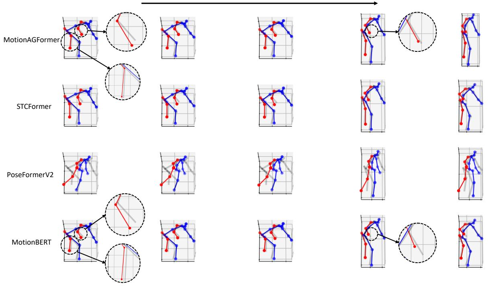

您提供的内容似乎不完整。我只看到了两行文字：

Time

MotionAGFormer

这看起来像是论文的标题片段（"Time" 可能是标题的一部分，"MotionAGFormer" 是方法/模型的名称），但缺少完整的论文正文（摘要、引言、方法、实验、结果、参考文献等）。

请重新粘贴完整的英文论文 Markdown 文本，我再为您完整翻译为中文。

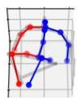

图 9. 在 Human3.6M 数据集的一个随机序列上，将 MotionAGFormer 与 STCformer [40]、PoseFormerV2 [50] 和 MotionBERT [53] 进行的定性比较。

时间

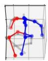

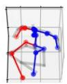

STCFormer

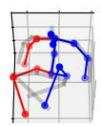

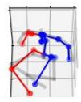

PoseFormerV2

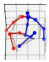

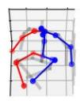

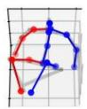

MotionBERT

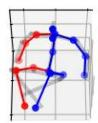

  

图 10. 模型在 Human3.6M 数据集上某随机序列上的失败案例。

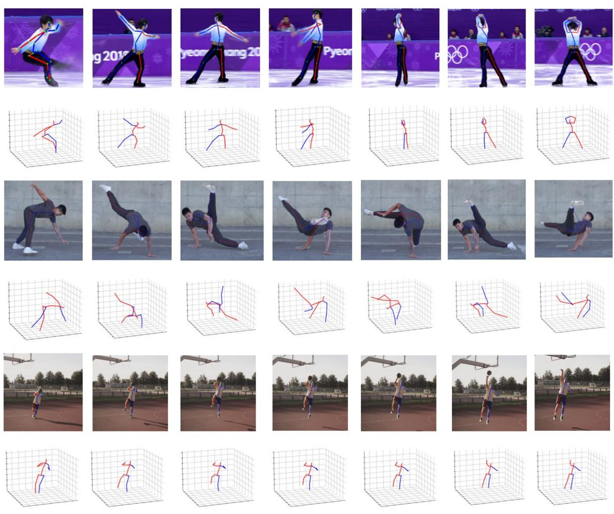  

图 11. MotionAGFormer 的野外视频评估。估计结果基于我们的基础变体（base variant）。