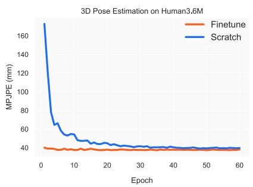
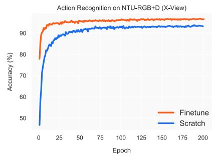
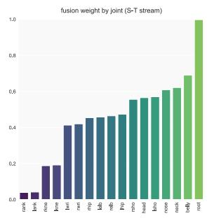
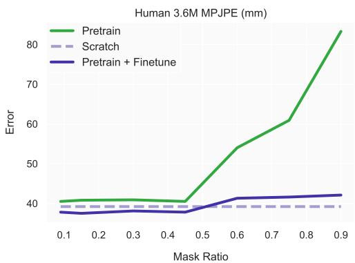

MotionBERT：学习人体运动表征的统一视角

Wentao Zhu1 Xiaoxuan Ma1 Zhaoyang Liu2 Libin Liu1 Wayne Wu2 Yizhou Wang1†

1 北京大学（Peking University） 2 上海人工智能实验室（Shanghai AI Laboratory）

{wtzhu,maxiaoxuan,libin.liu,yizhou.wang}@pku.edu.cn

{zyliumy,wuwenyan0503}@gmail.com

## 摘要

我们提出了一种统一的视角，通过从大规模且异构的数据资源中学习人体运动表征，来处理各种以人为中心的视频任务。具体而言，我们提出了一个预训练阶段，在该阶段中训练一个运动编码器，使其能够从带有噪声的部分二维观测中恢复出底层的三维运动。以这种方式获得的运动表征融合了关于人体运动的几何、运动学与物理知识，并且能够被轻松迁移到多个下游任务。我们使用双流时空 Transformer（Dual-stream Spatio-temporal Transformer，DSTformer）神经网络来实现该运动编码器。它能够全面且自适应地捕捉骨骼关节之间长距离的时空关系，以从零训练（trained from scratch）的方式取得了迄今为止最低的三维姿态估计误差，彰显了其优越性。此外，我们所提出的框架仅需将预训练的运动编码器与一个简单的回归头（1-2 层）进行微调，即可在全部三个下游任务上达到最先进的性能，这充分展示了所学运动表征的多功能性与广泛适用性。代码与模型已在 https://motionbert.github.io/ 公开。

## 1. 引言

感知并理解人类活动长期以来一直是机器智能的核心追求。为此，研究者们定义了多种任务，从视频中估计以人为中心的语义标签，例如骨骼关键点 [14, 35]、动作类别 [64, 123] 以及表面网格 [46, 71]。尽管在每一项任务上都已取得了显著进展，但这些任务往往是彼此孤立地进行建模，而非被视为相互关联的问题。例如，时空图卷积网络（Spatial Temporal Graph Convolutional Networks，ST-GCN）已被应用于在三维姿态估计 [13, 116] 与动作识别 [96, 123] 中对人体关节的时空关系进行建模，但它们之间的联系尚未被充分探索。直观而言，这些模型虽然是为不同问题而设计的，但它们都应该已经学会了识别典型的人体运动模式。然而，现有方法未能充分挖掘并利用这些跨任务的共性。理想情况下，我们可以开发出一种统一的、以人为中心的视频表征，使其能够被所有相关任务所共享。

  

图 1. 框架概览。我们利用运动编码器（motion encoder），通过从被破坏的 2D 骨架序列中恢复 3D 人体运动来学习人体运动表征。为了适应不同的下游任务，我们使用一个线性层或一个简单的多层感知机（MLP）对预训练的运动表征进行微调。

开发此类表示的一个重大挑战在于可用数据资源的异构性。动作捕捉（Mocap）系统 [38, 76] 能够通过标记点和传感器提供高保真 3D 运动数据，但所采集视频的外观通常局限于简单的室内场景。动作识别数据集提供了动作语义的标注，但它们要么不包含人体姿态标签 [16, 95]，要么仅包含有限的日常活动动作 [63, 64, 93]。相比之下，野外（in-the-wild）的人类视频提供了丰富多样的外观与运动。然而，获取精确的 2D 姿态标注需要耗费大量人力 [3]，而获得真值（GT）3D 关节点位置几乎是不可能的。因此，大多数现有研究仅针对单一类型的人体运动数据聚焦于特定任务，因而无法享受到其他数据资源所带来的优势。

在本研究中，我们为学习人体运动表示提供了一种新视角。其核心思想是：我们可以以统一的方式从异构的数据资源中学习通用的人体运动表示，并利用该表示以统一的方式应对不同的下游任务。我们提出了一个由预训练（pretraining）和微调（finetuning）构成的两阶段框架，如图 1 所示。在预训练阶段，我们从多样化的运动数据源中提取 2D 骨架序列，并对其施加随机的掩码与噪声加以扰动。随后，我们训练运动编码器从被扰动的 2D 骨架中恢复出 3D 运动。这一具有挑战性的预置任务本质上要求运动编码器能够：i) 从时序运动中推断底层 3D 人体结构；ii) 恢复出错误和缺失的观测值。通过这种方式，运动编码器隐式地捕获了诸如关节连接、解剖学约束以及时序动态等人体运动常识。在实践中，我们提出双流时空 Transformer（Dual-stream Spatio-temporal Transformer, DSTformer）作为运动编码器，用以捕获骨架关键点之间的长程关系。我们假设，从大规模且多样化的数据资源中学习到的运动表示可以跨不同下游任务共享，并提升其性能。因此，对于每个下游任务，我们使用任务特定的训练数据和监督信号，结合一个简单的回归头对预训练的运动表示进行适配。

总之，本工作的贡献主要体现在三个方面：1）我们提供了一个新的视角，即通过学习人体运动表征这一共享框架来解决各种以人为中心的视频任务。2）我们提出了一种预训练方法，以利用大规模但异构的人体运动资源，并学习可泛化的人体运动表征。我们的方法能够同时利用三维动捕（mocap）数据的精度和真实场景下 RGB 视频的多样性。3）我们设计了一个具有级联时空自注意力块的双流 Transformer 网络（dual-stream Transformer network），可作为人体运动建模的通用骨干网络。实验表明，上述设计使得所学到的人体运动表征具有高度的通用性，可迁移到多个下游任务中，性能优于针对特定任务的当前最优方法。

## 2. 相关工作

学习人体运动表征。早期的研究工作采用隐马尔可夫模型（Hidden Markov Models）[53, 108] 和图模型（graphical models）[51, 99] 来建模人体运动。Kanazawa 等人 [42] 设计了一个时间编码器（temporal encoder）和一个幻觉器（hallucinator）来学习三维人体动态的表征。Zhang 等人 [132] 以自监督的方式预测未来的三维动态。Sun 等人 [102] 进一步结合动作标签与动作记忆库（action memory bank）。从动作识别的角度来看，研究者们设计了多种预训练任务（pretext tasks），以自监督方式学习运动表征，包括未来预测 [100]、拼图（jigsaw puzzle）[60]、骨架对比（skeleton-contrastive）[107]、速度变化 [101]、跨视角一致性 [62] 以及对比-重建（contrast-reconstruction）[117]。类似的技术也在运动评估（motion assessment）[33, 85] 和运动重定向（motion retargeting）[126, 139] 等任务中被探索。这些方法利用同质化的运动数据，设计相应的预训练任务，并将其应用于特定的下游任务。在本工作中，我们提出了一种统一的预训练-微调（pretrain-finetune）框架，以整合异构的数据资源，并在多个下游任务中展示其通用性。

三维人体姿态估计。从单目 RGB 视频中恢复三维人体姿态是一个经典问题，相关方法可以分为两大类。第一类是利用卷积神经网络（CNN）直接从图像中估计三维姿态 [82, 104, 136]。然而，这些方法的一个局限性在于，由于当前数据采集技术的限制，三维姿态精度与外观多样性之间存在权衡。第二类是先提取二维姿态，然后通过单独的神经网络将估计得到的二维姿态提升到三维。提升过程可通过全连接网络（Fully Connected Network）[29, 78]、时间卷积网络（Temporal Convolutional Network, TCN）[22, 89]、图卷积网络（Graph Convolutional Network, GCN）[13, 28, 116] 以及 Transformer [56, 94, 134, 135] 实现。我们的框架基于第二类方法构建，因为我们使用所提出的 DSTformer 来完成二维到三维的提升（2D-to-3D lifting）。

基于骨架的动作识别。开创性工作 [74, 115, 127] 指出动作识别与人体姿态估计之间存在内在联系。为了建模人体关节之间的时空关系，已有研究主要采用 LSTM [98, 138] 和 GCN [21, 55, 68, 96, 123]。最近，PoseConv3D [32] 提出将 3D-CNN 应用于堆叠的 2D 关节热力图，并取得了改进的效果。除了全监督的动作识别任务外，NTU-RGB+D-120 [64] 将关注点引向了具有挑战性的单样本动作识别问题。为此，SL-DML [81] 将深度度量学习应用于多模态信号。Sabater 等人 [92] 使用 TCN 探索了治疗场景中的单样本识别问题。我们证明了预训练的运动表征可以很好地泛化到动作识别任务，并且预训练-微调框架是解决单样本挑战的合适方案。

人体网格恢复。基于 SMPL [71] 等参数化人体模型，许多研究工作 [41, 75, 83, 122, 133] 专注于从单张图像回归人体网格。SPIN [48] 还额外结合了人体拟合

  

图 2. 模型架构。我们提出了双流时空 Transformer（Dual-stream Spatio-temporal Transformer，DSTformer），作为人体运动建模的通用骨干网络。DSTformer 由 N 个双流融合模块组成。每个模块包含空间或时间 MHSA 与 MLP 两个分支。空间 MHSA 对同一时间步内不同关节点之间的连接进行建模，而时间 MHSA 对单个关节点随时间的运动进行建模。

## 3.2. 网络架构

将模型提升到训练循环中的 2D 关节。尽管这些方法在单帧上取得了令人满意的结果，但当应用于视频时，它们会产生抖动且不稳定的结果 [46,130]。为了提升其时间一致性，PoseBERT [8] 和 SmoothNet [130] 提出对单帧预测使用去噪与平滑模块。若干工作 [24,42,46,106] 将视频片段作为输入以利用时间线索。另一个常见的问题是，配对的图像与 GT 网格大多是在受约束的场景中采集的，这限制了上述方法的泛化能力。为此，Pose2Mesh [25] 提出首先使用现成的姿态估计器提取 2D 骨骼，然后将它们提升到 3D 网格顶点。我们的方法与最先进的人体网格恢复方法是互补的，并且可以通过预训练的运动表示进一步改善其时间一致性。

## 3. 方法

### 3.1. 概述

如第 1 节所述，我们的方法包含两个阶段，即统一预训练和任务特定的微调。在第一阶段，我们训练一个运动编码器来完成 2D 到 3D 的提升任务，其中我们使用所提出的 DSTformer 作为骨干网络。在第二阶段，我们在下游任务上微调预训练的运动编码器和几个新增的层。我们在预训练和微调阶段都使用 2D 骨骼序列作为输入，因为它们能够从各种运动源 [3, 10, 76, 86, 103] 中被可靠地提取，并且对变化具有更强的鲁棒性 [19, 32]。已有研究表明，在不同的下游任务中使用 2D 骨骼序列是有效的 [25, 32, 89, 109]。我们将首先介绍 DSTformer 的架构，然后详细描述训练方案。

图 2 展示了二维到三维提升的网络架构。给定输入的二维骨架序列 $\mathbf { x } \in \mathbb { R } ^ { T \times J \times C _ { \mathrm { i n } } }$，我们首先将其投影到高维特征 ${ \bf F } ^ { 0 } \in \mathbb { R } ^ { T \times J \times C _ { 1 } }$ 中，然后向其添加可学习的空间位置编码 $\mathbf { P } _ { \mathrm { p o s } } ^ { \mathrm { S } } \in \mathbb { R } ^ { 1 \times J \times C _ { \mathrm { f } } }$ 和时间位置编码 $\mathbf { P } _ { \mathrm { p o s } } ^ { \mathrm { T } } \bar { \in } \mathbb { R } ^ { \sum _ { T \times 1 \times C _ { \mathrm { f } } } }$。接着，我们使用序列到序列模型 DSTformer 来计算 $\mathbf { F } ^ { i } \in \bar { \mathbb { R } } ^ { T \times J \times C _ { \mathrm { f } } } ( i \mathbf { \theta } = 1 , \dots , N )$，其中 N 是网络深度。我们对 $\mathbf { F } ^ { N }$ 应用带 tanh 激活 [30] 的线性层来计算运动表示 $\mathbf { E } \in \mathbb { R } ^ { \bar { T } \times J \times C _ { \mathrm { e } } }$。最后，我们对 E 应用线性变换以估计三维运动 $\hat { \hat { \mathbf { X } } } \in \mathbb { R } ^ { T \times J \times C _ { \mathrm { o u t } } }$。这里，$T$ 表示序列长度，J 表示身体关节点数量。$C _ { \mathrm { i n } } , C _ { \mathrm { f } } , C _ { \mathrm { e } } ,$ 和 $C _ { \mathrm { { o u t } } }$ 分别表示输入、特征、嵌入和输出的通道数。我们首先介绍 DSTformer 的基本构件，即带有多头自注意力（Multi-Head Self-Attention，MHSA）的空间块和时间块，然后解释 DSTformer 的架构设计。

空间块（Spatial Block）。空间多头自注意力（Spatial MHSA，S-MHSA）旨在建模同一时间步内各关节点之间的关系。其定义如下

$$
\begin{array} { r } { \mathrm { S } \mathrm { - } \mathbf { M } \mathrm { H S A } ( \mathbf { Q } _ { \mathrm { S } } , \mathbf { K } _ { \mathrm { S } } , \mathbf { V } _ { \mathrm { S } } ) = [ \mathrm { h e a d } _ { 1 } ; \dots ; \mathrm { h e a d } _ { h } ] \mathbf { W } _ { \mathrm { S } } ^ { P } , } \\ { \mathrm { h e a d } _ { i } = \mathrm { s o f t m a x } ( \frac { \mathbf { Q } _ { \mathrm { S } } ^ { i } ( \mathbf { K } _ { \mathrm { S } } ^ { i } ) ^ { \prime } } { \sqrt { d _ { K } } } ) \mathbf { V } _ { \mathrm { S } } ^ { i } , } \end{array}\tag{1}
$$

其中 $\mathbf { W } _ { \mathrm { S } } ^ { P }$ 是一个投影参数矩阵，h 是注意力头的数量，$i \in { 1 , \dots , h } ,$，′ 表示矩阵转置。我们利用自注意力机制，从输入的逐帧空间特征 $\mathbf { F } _ { \mathrm { S } } ^ { \mathrm { } } \in \mathbb { R } ^ { J \times C _ { \mathrm { e } } }$ 中为每个头获取查询 $\mathbf { Q } _ { \mathrm { S } }$、键 $\mathbf { K } _ { \mathrm { S } } .$ 和值 ${ \bf V } _ { \mathrm { S } }$，

$$
\mathbf { Q } _ { \mathrm { s } } ^ { i } = \mathbf { F } _ { \mathrm { s } } \mathbf { W } _ { \mathrm { s } } ^ { ( Q , i ) } , \mathbf { K } _ { \mathrm { s } } ^ { i } = \mathbf { F } _ { \mathrm { s } } \mathbf { W } _ { \mathrm { s } } ^ { ( K , i ) } , \mathbf { V } _ { \mathrm { s } } ^ { i } = \mathbf { F } _ { \mathrm { s } } \mathbf { W } _ { \mathrm { s } } ^ { ( V , i ) } ,\tag{2}
$$

其中 $\mathbf { W } _ { \mathrm { S } } ^ { ( Q , i ) } , \mathbf { W } _ { \mathrm { S } } ^ { ( K , i ) } , \mathbf { W } _ { \mathrm { S } } ^ { ( V , i ) }$ 为投影矩阵，$d _ { K }$ 为 $\mathbf { K } _ { \mathrm { S } }$ 的特征维度。我们将 S-MHSA 并行地应用于不同时间步的特征。S-MHSA 的输出经过残差连接（residual connection）和层归一化（LayerNorm）处理后，进一步输入到多层感知机（MLP）中，随后再经过残差连接和 LayerNorm 处理，遵循文献 [112] 的设计。我们将由 MHSA、LayerNorm、MLP 和残差连接构成的整个空间块记为 。

时间块（Temporal Block）。时序多头自注意力（T-MHSA）旨在建模单个身体关节在不同时间步之间的关系。其计算过程与 S-MHSA 类似，区别在于 MHSA 应用于每个关节的时序特征 $\mathbf { F } _ { \mathrm { T } } \in \mathbb { R } ^ { T \times C _ { \mathrm { e } } }$，并在空间维度上进行并行化。

$$
\begin{array} { r } { \mathrm { T } \mathbf { \cdot } \mathbf { M } \mathrm { H S A } ( \mathbf { Q } _ { \mathrm { T } } , \mathbf { K } _ { \mathrm { T } } , \mathbf { V } _ { \mathrm { T } } ) = [ \mathrm { h e a d } _ { 1 } ; \dots ; \mathrm { h e a d } _ { h } ] \mathbf { W } _ { \mathrm { T } } ^ { P } , } \\ { \mathrm { h e a d } _ { i } = \operatorname { s o f t m a x } ( \frac { \mathbf { Q } _ { \mathrm { T } } ^ { i } ( \mathbf { K } _ { \mathrm { T } } ^ { i } ) ^ { \prime } } { \sqrt { d _ { K } } } ) \mathbf { V } _ { \mathrm { T } } ^ { i } , } \end{array}\tag{3}
$$

其中 $i \in { 1 , \ldots , h , \mathbf { Q } _ { \mathrm { { T } } } , \mathbf { K } _ { \mathrm { { T } } } , \mathbf { V } _ { \mathrm { { T } } } }$ 的计算方式与公式 2 类似。我们将整个时间块记为 $\tau$

**双流时空 Transformer（Dual-stream Spatio-temporal Transformer）**。给定分别捕获帧内和帧间人体关节交互的空间 MHSA 与时间 MHSA，我们组装这些基本构建块以融合流程中的空间与时间信息。我们设计了一个双流架构，并基于以下假设：1) 两个流都应该能够建模完整的时空上下文。2) 每个流应该专注于不同的时空方面。3) 两个流应该融合在一起，其融合权重根据输入的时空特征进行动态平衡。

因此，我们以不同顺序堆叠空间 MHSA 和时间 MHSA 块，从而形成两个并行的计算分支。两个分支的输出特征通过由注意力回归器预测的自适应权重进行融合。该双流融合模块随后重复 N 次：

$$
\mathbf { F } ^ { i } = \alpha _ { \mathrm { S T } } ^ { i } \circ \mathcal { T } _ { 1 } ^ { i } ( S _ { 1 } ^ { i } ( \mathbf { F } ^ { i - 1 } ) ) + \alpha _ { \mathrm { T S } } ^ { i } \circ S _ { 2 } ^ { i } ( \mathcal { T } _ { 2 } ^ { i } ( \mathbf { F } ^ { i - 1 } ) ) , \quad i \in 1 , \dots , N ,\tag{4}
$$

其中 $\mathbf{F}^i$ 表示第 $i$ 层的特征嵌入，表示逐元素相乘。 和 $\tau$ 块的顺序如图 2 所示，且不同块之间不共享权重。自适应融合权重 αST、$\alpha_{TS} \in \mathbb{R}^{N \times T \times J}$ 由下式给出

$$
\alpha _ { \mathrm { S T } } ^ { i } , \alpha _ { \mathrm { T S } } ^ { i } = \mathrm { s o f t m a x } ( \mathcal { W } ( [ \mathcal { T } _ { 1 } ^ { i } ( S _ { 1 } ^ { i } ( \mathbf { F } ^ { i - 1 } ) ) , S _ { 2 } ^ { i } ( \mathcal { T } _ { 2 } ^ { i } ( \mathbf { F } ^ { i - 1 } ) ) ] ) ) ,\tag{5}
$$

其中 是一个可学习的线性变换。[, ] 表示拼接。

## 3.3. 统一预训练

我们在设计统一预训练框架时面临两个关键挑战：1) 如何通过一个通用的预训练任务学习到强大的运动表征；2) 如何利用各种格式的大规模异构人体运动数据。

针对第一个挑战，我们遵循语言建模 [12, 30, 90] 和视觉建模 [7, 36] 中的成功实践来构建监督信号，即遮盖部分输入并利用编码后的表征来重建完整输入。值得注意的是，这种"完形填空（cloze）"任务天然存在于人体运动分析中，也就是从二维视觉观测中恢复丢失的深度信息——三维人体姿态估计。受此启发，我们利用大规模的三维动捕（mocap）数据 [76]，设计了一个二维到三维提升（2D-to-3D lifting）预训练任务。我们首先通过正交投影将三维运动投影得到二维骨架序列 x。然后，我们对 x 进行随机遮盖并添加噪声以产生被损坏的二维骨架序列，这也类似于实际的二维检测结果，因为它包含了遮挡、检测失败和误差。我们以一定概率同时施加关节级（joint-level）和帧级（frame-level）的掩码。我们使用前述的运动编码器获得运动表征 E，并重建三维运动 X̂ 。然后我们计算 X̂ 与真实值（GT）三维运动 X 之间的关节损失 $\mathcal { L } _ { 3 \mathrm { D } }$。我们还根据先前的工作 [89, 134] 加入了速度损失 $\mathcal { L } _ { 0 }$。三维重建损失因此由下式给出

$$
\mathcal { L } _ { \mathrm { 3 D } } = \sum _ { t = 1 } ^ { T } \sum _ { j = 1 } ^ { J } \parallel \hat { \mathbf { X } } _ { t , j } - \mathbf { X } _ { t , j } \parallel _ { 2 } , \quad \mathcal { L } _ { 0 } = \sum _ { t = 2 } ^ { T } \sum _ { j = 1 } ^ { J } \parallel \hat { \mathbf { O } } _ { t , j } - \mathbf { O } _ { t , j } \parallel _ { 2 } ,
$$

$$\begin{array}{r} \hat{\mathbf{O}}_{t} = \hat{\mathbf{X}}_{t} - \hat{\mathbf{X}}_{t-1}, \mathbf{O}_{t} = \mathbf{X}_{t} - \mathbf{X}_{t-1}. \end{array}$$

(6)

对于第二个挑战，我们注意到 2D 骨架可以作为通用媒介，因为它们可以从各种运动数据源中提取。我们进一步将野外 RGB 视频整合到 2D 到 3D 的提升（lifting）框架中，以进行统一的预训练。对于 RGB 视频，2D 骨架 $\mathbf{x}$ 可以通过人工标注 [3] 或 2D 姿态估计器 [14, 103] 获得，并且所提取的 2D 骨架的深度通道本质上是被「掩码」的。类似地，我们添加额外的掩码和噪声以降低 $\mathbf{x}$ 的质量（如果 $\mathbf{x}$ 已经包含检测噪声，则仅应用掩码）。由于这些数据没有 3D 运动真值 $\mathbf{X}$，我们应用加权 2D 重投影损失，其计算公式为

$$
\mathcal { L } _ { \mathrm { 2 D } } = \sum _ { t = 1 } ^ { T } \sum _ { j = 1 } ^ { J } \delta _ { t , j } \| \hat { \mathbf { x } } _ { t , j } - \mathbf { x } _ { t , j } \| _ { 2 } ,\tag{7}
$$

其中 $\hat{\bf x}$ 是估计的三维运动 $\hat{\bf X}$ 的二维正交投影，$\pmb{\delta} \in \mathbf{\bar{\mathbb{R}}}^{\bar{T} \times J}$ 由可见性标注（visibility annotation）或二维检测置信度给出。

总预训练损失（pretraining loss）由下式计算：

$$
\small \mathcal { L } = \underbrace { \mathcal { L } _ { \mathrm { 3 D } } + \lambda _ { 0 } \mathcal { L } _ { 0 } } _ { \mathrm { f o r 3 D \ : d a t a } } + \underbrace { \mathcal { L } _ { \mathrm { 2 D } } } _ { \mathrm { f o r 2 D \ : d a t a } } ,\tag{8}
$$

其中 $\lambda _ { 0 }$ 是用于平衡各项损失的常数系数。

## 3.4. 任务特定的微调（Task-specific Finetuning）

学习到的特征嵌入 E 充当一种三维感知且时序感知的人体运动表示。对于下游任务，我们采用极简设计原则，即构建浅层的下游网络，并在训练时不引入任何额外的技巧。在实际实现中，我们使用一个额外的线性层或带有一个隐藏层的 MLP。随后，我们对整个网络进行端到端的微调。

三维姿态估计（3D Pose Estimation）。由于我们使用二维到三维的提升（2D-to-3D lifting）作为前置任务（pretext task），因此只需直接复用整个预训练网络。在微调阶段，输入的二维骨架从视频中估计得到，且不附加额外的掩码或噪声。

基于骨架的动作识别（Skeleton-based Action Recognition）。我们对不同人物和不同时刻的特征直接进行全局平均池化（global average pooling）。所得结果随后输入一个带有一个隐藏层的 MLP。网络的训练采用交叉熵分类损失。对于单样本学习（one-shot learning），我们在池化后的特征之后接一个线性层，以提取片段级的动作表示。关于单样本学习的详细设置将在第 4.4 节介绍。

人体网格恢复（Human Mesh Recovery）。我们使用 SMPL [71] 模型来表示人体网格，并对其参数进行回归。SMPL 模型由姿态参数 $\theta \ \in \ \mathbb { R } ^ { 7 2 }$ 和形状参数 $\beta \in \mathbb { R } ^ { 1 0 }$ 组成，并据此计算三维网格 $\mathcal { M } ( \boldsymbol { \theta } , \bar { \boldsymbol { \beta } } ) \in \mathbb { R } ^ { 6 8 9 0 \times 3 }$ 。为了对每一帧的姿态参数进行回归，我们将运动嵌入 E 输入一个带有一个隐藏层的 MLP，得到 $\pmb { \hat { \theta } } \in \mathbb { R } ^ { T \times \breve { 7 } 2 }$ 。为了估计形状参数，考虑到一个视频序列中人体形状应当保持一致，我们首先沿时间维度对 E 进行平均池化，然后将其输入另一个 MLP 中以回归出单一的 $\hat { \beta }$，再将其扩展到整个序列，得到 $\hat { \beta } \in \mathbb { R } ^ { \bar { T } \times 1 0 }$ 。形状 MLP 与姿态回归 MLP 具有相同的网络结构，并且它们分别使用平均形状和平均姿态进行初始化，如文献 [46] 所示。总损失计算如下

$$
\begin{array} { r } { \mathcal { L } = \lambda _ { 3 \mathrm { { D } } } ^ { \mathrm { { m } } } \mathcal { L } _ { 3 \mathrm { { D } } } ^ { \mathrm { { m } } } + \lambda _ { \theta } \mathcal { L } _ { \theta } + \lambda _ { \beta } \mathcal { L } _ { \beta } + \lambda _ { \mathrm { { n } } } \mathcal { L } _ { \mathrm { { n o r m } } } + \lambda _ { 0 } ^ { \mathrm { { m } } } \mathcal { L } _ { 0 } ^ { \mathrm { { m } } } , } \end{array}\tag{9}
$$

其中每一项的计算方式如下

$$
\begin{array} { r l } & { \mathcal { L } _ { 3 \mathrm { D } } ^ { \mathrm { m } } = \| \hat { \mathbf { X } } ^ { \mathrm { m } } - \mathbf { X } ^ { \mathrm { m } } \| _ { 1 } , \quad \mathcal { L } _ { \boldsymbol { \theta } } = \| \hat { \pmb { \theta } } - \pmb { \theta } \| _ { 1 } , \quad \mathcal { L } _ { \boldsymbol { \beta } } = \| \hat { \pmb { \beta } } - \pmb { \beta } \| _ { 1 } , } \\ & { \mathcal { L } _ { \mathrm { n o r m } } = \| \hat { \pmb { \theta } } \| _ { 2 } + \| \hat { \pmb { \beta } } \| _ { 2 } , \quad \mathcal { L } _ { 0 } ^ { \mathrm { m } } = \| \hat { \mathbf { O } } ^ { \mathrm { m } } - \mathbf { O } ^ { \mathrm { m } } \| _ { 2 } . } \end{array}\tag{10}
$$

注意，运动 $\mathbf{X}^{\mathrm{m}}$ 中每个 3D 姿态在第 t 帧由网格顶点回归得到，$\mathbf{X}_{t}^{\mathrm{m}} = \mathbf{J}\mathcal{M}(\theta_{t}, \beta_{t})$，其中 $\mathbf{J} \in \mathbb{R}^{J\times 6890}$ 是一个预定义矩阵 [10]。$\mathbf{O}^{\mathrm{m}} = \mathbf{X}_{t+1}^{\mathrm{m}} - \mathbf{X}_{t}^{\mathrm{m}}$，$\hat{\mathbf{O}}^{\mathrm{m}} = \hat{\mathbf{X}}_{t+1}^{\mathrm{m}} - \hat{\mathbf{X}}_{t}^{\mathrm{m}}$。$\lambda_{3\mathrm{D}}^{\mathrm{m}}$、$\lambda_{\theta}$、$\lambda_{\beta}$、$\lambda_{\mathrm{n}}$ 和 $\lambda_{0}^{\mathrm{m}}$ 是用于平衡训练损失的常数系数。

## 4. 实验

## 4.1. 实现

我们实现了所提出的运动编码器 DSTformer，其深度 $N=5$，头数 $h=8$，特征尺寸 $C_{\mathrm{f}}=512$，嵌入尺寸 $C_{\mathrm{e}}=512$。对于预训练，我们使用序列长度 $T=243$。由于采用基于 Transformer 的骨干网络，预训练模型能够处理不同的输入长度。在微调期间，我们将骨干网络的学习率设置为新层学习率的 0.1。我们将在以下各节中分别介绍实验所用数据集。更多实验细节请参阅附录。

## 4.2. 预训练

我们从两个数据集 Human3.6M [38] 和 AMASS [76] 中收集多样化且真实的 3D 人体运动。Human3.6M [38] 是一个常用于 3D 人体姿态估计的室内数据集，包含专业演员执行日常动作的 360 万个视频帧。遵循先前的工作 [78, 89]，我们使用受试者 1、5、6、7、8 进行训练，使用受试者 9、11 进行测试。AMASS [76] 集成了大多数现有的基于标记的 Mocap 数据集 [1,2,5,11,15,18,34,37,52,69,72,77,84,97,110,111]，并使用统一的表示形式对其进行参数化。在预训练期间，我们不使用这两个数据集的图像或 2D 检测结果，因为 Mocap 数据集通常不提供原始视频。相反，我们使用正交投影来获得未受污染的 2D 骨架。为进一步提高运动多样性，我们进一步整合了两个野外 RGB 视频数据集 PoseTrack [3]（带标注）和 InstaVariety [42]（无标注）。我们将身体关键点定义与 Human3.6M 对齐，并遵循 [27] 将相机坐标校准为像素坐标。我们随机将 15% 的关节置零，并从高斯分布与均匀分布的混合中采样噪声 [17]。遵循课程学习实践 [9, 118]，我们首先仅在 3D 数据上训练 30 个 epoch，然后在 3D 数据和 2D 数据上联合训练 60 个 epoch。

## 4.3. 3D 姿态估计

我们在 Human3.6M [38] 上评估 3D 姿态估计性能，并报告平均每关节位置误差（mean per joint position error, MPJPE），单位为毫米，该指标在根关节对齐后，衡量预测关节位置与真值（GT）之间的平均距离。我们还计算了平均每关节速度误差（mean per-joint velocity error, MPJVE），以评估时序平滑度，遵循先前工作 [134, 135] 的做法。我们使用堆叠沙漏网络（Stacked Hourglass, SH）[86] 从视频中提取 2D 骨架，并在 Human3.6M [38] 训练集上对整个网络进行微调。此外，我们训练了另一个具有相同架构但采用随机初始化而非预训练权重的模型。如表 1（上）所示，从零训练的模型优于先前方法，包括其他具有时空建模能力的基于 Transformer 的设计。这表明所提出的 DSTformer 在学习 3D 几何结构和时序动态方面的有效性。为进一步评估模型能力的上限，我们比较了使用 2D 真值（GT）姿态序列作为输入时的性能，这消除了不同 2D 检测器的影响。如表 1（中）所示，我们的模型显著优于所有先前方法。表 1（下）显示，我们的两个模型在 MPJVE 方面也超越了先前工作，暗示更好的时序一致性。我们将从零训练模型的性能优势归因于所提出的 DSTformer 设计。我们在第 4.6 节和补充材料中包含了更多比较和分析，以展示 DSTformer 相对于其他时空架构的优势。此外，我们的方法通过所提出的预训练阶段实现了更低的误差。

<table><tr><td>Method</td><td>T</td><td>Dire.</td><td>Disc.</td><td>Eat</td><td>Greet</td><td>Phone</td><td>Photo</td><td>Pose</td><td>Purch.</td><td>Sit</td><td>SitD</td><td>Smoke</td><td>Wait</td><td>WalkD</td><td>Walk</td><td>WalkT</td><td>Avg</td></tr><tr><td>Martinez et al. [78] ICCV&#x27;17</td><td>1</td><td>51.8</td><td>56.2</td><td>58.1</td><td>59.0</td><td>69.5</td><td>78.4</td><td>55.2</td><td>58.1</td><td>74.0</td><td>94.6</td><td>62.3</td><td>59.1</td><td>65.1</td><td>49.5</td><td>52.4</td><td>62.9</td></tr><tr><td>Pavlakos et al. [88] CVPR’18</td><td>1</td><td>48.5</td><td>54.4</td><td>54.4</td><td>52.0</td><td>59.4</td><td>65.3</td><td>49.9</td><td>52.9</td><td>65.8</td><td>71.1</td><td>56.6</td><td>52.9</td><td>60.9</td><td>44.7</td><td>47.8</td><td>56.2</td></tr><tr><td>LCN [28] ICCV&#x27;19</td><td>1</td><td>46.8</td><td>52.3</td><td>44.7</td><td>50.4</td><td>52.9</td><td>68.9</td><td>49.6</td><td>46.4</td><td>60.2</td><td>78.9</td><td>51.2</td><td>50.0</td><td>54.8</td><td>40.4</td><td>43.3</td><td>52.7</td></tr><tr><td>Xu et al. [121] CVPR’21</td><td>1</td><td>45.2</td><td>49.9</td><td>47.5</td><td>50.9</td><td>54.9</td><td>66.1</td><td>48.5</td><td>46.3</td><td>59.7</td><td>71.5</td><td>51.4</td><td>48.6</td><td>53.9</td><td>39.9</td><td>44.1</td><td>51.9</td></tr><tr><td>VideoPose3D [89] CVPR&#x27;19</td><td>243</td><td>45.2</td><td>46.7</td><td>43.3</td><td>45.6</td><td>48.1</td><td>55.1</td><td>44.6</td><td>44.3</td><td>57.3</td><td>65.8</td><td>47.1</td><td>44.0</td><td>49.0</td><td>32.8</td><td>33.9</td><td>46.8</td></tr><tr><td>Cai et al. [13] ICCV’19</td><td>7</td><td>44.6</td><td>47.4</td><td>45.6</td><td>48.8</td><td>50.8</td><td>59.0</td><td>47.2</td><td>43.9</td><td>57.9</td><td>61.9</td><td>49.7</td><td>46.6</td><td>51.3</td><td>37.1</td><td>39.4</td><td>48.8</td></tr><tr><td>Yeh et al. [129] NeurIPS’19</td><td>243</td><td>44.8</td><td>46.1</td><td>43.3</td><td>46.4</td><td>49.0</td><td>55.2</td><td>44.6</td><td>44.0</td><td>58.3</td><td>62.7</td><td>47.1</td><td>43.9</td><td>48.6</td><td>32.7</td><td>33.3</td><td>46.7</td></tr><tr><td>Liu et al. [67] CVPR’20</td><td>243</td><td>41.8</td><td>44.8</td><td>41.1</td><td>44.9</td><td>47.4</td><td>54.1</td><td>43.4</td><td>42.2</td><td>56.2</td><td>63.6</td><td>45.3</td><td>43.5</td><td>45.3</td><td>31.3</td><td>32.2</td><td>45.1</td></tr><tr><td>* Cheng et al. [22] AAAI&#x27;20</td><td>128</td><td>36.2</td><td>38.1</td><td>42.7</td><td>35.9</td><td>38.2</td><td>45.7</td><td>36.8</td><td>42.0</td><td>45.9</td><td>51.3</td><td>41.8</td><td>41.5</td><td>43.8</td><td>33.1</td><td>28.6</td><td>40.1</td></tr><tr><td>* UGCN [116] ECCV’20</td><td>96</td><td>38.2</td><td>41.0</td><td>45.9</td><td>39.7</td><td>41.4</td><td>51.4</td><td>41.6</td><td>41.4</td><td>52.0</td><td>57.4</td><td>41.8</td><td>44.4</td><td>41.6</td><td>33.1</td><td>30.0</td><td>42.6</td></tr><tr><td>† PoseFormer [135] ICCV’21</td><td>81</td><td>41.5</td><td>44.8</td><td>39.8</td><td>42.5</td><td>46.5</td><td>51.6</td><td>42.1</td><td>42.0</td><td>53.3</td><td>60.7</td><td>45.5</td><td>43.3</td><td>46.1</td><td>31.8</td><td>32.2</td><td>44.3</td></tr><tr><td>* Wehrbein et al. [119] ICCV&#x27;21</td><td>200</td><td>38.5</td><td>42.5</td><td>39.9</td><td>41.7</td><td>46.5</td><td>51.6</td><td>39.9</td><td>40.8</td><td>49.5</td><td>56.8</td><td>45.3</td><td>46.4</td><td>46.8</td><td>37.8</td><td>40.4</td><td>44.3</td></tr><tr><td>† MHFormer [56] CVPR’22</td><td>351</td><td>39.2</td><td>43.1</td><td>40.1</td><td>40.9</td><td>44.9</td><td>51.2</td><td>40.6</td><td>41.3</td><td>53.5</td><td>60.3</td><td>43.7</td><td>41.1</td><td>43.8</td><td>29.8</td><td>30.6</td><td>43.0</td></tr><tr><td>*† MixSTE [134] CVPR&#x27;22</td><td>243</td><td>36.7</td><td>39.0</td><td>36.5</td><td>39.4</td><td>40.2</td><td>44.9</td><td>39.8</td><td>36.9</td><td>47.9</td><td>54.8</td><td>39.6</td><td>37.8</td><td>39.3</td><td>29.7</td><td>30.6</td><td>39.8</td></tr><tr><td>† P-STMO [94] ECCV’22</td><td>243</td><td>38.4</td><td>42.1</td><td>39.8</td><td>40.2</td><td>45.2</td><td>48.9</td><td>40.4</td><td>38.3</td><td>53.8</td><td>57.3</td><td>43.9</td><td>41.6</td><td>42.2</td><td>29.3</td><td>29.3</td><td>42.1</td></tr><tr><td>† Ours (scratch)</td><td>243</td><td>36.3</td><td>38.7</td><td>38.6</td><td>33.6</td><td>42.1</td><td>50.1</td><td>36.2</td><td>35.7</td><td>50.1</td><td>56.6</td><td>41.3</td><td>37.4</td><td>37.7</td><td>25.6</td><td>26.5</td><td>39.2</td></tr><tr><td>† Ours (finetune)</td><td>243</td><td>36.1</td><td>37.5</td><td>35.8</td><td>32.1</td><td>40.3</td><td>46.3</td><td>36.1</td><td>35.3</td><td>46.9</td><td>53.9</td><td>39.5</td><td>36.3</td><td>35.8</td><td>25.1</td><td>25.3</td><td>37.5</td></tr><tr><td>Method</td><td>T</td><td>Dire.</td><td>Disc.</td><td>Eat</td><td>Greet</td><td>Phone</td><td>Photo</td><td>Pose</td><td>Purch.</td><td>Sit</td><td>SitD</td><td>Smoke</td><td>Wait</td><td>WalkD</td><td>Walk</td><td>WalkT</td><td>Avg</td></tr><tr><td>Martinez et al. [78] ICCV&#x27;17</td><td>1</td><td>37.7</td><td>44.4</td><td>40.3</td><td>42.1</td><td>48.2</td><td>54.9</td><td>44.4</td><td>42.1</td><td>54.6</td><td>58.0</td><td>45.1</td><td>46.4</td><td>47.6</td><td>36.4</td><td>40.4</td><td>45.5</td></tr><tr><td>LCN [28] ICCV’19</td><td>1</td><td>36.3</td><td>38.8</td><td>29.7</td><td>37.8</td><td>34.6</td><td>42.5</td><td>39.8</td><td>32.5</td><td>36.2</td><td>39.5</td><td>34.4</td><td>38.4</td><td>38.2</td><td>31.3</td><td>34.2</td><td>36.3</td></tr><tr><td>Xu et al. [121] CVPR’21</td><td>1</td><td>35.8</td><td>38.1</td><td>31.0</td><td>35.3</td><td>35.8</td><td>43.2</td><td>37.3</td><td>31.7</td><td>38.4</td><td>45.5</td><td>35.4</td><td>36.7</td><td>36.8</td><td>27.9</td><td>30.7</td><td>35.8</td></tr><tr><td>UGCN [116] ECCV&#x27;20</td><td>96</td><td>23.0</td><td>25.7</td><td>22.8</td><td>22.6</td><td>24.1</td><td>30.6</td><td>24.9</td><td>24.5</td><td>31.1</td><td>35.0</td><td>25.6</td><td>24.3</td><td>25.1</td><td>19.8</td><td>18.4</td><td>25.6</td></tr><tr><td>† PoseFormer [135] ICCV’21</td><td>81</td><td>30.0</td><td>33.6</td><td>29.9</td><td>31.0</td><td>30.2</td><td>33.3</td><td>34.8</td><td>31.4</td><td>37.8</td><td>38.6</td><td>31.7</td><td>31.5</td><td>29.0</td><td>23.3</td><td>23.1</td><td>31.3 30.5</td></tr><tr><td>† MHFormer [56] CVPR’22 † MixSTE [134] CVPR’22</td><td>351</td><td>27.7 21.6</td><td>32.1 22.0</td><td>29.1 20.4</td><td>28.9 21.0</td><td>30.0 20.8</td><td>33.9 24.3</td><td>33.0 24.7</td><td>31.2 21.9</td><td>37.0 26.9</td><td>39.3 24.9</td><td>30.0 21.2</td><td>31.0 21.5</td><td>29.4 20.8</td><td>22.2 14.7</td><td>23.0 15.6</td></table>

表 1. 在 Human3.6M 数据集上三维人体姿态估计的定量比较。（上）使用检测到的二维姿态序列的 MPJPE（毫米）。（中）使用真实二维姿态序列的 MPJPE（毫米）。（下）使用检测到的二维姿态序列的 MPJVE（毫米）。T 表示该方法所使用的片段长度。我们选取了每项工作中所报告的最佳结果。∗ 表示使用 HRNet [103] 进行二维检测。† 表示采用时空 Transformer 设计实现。最佳与次佳结果分别以加粗和下划线格式突出显示。

## 4.4. 基于骨架的动作识别（Skeleton-based Action Recognition）

我们进一步探索了利用预训练的人体运动表征来学习动作语义的可能性。我们使用人体动作数据集 NTU-RGB+D [93]，其包含 57K 个视频和 60 个动作类别，并遵循跨受试者（Cross-subject, X-Sub）与跨视角（Cross-view, X-View）的数据划分方式。该数据集有一个扩展版本 NTU-RGB+D-120 [64]，包含 114K 个视频和 120 个动作类别。我们在 NTU-RGB+D-120 上遵循所建议的单样本（One-shot）动作识别协议。对于这两个数据集，我们按照 [32] 的方法使用 HRNet [103] 提取二维骨架。类似地，我们训练了一个采用随机初始化的基线模型（scratch model）用于对比。如表 2（左）所示，我们的方法与当前最先进的方法相当或更优。值得注意的是，预训练阶段带来了显著的性能提升。

此外，我们深入探讨了具有重要实际意义的单样本（one-shot）设定。现实应用常常需要在教育、体育和医疗等特定领域进行细粒度的动作识别。不幸的是，这些场景中的动作类别通常并未在公开数据集中被定义。因此，对于这些新出现的动作类别只能获得有限的标注，从而使得准确的识别成为一项具有挑战性的任务。如 [64] 所提出的，我们在仅使用每个类别 1 个标注视频的情况下，报告了在 20 个新类别的评估集上的结果。辅助集包含其余 100 个类别，并且这些类别的所有样本均可使用。我们使用监督对比学习技术 [44] 在辅助集上训练模型。对于一批辅助数据，同一类别的样本在动作嵌入空间中被拉近，而不同类别的样本则被推远。在评估阶段，我们计算测试样本与示例（exemplar）之间的余弦距离，并采用 1-最近邻（1-nearest neighbor）来确定类别。表 2（右）表明，所提出的模型以相当大的幅度优于当前最先进的方法。此外，值得注意的是，我们的预训练模型仅需 1-2 个 epoch 的微调即可达到最佳性能。我们的结果表明，预训练阶段能够有效地学习到一种鲁棒的运动表征，即使在标注数据有限的情况下也能很好地泛化到新的下游任务。

<table><tr><td rowspan=1 colspan=4>Method</td><td rowspan=1 colspan=1>X-Sub X-View</td></tr><tr><td rowspan=4 colspan=4>ST-GCN [123] AAAI&#x27;182s-AGCN [96] CVPR’19MS-G3D [68] CVPR’20Shift-GCN [21] CVPR’20</td><td rowspan=1 colspan=1>81.5  88.3</td></tr><tr><td rowspan=1 colspan=1>88.5  95.1</td></tr><tr><td rowspan=1 colspan=1>3D [68] CVPR'20</td><td rowspan=1 colspan=1>91.5  96.2</td></tr><tr><td rowspan=1 colspan=3>hift-GCN [21] CVPR'20</td><td rowspan=1 colspan=1>90.7  96.5</td></tr><tr><td rowspan=1 colspan=1>Cro</td><td></td><td rowspan=1 colspan=2>sSCLR [62] CVPR’21</td><td rowspan=1 colspan=1>86.2  92.5</td></tr><tr><td rowspan=1 colspan=4>MCC (finetune) [101] ICCV&#x27;21</td><td rowspan=1 colspan=1>89.7  96.3</td></tr><tr><td rowspan=1 colspan=4>SCC (finetune) [125] ICCV’21</td><td rowspan=1 colspan=1>88.0  94.9</td></tr><tr><td rowspan=3 colspan=4>UNIK (finetune) [124] BMVC&#x27;21CTR-GCN [20] ICCV’21PoseConv3D [32] CVPR’22</td><td rowspan=1 colspan=1>86.8  94.4</td></tr><tr><td rowspan=1 colspan=1>92.4  96.8</td></tr><tr><td rowspan=1 colspan=1>93.1  95.7</td></tr><tr><td rowspan=2 colspan=4>Ours (scratch)Ours (finetune)</td><td rowspan=1 colspan=1>87.7  94.1</td></tr><tr><td rowspan=1 colspan=1>93.0  97.2</td></tr></table>

<table><tr><td>Method</td><td>Accuracy</td></tr><tr><td>ST-LSTM + AvgPool [65]</td><td>42.9</td></tr><tr><td>ST-LSTM + FC [66]</td><td>42.1</td></tr><tr><td>ST-LSTM + Attention [66]</td><td>41.0</td></tr><tr><td>APSR [64]</td><td>45.3</td></tr><tr><td>TCN OneShot [92]</td><td>46.5</td></tr><tr><td>SL-DML [81]</td><td>50.9</td></tr><tr><td>Skeleton-DML [80]</td><td>54.2</td></tr><tr><td>Ours (scratch)</td><td>61.0</td></tr><tr><td>Ours (finetune)</td><td>67.4</td></tr></table>

表 2. 基于骨架的动作识别准确率的定量比较。（左）NTU-RGB+D 上的跨主体与跨视角识别准确率。为保证比较的公平性，所有方法仅使用"关节（joint）"模态并采用 1 片段（1-clip）采样进行评估。（右）NTU-RGB+D-120 上的单样本（one-shot）识别准确率。所有结果均为 Top-1 准确率（%）。

<table><tr><td rowspan="2">Method</td><td rowspan="2">Input</td><td rowspan="2"> $T$ </td><td colspan="3">Human3.6M</td><td colspan="3">3DPW</td></tr><tr><td>MPVE↓</td><td>MPJPE↓</td><td>PA-MPJPE↓</td><td>MPVE↓</td><td>MPJPE↓</td><td>PA-MPJPE↓</td></tr><tr><td>HMR [41] CVPR&#x27;18</td><td>image</td><td>1</td><td></td><td>88.0</td><td>56.8</td><td></td><td>130.0</td><td>81.3</td></tr><tr><td>† SPIN [48] ICCV&#x27;19</td><td>image</td><td>1</td><td>82.3</td><td>59.4</td><td>39.3</td><td>129.1</td><td>100.9</td><td>59.1</td></tr><tr><td>Pose2Mesh [25] ECCV&#x27;20</td><td>2D pose</td><td>1</td><td>85.3</td><td>64.9</td><td>48.7</td><td>109.3</td><td>91.4</td><td>60.1</td></tr><tr><td>I2L-MeshNet [83] ECCV&#x27;20</td><td>image</td><td>1</td><td></td><td>55.7</td><td>41.7</td><td>110.1</td><td>93.2</td><td>58.6</td></tr><tr><td>† HybrIK [54] CVPR&#x27;21</td><td>image</td><td>1</td><td>58.1</td><td>47.4</td><td>30.1</td><td>82.4</td><td>71.3</td><td>41.9</td></tr><tr><td>METRO [58] CVPR’21</td><td>image</td><td>1</td><td></td><td>54.0</td><td>36.7</td><td>88.2</td><td>77.1</td><td>47.9</td></tr><tr><td>Mesh Graphormer [59] ICCV&#x27;21</td><td>image</td><td>1</td><td></td><td>51.2</td><td>34.5</td><td>87.7</td><td>74.7</td><td>45.6</td></tr><tr><td>PARE [47] ICCV’21</td><td>image</td><td>1</td><td></td><td></td><td></td><td>88.6</td><td>74.5</td><td>46.5</td></tr><tr><td>ROMP [105] ICCV’21</td><td>image</td><td>1</td><td></td><td></td><td></td><td>108.3</td><td>91.3</td><td>54.9</td></tr><tr><td>PyMAF [133] ICCV&#x27;21</td><td>image</td><td>1</td><td></td><td>57.7</td><td>40.5</td><td>110.1</td><td>92.8</td><td>58.9</td></tr><tr><td>ProHMR [50] ICCV&#x27;21</td><td>image</td><td>1</td><td></td><td></td><td>41.2</td><td></td><td></td><td>59.8</td></tr><tr><td>OCHMR [43] CVPR&#x27;22</td><td>image</td><td>1</td><td></td><td></td><td></td><td>107.1</td><td>89.7</td><td>58.3</td></tr><tr><td>3DCrowdNet [26] CVPR&#x27;22</td><td>image</td><td>1</td><td></td><td></td><td></td><td>98.3</td><td>81.7</td><td>51.5</td></tr><tr><td>CLIFF [57] ECCV’22</td><td>image</td><td>1</td><td></td><td>47.1</td><td>32.7</td><td>81.2</td><td>69.0</td><td>43.0</td></tr><tr><td>FastMETRO [23] ECCV’22</td><td>image</td><td>1</td><td></td><td>52.2</td><td>33.7</td><td>84.1</td><td>73.5</td><td>44.6</td></tr><tr><td>VisDB [128] ECCV&#x27;22</td><td>image</td><td>1</td><td></td><td>51.0</td><td>34.5</td><td>85.5</td><td>73.5</td><td>44.9</td></tr><tr><td>TemporalContext [6] CVPR&#x27;19</td><td>video</td><td>32</td><td></td><td>77.8</td><td>54.3</td><td>-</td><td></td><td>72.2</td></tr><tr><td>HMMR [42] CVPR&#x27;19</td><td>video</td><td>20</td><td></td><td></td><td>56.9</td><td>139.3</td><td>116.5</td><td>72.6</td></tr><tr><td>DSD-SATN [106] ICCV&#x27;19</td><td>video</td><td>9</td><td></td><td>59.1</td><td>42.4</td><td></td><td></td><td>69.5</td></tr><tr><td>VIBE [46] CVPR’20</td><td>video</td><td>16</td><td></td><td>65.6</td><td>41.4</td><td>99.1</td><td>82.9</td><td>51.9</td></tr><tr><td>TCMR [24] CVPR’21</td><td>video</td><td>16</td><td></td><td>62.3</td><td>41.1</td><td>102.9</td><td>86.5</td><td>52.7</td></tr><tr><td>† MAED [114] ICCV’21</td><td>video</td><td>16</td><td>84.1</td><td>60.4</td><td>38.3</td><td>93.3</td><td>79.0</td><td>45.7</td></tr><tr><td>MPS-Net [120] CVPR&#x27;22</td><td>video</td><td>16</td><td></td><td>69.4</td><td>47.4</td><td>99.7</td><td>84.3</td><td>52.1</td></tr><tr><td>* PoseBERT [8] TPAMI&#x27;22 (+SPIN [48])</td><td>video</td><td>16</td><td></td><td></td><td></td><td>-</td><td></td><td>57.3↓2.3</td></tr><tr><td>* SmoothNet [130] ECCV&#x27;22 (+SPIN [48])</td><td>video</td><td>32</td><td></td><td>67.5↓1.0</td><td>46.3↓0.2</td><td>-</td><td>86.7↓0.9</td><td>52.7↓0.6</td></tr><tr><td>Ours (scratch)</td><td>2D motion</td><td>16</td><td>75.7</td><td>62.8</td><td>41.0</td><td>99.1</td><td>85.5</td><td>50.2</td></tr><tr><td>Ours (finetune)</td><td>2D motion</td><td>16</td><td>65.5</td><td>53.8</td><td>34.9</td><td>88.1</td><td>76.9</td><td>47.2</td></tr><tr><td>Ours (finetune) + SPIN [48]</td><td>video</td><td>16</td><td>63.7↓18.6</td><td> $5 2 . 2 \downarrow 7 . 2$ </td><td>35.7↓3.6</td><td>92.8 ↓36.3</td><td>79.6↓21.3</td><td>48.2↓10.9</td></tr><tr><td>Ours (finetune) + MAED [114] Ours (finetune) + HybrIK [54]</td><td>video video</td><td>16 16</td><td> $6 6 . 8 \downarrow 1 7 . 3$   $5 2 . 6 \downarrow 5 . 5$ </td><td> $5 4 . 8 \downarrow 5 . 6$   $4 3 . 1 \downarrow 4 . 3$ </td><td>36.4↓1.9  $2 7 . 8 \downarrow 2 . 3$ </td><td>84.4↓8.9  $7 9 . 4 \downarrow 3 . 0$ </td><td>72.3 ↓ 6.7 68.8↓2.5</td><td> $4 2 . 3 \downarrow 3 . 4$   ${ \bf 4 0 . 6 . } | 1 . 3$ </td></tr></table>

Table 3. 在 Human3.6M 和 3DPW 数据集上人体网格恢复的定量比较。T 表示该方法使用的片段长度。† 表示使用官方模型权重得到的结果。其余均为官方报告的结果。∗ 中的增益对应不同的 SPIN [48] 复现结果。

## 4.5. 人体网格恢复（Human Mesh Recovery）

我们在 Human3.6M [38] 和 3DPW [113] 数据集上进行实验，并在训练过程中按照 [46, 58, 114] 的做法额外加入 COCO [61] 数据集。我们对这两个数据集沿用 [78]（第 4.2 节）中相同的训练集与测试集划分方式。

  

图 3. 微调与从头训练的 learning curves。

<table><tr><td>Backbone (frozen)</td><td>MPJPE↓ (3D pose)</td><td>MPVE↓ (mesh)</td><td>Accuracy ↑ (action x-view)</td><td>Accuracy↑ (action 1-shot)</td></tr><tr><td>Random Pretrained</td><td>404.4mm 40.3mm</td><td>114.4mm 72.1mm</td><td>47.6% 87.3%</td><td>46.8% 60.7%</td></tr></table>

表 4. 部分微调的对比。

以及 [46, 58, 114]。遵循常见做法 [41,46,49,114]，我们报告由 $J(\theta, \beta)$ 得到的 14 个关节点的 MPJPE（mm）和 PA-MPJPE（mm）。PA-MPJPE 是在与 GT 对齐平移、旋转和缩放后计算得到的 MPJPE。我们进一步报告网格 $(\theta, \beta)$ 的平均每顶点误差（MPVE）（mm），该指标在根关节对齐后衡量估计顶点与 GT 顶点之间的平均距离。需要注意的是，大多数先前工作 [24, 41, 46, 48, 54, 58, 73, 114] 在训练时使用了 COCO [61] 之外的数据集，例如 LSP [39]、MPI-INF-3DHP [79] 等，而我们的方法没有使用这些数据集。表 3 表明，我们微调后的模型在 Human3.6M 和 3DPW 数据集上均取得了有竞争力的结果，在 MPVE 误差上尤其超越了所有当前最先进的基于视频的方法，包括 MAED [114]。尽管如此，我们注意到仅从稀疏的 2D 关键点估计完整人体网格 [10,25] 是一个不适定问题，因为它缺乏人体形状信息。鉴于此，我们提出了一种混合方法，结合我们框架（连贯运动）和基于 RGB 的方法（精确形状）的优势。我们引入了一个可与现有基于图像/视频的方法轻松集成的细化模块，类似于 [8,130]。具体而言，我们的细化模块是一个 MLP，它将我们预训练的运动表征与初始预测相结合，回归关节点旋转的残差。我们的方法有效提升了当前最先进方法 [48,54,114] 的性能，达到了迄今为止最低的误差。

## 4.6. 消融研究

微调 vs. 从头训练。我们比较了预训练模型的微调过程与从头训练的过程。如图 3 所示，使用预训练权重初始化的模型在所有三个任务上都表现出更优的性能和更快的收敛速度。这一观察表明，预训练模型学习到了关于人体运动的可迁移知识，有助于多个下游任务的学习。

<table><tr><td>Pretrain</td><td>Noise</td><td>Mask 2D</td><td>MPJPE↓ (3D pose)</td><td>MPVE↓ (mesh)</td><td>Accuracy↑ (action x-sub)</td></tr><tr><td>-</td><td></td><td></td><td>39.2mm</td><td>75.7mm</td><td>87.7%</td></tr><tr><td>√</td><td>-</td><td></td><td>38.8mm</td><td>70.6mm</td><td>89.4%</td></tr><tr><td>√</td><td>√</td><td>一 1</td><td>38.1mm</td><td>68.4mm</td><td>90.7%</td></tr><tr><td>√</td><td>√</td><td>√ –</td><td>37.4mm</td><td>67.8mm</td><td>91.9%</td></tr><tr><td>√</td><td>√</td><td>√ √</td><td>37.5mm</td><td>65.5mm</td><td>93.0%</td></tr></table>

表 5. 不同预训练策略的比较。

**部分微调。** 除了端到端的微调之外，我们冻结运动编码器主干网络，仅针对每个下游任务训练回归头。为了验证预训练运动表征的有效性，我们将预训练的运动编码器与随机初始化的运动编码器进行了对比。我们报告了在 Human3.6M 上的三维姿态与网格结果，以及在 NTU-RGB+D 和 NTU RGB+D-120 上的动作识别结果（以下表格同理）。从表 4 可以看出，基于冻结的预训练运动表征，我们的方法在多个下游任务上仍取得了具有竞争力的性能，并且相较于基线方法有显著提升。预训练加部分微调使得所有下游任务可以共享同一个主干网络，显著降低了需要多任务推理的应用的计算开销。

**预训练策略。** 我们评估了不同预训练策略对下游任务性能的影响。从零训练的基线方法出发，我们依次应用所提出的策略。如表 5 所示，原始的二维到三维预训练阶段为所有下游任务都带来了收益。引入数据损坏（corruptions）进一步提升了所学到的运动嵌入的质量。与野外视频（w. 2D）的统一预训练享有更高的运动多样性，这进一步有助于多个下游任务。

**不同主干网络的预训练。** 我们进一步研究所提出的预训练方法的通用性。我们将运动编码器主干网络替换为两个变体：TCN [89] 和 PoseFormer [135]。这些模型被稍作修改为 seq2seq 版本，而预训练与微调的所有配置均沿用原方案。表 6 显示，所提出的方法在不同的主干模型和不同任务上均稳定地带来收益。

<table><tr><td>Setting</td><td>MPJPE↓ (3D pose)</td><td>MPVE↓ (mesh)</td><td>Accuracy ↑ (action x-view)</td><td>Accuracy↑ (action 1-shot)</td></tr><tr><td>TCN (scratch)</td><td>50.1mm</td><td>92.6mm</td><td>91.5%</td><td>52.4%</td></tr><tr><td>TCN (finetune)</td><td>47.9mm</td><td>86.3mm</td><td>92.8%</td><td>59.9%</td></tr><tr><td>PoseFormer (scratch) PoseFormer (finetune)</td><td>44.8mm 41.5mm</td><td>85.9mm 80.5mm</td><td>94.2% 95.9%</td><td>57.4% 60.7%</td></tr></table>

表 6. 不同骨干网络的对比。

<table><tr><td>Arch. Design</td><td>(a) S-T</td><td>(b)</td><td>(c)</td><td>(d)</td><td>(e) S-T + T-S S-T + T-S</td><td>(f)</td></tr><tr><td>MPJPE↓</td><td></td><td>T-S</td><td>S+T</td><td>ST-MHSA</td><td></td><td>(Average) (Adaptive)</td></tr><tr><td></td><td> $4 0 . 5 8 _ { \pm 0 . 3 1 }$ </td><td></td><td></td><td>41.05±0.24 41.76±0.22 41.54±0.35</td><td> $3 9 . 8 7 _ { \pm 0 . 3 2 }$ </td><td> $3 9 . 2 5 _ { \pm 0 . 2 7 }$ </td></tr></table>

Table 7. 模型架构变体的对比。所有方法均在 Human3.6M 上从零开始训练，运行 5 次，以 MPJPE（毫米）作为评估指标，报告均值和标准差。

Model Architecture. 最后，我们研究了 DSTformer 的设计选择。在表 8 的 (a) 到 (f) 中，我们比较了基本 Transformer 模块的不同结构设计。(a) 和 (b) 是具有不同顺序的单流版本。(a) 在概念上类似于 PoseFormer [135]、MH-Former [56] 和 MixSTE [134]。(c) 限制每个流在融合之前仅进行时间或空间建模，类似于 MAED [114]。(d) 直接连接 S-MHSA 和 T-MHSA 而中间不使用 MLP，类似于 MAED [114] 中的 MSA-T 变体。(e) 用对两个流的平均池化代替自适应融合。(f) 是所提出的 DSTformer 设计。结果在统计上证实了我们的设计原则——如第 3.2 节所述，两个流都应该具备能力并且互补。此外，我们发现将每个自注意力块与一个 MLP 配对至关重要，因为它可以投影所学到的特征交互并带来非线性。总体而言，我们为 3D 姿态估计任务设计了模型架构，并在不进行额外调整的情况下将其应用于所有其他任务。

## 5. Conclusion

在这项工作中，我们提供了一个统一的视角来处理各种以人为中心的视频任务。我们开发了一种预训练方法，从大规模和异构的数据源中学习人体运动表征。我们还提出了 DSTformer 作为通用的人体运动编码器。在多个基准测试上的实验结果证明了所学运动表征的多功能性。未来的工作可以探索将所学到的运动表征与通用视频架构相融合，作为以人为中心的语义特征，并将其应用于更多任务（例如，动作评估、分割）。

Acknowledgement 本工作部分得到了 MOST-2022ZD0114900 的支持。我们感谢 Hai Ci 和 Jiefeng Li 所提供的卓越支持。

## References

[1] Advanced Computing Center for the Arts and Design. ACCAD 运动捕捉数据集 (ACCAD MoCap Dataset). 5

[2] Ijaz Akhter and Michael J. Black. 面向 3D 人体姿态重建的姿态条件关节角度限制 (Pose-conditioned joint angle limits for 3D human pose reconstruction). 发表于 CVPR，第 1446–1455 页，2015 年 6 月。5

[4] Mykhaylo Andriluka, Leonid Pishchulin, Peter Gehler, and Bernt Schiele. 人体姿态估计：新基准与最新技术分析 (Human pose estimation: New benchmark and state of the art analysis). 发表于 CVPR，2014 年。16

[5] Andreas Aristidou, Ariel Shamir, and Yiorgos Chrysanthou. 数字舞蹈民族志：组织大型舞蹈集合 (Digital dance ethnography: Organizing large dance collections). JOCCH，12(4):1–27，2019 年。5

[6] Anurag Arnab, Carl Doersch, and Andrew Zisserman. 利用时间上下文进行野外三维人体姿态估计. 收录于 CVPR，第 3395–3404 页，2019 年. 7

[7] Hangbo Bao, Li Dong, Songhao Piao, and Furu Wei. BEit：图像 Transformer 的 BERT 预训练. 收录于 ICLR，2022 年. 4

[8] Fabien Baradel, Romain Brégier, Thibault Groueix, Philippe Weinzaepfel, Yannis Kalantidis, and Grégory Rogez. PoseBERT：用于时序三维人体建模的通用 Transformer 模块. 《IEEE 模式分析与机器智能汇刊》，2022 年. 3, 7, 8

[9] Yoshua Bengio, Jérôme Louradour, Ronan Collobert, and Jason Weston. 课程学习. 收录于 ICML，第 41–48 页，2009 年. 5

[10] Federica Bogo, Angjoo Kanazawa, Christoph Lassner, Peter Gehler, Javier Romero, and Michael J Black. 保持 SMPL：基于单张图像自动估计三维人体姿态与形状. 收录于 ECCV，第 561–578 页，2016 年. 3, 5, 8, 16

[11] Federica Bogo, Javier Romero, Gerard Pons-Moll, and Michael J Black. 动态 FAUST：注册运动中的人体. 收录于 CVPR，第 6233–6242 页，2017 年. 5

[12] Tom Brown, Benjamin Mann, Nick Ryder, Melanie Subbiah, Jared D Kaplan, Prafulla Dhariwal, Arvind Neelakantan, Pranav Shyam, Girish Sastry, Amanda Askell, et al. 语言模型是少样本学习者. 《NeurIPS》，第 33 卷，第 1877–1901 页，2020 年. 4

[13] Yujun Cai, Liuhao Ge, Jun Liu, Jianfei Cai, Tat-Jen Cham, Junsong Yuan, and Nadia Magnenat Thalmann. 利用图卷积网络探索时空关系进行三维姿态估计. 收录于 ICCV，第 2272–2281 页，2019 年. 1, 2, 6

[14] Zhe Cao, Tomas Simon, Shih-En Wei, and Yaser Sheikh. 使用部位亲和力场的实时多人二维姿态估计. 收录于 CVPR，第 7291–7299 页，2017 年. 1, 4, 16

[15] Carnegie Mellon University. CMU MoCap 数据集. 5

[16] Joao Carreira and Andrew Zisserman. 动作识别何去何从？一种新模型与 Kinetics 数据集. 收录于 CVPR，第 6299–6308 页，2017 年. 1

[17] Ju Yong Chang, Gyeongsik Moon, and Kyoung Mu Lee. PoseLifter：从单张含噪二维人体姿态估计绝对三维人体姿态的网络. arXiv 预印本 arXiv:1910.12029，2019 年. 5, 16

[18] Anargyros Chatzitofis, Leonidas Saroglou, Prodromos Boutis, Petros Drakoulis, Nikolaos Zioulis, Shishir Subramanyam, Bart Kevelham, Caecilia Charbonnier, Pablo Cesar, Dimitrios Zarpalas, et al. Human4D：面向运动与沉浸式媒体的人本多模态数据集. 《IEEE Access》，第 8 卷，第 176241–176262 页，2020 年. 5

[19] Xipeng Chen, Kwan-Yee Lin, Wentao Liu, Chen Qian, and Liang Lin. 用于三维人体姿态估计的几何感知表示的弱监督发现. 收录于 CVPR，2019 年. 3

[20] Yuxin Chen, Ziqi Zhang, Chunfeng Yuan, Bing Li, Ying Deng, and Weiming Hu. 基于骨架动作识别的逐通道拓扑细化图卷积. 收录于 ICCV，2021 年. 7

[21] Ke Cheng, Yifan Zhang, Xiangyu He, Weihan Chen, Jian Cheng, and Hanqing Lu. 基于移位图卷积网络的骨架动作识别. 收录于 CVPR，2020 年. 2, 7

[22] Yu Cheng, Bo Yang, Bo Wang, and Robby T Tan. 使用具有显式遮挡训练的时空网络进行三维人体姿态估计. 收录于 AAAI, 2020. 2, 6

[23] Junhyeong Cho, Kim Youwang, and Tae-Hyun Oh. 用于基于 Transformer 的三维人体网格恢复的解耦模态交叉注意力. 收录于 欧洲计算机视觉会议 (ECCV), 2022. 7

[24] Hongsuk Choi, Gyeongsik Moon, Ju Yong Chang, and Kyoung Mu Lee. 超越静态特征：从视频中获取时间一致的三维人体姿态与形状. 收录于 CVPR, 第 1964–1973 页, 2021. 3, 7, 8

[25] Hongsuk Choi, Gyeongsik Moon, and Kyoung Mu Lee. Pose2mesh：用于从二维人体姿态恢复三维人体姿态与网格的图卷积网络. 收录于 ECCV, 第 769–787 页, 2020. 3, 7, 8, 16

[26] Hongsuk Choi, Gyeongsik Moon, JoonKyu Park, and Kyoung Mu Lee. 学习从野外拥挤场景中估计鲁棒的三维人体网格. 收录于 CVPR, 第 1475–1484 页, 2022 年 6 月. 7

[27] Hai Ci, Xiaoxuan Ma, Chunyu Wang, and Yizhou Wang. 用于单目三维人体姿态估计的局部连接网络. IEEE TPAMI, 第 1–1 页, 2020. 5, 16

[28] Hai Ci, Chunyu Wang, Xiaoxuan Ma, and Yizhou Wang. 面向三维人体姿态估计的网络结构优化. 收录于 ICCV, 第 2262–2271 页, 2019. 2, 6

[29] Hai Ci, Mingdong Wu, Wentao Zhu, Xiaoxuan Ma, Hao Dong, Fangwei Zhong, and Yizhou Wang. Gfpose：利用梯度场学习三维人体姿态先验. CVPR, 2023. 2

[30] Jacob Devlin, Ming-Wei Chang, Kenton Lee, and Kristina Toutanova. BERT：用于语言理解的深度双向 Transformer 预训练. 收录于 NAACL, 2019. 3, 4, 16

[31] Haodong Duan, Jiaqi Wang, Kai Chen, and Dahua Lin. Pyskl：迈向骨骼动作识别的良好实践, 2022. 16

[32] Haodong Duan, Yue Zhao, Kai Chen, Dian Shao, Dahua Lin, and Bo Dai. 重新审视基于骨骼的动作识别. 收录于 CVPR, 2022. 2, 3, 6, 7, 16

[33] Mark Endo, Kathleen L. Poston, Edith V. Sullivan, Li Fei-Fei, Kilian M. Pohl, and Ehsan Adeli. Gaitforemer：通过人体运动预测对 Transformer 进行自监督预训练以用于少样本步态损伤严重程度估计. 收录于 MICCAI, 第 130–139 页, 2022. 2

[34] Rıza Alp Güler, Natalia Neverova, and Iasonas Kokkinos. MoVi：一个大规模多用途运动与视频数据集, 2020. 5

[35] Saeed Ghorbani, Kimia Mahdaviani, Anne Thaler, Konrad Kording, Douglas James Cook, Gunnar Blohm, and Nikolaus F. Troje. Densepose：野外密集人体姿态估计. 收录于 CVPR, 第 7297–7306 页, 2018. 1

[36] Kaiming He, Xinlei Chen, Saining Xie, Yanghao Li, Piotr Dollár, and Ross B. Girshick. 掩码自编码器是可扩展的视觉学习器. 收录于 CVPR, 2022. 4, 18

[37] Ludovic Hoyet, Kenneth Ryall, Rachel McDonnell, and Carol O’Sullivan. 手法魔术：从简化标记集合感知手指运动. 收录于 ACM SIGGRAPH 交互式三维图形与游戏研讨会论文集, 2012. 5

[38] Catalin Ionescu, Dragos Papava, Vlad Olaru, and Cristian Sminchisescu. Human3.6m：大规模数据集

and predictive methods for 3d human sensing in natural environments. IEEE TPAMI, 2014. 1, 5, 7, 16

判别与预测方法用于自然环境下的三维人体感知。IEEE TPAMI，2014 年。1, 5, 7, 16

[39] Sam Johnson 与 Mark Everingham. 用于人体姿态估计的聚类姿态与非线性外观模型。发表于 BMVC，第 2 卷，第 5 页，2010 年。8

[40] Hanbyul Joo、Natalia Neverova 与 Andrea Vedaldi. 面向野外三维人体姿态估计的示例微调三维人体模型拟合。发表于 3DV，第 42–52 页。IEEE，2021 年。16

[41] Angjoo Kanazawa、Michael J Black、David W Jacobs 与 Jitendra Malik. 端到端恢复人体形状与姿态。发表于 CVPR，第 7122–7131 页，2018 年。2, 7, 8, 16

[42] Angjoo Kanazawa、Jason Y Zhang、Panna Felsen 与 Jitendra Malik. 从视频中学习三维人体动力学。发表于 CVPR，第 5614–5623 页，2019 年。2, 3, 5, 7, 16

[43] Rawal Khirodkar、Shashank Tripathi 与 Kris Kitani. 遮挡下的人体网格恢复。发表于 CVPR，第 1715–1725 页，2022 年 6 月。7

[44] Prannay Khosla、Piotr Teterwak、Chen Wang、Aaron Sarna、Yonglong Tian、Phillip Isola、Aaron Maschinot、Ce Liu 与 Dilip Krishnan. 有监督对比学习。发表于 NeurIPS，2020 年。7, 16

[45] Diederik P Kingma 与 Jimmy Ba. Adam：一种随机优化方法。arXiv 预印本，arXiv:1412.6980，2014 年。16

[46] Muhammed Kocabas、Nikos Athanasiou 与 Michael J Black. VIBE：用于人体姿态与形状估计的视频推理。发表于 CVPR，第 5253–5263 页，2020 年。1, 3, 5, 7, 8, 16

[47] Muhammed Kocabas、Chun-Hao P. Huang、Otmar Hilliges 与 Michael J. Black. PARE：用于三维人体估计的部位注意力回归器。发表于 IEEE/CVF 国际计算机视觉会议（ICCV）论文集，第 11127–11137 页，2021 年 10 月。7

[48] Nikos Kolotouros、Georgios Pavlakos、Michael J Black 与 Kostas Daniilidis. 通过循环内模型拟合学习重建三维人体姿态与形状。发表于 ICCV，第 2252–2261 页，2019 年。2, 7, 8, 16

[49] Nikos Kolotouros, Georgios Pavlakos, and Kostas Daniilidis. Convolutional mesh regression for single-image human shape reconstruction. In CVPR, pages 4501–4510, 2019. 8

[49] Nikos Kolotouros、Georgios Pavlakos 与 Kostas Daniilidis. 用于单张图像人体形状重建的卷积网格回归。发表于 CVPR，第 4501–4510 页，2019 年。8

[50] Nikos Kolotouros、Georgios Pavlakos、Dinesh Jayaraman 与 Kostas Daniilidis. 用于人体网格恢复的概率建模。发表于 ICCV，第 11605–11614 页，2021 年 10 月。7

[51] Björn Krüger、Anna Vögele、Tobias Willig、Angela Yao、Reinhard Klein 与 Andreas Weber. 运动数据的高效无监督时间分割。IEEE 多媒体汇刊，2017 年。2

[52] Bio Motion Lab. BMLhandball Motion Capture Database. 5

[52] Bio Motion Lab. BMLhandball 运动捕捉数据库。5

[53] Andreas Lehrmann、Peter V. Gehler 与 Sebastian Nowozin. 用于人体运动的高效非线性马尔可夫模型。发表于 CVPR，2014 年。2

[54] Jiefeng Li、Chao Xu、Zhicun Chen、Siyuan Bian、Lixin Yang 与 Cewu Lu. HybrIK：用于三维人体姿态与形状估计的解析-神经混合逆运动学方法。发表于 CVPR，第 3383–3393 页，2021 年。7, 8

[55] Maosen Li、Siheng Chen、Xu Chen、Ya Zhang、Yanfeng Wang 与 Qi Tian. 用于基于骨架动作识别的动作-结构图卷积网络。发表于 CVPR，2019 年。2

[56] Wenhao Li, Hong Liu, Hao Tang, Pichao Wang, and Luc Van Gool. MHFormer：用于三维人体姿态估计的多假设 Transformer. 收录于：IEEE/CVF Conference on Computer Vision and Pattern Recognition (CVPR)，第 13147–13156 页，2022 年. 2, 6, 9, 16

[57] Zhihao Li, Jianzhuang Liu, Zhensong Zhang, Songcen Xu, and Youliang Yan. CLIFF：将全帧中的位置信息引入人体姿态与形状估计. 收录于：ECCV，2022 年. 7

[58] Kevin Lin, Lijuan Wang, and Zicheng Liu. 基于 Transformer 端到端的人体姿态与网格重建. 收录于：CVPR，第 1954–1963 页，2021 年. 7, 8

[59] Kevin Lin, Lijuan Wang, and Zicheng Liu. Mesh Graphormer. 收录于：ICCV，第 12939–12948 页，2021 年. 7

[60] Lilang Lin, Sijie Song, Wenhan Yang, and Jiaying Liu. MS2L：用于基于骨架动作识别的多任务自监督学习. 收录于：ACM International Conference on Multimedia，第 2490–2498 页，2020 年. 2, 17

[61] Tsung-Yi Lin, Michael Maire, Serge Belongie, James Hays, Pietro Perona, Deva Ramanan, Piotr Dollár, and C Lawrence Zitnick. Microsoft COO：上下文中的常见物体. 收录于：ECCV，第 740–755 页，2014 年. 7, 8, 16

[62] Li Linguo, Wang Minsi, Ni Bingbing, Wang Hang, Yang Jiancheng, and Zhang Wenjun. 基于跨视角一致性追求的三维人体动作表示学习. 收录于：CVPR，2021 年. 2, 7, 17

[63] Chunhui Liu, Yueyu Hu, Yanghao Li, Sijie Song, and Jiaying Liu. PKU-MMD：一个用于连续多模态人体动作理解的大规模基准. arXiv preprint arXiv:1703.07475，2017 年. 1

[64] Jun Liu, Amir Shahroudy, Mauricio Perez, Gang Wang, Ling-Yu Duan, and Alex C Kot. NTU RGB+D 120：一个用于三维人体活动理解的大规模基准. IEEE TPAMI，42(10)：2684–2701，2019 年. 1, 2, 6, 7

[65] Jun Liu, Amir Shahroudy, Dong Xu, Alex C Kot, and Gang Wang. 使用带有信任门控的空域-时域 LSTM 网络进行基于骨架的动作识别. IEEE TPAMI，40(12)：3007–3021，2017 年. 7

[66] Jun Liu, Gang Wang, Ping Hu, Ling-Yu Duan, and Alex C Kot. 全局上下文感知的注意力 LSTM 网络用于三维动作识别. 收录于：CVPR，第 1647–1656 页，2017 年. 7

[67] Ruixu Liu, Ju Shen, He Wang, Chen Chen, Sen-ching Cheung, and Vijayan Asari. 注意力机制利用时域上下文：实时三维人体姿态重建. 收录于：CVPR，2020 年. 6

[68] Ziyu Liu, Hongwen Zhang, Zhenghao Chen, Zhiyong Wang, and Wanli Ouyang. 解耦并统一用于基于骨架动作识别的图卷积. 收录于：CVPR，第 143–152 页，2020 年. 2, 7

[69] Matthew Loper, Naureen Mahmood, and Michael J. Black. MoSh：从稀疏标记点进行运动与形状捕捉. ACM Transactions on Graphics，33(6)，2014 年 11 月. 5

[70] Matthew Loper, Naureen Mahmood, and Michael J Black. MoSh：从稀疏标记点进行运动与形状捕捉. TOG，33(6)：1–13，2014 年. 16

[71] Matthew Loper, Naureen Mahmood, Javier Romero, Gerard Pons-Moll, and Michael J Black. SMPL：一种蒙皮多人线性模型. ACM Transactions on Graphics，34(6)：1–16，2015 年. 1, 2, 5

[72] Eyes JAPAN Co. Ltd. Eyes Japan MoCap Dataset. 5

[73] Zhengyi Luo、S Alireza Golestaneh 和 Kris M Kitani。基于运动压缩与精化的三维人体运动估计。载于 ACCV，2020。8

[74] Diogo C. Luvizon、David Picard 和 Hedi Tabia。使用多任务深度学习的 2D/3D 位姿估计与动作识别。载于 CVPR，第 5137–5146 页，2018。2

[75] Xiaoxuan Ma、Jiajun Su、Chunyu Wang、Wentao Zhu 和 Yizhou Wang。基于虚拟标记的三维人体网格估计。载于 Proceedings of the IEEE/CVF Conference on Computer Vision and Pattern Recognition (CVPR)，第 534–543 页，2023 年 6 月。2

[76] Naureen Mahmood、Nima Ghorbani、Nikolaus F. Troje、Gerard Pons-Moll 和 Michael J. Black。AMASS：以表面形状表示的运动捕捉档案库。载于 ICCV，第 5441–5450 页，2019 年 10 月。1, 3, 4, 5, 16

[77] Christian Mandery、Ömer Terlemez、Martin Do、Nikolaus Vahrenkamp 和 Tamim Asfour。KIT 全身人体运动数据库。载于 ICAR，第 329–336 页。IEEE，2015。5

[78] Julieta Martinez、Rayat Hossain、Javier Romero 和 James J Little。一个简单而有效的三维人体位姿估计基线方法。载于 ICCV，第 2640–2649 页，2017。2, 5, 6, 7

[79] Dushyant Mehta、Helge Rhodin、Dan Casas、Pascal Fua、Oleksandr Sotnychenko、Weipeng Xu 和 Christian Theobalt。使用改进的 CNN 监督在野外进行单目三维人体位姿估计。载于 3DV，第 506–516 页。IEEE，2017。8

[80] Raphael Memmesheimer、Simon Häring、Nick Theisen 和 Dietrich Paulus。Skeleton-DML：基于骨骼的单样本动作识别的深度度量学习。载于 WACV，第 3702–3710 页，2022。7

[81] Raphael Memmesheimer、Nick Theisen 和 Dietrich Paulus。SL-DML：用于多模态单样本动作识别的信号级深度度量学习。载于 ICPR，2021。2, 7

[82] Gyeongsik Moon、Juyong Chang 和 Kyoung Mu Lee。面向单张 RGB 图像三维多人位姿估计的相机距离感知自顶向下方法。载于 ICCV，2019。2

[83] Gyeongsik Moon 和 Kyoung Mu Lee。I2L-MeshNet：用于从单张 RGB 图像精确估计三维人体位姿与网格的图像到 lixel 预测网络。载于 ECCV，第 752–768 页，2020。2, 7

[84] Meinard Müller、Tido Röder、Michael Clausen、Bernhard Eberhardt、Björn Krüger 和 Andreas Weber。运动捕捉数据库 HDM05 文档。技术报告 CG-2007-2，波恩大学，2007 年 6 月。5

[85] Mahdiar Nekoui 和 Li Cheng。通过自监督表示学习增强人体运动评估。载于 BMVC，2021。2

[86] Alejandro Newell、Kaiyu Yang 和 Jia Deng。用于人体位姿估计的堆叠沙漏网络。载于 ECCV，2016。3, 5

[87] Adam Paszke、Sam Gross、Francisco Massa、Adam Lerer、James Bradbury、Gregory Chanan、Trevor Killeen、Zeming Lin、Natalia Gimelshein、Luca Antiga、Alban Desmaison、Andreas Kopf、Edward Yang、Zachary DeVito、Martin Raison、Alykhan Tejani、Sasank Chilamkurthy、Benoit Steiner、Lu Fang、Junjie Bai 和 Soumith Chintala。PyTorch：一种命令式风格的高性能深度学习库。载于 NeurIPS。2019。16

[88] Georgios Pavlakos, Xiaowei Zhou, and Kostas Daniilidis. 用于三维人体姿态估计的序数深度监督（Ordinal depth supervision for 3d human pose estimation）. 发表于 CVPR，第 7307–7316 页，2018 年. 6

[89] Dario Pavllo, Christoph Feichtenhofer, David Grangier, and Michael Auli. 视频中基于时间卷积与半监督训练的三维人体姿态估计（3d human pose estimation in video with temporal convolutions and semisupervised training）. 发表于 CVPR，第 7753–7762 页，2019 年. 2, 3, 4, 5, 6, 9, 16

[91] Javier Romero, Dimitrios Tzionas, and Michael J. Black. 具身之手：手与身体的联合建模与捕捉（Embodied hands: Modeling and capturing hands and bodies together）. 发表于 ACM Transactions on Graphics（Proc. SIGGRAPH Asia），2017 年. 16

[92] Alberto Sabater, Laura Santos, Jose Santos-Victor, Alexandre Bernardino, Luis Montesano, and Ana C. Murillo. 挑战性治疗场景中的单样本动作识别（One-shot action recognition in challenging therapy scenarios）. 发表于 CVPR Workshop，2021 年. 2, 7

[93] Amir Shahroudy, Jun Liu, Tian-Tsong Ng, and Gang Wang. NTU RGB+D：用于三维人体活动分析的大规模数据集（Ntu rgb+ d: A large scale dataset for 3d human activity analysis）. 发表于 CVPR，第 1010–1019 页，2016 年. 1, 6

[94] Wenkang Shan, Zhenhua Liu, Xinfeng Zhang, Shanshe Wang, Siwei Ma, and Wen Gao. P-STMO：用于三维人体姿态估计的预训练空时多对一模型（P-stmo: Pretrained spatial temporal many-to-one model for 3d human pose estimation）. 收录于《计算机视觉——ECCV 2022：第十七届欧洲会议，特拉维夫，以色列，2022 年 10 月 23–27 日，会议论文集》第五部分，第 461–478 页. Springer，2022 年. 2, 6

[95] Dian Shao, Yue Zhao, Bo Dai, and Dahua Lin. FineGym：用于细粒度动作理解的层次化视频数据集（Finegym: A hierarchical video dataset for fine-grained action understanding）. 发表于 CVPR，第 2616–2625 页，2020 年. 1

[96] Lei Shi, Yifan Zhang, Jian Cheng, and Hanqing Lu. 用于基于骨架的动作识别的双流自适应图卷积网络（Two-stream adaptive graph convolutional networks for skeleton-based action recognition）. 发表于 CVPR，2019 年. 1, 2, 7

[97] Leonid Sigal, Alexandru O Balan, and Michael J Black. HumanEva：用于关节化人体运动评估的同步视频与运动捕捉数据集及基线算法（Humaneva: Synchronized video and motion capture dataset and baseline algorithm for evaluation of articulated human motion）. IJCV，87(1):4–27，2010 年. 5

[98] Sijie Song, Cuiling Lan, Junliang Xing, Wenjun Zeng, and Jiaying Liu. 用于骨架数据人体动作识别的端到端空时注意力模型（An end-to-end spatio-temporal attention model for human action recognition from skeleton data）. 发表于 AAAI，第 4263–4270 页，2017 年. 2

[99] Yang Song, Luis Goncalves, and Pietro Perona. 人体运动模型的无监督学习（Unsupervised learning of human motion models）. 收录于 T. Dietterich, S. Becker, and Z. Ghahramani 主编的 NeurIPS，第 14 卷. MIT Press，2001 年. 2

[100] Kun Su, Xiulong Liu, and Eli Shlizerman. 预测与聚类：基于骨架的无监督动作识别（Predict & cluster: Unsupervised skeleton based action recognition）. 发表于 CVPR，第 9631–9640 页，2020 年. 2

[101] Yukun Su, Guosheng Lin, and Qingyao Wu. 基于运动一致性与连续性的自监督三维骨架动作表示学习（Self-supervised 3d skeleton action representation learning with motion consistency and continuity）. 发表于 ICCV，2021 年. 2, 7, 17

[102] Jiangxin Sun, Zihang Lin, Xintong Han, Jian-Fang Hu, Jia Xu, and Wei-Shi Zheng. 动作引导的三维人体运动预测（Action-guided 3d human motion prediction）. 发表于 NeurIPS，第 34 卷，第 30169–30180 页. Curran Associates, Inc.，2021 年. 2

[103] Ke Sun, Bin Xiao, Dong Liu, and Jingdong Wang. 用于人体姿态估计的深度高分辨率表示学习. 发表于 CVPR, 2019. 3, 4, 6, 16

[104] Xiao Sun, Bin Xiao, Fangyin Wei, Shuang Liang, and Yichen Wei. 积分人体姿态回归. 发表于 ECCV, 2018. 2

[105] Yu Sun, Qian Bao, Wu Liu, Yili Fu, Michael J Black, and Tao Mei. 单目、单阶段、多人三维人体回归. 发表于 ICCV, 第 11179–11188 页, 2021. 7

[106] Yu Sun, Yun Ye, Wu Liu, Wenpeng Gao, Yili Fu, and Tao Mei. 通过骨架解耦表示从单目图像恢复人体网格. 发表于 ICCV, 第 5349–5358 页, 2019. 3, 7

[107] Fida Mohammad Thoker, Hazel Doughty, and Cees GM Snoek. 骨架对比的三维动作表示学习. 发表于 ACM 国际多媒体会议, 第 1655–1663 页, 2021. 2, 17

[108] Dorra Trabelsi, Samer Mohammed, Faicel Cham roukhi, Latifa Oukhellou, and Yacine Amirat. 基于隐马尔可夫模型回归的自动活动识别无监督方法. IEEE Transactions on Automation Science and Engineering, 2013. 2

[109] Shashank Tripathi, Siddhant Ranade, Ambrish Tyagi, and Amit K. Agrawal. PoseNet3D：通过知识蒸馏学习时序一致的三维人体姿态. 发表于第八届三维视觉国际会议, 2020. 3

[110] Nikolaus F. Troje. 分解生物运动：人类步态模式分析与合成框架. Journal of Vision, 2(5):2–2, Sept. 2002. 5

[111] Matthew Trumble, Andrew Gilbert, Charles Malleson, Adrian Hilton, and John P. Collomosse. 全采集：融合视频与惯性传感器的三维人体姿态估计. 发表于 BMVC, 2017. 5

[112] Ashish Vaswani, Noam Shazeer, Niki Parmar, Jakob Uszkoreit, Llion Jones, Aidan N Gomez, Łukasz Kaiser, and Illia Polosukhin. 注意力即所需. 发表于 NeurIPS, 2017. 4

[113] Timo von Marcard, Roberto Henschel, Michael J Black, Bodo Rosenhahn, and Gerard Pons-Moll. 使用惯性测量单元和运动相机在野外恢复精确的三维人体姿态. 发表于 ECCV, 第 601–617 页, 2018. 7, 16

[114] Ziniu Wan, Zhengjia Li, Maoqing Tian, Jianbo Liu, Shuai Yi, and Hongsheng Li. 用于三维人体形状与姿态估计的多层级注意力编解码器. 发表于 ICCV, 第 13033–13042 页, 2021. 7, 8, 9, 16

[115] Chunyu Wang, Yizhou Wang, and Alan L. Yuille. 基于姿态的动作识别方法. 发表于 CVPR, 第 915–922 页, 2013. 2

[116] Jingbo Wang, Sijie Yan, Yuanjun Xiong, and Dahua Lin. 运动引导的视频三维姿态估计. 发表于 European Conference on Computer Vision, 第 764–780 页. Springer, 2020. 1, 2, 6

[117] Peng Wang, Jun Wen, Chenyang Si, Yuntao Qian, and Liang Wang. 用于自监督骨架动作识别的对比-重建表示学习. arXiv preprint arXiv:2111.11051, 2021. 2, 17

[118] Xin Wang, Yudong Chen, and Wenwu Zhu. 课程学习综述. IEEE TPAMI, 2022. 5

[119] Tom Wehrbein, Marco Rudolph, Bodo Rosenhahn, and Bastian Wandt. 基于归一化流的概率性单目三维人体姿态估计. 发表于 ICCV，2021年。6

[120] Wen-Li Wei, Jen-Chun Lin, Tyng-Luh Liu, and Hong-Yuan Mark Liao. 捕捉运动中的人：基于单目视频的时序注意力三维人体姿态与形状估计. 发表于 IEEE 计算机视觉与模式识别会议 (CVPR)，2022年6月。

[121] Tianhan Xu and Wataru Takano. 用于三维人体姿态估计的图堆叠沙漏网络. 发表于 CVPR，2021年。6

[122] Yuanlu Xu, Song-Chun Zhu, and Tony Tung. DenseRaC：通过密集渲染与比较联合估计三维姿态与形状. 发表于 ICCV，第 7760–7770 页，2019年。2

[123] Sijie Yan, Yuanjun Xiong, and Dahua Lin. 用于基于骨架动作识别的时空图卷积网络. 发表于 AAAI，2018年。1, 2, 7, 16

[124] Di Yang, Yaohui Wang, Antitza Dantcheva, Lorenzo Garattoni, Gianpiero Francesca, and Francois Bremond. UniK：面向真实世界基于骨架动作识别的统一框架. 发表于 BMVC，2021年。7

[125] Siyuan Yang, Jun Liu, Shijian Lu, Meng Hwa Er, and Alex C. Kot. 用于无监督三维动作表征学习的骨架点云着色. 发表于 ICCV，2021年。7, 17

[126] Zhuoqian Yang, Wentao Zhu, Wayne Wu, Chen Qian, Qiang Zhou, Bolei Zhou, and Chen Change Loy. TransMoMo：不变性驱动的无监督视频运动重定向. 发表于 CVPR，2020年。2

[127] Angela Yao, Juergen Gall, and Luc Gool. 多视角下耦合的动作识别与姿态估计. 《国际计算机视觉杂志》，第 16–37 页，2012年。2

[128] Chun-Han Yao, Jimei Yang, Duygu Ceylan, Yi Zhou, Yang Zhou, and Ming-Hsuan Yang. 学习可见性以实现鲁棒的稠密人体估计. 发表于欧洲计算机视觉会议 (ECCV)，2022年。7

[129] Raymond Yeh, Yuan-Ting Hu, and Alexander Schwing. 用于人体姿态回归的手性网络. 发表于 NeurIPS，2019年。6

[130] Ailing Zeng, Lei Yang, Xuan Ju, Jiefeng Li, Jianyi Wang, and Qiang Xu. SmoothNet：用于精炼视频中人体姿态的即插即用网络. 发表于欧洲计算机视觉会议。Springer 出版社，2022年。3, 7, 8

[131] Feng Zhang, Xiatian Zhu, Hanbin Dai, Mao Ye, and Ce Zhu. 用于人体姿态估计的分布感知坐标表示. 发表于 CVPR，2020年6月。16

[132] Feng Zhang, Xiatian Zhu, and Mao Ye. 快速人体姿态估计. 发表于 CVPR，2019年。2

[133] Hongwen Zhang, Yating Tian, Xinchi Zhou, Wanli Ouyang, Yebin Liu, Limin Wang, and Zhenan Sun. PyMAF：基于金字塔网格对齐反馈循环的三维人体姿态与形状回归. 发表于 ICCV，第 11446–11456 页，2021年。2, 7

[134] Jinlu Zhang, Zhigang Tu, Jianyu Yang, Yujin Chen, and Junsong Yuan. MixSTE：用于视频中三维人体姿态估计的 Seq2Seq 混合时空编码器. 发表于 CVPR，2022年。2, 4, 5, 6, 9, 16

[135] Ce Zheng, Sijie Zhu, Matias Mendieta, Taojiannan Yang, Chen Chen, and Zhengming Ding. 基于时空 Transformer 的三维人体姿态估计. ICCV，2021年。2, 5, 6, 9, 16

[136] Kun Zhou, Xiaoguang Han, Nianjuan Jiang, Kui Jia, and Jiangbo Lu. 部件中心热图三元组学习用于精确 3D 人体姿态估计（Hemlets Pose: Learning Part-Centric Heatmap Triplets for Accurate 3D Human Pose Estimation）. 发表于 ICCV, 2019. 2

[137] Yi Zhou, Connelly Barnes, Jingwan Lu, Jimei Yang, and Hao Li. 神经网络中旋转表示的连续性研究（On the Continuity of Rotation Representations in Neural Networks）. 发表于 CVPR, 2019. 16

[138] Wentao Zhu, Cuiling Lan, Junliang Xing, Wenjun Zeng, Yanghao Li, Li Shen, and Xiaohui Xie. 基于正则化深度 LSTM 网络的骨架动作识别共现特征学习（Cooccurrence Feature Learning for Skeleton Based Action Recognition Using Regularized Deep LSTM Networks）. 发表于 AAAI, 2016. 2

[139] Wentao Zhu, Zhuoqian Yang, Ziang Di, Wayne Wu, Yizhou Wang, and Chen Change Loy. MoCaNet：通过规范化网络实现野外运动重定向（MoCaNet: Motion Retargeting In-the-Wild via Canonicalization Networks）. 发表于 AAAI, 2022. 2

## A. 附录

## A.1. 实验细节

**设置（Setup）.** 我们使用 $\mathrm { P y } .$ Torch [87] 实现所提出的模型。所有实验在一台配备 8 张 NVIDIA V100 GPU 的 Linux 机器上进行，该机器用于加速预训练。微调与推理通常只需单张 GPU 即可。

**预训练（Pretraining）.** 对于 AMASS [76]，我们首先渲染参数化人体模型 SMPL+H [91]，然后使用预定义的回归矩阵 [10] 提取 3D 关键点。我们通过相机投影 [27] 从 Human3.6M [38] 中提取 3D 关键点。对于 3D 动捕数据，我们采样长度为 $T = 2 4 3$ 的运动片段。对于 2D 数据，我们利用 PoseTrack [3] 提供的标注。我们进一步纳入了来自未标注视频数据集 InstaVariety [42] 的 2D 运动数据，这些数据由 OpenPose [14] 提取。由于野外视频的有效序列长度较短，我们使用 $T = 3 0$（PoseTrack）和 $T = 8 1$（InstaVariety）。我们按照先前工作的做法，通过置换与插值将 2D 数据集（COCO 与 OpenPose 格式）的关键点转换为 Human3.6M 格式。遵循 [32, 123] 的设置，我们将输入通道设为 $C _ { \mathrm { i n } } = 3$：($x$、$y$ 坐标与置信度)。我们采用随机水平翻转作为数据增强。整个网络使用 Adam [45] 优化器训练 90 个 epoch，学习率为 0.0005，批量大小为 64。损失项的权重为 $\lambda _ { 0 } = 2 0$。我们将 2D 骨架掩码比例（masking rat$\mathrm { i } o$）设为 $1 5 \%$，与 BERT [30] 一致。具体而言，我们使用 10% 的帧级掩码和 5% 的关节级掩码。我们调整两类掩码的比例，仅观察到微小的差异。我们遵循 [17] 的方法拟合一个混合分布，并从该分布中为每个关节采样噪声。为使噪声平滑并避免严重抖动，我们首先为 $T _ { K } = 2 7$ 个关键帧采样噪声 $\boldsymbol { z } \in \mathbb { R } ^ { T _ { K } \times J }$，然后将其上采样至 $z ^ { \prime } \in \mathbb { R } ^ { T \times J }$，并附加一个较小的高斯噪声 $\mathcal { N } ( 0 , 0 . 0 0 2 ^ { 2 } )$。

3D 姿态估计（3D Pose Estimation）。2D 骨架由在 MPII [4] 和 Human3.6M [38] 上训练的 2D 姿态估计器提供，遵循常见做法 [27, 89]。从头训练时，我们训练 60 个 epoch，学习率为 0.0002，批量大小为 32。微调时，我们加载预训练权重并训练 30 个 epoch。

基于骨架的动作识别（Skeleton-based Action Recognition）。我们使用 HRNet [103] 提取的 2D 骨架序列，由 PYSKL [31] 提供。然后我们将骨架序列上采样到统一长度 $T = 2 4 3$。对于 $\mathrm { N T U - R G B + D } _ { \mathrm { ~ \tiny ~  ~ } }$，全局平均池化后的 DSTformer 输出被送入一个 MLP，其中包含 dropout $p = 0 . 5$、一个具有 2048 通道的隐藏层、BatchNorm 和 ReLU。从头训练时，我们训练 200 个 epoch，学习率为 0.001，批量大小为 32。微调时，我们将骨干网络的学习率设为 0.0001，下游 MLP 的学习率设为 0.001。在 NTU-RGB+D-120 上的 one-shot 识别任务中，我们应用 dropout $p = 0 . 1$，并使用一个线性层得到大小为 2048 的动作表征（action representation）。我们以批量大小 16 进行训练，每个 batch 包含 8 个动作对。同一动作类别的样本被设为正样本，batch 中其余样本为负样本。我们使用有监督对比损失 [44]，温度系数为 0.1。

人体网格恢复（Human Mesh Recovery）。对于 Human3.6M 数据集，我们使用与 3D 姿态估计任务相同的 2D 骨架序列。SMPL 真值（GT）参数通过 MoSh [70] 获得，该方法拟合物理动捕标记点。对于 3DPW 数据集，我们从 [25] 提供的 DarkPose [131] 获取其检测到的 2D 骨架序列。3DPW 的 SMPL GT 参数通过 IMU [113] 获得。遵循先前工作 [41, 46, 114]，我们按照 [25] 加入 COCO [61] 数据集用于训练。COCO 的伪 GT（pseudo-GT）SMPL 参数由 EFT [40] 提供。遵循 [46, 48]，我们在估计姿态参数时使用 6D 连续旋转表征 [137] 而非原始的轴角。形状和姿态 MLP 相同，包含一个具有 512 通道的隐藏层、BatchNorm 和 ReLU。我们在两个数据集上均采样长度为 $T = 1 6$、步长为 8 的运动片段。损失项权重为 $\lambda _ { \mathrm { 3 D } } ^ { \mathrm { m } } = 0 . 5 , \lambda _ { \theta } = 1 0 0 0 , \lambda _ { \beta } = 1 , \lambda _ { \mathrm { n } } = 2 0$ 和 $\lambda _ { 0 } ^ { \mathrm { m } } = 1 0$。我们以端到端方式训练整个网络 60 个 epoch，批量大小为 128，骨干网络的学习率为 0.00005，下游网络的学习率为 0.0005。

## A.2. 补充实验（Additional Experiments）

我们首先对所提出的模型架构进行更深入的分析，然后在基于骨架的动作识别任务上展示更多结果。我们还包含了一项关于预训练掩码比例的消融研究以及定性结果。

## A.2.1 DSTformer 的分析（Analysis of DSTformer）

我们考察了所提出的 DSTformer 模型，以解释其性能提升的原因，并在 3.2 节中重新评估设计假设。DSTformer 与现有工作 [56, 134, 135] 的主要区别在于其双流设计以及自适应融合机制。因此，我们探查由注意力回归器（attention regressor）生成的融合权重 $\alpha _ { { \mathrm { S } } \mathrm { T } }$ 和 $\alpha _ { \mathrm { T S } }$，以弄清它如何在两个流之间进行平衡并适应不同输入。

我们首先考察不同输入动作对双流融合权重的影响，结果如图 4（左）所示。注意 $\alpha _ { \mathrm { S } \mathrm { T } } + \alpha _ { \mathrm { T S } } = 1$，为简便起见，我们仅分析 $\pmb { \alpha } _ { { \mathrm { S } } \mathrm { T } }$。我们发现，运动幅度较大的动作（例如走路）对应于 S-T 流更小的融合权重，这意味着模型倾向于 T-S 流。相反，当输入是较为静态的动作（例如坐和吃饭）时，模型则倾向于提高 S-T 流的权重。这些结果与我们的假设一致：两个流能够关注特征的不同时空方面，并能够根据输入特性对两个流重新加权。直观来看，S-T 分支更专注于空间建模，而 T-S 分支则更聚焦于时序建模。

  

图 4. 按动作（左）和关节点（右）分组的融合权重统计。我们在 Human3.6M 测试集上绘制了 S-T 流（S-T stream）的平均融合权重。所用探查（probing）对象为在 Human3.6M 上从头训练的 3D 姿态估计模型的第三层。

<table><tr><td colspan="2">Depth(N) Heads(h)</td><td>Channels(Ce)</td><td>MPJPE</td></tr><tr><td>4</td><td>8</td><td>512</td><td>39.7</td></tr><tr><td>6</td><td>8</td><td>512</td><td>40.4</td></tr><tr><td>5</td><td>6</td><td>512</td><td>39.6</td></tr><tr><td>5</td><td>10</td><td>512</td><td>39.5</td></tr><tr><td>5</td><td>8</td><td>256</td><td>40.4</td></tr><tr><td>5</td><td>8</td><td>512</td><td>39.2</td></tr></table>

表 8. 模型架构设计的对比。所有方法均在 Human3.6M 上从头训练，并以 MPJPE（毫米）为评估指标。

我们进一步研究了融合权重在全身关节点上的分布情况。如图 4（右）所示，不同身体关节点的融合权重差异显著。具体而言，对于时间变化较大的关键点（肢体关节点），模型更倾向于 T-S 分支；而对于较为稳定的关键点（躯干关节点），模型则给予 S-T 分支更多权重。这一结果也呼应了我们对两条流所采用的"分工协作"（division and cooperation）设计理念。此外，我们还分析了不同身体关节点融合权重之间的相关性。图 5 表明，来自同一功能部位（例如手臂、腿部、头部、躯干）的关节点的融合权重天然具有相关性，这表明模型隐式地学习到了关节点之间的连接关系，并能够根据输入变化以相互关联的方式动态调整其权重。

  

图 5. 关节级融合权重的相关性矩阵。结果在 Human3.6M 测试集上计算得出。我们使用一个在 Human3.6M 上从头训练的 3D 姿态估计模型的第三层进行探针分析。

## A.2.2 架构超参数分析

我们探讨了不同架构超参数如何影响 DSTformer 的性能。在表 8 中，我们改变堆叠模块的数量（深度，depth）、自注意力头数（heads）以及嵌入维度（channels），并在 3D 人体姿态估计（3D human pose estimation）任务上测量其表现。随后我们选择最优组合，并将该设计应用于所有任务而不再做额外调整。

<table><tr><td rowspan="2">Method</td><td colspan="3">X-Sub</td><td colspan="3">X-View</td></tr><tr><td>scratch</td><td>finetune</td><td>diff</td><td>scratch</td><td>finetune</td><td>diff</td></tr><tr><td>MS2L [60]</td><td>78.4</td><td>78.6</td><td>+0.2</td><td>-</td><td>-</td><td>-</td></tr><tr><td>CrosSCLR [62]</td><td>85.2</td><td>86.2</td><td>+1.0</td><td>91.4</td><td>92.5</td><td>+1.1</td></tr><tr><td>Skel-Con [107]</td><td>72.9</td><td>79.3</td><td>+6.4</td><td>87.8</td><td>90.4</td><td>+2.6</td></tr><tr><td>MCC [101]</td><td>88.5</td><td>89.7</td><td>+1.2</td><td>95.1</td><td>96.3</td><td>+1.2</td></tr><tr><td>SCC [125]</td><td>-</td><td>88.0</td><td>-</td><td>-</td><td>94.9</td><td>-</td></tr><tr><td>Ours</td><td>87.7</td><td>93.0</td><td>+5.3</td><td>94.1</td><td>97.2</td><td>+3.1</td></tr></table>

表 9. 与自监督动作识别方法的定量比较。我们在 NTU-RGB+D 上测量 top-1 准确率。diff 衡量 scratch 与 finetune 之间的性能差距。

## A.2.3 Comparison with Self-supervised Action Recognition Approaches

## A.2.3 与自监督动作识别方法的比较

我们的框架与自监督的基于骨架的动作识别研究方向 [60, 62, 101, 107, 125] 也存在一些共通之处。这些方法在 3D 骨架序列上设计各种 pretext task，并在没有动作标签的情况下学习 3D 运动表示（即自监督学习）。据我们所知，我们的方法是首个将 2D-to-3D 提升（lifting）作为 pretext task 用于基于骨架的动作识别的方法。通过这种方式，它在 2D 骨架序列上学习具有 3D 感知能力的运动表示。

  

图 6. 一次性识别（one-shot recognition）中动作表征的可视化。我们展示了通过对比学习（contrastive learning）在其他 100 个辅助类别上训练之后，得到的这 20 个新类别（novel classes）的动作表征。我们计算成对余弦距离（pairwise cosine distance）并应用 t-SNE 进行降维。菱形标记表示用于一次性识别的有标签样本（labeled exemplars）。

虽然先前的方法学习的是需要 3D 骨架序列作为输入（通常通过 Azure Kinect 等 RGB-D 设备获取）的 3D 运动表征，但 2D 运动表征可以更容易地应用于野外视频（来自移动设备或互联网）。我们进行了定量比较，并将结果展示在表 9 中。微调相对于从头训练的精度提升，可以被视为所学运动表征的贡献。尽管我们的网络并非专为动作识别任务设计（从头训练），但它在微调性能上超越了先前的方法，并展现出可观的性能提升（差值）。

## A.2.4 单样本动作识别

图 6 展示了我们微调模型对新类别的所学动作表征。可以看到，尽管模型此前从未见过这些动作，仍能形成有意义的聚类。我们使用样本示例进行 1-最近邻单样本动作识别，达到了 67.4% 的 top-1 准确率。

## A.2.5 掩码比例分析

我们研究了不同掩码比例对预训练和下游微调的影响。我们在 Human3.6M 测试集上以 MPJPE 来衡量性能。帧级掩码与关节级掩码固定为 2 : 1。如图 7 所示，当掩码比例小于 45% 时，预训练模型能够很好地学习 2D 到 3D 的提升（lifting），并且预训练能够提升微调性能（优于从头训练基线）。随着掩码比例的继续增大，预训练模型在 2D 到 3D 提升任务上的表现明显变差，且预训练对微调性能不再有增益。我们的观察与 MAE [36] 略有不同，后者的高掩码比例（75%）效果良好。一种可能的解释是，骨架是人体运动的高度抽象表征。高掩码比例留下的线索过少，难以补全整个序列，因此模型倾向于过拟合。还需要指出的是，在我们的预训练任务（2D 到 3D 提升）中，深度通道（占原始数据的 $( \frac 1 3$）本质上是被掩码的。

  

图 7. 预训练掩码比例的消融研究。对于每种掩码比例，我们分别在有/无微调（finetuning）的情况下测试预训练模型在 Human3.6M 数据集上的 MPJPE。

## A.3. 局限性

本研究的主要局限性在于其聚焦于单人骨架序列，导致运动表示对诸如外观、周围环境以及交互等因素不敏感。为克服这些局限性，未来的工作可以探索将学习到的运动表示与通用的视频特征或场景表示相结合。