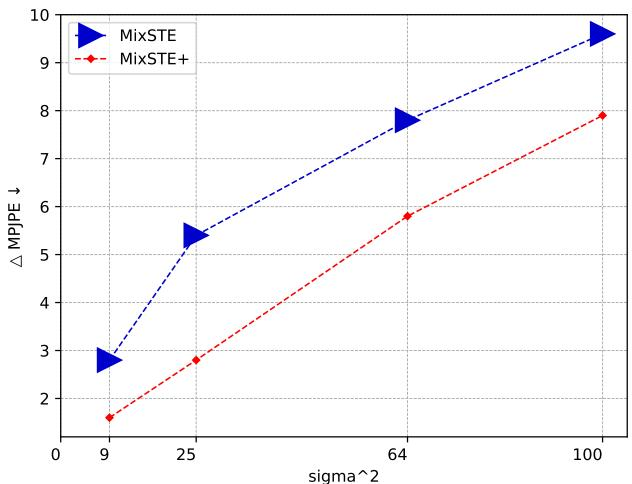
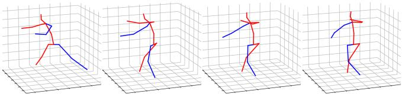

# PoseFormerV2：探索频域以实现高效且鲁棒的 3D 人体姿态估计

Qitao Zhao1\* Ce Zheng2 Mengyuan Liu3 Pichao Wang4 Chen Chen2

1Shandong University 2Center for Research in Computer Vision, University of Central Florida 4Amazon Prime Video

pichaowang@gmail.com

chen.chen@crcv.ucf.edu

## Abstract

近期，基于 Transformer 的方法在序列 2D 到 3D 提升的人体姿态估计任务中取得了显著成功。 0.9 作为开创性工作，PoseFormer 通过级联的 Transformer 层同时捕捉每一视频帧中人体关节点之间的空间关系以及跨帧的人体动态，并取得了令人瞩目的性能。然而，在实际场景中，PoseFormer 及其后续方法的性能受到两个因素的限制：（a）输入关节点序列的长度；（b）2D 关节点检测的质量。现有方法通常对输入序列的所有帧施加自注意力，当为获得更高的估计精度而增加帧数时，会带来巨大的计算开销，并且对 2D 关节点检测器能力有限所天然引入的噪声不具备鲁棒性。本文提出了 PoseFormerV2，它利用长骨骼序列在频域中的紧凑表示，以高效地扩展感受野，并提升对带噪 2D 关节点检测的鲁棒性。该方法对 PoseFormer 进行了最小程度的修改，能够有效地融合时域与频域的特征，相较于前身方法在速度-精度权衡上表现更优。在两个基准数据集（即 Human3.6M 和 MPI-INF-3DHP）上的大量实验表明，所提方法显著优于原始的 PoseFormer 以及其他基于 Transformer 的变体。代码已在 https://github.com/QitaoZhao/PoseFormerV2 发布。

## 1. Introduction

三维人体姿态估计（HPE）旨在基于单目视频（不含中间 2D 表示）[25,28] 或 2D 人体关节点序列（即 2D 到 3D 提升方法）[5,18,37,43]，将人体关节点定位到三维空间中。随着 2D 人体姿态检测器 [6, 26] 的大量可用以及 2D 人体骨骼表示的轻量化特性，基于提升的方法现已成为 3D 人体姿态估计的主流。相较于原始的单目视频，每一视频帧中人体关节点的 2D 坐标对内存更加友好，使得基于提升的方法能够利用较长的关节点序列来提升姿态估计精度。

  

图 1. PoseFormerV2 与 PoseFormerV1 [46] 在 Human3.6M [13] 上的对比。RF 表示感受野（Receptive Field），k×RF 表示完整序列长度与输入 PoseFormerV2 空间编码器的帧数之比为 k，即空间编码器的感受野通过完整序列的少量低频系数被扩展了 k×。所提方法在速度-精度权衡方面大幅优于 PoseFormerV1，且更大的 k 带来更显著的提升，例如当 k 为 27 时可获得 4.6× 的加速。

Transformer[36]首先在自然语言处理（Natural Language Processing, NLP）领域[3, 8]取得了巨大成功，随后将其能力拓展到计算机视觉社区，成为多种视觉任务的事实标准方法，例如图像分类[9, 19, 35]、目标检测[4, 47]以及视频识别[1, 2, 42]。人体关节表示的离散性以及骨架序列中对长程时序依赖建模的需求，使得 Transformer 成为基于提升（lifting）方法的人体姿态估计的极佳选择。此前的工作[15, 16, 32, 44, 46]已将 Transformer 作为 3D 人体姿态估计的骨干网络，并展示了令人瞩目的结果。

  

图 2. PoseFormerV1 概述。PoseFormerV1 主要由两个模块组成：空间变换器编码器（spatial transformer encoder）和时间变换器编码器（temporal transformer encoder）。给定 2D 关节点序列，PoseFormerV1 的时间编码器对所有帧应用自注意力机制（self-attention），以进行人体运动建模。

表 1. 将真值（ground-truth）2D 检测替换为 CPN [6] 2D 姿态检测后，最先进的（state-of-the-art, SOTA）基于 Transformer 的方法所带来的计算开销与性能下降。性能下降在 Human3.6M 数据集（协议 1（Protocol 1））[13] 上报告。RF：感受野（Receptive Field），含义与图 1 中的相同。

<table><tr><td colspan="2">Method</td><td>Seq. Length</td><td>GFLOPs</td><td>Perform. Drop (mm)</td></tr><tr><td colspan="2">PoseFormerV1 [46]</td><td>81</td><td>1.36</td><td>13.0</td></tr><tr><td rowspan="3">StridedTransformer [15] MixSTE [44]</td><td>ICCV&#x27;21 TMM&#x27;22</td><td>243</td><td>1.37</td><td>15.2</td></tr><tr><td>CVPR&#x27;22</td><td>81</td><td>92.46</td><td>16.5</td></tr><tr><td>CVPR&#x27;22 ECCV&#x27;22</td><td>81</td><td>3.12</td><td>11.8</td></tr><tr><td colspan="2">P-STMO [32] PoseFormerV2 (9×RF) PoseFormerV2 (27× RF)</td><td>243 81</td><td>1.74 0.35</td><td>13.5 8.2</td></tr></table>

作为基于 Transformer 方法的开创性工作，PoseFormer [46] 将关节序列特征提取分解为两个阶段（见图 2），其性能超越了传统的基于卷积的方法。首先，将每一帧内的所有关节线性投影到高维向量（即关节 token）作为空间 Transformer 编码器的输入。空间编码器通过自注意力机制建立单帧内各关节之间的依赖关系。在第二阶段，每一帧的关节 token 被合并为一个帧 token，作为时序编码器的输入，用于对序列中所有帧的人体运动进行建模。更多细节见第 3.1 节。

尽管 PoseFormer 具有较强的能力，其性能（以及其他基于 Transformer 的方法）受到两个关键因素的限制。(a) 输入的 2D 骨架序列的长度（帧数）。当前最先进的基于 Transformer 的方法通常使用极长的序列以获得先进的性能，例如 PoseFormer [46] 使用 81 帧，P-STMO [15] 使用 243 帧，MHFormer [16] 使用 351 帧。然而，对如此长的序列密集地施加自注意力在计算上代价极高，例如在 RTX 3090 GPU 上，3 帧 PoseFormer 的单轮训练墙钟时间约为 5 分钟，而 81 帧 PoseFormer 的代价则飙升至约 1.5 小时。(b) 2D 关节检测的质量。2D 关节检测器不可避免地会引入噪声，这源于其训练数据集的偏差以及单帧估计范式带来的时序不一致性。例如，在 Human3.6M 数据集 [13] 上，使用真实标注（ground-truth）的 2D 检测时，PoseFormer 达到 31.3mm 的 MPJPE（Mean Per Joint Position Error，平均每关节位置误差）；当输入替换为 CPN [6] 的 2D 姿态检测时，该结果显著下降至 44.3mm。在实际应用中，长序列推理对于 AR/VR 头显等资源受限设备的硬件部署而言可能难以承受，而高质量的 2D 检测也难以获得。关于现有基于 Transformer 的方法处理长序列的效率与对噪声 2D 关节检测的鲁棒性的更多定量结果见表 1。

基于上述实际考虑，我们提出两个重要的研究问题：

• Q1：如何高效利用长关节序列以获得更高的估计精度？

• Q2：如何提升模型对不可靠 2D 姿态检测的鲁棒性？

少数工作尝试通过引入手工设计的模块来回答上述两个问题中的某一个，例如仅处理部分视频帧以提升效率的下采样-上采样模块（downsampling-and-uplifting module）[10]，以及用于建模身体部位深度歧义和二维检测器不确定性的多假设模块（multi-hypothesis module）[16]。然而，这些方法都未能同时为这两个问题找到单一的解决方案；更糟糕的是，上述问题的解决方案之间似乎存在悖论，例如多假设策略 [16] 提升了鲁棒性却带来了额外的计算开销（另见表 1）。

在本文中，我们进行了“一石二鸟”的初步尝试。仅对既有最佳方法 PoseFormer 进行适度的修改，我们证明了恰当的输入序列表示形式可能是同时回答这两个问题的关键。具体而言，我们聚焦于三维人体姿态估计（Human Pose Estimation, HPE）文献中鲜有探索的频域，提出将输入骨骼序列编码为低频系数。这一表示背后的洞见出人意料地简洁：一方面，低频分量足以表征完整的视觉本质 [38, 41]（例如图像压缩中的二维图像以及本文中的关节轨迹），从而免去了对所有帧进行自注意力（self-attention）这一昂贵操作；另一方面，骨骼序列本身的低频表示能够滤除检测到的关节轨迹中所包含的高频噪声（抖动与离群点）[21, 22]。

我们沿用了 PoseFormer 的时空架构，但强制空间变换器编码器（spatial transformer encoder）只能"看到"长序列中少数几个中心帧。随后，我们用完整序列的低频分量所提供的全局特征来补充"短视"的帧级特征（空间编码器的输出）。在不借助对所有时间步进行昂贵的逐帧自注意力前提下，我们将时间变换器编码器重构为一个时频特征融合模块（Time-Frequency Feature Fusion module）。

在两个人体三维姿态估计基准（即 Human3.6M [13] 和 MPI-INF-3DHP [23]）上的大量实验表明，本文所提出的方法（命名为 PoseFormerV2）在速度-精度权衡以及对二维关节检测噪声的鲁棒性方面，显著优于其前身（参见图 1）以及其他基于 Transformer 的变体。我们的贡献主要体现在三个方面：

• 据我们所知，我们是首个在二维到三维提升的人体姿态估计任务中，利用输入关节序列的频域表示方法的团队。我们发现该表示能够同时契合该领域中两个重要问题（即长序列处理效率与对不可靠关节检测的鲁棒性），且实验证据表明该方法能够轻松推广至其他模型。

• 我们设计了一个有效的时频特征融合（Time-Frequency Feature Fusion）模块，以缩小时域与频域特征之间的差距，使我们能够在速度与精度之间灵活地取得平衡。

• 我们的 PoseFormerV2 在 Human3.6M 数据集上的速度-精度权衡与鲁棒性方面均优于其他基于 Transformer 的方法，并在 MPI-INF-3DHP 数据集上达到了当前最优水平。

## 2. 相关工作

我们的方法建立在结构简洁的 PoseFormer [46] 之上，旨在从频域视角提升其处理长序列的效率以及对带噪关节检测的鲁棒性。因此，本节我们主要聚焦于 2D-to-3D 提升式人体姿态估计（Human Pose Estimation, HPE）中这一类工作（基于 Transformer 的方法），并介绍计算机视觉文献中频域表示的应用，特别是在与基于提升的 3D HPE 最为密切相关的基于骨架的任务中的应用。

## 2.1. 基于 Transformer 的三维人体姿态估计

PoseFormer [46] 是首个在基于提升的三维人体姿态估计中采用视觉 Transformer 作为骨干网络的工作，并大幅超越了此前基于 CNN 的方法。尽管性能具有竞争力，Zhang 等 [44] 指出 PoseFormer 的「先空间后时间」范式可能会忽略每个关节独有的时间模式，并提出采用交替的空间-时间 Transformer 层，以实现细粒度的、针对特定关节的特征提取。MHFormer [16] 进一步将任务相关的先验知识引入 Transformer 进行三维 HPE。具体而言，2D-to-3D 提升是一类反问题（inverse problem），其存在多个合理的答案，因此他们生成多个假设来建模身体部位的歧义以及关节检测器中的不确定性，取得了先进的性能。受图像分类中掩码图像建模（Masked Image Modeling, MIM）进展 [12, 39, 40] 的启发，P-STMO [32] 将掩码关节建模（Masked Joint Modeling）应用于三维 HPE 中，并结合自监督学习。

另一类工作 [10, 15] 致力于提升基于 Transformer 的方法的效率。利用 2D 关节序列中的时间冗余，StridedTransformer [15] 用带步长的卷积（strided convolutions）替代了参数庞大的全连接层。Einfalt 等 [10] 声称逐帧的 2D 关节检测甚至比提升模型本身更加计算昂贵，因此提出以固定间隔对输入视频帧进行下采样，仅在这些采样帧上运行 2D 关节检测器和提升模型。尽管上述方法 [10, 15] 比先前工作更为高效，它们仅利用相邻视频帧之间的一致性来减少时间维度上的自注意力参与者，而未从全局视角出发，因此可能在性能上出现明显下降。

## 2.2. 视觉中的频域表示

由于人类视觉系统对图像的低频成分更敏感，传统的图像压缩算法，例如 JPEG [30] 和 JPEG 2000 [33]，通过为图像的低频离散余弦变换（Discrete Cosine Transform, DCT）系数分配更多的存储预算来降低存储 2D 图像的内存开销。基于同样的逻辑，[41] 提出针对 2D 图像自适应地移除 DCT 成分中无信息的通道，以提高图像分类效率。最近，一些工作 [11, 31] 提出用可由快速算法加速的频率变换来替代昂贵的自注意力机制。GFN [31] 提出使用可学习的频率滤波器高效地混合视觉标记，而 AFNO [11] 通过算子学习进一步提升了频域中标记混合器的性能。此外，Wang 等人 [38] 利用低频快速傅里叶变换（Fast Fourier Transform, FFT）成分来压缩视觉 Transformer。

基于骨架的任务与我们的工作（以 2D 骨架序列作为输入）更为相关。在人体运动预测文献中，先前的工作 [21, 22] 将骨架序列从时域变换为 DCT 系数，以编码人体动态，而非编码静态的关节坐标。他们观察到，丢弃少量高频系数不一定会带来性能下降，甚至能提升预测的未来运动的平滑度。然而，在基于提升（lifting-based）的 3D 人体姿态估计中，2D 关节序列的频域表示尚未被探索过。

我们的方法从这些先前将频率变换应用于视觉任务的尝试中汲取灵感，但视角有所不同。我们在第 3.2.1 节中详细介绍了选择 DCT 系数表示的动机。

## 3. 方法

PoseFormer [46] 通过将序列特征提取分解为两个阶段，$i . e .$，即空间编码器和时间编码器，来促进 3D 人体姿态估计，并已被证明是有效的。然而，当输入序列的长度增加时，它面临着巨大的计算负担，并且对噪声关节检测敏感。在本节中，我们介绍了 PoseFormerV2 的细节，它利用输入序列的频率表示来克服上述两个问题。

## 3.1. PoseFormerV1 [46] 的预备知识

我们首先简要概述 PoseFormerV1（见图 2），为后续讨论其改进奠定基础。PoseFormerV1 包含两个主要模块：用于单帧关节关联建模的空间编码器（spatial encoder），以及用于跨帧人体运动建模的时间编码器（temporal encoder）。给定输入的二维骨架序列 $\mathbf { x } \in \mathbb { R } ^ { F \times J \times 2 }$，其中 $F$ 表示序列长度，$J$ 表示人体表示中的关节数量。首先，将每一帧中人体所有关节的坐标线性投影到一个 $c$ 维向量（即关节嵌入（joint embedding）），记为 ${ \bf z } _ { 0 } \in \mathbb { R } ^ { F \times J \times c }$。将一个可学习的空间位置嵌入（spatial positional embedding） $\mathbf { E } _ { S P o s } \in \mathbb { R } ^ { 1 \times J \times c }$ [9] 加到 $\mathbf { z } _ { 0 }$ 上，以编码与关节相关的信息。

**空间 Transformer 编码器** 利用自注意力机制，分别为每一帧的关节嵌入 $\mathbf { z } _ { 0 } ^ { i } \in \mathbb { R } ^ { 1 \times J \times c }$ 建立空间依赖关系。在该阶段，输入到每个 Transformer 块中的 token 数量为 $J$。第 $i$ 帧经过 $L$ 层空间 Transformer 编码器后的输出记为 $\mathbf { z } _ { L } ^ { i } \in \mathbb { R } ^ { 1 \times J \times c }$。然后将每帧的表示展平并拼接，作为时间 Transformer 编码器的输入 $\mathbf { Z } _ { 0 } \in \bar { \mathbb { R } } ^ { F \times ( J \cdot c ) }$。

**时间 Transformer 编码器**。类似地，在输入 $\mathbf { Z } _ { 0 }$ 上加上一个可学习的时间位置嵌入（temporal positional embedding） $\mathbf { E } _ { T P o s } \in \mathbb { R } ^ { F \times ( J \cdot c ) }$，以为每一帧编码与索引相关的信息。由 $M$ 层 Transformer 组成的时间编码器对整个序列中帧与帧之间的依赖关系进行密集建模，其输出记为 $\mathbf { Z } _ { M } \in \mathbb { R } ^ { F \times ( J \cdot c ) }$。在该阶段，每个 Transformer 层的 token 数为 $F$，即输入序列的长度。

**回归头（Regression head）**。为了估计序列中心帧的三维姿态，使用一个简单的一维卷积来收集时间信息，再通过一个线性投影输出最终的姿态表示 $\mathbf { y } \in \mathbb { R } ^ { 1 \times ( J \cdot 3 ) }$

  

图 3. Human3.6M [13] 数据集中由 CPN [6] 检测的关节轨迹的一个随机选取的示例，以及使用前 3 个、9 个和 27 个 DCT 系数（总共 81 个）的重建结果。注意，即使仅使用前 3 个系数，重建（橙色）曲线也能捕捉到原始输入的整体特征，并且更加平滑。

## PoseFormerV1 的局限性

用 Transformer 层建模每帧内部的关节依赖以及跨帧的人体运动是直接的。虽然这种密集建模带来了先进的估计精度，但由于自注意力相对于 token 数量的二次计算增长 $( i . e .$ ，即空间编码器中的关节数量和时间编码器中的序列长度），它在计算上是不友好的，尤其是在输入序列长度增加时。虽然空间 Transformer 层的 token 数量 $( i . e .$ ，即关节数量）与帧数无关，但值得注意的是，在实际场景中，由于 GPU 并行化能力有限，序列长度隐式地影响了空间编码器的计算预算。除了效率问题之外，PoseFormerV1 对输入 2D 关节检测的质量敏感（实验证据见表 1 和第 4.3 节）。

在下文中，我们提出一种基于输入序列频域表示的替代方案，以克服 PoseFormerV1 的局限性。

## 3.2. PoseFormerV2

## 3.2.1 骨骼序列的频率表示

动机。我们提出用离散余弦变换（Discrete Cosine Transform, DCT）将输入骨骼序列变换到频域，并仅利用一部分低频系数。DCT 系数为输入时间序列编码了多层时间信息。具体而言，低频系数编码其大致轮廓，而高频系数编码其细节，$e . g .$ 抖动或急剧变化。为了更好地说明我们选择这种表示的动机，我们给出了 Human3.6M [13] 数据集中"Directions"动作的 CPN [6] 检测的 81 帧关节轨迹示例，以及分别用前 3、9 和 27 个 DCT 系数重建的结果（见图 3）。随着保留的 DCT 系数数量的增加，重建轨迹更接近原始输入但更不平滑。注意，仅使用 3 个 DCT 系数（用橙色曲线表示）即可捕捉原始轨迹的整体趋势，而使用 9 和 27 个系数（粉色和绿色曲线）则能更好地保留原始序列的特征，同时去除高频噪声（锯齿状波动）。这些观察促使我们在工作中利用输入关节序列中少数信息量大的低频 DCT 分量，作为紧凑且去噪的序列表示。通过这种表示，我们显著减少了作为输入的序列有效长度，并提升了我们模型对 2D 关节检测中所含噪声的鲁棒性。我们在补充材料中给出了 DCT 的正式介绍。

  

图 4. (a) PoseFormerV2 的整体结构概览。(b) 空间变换器（Spatial Transformer）与时频特征融合变换器（Time-Frequency Feature Fusion Transformer）。(c) 频率多层感知机（FreqMLP, Frequency Multi-Layer Perceptron）。举例而言，在 (a) 中，我们使用 3 个中心帧（索引为 -1、0 和 1）进行细粒度的帧级特征提取，并使用完整 9 帧序列的前 3 个 DCT 系数进行全局频域特征提取。因此，与 PoseFormerV1 相比，输入到空间编码器和时间编码器的有效帧数有所减少（分别为 3、6 对比 9、9）。

## 3.2.2 架构

在本节中，我们介绍所提出方法 PoseFormerV2 的架构（整体概览见图 4）。

**空间变换器编码器（spatial transformer encoder）**。给定一个 2D 骨骼序列 $\mathbf{x} \in \mathbb{R}^{F \times J \times 2}$（最好是长序列，例如 $F$ 为 81），我们首先在序列中心（即图 4 (a) 中索引为 0 的帧）周围采样 $F'$（通常 $F' \ll F$）帧，记为 $\mathbf{x}' \in \mathbb{R}^{F' \times J \times 2}$，作为空间编码器的输入。空间编码器的输出记为 $\mathbf{z}^{Time} \in \mathbb{R}^{F' \times (J \cdot c)}$（时间域的帧级特征）。空间编码器的设计直接沿用 PoseFormerV1。

**低频 DCT 系数**。$\mathbf{z}^{Time}$ 被称为「短视的」，因为其感受野（$F'$）相对于整个序列长度（$F$）是受限的。为了高效地利用原始序列的长程人体动态信息，我们转而采用其频域表示。我们首先将完整序列 $\mathbf{x} \in \mathbb{R}^{F \times J \times 2}$ 转换为 DCT 系数，记为 $\mathbf{C} \in \mathbb{R}^{F \times J \times 2}$。然后，对每个关节的轨迹，我们使用低通滤波器仅保留前 $N$（$\ll F$）个系数 $\mathbf{C}' \in \mathbb{R}^{N \times J \times 2}$，其中原始序列的时间信息在很大程度上得以保留，且高频噪声被去除。

低频系数 $\mathbf{C}'$ 被展平并线性投影为 $\mathbf{z}^{Freq} \in \mathbb{R}^{N \times (J \cdot c)}$（频率系数的嵌入）。$\mathbf{z}^{Freq}$ 与一个可学习的频率位置嵌入 $\mathbf{E}_{FPos}$（类似于 PoseFormerV1 中的 $\mathbf{E}_{TPos}$）相加。时间域和频率域的特征被拼接在一起，写作

$$
{ \bf z } = [ { \bf z } ^ { T i m e } ; { \bf z } ^ { F r e q } ] ,\tag{1}
$$

馈送到时频特征融合模块。

时频特征融合（Time-Frequency Feature Fusion）。我们采用 transformer 层来建模跨帧的时间依赖关系，与 PoseFormerV1 中相同。与 PoseFormerV1 完全在时域提取特征不同，所提方法融合了时域与频域两者的特征。为了缩小两个域之间的差距，我们对 vanilla transformer 层进行了简单修改。(1) 时域与频域特征共享自注意力，但使用独立的前馈网络；(2) 我们在时域特征 $\mathbf { z } ^ { T i m e }$ 的前馈网络中应用 FreqMLP（频率多层感知机，Frequency Multi-Layer Perceptron）（见图 4(b)(c)）。在我们的 FreqMLP 中，在 vanilla MLP 之前和之后分别使用 DCT 和 IDCT。该方法背后的直觉是：通过低通滤波器可以从频域特征中滤除高频噪声，但精细的人体运动特征（例如快速的局部运动）也可能作为噪声一同丢失。为了解决这一问题，FreqMLP 充当一个可训练的频域滤波器，使我们能够自适应地调整 2D 关节坐标嵌入（即时域特征）中每个频率分量的权重，作为频域特征的补充。这些模块的公式化为：

$$
\mathbf { z } _ { k } ^ { ' } = \mathrm { M S A } ( \mathbf { z } _ { k } ) ,\tag{2}
$$

$$
\begin{array} { r } { \mathbf { z } _ { k } ^ { T i m e } , \mathbf { z } _ { k } ^ { F r e q } = \mathbf { z } _ { k } ^ { ' } [ : F ^ { \prime } ] , \mathbf { z } _ { k } ^ { ' } [ F ^ { \prime } : ] , } \end{array}\tag{3}
$$

$$
\mathbf { z } _ { k + 1 } = \mathrm { C o n c a t } ( \mathrm { F r e q M L P } ( \mathbf { z } _ { k } ^ { T i m e } ) , \mathrm { M L P } ( \mathbf { z } _ { k } ^ { F r e q } ) ) ,\tag{4}
$$

where MSA 表示多头自注意力（Multi-head Self-Attention），$F ^ { \prime }$ 是采样中心帧的数量。上述修改的有效性在第 4.4 节中得到验证。需要认识到，拼接操作会导致 Transformer 的 token 数量增多。然而，通过将空间编码器限制为仅观察有限数量的中心帧，并加入少量低频 DCT 系数以扩展其感受野，我们可以灵活地降低总体计算量。该方法不仅降低了计算成本，还增强了模型相较于 PoseFormerV1 的抗噪声能力。

回归头与损失函数。与 PoseFormerV1 一样，我们使用一维卷积层来聚合时间信息，并通过线性投影得到序列中心帧的最终三维姿态 $\mathbf { y } \in \mathbb { R } ^ { 1 \times ( J \cdot 3 ) }$。我们采用与 PoseFormerV1 相同的标准 MPJPE（Mean Per Joint Position Error，每关节平均位置误差）损失来训练模型。

## 4. 实验

## 4.1. 数据集与评价指标

我们在两个三维人体姿态估计数据集上进行了实验，即 Human3.6M [13] 和 MPI-INF-3DHP [23]，以证明所提方法的有效性。关于这两个数据集及其各自评价指标的更详细描述见补充材料。

## 4.2. 实现细节与分析

所提方法包含三个针对实验设置的重要超参数。这些参数包括在空间编码器中作为输入的帧数（f）、表示扩大感受野的整个输入序列的长度（F），以及用于融合长程时间信息的所保留的 DCT 系数数量（n）。除非特别说明，为方便起见我们简单地将 $n = f$ 设为相等。在实际应用中，它们可以进一步调节，以灵活地在速度和精度之间进行权衡。当 f 等于 1 时，由于单个 DCT 系数可能不足以对长输入序列的时间信息进行编码，此时将 n 设为 3。当 $f$ 和 n 固定后，模型的计算复杂度也就预先确定了（即空间编码器的 token 数和特征融合模块的 token 数都固定）。我们可以通过调整 $F$ 来有效地将模型的感受野从有限的 f 扩展到任意大小，而不会带来额外的计算开销。这使我们能够高效地利用长序列来提升精度。模型架构与训练的超参数细节在补充材料中给出。

## 4.3. 与最先进方法的对比

Human3.6M。我们在 Human3.6M 上将我们的方法与 Pose-FormerV1 以及其他基于 Transformer 的方法进行比较（表 2）。我们通过改变 $f$ 的值和序列长度来展示模型的灵活性。当扩展比 $( i . e . ,$ ，即完整序列长度与 f 的比值）较大时，我们的方法尤其高效。例如，当扩展比为 81 时，它仅用 77.2 MFLOPs 就达到 47.6 mm 的 MPJPE，而 MHFormer [16] 用 342.9 MFLOPs 达到 47.8 mm 的 MPJPE（慢了 4.4 倍）。此外，在相近的计算预算（约 350 MFLOPs）和相同的完整序列长度（81）下，我们的方法达到 46.0 mm MPJPE，而 StridedTransformer [15] 得到 47.5 mm MPJPE（提升 3.2%↑）。图 5 给出了更清晰的对比，表明所提方法在速度-精度权衡方面优于其他基于 Transformer 的方法。注：带有额外预训练阶段的方法以及计算量极大的 MixSTE [44]（仅 3 帧输入就需要 3420 MFLOPs）未纳入比较。Pose-FormerV2 相对于 PoseFormerV1 的改进如图 1 所示。

表 2. 在 Human3.6M 上与之前基于 Transformer 的方法的定量比较（单位：mm）。$f \colon$ 输入到模型的帧数，Seq. Len.：整个输入序列的长度 $( i . e .$ ，即有效感受野）。最佳得分以粗体标注。（\*）表示使用了额外的预训练阶段，（†）表示我们的重新实现。

<table><tr><td rowspan=1 colspan=1>Method</td><td rowspan=1 colspan=1>f</td><td rowspan=1 colspan=1>Seq.Len.</td><td rowspan=1 colspan=1>MFLOPs</td><td rowspan=1 colspan=1>MPJPE↓/P-MPJPE↓</td></tr><tr><td rowspan=6 colspan=1>PoseFormerV1 [46] ICCV&#x27;21StridedTrans. [15] TMM&#x27;22MixSTE [44](†) CVPR’22MHFormer [16] CVPR&#x27;22MHFormer [16] CVPR’22P-STMO [32](*) ECCV’22P-STMO [32](*) ECCV’22Einfalt et al. [10] WACV&#x27;23</td><td rowspan=1 colspan=1>27</td><td rowspan=1 colspan=1>27</td><td rowspan=1 colspan=1>542.1</td><td rowspan=1 colspan=1>47.0/-</td></tr><tr><td rowspan=1 colspan=1>81</td><td rowspan=1 colspan=1>81</td><td rowspan=1 colspan=1>342.5</td><td rowspan=5 colspan=1>47.5/-49.6/38.947.8/-45.9/-46.8/-45.6/-47.9/-</td></tr><tr><td rowspan=4 colspan=1>392727819</td><td rowspan=3 colspan=1>3927</td><td rowspan=1 colspan=1>3420</td></tr><tr><td rowspan=1 colspan=1>342.9</td></tr><tr><td rowspan=1 colspan=1>1031.8</td></tr><tr><td rowspan=1 colspan=1>818181</td><td rowspan=1 colspan=1>163493543</td></tr><tr><td rowspan=1 colspan=1>PoseFormerV2PoseFormerV2PoseFormerV2</td><td rowspan=1 colspan=1>111</td><td rowspan=1 colspan=1>92781</td><td rowspan=1 colspan=1>77.277.277.2</td><td rowspan=1 colspan=1>49.9/38.748.7/37.847.6/37.3</td></tr><tr><td rowspan=1 colspan=1>PoseFormerV2PoseFormerV2PoseFormerV2</td><td rowspan=1 colspan=1>333</td><td rowspan=1 colspan=1>92781</td><td rowspan=1 colspan=1>117.3117.3117.3</td><td rowspan=1 colspan=1>49.5/38.547.9/37.447.1/37.3</td></tr><tr><td rowspan=1 colspan=1>PoseFormerV2PoseFormerV2</td><td rowspan=1 colspan=1>99</td><td rowspan=1 colspan=1>2781</td><td rowspan=1 colspan=1>351.7351.7</td><td rowspan=1 colspan=1>47.6/37.146.0/36.1</td></tr><tr><td rowspan=1 colspan=1>PoseFormerV2</td><td rowspan=1 colspan=1>27</td><td rowspan=1 colspan=1>243</td><td rowspan=1 colspan=1>1054.8</td><td rowspan=1 colspan=1>45.2/35.6</td></tr></table>

  

图 5. 在 Human3.6M 数据集上 PoseFormerV2 与其他先进 Transformer 方法的对比（单位：毫米）。RF：感受野（Receptive Field）；$k { \times } \mathrm { R F }$ 表示 PoseFormerV2 的感受野通过全序列中的少量低频 DCT 系数扩展了 $k \times$。所提方法在速度-精度权衡方面优于其他方法，且 $k$ 越大，相较于其他方法的提升越显著。（建议在彩色模式下查看）

  

图 6. PoseFormerV2 与其他基于 Transformer 的方法 [16, 44, 46] 在 Human3.6M 上对噪声鲁棒性的对比。将标准差为 sigma 的零均值高斯噪声添加到真实 2D 检测结果上，并展示了随着 sigma 增加其性能下降情况（△MPJPE，单位为 mm）。标记的大小表示模型的计算开销。

表 3. 在 MPI-INF-3DHP 上与先前方法的定量比较。T：整个序列长度，默认值为 1。最佳得分以粗体标出。(\*) 表示使用了额外的预训练阶段；(†) 表示我们的重新实现。

<table><tr><td rowspan=1 colspan=1>Method</td><td rowspan=1 colspan=1></td><td rowspan=1 colspan=1>PCK↑  AUC ↑  MPJPE↓</td></tr><tr><td rowspan=11 colspan=1>Mehta et al. [23]Mehta et al. [24]Pavllo et al. [29] (T=81)Pavllo et al. [29] (T=243)Lin et al. [17] (T=25)Li et al. [14]Chen et al. [5] (T=81)PoseFormerV1 [46] (T=9)(†)MHFormer [16] (T=9)MixSTE [44] (T=27)P-STMO [32] (T=81)(*)</td><td rowspan=3 colspan=1>3DV&#x27;17ACM ToG&#x27;17CVPR&#x27;19</td><td rowspan=1 colspan=1>75.7    39.3     117.6</td></tr><tr><td rowspan=1 colspan=1>76.6    40.4     124.7</td></tr><tr><td rowspan=1 colspan=1>86.0    51.9     84.0</td></tr><tr><td rowspan=6 colspan=1>CVPR&#x27;19BMVC&#x27;19CVPR’20TCSVT&#x27;21ICCV’21CVPR&#x27;22</td><td rowspan=1 colspan=1>85.5    51.5     84.8</td></tr><tr><td rowspan=1 colspan=1>83.6    51.4     79.8</td></tr><tr><td rowspan=1 colspan=1>81.2    46.1     99.7</td></tr><tr><td rowspan=1 colspan=1>87.9    54.0     78.8</td></tr><tr><td rowspan=1 colspan=1>95.4    63.2     57.7</td></tr><tr><td rowspan=1 colspan=1>93.8    63.3     58.0</td></tr><tr><td rowspan=2 colspan=1>CVPR&#x27;22ECCV&#x27;22</td><td rowspan=1 colspan=1>94.4    66.5     54.9</td></tr><tr><td rowspan=1 colspan=1>97.9    75.8     32.2</td></tr><tr><td rowspan=1 colspan=1>PoseFormerV2 (T=81)</td><td rowspan=1 colspan=1></td><td rowspan=1 colspan=1>97.9    78.8     27.8</td></tr></table>

为了证明加入低频DCT（Discrete Cosine Transform）系数有助于提高所提方法的鲁棒性，我们通过在Human3.6M数据集[13]的真实2D检测上添加零均值高斯噪声，使基于lifting的姿态估计任务更具挑战性（图6）。为了保证公平比较，我们对所有方法保持相同的输入序列长度（在本例中为27帧）。对于我们的方法，$f = n = 3 .$。实验证据表明，随着高斯噪声标准差（sigma）的增大，PoseFormerV2的性能下降较少，同时更加高效。我们观察到PoseFormerV1的性能随着sigma从8增大到10而急剧下降。相比之下，所提方法表现出更稳定的趋势。此外，我们的方法甚至优于将2D检测器的不确定性纳入模型设计的MHFormer[16]。有趣的是，我们发现较小的噪声可能会提高3D姿态估计的准确度（sigma = 3）。

表4. 对PoseFormerV1若干改进的消融研究。我们展示了如何将一个9帧的PoseFormerV1逐步转换为PoseFormerV2（使用来自81帧序列的9个DCT系数）。评估在Human3.6M（协议1（Protocol 1），单位：mm）上进行。RF表示感受野（Receptive Field）。

<table><tr><td>Step</td><td>Description</td><td>RF</td><td>MPJPE↓</td></tr><tr><td>(0)</td><td>Original 9-frame PoseFormerV1.</td><td>9</td><td>49.9</td></tr><tr><td>(1)</td><td>Frames are sampled from a longer sequence.</td><td>9</td><td>49.9</td></tr><tr><td>(2)</td><td>Append the embedding of DCT coefficients.</td><td>81</td><td>47.1 (2.8↓)</td></tr><tr><td>(3)</td><td>Replace the vanilla MLP with FreqMLP.</td><td>81</td><td>46.0 (3.9↓)</td></tr></table>

表 5. 对用作 PoseFormerV2 输入的帧数和 DCT 系数数量的消融实验。评估在 Human3.6M（协议 1，单位：mm）上进行。

<table><tr><td>Frame Number (f)</td><td>Coefficient Number (n)</td><td>Full Length</td><td>MFLOPs</td><td>MPJPE</td></tr><tr><td>1</td><td>1</td><td>27</td><td>39.2</td><td>51.1</td></tr><tr><td>1</td><td>3</td><td>27</td><td>77.2</td><td>48.7 (2.4↓)</td></tr><tr><td>3</td><td>1</td><td>27</td><td>79.4</td><td>50.1 (1.0↓)</td></tr><tr><td>3</td><td>3</td><td>27</td><td>117.3</td><td>47.9 (3.2↓)</td></tr><tr><td>9</td><td>9</td><td>27</td><td>351.7</td><td>47.6 (3.5↓)</td></tr></table>

MPI-INF-3DHP。我们还在 MPI-INF-3DHP [23]（表 3）上与其他方法进行了比较。我们从输入的 81 帧序列中使用 9 个中心帧和前 9 个 DCT 系数。所提出的方法优于其他方法，包括带有掩码关节预训练的 P-STMO [32]。这一结果验证了我们方法的有效性。我们的实现遵循 [32]。

定性比较。我们在图 7 中给出了我们的方法与有竞争力的 MHFormer [16] 和 PoseFormerV1 [46] 的定性比较。所有方法都使用 81 帧的 2D 关节序列作为输入。为了进一步说明我们方法的鲁棒性，我们通过向随机选择的关节（例如"左手腕"、"右脚"）的序列 2D 检测添加高斯噪声，使姿态估计任务变得更加困难。所提出的方法即使在高度偏离的 2D 检测下（由浅黄色箭头指示）也能获得可靠的 3D 人体姿态。值得注意的是，我们的模型比 MHFormer 高效约 9 倍（3.12 GFLOPs 对比 0.35 GFLOPs），比 PoseFormerV1 高效约 4 倍（1.36 GFLOPs 对比 0.35 GFLOPs）。

## 4.4. 消融研究

在本节中，我们展示了通过对 PoseFormerV1 进行少量修改如何以循序渐进的方式带来显著改进。此外，为了更深入地了解输入序列的频域表示，我们揭示了输入帧数和保留的 DCT 系数数量对我们方法的影响。

将 PoseFormerV1 转换为 PoseFormerV2。我们继承了 PoseFormerV1 的整体时空架构，并对其时间 Transformer 引入了克制的修改，以实现更好的多域特征融合。作为示例，我们逐步说明如何将 9 帧的 PoseFormerV1 转换为 PoseFormerV2：（1）输入（即 9 帧）从更长的序列（例如 81 帧）的序列中心采样。由于模型的输入实际上未发生变化，此步骤不会带来性能提升，也不会增加感受野。（2）PoseFormerV1 空间编码器的输出 zT ime 被追加到完整序列（此处为 81 帧）的前 n 个 DCT 系数（记为 zF req）的嵌入中，作为时间编码器的输入。为方便起见，我们将 n 设为 9。（3）我们将时间编码器中用于 zT ime 的普通 MLP（zT ime 和 zF req 在替换之前已分别使用各自的普通 MLP）替换为 FreqMLP（详见第 3.2.2 节）。经过这些步骤后，PoseFormerV1 被转换为 PoseFormerV2，感受野从 9 扩大到 81。我们在表 4 中给出了每个步骤带来的改进。值得注意的是，通过从更长的序列（即 81 帧）引入 9 个 DCT 系数，9 帧 PoseFormerV1 的 MPJPE 降低了 7.8%（49.9 mm 对比 46.0 mm），这验证了所提出的输入关节序列 DCT 表示的有效性。

  

图 7. PoseFormerV2 与 MHFormer [16] 和 PoseFormerV1 [46] 的定性比较。我们对某一特定关节点的二维检测随机添加高斯噪声。我们用浅黄色箭头高亮显示偏移的二维检测，并用橙色箭头标注相应的三维姿态估计。相比现有方法，PoseFormerV2 对高噪声输入表现出更强的鲁棒性。

输入帧数与 DCT 系数。在表 5 中，我们研究了输入到空间编码器的帧数（f）以及保留的 DCT 系数数量（n）的影响。此处我们保持整个关节序列的长度固定，即 27。基线模型仅使用一帧中心帧和一个 DCT 系数 $( f = n = 1)$。同时增大这两个参数都能带来持续的提升，而 n 的增大带来更多的误差降低（n = 3 时下降 2.4，而 f = 3 时下降 1.0），因为仅需少量 DCT 系数即可捕捉整个序列的全局特征。我们通过实验发现，f 与 n 以 9 的扩展比例相匹配（即 f = n = 3）时，可在速度与精度之间取得令人满意的折中。

## 4.5. 泛化能力

所提出的频域方法可推广到其他方法，例如 MixSTE [44] 和 MHFormer [16]，因为它们同样采用 Transformer 进行时序建模。我们通过引入低频 DCT 系数来改进这两种方法。详细说明见补充材料。

## 5. 结论

我们提出了一种解决方案，从一个鲜有探索的频域视角出发，同时缓解基于提升的 3D 人体姿态估计中两个看似无关、甚至相互矛盾的问题——长序列输入的处理效率与对噪声关节检测的鲁棒性。所提出的方法 PoseFormerV2 利用长 2D 关节序列的紧凑频域表示，在高效扩大模型感受野的同时提升了其鲁棒性。实验结果表明，我们的方法在 Human3.6M 和 MPI-INF-3DHP 上优于此前基于 Transformer 的方法。

## 补充材料

## A. 概述

补充材料包含以下章节：

- 章节 B：离散余弦变换（Discrete Cosine Transform）的形式化介绍。

- 章节 C：数据集与评价指标。

- 章节 D：更多实现细节。

- 章节 E：PoseFormerV2 与一个纯频域简单基线模型的对比。

- 章节 F：本方法向更多模型的推广。

- 章节 G：可视化与分析。

- 章节 H：更广泛的影响与局限性。

## B. 离散余弦变换

下面给出离散余弦变换（DCT）的形式化介绍。给定一个 2D 关节序列，记为 $\mathbf { x } \in \mathbb { R } ^ { F \times J \times 2 }$，其中 F 为序列长度，J 为每帧中的关节数，第 j 个关节的 x（或 y）坐标轨迹记为 $\mathbf { x } _ { j , 0 } \in \mathbb { R } ^ { F }$（或 $\mathbf { x } _ { j , 1 } \in \mathbb { R } ^ { F }$，为方便起见均记为 $\hat { \mathbf { x } } _ { j }$），它是一个一维时间序列，我们对每条轨迹（共 $J * 2$ 条轨迹）单独施加 DCT。

对于轨迹 $\hat { \mathbf { x } } _ { j }$，第 i 个 DCT 系数计算如下

$$
\begin{array} { r } { C _ { j , i } = \sqrt { \frac { 2 } { F } } \sum _ { f = 1 } ^ { F } x _ { j , f } \frac { 1 } { \sqrt { 1 + \delta _ { i 1 } } } \cos \left( \frac { \pi } { 2 F } ( 2 f - 1 ) ( i - 1 ) \right) } \end{array}\tag{5}
$$

其中 $\delta _ { i 1 } = 1$（当 $i \ = \ 1$ 时），否则 $\delta _ { i 1 } = 0$ 。轨迹中的每个时间步产生一个 DCT 系数，$i . e . , i \in$ $\{ 1 , 2 , \cdots , F \}$ 。DCT 系数对输入时间序列中多个层次的时序信息进行编码。具体而言，低频系数 $( i . e .$（即 $i$ 较小时）编码输入序列的整体轮廓，而高频系数 $( i . e .$（即 $i$ 较大时）编码细节，例如输入序列中的抖动或突变。可以使用逆离散余弦变换（Inverse Discrete Cosine Transform，IDCT）将原始输入序列在时域中恢复，其公式为

$$
\begin{array} { r } { x _ { j , f } = \sqrt { \frac { 2 } { F } } \sum _ { i = 1 } ^ { F } C _ { j , i } \frac { 1 } { \sqrt { 1 + \delta _ { i 1 } } } \cos \left( \frac { \pi } { 2 F } ( 2 f - 1 ) ( i - 1 ) \right) } \end{array}\tag{6}
$$

以及 $f \in \{ 1 , 2 , \cdots , F \}$ 。如果保留 DCT 的全部系数，则是无损的。在实际应用中，我们仅保留少量低频系数、将其他系数置零，就可以略微有损地恢复输入序列。值得注意的是，由于丢弃了部分高频系数，恢复出的曲线相比原始曲线更为平滑。 DCT 的这一性质是理想的——即使以更干净的方式，仅一小部分 DCT 系数就足以表示整个输入序列。这促使我们采用这种表示形式来高效处理长序列，同时提升模型对低质量 2D 检测的鲁棒性，因为低质量 2D 检测中常常出现高频噪声。

## C. 数据集与评价指标（Datasets and Evaluation Metrics）

Human3.6M 是目前应用最广泛的 3D 人体姿态估计基准。该数据集包含在室内不同地点由 4 个相机拍摄的超过 360 万帧视频。该数据集包含 11 位受试者执行 15 种不同的动作，例如「Walking」和「Phoning」。我们按照 [5, 18, 29, 46] 的设置，在 5 位受试者（S1、S5、S6、S7、S8）上训练模型，并在另外 2 位受试者（S9、S11）上进行测试。

MPI-INF-3DHP 在受控的室内环境与具有挑战性的室外环境中采集得到。它也提供了与 Human3.6M 类似的多视角下的不同受试者与动作。

评价指标（Evaluation Metrics）。我们在 Human3.6M 上报告两个常用指标：MPJPE 和 P-MPJPE [45]。 MPJPE（Mean Per Joint Position Error，称为 Protocol 1）度量估计的 3D 姿态与 3D 真值姿态之间的平均欧氏距离。 P-MPJPE（Protocol 2）对估计的 3D 姿态施加刚性变换，然后在经过对齐的估计 3D 姿态与 3D 真值姿态之间计算距离。

对于 MPI-INF-3DHP 数据集，我们按照 [5, 17, 37] 报告 MPJPE、150mm 范围内的关键点正确百分比（Percentage of Correct Keypoint，PCK）以及曲线下面积（Area Under Curve，AUC）。

## D. 更多实现细节（More Implementation Details）

我们的方法建立在 PoseFormerV1 [46] 之上。为了更好地展示我们对输入序列进行 DCT 系数表示的有效性，并与 PoseFormerV1 进行公平比较，我们直接沿用 PoseFormerV1 中关于模型架构的最优超参数，尽管进一步的探索可能会带来更多的性能提升。

模型架构超参数（Model architecture hyper-parameters）。空间 Transformer 中的嵌入特征维度 $c$ 为 32，空间 Transformer 与特征融合 Transformer 的层数均为 4，沿用 [46] 的设置。此外，空间-时间位置嵌入（Spatial-Temporal Positional Embedding）的设计也沿用 [46]。

实验设置。我们的实验使用 Pytorch [27] 在单块 NVIDIA RTX 3090 上进行。对于训练和测试，我们遵循 [5, 18, 29, 46] 应用水平翻转数据增强。我们使用 AdamW [20] 优化器训练模型 80 个 epoch，权重衰减为 0.1。初始学习率设为 8e-4，采用指数学习率衰减策略，衰减因子为 0.99。我们在 Human3.6M 上采用 CPN [7] 的 2D 姿态检测，遵循 [5, 18, 29]。对于 MPI-INF-3DHP 数据集，我们使用真实标注的 2D 检测结果，遵循 [17, 24]。

## E. 简单基线（Simple Baseline）

在我们的方法中，PoseFormerV1 [46] 的时间编码器被重构为时频特征融合（Time-Frequency Feature Fusion）模块，我们展示了输入序列的低频系数有助于提高模型处理长序列的效率以及其对噪声关节点检测的鲁棒性。鉴于该表示的有效性，读者可能会提出一个问题：为什么不完全从输入序列的 DCT 系数中提取特征，而是另外将它们与时域特征相结合？在此我们设计了一个基线模型，将 PoseFormerV1 [46] 的输入（时域中的关节点坐标）简单替换为输入序列的低频 DCT 系数。基线模型与我们的方法保持相同的完整序列长度和保留的 DCT 系数数量（记为 n）。为方便起见，输入 PoseFormerV2 空间编码器的帧数（f）设为 n。我们提供的量化结果表明，这种简单直接的方法效果不佳，尤其是当完整序列长度与 n 之比增大时（见表 6）。仅序列中少数中心帧的特征就能显著提升精度，$e . g .$ ，对于长度为 81 的完整输入序列中的 3 个中心帧，MPJPE 从 49.7mm 降至 47.1mm（下降 5.2%，见表 6 第 3 行）。

表 6. PoseFormerV2 与简单基线的对比。评估在 Human3.6M（协议 1，MPJPE）[13] 上进行，帧数（f）仅适用于 PoseFormerV2。

<table><tr><td>Frame Number (f)</td><td>Coefficient Number (n)</td><td>Full Length</td><td>Baseline</td><td>PoseFormerV2</td></tr><tr><td>3</td><td>3</td><td>9</td><td>50.2</td><td>49.5 (0.7↓)</td></tr><tr><td>3</td><td>3</td><td>27</td><td>48.7</td><td>47.9 (0.8↓)</td></tr><tr><td>3</td><td>3</td><td>81</td><td>49.7</td><td>47.1 (2.6↓)</td></tr><tr><td>9</td><td>9</td><td>27</td><td>48.8</td><td>47.6 (1.2↓)</td></tr><tr><td>9</td><td>9</td><td>81</td><td>47.8</td><td>46.0 (1.8↓)</td></tr></table>

直觉上，PoseFormerV2 的空间编码器对时间域中若干中心帧的关节坐标进行编码，有助于捕捉细粒度的人体运动，从而有利于序列中心帧的 3D 姿态估计。相反，输入序列的低频系数会过滤掉高频噪声以及对姿态估计可能具有信息量的人体运动细节 $( e . g .$ ，快速运动)，即所谓的过度平滑（over-smoothing）问题。因此，来自时间域和频率域的特征 $i . e .$ ，中心帧的关节坐标和序列的低频系数，承载着互补的语义信息。这些考虑使得我们所提出的时频特征融合（Time-Frequency Feature Fusion）设计成为必要。

## F. 推广至更多模型（Generalization to More Models）

在正文中，我们聚焦于从一个几乎未被探索的频率域视角来改进 PoseFormerV1 [46]。在这一部分中，我们将说明所提出的频率域方法同样能够良好地泛化到其他现有的最先进方法 $e . g .$ ，MixSTE [44] 和 MHFormer [16]。由于这些方法 [16, 44] 也像 PoseFormerV1 [46] 一样沿时间维度对所有帧施加自注意力，所提出的方法可以轻松地嵌入到它们的模型中，无需对模型架构进行复杂的重新设计。为了公平比较，我们直接采用这些原始方法的最优超参数 $( e . g .$ ，层数、通道维度)。进一步的超参数调优可能带来额外的性能提升。

  

图 8. 在 Human3.6M [13] 上，对 MixSTE [44] 及其采用序列频率表示的改进版本的对比。RF：感受野（Receptive Field），k×RF 表示通过全序列的少量低频 DCT（Discrete Cosine Transform）系数，将 MixSTE 的感受野扩展 k×。所提方法有助于 MixSTE 在速度与精度之间获得更好的折中。（建议以彩色方式查看）

  

图 9. 在 Human3.6M [13] 数据集上，MixSTE [44] 与其使用序列低频 DCT 系数的改进版本在抗噪声鲁棒性方面的对比。在真实 2D 检测结果上添加标准差为 σ 的零均值高斯噪声，并展示随着 σ 增大时其性能下降（△MPJPE）情况。标记的大小表示模型的计算成本。

MixSTE [44] 采用了与 PoseFormerV1 [46] 相同的时空架构。与 PoseFormerV1 的"先空间后时间"范式相比，MixSTE 交替使用空间与时间 Transformer 编码器。类似地，我们从一个较长的视频序列中中心采样少量视频帧，作为 MixSTE 空间编码器的输入。对于时间编码器，我们将时域特征（空间编码器的输出）与完整输入序列的低频系数嵌入拼接起来。MixSTE 及其改进版本的对比展示在图 8 和图 9 中。原始的 MixSTE 计算开销很大，而我们的方法同时提升了其效率与精度：MixSTE 在 30.8 GFLOPs 的计算量下取得 46.2 mm 的 MPJPE，而其改进版本仅需 15.4 GFLOPs 即达到 45.3 mm 的 MPJPE（速度提升 2 倍，误差降低 1.9%，参见图 8 中的亮红色曲线）。我们还表明，本方法提升了 MixSTE 对含噪 2D 关键点检测的鲁棒性（图 9）。具体而言，我们在 Human3.6M [13] 上对 27 帧的真值 2D 关键点序列添加零均值高斯噪声。改进后的 MixSTE（记为 MixSTE+）将 3 个中心帧作为其空间编码器的输入，并将前 3 个 DCT 系数作为完整序列更为干净的全序列全局表示。MixSTE+ 的性能下降更少，同时效率提升 6 倍（30.8 GFLOPs 对比 5.1 GFLOPs，由标记大小表示）。

  

图 10. MHFormer [16] 及其改进版本（使用序列的低频 DCT 系数）在 Human3.6M [13] 数据集上对噪声鲁棒性的对比。实验设置同图 9。标记的大小表示模型的计算开销。

MHFormer [16] 将多假设引入其架构中，以建模身体部位的深度歧义性和关节检测器的不确定性，因此具有相对较好的鲁棒性（实验结果可在主论文中查阅）。此外，MHFormer 同样包含类似 PoseFormerV1 [46] 的时空 transformer 模块。为进一步验证我们方法的普适性，我们以 MixSTE+ 的方式对 MHFormer 进行了类似改进。实验证据表明，尽管 MHFormer 已具备关于噪声关节检测的先验知识，我们所提方法仍能在降低其计算成本的同时提升其鲁棒性（见图 10）。因此，该结果表明，就模型鲁棒性的提升而言，我们的方法与其他方法是兼容的。

至此，我们已成功将所提方法推广到另外两种基于 transformer 的方法，即 MixSTE [44] 和 MHFormer [16]。未来，我们可能会探索将所提方法推广到更广泛的模型架构，例如 3D 人体姿态估计中基于 CNN 和基于 GNN 的方法。此外，我们相信我们的方法也可应用于其他任务，尤其是基于骨架的任务，在这些任务中，长序列处理的计算成本以及人体骨架表示的质量可能成为问题。

## G. 可视化与分析

在本节中，我们提供了一系列具有挑战性的真实场景图像上的定性结果，以展示 PoseFormerV2 在实际场景中的鲁棒性。

图 11 展示了若干具有代表性的困难案例，使用 HRNet [34] 进行 2D 关节检测：（a）遮挡，即关节之间相互重叠；（b）（c）漏检的关节；（d）交换的关节。具体而言，（b）中第 4 张图中人物的右臂以及（c）中第 3 张图中人物的左臂出现漏检。此外，在（d）中第 2 张图中，人物的两条腿被交换（用浅黄色圆圈标注）。尽管 2D 关节输入并不完美，PoseFormerV2 仍能在 3D 空间中为这些关节推断出正确的位置（用橙色圆圈标出）。

分析。PoseFormerV2 的鲁棒性归因于对输入关节序列使用了合适的表示——低频 DCT 系数，而非可能引入额外计算成本的手工设计模块，例如文献 [16] 中的多假设生成模块。低频 DCT 系数提供了输入序列的全局视角，因此单个视频帧中所包含的噪声被弱化。对 DCT 系数的这一使用方式还给 PoseFormerV2 带来了额外优势，即相邻帧之间估计所得 3D 姿态的时间一致性。我们提供了一个视频示例，用以说明在 2D 关节检测受到极端破坏的情况下，所提方法仍能保持出色的一致性（即时间稳定性）。

## H. 更广泛的影响与局限性

更广泛的影响。在本文中，我们试图协调真实场景下三维人体姿态估计（3D HPE, Human Pose Estimation）应用中的两个关键问题，即模型处理长序列以提升精度的效率，以及它们对含噪二维检测的鲁棒性，因为高质量的关节序列难以获取。为了鼓励更多的实际应用，我们可能将研究重点从在精心控制的数据集上追求边际改进，转变为克服现有方法在实际使用中的缺陷。我们期待更多研究沿着这一方向展开。

  

(a)

  

您发送的"(b)"似乎是某个图或表格的子标签，缺少上下文。能否提供完整的英文论文 Markdown 内容，以便我进行翻译？

  

**图 11.** PoseFormerV2 在具有挑战性的野外图像下的定性结果：(a) 遮挡；(b)(c) 漏检的二维关节点；(d) 错位的二维关节点。我们用浅黄色圆圈标出不可靠的二维检测结果，并用橙色圆圈标出对应的三维姿态估计结果。PoseFormerV2 对不完美的二维关节点检测表现出很强的鲁棒性。

另一方面，本工作基于一种鲜有研究的频率方法——离散余弦变换（Discrete Cosine Transform, DCT），它在传统图像压缩算法中扮演着重要角色。我们希望本研究能够启发更多研究来重新审视传统信号处理技术，因为在深度学习时代，我们所处理的各种数据实际上都是不同形式的信号。这些精心设计的方法与近年来发展起来的深度学习方法的恰当结合，可能会带来意想不到的优势。

局限性。我们的方法包含两个重要的超参数——采样中心帧的数量，以及完整输入序列所保留的 DCT 系数的数量。目前，它们是依据实验结果或人工经验在速度与精度之间进行权衡来选取的。未来，我们可以将它们重塑为可从输入数据中自动学习到的可学习参数，或者进一步从理论上推导出它们的最优选择，从而消除参数搜索的需要。

## 参考文献

[1] Anurag Arnab, Mostafa Dehghani, Georg Heigold, Chen Sun, Mario Lucič, and Cordelia Schmid. ViViT：一种视频视觉 Transformer（ViViT: A video vision transformer）. 发表于 IEEE/CVF 国际计算机视觉会议（ICCV），2021 年 10 月，第 6836–6846 页。1

[2] Gedas Bertasius, Heng Wang, and Lorenzo Torresani. 时空注意力就是理解视频所需的全部吗？（Is space-time attention all you need for video understanding?）发表于国际机器学习会议（ICML），2021 年 7 月。1

[4] Nicolas Carion, Francisco Massa, Gabriel Synnaeve, Nicolas Usunier, Alexander Kirillov, and Sergey Zagoruyko. 使用 Transformer 进行端到端目标检测（End-to-end object detection with transformers）. 发表于欧洲计算机视觉会议，第 213–229 页。Springer，2020。1

[5] Tianlang Chen, Chen Fang, Xiaohui Shen, Yiheng Zhu, Zhili Chen, and Jiebo Luo. 基于骨骼姿态分解的解剖学感知 3D 人体姿态估计（Anatomy-aware 3D human pose estimation with bone-based pose decomposition）. 《IEEE Transactions on Circuits and Systems for Video Technology》，2021。1, 7, 9

[6] Yilun Chen, Zhicheng Wang, Yuxiang Peng, Zhiqiang Zhang, Gang Yu, and Jian Sun. 用于多人姿态估计的级联金字塔网络（Cascaded pyramid network for multi-person pose estimation）. 发表于 CVPR，2018。1, 2, 4

[7] Yilun Chen, Zhicheng Wang, Yuxiang Peng, Zhiqiang Zhang, Gang Yu, and Jian Sun. 用于多人姿态估计的级联金字塔网络（Cascaded pyramid network for multi-person pose estimation）. 发表于 IEEE 计算机视觉与模式识别会议论文集，第 7103–7112 页，2018。9

[8] Jacob Devlin, Ming-Wei Chang, Kenton Lee, and Kristina Toutanova. BERT：用于语言理解的深度双向 Transformer 预训练（BERT: Pre-training of deep bidirectional transformers for language understanding）. arXiv 预印本 arXiv:1810.04805，2018。1

[10] Moritz Einfalt, Katja Ludwig, and Rainer Lienhart. 提升与上采样：基于提升 Transformer 的高效三维人体姿态估计（Uplift and upsample: Efficient 3d human pose estimation with uplifting transformers）. 发表于 IEEE/CVF 冬季计算机视觉应用会议（WACV）论文集，2023 年 1 月. 2, 3, 6

[11] John Guibas, Morteza Mardani, Zongyi Li, Andrew Tao, Anima Anandkumar, and Bryan Catanzaro. 自适应傅里叶神经算子：Transformer 中高效的令牌混合器（Adaptive fourier neural operators: Efficient token mixers for transformers）. arXiv 预印本 arXiv:2111.13587, 2021. 3

[12] Kaiming He, Xinlei Chen, Saining Xie, Yanghao Li, Piotr Dollar, and Ross Girshick. 掩码自编码器是可扩展的视觉学习器（Masked autoencoders are scalable vision learners）. 发表于 IEEE/CVF 计算机视觉与模式识别会议论文集，第 16000–16009 页，2022. 3

[13] C. Ionescu, D. Papava, V. Olaru, and C. Sminchisescu. Human3.6m：自然环境中三维人体感知的大规模数据集与预测方法（Human3.6m: Large scale datasets and predictive methods for 3d human sensing in natural environments）. IEEE TPAMI, 2014. 1, 2, 3, 4, 6, 7, 10, 11

[14] Shichao Li, Lei Ke, Kevin Pratama, Yu-Wing Tai, Chi-Keung Tang, and Kwang-Ting Cheng. 基于进化训练数据的深度级联单体三维人体姿态估计（Cascaded deep monocular 3d human pose estimation with evolutionary training data）. 发表于 IEEE/CVF 计算机视觉与模式识别（CVPR）会议论文集，2020 年 6 月. 7

[15] Wenhao Li, Hong Liu, Runwei Ding, Mengyuan Liu, Pichao Wang, and Wenming Yang. 利用跨步 Transformer 挖掘时间上下文进行三维人体姿态估计（Exploiting temporal contexts with strided transformer for 3d human pose estimation）. IEEE 多媒体学报（IEEE Transactions on Multimedia）, 2022. 2, 3, 6

[16] Wenhao Li, Hong Liu, Hao Tang, Pichao Wang, and Luc Van Gool. MHFormer：用于三维人体姿态估计的多假设 Transformer（Multi-hypothesis transformer for 3d human pose estimation）. 发表于 IEEE/CVF 计算机视觉与模式识别（CVPR）会议论文集，第 13147–13156 页，2022 年 6 月. 2, 3, 6, 7, 8, 10, 11

[17] Jiahao Lin and Gim Hee Lee. 基于轨迹空间分解的深度视频三维人体姿态估计（Trajectory space factorization for deep video-based 3d human pose estimation）. 发表于 BMVC, 2019. 7, 9

[18] Ruixu Liu, Ju Shen, He Wang, Chen Chen, Sen-ching Cheung, and Vijayan Asari. 注意力机制利用时间上下文：实时三维人体姿态重建（Attention mechanism exploits temporal contexts: Real-time 3d human pose reconstruction）. 发表于 CVPR, 2020. 1, 9

[19] Ze Liu, Yutong Lin, Yue Cao, Han Hu, Yixuan Wei, Zheng Zhang, Stephen Lin, and Baining Guo. Swin Transformer：使用移位窗口的分层视觉 Transformer（Swin transformer: Hierarchical vision transformer using shifted windows）. 发表于 IEEE/CVF 国际计算机视觉会议论文集，第 10012–10022 页，2021. 1

[20] Ilya Loshchilov and Frank Hutter. 解耦的权重衰减正则化（Decoupled weight decay regularization）. arXiv 预印本 arXiv:1711.05101, 2017. 9

[21] Wei Mao, Miaomiao Liu, and Mathieu Salzmann. 历史重演：通过运动注意力进行人体运动预测（History repeats itself: Human motion prediction via motion attention）. 发表于欧洲计算机视觉会议论文集，第 474–489 页. Springer, 2020. 2, 3

[22] Wei Mao, Miaomiao Liu, Mathieu Salzmann, and Hongdong Li. 学习轨迹依赖性用于人体运动预测（Learning trajectory dependencies for human motion prediction）。载于：IEEE/CVF International Conference on Computer Vision 论文集，第 9489–9497 页，2019 年。2, 3

[23] Dushyant Mehta, Helge Rhodin, Dan Casas, Pascal Fua, Oleksandr Sotnychenko, Weipeng Xu, and Christian Theobalt. 使用改进 CNN 监督的野外单目三维人体姿态估计（Monocular 3d human pose estimation in the wild using improved cnn supervision）。载于：2017 International Conference on 3D Vision (3DV)，第 506–516 页。IEEE，2017 年。3, 6, 7

[25] Gyeongsik Moon and Kyoung Mu Lee. I2L-MeshNet：从单张 RGB 图像进行精确三维人体姿态与网格估计的图像到 lixel 预测网络（I2l-meshnet: Image-to-lixel prediction network for accurate 3d human pose and mesh estimation from a single rgb image）。载于：ECCV，2020 年。1

[26] Alejandro Newell, Kaiyu Yang, and Jia Deng. 用于人体姿态估计的堆叠沙漏网络（Stacked hourglass networks for human pose estimation）。载于：European Conference on Computer Vision，第 483–499 页。Springer，2016 年。1

[28] Georgios Pavlakos, Xiaowei Zhou, and Kostas Daniilidis. 用于三维人体姿态估计的序数深度监督（Ordinal depth supervision for 3D human pose estimation）。载于：CVPR，2018 年。1

[29] Dario Pavllo, Christoph Feichtenhofer, David Grangier, and Michael Auli. 基于时间卷积与半监督训练的视频三维人体姿态估计（3d human pose estimation in video with temporal convolutions and semi-supervised training）。载于：CVPR，2019 年。7, 9

[30] William B Pennebaker and Joan L Mitchell. JPEG：静止图像数据压缩标准（JPEG: Still image data compression standard）。Springer Science & Business Media，1992 年。3

[31] Yongming Rao, Wenliang Zhao, Zheng Zhu, Jiwen Lu, and Jie Zhou. 用于图像分类的全局滤波器网络（Global filter networks for image classification）。Advances in Neural Information Processing Systems，34:980–993，2021 年。3

[32] Wenkang Shan, Zhenhua Liu, Xinfeng Zhang, Shanshe Wang, Siwei Ma, and Wen Gao. P-STMO：用于三维人体姿态估计的预训练时空多对一模型（P-stmo: Pre-trained spatial temporal many-to-one model for 3d human pose estimation）。arXiv preprint arXiv:2203.07628，2022 年。2, 3, 6, 7

[33] Athanassios Skodras, Charilaos Christopoulos, and Touradj Ebrahimi. JPEG 2000 静止图像压缩标准（The jpeg 2000 still image compression standard）。IEEE Signal Processing Magazine，18(5):36–58，2001 年。3

[34] Ke Sun, Bin Xiao, Dong Liu, and Jingdong Wang. 用于人体姿态估计的深度高分辨率表示学习（Deep high-resolution representation learning for human pose estimation）。载于：CVPR，2019 年。11

[35] Hugo Touvron, Matthieu Cord, Matthijs Douze, Francisco Massa, Alexandre Sablayrolles, and Hervé Jégou. 通过注意力机制训练数据高效的图像 Transformer 与蒸馏（Training data-efficient image transformers & distillation through attention）。arXiv preprint arXiv:2012.12877，2020 年。1

[37] Jingbo Wang, Sijie Yan, Yuanjun Xiong, Dahua Lin. 视频中运动引导的三维姿态估计. 载于：欧洲计算机视觉会议（European Conference on Computer Vision），第 764–780 页，Springer，2020 年。1, 9

[38] Zhenyu Wang, Hao Luo, Pichao WANG, Feng Ding, Fan Wang, Hao Li. VTC-LFC：基于低频分量的 Vision Transformer 压缩. 载于：第三十六届神经信息处理系统大会（Thirty-Sixth Conference on Neural Information Processing Systems），2022 年。2, 3

[39] Chen Wei, Haoqi Fan, Saining Xie, Chao-Yuan Wu, Alan Yuille, Christoph Feichtenhofer. 自监督视觉预训练中的掩码特征预测. 载于：IEEE/CVF 计算机视觉与模式识别会议论文集（Proceedings of the IEEE/CVF Conference on Computer Vision and Pattern Recognition），第 14668–14678 页，2022 年。3

[40] Zhenda Xie, Zheng Zhang, Yue Cao, Yutong Lin, Jianmin Bao, Zhuliang Yao, Qi Dai, Han Hu. SimMIM：一个用于掩码图像建模的简单框架. 载于：IEEE/CVF 计算机视觉与模式识别会议论文集（Proceedings of the IEEE/CVF Conference on Computer Vision and Pattern Recognition），第 9653–9663 页，2022 年。3

[41] Kai Xu, Minghai Qin, Fei Sun, Yuhao Wang, Yen-Kuang Chen, Fengbo Ren. 频域学习. 载于：IEEE/CVF 计算机视觉与模式识别会议（CVPR）论文集，2020 年 6 月。2, 3

[42] Shen Yan, Xuehan Xiong, Anurag Arnab, Zhichao Lu, Mi Zhang, Chen Sun, Cordelia Schmid. 用于视频识别的多视角 Transformer. 载于：IEEE/CVF 计算机视觉与模式识别会议论文集（Proceedings of the IEEE/CVF Conference on Computer Vision and Pattern Recognition），第 3333–3343 页，2022 年。1

[43] Ailing Zeng, Xiao Sun, Fuyang Huang, Minhao Liu, Qiang Xu, Stephen Lin. SRNet：通过拆分-再组合方法提升三维人体姿态估计的泛化能力. 载于：欧洲计算机视觉会议（ECCV），2020 年。1

[44] Jinlu Zhang, Zhigang Tu, Jianyu Yang, Yujin Chen, Junsong Yuan. MixSTE：用于视频中三维人体姿态估计的 Seq2Seq 混合时空编码器. 载于：IEEE/CVF 计算机视觉与模式识别会议论文集（Proceedings of the IEEE/CVF Conference on Computer Vision and Pattern Recognition），第 13232–13242 页，2022 年。2, 3, 6, 7, 8, 10, 11

[45] Ce Zheng, Wenhan Wu, Taojiannan Yang, Sijie Zhu, Chen Chen, Ruixu Liu, Ju Shen, Nasser Kehtarnavaz, Mubarak Shah. 基于深度学习的人体姿态估计综述，2020 年。9

[46] Ce Zheng, Sijie Zhu, Matias Mendieta, Taojiannan Yang, Chen Chen, Zhengming Ding. 基于空间与时间 Transformer 的三维人体姿态估计. 载于：IEEE/CVF 国际计算机视觉会议（ICCV）论文集，第 11656–11665 页，2021 年 10 月。1, 2, 3, 4, 6, 7, 8, 9, 10, 11

[47] Xizhou Zhu, Weijie Su, Lewei Lu, Bin Li, Xiaogang Wang, Jifeng Dai. Deformable DETR：用于端到端目标检测的可变形 Transformer. arXiv 预印本 arXiv:2010.04159，2020 年。1