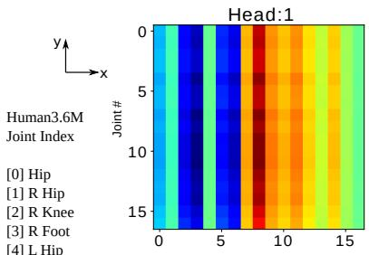
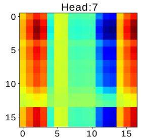
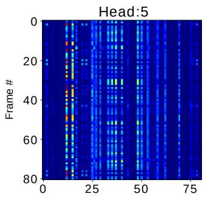
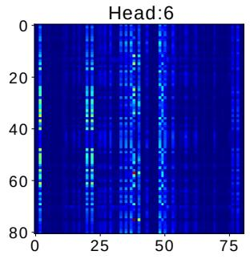
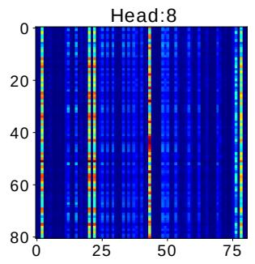
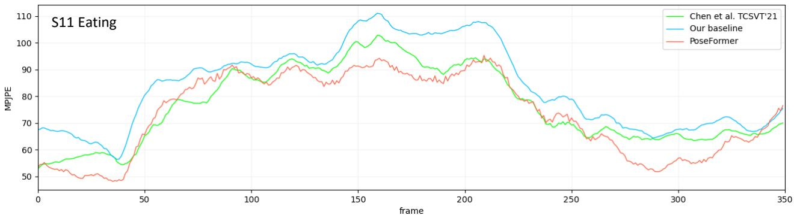
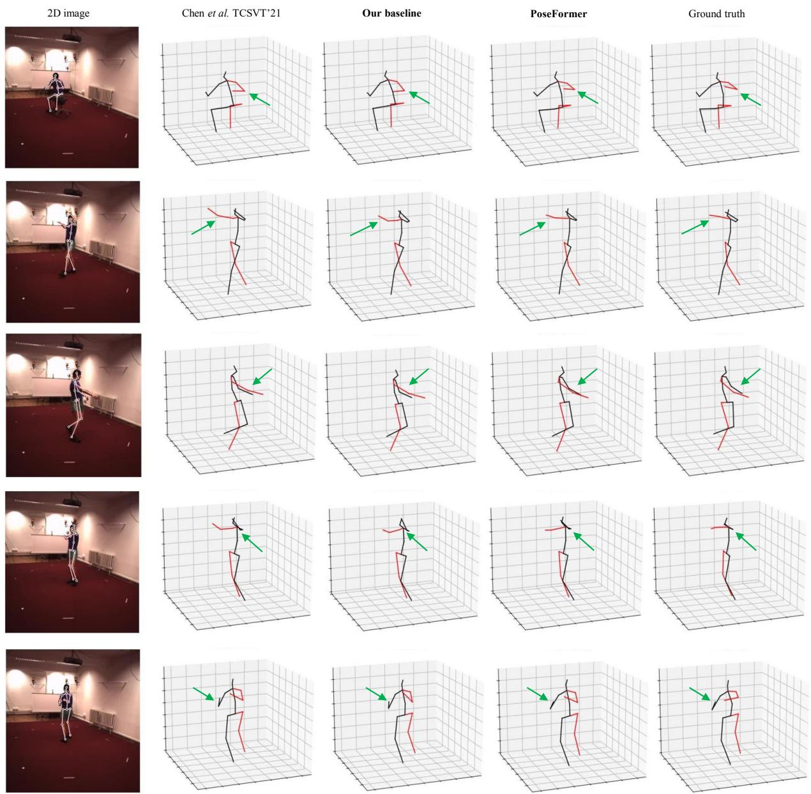
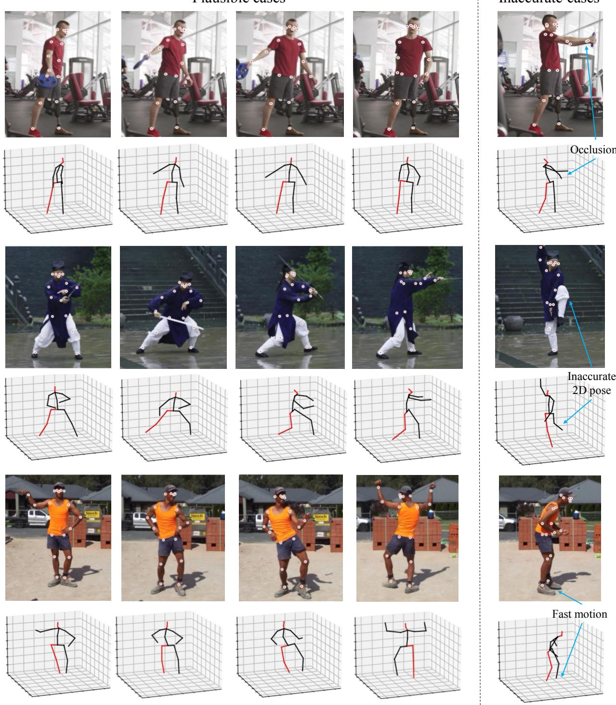

# 基于时空 Transformer 的三维人体姿态估计

Ce Zheng1、Sijie Zhu1、Matias Mendieta1、Taojiannan Yang1、Chen Chen1、Zhengming Ding2

1Center for Research in Computer Vision（中佛罗里达大学计算机视觉研究中心），美国

2Department of Computer Science, Tulane University（杜兰大学计算机科学系），美国

{cezheng,sizhu,mendieta,taoyang1122}@knights.ucf.edu；

chen.chen@crcv.ucf.edu；zding1@tulane.edu

## 摘要

Transformer 架构已成为自然语言处理中的主流模型，如今正被引入计算机视觉任务，例如图像分类、目标检测和语义分割。然而，在人体姿态估计领域，卷积架构仍占据主导地位。在本文中，我们提出了 PoseFormer，一种纯粹基于 Transformer 的视频三维人体姿态估计方法，不涉及任何卷积架构。受近期视觉 Transformer 发展的启发，我们设计了一种时空 Transformer 结构，能够全面建模每一帧内人体关节之间的关系以及跨帧的时间相关性，从而输出中心帧的精确三维人体姿态。我们在两个流行且标准的基准数据集 Human3.6M 和 MPI-INF-3DHP 上对所提方法进行了定量与定性评估。大量的实验表明，PoseFormer 在这两个数据集上均达到了当前最优性能。代码已开源，地址为 https://github.com/zczcwh/PoseFormer

## 1. 引言

人体姿态估计（Human Pose Estimation, HPE）旨在从图像和视频等输入数据中定位人体关节点并构建身体表征（例如骨骼位置）。HPE 提供人体的几何与运动信息，可广泛应用于诸多领域（例如人机交互、运动分析、医疗健康）。当前的研究工作大体可以分为两类：（1）直接估计方法，以及（2）二维到三维提升方法。直接估计方法 [31, 29] 从二维图像或视频帧直接推断三维人体姿态，无需中间估计二维姿态表征。二维到三维提升方法 [25, 5, 43, 38] 从中间估计得到的二维姿态推断三维人体姿态。受益于当前最先进的二维姿态检测器的优异性能，二维到三维提升方法通常优于直接估计方法。然而，将这些二维姿态映射到三维并非易事；由于深度模糊和遮挡，从同一二维姿态可能生成多种潜在的三维姿态。为缓解其中一些问题并保持自然的连贯性，许多近期工作已将视频中的时序信息集成到其方法中。例如，[25, 5] 利用时序卷积神经网络（temporal CNNs）从相邻帧捕获全局依赖关系，[33] 则使用循环结构取得类似效果。然而，这两种架构的时序相关性窗口都是有限的。基于 CNN 的方法通常依赖扩张（dilation）技术，这天然地具有有限的时序连通性，而循环网络则主要受限于简单的顺序相关性。

最近，Transformer [37] 已成为自然语言处理（Natural Language Processing, NLP）领域事实上的标准模型，这得益于其高效性、可扩展性以及强大的建模能力。凭借 Transformer 的自注意力机制，可以清晰地捕获长输入序列之间的全局相关性。这使得它成为序列数据问题中尤为契合的架构，因此也自然可以扩展到三维 HPE。凭借其全面的连通性与表达能力，Transformer 为跨帧学习更强的时序表征提供了机会。

然而，近期工作 [12, 36] 表明，Transformer 需要特定的设计才能在视觉任务上达到与 CNN 对应方法相当的性能。具体而言，它们通常需要极大规模的训练数据集 [12]，或者在应用于较小数据集时使用增强的数据增广与正则化策略 [36]。此外，现有的视觉 Transformer 主要被局限于图像分类 [12, 36]、目标检测 [4, 50] 以及分割 [41, 47] 等任务，但如何利用 Transformer 的强大能力来解决三维 HPE 任务仍不明确。

要回答这个问题，我们首先将 Transformer 直接应用于二维到三维提升人体姿态估计（Human Pose Estimation, HPE）。在这种情况下，我们将给定序列中每一帧的整个二维姿态视为一个 token（图 1(a)）。虽然这种基线方法在一定程度上是可行的，但它忽略了空间关系（关节到关节）的自然区分，留下了潜在的改进空间。这种基线方法的一个自然扩展是将每个二维关节坐标视为一个 token，并提供由该序列所有帧中的这些关节所构成的输入（图 1(b)）。然而，在这种情况下，当使用较长的帧序列时，token 的数量会变得非常大（在三维 HPE 中，243 帧和每帧 17 个关节是常见的，token 的数量将达到 243×17=4131）。由于 Transformer 计算每个 token 与其他所有 token 之间的直接注意力，模型的内存需求将达到不合理的水平。

  

图 1. 两种基线方法。

因此，作为应对这些挑战的有效方案，我们提出了 PoseFormer，这是首个用于视频中 2D 到 3D 提升式人体姿态估计（Human Pose Estimation, HPE）的纯 Transformer 网络。PoseFormer 分别用针对空间和时间维度的独立 Transformer 模块，直接对空间和时间两方面进行建模。PoseFormer 不仅能在空间与时间元素上生成强表征，而且不会因较长的输入序列而引入庞大的 token 数量。从高层次来看，PoseFormer 简单地接收来自现成 2D 姿态估计器检测出的一序列 2D 姿态，并输出中间帧的 3D 姿态。更具体地说，我们构建了一个空间 Transformer 模块来编码每一帧中 2D 关节点之间的局部关系。空间自注意力层会考虑 2D 关节点的位置信息，并返回该帧的潜在特征表示。随后，我们的时间 Transformer 模块分析每个空间特征表示之间的全局依赖关系，并生成准确的 3D 姿态估计结果。

在两个主流的 3D HPE 基准数据集 Human3.6M [16] 和 MPI-INF-3DHP [27] 上的实验评估表明，PoseFormer 在这两个数据集上都达到了最先进的性能。我们将所估计的 3D 姿态与最先进方法的结果进行了可视化对比，发现 PoseFormer 输出的结果更为平滑且更加可靠。此外，在消融实验中我们还提供了 PoseFormer 注意力图的可视化与分析，以理解模型的内部工作机制，并展示其有效性。我们的贡献主要有三点：

• 我们提出了首个基于纯 Transformer 的模型 PoseFormer，用于 2D 到 3D 提升式 3D HPE 任务。

• 我们设计了一种有效的时空 Transformer 模型，其中空间 Transformer 模块编码人体关节点之间的局部关系，时间 Transformer 模块则捕获整个序列中跨帧的全局依赖关系。

• 在没有任何额外技巧的前提下，我们的 PoseFormer 模型在 Human3.6M 和 MPI-INF-3DHP 数据集上均取得了最先进的结果。

## 2. 相关工作（Related Works）

在本节中，我们专门对单人体单视角 3D HPE 方法进行总结。直接估计方法直接从 2D 图像推断 3D 人体姿态，无需中间估计 2D 姿态表示。2D 到 3D 提升方法则以 2D 姿态作为输入，生成对应的 3D 姿态，在该领域的最新方法中更为流行。任何现成的 2D 姿态估计器都能与这些方法有效兼容。我们所提出的方法 PoseFormer 同样遵循 2D 到 3D 提升的流程，因此本节将主要聚焦于这类方法。

2D-to-3D 提升人体姿态估计。二维到三维提升方法利用从输入图像或视频帧估计出的二维姿态作为输入。OpenPose [3]、CPN [6]、AlphaPose [13] 和 HR-Net [35] 已被广泛用作二维姿态检测器。基于这一中间表示，三维姿态可以通过多种方法生成。Martinez 等人 [26] 提出了一种简单有效的全连接残差网络，仅基于单帧的二维关节位置来回归三维关节位置。然而，相比于从单目图像估计三维人体姿态，视频能够提供时间信息以提高准确性与鲁棒性 [49, 10, 32, 8, 2, 44, 38]。Hossain 和 Little [33] 提出了一种使用长短期记忆网络（Long Short-Term Memory, LSTM）单元的循环神经网络，以利用输入序列中的时间信息。若干工作 [10, 2, 21] 利用了时空关系与约束，例如骨骼长度和左右对称性，来提升性能。Pavllo 等人 [32] 引入了时间卷积网络，从连续的二维关键点序列中估计三维姿态。基于 [32]，Chen 等人 [5] 添加了骨骼方向模块与骨骼长度模块，以确保跨视频帧的时间一致性；Liu 等人 [25] 则利用注意力机制来识别重要帧。然而，先前的最先进方法（例如 [25, 5]）依赖于扩张时间卷积来捕获全局依赖关系，这在时间连通性方面本质上存在局限。此外，这些工作中的大多数 [25, 5, 33, 32] 仅使用简单的操作将关节坐标投影到潜在空间，未考虑人体关节的运动学相关性。

三维人体姿态估计中的 GNN。自然地，人体姿态可以表示为一个图，其中关节作为节点，骨骼作为边。图神经网络（Graph Neural Network, GNN）也已被应用于二维到三维姿态提升问题，并取得了令人期待的性能 [9, 45, 24]。Ci 等人 [9] 提出了一种名为局部连接网络（Locally Connected Networks, LCN）的框架，结合全连接网络与 GNN 操作来编码局部关节邻域之间的关系。Zhao 等人 [45] 解决了图卷积网络（Graph Convolutional Network, GCN）[19] 操作的一项局限，即权重矩阵在所有节点间共享的问题。他们引入了语义图卷积操作，以学习边上的逐通道权重。

  

图 2. （a）时序 Transformer 基线模型。（b）时空 Transformer（PoseFormer）架构，由三个模块组成。一个空间 Transformer 模块，用于在考虑每个个体骨架关节点相关性的前提下提取特征。一个时序 Transformer 模块，用于学习整个序列的全局依赖关系。一个回归头模块，用于回归出中心帧的最终三维姿态。Transformer 编码器的示意图参考了 ViT [12]。

对于我们的 PoseFormer，Transformer 可以看作是一种图神经网络，它具有一种独特的、通常是更优的图运算。具体而言，Transformer 编码器模块本质上构成一个全连接图，其中边权重通过以输入为条件的多头自注意力机制计算得到。该运算还包含节点特征的归一化、跨注意力头输出的前馈聚合，以及残差连接，这些组件使其能够通过堆叠多层而有效地扩展。与其他图运算相比，这种运算具有优势。例如，节点之间连接的强度由 Transformer 的自注意力机制决定，而不是像该任务中典型的基于 GCN 的方法那样通过预定义的邻接矩阵来确定。这使得模型能够灵活地根据每个输入姿态自适应地调整关节之间的相对重要性。此外，Transformer 中全面的缩放与归一化组件很可能有助于缓解在堆叠多层时困扰许多 GNN 运算变体的过平滑（over-smoothing）问题 [48]。

视觉 Transformer（Vision Transformers）。最近，将 Transformer 应用于视觉任务的研究兴趣日益增长 [17, 14]。Carion 等人 [4] 提出了一种用于目标检测和全景分割的 DEtection TRansformer（DETR）。Dosovitskiy 等人 [12] 提出了一种纯 Transformer 架构——视觉 Transformer（ViT），在图像分类任务上取得了最先进的性能。然而，ViT 是在大规模数据集 ImageNet-21k 和 JFT-300M 上训练的，这需要庞大的算力资源。随后，Touvron 等人提出了一个数据高效的图像 Transformer（DeiT）[36]，它在 ViT 的基础上引入了知识蒸馏。对于 HPE 这类回归问题，Yang 等人 [40] 提出了一种 Transformer 网络 Transpose，仅用于从图像中估计 2D 姿态。Lin 等人 [23] 在其方法 METRO（MEsh TRansfOrmer）中将 CNN 与 Transformer 网络相结合，从单张图像重建 3D 姿态与网格顶点。与我们的方法不同，METRO 属于直接估计的范畴。此外，METRO 忽略了时间一致性，这限制了其估计结果的鲁棒性。我们的时空 Transformer 架构能够挖掘每一帧中的关键点相关性，并在视频中保持自然的时间连贯性。

## 3. 方法（Method）

我们采用与文献 [26, 32, 25, 5] 相同的视频中 3D 人体姿态估计（HPE）的 2D 到 3D 提升流程。每一帧的 2D 姿态由现成的 2D 姿态检测器获得，接着将连续帧的 2D 姿态序列作为输入，用于估计中心帧的 3D 姿态。相比于以往基于 CNN 的最优模型，我们提出了一个高度具有竞争力的无卷积 Transformer 网络。

## 3.1. 时间 Transformer 基线（Temporal Transformer Baseline）

作为 Transformer 在二维到三维提升（lifting）中的基线应用，我们将每个二维姿态视为一个输入 token，并采用 Transformer 来捕捉输入之间的全局依赖关系，如图 2(a) 所示。我们将每个输入 token 称为 patch（片段），这与 ViT [12] 的术语类似。对于输入序列 $X \in \mathbb { R } ^ { f \times ( J \cdot 2 ) }$ )，其中 f 为输入序列的帧数，J 为每个二维姿态的关节数，2 表示关节在二维空间中的坐标。$\{ \mathbf { x } ^ { i } \overset { \cdot } { \in } \mathbb { R } ^ { 1 \times ( J \cdot 2 ) } | i = 1 , 2 , \overset { \cdot } { \dots } f \}$ 表示每一帧的输入向量。patch embedding 是一个可训练的线性投影层，用于将每个 patch 嵌入到高维特征中。Transformer 网络利用位置嵌入（positional embeddings）来保留序列的位置信息。该过程可以形式化表示为：

$$
Z _ { 0 } = [ \mathbf { x } ^ { 1 } E ; \mathbf { x } ^ { 2 } E ; \ldots ; \mathbf { x } ^ { f } E ] + E _ { p o s } .\tag{1}
$$

经过线性投影矩阵 $E \in \mathbb { R } ^ { ( J \cdot 2 ) \times C }$ 的嵌入，并与位置嵌入 $E _ { p o s } \in \mathbb { R } ^ { f \times C }$ 相加后，输入序列 $\overset { \cdot } { X } \in \mathbb { R } ^ { f \times ( J \cdot 2 ) }$ 变为 $\dot { Z _ { 0 } } \in \mathbb { R } ^ { f \times C }$，其中 $C$ 为嵌入维度。$Z _ { 0 }$ 被送入时间 Transformer 编码器。

作为 Transformer 的核心函数，自注意力（self-attention）旨在关联输入序列中不同位置与嵌入特征之间的关系。我们的 Transformer 编码器由多头自注意力（Multi-head Self Attention）块与多层感知机（MLP）块组成，与文献 [12] 中的结构相同。每个块之前应用层归一化（LayerNorm），每个块之后应用残差连接 [39, 1]。

缩放点积注意力（Scaled Dot-Product Attention）可被描述为一个映射函数，将查询矩阵 $Q$、键矩阵 $K$ 和值矩阵 $V$ 映射到一个输出注意力矩阵。$Q , K , V \in \mathbb { R } ^ { N \times d }$，其中 $N$ 是序列中的向量数量，$d$ 是维度。在该注意力操作中使用缩放因子 $\textstyle { \frac { 1 } { \sqrt { d } } }$ 进行适当的归一化，防止当 $d$ 值较大导致点积幅值过大时出现极小的梯度。因此，缩放点积注意力的输出可表示为：

$$
\operatorname { A t t e n t i o n } ( Q , K , V ) = \operatorname { S o f t m a x } ( Q K ^ { \top } / \sqrt { d } ) V .\tag{2}
$$

在我们的时序 Transformer 中，$d = C$ 且 $N = f .$。$Q , \ K$ 和 $V$ 由嵌入特征 $Z \in \mathbb { R } ^ { f \times C }$ 通过线性变换 $W _ { Q } , \thinspace W _ { K }$ 和 $W _ { V }$ $\in \mathbb { R } ^ { C \times C }$ 计算得到。

$$
Q = Z W _ { Q } , K = Z W _ { K } , V = Z W _ { V } .\tag{3}
$$

多头自注意力层（Multi-head Self Attention Layer, MSA）利用多个注意力头来联合建模来自不同位置上的多个表征子空间中的信息。每个注意力头并行地应用缩放点积注意力（scaled dot-product attention）。MSA 的输出是 h 个注意力头输出的拼接。

$$
\mathrm { M S A } ( Q , K , V ) = \mathrm { C o n c a t } ( H _ { 1 } , H _ { 2 } , \dots , H _ { h } ) W _ { o u t }\tag{4}
$$

$$
\mathrm { w h e r e } \quad H _ { i } = \mathrm { A t t e n t i o n } ( Q _ { i } , K _ { i } , V _ { i } ) , i \in [ 1 , . . . , h ]\tag{5}
$$

给定我们嵌入后的特征 $Z _ { 0 } \in \mathbb { R } ^ { f \times C }$，L 层时序变换器编码器（Temporal Transformer Encoder）的结构可表示如下：

$$
Z _ { \ell } ^ { ' } = \mathrm { M S A } ( \mathrm { L N } ( Z _ { \ell - 1 } ) ) + Z _ { \ell - 1 } , \quad \ell = 1 , 2 \dots L\tag{6}
$$

$$
Z _ { \ell } = \mathrm { M L P } ( \mathrm { L N } ( Z _ { \ell } ^ { ' } ) ) + Z _ { \ell } ^ { ' } , ~ \ell = 1 , 2 , \ldots L\tag{7}
$$

$$
Y = \mathrm { L N } ( Z _ { L } ) ,\tag{8}
$$

其中 LN(·) 表示层归一化算子（与 ViT 中相同）。时序 Transformer 编码器由 L 个相同的层组成，编码器输出 $Y \in \mathbb { R } ^ { f \times C }$ 与编码器输入 $Z _ { 0 } \in \bar { \mathbb { R } ^ { f \times C } }$ 保持相同尺寸。

为了预测中心帧的 3D 姿态，编码器输出 $\bar { Y } \in \mathbb { R } ^ { f \times C }$ 通过在帧维度上取平均值被压缩为一个向量 $y \in \mathbb { R } ^ { 1 \times C }$。最后，一个 MLP 模块将输出回归到 $\mathbf { y } \in \mathbb { R } ^ { 1 \times ( J \cdot 3 ) }$，即中心帧的 3D 姿态。

## 3.2. PoseFormer：时空 Transformer

我们观察到时序 Transformer 基线主要关注输入序列中帧之间的全局依赖关系。Patch embedding，即一个线性变换，被用于将关节坐标映射到一个隐藏维度。然而，关节坐标之间的运动学信息在时序 Transformer 基线中没有得到充分的表征，因为一个简单的线性投影层无法学习注意力信息。一种潜在的解决方法是，将每个关节坐标视为一个独立的 patch，并将所有帧的关节作为输入送入 Transformer（见图 1(b)）。然而，patch 的数量会迅速增加（帧数 f 乘以关节数 J），导致模型计算复杂度为 $O ( ( f \cdot J ) ^ { 2 } )$。例如，如果我们使用 81 帧且每个 2D 姿态有 17 个关节，则 patch 数量将为 1377（ViT 模型使用 576 个 patch（输入尺寸 = 384×384，patch 尺寸 = 16×16））。

为了高效地学习局部关节相关性，我们分别采用两个独立的 Transformer 分别处理空间信息和时序信息。如图 2(b) 所示，PoseFormer 由三个模块组成：空间 Transformer 模块、时序 Transformer 模块和回归头模块。

空间变换器模块（Spatial Transformer Module）。空间变换器模块用于从单帧中提取高维特征嵌入。给定一个具有 J 个关节的二维姿态，我们将每个关节（即两个坐标）视为一个 patch，并遵循通用 Vision Transformer 流程，在所有 patch 之间进行特征提取。首先，我们通过一个可训练的线性映射将每个关节的坐标映射到高维，这被称为空间 patch 嵌入（spatial patch embedding）。我们将其与可学习的空间位置嵌入（spatial positional embedding）[12] $E _ { S P o s } ~ \in ~ \mathbb { R } ^ { J \times c }$ 相加，因此第 i 帧的输入 $\mathbf { x } _ { i } \in \mathbb { R } ^ { 1 \times \left( J \cdot 2 \right) }$ 变为 $\boldsymbol { z } _ { 0 } ^ { i } \in \mathbb { R } ^ { J \times c }$，其中 2 表示每帧中的二维坐标，c 是空间嵌入维度。得到的关节特征序列 $z _ { 0 } ^ { i }$ 被送入空间变换器编码器（spatial transformer encoder），该编码器应用自注意力机制（self-attention）来整合所有关节之间的信息。对于第 i 帧，具有 L 层的空间变换器编码器的输出将为 $\boldsymbol { z } _ { L } ^ { i } \in \mathbb { R } ^ { J \times c }$。

时间变换器模块（Temporal Transformer Module）。由于空间变换器模块对每帧单独编码高维特征，时间变换器模块的目标是对跨帧序列的依赖关系进行建模。对于第 i 帧，空间变换器的输出 $z _ { L } ^ { i } \in \mathbb { R } ^ { J \times c }$ 被展平为向量 $\mathbf { z } ^ { i } \in \mathbb { R } ^ { 1 \times ( J \cdot c ) }$。然后，我们将来自 f 个输入帧的这些向量 $\{ \mathbf { z } ^ { 1 } , \mathbf { z } ^ { 2 } , \hdots , \mathbf { z } ^ { f } \}$ 拼接为 $Z _ { 0 } ~ \in ~ \mathbb { R } ^ { f \times ( J \cdot c ) }$。在送入时间变换器模块之前，我们加入可学习的时间位置嵌入（temporal positional embedding）[12] $E _ { T P o s } \in \mathbb { R } ^ { f \times ( J \cdot c ) }$ 以保留帧位置信息。对于时间变换器编码器（temporal transformer encoder），我们采用与空间变换器编码器相同的架构，该架构由多头自注意力块（multihead self-attention blocks）和 MLP 块组成。时间变换器模块的输出为 $Y \in \mathbb { R } ^ { f \times ( J \cdot c ) }$。

回归头（Regression Head）。由于我们使用一个帧序列来预测中心帧的三维姿态，时间变换器模块的输出 $Y \in \mathbb { R } ^ { f \times ( J \cdot c ) }$ 需要被归约到 $\mathbf { y } \in \mathbb { R } ^ { 1 \times ( J \cdot c ) }$。为此，我们在帧维度上应用加权平均操作（weighted mean operation，所用权重为可学习权重）。最后，一个带有层归一化（LayerNorm）和一个线性层的简单 MLP 块返回输出 $\mathbf { y } \in \mathbb { R } ^ { 1 \times ( J \cdot 3 ) }$，即中心帧的预测三维姿态。

损失函数（Loss Function）。为了训练我们的时空变换器模型，我们采用标准的 MPJPE（平均关节点位置误差，Mean Per Joint Position Error）损失来最小化预测姿态与真实姿态之间的误差，方法如下

$$
\mathcal { L } = \frac { 1 } { J } \Sigma _ { k = 1 } ^ { J } \Vert p _ { k } - \hat { p } _ { k } \Vert _ { 2 } ,\tag{9}
$$

其中 $p_k$ 和 $\hat{p}_k$ 分别是第 $k$ 个关节的真实 3D 关节位置和估计 3D 关节位置。

## 4. 实验

## 4.1. 数据集与评估指标

我们在两个常用的 3D 人体姿态估计（Human Pose Estimation, HPE）数据集 Human3.6M [16] 和 MPI-INF-3DHP [27] 上评估我们的模型。

Human3.6M [16] 是目前应用最广泛的 3D 单人 HPE 室内数据集。其中包含 11 名专业演员执行 17 种动作，例如坐下、行走和打电话等。每位受试者的视频由室内环境中的 4 个不同视角拍摄。该数据集包含 360 万帧视频，并配有由基于标记的高精度动捕系统采集的 3D 真值标注。参照先前工作 [32, 25, 5]，我们采用相同的实验设置：使用全部 15 个动作进行训练和测试，模型在五个受试者片段（S1、S5、S6、S7、S8）上训练，并在两个受试者（S9 和 S11）上进行测试。

MPI-INF-3DHP [27] 是一个更具挑战性的 3D 姿态数据集。它同时包含受约束的室内场景和复杂的室外场景。其中有 8 名演员在覆盖更大姿态多样性的 14 个摄像机视角下执行 8 种动作。MPI-INF-3DHP 为不同场景下的 6 名受试者提供了测试集。我们遵循文献 [22, 5, 38] 中的设置。

对于 Human3.6M 数据集，我们使用最常见的评估指标（MPJPE 和 P-MPJPE）[46] 来评估我们估计结果相对于真实 3D 姿态的性能。MPJPE（Mean Per Joint Position Error，关节位置平均误差）以毫米为单位计算估计关节与真实关节之间的平均欧氏距离；我们将 MPJPE 称为 Protocol 1。P-MPJPE 是估计 3D 姿态与真实姿态经过后处理刚性对齐后的 MPJPE，它对单个关节预测失败更具鲁棒性。我们将 P-MPJPE 称为 Protocol 2。

对于 MPI-INF-3DHP 数据集，我们使用 MPJPE、150 毫米范围内的关键点正确百分比（Percentage of Correct Keypoint, PCK）[22, 5, 38] 和曲线下面积（Area Under Curve, AUC）。

## 4.2. 实现细节

我们使用 PyTorch [30] 实现了所提出的方法。训练和测试使用了两块 NVIDIA RTX 3090 GPU。我们在进行实验时选择了三种不同的帧序列长度，即 $f=9$、$f=27$、$f=81$。关于帧数与结果的细节将在消融研究（第 4.4 节）中讨论。参照文献 [32, 25, 5]，我们在训练和测试中都采用了水平姿态翻转作为数据增强。我们使用 Adam [18] 优化器训练模型 130 个 epoch，权重衰减为 0.1。我们采用指数学习率衰减策略，初始学习率为 2e-4，每个 epoch 的衰减因子为 0.98。我们将批量大小（batch size）设置为 1024，并对 Transformer 编码器层采用随机深度（Stochastic Depth）[15] 丢弃率为 0.1。对于 2D 姿态检测器，我们参照文献 [32, 25, 5] 在 Human3.6M 上使用级联金字塔网络（Cascaded Pyramid Network, CPN）[7]；对于 MPI-INF-3DHP，我们参照文献 [28, 22] 将真实 2D 姿态作为输入。

## 4.3. 与最先进方法的比较

Human3.6M。我们在表 1 中报告了测试集（S9 和 S11）上全部 15 种动作的结果。最后一列给出了在整个测试集上的平均性能。遵循 2D-to-3D 提升方法，我们使用 CPN（cascaded pyramid network）网络作为 2D 姿态检测器，然后使用检测到的 2D 姿态作为输入进行训练和测试。PoseFormer 在协议 1 和协议 2 下分别以较大的幅度（6.1% 和 6.4%）超越了我们的基线（即第 3.1 节中的时序 Transformer 基线）。这清楚地展示了使用空间 Transformer 来有效地建模每一帧中关节之间相关性的优势。如表 1（上）所示，PoseFormer 在协议 1 下取得了 44.3mm 的最低平均 MPJPE。与基于 Transformer 的方法 METRO [23] 相比，PoseFormer 将 MPJPE 降低了约 18%，而 METRO 由于 3D 姿态是由单张图像估计的，因此忽略了时序一致性。对于协议 2，我们也取得了最佳的整体结果，如表 1（下）所示。此外，PoseFormer 在 Photo、SittingDown、WalkDog 和 Smoke 等困难动作上取得了更准确的姿态预测结果。与其他简单动作不同，这些动作中的姿态变化更快，且一些长距离的帧之间具有很强的相关性。在这种情况下，全局依赖性发挥着重要作用，而 Transformer 的注意力机制则具有特别突出的优势。

Table 1. 在 Human3.6M 上使用检测到的 2D 姿态作为输入，在协议 1 和协议 2 下，估计的 3D 姿态与真实 3D 姿态之间的平均每关节位置误差（Mean Per Joint Position Error）的定量比较。上表：协议 1（MPJPE）下的结果。下表：协议 2（P-MPJPE）下的结果。f 表示每个方法使用的输入帧数，∗ 表示输入的 2D 姿态由级联金字塔网络（CPN）检测得到，† 表示基于 Transformer 的模型。（红色：最佳；蓝色：次佳）

<table><tr><td>Protocol i</td><td></td><td>Dir.</td><td>Disc.</td><td>Eat.</td><td>Greet</td><td>Phone</td><td>Photo</td><td>Pose</td><td>Purch.</td><td>Sit</td><td>SitD.</td><td>Somke</td><td>Wait</td><td>WalkD.</td><td>Walk</td><td>WalkT.</td><td>Average</td></tr><tr><td>Dabral et al. [11]</td><td>ECCV&#x27;18 ICCV&#x27;19</td><td>44.8</td><td>50.4</td><td>44.7</td><td>49.0</td><td>52.9</td><td>61.4</td><td>43.5</td><td>45.5</td><td>63.1</td><td>87.3</td><td>51.7</td><td>48.5</td><td>52.2 51.3</td><td>37.6 37.1</td><td>41.9 39.4</td><td>52.1</td></tr><tr><td>Cai et al.  $[ 2 ] \overset { \cdot } { ( } f \overset { \cdot } { = } 7 )$ </td><td></td><td>44.6</td><td>47.4</td><td>45.6</td><td>48.8</td><td>50.8</td><td>59.0</td><td>47.2</td><td>43.9</td><td>57.9</td><td>61.9</td><td>49.7</td><td>46.6</td><td></td><td></td><td></td><td>48.8</td></tr><tr><td>Pavllo et  $a l . \left[ 3 2 \right] ( f = 2 4 3 ) ^ { * }$ </td><td>CVPR&#x27;19</td><td>45.2</td><td>46.7</td><td>43.3</td><td>45.6</td><td>48.1</td><td>55.1</td><td>44.6</td><td>44.3</td><td>57.3</td><td>65.8</td><td>47.1</td><td>44.0</td><td>49.0</td><td>32.8</td><td>33.9</td><td>46.8</td></tr><tr><td>Lin et al.  $[ 2 2 ] ( f = 5 0 )$ </td><td>BMVC&#x27;19</td><td>42.5</td><td>44.8</td><td>42.6</td><td>44.2</td><td>48.5</td><td>57.1</td><td>52.6</td><td>41.4</td><td>56.5</td><td>64.5</td><td>47.4</td><td>43.0</td><td>48.1</td><td>33.0</td><td>35.1</td><td>46.6</td></tr><tr><td>Yeh et al. [42]</td><td>NIPS&#x27;19</td><td>44.8</td><td>46.1</td><td>43.3</td><td>46.4</td><td>49.0</td><td>55.2</td><td>44.6</td><td>44.0</td><td>58.3</td><td>62.7</td><td>47.1</td><td>43.9</td><td>48.6</td><td>32.7</td><td>33.3</td><td>46.7</td></tr><tr><td>Liu et al. [25] (f = 243)*</td><td>CVPR&#x27;20</td><td>41.8</td><td>44.8</td><td>41.1</td><td>44.9</td><td>47.4</td><td>54.1</td><td>43.4</td><td>42.2</td><td>56.2</td><td>63.6</td><td>45.3</td><td>43.5</td><td>45.3</td><td>31.3</td><td>32.2</td><td>45.1</td></tr><tr><td>SRNet [43] *</td><td>ECCV&#x27;20</td><td>46.6</td><td>47.1</td><td>43.9</td><td>41.6</td><td>45.8</td><td>49.6</td><td>46.5</td><td>40.0</td><td>53.4</td><td>61.1</td><td>46.1</td><td>42.6</td><td>43.1</td><td>31.5</td><td>32.6</td><td>44.8</td></tr><tr><td>UGCN [38] (f = 96)</td><td>ECCV&#x27;20</td><td>41.3</td><td>43.9</td><td>44.0</td><td>42.2</td><td>48.0</td><td>57.1</td><td>42.2</td><td>43.2</td><td>57.3</td><td>61.3</td><td>47.0</td><td>43.5</td><td>47.0</td><td>32.6</td><td>31.8</td><td>45.6</td></tr><tr><td>Chen et al. [5] (f = 81)* METRO [23] (f = 1) †</td><td>TCSVT21</td><td>42.1</td><td>43.8</td><td>41.0</td><td>43.8</td><td>46.1</td><td>53.5</td><td>42.4</td><td>43.1</td><td>53.9</td><td>60.5</td><td>45.7</td><td>42.1</td><td>46.2</td><td>32.2</td><td>33.8</td><td>44.6</td></tr><tr><td>Baseline (f = 81)*†</td><td>CVPR&#x27;21</td><td></td><td>47.9</td><td></td><td></td><td></td><td>-</td><td>-</td><td>-</td><td>-</td><td></td><td>-</td><td></td><td></td><td></td><td></td><td>54.0</td></tr><tr><td>PoseFormer (f = 81)*†</td><td></td><td>43.8 41.5</td><td>44.8</td><td>43.8 39.8</td><td>45.5 42.5</td><td>49.7 46.5</td><td>55.7 51.6</td><td>44.3 42.1</td><td>45.8</td><td>57.7 53.3</td><td>66.3 60.7</td><td>47.4 45.5</td><td>45.4</td><td>48.6 46.1</td><td>32.5</td><td>33.8 32.2</td><td>47.2 44.3</td></tr><tr><td>Protocol 2</td><td></td><td>Dir.</td><td>Disc.</td><td>Eat.</td><td></td><td></td><td></td><td></td><td>42.0</td><td>Sit</td><td>SitD.</td><td></td><td>43.3</td><td>WalkD.</td><td>31.8</td><td></td><td></td></tr><tr><td>Pavlakos et al. [31]</td><td>CVPR&#x27;18</td><td>34.7</td><td>39.8</td><td>41.8</td><td>Greet</td><td>Phone 42.5</td><td>Photo 47.5</td><td>Pose</td><td>Purch. 36.6</td><td>50.7</td><td>56.8</td><td>Somke 42.6</td><td>Wait</td><td>43.9</td><td>Walk</td><td>WalkT. 36.5</td><td>Average 41.8</td></tr><tr><td></td><td>ECCV&#x27;18</td><td>35.7</td><td>39.3</td><td>44.6</td><td>38.6</td><td></td><td></td><td>38.0</td><td></td><td></td><td>61.3</td><td>46.5</td><td>39.6</td><td></td><td>32.1</td><td>39.4</td><td>44.1</td></tr><tr><td>Hossain et al. [33]</td><td></td><td></td><td></td><td></td><td>43.0</td><td>47.2</td><td>54.0</td><td>38.3</td><td>37.5</td><td>51.6</td><td></td><td></td><td>41.4</td><td>47.3</td><td>34.2</td><td></td><td></td></tr><tr><td>Cai et al.  $\left[ 2 \right] \left( f = 7 \right)$ </td><td>ICCV&#x27;19</td><td>35.7</td><td>37.8 35.3</td><td>36.9</td><td>40.7</td><td>39.6</td><td>45.2</td><td>37.4</td><td>34.5</td><td>46.9</td><td>50.1</td><td>40.5</td><td>36.1</td><td>41.0</td><td>29.6</td><td>32.3</td><td>39.0 36.8</td></tr><tr><td>Lin et al.  $\left[ 2 2 \right] \left( f = 5 0 \right)$ </td><td>BMVC&#x27;19 CVPR&#x27;19</td><td>32.5</td><td></td><td>34.3</td><td>36.2</td><td>37.8</td><td>43.0</td><td>33.0</td><td>32.2</td><td>45.7</td><td>51.8</td><td>38.4</td><td>32.8</td><td>37.5</td><td>25.8</td><td>28.9</td><td>36.5</td></tr><tr><td>Pavllo et al.  $[ 3 2 ] ( f = 2 4 3 ) ^ { \ast }$ </td><td>CVPR&#x27;20</td><td>34.1</td><td>36.1 35.2</td><td>34.4</td><td>37.2</td><td>36.4</td><td>42.2</td><td>34.4</td><td>33.6</td><td>45.0</td><td>52.5</td><td>37.4</td><td>33.8</td><td>37.8</td><td>25.6</td><td>27.3 27.2</td><td>35.6</td></tr><tr><td>Liu et al. [2  $5 ] ( f = 2 4 3 ) ^ { \ast }$ </td><td></td><td>32.3</td><td>35.2</td><td>33.3</td><td>35.8</td><td>35.9</td><td>41.5</td><td>33.2</td><td>32.7</td><td>44.6</td><td>50.9</td><td>37.0</td><td>32.4</td><td>37.0</td><td>25.2</td><td></td><td>35.5</td></tr><tr><td>UGCN [38  $\displaystyle { \mathrm { ~ l ~ } ( f = 9 6 ) }$ </td><td>ECCV&#x27;20 TCSVT&#x27;21</td><td>32.9</td><td>35.3</td><td>35.6</td><td>34.4</td><td>36.4</td><td>42.7</td><td>31.2</td><td>32.5</td><td>45.6</td><td>50.2</td><td>37.3</td><td>32.8</td><td>36.3</td><td>26.0</td><td>23.9</td><td></td></tr><tr><td>Chen et al.  $[ 5 ] ( f = \mathring 8 1 ) ^ { * }$ </td><td></td><td>33.1</td><td></td><td>33.4</td><td>35.9</td><td>36.1</td><td>41.7</td><td>32.8</td><td>33.3</td><td>42.6</td><td>49.4</td><td>37.0</td><td>32.7</td><td>36.5</td><td>25.5</td><td>27.9</td><td>35.6</td></tr><tr><td>Baseline  $\overline { { f = 8 1 ) ^ { * } \dag } }$ </td><td></td><td>33.6</td><td>37.1</td><td>35.4</td><td>36.7</td><td>37.8</td><td>42.2</td><td>33.9</td><td>34.7</td><td>47.0</td><td>53.4</td><td>38.2</td><td>34.3</td><td>37.6</td><td>25.3</td><td>27.8</td><td>37.0</td></tr><tr><td>PoseFormer  $( f = 8 1 ) ^ { * } \dag$ </td><td></td><td>32.5</td><td>34.8</td><td>32.6</td><td>34.6</td><td>35.3</td><td>39.5</td><td>32.1</td><td>32.0</td><td>42.8</td><td>48.5</td><td>34.8</td><td>32.4</td><td>35.3</td><td>24.5</td><td>26.0</td><td>34.6</td></tr></table>

为了进一步探究我们方法的下界，我们直接使用真实 2D 姿态（ground truth 2D pose）作为输入，以缓解含噪 2D 姿态数据引起的误差。结果如表 2 所示。使用干净的 2D 姿态数据后，MPJPE 从 44.3mm 降低到 31.3mm，降幅约 29.7%。PoseFormer 在 9 个动作中取得最佳成绩，在 6 个动作中取得次优成绩。与 SRNet [43] 相比，平均得分提升约 2%。

在图 3 中，我们还比较了 Human3.6M 测试集 S11 上 Photo 动作中误差最大的部分单个关节点的 MPJPE。在这些困难关节点上，PoseFormer 的性能优于 [32, 5]。

  

图 3. Human3.6M 测试集 S11 中 Photo 动作所有帧的平均关节误差对比。

MPI-INF-3DHP。表 3 报告了 PoseFormer 在 MPI-INF-3DHP 上与其他方法的定量结果。该数据集相比 Human3.6M 训练样本更少，并且部分样本来自室外场景。由于该数据集的序列长度通常较短，我们使用 9 帧的 2D 姿态作为模型输入。我们的方法在所有三项评估指标（PCK、AUC 和 MPJPE）上再次取得了最佳性能。

定性结果。我们还提供了 3D 估计姿态与真实标签之间的可视化对比。我们在 Human3.6M 测试集 S11 上的 Photo 动作上评估了 PoseFormer，这是最具挑战性的动作之一（所有方法的 MPJPE 都较高）。与现有最优方法 [5] 相比，我们的 PoseFormer 实现了更精确的预测，如图 4 所示。

## 4.4. 消融实验

为了验证 PoseFormer 各独立组件的贡献以及超参数对性能的影响，我们在协议 1 下的 Human3.6M 数据集上进行了广泛的消融实验。

PoseFormer 的设计。我们在表 4 中研究了空间Transformer（spatial transformer）的影响，以及空间和时间Transformer的位置编码（positional embedding）。我们输入 9 帧 CPN 检测的 2D 姿态 $(J = 17)$ 来预测 3D 姿态。所有架构参数固定不变以公平比较各模块的影响；空间Transformer的嵌入维度为 $17 \times 32 = 544$，空间Transformer编码器层数为 4。对于时间Transformer，嵌入维度与空间Transformer一致（即 544），我们也使用 4 层时间Transformer。为了验证我们时空设计的有效性，我们首先与第 3.1 节中最初采用的 Transformer 基线进行比较。表 4 中的结果表明我们的时空Transformer带来了显著提升（从 52.5 提升到 49.9 MPJPE），这是因为关节间的相关性被更强地建模了。这也与表 1 中 $f = 81$ 时（基线 vs. PoseFormer）的结果一致。接下来，我们评估位置编码的影响。我们探索了四种可能的组合：不使用位置编码、仅使用空间位置编码、仅使用时间位置编码、以及同时使用空间和时间位置编码。通过比较这些组合的结果，可以明显看出位置编码能够提升性能。将其同时应用于空间和时间模块时，可获得最佳的整体结果。

Table 2. 在 Human3.6M 数据集上，使用真实姿态（ground truth）2D 姿态作为输入，在协议 1（Protocol 1）下估计 3D 姿态与真实标签 3D 姿态之间的平均关节位置误差（MPJPE）定量比较。（红色：最佳；蓝色：次佳）

<table><tr><td>GT Protocol 1</td><td colspan="10">Dir.</td><td>Somke</td><td></td><td>Wait</td><td>WalkD.</td><td>Walk</td><td>WalkT.</td><td>Average</td></tr><tr><td>Hossain et al. [33]</td><td>ECCV&#x27;18</td><td>35.2</td><td>Disc. 40.8</td><td>Eat. 37.2</td><td>Greet 37.4</td><td>Phone 43.2</td><td>Photo 44.0</td><td>Pose 38.9</td><td>Purch. 35.6</td><td>Sit 42.3</td><td>SitD. 44.6</td><td>39.7</td><td>39.7</td><td>40.2</td><td>32.8</td><td>35.5</td><td>39.2</td></tr><tr><td>Pavllo et al. [32] (f = 243)</td><td>CVPR&#x27;19</td><td></td><td></td><td></td><td></td><td></td><td></td><td></td><td></td><td></td><td></td><td></td><td></td><td></td><td></td><td></td><td>37.2</td></tr><tr><td>Liu et al. [25] (f = 243)</td><td>CVPR&#x27;20</td><td>34.5</td><td>37.1</td><td>33.6</td><td>34.2</td><td>32.9</td><td>37.1</td><td>39.6</td><td>35.8</td><td>40.7</td><td>41.4</td><td>33.0</td><td>33.8</td><td>33.0</td><td>26.6</td><td>26.9</td><td>34.7</td></tr><tr><td>SRNet [43]</td><td>ECCV&#x27;20</td><td>34.8</td><td>32.1</td><td>28.5</td><td>30.7</td><td>31.4</td><td>36.9</td><td>35.6</td><td>30.5</td><td>38.9</td><td>40.5</td><td>32.5</td><td>31.0</td><td>29.9</td><td>22.5</td><td>24.5</td><td>32.0</td></tr><tr><td>Chen et al. [5] (f = 243)</td><td>TCSVT&#x27;21</td><td></td><td></td><td></td><td></td><td></td><td></td><td></td><td></td><td></td><td></td><td></td><td></td><td></td><td></td><td></td><td>32.3</td></tr><tr><td>PoseFormer (f = 81)</td><td></td><td>30.0</td><td>33.6</td><td>29.9</td><td>31.0</td><td>30.2</td><td>33.3</td><td>34.8</td><td>31.4</td><td>37.8</td><td>38.6</td><td>31.7</td><td>31.5</td><td>29.0</td><td>23.3</td><td>23.1</td><td>31.3</td></tr></table>

  

图 4. 本文方法（PoseFormer）与当前最优方法（SOTA）Chen et al. [5] 在 Human3.6M 测试集 S11 的 Photo 动作上的定性对比。绿色箭头标示了 PoseFormer 结果明显更优的位置。

表3. 在 MPI-INF-3DHP 上与先前方法的定量比较。最佳得分以粗体标记。

<table><tr><td></td><td></td><td>PCK↑</td><td>AUC↑</td><td>MPJPE↓</td></tr><tr><td>Mehta et al. [27]</td><td>3DV&#x27;17</td><td>75.7</td><td>39.3</td><td>117.6</td></tr><tr><td>Mehta et al. [28] Pavllo et al. [32] (81 frames)</td><td>ACM ToG&#x27;17 CVPR&#x27;19</td><td>76.6 86.0</td><td>40.4</td><td>124.7</td></tr><tr><td>Pavllo et al. [32] (243 frames)</td><td>CVPR&#x27;19</td><td>85.5</td><td>51.9 51.5</td><td>84.0 84.8</td></tr><tr><td>Lin et al. [22] (25 frames)</td><td>BMVC&#x27;19</td><td>83.6</td><td>51.4</td><td>79.8</td></tr><tr><td>Li et al. [20]</td><td>CVPR&#x27;20</td><td>81.2</td><td>46.1</td><td>99.7</td></tr><tr><td>Chen et al. [5] (81 frames)</td><td>TCSVT’21</td><td>87.9</td><td>54.0</td><td>78.8</td></tr><tr><td>PoseFormer (9 frames)</td><td></td><td>88.6</td><td>56.4</td><td>77.1</td></tr></table>

表 4. PoseFormer 中不同组件的消融研究。评估在 Human3.6M（协议 1）上使用检测到的 2D 姿态作为输入进行。（T：仅时序；S-T：时空）

<table><tr><td>Input length (f)</td><td>T</td><td>S-T</td><td>Spatial Pos Emb</td><td>Temporal Pos Emb</td><td>MPJPE</td></tr><tr><td>9</td><td>√</td><td>x</td><td>x</td><td>√</td><td>52.5</td></tr><tr><td>9</td><td>x</td><td>√</td><td>x</td><td>x</td><td>51.6</td></tr><tr><td>9</td><td>×</td><td>√</td><td>√</td><td>x</td><td>50.7</td></tr><tr><td>9</td><td>x</td><td>v√</td><td>x</td><td>√</td><td>50.5</td></tr><tr><td>9</td><td>x</td><td></td><td>√</td><td>√</td><td>49.9</td></tr></table>

表 5. PoseFormer 中不同架构参数的消融研究。评估在 Human3.6M（Protocol 1）上使用检测到的 2D 姿态作为输入进行。c 是空间 Transformer 的块嵌入维度。$L _ { S }$ 和 $L _ { T }$ 分别表示空间 Transformer 和时间 Transformer 中的层数。

<table><tr><td>C</td><td>16</td><td>16</td><td>16</td><td>32</td><td>32</td><td>32</td><td>48</td><td>48</td><td>48</td></tr><tr><td> $\overline { { L _ { S } } }$ </td><td>2</td><td>4</td><td>6</td><td>2</td><td>4</td><td>6</td><td>2</td><td>4</td><td>6</td></tr><tr><td> $L _ { T }$ </td><td>2</td><td>4</td><td>6</td><td>2</td><td>4</td><td>6</td><td>2</td><td>4</td><td>6</td></tr><tr><td>MPJPE</td><td>52.8</td><td>51.7</td><td>50.4</td><td>52.4</td><td>49.9</td><td>50.3</td><td>51.7</td><td>50.4</td><td>50.5</td></tr></table>

架构参数分析。我们在表5中探索了不同的参数组合，以寻找最优的网络架构。$c$ 表示空间Transformer中的嵌入特征维度，$L$ 表示Transformer编码器中使用的层数。在Pose-Former中，空间Transformer的输出被展平，并与时间位置嵌入相加，形成时间Transformer编码器的输入。因此，时间Transformer编码器中的嵌入特征维度为 $c \times J$。我们模型的最优参数为 $c = 3 2 \AA$ $L _ { S } = 4 ,$ and $L _ { T } = 4$

表6. 计算复杂度、MPJPE和推理速度（每秒帧数（FPS））的比较。评估在Human3.6M上按照协议1进行，使用检测到的2D姿态作为输入。FPS基于单个GeForce GTX 2080 Ti GPU测得。

<table><tr><td rowspan=1 colspan=4></td><td></td><td rowspan=1 colspan=1>Parameters (M)</td><td rowspan=1 colspan=1>FLOPs (M)</td><td rowspan=1 colspan=1>MPJPE</td><td rowspan=1 colspan=6>FPS</td></tr><tr><td rowspan=6 colspan=4>Hossain and Little [33]Pavllo et al. [32]Pavllo et al. [32]Pavllo et al. [32]Chen et al. [5]Chen et al. [5]Chen et al. [5]</td><td></td><td rowspan=1 colspan=1>16.95</td><td rowspan=1 colspan=1>33.88</td><td rowspan=1 colspan=1>58.3</td><td rowspan=1 colspan=6>=</td></tr><tr><td rowspan=1 colspan=2></td><td></td><td rowspan=1 colspan=1>8.56</td><td rowspan=1 colspan=1>17.09</td><td rowspan=1 colspan=1>48.8</td><td rowspan=1 colspan=6>1492</td></tr><tr><td rowspan=1 colspan=2>et al. [32]</td><td></td><td rowspan=1 colspan=1>12.79</td><td rowspan=1 colspan=1>25.48</td><td rowspan=1 colspan=1>47.7</td><td rowspan=1 colspan=6>1121</td></tr><tr><td></td><td rowspan=1 colspan=1>16.95</td><td rowspan=1 colspan=1>33.87</td><td rowspan=1 colspan=1>46.8</td><td rowspan=1 colspan=6>863</td><td rowspan=1 colspan=1></td></tr><tr><td rowspan=1 colspan=1>27</td><td rowspan=1 colspan=1>31.88</td><td rowspan=1 colspan=1>61.7</td><td rowspan=1 colspan=1>45.3</td><td rowspan=1 colspan=6>410</td><td rowspan=1 colspan=1>81</td><td rowspan=1 colspan=1>45.53</td><td rowspan=1 colspan=1>88.9</td><td rowspan=1 colspan=1>44.6</td></tr><tr><td></td><td rowspan=1 colspan=1>59.18</td><td rowspan=1 colspan=1>116</td><td rowspan=1 colspan=1>44.1</td><td rowspan=1 colspan=6>264</td></tr><tr><td rowspan=2 colspan=4>PoseFormerPoseFormerPoseFormer</td><td></td><td rowspan=1 colspan=1>9.58</td><td rowspan=1 colspan=1>150</td><td rowspan=1 colspan=1>49.9</td><td rowspan=1 colspan=6>320</td></tr><tr><td></td><td rowspan=1 colspan=1>9.599.60</td><td rowspan=1 colspan=1>4521358</td><td rowspan=1 colspan=1>47.044.3</td><td rowspan=1 colspan=6>297269</td></tr></table>

计算复杂度分析。我们在表 6 中报告了模型的性能、参数总量、每帧的估计浮点运算量（FLOPs），以及在不同输入序列长度（f）下的输出每秒帧数（FPS）。当序列长度增加时，我们的模型取得了更高的准确度，且参数总量并未显著增加。这是因为帧数仅影响时间位置嵌入层，而该层不需要大量参数。与其他模型相比，我们的方法所需的总参数量更少，同时性能仍具竞争力。我们按照文献 [5] 中的相同设置，报告了不同模型在单块 GeForce RTX 2080 Ti GPU 上的推理 FPS。尽管我们模型的推理速度并非绝对最快，但对于实时推理而言，该速度仍然是可以接受的。对于完整的三维人体姿态估计（3D HPE）处理流程，首先由 2D 姿态检测器检测 2D 姿态，再由我们的方法估计 3D 姿态。常用 2D 姿态检测器的 FPS 通常低于 80，这意味着我们模型的推理速度不会成为瓶颈。

  

图 5. 空间变换器（spatial transformer）中自注意力（self-attention）的可视化。x 轴（水平方向）与 y 轴（垂直方向）分别对应查询（queries）和预测输出。像素 $w_{i,j}$（i：行，j：列）表示第 j 个查询对第 i 个输出的注意力权重。红色表示更强的注意力。注意力输出已归一化到 0 到 1。

  

图 6. 时序 Transformer（Temporal Transformer）中自注意力（Self-Attention）的可视化。x 轴（水平方向）与 y 轴（垂直方向）分别对应查询（queries）与预测输出（predicted outputs）。像素 $w_{i,j}$（i：行，j：列）表示第 i 个输出对第 j 个查询的注意力权重。红色表示更强的注意力。注意力输出已归一化至 0 到 1 区间。

注意力可视化（Attention Visualization）。为了通过多头自注意力块来阐释注意力机制，我们在 Human3.6M 测试集 S11 上针对某个特定动作（SittingDown）评估我们的模型，并分别可视化空间和时间 Transformer 中的自注意力图，分别如图 5 和图 6 所示。

对于空间自注意力图，横轴对应于 17 个关节的查询（query），纵轴表示注意力输出。如图 5 所示，不同注意力头返回不同的注意力强度，这些强度代表了输入关节之间所学习到的各种局部关系。我们发现，头 3（Head 3）聚焦于关节 15 和 16，即右肘和右腕。头 5（Head 5）构建了左腿与左臂之间的关联（关节 4、5、6 与关节 11、12、13）。这些关节可以归为身体的左侧部分，而头 7（Head 7）则关注右侧（关节 1、2、3 与关节 12、13、14）。

对于图 6 中的时间自注意力图，横轴对应于 81 帧的查询，纵轴表示注意力输出。不同的注意力头学习到了长程全局依赖关系。头 3（Head 3）的注意力与中心帧右侧的某些帧（例如第 58、62 和 69 帧）高度相关。头 7（Head 7）捕获了第 1、20、22、42、78 帧之间的依赖关系，尽管这些帧之间的距离很远。空间和时间注意力图表明，PoseFormer 成功地建模了关节之间的局部关系，同时也捕获了整个输入序列的长程全局依赖。

表 7. HumanEva 测试集上的 MPJPE 评估。FT 表示使用在 Human3.6M 上预训练的模型进行微调。

<table><tr><td></td><td colspan="3">walk</td><td colspan="3">jog</td></tr><tr><td></td><td>S1</td><td>S2</td><td>S3</td><td>S1</td><td>S2</td><td>S3</td></tr><tr><td>PoseFormer (f = 43)</td><td>16.3</td><td>11.0</td><td>47.1</td><td>25.0</td><td>15.2</td><td>15.1</td></tr><tr><td>PoseFormer (f = 43) FT</td><td>14.4</td><td>10.2</td><td>46.6</td><td>22.7</td><td>13.4</td><td>13.4</td></tr></table>

向小数据集的泛化。先前的研究工作，例如 [12]，已得出结论：当训练数据量不足时，transformer 泛化能力较差。我们使用本文所提模型在一个小数据集 HumanEva [34] 上开展了实验，以探究 transformer 在小数据集上的学习能力。与 Human3.6M（>1M 帧）相比，该数据集规模要小得多（<50K 帧）。表 7 展示了从零训练以及使用在 Human3.6M 上预训练的模型进行微调的结果。我们发现，微调能够大幅提升模型性能，这与先前的观察 [12, 36] 一致：在大规模数据集上进行预训练后，transformer 能够取得良好表现。

## 5. 结论

本文提出了 PoseFormer，一种基于纯 transformer 的、用于从 2D 视频进行 3D 姿态估计的方法。其中，空间 transformer 模块对 2D 关节点之间的局部关系进行编码，而时间 transformer 模块则捕捉跨越任意帧（与帧间距离无关）的全局依赖关系。大量实验表明，本文模型在两个主流 3D 姿态数据集上均达到了当前最优性能。

致谢：本研究部分由美国国家科学基金会（National Science Foundation）资助，资助编号 1910844。

## 参考文献

[1] Alexei Baevski, Michael Auli. 神经语言建模的自适应输入表示（Adaptive input representations for neural language modeling）. arXiv 预印本 arXiv:1809.10853, 2018.

[2] Y. Cai, L. Ge, J. Liu, J. Cai, T. Cham, J. Yuan, N. M. Thalmann. 基于图卷积网络利用时空关系进行 3D 姿态估计（Exploiting spatial-temporal relationships for 3d pose estimation via graph convolutional networks）. 发表于 ICCV, 2019.

[3] Zhe Cao, Tomas Simon, Shih-En Wei, Yaser Sheikh. 基于部分亲和力场的实时多人 2D 姿态估计（Realtime multi-person 2d pose estimation using part affinity fields）. 发表于 CVPR, 2017.

[4] Nicolas Carion, Francisco Massa, Gabriel Synnaeve, Nicolas Usunier, Alexander Kirillov, Sergey Zagoruyko. 基于 transformer 的端到端目标检测（End-to-end object detection with transformers）. 发表于 European Conference on Computer Vision, 第 213–229 页. Springer, 2020.

[5] Tianlang Chen, Chen Fang, Xiaohui Shen, Yiheng Zhu, Zhili Chen, Jiebo Luo. 基于骨骼姿态分解的解剖学感知 3D 人体姿态估计（Anatomy-aware 3d human pose estimation with bone-based pose decomposition）. 发表于 IEEE Transactions on Circuits and Systemsfor Video Technology, 2021.

[6] Yilun Chen, Zhicheng Wang, Yuxiang Peng, Zhiqiang Zhang, Gang Yu, Jian Sun. 面向多人姿态估计的级联金字塔网络（Cascaded pyramid network for multi-person pose estimation）. 发表于 CVPR, 2018.

[7] Yilun Chen, Zhicheng Wang, Yuxiang Peng, Zhiqiang Zhang, Gang Yu, Jian Sun. 面向多人姿态估计的级联金字塔网络（Cascaded pyramid network for multi-person pose estimation）. 发表于 Proceedings of the IEEE conference on computer vision and pattern recognition, 第 7103–7112 页, 2018.

[8] Y. Cheng, B. Yang, B. Wang, Y. Wending, R. Tan. 视频中面向 3D 人体姿态估计的遮挡感知网络（Occlusion-aware networks for 3d human pose estimation in video）. 发表于 ICCV, 2019.

[9] H. Ci, C. Wang, X. Ma, Y. Wang. 针对 3D 人体姿态估计的网络结构优化（Optimizing network structure for 3d human pose estimation）. 发表于 ICCV, 2019.

[10] Rishabh Dabral, Anurag Mundhada, Uday Kusupati, Safeer Afaque, Abhishek Sharma, and Arjun Jain. 从结构和运动中学习三维人体姿态. 发表于 ECCV，2018.

[11] Rishabh Dabral, Anurag Mundhada, Uday Kusupati, Safeer Afaque, Abhishek Sharma, and Arjun Jain. 从结构和运动中学习三维人体姿态. 发表于欧洲计算机视觉国际会议（ECCV）论文集，第668–683页，2018.

[13] Hao-Shu Fang, Shuqin Xie, Yu-Wing Tai, and Cewu Lu. RMPE：区域多人姿态估计. 发表于 ICCV，2017.

[15] Gao Huang, Yu Sun, Zhuang Liu, Daniel Sedra, and Kilian Q Weinberger. 具有随机深度的深度网络. 发表于欧洲计算机视觉会议，第646–661页。Springer，2016.

[16] C. Ionescu, D. Papava, V. Olaru, and C. Sminchisescu. Human3.6M：用于自然环境中三维人体感知的大规模数据集与预测方法. IEEE TPAMI，2014.

[17] Salman Khan, Muzammal Naseer, Munawar Hayat, Syed Waqas Zamir, Fahad Shahbaz Khan, and Mubarak Shah. 视觉中的 Transformer：综述. arXiv 预印本 arXiv:2101.01169，2021.

[18] Diederik P Kingma and Jimmy Ba. Adam：一种随机优化方法. arXiv 预印本 arXiv:1412.6980，2014.

[19] Thomas N. Kipf and Max Welling. 基于图卷积网络的半监督分类. 发表于国际学习表征会议（ICLR），2017.

[20] Shichao Li, Lei Ke, Kevin Pratama, Yu-Wing Tai, Chi-Keung Tang, and Kwang-Ting Cheng. 利用进化训练数据的级联深度单目三维人体姿态估计. 发表于 IEEE/CVF 计算机视觉与模式识别会议（CVPR）论文集，2020年6月.

[21] Z. Li, X. Wang, F. Wang, and P. Jiang. 通过单目视频提升单帧三维人体姿态估计. 发表于 ICCV，2019.

[22] Jiahao Lin and Gim Hee Lee. 基于深度视频的三维人体姿态估计的轨迹空间分解. 发表于 BMVC，2019.

[23] Kevin Lin, Lijuan Wang, and Zicheng Liu. 使用 Transformer 进行端到端人体姿态与网格重建. arXiv 预印本 arXiv:2012.09760，2020.

[24] Kenkun Liu, Rongqi Ding, Zhiming Zou, Le Wang, and Wei Tang. 三维人体姿态估计中图网络权重共享的综合性研究. 发表于 ECCV，2020.

[25] Ruixu Liu, Ju Shen, He Wang, Chen Chen, Sen-ching Cheung, and Vijayan Asari. 注意力机制利用时间上下文：实时三维人体姿态重建. 发表于 CVPR，2020.

[26] Julieta Martinez, Rayat Hossain, Javier Romero, and James J. Little. 一个简单而有效的 3D 人体姿态估计基线方法. 见：ICCV, 2017.

[27] Dushyant Mehta, Helge Rhodin, Dan Casas, Pascal Fua, Oleksandr Sotnychenko, Weipeng Xu, and Christian Theobalt. 利用改进的 CNN 监督在野外进行单目 3D 人体姿态估计. 见：2017 年国际三维视觉会议（3DV），第 506–516 页. IEEE, 2017.

[28] Dushyant Mehta, Srinath Sridhar, Oleksandr Sotnychenko, Helge Rhodin, Mohammad Shafiei, Hans-Peter Seidel, Weipeng Xu, Dan Casas, and Christian Theobalt. VNect：使用单个 RGB 相机进行实时 3D 人体姿态估计. ACM 图形学汇刊（TOG）, 36(4):1–14, 2017.

[29] Gyeongsik Moon and Kyoung Mu Lee. I2L-MeshNet：从单张 RGB 图像到像素（lixel）预测的网络，用于精确的 3D 人体姿态与网格估计. 见：ECCV, 2020.

[31] Georgios Pavlakos, Xiaowei Zhou, and Kostas Daniilidis. 用于 3D 人体姿态估计的序数深度监督. 见：CVPR, 2018.

[32] Dario Pavllo, Christoph Feichtenhofer, David Grangier, and Michael Auli. 基于时序卷积与半监督训练的视频 3D 人体姿态估计. 见：CVPR, 2019.

[33] Mir Rayat Imtiaz Hossain and James J. Little. 利用时序信息进行 3D 人体姿态估计. 见：欧洲计算机视觉会议（ECCV）, 2018.

[34] L. Sigal, A. Balan, and M. J. Black. HumanEva：用于关节式人体运动评估的同步视频与运动捕捉数据集及基线算法. IJCV, 2010.

[35] Ke Sun, Bin Xiao, Dong Liu, and Jingdong Wang. 用于人体姿态估计的深度高分辨率表示学习. 见：CVPR, 2019.

[36] Hugo Touvron, Matthieu Cord, Matthijs Douze, Francisco Massa, Alexandre Sablayrolles, and Herve Jégou. 通过注意力进行数据高效图像 Transformer 训练与蒸馏. arXiv 预印本 arXiv:2012.12877, 2020.

[38] Jingbo Wang, Sijie Yan, Yuanjun Xiong, and Dahua Lin. 由运动引导的视频 3D 姿态估计. 见：欧洲计算机视觉会议，第 764–780 页. Springer, 2020.

[39] Qiang Wang, Bei Li, Tong Xiao, Jingbo Zhu, Changliang Li, Derek F Wong, and Lidia S Chao. 学习用于机器翻译的深度 Transformer 模型. arXiv 预印本 arXiv:1906.01787, 2019.

[40] Sen Yang, Zhibin Quan, Mu Nie, and Wankou Yang. TransPose：通过 Transformer 实现可解释的人体姿态估计. arXiv 预印本 arXiv:2012.14214, 2020.

[41] Linwei Ye, Mrigank Rochan, Zhi Liu, and Yang Wang. 用于指代图像分割的跨模态自注意力网络。载于 IEEE/CVF 计算机视觉与模式识别会议论文集，第 10502–10511 页，2019。

[42] Raymond A Yeh, Yuan-Ting Hu, and Alexander G Schwing. 用于人体姿态回归的手性网络。2019。

[43] Ailing Zeng, Xiao Sun, Fuyang Huang, Minhao Liu, Qiang Xu, and Stephen Lin. SRNet：通过拆分与重组方法改进三维人体姿态估计的泛化能力。载于 ECCV，2020。

[44] Tianshu Zhang, Buzhen Huang, and Yangang Wang. 基于单张彩色图像的物体遮挡下人体形状与姿态估计。载于 CVPR，2020。

[45] Long Zhao, Xi Peng, Yu Tian, Mubbasir Kapadia, and Dimitris N. Metaxas. 用于三维人体姿态回归的语义图卷积网络。载于 CVPR，2019。

[46] Ce Zheng, Wenhan Wu, Taojiannan Yang, Sijie Zhu, Chen Chen, Ruixu Liu, Ju Shen, Nasser Kehtarnavaz, and Mubarak Shah. 基于深度学习的人体姿态估计综述，2020。

[47] Sixiao Zheng, Jiachen Lu, Hengshuang Zhao, Xiatian Zhu, Zekun Luo, Yabiao Wang, Yanwei Fu, Jianfeng Feng, Tao Xiang, Philip HS Torr 等。基于 Transformer 从序列到序列视角重新思考语义分割。arXiv 预印本 arXiv:2012.15840，2020。

[48] Kaixiong Zhou, Xiao Huang, Yuening Li, Daochen Zha, Rui Chen, and Xia Hu. 迈向更深层的图神经网络：可微分组归一化。载于 H. Larochelle、M. Ranzato、R. Hadsell、M. F. Balcan 和 H. Lin 主编，《神经信息处理系统进展》，第 33 卷，第 4917–4928 页。Curran Associates 公司，2020。

[49] Xingyi Zhou, Qixing Huang, Xiao Sun, Xiangyang Xue, and Yichen Wei. 面向真实场景下的三维人体姿态估计：一种弱监督方法。载于 ICCV，2017。

[50] Xizhou Zhu, Weijie Su, Lewei Lu, Bin Li, Xiaogang Wang, and Jifeng Dai. Deformable DETR：用于端到端目标检测的可变形 Transformer。arXiv 预印本 arXiv:2010.04159，2020。

## 附录

在本附录中，我们提供以下内容：

- 空间与时间注意力图的可视化综合展示。
- 逐帧比较，用以追踪所有关节在跨帧上的平均 MPJPE。
- 估计三维姿态的更多定性比较。
- 使用所提出的 PoseFormer 在从 YouTube 收集的真实场景视频上估计的三维姿态。

我们还提供了演示视频以展示所提出的 PoseFormer 的三维人体姿态估计结果。更多详情，请访问 https://github.com/zczcwh/PoseFormer

## A. 注意力可视化

我们在 Human3.6M 测试集 S11 的 SittingDown（坐下）动作上评估 PoseFormer 模型时，展示了全部 8 个注意力头的空间注意力图与时间注意力图的更多可视化示例。对于图 7 中的空间自注意力图，横轴对应 17 个关节点的查询（query），纵轴表示注意力输出。不同的注意力头返回不同的注意力强度，代表了输入关节点之间学习到的各种局部关系。对于图 8 中的时间自注意力图，横轴对应 81 帧的查询，纵轴表示注意力输出。长期全局依赖关系由不同的注意力头捕获。空间与时间注意力图已证明，PoseFormer 成功编码了 2D 关节点之间的局部关系，并对任意帧间的全局依赖进行建模，且不受距离限制。

## B. 逐帧分析

我们通过计算每帧所有估计关节点的平均 MPJPE 来进行逐帧估计分析。如图 9 所示，我们在 Human3.6M [16] 测试集 S11 的 Eating（进食）和 Photo（拍照）动作上测量逐帧 MPJPE。与我们的基线方法（仅时间 Transformer）和最先进的方法 [5] 相比，我们的 PoseFormer（红线）在两个动作的大多数帧中均产生了更低的 MPJPE。

## C. 更多定性结果

我们提供了更多 3D 估计姿态与真实标注（ground truth）之间的视觉对比。我们在 Human3.6M 测试集 S11 的 Greeting（打招呼）和 Walk-Dog（遛狗）动作上评估 PoseFormer。如图 10 所示，与最先进的方法 [5] 和我们的基线相比，PoseFormer 实现了更准确的估计。

## D. 在野外视频上的性能

我们的模型在室内数据集 Human3.6M 上训练，该数据集背景静止且相机拍摄设置已知。由于动态环境和未知的相机设置，从野外视频估计 3D 人体姿态更具挑战性。在不受约束的环境中，前景/背景物体的外观通常存在较大变化，并且存在严重的遮挡。我们还在 YouTube 上的一些在线视频上评估了 PoseFormer 的性能，如图 11 所示。我们首先使用 AlphaPose [13] 作为 2D 姿态检测器，从视频帧生成 2D 姿态，然后应用 PoseFormer 进行 3D 姿态估计。我们观察到，PoseFormer 在大多数帧上实现了可接受的性能，但由于 2D 姿态检测不准确、遮挡和快速运动，仍然存在一些失败案例（见图 11）。由于 PoseFormer 是一种 2D 到 3D 的提升（lifting）方法，任何检测错误的 2D 姿态都可能导致 3D 姿态估计不准确。遮挡是 3D 人体姿态估计（Human Pose Estimation，HPE）中仍然存在的一个关键挑战，因为信息缺失。此外，极端快速运动的估计可能会受到帧的运动模糊的影响。

  

图 7. 空间变换器（Spatial Transformer）中自注意力（Self-Attention）机制的可视化。x 轴（水平方向）和 y 轴（垂直方向）分别对应查询（Queries）和预测输出（Predicted Outputs）。像素 w（i：行，j：列）表示第 i 个输出对第 j 个查询的注意力权重（Attention Weight）。红色表示更强的注意力。注意力输出已归一化到 0 到 1 之间。

  

图 8. 时序 Transformer 中自注意力机制的可视化。横轴（水平方向）和纵轴（垂直方向）分别对应查询（queries）和预测输出。像素 $w_{i,j}$（i 表示行，$j$ 表示列）表示第 j 个查询对第 i 个输出的注意力权重。红色表示更强的注意力。注意力输出被归一化到 0 到 1 之间。

  

图 9. 在 Human3.6M 测试集上，我们的方法（PoseFormer）、我们的基线方法以及当前最优方法 Chen 等人 [5] 的逐帧对比。上图：S11 拍摄（Photo）动作。下图：S11 进食（Eating）动作。

  

图 10. 在 Human3.6M 测试集 S11 的 Greeting 和 WalkDog 动作上，我们的方法（PoseFormer）、我们的基线方法以及 Chen 等人 [5] 提出的当前最优方法之间的定性比较。绿色箭头突出显示了 PoseFormer 结果明显更优的位置。

合理的情况（Plausible cases）

不准确的情况（Inaccurate cases）

  

图 11. 野外视频的定性结果：原始帧序列及其使用 PoseFormer 检测到的二维关节和恢复出的三维姿态。