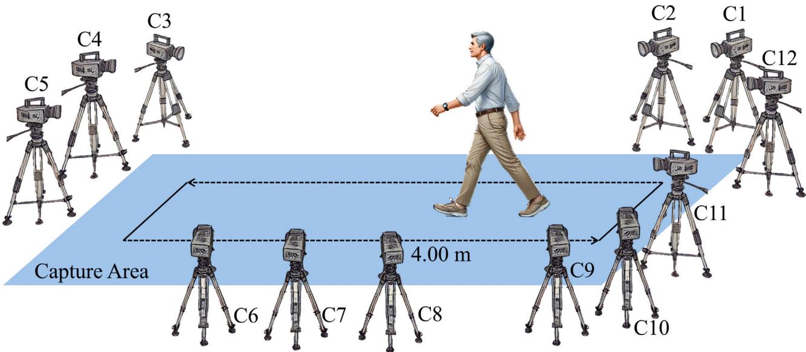
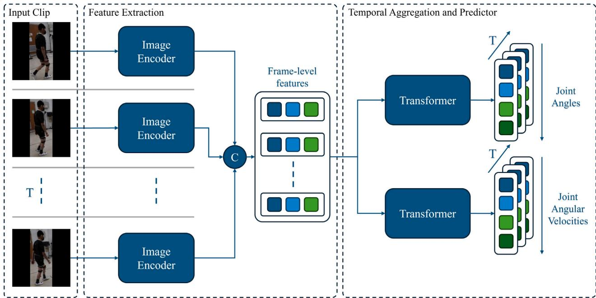
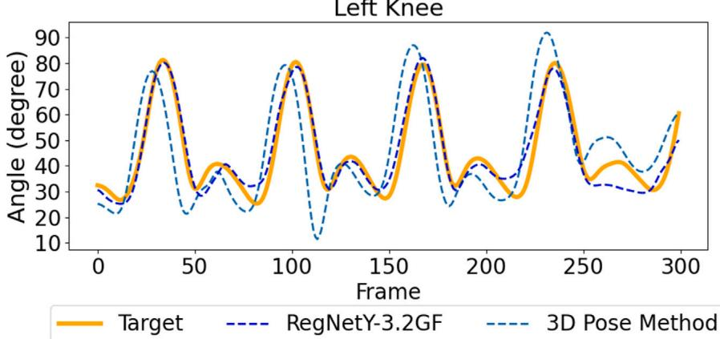
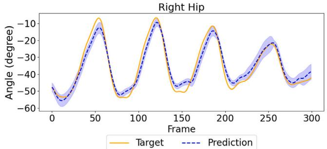
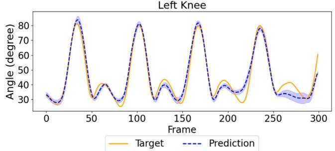
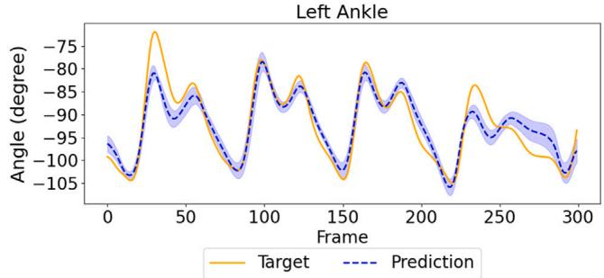
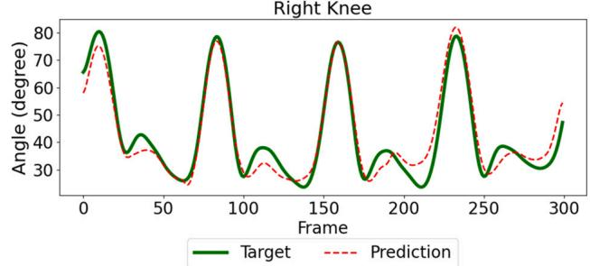
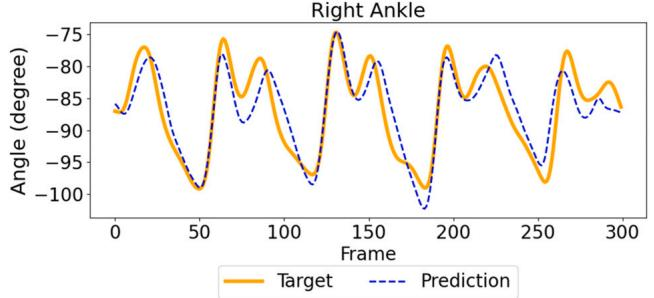

使用单个 RGB 摄像头的下肢关节角度估计

Vanyi Chao a,b , Sungho Park a,c , Ankhzaya Jamsrandorj a , Dawoon Jung a , Jinwook Kim a,∗, Kyung-Ryoul Mun a,∗

## A R T I C L E I N F O

关键词：CNN-Transformer 架构；关节角度估计；下肢运动学

## A B S T R A C T

下肢关节角度的精确测量对于步态分析、康复以及退行性疾病的早期检测至关重要。现有基于标记物（marker-based）的可穿戴传感器方法不仅需要复杂的设备布置，还需要精细的标定流程，限制了其向日常生活的推广。本研究旨在提出一种直接从单视角 RGB 帧中估计髋、膝和踝关节角度的视觉方法。我们构建了一个端到端模型，将卷积神经网络（CNN）用于空间特征提取，将 Transformer 模块用于捕捉步态的时间动态特性，并设计了一种新颖的损失函数，同时对角度误差和角速度误差进行联合惩罚，从而提高了估计的整体一致性与精度。将所提出模型的性能与三维姿态（3D pose）方法进行了比较，并通过改变相机视角、行走速度和异常步态模式对其稳健性进行了检验。所提出模型在不同视角、行走速度和步态模式下均达到了 0.92 以上的组内相关系数（ICC），其性能优于三维姿态方法的两阶段基线。该模型不仅免除了复杂设备和传感器的需求，与两阶段流水线方法相比也较不易产生误差。在临床与家庭环境中应用时，它可为步态评估提供一种经济且可靠的解决方案。

## 1. Introduction

关节角度测量是人体运动分析的基础，在步态分析、临床评估、康复以及运动科学等领域有着广泛的应用。值得注意的是，近期研究表明，步态分析中的关节角度测量能够有效地用于帕金森病 [1]、肌少症 [2,3]、痴呆与阿尔茨海默病 [4] 以及衰弱 [5] 的早期检测。

传统的下肢关节角度测量主要依赖使用可穿戴传感器的运动捕捉（MoCap）系统。MoCap系统借助多个摄像头与身体标记点来提供精确的关节角度数据，被视为该领域的金标准。可穿戴传感器，例如惯性测量单元（IMU）和表面肌电（sEMG）传感器，则直接附着于人体，以采集能够映射为关节角度的运动学数据和肌肉活动。尽管精度较高，MoCap系统在搭建与用户舒适度方面仍面临若干挑战。MoCap的搭建不仅通常需要受控环境，还需要复杂且昂贵的设备。IMU和sEMG传感器则较易出现信号漂移[6,7]和佩戴位置问题[8]，且偶有报告称会引起用户不适。

深度学习技术近来被融入MoCap，使其能够在不使用标记点或可穿戴设备的情况下估计关节角度[9–13]。这些系统利用姿态估计模型从每一帧视频中提取二维关节点，再通过二维到三维的提升模型重建关节的三维位置，进而能够计算出整个步态周期中的关节角度。它们已成为传统步态分析的一种实用且非侵入式的替代方案。然而，仍有一些挑战亟待解决。二维关键点检测的精度易受个体人体测量学差异的影响，导致估计的关节中心与实际关节中心之间出现偏差。这些二维关键点定位的初始误差常常会在后续的二维到三维姿态重建中传播，从而放大不准确性，凸显出对能够在不同人群和录制条件下良好泛化的鲁棒单目摄像头解决方案的需求。

这些挑战进一步限制了姿态估计模型在临床和真实世界环境中的适用性。研究表明，要达到与临床标准相当的精度，基于视觉的系统通常需要采用多视角摄像头布置来解决遮挡问题并保证三维保真度[14]。这需要同步的硬件与专用的采集空间，与传统的实验室环境类似。为克服该挑战，研究者们提出了单摄像头方案，从而具备更高的可及性，但这些方案依赖于对摄像头内参的显式了解，或需要场景中存在特定的标定物以恢复绝对尺度[15]。这些因素阻碍了无标记姿态估计技术在远程监测场景中的广泛应用——在该场景中，非专业用户通常依赖未经标定的消费级设备，且无法获得训练有素的专业人员的协助。

  

图 1. 实验装置，展示为实现最优数据采集而将十二台摄像机划分为四个区域的布局。区域 1（C12、C1、C2）、区域 2（C3、C4、C5）、区域 3（C6、C7、C8）以及区域 4（C9、C10 和 C11）。

表 1

基于这一动机，我们提出了一种端到端模型，该模型可以直接从单个 RGB 摄像机采集的视频帧中估计下肢关节角度，从而消除了三维姿态方法的两阶段流程。该模型将结合空间特征提取和时间建模，并将在不同的摄像机视角、行走速度和步态模式下对其性能进行验证。本研究的贡献包括：

1. 一个稳健的、单摄像机的关节角度估计模型，可泛化到不同的视角、行走速度和步态模式；

2. 一个集空间与时间建模于一体的端到端深度学习架构；

3. 可受益于关节角度和角速度精确预测的、更丰富的步态分析；

4. 一个全面的关节角度数据集，不仅可用于关节角度估计，还可用于疾病的早期识别。

## 2. 材料与方法

## 2.1. 受试者

本研究共纳入 69 名受试者（表 1）。平均年龄为 73.34 ± 12.4 岁，平均身高和平均体重分别为 161.43 ± 9.43 cm 和 $6 0 . 4 3 \pm 1 0 . 6 7$ kg。男性受试者占 58% $\left( \mathbf { n } = 4 0 \right)$。受试者中包括 28 名肌少症（sarcopenia）患者和 23 名帕金森病（Parkinson's disease）患者。其余 18 名无任何可能影响行走能力的疾病，作为对照组。所有招募的受试者均能够在不使用助行器的情况下独立行走。所有受试者在参与前均提供了书面知情同意书，且本研究已获得机构审查委员会的批准（KHUH 2022-05-036-001）。

按组别列出的研究受试者的人体测量学特征。

<table><tr><td rowspan="2"></td><td rowspan="2">Normal gait</td><td colspan="2">Abnormal gait</td></tr><tr><td>Sarcopenia</td><td>Parkinson&#x27;s disease</td></tr><tr><td>Age</td><td>62.72 ± 18.00</td><td>81.14 ± 3.93</td><td>72.17 ± 5.08</td></tr><tr><td>Weight</td><td>65.29 ± 11.17</td><td>53.43 ± 6.75</td><td>65.29 ± 11.17</td></tr><tr><td>Height</td><td>163.33 ± 11.41</td><td>157.67 ± 7.05</td><td>164.52 ± 8.65</td></tr></table>

## 2.2. 实验（Experiments）

实验在室内进行，安装了一套动作捕捉系统（motion capture system）和 12 台数字相机（图 1）。要求每位参与者在穿戴跟踪标记的情况下，以通常速度和比通常更快的速度两种速度条件直行 4 米。此外，还使用一名穿着宽松长裤的被试数据开展了补充验证实验，以评估模型在严重衣物遮挡下的鲁棒性。数字相机从 12 个不同角度记录参与者的行走情况，分为区域 1、2、3 和 4 四个视角。区域 1 为参与者右侧的对角视图，区域 2 为正面视图，区域 3 为侧面视图，区域 4 为参与者左侧的对角视图。使用 CORTEX 光学动作捕捉系统获取关节角度和位置。数字相机和光学相机的采样频率均设置为 60 Hz。

## 2.3. 数据采集与处理（Data collection and processing）

由于 12 台相机在执行动作捕捉的同时同步记录视频，因此采用闪光信号技术对录制的视频进行剪裁和同步。首先，设计了一个用于接收闪光设备闪光信号的电路。当闪光触发时，光电二极管会产生电流，该电流随后经运算放大器放大，并转换为晶体管-晶体管逻辑（Transistor-Transistor Logic, TTL）电平信号。当该信号发生突变时，微控制器会生成一个持续 100 ms 的脉冲。本实验使用的 MoCap 系统由上升沿脉冲触发。同时，数字相机捕捉闪光发生的瞬间。该瞬间通过检测像素强度的突然增大来识别。为了适应背景亮度和光照条件的变化，用于检测闪光的像素强度阈值被设定在 100 到 150 之间。所生成的脉冲与所捕捉到的闪光瞬间被用于视频和关节角度数据的同步与剪裁。

  

图 2. 联合预测关节角度与角速度的端到端架构。包含 � 帧的单视角输入片段被传入共享的图像编码器，以提取每一帧的空间特征。这些帧级特征经拼接后被送入两个并行的 Transformer 模块——其中一个预测逐帧的关节角度，另一个预测关节角速度——从而实现步态空间动态与时间动态的同步学习。

在获取关节角数据后，应用了 $\sigma = 3$ 的高斯滤波器以平滑数据并降低噪声。随后，提取了每一帧中每位受试者的边界框，以便仅聚焦于受试者本身。为了获得这些边界框，分别使用 YOLOv8 [16] 模型进行人体检测，使用 ByteTrack [17] 进行人体跟踪。由于跟踪器会为画面中所有人（包括非参与者）生成边界框，因此对 ID 进行了人工校正，以确保边界框正确对应每位参与者。

数据集被划分为三部分：训练集包含 41 名受试者，验证集包含 14 名受试者，测试集包含 14 名受试者。具体而言，训练集、验证集和测试集分别由 1342 个视频和 1,037,010 张图像、466 个视频和 324,953 张图像、以及 455 个视频和 338,433 张图像组成。

## 2.4. 模型构建（Model building）

所提出的端到端模型的总体架构如图 2 所示。该框架旨在通过一条统一的流程从视频帧中直接估计关节角度和角速度。它由三个主要阶段组成：（1）输入构建（Input Construction），用于准备时序视频片段；（2）特征提取（Feature Extraction），由共享的图像编码器从每一帧中捕获空间特征；以及（3）时序聚合与预测（Temporal Aggregation and Prediction），由 Transformer 模块对时序步态动态进行建模，以生成最终的关节运动学预测结果。各组件的具体细节将在以下小节中说明。

## 2.4.1. 输入构建（Input construction）

为了构建用于预测人体关节角度和角速度的深度学习模型，采用了滑动窗口方法来构建输入。输入由 32 个连续帧构成，并确保帧之间不重叠。所构建的输入对应于 60 帧每秒（FPS）下半个秒的视频。模型输入张量记作 $x \in \mathbb { R } ^ { T \times 3 \times H \times W }$，其中 � 为每个输入的帧数，� 和 � 分别为每个视频帧的高度和宽度。训练时随机选取输入。该模型由两个主要模块组成：特征提取和时序聚合。

## 2.4.2. 特征提取（Feature extraction）

给定帧序列 $x \in \mathbb { R } ^ { C \times T \times H \times W }$，每个编码器独立地处理单帧 $x _ { i } \in \mathbb { R } ^ { C \times H \times W }$，并产生一个输出特征向量 $x _ { i } \ \in \ \mathbb { R } ^ { D }$，其中 D 表示所提取特征的维度。在各帧被编码器处理之后，将各个编码器的输出沿时间维度进行拼接，生成帧级特征 $\boldsymbol { x } _ { f } \in \mathbb { R } ^ { T \times D }$。该拼接表示捕获了序列中每帧的空间特征，并随后被送入时间聚合模块进行进一步处理。

所提取特征的维度 D 取决于所选骨干模型的选择。我们探索了多种骨干模型，包括 Vision Transformer（视觉 Transformer）、CNN（卷积神经网络）以及混合模型。在 Vision Transformer 方面，我们采用了 Swin Transformer [18]，它利用具有移位窗口的分层架构来高效地捕获局部与全局空间特征。对于混合模型，我们使用了 MaxViT [19]，它通过块注意力（block attention）与网格注意力（grid attention），集成了 CNN 与 ViT 来捕获局部与全局空间特征。对于 CNN，我们实现了 ConvNeXtV2 [20]、RegNetY [21] 与 EfficientNetV2 [22]，这些模型被视作当前最先进的骨干模型之一 [23]。

## 2.4.3. 时间聚合

在特征提取之后，我们获得了帧级特征序列 $x _ { f } \in \mathbb { R } ^ { T \times D }$。时间聚合模块对该序列进行处理，以捕获帧之间的动态关系。在我们的方法中，基于 Transformer 的架构利用自注意力机制来动态加权并整合局部与全局的时间依赖关系，得到聚合特征 $x _ { \mathbf { a g g } } \in \mathbb { R } ^ { T \times D }$，其封装了空间特征随时间的演化。

随后，将时序感知特征输入到一个全连接层，该全连接层的神经元数量等于关节类别数。这些类别对应于右踝与左踝、右膝与左膝、以及右髋与左髋的屈曲与伸展角度。

然后，又构建了一条用于关节角速度预测的附加分支，以与关节角度预测分支相平行。该附加分支通过利用多任务损失函数略微提升了模型的整体性能。关节角速度是一个有价值的步态参数，因为已知其不受标记点放置的影响，而标记点放置在采集 MoCap 真值数据时会造成角度的偏移。

## 2.4.4. 推理算法

在本工作中，与依赖中间关键点定位的传统算法不同，所提框架学习了一个直接映射函数 ${\mathcal{F}}: x \to (\theta, \omega)$。它以原始视频张量 $x$ 作为输入，在单次前向传播中回归出关节角度 $\theta$ 与角速度 $\omega$，无需显式的骨架跟踪即可隐式地捕获受试者的步态模式。附录中的算法 1 给出了本研究使用的算法。

## 2.5. 损失函数

我们的模型采用多任务损失进行训练，联合优化两个相关任务：关节角度的估计以及关节角速度的估计。对于这两个任务，我们均采用了 L1 损失，其在回归场景中已被证明是有效的。此外，为了促进估计的关节角度与推导出的角速度之间的时间一致性，我们引入了一项一致性损失项。该项鼓励预测的角速度与预测关节角度的有限差分相匹配。各损失分量的计算方式如下：

$$
\mathcal {L} _ {\theta} = \| \hat {\theta} - \theta \| _ {1},\tag{1}
$$

$$
\mathcal {L} _ {\omega} = \| \hat {\omega} - \omega \| _ {1},\tag{2}
$$

$$
\mathcal {L} = \mathcal {L} _ {\theta} + \mathcal {L} _ {\omega} + \lambda \left\| \hat {\omega} _ {2: T} - (\hat {\theta} _ {2: T} - \hat {\theta} _ {1: T - 1}) \right\| _ {1},\tag{3}
$$

其中 $\hat{\theta}$ 和 $\theta$ 分别表示预测关节角度和真实关节角度。$\dot{\hat{\theta}}$ 和 $\dot{\theta}$ 分别表示预测关节角速度和真实关节角速度。2:T 表示从第 2 时刻到第 $T$ 时刻的帧。$\lambda$ 是用于一致性项的人工调参权重因子。

## 2.6. 训练细节

为训练所准备的样本使用 YOLOv8 生成的边界框进行裁剪。YOLOv8 的边界框在每侧向外扩展 10 像素，以确保完整覆盖每位受试者的肢体。裁剪后的输入随后使用零值进行方形填充以保持其宽高比，然后调整大小为 224 × 224 像素以保证输入尺寸的一致性。真实标签通过应用与输入构建相同的滑动窗口方法进行分段处理。每个关节角度按照其活动范围归一化到 0 到 1 的区间内。为了获得关节角速度的真实标签，计算连续关节角度之间的差值，计算公式如下：

$$
\omega_ {2: T} = \theta_ {2: T} - \theta_ {1: T - 1},\tag{4}
$$

其中初始角速度设为零，假设每位受试者均从静止状态开始行走。这些步骤确保了输入图像与对应的真值数据均经过统一缩放、时间对齐，可用于模型训练。

训练采用 AdamW 优化器，权重衰减为 0.01，初始学习率为 $1 \times 1 0 ^ { - 4 }$。学习率调度使用 CosineAnnealingWarmRestarts，预热期（warmup period）为 6 个 epoch，学习率在最小值 $3 \times 1 0 ^ { - 6 }$ 与最大值 $1 \times 1 0 ^ { - 4 }$ 之间进行余弦退火。模型使用损失函数  (3) 进行训练，最多训练 50 个 epoch。所有实验均在 NVIDIA RTX 4090 GPU 上完成。每个 epoch 结束后，在评估集上使用平均绝对误差（MAE）与组内相关系数（ICC）评估训练性能。MAE 用于量化模型的绝对精度，表示预测关节角度与真值之间偏差的平均幅度（单位：度）。MAE 越低，说明关节位置幅值估计的精度越高。为评估预测步态波形的可信度与时间一致性，计算了 ICC。根据可靠性研究的公认指南 [24]，ICC 值小于 0.50、介于 0.50 与 0.75 之间、介于 0.75 与 0.90 之间、以及大于 0.90 分别表示可靠性较差、中等、良好和优秀。这些阈值用于在不同测试条件下对模型性能的质量进行分级。

Table 2  
在测试集上对关节角度与关节角速度预测所采用的不同骨干模型的对比。

<table><tr><td rowspan="2">Backbone</td><td colspan="2">Angle</td><td colspan="2">Angular velocity</td></tr><tr><td>MAE</td><td>ICC</td><td>MAE</td><td>ICC</td></tr><tr><td>MaxViT</td><td>4.5874</td><td>0.9138</td><td>0.4167</td><td>0.9385</td></tr><tr><td>ConvNeXtV2-T</td><td>4.5310</td><td>0.9184</td><td>0.4257</td><td>0.9319</td></tr><tr><td>RegNetY3.2GF</td><td>4.1966</td><td>0.9285</td><td>0.4027</td><td>0.9418</td></tr><tr><td>EfficientNetV2-S</td><td>4.2577</td><td>0.9297</td><td>0.4318</td><td>0.9331</td></tr><tr><td>Swin-T</td><td>4.8141</td><td>0.9149</td><td>0.4863</td><td>0.9205</td></tr></table>

## 3. 结果

## 3.1. 不同骨干网络下的模型性能

使用 RegNetY 作为骨干网络的模型在预测关节角度和角速度方面均优于其他模型（表 2）。在使用 RegNetY 作为骨干网络的模型中，预测角度时达到了最低的平均绝对误差（MAE）4.1966，组内相关系数（ICC）为 0.9285。在预测角速度方面，最低 MAE 为 0.4027，对应 ICC 为 0.9418。总体而言，五种骨干网络均表现出强劲的性能，各项指标之间仅有微小差异，验证了所提架构在关节角度和角速度预测方面的有效性。使用 RegNetY 和 EfficientNetV2 的模型在准确性和可靠性之间提供了最佳平衡。使用 EfficientNetV2 的模型在角度预测中获得了最高的 ICC 值 0.9297，而使用 RegNetY 的模型在预测角度和角速度时均表现出持续较低的 MAE 值。之所以选择 RegNetY 作为骨干网络，是因为其在关节角度和角速度预测两方面均展现出整体较强的预测性能。尽管 EfficientNetV2 在角度预测上获得了略高的 ICC 值，但 RegNetY 在这两项预测中均给出了最低的 MAE 值，并且在角速度预测上 ICC 最高。这种稳定的准确性使 RegNetY 成为我们提出模型的首选。

## 3.2. 所开发模型的性能

所开发模型在测试集上取得了平均 MAE 为 4.1966、ICC 为 0.9285 的结果，与真值之间表现出较高的相关性（表 3）。当模型在不含角速度信息的情况下训练时，ICC 为 0.9193。在左踝关节角度的预测中取得了最低的 MAE 为 2.9992，而在右膝关节角度的预测中取得了最高的 ICC 为 0.9654。尽管幅度不大，引入角速度信息仍提升了关节角度预测的一致性和整体表现。综合来看，所开发模型在预测不同关节运动的幅值和时间相位上均有效，在角速度预测上表现尤为稳健。

Table 5  
Table 4  
Table 3  
不同关节在角度和角速度预测中的性能比较。性能评估采用 MAE 和 ICC。结果基于 RegNetY3.2GF 骨干网络模型，在测试集上评估得到。

<table><tr><td rowspan="2">Joints</td><td colspan="2">Angle</td><td colspan="2">Angular velocity</td></tr><tr><td>MAE</td><td>ICC</td><td>MAE</td><td>ICC</td></tr><tr><td>Right hip</td><td>4.6776</td><td>0.9420</td><td>0.3192</td><td>0.9691</td></tr><tr><td>Left hip</td><td>5.1525</td><td>0.9338</td><td>0.3459</td><td>0.9618</td></tr><tr><td>Right knee</td><td>4.5971</td><td>0.9654</td><td>0.5347</td><td>0.9635</td></tr><tr><td>Left knee</td><td>4.4972</td><td>0.9651</td><td>0.5278</td><td>0.9635</td></tr><tr><td>Right ankle</td><td>3.2557</td><td>0.8795</td><td>0.3549</td><td>0.8916</td></tr><tr><td>Left ankle</td><td>2.9992</td><td>0.8856</td><td>0.3335</td><td>0.9010</td></tr><tr><td>Average</td><td>4.1966</td><td>0.9285</td><td>0.4027</td><td>0.9418</td></tr><tr><td>Without velocity</td><td>-</td><td>0.9193</td><td>-</td><td>-</td></tr></table>

所开发模型在不同输入图像分辨率下的性能比较。基准分辨率为 224 × 224。结果基于 RegNetY3.2GF 骨干网络模型，在测试集上评估得出。

<table><tr><td rowspan="2">Resolution</td><td colspan="2">Angle</td><td colspan="2">Angular velocity</td></tr><tr><td>MAE</td><td>ICC</td><td>MAE</td><td>ICC</td></tr><tr><td>224 × 224</td><td>4.1966</td><td>0.9285</td><td>0.4027</td><td>0.9418</td></tr><tr><td>128 × 128</td><td>4.6676</td><td>0.9189</td><td>0.4077</td><td>0.9392</td></tr><tr><td>112 × 112</td><td>4.6392</td><td>0.9160</td><td>0.4369</td><td>0.9294</td></tr><tr><td>64 × 64</td><td>5.1559</td><td>0.9000</td><td>0.4528</td><td>0.9255</td></tr></table>

我们的模型（采用 RegNetY3.2GF）与 3D 姿态方法在验证集和测试集上的比较

<table><tr><td rowspan="2">Model (Knee only)</td><td colspan="2">Validation set</td><td colspan="2">Test set</td></tr><tr><td>MAE</td><td>ICC</td><td>MAE</td><td>ICC</td></tr><tr><td>RegNetY3.2GF</td><td>5.5312</td><td>0.8983</td><td>4.5472</td><td>0.9652</td></tr><tr><td>3D pose method</td><td>10.2434</td><td>0.7932</td><td>9.6163</td><td>0.8522</td></tr></table>

在进一步开展通过改变平滑核大小进行的敏感性分析时，发现将核大小减小至 $\kappa=1$ 会因保留高频噪声而轻微降低可靠性（ICC = 0.9253），而将其增大至 $\kappa=5$ 则会过度衰减峰值关节角度。因此，选取 $\kappa=3$ 的核大小作为噪声抑制与波形保持之间的最优折中（ICC = 0.9285）。

## 3.3. 输入分辨率对所提出模型的影响

为评估所提出模型在不同图像分辨率下的鲁棒性，开展了一项包含 224×224、128×128、112×112 和 64×64 四种不同分辨率的消融研究。如表 4 所示，采用 224×224 图像分辨率训练的模型达到了最高精度，关节角度的 MAE 为 4.3200、ICC 为 0.9285。将图像分辨率降至 128×128 时，关节角度的 MAE 为 4.6676、ICC 为 0.9189。在最低的 $64\times 64$ 图像分辨率下，模型关节角度的 MAE 为 5.1559、ICC 为 0.9000。对于角速度，在所有图像分辨率下 ICC 均保持在 0.92 以上。

## 3.4. 与三维姿态方法的定量比较

将所开发模型与三维姿态方法进行比较的结果表明，所开发模型在膝关节关节角度预测方面优于三维姿态方法（表 5）。由于三维姿态方法的源代码不可获取，因此重新复现了两阶段流水线以进行比较。首先，应用 ViTPose 从 RGB 图像中提取二维关节关键点 [25]。然后，利用 MotionBERT 将这些关键点提升至三维空间 [26]。关节角度直接由这些重建的三维位置计算得到。选择 ViTPose 是因其稳健的二维关键点估计能力，选择 MotionBERT 是因其精确的三维姿态重建能力。选用这一方法组合是考虑到它们具有业界领先的性能，同时具备开源可用性与易实现性。

表 6  
测试集上四个相机视角分组的性能表现。相机配置详见 2.2 节。

<table><tr><td rowspan="2">Camera group</td><td colspan="2">Angle</td><td colspan="2">Angular velocity</td></tr><tr><td>MAE</td><td>ICC</td><td>MAE</td><td>ICC</td></tr><tr><td>Region 1</td><td>4.240</td><td>0.929</td><td>0.410</td><td>0.942</td></tr><tr><td>Region 2</td><td>4.256</td><td>0.929</td><td>0.405</td><td>0.942</td></tr><tr><td>Region 3</td><td>4.028</td><td>0.936</td><td>0.396</td><td>0.945</td></tr><tr><td>Region 4</td><td>4.337</td><td>0.919</td><td>0.405</td><td>0.938</td></tr></table>

当 MotionBERT 将关键点提升到三维空间时，它输出的是以相机为中心的坐标系下的坐标。为了将这些坐标转换为一个与人体解剖学对齐的、以身体为中心的坐标系，首先定义了局部坐标轴：Y 轴由从根关节到左髋的向量确定，Z 轴由从根关节到腹部的向量确定，X 轴由 Y 轴和 Z 轴的叉积确定。然后，将头到鼻向量投影到 XY 平面上，并计算其与初始 X 轴的点积。当点积为负时，X 轴被翻转，使其能够始终指向鼻部投影方向，从而确保朝向前的解剖学方向。作为最后一步，在该局部坐标系中基于标准解剖学标志点定义了一个规范的 T 姿态。在关节角度计算过程中，每个肢体段从其 T 姿态方向层级旋转到其观测方向，保证了所有关节角度都在一致的解剖学轴上测量。由于 MotionBERT 的三维姿态估计器未提供脚趾关键点，踝关节角度的计算不可行。因此，比较仅针对左右膝关节的角度进行。

所开发的模型在验证集上预测膝关节角度的 ICC 为 0.8983，而三维姿态方法的 ICC 为 0.7932。在测试集上，所开发的模型达到了 0.9652 的 ICC，而三维姿态方法的 ICC 为 0.8522。

当比较所提模型和三维姿态方法的目标轨迹时，所提模型更紧密地跟踪了真实值，特别是在快速屈伸阶段（图 3）。

## 3.5. 对视角变化的鲁棒性

当通过改变视角来研究所开发模型的性能时，未观察到视角间的显著差异（表 6）。无论区域（Regions）如何，该模型在关节角度和角速度预测方面均表现出一致的准确性和可靠性。各区域（Region 1、2、3 和 4）的 ICC 范围在 0.919 至 0.936 之间，MAE 在 4.028 至 4.337 之间变化。区域 3 产生了最高的 ICC（0.945）和最低的 MAE（4.028）。区域 4 的 ICC 最低。每个视角的预测都与真实值非常接近，表明所提模型无论视角如何都能产生可靠的预测（图 4）。

## 3.6. 对速度变化的鲁棒性

当在两种不同的步行速度下研究所开发模型的性能时，所开发模型的预测在正常和快于正常速度条件下都与真实轨迹高度一致（图 5）。预测的幅度、相位和时间与真实值紧密匹配，而在步幅长度和周期持续时间方面存在轻微偏差。

  

图 3. 右膝与左膝关节角度预测的可视化：所提方法（Proposed method）与 3D 姿态方法（3D pose method）的对比。

在测试集上各参与者组的关节角度与角速度预测性能比较。健康组同时包含年轻与年长受试者。

<table><tr><td rowspan="2">Group</td><td colspan="2">Angle</td><td colspan="2">Angular velocity</td></tr><tr><td>MAE</td><td>ICC</td><td>MAE</td><td>ICC</td></tr><tr><td>Parkinson&#x27;s disease</td><td>4.2069</td><td>0.9165</td><td>0.4109</td><td>0.9170</td></tr><tr><td>Sarcopenia</td><td>4.2911</td><td>0.9251</td><td>0.3678</td><td>0.9474</td></tr><tr><td>Healthy</td><td>4.1281</td><td>0.9389</td><td>0.4201</td><td>0.9547</td></tr></table>

在对快于常速条件的测试中，由于快于常速相比常速活动范围较小，模型在摆动中期对踝关节角度表现出轻微的相位滞后。尽管如此，所提出的模型仍准确地捕捉到了常速与快速两种条件下关节运动的整体趋势和动态特性。

## 3.7. 对步态变化的鲁棒性

进一步通过异常步态考察了所开发模型的性能。受试者被分为三组：诊断为帕金森病（Parkinson's disease）的受试者（n = 23）、诊断为肌少症（sarcopenia）的受试者（n = 28），以及在参与实验时未被诊断出任何可能影响其行走能力的健康状况的受试者（n = 18）。诊断为帕金森病的受试者与诊断为肌少症的受试者之间没有重叠。帕金森病或肌少症患者的步态被视为异常步态，其余受试者的步态被视为正常步态。在测试集中，模型在预测帕金森病患者关节角度时达到了 0.9165 的组内相关系数（ICC），在肌少症患者中达到了 0.9251 的 ICC，在其余受试者中达到了 0.9389 的 ICC（表 7）。异常步态的平均绝对误差（MAE）范围较窄，为 4.2069 至 4.2911，与正常步态的 MAE 没有显著偏离。在角速度方面，肌少症组的 MAE 略有下降，但仍处于不影响模型可靠预测性能的范围之内。最后，在一名穿着宽松长裤、完全遮挡膝关节和踝关节的受试者所进行的验证中，模型在七个视角（C1、C3、C4、C5、C8、C10、C12）下仍保持了高可靠性，平均 ICC 达到 0.9335，证明了在关节被遮挡条件下模型的鲁棒性。

## 4. 讨论

本研究旨在开发并验证一种可直接从视频帧中估计下肢关节角度的模型。所开发的模型以 RegNetY 作为主干，融合了用于空间特征提取的卷积神经网络与用于捕捉步态时间动态的 Transformer 模块。研究还提出了一种同时对角度误差和角速度误差进行惩罚的新型损失函数，以提升预测的一致性和整体准确度。通过与三维姿态模型在准确性方面的对比，所开发模型在测试集中达到了 0.9652 的 ICC。该模型不仅在估计关节角度方面表现出色，而且在估计角速度方面，在不同的相机视角、行走速度和步态模式下均表现出稳健的性能。

所提方法的核心理创新在于范式转变——从显式几何重建转向直接运动学学习，消除了先前易出错的两阶段流程。通过绕过中间关键点检测步骤，该框架直接学习视觉步态模式与关节力学之间的内在生物力学关系，并以速度感知损失函数进行引导，从而确保时间一致性。由于无需标记点或专用硬件，所提方法摆脱了对专业设备和训练有素人员的依赖，显著提升了可及性。即便使用消费级智能手机摄像头通常能够获取的低分辨率图像，所提模型仍表现出尚佳的性能，这表明该模型有潜力成为一种经济实惠且易于普及的步态评估解决方案，适用于临床及家庭场景。

  

图 4. 一名快步行走受试者的关节角度预测（蓝色）与真值（ground truth，橙色）的可视化结果，采集自十二个不同摄像机视角（C1 至 C12）。

所提出模型的出色表现可能源于卷积神经网络（Convolutional Neural Networks, CNNs）与 Transformer 的结合。已有研究表明，将用于局部特征提取的 CNN 与用于全局时序建模的 Transformer 相结合的混合深度学习架构，在人体运动学分析中表现出更优的性能 [27]。这些混合网络有效地缓解了步态事件检测与时空参数估计中空间分辨率与时序一致性之间的权衡 [28]。步态周期中膝关节显著的活动范围也可能促成了这一卓越性能。与经历相对细微旋转的踝关节不同，膝关节呈现出明显的、高幅度的屈伸模式，提供了强烈的视觉线索，使空间特征提取器能够以更高的精度捕捉其动态特性。此外，一种联合优化角度与角速度预测的新型多任务损失函数也有助于提升整体一致性。

本研究中使用的损失函数被设计用于联合优化关节角度及其对应角速度的估计。模型采用多任务损失进行训练，其中关节角度与角速度预测均采用 L1 损失。此外，还引入了一项一致性损失项，通过鼓励预测速度与预测关节角度的有限差分相匹配，来促进时序一致性。该方法使模型能够利用角度与角速度之间的内在关系，从而同时提高预测的准确性与时序一致性。将角速度同时纳入输出与损失计算中，有助于整体性能的提升。值得注意的是，加入速度预测使组内相关系数（Intraclass Correlation Coefficient, ICC）从 0.9193 提升至 0.9285。尽管该提升幅度不大，但它表明与真实值的吻合度有所增强，并凸显了纳入动态特征的价值。这表明，在训练过程中同时利用静态与动态步态特征，能够从视频数据中更可靠地估计下肢关节角度。该方法也反映了物理感知动作捕捉以及当前最先进的动作表示学习领域的最新趋势。已有研究证明，将速度级监督集成到 MotionBERT 损失函数中，对于从部分观测中恢复出平滑且时序一致的 3D 动作至关重要 [26]。当前的研究已采用基于显式物理学的学习策略来强制实现生物合理性，利用基于导数的约束来消除物理上不可能的伪影 [29.30]。

本研究探索了几种模型作为模型开发的骨干网络，最终选择了 RegNetY。尽管所有骨干模型都表现出相当强的性能，支撑了所提出模型设计的有效性，但在其他骨干模型中，RegNetY 在关节角度和角速度两方面均提供了最稳健且一致的性能。可以推测，RegNetY 灵活且可扩展的架构归因于其高效地平衡了深度、宽度与分组卷积，从而增强了特征表示能力。这一观察得到了近期研究的支持，这些研究证明了 RegNet 架构的强大特征提取能力与效率 [23]。所开发的模型在使用 RegNetY 时在下肢关节角度估计方面表现出强劲性能，其中膝关节的估计精度最高。将角速度纳入模型进一步提升了预测精度，表明动态特征在预测中的价值。未来使用面向回归的量化方法（如 Reg-PTQ [31]）以及量化 Transformer 模块（如 Q-ViT [32]）对 RegNetY 骨干进行量化，将最大限度地降低内存占用并提高所提出模型的适用性。

  

(a) 快速行走。

  

(b) 正常步态。

图 5. 两种步态条件下目标值与预测值的右侧关节角度在视频帧上的对比。(a) 快速行走（橙色实线：目标值；蓝色虚线：预测值）。(b) 正常步态（绿色实线：目标值；红色虚线：预测值）。

所开发模型与三维姿态模型之间的性能对比表明，所开发模型可以成为三维姿态模型的一种可靠替代方案。三维姿态方法依赖于从 RGB 图像中提取二维关键点，并将其用于提升模型（lifting model）中以估计三维关节位置，再从这些位置计算出关节角度 [9–13]。然而，这一过程相当容易出错，因为初始的二维关键点定位可能导致最终估计中出现累积性的误差。相比之下，所开发模型通过直接从视频帧估计关节角度，获得了更接近真值的估计结果。因此，误差传播的风险得以降低，尤其是在步态的快速阶段，无论是时序还是幅度方面。这种直接估计不仅提高了准确性，还简化了工作流程，使其成为在不同情境下进行步态分析时一种更易获取的替代方案。

所开发模型对各类变化来源表现出了强大的鲁棒性，例如相机视角、行走速度、步态异常以及不同的着装条件。在不同相机视角下，估计结果保持一致，仅在视角间出现了 ICC 和 MAE 的微小波动。在速度变化方面也再次确认了其尚佳的性能。尽管在快于平常速度的摆动中期出现了轻微偏差，但在平常速度和快于平常速度条件下的预测均与真值轨迹高度吻合。在较高行走速度下观察到的相位滞后可能源于快速运动远端关节所导致的运动模糊加剧，这种模糊降低了与关节相关的空间特征质量，并影响了时序估计。所开发模型在区分肌少症（sarcopenia）患者和帕金森病（Parkinson's disease）患者与正常人步态方面的鲁棒性，进一步拓展了其潜在的应用范围。这种鲁棒性还延伸到了着装变化方面——即使宽松的裤子遮挡了四肢，该模型仍能成功推断关节运动学，这得益于它利用了全局身体动态和时序模式，而非仅仅依赖局部关节可见性。这种鲁棒性可归因于模型的端到端架构，该架构结合了从每一视频帧中强大的空间特征提取以及利用 Transformer 所进行的时序建模。通过同时学习帧级视觉线索及其时序关系，模型有效地捕捉到了关键的步态动态，使其能够在不同条件下保持性能。这种能力对于现实世界的应用至关重要，因为在现实场景中，录制设置和患者状况的多变性十分常见。

在研究输入分辨率对模型性能的影响时发现，降低图像分辨率仅会导致准确率出现轻微下降，即使在较低分辨率下模型仍能保持较高的可靠性。这表明所提出的模型能够有效捕捉全局的时空步态模式，而非仅仅依赖精细的空间细节。这增强了所提模型在实际场景中的适用性，尤其是在计算资源或输入质量受限的情况下。这一点尤其支持将其部署到既需要鲁棒性又需要效率的实际步态评估环境中。

所提模型的较高处理吞吐量表明其具备用于实时步态分析的强大可行性。该模型处理一段包含 1127 帧的视频耗时 4.14 s，平均吞吐率约为 270 FPS，即每帧约 3.7 ms。鉴于步态分析的标准视频采集帧率为 60 FPS，所提模型的运行速度约为实时的 4.5 倍。尽管由于滑动窗口策略需要较短的初始缓冲时间，但模型可以以可忽略的延迟生成后续输出，从而支持连续分析。这一能力凸显了所提模型在实时临床与监测应用中的潜力。

所提模型提供了若干具有临床意义的优点，可支持其在真实医疗环境中的应用。该模型仅使用单个 RGB 摄像头即可实现低成本、无侵入的步态分析，无需依赖可穿戴传感器或基于标记点的系统。模型表现出较高的估计精度与可靠性，能够对关节角度和角速度进行临床上可行的评估。其在多种步态模式（包括神经系统及肌骨系统疾病患者中观察到的步态模式）上的鲁棒性，凸显了其在疾病早期发现与纵向病情进展监测方面的应用价值。最后，其对动态步态特征的量化能力为开发可扩展的、基于视频的数字生物标志物提供了机遇，可用于支持未来的诊断与预后应用。对于未来的真实场景部署，可考虑若干策略，例如测试时增强（test-time augmentation）与域自适应（domain adaptation）。测试时增强将对输入的多种增强版本进行评估并聚合，从而提高预测的鲁棒性。域自适应技术可用于缓解训练数据与真实场景之间的领域差距。

本研究仍存在若干局限性。首先，所开发的模型仅在画面中仅有一名受试者的场景下进行设计与验证。当画面中包含多名个体，或环境中存在日常生活物品（如家具或助行器具）所引起的遮挡时，模型的性能仍有待考察。其次，数据采集是在受控的室内环境中完成的，该环境保证了光照与背景的一致性。

## 5. 结论

本研究开发并验证了一种端到端的、基于视觉的模型，可直接从视频帧估计下肢关节角度。该模型以 RegNetY 作为骨干网络，集成了用于空间特征提取的卷积神经网络和用于捕捉步态时序动态的 Transformer 模块。所提出的新型损失函数同时对角度误差和角速度误差施加惩罚，从而提高了整体估计精度。与 3D 姿态模型相比，所开发的模型具有更高的精度，其最高 ICC 达到 0.9652。该模型在不同相机视角、不同速度条件以及不同步态模式下的稳健性均得到了验证。该模型能够在临床和居家场景中促成更可靠、更易获取的步态评估。

## CRediT 作者贡献说明

Vanyi Chao：撰写–审阅与编辑、撰写–初稿、可视化、验证、软件、方法学、形式分析、概念化。Sungho Park：可视化、验证、调查、数据管理。Ankhzaya Jamsrandorj：撰写–审阅与编辑、形式分析、数据管理。Dawoon Jung：验证、形式分析。Jinwook Kim：撰写–审阅与编辑、形式分析。Kyung-Ryoul Mun：撰写–审阅与编辑、可视化、验证、监督、经费获取、形式分析、概念化。

## 利益冲突声明

作者声明，他们不存在任何已知的可能影响本报告工作的竞争性财务利益或个人关系。

## 致谢

本研究由韩国科学技术研究院机构项目（项目编号：26E0211）资助，并获得韩国政府（MSIT）下属韩国国家研究基金会（NRF）的资助（编号：RS-2025-25462906）。

## 附录. 推理阶段的实现细节

从原始视频输入到最终运动学估计的整体算法工作流程在算法 1 中详细给出。该过程从被试定位（步骤 1）开始，其中 YOLOv8 检测器在每个视频帧中分离出参与者。这些检测结果被用于裁剪并将帧缩放至 224 × 224 像素，同时施加方形填充以保留被试的原始宽高比。在步骤 2 中，预处理后的视频序列被划分为不重叠的、每段 32 帧（T = 32）的时间窗口。为确保对潜在的乱序处理具有鲁棒性，每个窗口的帧索引被存储为参考键。在模型推理（步骤 3）期间，每个窗口被送入所提出的端到端网络 ，以预测对应的关节角度 � 和角速度 �。最后，在步骤 4 中，窗口级预测按其索引键排序并拼接，从而重建覆盖整个视频时长的连续运动学轨迹。

Algorithm 1 Inference algorithm for end-to-end joint angle estimation
Input: Raw video sequence $V = \{f_1, f_2, ..., f_N\}$
Output: Joint angles $\theta \in \mathbb{R}^{N \times J}$ and angular velocities $\omega \in \mathbb{R}^{N \times J}$
1: Initialize empty prediction map $M_{preds} \leftarrow \{\}$
2: Step 1: Subject Localization &amp; Preprocessing
3: for each frame $f_i \in V$ do
4: $B_i \leftarrow \text{YOLOv8}(f_i)$
5: $x_i \leftarrow \text{SquarePad}(\text{Crop}(f_i, B_i), 224 \times 224)$
6: end for
7: Step 2: Temporal Windowing
8: Partition processed frames $x$ into non-overlapping windows $W$
9: Set window size $T \leftarrow 32$
10: Store frame indices $idx_k$ for each window $W_k$
11: Step 3: Model Inference
12: for each window $W_k \in W$ do
13: $(\hat{\theta}_k, \hat{\omega}_k) \leftarrow F(W_k)$
14: $M_{preds}[idx_k] \leftarrow (\hat{\theta}_k, \hat{\omega}_k)$
15: end for
16: Step 4: Sequence Alignment
17: Sort $M_{preds}$ by key indices
18: $\theta, \omega \leftarrow \text{Concatenate}(M_{preds})$
19: return $\theta, \omega$

## 数据可用性

数据将根据请求提供。

## 参考文献

[1] L. Di Biase, A. Di Santo, M.L. Caminiti, A. De Liso, S.A. Shah, L. Ricci, V. Di Lazzaro. 帕金森病中的步态分析：用于诊断与症状监测的最准确标志物综述（Sensors 20 (12) (2020) 3529）。

[2] J.-K. Kim, M.-N. Bae, K.B. Lee, S.G. Hong. 基于惯性传感器步态参数的肌少症患者识别（Sensors 21 (5) (2021) 1786）。

[3] S. Kim, S. Park, S. Lee, S.H. Seo, H.S. Kim, Y. Cha, J.-T. Kim, J.-W. Kim, Y.-C. Ha, J.-I. Yoo. 利用步态分析与智能鞋垫评估肌少症患者的体能以开发数字生物标志物（Sci. Rep. 13 (1) (2023) 10602）。

[4] R. Rucco, V. Agosti, F. Jacini, P. Sorrentino, P. Varriale, M. De Stefano, G. Milan, P. Montella, G. Sorrentino. 通过三维运动捕捉对额颞叶痴呆和阿尔茨海默病患者进行时空和运动学步态分析. Gait Posture 52 (2017) 312–317.

[5] W. Tsuchida, Y. Kobayashi, K. Inoue, M. Horie, K. Yoshihara, T. Ooie. 通过主成分分析识别虚弱老年女性步态的运动学特征. Sci. Rep. 12 (1) (2022) 1676.

[6] J. Ryu, B.-H. Lee, J. Maeng, D.-H. Kim. 基于用户自适应分类器的 sEMG 信号和 IMU 传感器步态子相位检测与预测. Med. Eng. Phys. 69 (2019) 50–57.

[7] A. Küderle, N. Roth, J. Zlatanovic, M. Zrenner, B. Eskofier, F. Kluge. 足戴式 IMU 传感器的放置确实会影响正常步行期间空间参数的准确性. PLoS One 17 (6) (2022) e0269567.

[8] R. Merletti, P. Di Torino. 肌电图数据报告标准. J Electromyogr Kinesiol. 9 (1) (1999) 3–4.

[9] H. Wang, Z. Xie, L. Lu, L. Li, X. Xu. 通过单个摄像机在举升任务中估计关节角度和 L5/S1 力矩的计算机视觉方法. J. Biomech. 129 (2021) 110860.

[10] J.-Y. Choi, E. Ha, M. Son, J.-H. Jeon, J.-W. Kim. 基于深度学习的三维人体姿势估计在真实环境中的人体关节角度估计. Sensors 24 (12) (2024) 3823.

[11] H. Yuan, Y. Zhou. 通过新型多人三维姿势估计技术（ROMP）基于单目 RGB 摄像机的老年护理人体工效学评估. Int. J. Ind. Ergon. 95 (2023) 103440.

[12] M. Yahya, J. Shah, K. Kadir, A. Warsi, S. Khan, H. Nasir. 使用单个 RGB 摄像机进行康复用肩关节角度精确估计. 见：2019 年 IEEE 国际仪器与测量技术会议 (I2MTC)，IEEE，2019 年，第 1–6 页.

[13] H. Wang, B. Su, L. Lu, S. Jung, L. Qing, Z. Xie, X. Xu. 通过单个摄像机和计算机视觉进行无标记步态分析. J. Biomech. 165 (2024) 112027.

[14] N. Nakano, T. Sakura, K. Ueda, L. Omura, A. Kimura, Y. Iino, S. Fukashiro, S. Yoshioka. 使用 OpenPose 与多个视频摄像机评估三维无标记运动捕捉精度. Front. Sport. Act. Living 2 (2020) 50.

[15] L. Needham, M. Evans, D.P. Cosker, L. Wade, P.M. McGuigan, J.L. Bilzon, S.L. Colyer. 几种姿势估计方法在三维关节中心定位中的精度. Sci. Rep. 11 (1) (2021) 20673.

[16] D. Reis, J. Kupec, J. Hong, A. Daoudi. 使用 YOLOv8 进行实时飞行目标检测. 2023 年，arXiv 预印本 arXiv:2305.09972.

[17] Y. Zhang, P. Sun, Y. Jiang, D. Yu, F. Weng, Z. Yuan, P. Luo, W. Liu, X. Wang. ByteTrack：通过关联每个检测框的多目标跟踪. 见：欧洲计算机视觉会议，Springer，2022 年，第 1–21 页.

[18] Z. Liu, Y. Lin, Y. Cao, H. Hu, Y. Wei, Z. Zhang, S. Lin, B. Guo, Swin transformer：基于移位窗口的层次化视觉变换器（Swin Transformer: Hierarchical Vision Transformer Using Shifted Windows），载于：IEEE/CVF 国际计算机视觉会议论文集，2021年，第10012–10022页。

[19] Z. Tu, H. Talebi, H. Zhang, F. Yang, P. Milanfar, A. Bovik, Y. Li, MaxViT：多轴视觉变换器（MaxViT: Multi-Axis Vision Transformer），载于：欧洲计算机视觉会议，Springer出版社，2022年，第459–479页。

[20] S. Woo, S. Debnath, R. Hu, X. Chen, Z. Liu, I.S. Kweon, S. Xie, ConvNeXt v2：与掩码自编码器协同设计与扩展卷积网络（ConvNeXt V2: Co-Designing and Scaling ConvNets with Masked Autoencoders），载于：IEEE/CVF 计算机视觉与模式识别会议论文集，2023年，第16133–16142页。

[21] I. Radosavovic, R.P. Kosaraju, R. Girshick, K. He, P. Dollár, 设计网络设计空间（Designing Network Design Spaces），载于：IEEE/CVF 计算机视觉与模式识别会议论文集，2020年，第10428–10436页。

[22] M. Tan, Q. Le, EfficientNetV2：更小的模型与更快的训练（EfficientNetV2: Smaller Models and Faster Training），载于：国际机器学习大会，PMLR出版社，2021年，第10096–10106页。

[23] P. Jeevan, A. Sethi, 使用哪种骨干网络：面向计算机视觉的资源高效领域专用比较（Which Backbone to Use: A Resource-Efficient Domain-Specific Comparison for Computer Vision），2024年，arXiv预印本 arXiv:2406.05612。

[24] T.K. Koo, M.Y. Li, 可靠性研究中类内相关系数的选择与报告指南（A Guideline of Selecting and Reporting Intraclass Correlation Coefficients for Reliability Research），《整脊医学杂志》（Journal of Chiropractic Medicine）15卷（2）：2016年，第155–163页。

[25] Y. Xu, J. Zhang, Q. Zhang, D. Tao, ViTPose：用于人体姿态估计的简洁视觉变换器基线（ViTPose: Simple Vision Transformer Baselines for Human Pose Estimation），《神经信息处理系统进展》35卷：2022年，第38571–38584页。

[26] W. Zhu, X. Ma, Z. Liu, L. Liu, W. Wu, Y. Wang, MotionBERT：面向人体运动表示学习的统一视角（MotionBERT: A Unified Perspective on Learning Human Motion Representations），载于：IEEE/CVF 国际计算机视觉会议论文集，2023年，第15085–15099页。

[27] A. Jamsrandorj, Q.H.N. Nguyen, D. Jung, M.S. Baek, K.-R. Mun, J. Kim, 基于单目相机与 CNN-Transformer 混合网络的步态时空参数图像估计（Image-Based Gait Spatiotemporal Parameters Estimation Using a Single Camera and CNN-Transformer Hybrid Network），载于：2023年第45届 IEEE 工程医学与生物学学会年会（EMBC），IEEE出版社，2023年，第1–5页。

[28] A. Jamsrandorj, D. Jung, K.S. Kumar, M.Z. Arshad, H. Lim, J. Kim, K.-R. Mun, 使用 CNN-Transformer 混合网络进行视角无关的步态事件检测（View-Independent Gait Events Detection Using CNN-Transformer Hybrid Network），《生物医学信息学杂志》（Journal of Biomedical Informatics）147卷：2023年，第104524页。

[29] S. Shimada, V. Golyanik, W. Xu, C. Theobalt, PhysCap：实时中物理可信的单目三维动作捕捉（PhysCap: Physically Plausible Monocular 3D Motion Capture in Real Time），《ACM 图形学汇刊》（ACM Transactions on Graphics，ToG）39卷（6）：2020年，第1–16页。

[30] C. Guo, G. L'Erario, G. Romualdi, M. Leonori, M. Lorenzini, A. Ajoudani, D. Pucci, 基于物理信息学习的稀疏 IMU 人体全身运动学预测（Physics-Informed Learning for Human Whole-Body Kinematics Prediction via Sparse IMUs），2025年，arXiv预印本 arXiv:2509.25704。

[31] Y. Ding, Y. Feng, C. Chen, J. Guo, X. Liu, Reg-PTQ：面向全量化目标检测器的回归专用训练后量化（Reg-PTQ: Regression-Specialized Post-Training Quantization for Fully Quantized Object Detector），载于：IEEE/CVF 计算机视觉与模式识别会议论文集，2024年，第16174–16184页。

[32] Y. Li, S. Xu, B. Zhang, X. Cao, P. Gao, G. Guo, Q-ViT：精确且完全量化的低比特视觉 Transformer，《Adv. Neural Inf. Process. Syst.》第 35 卷（2022 年）第 34451–34463 页