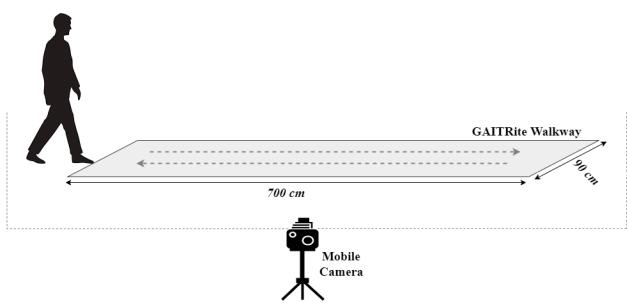

# 基于单摄像头与 CNN-Transformer 混合网络的步态时空参数图像估计方法

Ankhzaya Jamsrandorj1,4, Quynh Hoang Ngan Nguyen2,4, Dawoon Jung4, Min Seok Baek3, Kyung-Ryoul Mun4, Jinwook Kim4

摘要——基于视觉的步态分析在老年人健康状况的远程与持续监测中能够发挥重要作用。然而，大多数基于视觉的方法利用人体姿态信息来计算步态时空参数，且仅提供平均参数。本研究旨在提出一种直接的方法，实现逐步步态时空参数的估计。本研究共有 160 名老年人参与。数据通过 GAITRite 系统和移动摄像头同步采集。三个深度学习网络以少量 RGB 帧作为输入，以包含时空步态参数的连续一维信号作为输出进行训练。训练后的网络估计的步长与真实值的相关性达到 0.938 及以上，步态事件检测的 F 值达到 0.914 及以上。

临床意义——所提出的方法在分析步态时空参数方面与 GAITRite 系统表现出极好的一致性。我们的方法可应用于基于步态参数监测老年人的健康状况，从而实现疾病的早期诊断、合理治疗和及时干预。

## I. 引言

步态会因损伤、衰弱和衰老而发生改变，进而导致异常行走，这可能引发更为严重的健康问题，如肌肉骨骼、心血管和心理健康方面的疾病。因此，老年人的步态分析可以作为一种有效的临床指标，用于评估其身心状况并及早发现健康问题。

现有的专业系统，包括光学动作捕捉系统、测力台和可穿戴设备，价格昂贵、不便移动，且在日常生活中难以使用。由于需要高度配合，可能会给老年人带来不适。因此，基于视觉的步态分析系统对于远程评估和监测老年人的步态至关重要。大多数基于视觉的方法侧重于使用特定相机系统或外部姿态机进行二维或三维人体姿态估计，然后基于骨骼跟踪数据计算步态参数 [1]–[9]。Ismail 等人应用 DeepPose 框架获取二维人体关节位置，并通过回归模型估计选定关节的运动以进行步态分析 [2]。类似地，Stenum 等人使用侧视图视频，通过 OpenPose 定位关节并进行跟踪来测量时空步态参数 [6]。然而，从人体姿态检测器提取的二维关节位置可能并非这些关节的中心，存在一定误差。此外，二维姿态估计结果会受到视点变化、部分遮挡、光照变化以及生物特征差异的影响。这会影响步态参数的计算。因此，一些研究工作使用三维关节位置来避免这些问题并提高步态分析的可靠性。Azhand 等人提出了一种基于从二维人体姿态提升得到的三维人体姿态及其跟踪结果的步态分析系统 [7]。Zhu 等人引入了一个级联网络，利用红外热成像视频和从 OpenPose 框架提取的二维姿态来回归三维人体关节位置，然后通过跟踪估计的关节来计算步态参数 [8]。然而，这些方法仍然依赖于二维姿态，并使用复杂模型来估计三维人体关节坐标。此外，这些方法在健康的年轻和年长受试者上进行了验证。

在本研究中，我们主要关注老年人，包括健康对照（healthy controls, HC）和神经退行性疾病患者，尤其是帕金森病（Parkinson's disease, PD）、阿尔茨海默病（Alzheimer's disease, AD）以及轻度认知障碍（Mild Cognitive Impairment, MCI）患者，考虑到它们在老年人中的高患病率，因为步态可用于评估神经退行性疾病 [10]– [12]。此外，对老年人进行连续的逐步步态分析能够实现对受伤或跌倒风险 [9]、术后康复效果以及运动障碍诊断与评估的基础临床评估。

因此，本研究旨在提出一种基于视觉的方法，该方法不需要人体关节位置，且易于在日常生活中应用，用于逐步时空步态参数的估计。

## II. 材料与方法

## A. 研究对象

本研究基于韩国科学技术研究院（Korea Institute of Science and Technology）机构审查委员会批准的研究工作。

共有 160 名老年受试者参与了本实验。所有参与者在参与前均获得了书面知情同意。所有受试者，包括健康对照（Healthy Controls, HC）以及确诊为帕金森病（Parkinson's Disease, PD）、阿尔茨海默病（Alzheimer's Disease, AD）、轻度认知障碍（Mild Cognitive Impairment, MCI）及其他疾病的患者，均可独立行走，无需他人帮助或辅助设备。

  

图 1. 实验装置，包括 GAITRite 步道系统和一台移动摄像头。摄像头从侧面视角记录行走动作，但摄像头的高度和位置并未固定。

表 I 总结了每个研究组的人口统计学和人体测量学特征。

## B. 实验方案

数据通过 GAITRite 走道系统和移动摄像机在室内环境中同时采集，如图 1 所示。要求受试者以自选速度在压力垫上行走。要求受试者完成十次步行动作。摄像机以高清分辨率、30 Hz 帧率从侧面视角记录步行动作。步态时空参数（包括步幅（SL）、足跟着地（FC）时刻和足尖离地（FO）时刻）的真值由 GAITRite 走道系统测得。视频和 GAITRite 系统数据由一位专家以首次 FC 事件为基准进行手动同步，随后由另一位专家进行交叉核对。

## C. 步态时空参数估计器开发

1) 基于视觉的步态时空参数估计的目标构建：GAITRite 系统提供两组步态时空参数：测试场的平均参数和详细场的单步足落参数。我们提取了关于

  

图 2. 逐步步态时空参数估计的目标构建。（步长-矩形，足着地（Foot Contact, FC）-正方形，足离地（Foot Off, FO）-菱形）

表 I  
各研究组的人口统计学与人体测量学特征

<table><tr><td></td><td>AD</td><td>MCI</td><td>PD</td><td>HC</td><td>Other</td></tr><tr><td>Number of participants (Female)</td><td>37 (18)</td><td>28 (15)</td><td>39 (18)</td><td>26 (14)</td><td>30 (12)</td></tr><tr><td>Age (years)</td><td> $73.5 \pm 7.6$ </td><td> $74.4 \pm 6.0$ </td><td> $70.9 \pm 10.6$ </td><td> $70.8 \pm 9.7$ </td><td> $70.7 \pm 11.8$ </td></tr><tr><td>Weight (kg)</td><td> $56.7 \pm 10.4$ </td><td> $55.5 \pm 9.7$ </td><td> $61.2 \pm 10.4$ </td><td> $59.8 \pm 12.9$ </td><td> $61.8 \pm 9.9$ </td></tr><tr><td>Height (cm)</td><td> $157.7 \pm 8.8$ </td><td> $153.4 \pm 6.8$ </td><td> $160.9 \pm 9.1$ </td><td> $162.1 \pm 7.1$ </td><td> $161.7 \pm 8.8$ </td></tr><tr><td>Average walking speed (cm/s)</td><td> $76.2 \pm 16.7$ </td><td> $84.7 \pm 23.1$ </td><td> $91.7 \pm 24.2$ </td><td> $102.9 \pm 20.6$ </td><td> $80.1 \pm 25.0$ </td></tr></table>

数据以平均值±标准差的形式呈现。

FC（首次触地，First Contact）和 FO（脚尖离地，Foot Off）事件发生以及 SL（步幅，Stride Length）来自每位受试者的个体足部着地参数，每个 SL 参数均使用受试者的腿长进行了归一化。如图 2 所示，这些时空参数被用于构建逐步的一维信号，以用于基于视觉的估计。步幅是同一只脚连续两次 FC 时刻之间的距离。然而，我们构建的是同一只脚 FO 与 FC 事件之间的一维信号。假设受试者在行走过程中保持恒定的速度，信号被线性增加，以达到从 GAITRite 系统提取的 SL 真值。因此，每个构建的信号都包含了每个步幅的空间和时间步态参数。

2) 网络架构：所提出的用于基于视觉的步态时空参数估计的网络 CNN-Transformer 由一个空间特征提取器、一个时间特征提取器和全连接层组成。在 ImageNet 上预训练的 ResNet18 被用作从输入帧中提取空间特征的空间特征提取器，而 Transformer 编码器则用于提取时间特征。如图 3 所示，输入特征序列嵌入了位置信息，然后输入到包含两个编码器层的 Transformer 编码器中。每个编码器层包含四个多头自注意力子层和一个前馈层。最后的模块包含两个全连接层，层间采用 ReLU 激活函数和 Dropout。我们使用长短期记忆网络（CNN-LSTM）和双向 LSTM（CNN-BiLSTM）两种深度学习网络作为时间特征提取器进行实验，以进行性能比较。网络的输入为 27 个连续的视频帧，网络的输出为双腿步幅的构建目标值。

## D. 实现细节

1) 数据处理：网络的输入为带有真值人体边界框的 27 个连续帧以及所有帧的构建步幅值。原始帧通过裁剪帧中的人物，然后左右填充以获得正方形图像并将其调整为 448×448 进行预处理。我们按受试者将数据集划分为三部分。训练集包含来自 96 名受试者的数据，其中 AD 20 名、MCI 17 名、PD 21 名、HC 15 名以及其他疾病受试者 23 名。验证集包含来自 32 名受试者的数据，其中 AD 7 名、MCI 5 名、PD 8 名、HC 5 名以及其他病症受试者 7 名。最后，测试集由来自剩余 32 名受试者的数据组成，其中 AD 10 名、MCI 6 名、PD 10 名、HC 6 名。

TABLE II  
网络在测试集上的空间参数估计性能。

<table><tr><td rowspan="2">Model</td><td colspan="2">MAE (cm)</td><td colspan="2">ICC</td></tr><tr><td>RSL</td><td>LSL</td><td>RSL</td><td>LSL</td></tr><tr><td>CNN-LSTM</td><td>9.236 ± 4.677</td><td>9.983 ± 4.523</td><td>0.905 ± 0.041</td><td>0.885 ± 0.047</td></tr><tr><td>CNN-BiLSTM</td><td>7.211 ± 3.648</td><td>8.643 ± 4.742</td><td>0.953 ± 0.043</td><td>0.918 ± 0.043</td></tr><tr><td>CNN-Transformer</td><td>6.909 ± 3.657</td><td>7.420 ± 3.153</td><td>0.962 ± 0.047</td><td>0.957 ± 0.045</td></tr></table>

RSL，右步幅（right stride length）；LSL，左步幅（left stride length）。  
数据以均值 ± SD 表示。

2) 数据增强：尽管本研究中使用单个摄像机采集步态数据，但为了避免仅受限于特定的摄像机视角，摄像机的高度和位置并未固定。不同参与者之间可能略有差异。此外，对输入帧施加了旋转增强，将其沿 x 轴旋转 $3 0 ^ { \circ }$ 和 -30°，以使所提方法对摄像机角度变化更具鲁棒性。同时还使用了水平翻转。

3) 训练方案：所有实验均使用 PyTorch 框架。网络权重的初始化采用在 ImageNet 上进行预训练的方式，用于步态时空参数估计。所有网络均使用平均绝对误差（Mean Absolute Error, MAE）和 Adam 优化器进行训练，初始学习率为 0.0001，批量大小为 16。每经过三个 epoch 后学习率降低两次。

  

图 3. CNN-Transformer 网络的架构。该网络采用 ResNet18 模型作为空间特征提取器，并使用包含两个编码器层的 Transformer 编码器来提取时间特征。每个 Transformer 编码器层包含四个多头自注意力子层。

TABLE III  
网络在测试集上的步态事件检测性能。

<table><tr><td rowspan="2">Model</td><td colspan="4">F1</td></tr><tr><td>RFC</td><td>RFO</td><td>LFC</td><td>LFO</td></tr><tr><td>CNN-LSTM</td><td>0.908 ± 0.132</td><td>0.941 ± 0.127</td><td>0.914 ± 0.136</td><td>0.949 ± 0.112</td></tr><tr><td>CNN-BiLSTM</td><td>0.907 ± 0.125</td><td>0.941 ± 0.119</td><td>0.906 ± 0.128</td><td>0.965 ± 0.090</td></tr><tr><td>CNN-Transformer</td><td>0.901 ± 0.146</td><td>0.951 ± 0.114</td><td>0.928 ± 0.141</td><td>0.967 ± 0086</td></tr></table>

RFC，右脚着地（right foot contact）；RFO，右脚离地（right foot-off）；LFC，左脚着地（left foot contact）；LFO，左脚离地（left foot-off）。数据以均值 ± 标准差（mean ± SD）的形式呈现。

## E. 评估指标

步态时空参数估计的目标被设计为简单的 1D 信号。采用平均绝对误差（MAE, cm）和组内相关系数（ICC）来评估各网络在步长估计方面的性能。首先从每个信号中提取定义步长的峰值，然后计算类型 (2,k) 的 MAE 和 ICC，以评估 GAITRite 系统与所提方法之间的一致性。采用 F1 分数（F1-score, F1）来评估各网络在步态事件检测方面的性能。我们通过查找具有峰值的位置来精确定位包含 FC 事件的帧编号。采用阈值为 2（cm）的最近点来确定包含 FO 事件的帧编号。随后计算目标帧编号与预测帧编号之间的帧差。若帧差小于 2 帧的阈值，则该事件被视为真正例。所有其他步态事件预测被视为假正例，所有未被检测到的目标被视为假负例。

## III. 结果

估计结果如图 4 所示，三个网络均能准确估计步长并检测出包含步态事件的帧。

表 II 总结了各深度学习网络在估计右步长和左步长方面的 MAE 和 ICC。CNN-Transformer 网络在步长估计上取得了最低的 MAE，分别为 6.909 和 7.420。相应地，CNN-Transformer 网络在估计右步长和左步长时分别获得了最高的 ICC，分别为 0.962 和 0.957。

表 III 总结了各网络在测试集上对 FO 和 FC 事件的检测结果。对于所有网络而言，FO 事件的检测性能均高于 FC 事件。CNN-Transformer 网络在检测右脚 FO 事件、左脚 FC 和 FO 事件时分别取得了最高的 $\mathrm { F } _ { 1 } \mathrm { \cdot }$ 分数，分别为 0.951（精确率 0.928，召回率 0.985）、0.928（精确率 0.909，召回率 0.969）和 0.967（精确率 0.953，召回率 0.988）。相比之下，CNN-BiLSTM 网络在检测右脚 FC 事件时取得了最高的 F1 分数 0.908（精确率 0.857，召回率 0.993）。

表 IV 和表 V 显示了在摄像机角度发生变化时各深度学习网络的性能。当输入帧沿水平轴旋转时，本研究使用的三个网络均展示出对步态时空参数相当稳健的估计能力。如表所示，与将输入旋转 $3 0 ^ { \circ }$ 度相比，网络在将输入旋转 -30° 时取得了更好的性能。性能提升的原因可能在于，在以负角度旋转的帧中，下肢显得更为舒展。

表 IV  
不同角度旋转数据下网络对步长的估计性能

<table><tr><td rowspan="2"></td><td rowspan="2">Model</td><td colspan="3">Rotation angle</td></tr><tr><td> $30^{\circ}$ </td><td> $0^{\circ}$ </td><td> $-30^{\circ}$ </td></tr><tr><td rowspan="3">MAE (cm)</td><td>CNN-LSTM</td><td> $9.635 \pm 5.141$ </td><td> $9.610 \pm 4.600$ </td><td> $9.487 \pm 5.162$ </td></tr><tr><td>CNN-BiLSTM</td><td> $7.930 \pm 4.821$ </td><td> $7.927 \pm 4.195$ </td><td> $7.685 \pm 4.773$ </td></tr><tr><td>CNN-Transformer</td><td> $7.171 \pm 3.971$ </td><td> $7.165 \pm 3.405$ </td><td> $7.061 \pm 3.854$ </td></tr><tr><td rowspan="3">ICC</td><td>CNN-LSTM</td><td> $0.882 \pm 0.045$ </td><td> $0.895 \pm 0.063$ </td><td> $0.896 \pm 0.078$ </td></tr><tr><td>CNN-BiLSTM</td><td> $0.937 \pm 0.049$ </td><td> $0.936 \pm 0.047$ </td><td> $0.940 \pm 0.045$ </td></tr><tr><td>CNN-Transformer</td><td> $0.961 \pm 0.042$ </td><td> $0.960 \pm 0.042$ </td><td> $0.963 \pm 0.041$ </td></tr></table>

数据以平均值 ± 标准差表示。

## IV. 讨论（DISCUSSION）

本研究提出了一种新颖的基于视觉的时空步态参数估计方法。我们构建了包含空间和时间步态参数的简单一维信号，用于逐跨步的连续步态分析。利用少量 RGB 帧训练的深度学习网络，通过所构建的信号在时空步态参数估计方面取得了令人满意的性能。值得注意的是，我们的方法在对老年人进行步态分析时，不需要任何特殊传感器、标记点或人体姿态估计器。

所提出的方法在与 GAITRite 步道系统分析时空步态参数方面表现出极好的一致性。本研究中 CNN-Transformer 网络所达到的最佳估计性能，可能源于其能够借助多头自注意力机制同时访问长距离序列数据的能力。与 CNN-LSTM 不同，CNN-Transformer 网络能够同时考虑未来和过去的信息，这也带来了 CNN-BiLSTM 的优势，但计算成本降低了一半。

使用 CNN-Transformer 网络，我们分析了在不同受试者组（包括 AD、MCI、PD 和 HC）上的估计性能。如表 VI 所示，无论受试者组别如何，CNN-Transformer 网络估计跨步长度的 ICC 均达到 0.929 及以上，检测 FO 事件的 $\mathrm { F } _ { 1 }$ 得分均达到 0.933 及以上。然而，与 HC 和 MCI 相比，AD 和 PD 患者的 FC 事件检测效果不甚理想。基于估计性能，所提出的方法可用于正常步态和病理步态的远程监测与分析。

如引言所述，大多数基于视觉的方法使用人体姿态估计器来定位人体关节并跟踪它们以计算时空参数。然而，也有一些研究仅使用 RGB 视频进行步态分析。Yu 和 Jeong 等人开发并使用了相同的深度学习网络用于步态分析。他们使用由 RGB 视频帧通过 3D CNN 网络提取的预准备特征来估计平均时空参数 [13]、[14]。与这些研究相比，我们的方法无需任何预准备特征即可估计逐跨步的步态参数，使其更适合日常生活中的连续远程步态分析。此外，由于健康状况的原因，老年人和患者在不同行走阶段（如起始、中间和结束阶段）可能具有可区分的步态特征。逐跨步的时空步态参数能够对这些行走阶段的步态变异性进行分析。

**表 V（TABLE V）**  
不同旋转角度下网络对数据步态事件检测的性能。

<table><tr><td rowspan="2"></td><td rowspan="2">Model</td><td colspan="3">Rotation angle</td></tr><tr><td> $30^{\circ}$ </td><td> $0^{\circ}$ </td><td> $-30^{\circ}$ </td></tr><tr><td rowspan="3">EI</td><td>CNN-LSTM</td><td> $0.928 \pm 0.093$ </td><td> $0.928 \pm 0.079$ </td><td> $0.936 \pm 0.091$ </td></tr><tr><td>CNN-BiLSTM</td><td> $0.931 \pm 0.074$ </td><td> $0.930 \pm 0.069$ </td><td> $0.933 \pm 0.079$ </td></tr><tr><td>CNN-Transformer</td><td> $0.939 \pm 0.061$ </td><td> $0.937 \pm 0.086$ </td><td> $0.943 \pm 0.055$ </td></tr></table>

数据以均值 ± 标准差（SD）的形式呈现。

本研究存在若干可被视为局限性的方面。本研究的目的仅在于检测步态事件并估计步幅长度。步态时间参数可利用两个主要的步态事件计算得出。然而，更多的空间参数，例如步长、步宽和足部离地间隙，将在未来的工作中予以考虑。我们所提方法在基于单视角视频的步态时空参数估计上取得了令人鼓舞的性能。然而，将所提方法扩展到多视角视频、改进网络结构以提升性能，以及考察目标信号的不同形状，均已列入未来的工作计划中。

  

图 4. 网络与目标信号的估计性能。注：黑色虚线为用于精确定位包含 FO（足离地，Foot-Off）事件帧号的阈值，各信号峰值所在的帧号表示包含 FC（足触地，Foot Contact）事件的帧号。

表 VI 不同受试者组上 CNN-Transformer 网络时空步态参数估计性能的比较

<table><tr><td rowspan="2">Subject group</td><td colspan="2">ICC</td><td colspan="2">F1</td></tr><tr><td> $RSL$ </td><td> $LSL$ </td><td> $FC$ </td><td> $FO$ </td></tr><tr><td>AD</td><td>0.957 ± 0.139</td><td>0.933 ± 0.131</td><td>0.895 ± 0.210</td><td>0.933 ± 0.178</td></tr><tr><td>MCI</td><td>0.966 ± 0.039</td><td>0.929 ± 0.026</td><td>0.922 ± 0.096</td><td>0.970 ± 0.069</td></tr><tr><td>PD</td><td>0.939 ± 0.063</td><td>0.937 ± 0.074</td><td>0.895 ± 0.175</td><td>0.949 ± 0.102</td></tr><tr><td>HC</td><td>0.981 ± 0.029</td><td>0.983 ± 0.033</td><td>0.941 ± 0.051</td><td>0.982 ± 0.049</td></tr></table>

RSL，右跨步长；LSL，左跨步长；FC，足着地；FO，足离地。数据以 $\mathrm { m e a n } \pm \mathrm { S D }$ 表示。

## V. 结论

本研究提出了一种基于视觉的方法，用于逐步步态时空参数的估计。我们的结果支持所提方法评估各种步态的能力。以少量视频帧和连续信号作为目标训练得到的深度学习网络，在检测步态事件和估计跨步长方面表现出了具有竞争力的性能。我们的方法可应用于在家中监测老年人的健康状况，并为疾病的早期诊断、适当治疗以及及时干预作出贡献。

## 致谢

本研究得到残障人士足部诊断与制鞋技术开发项目（编号：1711192863）以及运动员训练/比赛数据管理与基于AI的绩效提升解决方案技术开发项目（编号：1375027432）的资助。

## 参考文献

[1] I. Gonzalez, I. H. L´ opez-Nava, J. Fontecha, A. Mu´ noz-Mel˜ endez, A. I.´ Perez-SanPablo, and I. Qui´ nones-Uri˜ ostegui, "被动视觉系统与可穿戴惯性系统在估算与GaitRite电子步道相关步态时序参数方面的比较," *Journal of biomedical informatics*, vol. 62, pp. 210–223, 2016.

[2] H. Ismail, I. Radwan, H. Suominen, and R. Goecke, "基于噪声观测的步态估计与分析," 载于 *2019年第41届IEEE医学与生物工程学会国际年会（EMBC）*. IEEE, 2019, 第2707–2712页.

[3] Ł. Kidzinski, B. Yang, J. L. Hicks, A. Rajagopal, S. L. Delp, and ´ M. H. Schwartz, "深度神经网络实现基于单摄像头视频的定量运动分析," *Nature communications*, vol. 11, no. 1, pp. 1–10, 2020.

[4] S. Hazra, A. A. Pratap, D. Tripathy, and A. Nandy, "基于多Kinect传感器的人体步态分析的新数据融合策略," *Biomedical Signal Processing and Control*, vol. 67, p. 102512, 2021.

[5] Y. Ma, K. Mithraratne, N. Wilson, Y. Zhang, and X. Wang, "基于Kinect v2的脑瘫儿童步态分析：稳定空间裕度及步态时空变量的有效性与可靠性," *Sensors*, vol. 21, no. 6, p. 2104, 2021.

[6] J. Stenum, C. Rossi, and R. T. Roemmich, "基于姿态估计的二维视频人体步态分析," *PLoS computational biology*, vol. 17, no. 4, p. e1008935, 2021.

[7] A. Azhand, S. Rabe, S. Muller, I. Sattler, and A. Heimann-Steinert,¨ "基于单目视频的算法提供高度有效且可靠的步态参数," *Scientific Reports*, vol. 11, no. 1, pp. 1–10, 2021.

[8] Y. Zhu, W. Lu, R. Zhang, R. Wang, and D. Robbins, "基于红外热图像与真值标注训练的双通道级联姿态估计网络用于实时步态测量," *Medical Image Analysis*, vol. 79, p. 102435, 2022.

[9] E. E. Stone and M. Skubic, "被动式居家步态步间变异性测量：视觉与 Kinect 传感的比较（Passive in-home measurement of stride-to-stride gait variability comparing vision and kinect sensing）," 载于：2011 年 IEEE 医学与生物工程学会国际年会（2011 Annual International Conference of the IEEE Engineering in Medicine and Biology Society），IEEE 出版，2011 年，第 6491–6494 页。

[10] D. Jung, J. Kim, M. Kim, C. W. Won, and K.-R. Mun, "基于序列步态特征与长短期记忆网络的认知障碍风险分类（Classifying the risk of cognitive impairment using sequential gait characteristics and long short-term memory networks）," *IEEE 生物医学与健康信息学杂志（IEEE Journal of Biomedical and Health Informatics）*，第 25 卷，第 10 期，第 4029–4040 页，2021 年。

[11] B. Vidya and P. Sasikumar, "基于步态的帕金森病诊断与严重程度分级：多类支持向量机方法（Gait based Parkinson's disease diagnosis and severity rating using multi-class support vector machine）," *应用软计算（Applied Soft Computing）*，第 113 卷，文章编号 107939，2021 年。

[12] B. Ghoraani, L. N. Boettcher, M. D. Hssayeni, A. Rosenfeld, M. I. Tolea, and J. E. Galvin, "基于双任务步态评估与机器学习的轻度认知障碍及阿尔茨海默病检测（Detection of mild cognitive impairment and Alzheimer's disease using dual-task gait assessments and machine learning）," *生物医学信号处理与控制（Biomedical Signal Processing and Control）*，第 64 卷，文章编号 102249，2021 年。

[13] H. Yu, K. Kang, S. Jeong, and J. Park, "用于院内与院外临床步态分析的深度视觉系统（Deep vision system for clinical gait analysis in and out of hospital）," 载于：神经信息处理国际会议（International Conference on Neural Information Processing），Springer 出版，2019 年，第 633–642 页。

[14] S. Jeong, H. Yu, J. Park, and K. Kang, "基于深度学习算法与单目视频的特发性正常压力脑积水定量步态分析（Quantitative gait analysis of idiopathic normal pressure hydrocephalus using deep learning algorithms on monocular videos）," *科学报告（Scientific Reports）*，第 11 卷，第 1 期，第 1–10 页，2021 年。