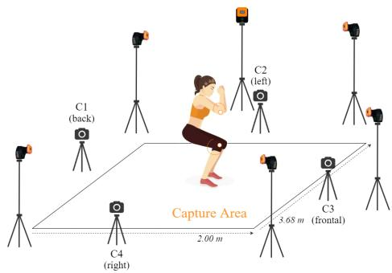

# 用于视角无关的膝关节与肘关节角度估计的深度学习网络

摘要——基于视觉的人体关节角度估计对于远程和持续的健康监测至关重要。大多数基于视觉的角度估计方法使用由光学运动相机、深度相机或人体姿态估计模型提取的人体关节位置。本研究旨在提出一种可靠且简单的方法，利用深度学习网络从 RGB 视频中估计膝关节和肘关节的屈伸角度。本研究共有十五名健康受试者执行了四项日常活动。实验采用了四种不同的深度学习网络，这些网络以九个连续帧作为输入，输出为由光学运动捕捉系统提取的每帧膝关节和肘关节角度。基于双向长短期记忆网络（BiLSTM）的关节角度估计器可以在不考虑相机视角的情况下估计两种关节角度，膝关节和肘关节的相关系数分别为 0.955 和 0.917。

## I. 引言

人体关节角度的持续估计能够对老年人受伤风险、术后康复效果以及人体关节运动障碍的诊断与评估进行关键的临床分析。在日常生活活动中，膝关节屈伸角度和肘关节屈伸角度可以作为帕金森病、中风、虚弱和脑瘫等神经和肌肉骨骼疾病严重程度的指标。因此，精确且可靠的膝关节和肘关节角度估计对于适当的临床干预至关重要。

可穿戴传感器（如表面肌电信号传感器（surface electromyography, sEMG）和惯性测量单元（inertial measurement unit, IMU））因其高精度以及能够在实验室外远程监测人体运动以估计人体关节角度的能力而被广泛使用。然而，基于可穿戴传感器的方法需要专业人员将传感器贴附到受试者身体上，分析输出信号，并要求受试者高度配合 [1]–[5]。

另一方面，基于视觉的方法被用于人体关节角度估计。目前的基于视觉的方法主要使用由专用硬件或软件生成的数据，例如光学运动相机、深度相机、被动标记系统或人体姿态估计器 [6]–[12]。

Schmitz 等人提出了一种无标记运动捕捉系统，用于评估使用单个相机测量的关节角度的准确性。该系统使用 Kinect 相机采集测试夹具的深度图和二维图像。采用一种假设膝关节为球窝关节的铰接式迭代最近点（iterative closest point）算法，将这些采集数据与模板对齐。然后，系统导出虚拟标记的轨迹，并利用这些轨迹计算关节角度 [7]。

Wang 等人提出了一种计算机视觉方法，使用单个相机在举升任务中估计关节角度，该方法分三步估计关节角度。首先，在 Detectron2 中对视频进行预处理，以检测每一帧中人体关节的二维关键点。然后，VideoPose3D 模型利用二维关键点重建三维姿态。最后，使用自上而下的逆动力学生物力学模型根据三维关节坐标计算关节角度 [10]。

Kidzinski 等人设计了一个机器学习模型来预测临床步态指标。他们使用 OpenPose 从视频中提取二维人体姿态。这些人体姿态轨迹被输入神经网络，以估计最大伸展时的膝关节屈曲角度 [11]。

这些基于视觉的方法完全依赖于使用深度感知相机、被动标记跟踪系统或人体姿态估计模型所提取的人体关节位置。然而，深度相机的覆盖范围有限，环境光照条件会显著影响人体关节角度的估计精度。此外，人体姿态检测系统所提取的关节位置可能并不是该关节的中心，这会影响关节角度的估计结果。

Kumar 等人提出了一种基于视频的系统，使用深度学习技术来解决上述基于视觉方法的局限性。一个由少量视频帧堆叠训练的深度卷积神经网络估计了受试者在跑步机上行走和做深蹲动作过程中人体下肢的角速度 [13]。

受 [13] 启发，本研究旨在提出一种简单、实用且多视角的方法，使用深度学习网络来估计膝关节屈伸角度与肘关节屈伸角度。

## II. 材料与方法

## A. 受试者

本研究基于韩国科学技术研究院（Korea Institute of Science and Technology）机构审查委员会支持的工作。

共计 15 名受试者（男性 12 名，女性 3 名；年龄 = 24.2 ± 3.8 岁，身高 = 170.7 ± 6.4 厘米，体重 = 71.7 ± 16.1 千克）无任何神经系统疾病史或现存症状，参与了本次实验。

所有受试者均签署了书面知情同意书，实验过程中未发生任何违规情况。

## B. 实验方案

数据在配备视频系统和动作捕捉系统的室内环境中采集，如图 1 所示，采集区域尺寸为 3.68 米 × 2.0 米。动作捕捉系统配备六台光学动作相机，用于追踪附着在受试者双膝和双肘上的标记点位置，动作捕捉数据以 120 Hz 的采样频率进行汇集。同时，4 台时间同步的 RGB 相机以全高清（Full HD）分辨率和 60 Hz 帧率同步采集视频数据。

本研究开发了一种基于闪光（flash）的同步方法，在光学数据中产生持续 100 ms 的脉冲信号，同时由数码相机捕捉闪光瞬间。针对每位受试者和每个动作试验，光学动作相机与数码相机通过这些闪光信号进行同步对齐。

受试者被要求执行四种日常动作：深蹲（Squat）、原地踏步（Walking in place, WIP）、单腿站立（One leg stand, OLS）和手臂动作（Arm）。在深蹲动作中，受试者进行 30 秒的深蹲。在原地踏步动作中，受试者以自选步频进行原地踏步。在单腿站立动作中，受试者单腿站立并抬起另一条腿，然后换另一条腿重复此动作。在手臂动作中，受试者被要求保持双臂与地面平行并在肘部进行弯曲；然后将双臂向两侧伸展，回到起始姿势，再将双臂前推并收回；受试者在直立状态下重复该动作持续一分钟。

最终，数据集共包含 1.29 M 帧。数据集的详细信息汇总于表 I 中。膝关节和肘关节角度的真值（ground-truth）指标由光学动作捕捉数据计算得到。每个视频的每一帧都附带人体边界框（bounding box），以及包含四个角度的标注：右膝和左膝的屈伸角度以及右肘和左肘的屈伸角度。

## C. 膝关节与肘关节角度估计器的开发

所提网络的架构由两部分组成：一个特征提取模型和一个基于长短期记忆网络（Long Short-Term Memory, LSTM）的关节角度估计器。图 2 展示了本研究所提基于 LSTM 的估计器的架构。我们采用在 ImageNet 上预训练的 ResNet18 作为骨干特征提取器，并将随后的九帧作为输入。

**表 I**  
膝关节与肘关节角度估计的数据集摘要

<table><tr><td>No of Subjects</td><td>Action Name</td><td>Time (seconds)</td><td>Frame Rate</td><td>No of Views</td><td>Total Frames</td></tr><tr><td rowspan="4">15 (12 males and 3 females)</td><td>Squat</td><td>30 x 2</td><td rowspan="4">60fps</td><td rowspan="4">4</td><td>216000</td></tr><tr><td>Walking in place</td><td>60 x 2</td><td>432000</td></tr><tr><td>One leg stand</td><td>60 x 2</td><td>432000</td></tr><tr><td>Arm</td><td>30 x 2</td><td>216000</td></tr><tr><td colspan="5">Dataset size</td><td>1296000</td></tr></table>

  

图 1. 实验设置，包含四个 RGB 相机和一个光学运动捕捉系统。

特征向量序列被输入到基于 LSTM 的网络中，该网络包含四个双向 LSTM 层，后接两个采用修正线性单元（Rectified Linear Unit, ReLU）激活函数的全连接（FC）层。最后一个 FC 层包含四个神经元，分别对应左右膝关节屈伸角度以及左右肘关节屈伸角度。我们使用三种不同的网络进行实验以比较性能：使用单帧训练的 ResNet18（ResNet18\_SF）、使用九帧堆叠训练的 ResNet18（ResNet18\_MF），以及单向 LSTM 网络。对于这些网络，我们移除了最后一个 FC 层并添加了一个新的 FC 层以适配本任务的输出。

## D. 实现细节与评估

1) 数据处理：我们将视频和动作捕捉数据下采样至 30Hz。网络输入为连续九帧图像及其对应的真实人体边界框，以及这九帧对应的各膝关节和肘关节屈伸角度。原始帧的预处理过程如下：首先根据真实人体边界框裁剪出帧中的人物，然后对左右两侧进行填充以得到正方形图像，最后将其缩放至 448 × 448 大小。数据集按参与者划分为三部分：8 名参与者的数据作为训练集（345.6k 帧），4 名参与者的数据作为验证集（172.8k 帧），剩余 3 名参与者的数据作为测试集（129.6k 帧）。

  

图 2. 双向 LSTM（Bidirectional LSTM）模型的架构。

  

图 3. 深蹲（Squat）动作中估计的膝关节与肘关节角度。

2) 训练方案（Training scheme）：所有实验均在 PyTorch 框架下完成。网络权重通过在 ImageNet 上进行预训练来初始化，用于膝关节和肘关节角度估计。在所有训练实验中，采用平均绝对误差（Mean Absolute Error，MAE）和 Adam 优化器，初始学习率为 0.001，批大小（batch size）为 16。每经过三个 epoch 后，学习率分别降低两次。

3) 评估指标（Evaluation metrics）：采用 MAE（单位：度）和皮尔逊相关系数（Pearson's Correlation Coefficient，PCC）来评估网络的性能。

## III. 结果（RESULTS）

图 3 和图 4 分别展示了在 Squat 和 WIP 动作中，四种不同深度学习网络对膝关节和肘关节角度的估计结果。在执行 OLS 和 Arm 动作时的膝关节和肘关节角度估计结果分别如图 5 和图 6 所示。结果表明，在不同活动过程中，这些网络能够准确地估计膝关节和肘关节的角度。

表 II 总结了深度学习网络对左右膝关节屈伸角度以及左右肘关节屈伸角度的 MAE 和 PCC。LSTM 模型在右膝关节角度上取得了 8.24 的最低 MAE；BiLSTM 模型在左膝关节、右肘关节和左肘关节角度上估计的最低 MAE 分别为 7.73、9.80 和 10.29。在右膝关节角度估计中，ResNet18\_SF 和 BiLSTM 网络均取得了 0.975 的最高 PCC。BiLSTM 模型在左膝关节、右肘关节和左肘关节角度上取得的最高 PCC 分别为 0.976、0.917 和 0.922。如表 III 所示，我们分析了

  

图 4. 在 WIP 动作期间估计的膝关节与肘关节角度。

各网络在不同动作上的 MAE 分别进行评估。对于 Squat 动作，LSTM 模型在膝关节角度估计上取得了 12.27 和 11.45 的最小 MAE，而 BiLSTM 模型在肘关节角度上取得了 9.95 和 10.26 的最小 MAE。此外，对于 WIP 动作，ResNet18\_MF 模型估计的右膝和左膝角度分别取得了 8.15 和 7.88 的最小 MAE，而右肘和左肘角度的估计结果分别为 7.00 和 8.05 的 MAE，这由 BiLSTM 模型取得。对于 OLS 动作，LSTM 和 BiLSTM 模型在右膝和左膝角度估计上分别取得了 6.64 和 7.06 的最小 MAE。相比之下，ResNet18\_SF 和 ResNet18\_MF 模型在右肘和左肘角度估计上分别取得了 5.45 和 5.61 的最小 MAE。

表 IV 和表 V 展示了四个深度学习网络在不同动作上的 PCC，其中包含了各活动中最活跃关节的结果。如表 IV 所示，对于 Squat 和 OLS，BiLSTM 模型在膝关节角度的平均估计上分别取得了 0.991 和 0.993 的最高 PCC。ResNet18\_SF 模型在右膝上取得了 0.951 的最高 PCC，而 ResNet18\_MF 模型在 WIP 动作的左膝角度估计上取得了 0.950 的最高 PCC。如表 V 所总结，BiLSTM 模型在 WIP 和 Arm 动作的肘关节角度平均估计上分别取得了 0.906 和 0.933 的最高 PCC。

TABLE II  
THE KNEE AND ELBOW JOINT ANGLE ESTIMATION PERFORMANCE OF THE FOUR NETWORKS

表 II  
四个网络的膝关节与肘关节角度估计性能

<table><tr><td></td><td>Model</td><td>R_Knee</td><td>L_Knee</td><td>R_Elbow</td><td>L_Elbow</td></tr><tr><td rowspan="4"> $MAE (^\circ)$ </td><td>ResNet18_SF</td><td>8.29</td><td>7.83</td><td>15.37</td><td>16.07</td></tr><tr><td>ResNet18_MF</td><td>10.17</td><td>9.34</td><td>14.64</td><td>14.28</td></tr><tr><td>LSTM</td><td>8.24</td><td>8.32</td><td>15.37</td><td>16.59</td></tr><tr><td>BiLSTM</td><td>8.67</td><td>7.73</td><td>9.80</td><td>10.29</td></tr><tr><td rowspan="4">PCC</td><td>ResNet18_SF</td><td>0.975</td><td>0.975</td><td>0.887</td><td>0.902</td></tr><tr><td>ResNet18_MF</td><td>0.974</td><td>0.968</td><td>0.882</td><td>0.900</td></tr><tr><td>LSTM</td><td>0.973</td><td>0.955</td><td>0.890</td><td>0.901</td></tr><tr><td>BiLSTM</td><td>0.975</td><td>0.976</td><td>0.917</td><td>0.922</td></tr></table>

  

图5. OLS动作过程中膝关节角度的估计结果。

## IV. 讨论（DISCUSSION）

本研究提出了一种使用深度学习网络来估计膝关节屈伸角与肘关节屈伸角的新方法。使用少量后续视频帧训练的深度学习网络取得了良好的性能，此外，使用单帧训练的简单 2D 网络在不同相机视角下估计膝关节与肘关节关节角时也获得了令人满意的结果。需要指出的是，该方法在估计人体关节角度时不需要任何特殊传感器、标记点以及人体姿态估计器。

深度学习网络估计关节角度的平均 MAE 为 8.57，平均 PCC 为 0.969（针对膝关节）；肘关节的平均 MAE 为 14.05，平均 PCC 为 0.900。表 VI 单独汇总了网络在不同相机视角下的性能。网络对膝关节屈伸角的估计性能在不同相机视角下都相对较好。相比之下，相机视角会影响肘关节屈伸角的估计。如表 VI 所示，由于在深蹲（Squat）和手臂（Arm）动作中从背侧无法观察到肘关节的屈曲，深度学习网络从背侧估计肘关节角度时具有更高的 MAE。因此，从右侧相机视角看，网络对右膝和右肘关节的估计误差小于左膝和左肘关节。从相反的相机视角也观察到了类似的情况。

**表 III  
不同动作下膝关节与肘关节角度估计网络性能对比**

<table><tr><td rowspan="2" colspan="2">Model</td><td colspan="4">MAE (°)</td></tr><tr><td>R_Knee</td><td>L_Knee</td><td>R_Elbow</td><td>L_Elbow</td></tr><tr><td rowspan="4">Squat</td><td>ResNet18_SF</td><td>12.66</td><td>13.26</td><td>21.54</td><td>24.43</td></tr><tr><td>ResNet18_MF</td><td>15.04</td><td>13.83</td><td>15.77</td><td>18.30</td></tr><tr><td>LSTM</td><td>12.27</td><td>11.45</td><td>22.95</td><td>25.30</td></tr><tr><td>BiLSTM</td><td>13.93</td><td>12.46</td><td>9.95</td><td>10.26</td></tr><tr><td rowspan="4">WIP</td><td>ResNet18_SF</td><td>8.67</td><td>8.21</td><td>10.32</td><td>10.02</td></tr><tr><td>ResNet18_MF</td><td>8.15</td><td>7.88</td><td>11.38</td><td>10.14</td></tr><tr><td>LSTM</td><td>10.42</td><td>11.43</td><td>7.44</td><td>8.83</td></tr><tr><td>BiLSTM</td><td>9.58</td><td>9.30</td><td>7.00</td><td>8.05</td></tr><tr><td rowspan="4">OLS</td><td>ResNet18_SF</td><td>8.37</td><td>7.38</td><td>5.45</td><td>7.55</td></tr><tr><td>ResNet18_MF</td><td>14.03</td><td>11.90</td><td>7.70</td><td>5.61</td></tr><tr><td>LSTM</td><td>6.64</td><td>8.10</td><td>9.08</td><td>8.97</td></tr><tr><td>BiLSTM</td><td>7.36</td><td>7.06</td><td>6.32</td><td>7.75</td></tr><tr><td rowspan="4">Arm</td><td>ResNet18_SF</td><td>3.47</td><td>2.47</td><td>22.72</td><td>23.76</td></tr><tr><td>ResNet18_MF</td><td>3.45</td><td>3.73</td><td>22.40</td><td>24.38</td></tr><tr><td>LSTM</td><td>3.62</td><td>2.29</td><td>21.40</td><td>23.90</td></tr><tr><td>BiLSTM</td><td>3.79</td><td>2.10</td><td>15.21</td><td>15.79</td></tr></table>

  

图 6. Arm 动作过程中估计的肘关节角度结果。

如引言部分所述，大多数基于视觉的方法使用特定的相机系统和人体姿态估计设备来定位人体关节，并跟踪这些关节以估计人体关节角度。Cai 等人研究了基于单个 Kinect 的系统在 Kinect 传感器放置于不同距离和方位时测量上肢关节角度的准确性。上肢关节角度是根据 Kinect v2 传感器在上肢功能性任务过程中获得的躯干和上肢关节中心的三维坐标计算得出的。在肘关节角度估计方面，平均绝对误差（Mean Absolute Error, MAE）范围为 10.20 到 28.32，具体取决于 Kinect 传感器的放置位置。当 Kinect 传感器放置在左侧 30° 位置时，基于 Kinect 的系统在估计肘关节屈伸角度时达到了最低的 MAE 值 10.20[6]。Pantzar-Castilla 等人设计了一种使用 RGB-D 相机从侧面视角进行膝关节角度估计的系统。髋关节、膝关节和踝关节中心从深度数据中提取，并在行走过程中进行跟踪。然后，利用这些关节中心轨迹计算膝关节角度。该系统估计膝关节角度的平均相关系数为 0.906[12]。与这些研究相比，我们的方法在无需特殊相机和人体姿态信息的情况下，从多相机视角估计膝关节和肘关节角度方面取得了显著的性能。我们期望所提出的方法能够作为有效且实用的人体关节角度估计方法，用于远程和持续的健康监测。

本研究存在一个与可推广性相关的局限性。研究参与者主要是年轻和健康的人群。因此，将我们的方法应用于不同的参与者群体（包括老年人、帕金森病、中风、脑瘫和肌营养不良等疾病的患者）是未来工作计划的一部分。

**TABLE IV  
不同动作下网络在膝关节角度估计方面的性能比较**

<table><tr><td rowspan="2"></td><td rowspan="2">Model</td><td colspan="2">PCC</td></tr><tr><td>R_Knee</td><td>L_Knee</td></tr><tr><td rowspan="4">Squat</td><td>ResNet18_SF</td><td>0.989</td><td>0.986</td></tr><tr><td>ResNet18_MF</td><td>0.988</td><td>0.985</td></tr><tr><td>LSTM</td><td>0.969</td><td>0.966</td></tr><tr><td>BiLSTM</td><td>0.991</td><td>0.990</td></tr><tr><td rowspan="4">WIP</td><td>ResNet18_SF</td><td>0.947</td><td>0.950</td></tr><tr><td>ResNet18_MF</td><td>0.951</td><td>0.936</td></tr><tr><td>LSTM</td><td>0.906</td><td>0.913</td></tr><tr><td>BiLSTM</td><td>0.940</td><td>0.945</td></tr><tr><td rowspan="4">OLS</td><td>ResNet18_SF</td><td>0.987</td><td>0.989</td></tr><tr><td>ResNet18_MF</td><td>0.984</td><td>0.982</td></tr><tr><td>LSTM</td><td>0.989</td><td>0.987</td></tr><tr><td>BiLSTM</td><td>0.993</td><td>0.993</td></tr></table>

表 V

不同动作下各网络在肘关节角度估计上的性能比较

<table><tr><td rowspan="2"></td><td rowspan="2">Model</td><td colspan="2">PCC</td></tr><tr><td>R_Elbow</td><td>L_Elbow</td></tr><tr><td rowspan="4">WIP</td><td>ResNet18_SF</td><td>0.884</td><td>0.902</td></tr><tr><td>ResNet18_MF</td><td>0.888</td><td>0.907</td></tr><tr><td>LSTM</td><td>0.882</td><td>0.903</td></tr><tr><td>BiLSTM</td><td>0.901</td><td>0.911</td></tr><tr><td rowspan="4">Arm</td><td>ResNet18_SF</td><td>0.889</td><td>0.902</td></tr><tr><td>ResNet18_MF</td><td>0.877</td><td>0.883</td></tr><tr><td>LSTM</td><td>0.898</td><td>0.898</td></tr><tr><td>BiLSTM</td><td>0.932</td><td>0.933</td></tr></table>

## V. 结论（CONCLUSIONS）

本研究提出了一种多视角、基于视觉的关节角度估计方法，无需特殊相机系统和可穿戴传感器，通过深度学习网络即可实现关节角度估计。使用少量视频帧训练的深度学习网络在估计膝关节和肘关节角度方面表现出卓越性能，且不受相机视角的影响。本方法可应用于居家健康监测，从而实现疾病的早期诊断、合理治疗与及时干预。

## 致谢（ACKNOWLEDGMENT）

本工作部分得到韩国体育振兴基金会（Korea Sports Promotion Foundation）"高新夏季信息技术优化国家运动表现提升项目"的支持，部分得到"运动员训练／比赛数据管理与基于人工智能的表现优化解决方案技术开发项目"（No.1375027374）的支持。

## 参考文献（REFERENCES）

[1] A. Kumar, A. K. Godiyal, P. Joshi, and D. Joshi，"一种基于力肌图的下肢截肢者和健全受试者膝关节角度连续估计新方法，" *IEEE Journal of Biomedical and Health Informatics*，第 25 卷，第 701–710 页，2021 年。

TABLE VI  
不同相机视角下网络性能的比较（COMPARISON OF THE NETWORKS' PERFORMANCE ON DIFFERENT CAMERA VIEW ANGLES.）

<table><tr><td rowspan="2" colspan="2">Model</td><td colspan="4">MAE (°)</td></tr><tr><td>R_Knee</td><td>L_Knee</td><td>R_Elbow</td><td>L_Elbow</td></tr><tr><td rowspan="4">back</td><td>ResNet18_SF</td><td>9.06</td><td>7.75</td><td>17.85</td><td>19.55</td></tr><tr><td>ResNet18_MF</td><td>13.08</td><td>10.59</td><td>15.79</td><td>16.38</td></tr><tr><td>LSTM</td><td>8.40</td><td>9.60</td><td>18.23</td><td>20.17</td></tr><tr><td>BiLSTM</td><td>8.77</td><td>7.27</td><td>12.37</td><td>12.74</td></tr><tr><td rowspan="4">left</td><td>ResNet18_SF</td><td>7.41</td><td>7.07</td><td>15.07</td><td>13.60</td></tr><tr><td>ResNet18_MF</td><td>8.29</td><td>7.47</td><td>14.90</td><td>13.59</td></tr><tr><td>LSTM</td><td>7.62</td><td>7.44</td><td>15.99</td><td>15.37</td></tr><tr><td>BiLSTM</td><td>8.70</td><td>8.06</td><td>9.60</td><td>8.90</td></tr><tr><td rowspan="4">frontal</td><td>ResNet18_SF</td><td>9.09</td><td>8.30</td><td>14.38</td><td>15.38</td></tr><tr><td>ResNet18_MF</td><td>8.52</td><td>9.40</td><td>14.02</td><td>13.64</td></tr><tr><td>LSTM</td><td>9.84</td><td>8.46</td><td>13.07</td><td>14.26</td></tr><tr><td>BiLSTM</td><td>9.11</td><td>7.33</td><td>8.70</td><td>10.49</td></tr><tr><td rowspan="4">right</td><td>ResNet18_SF</td><td>7.62</td><td>8.20</td><td>14.21</td><td>15.76</td></tr><tr><td>ResNet18_MF</td><td>10.78</td><td>9.87</td><td>13.84</td><td>13.51</td></tr><tr><td>LSTM</td><td>7.08</td><td>7.78</td><td>14.21</td><td>16.58</td></tr><tr><td>BiLSTM</td><td>8.08</td><td>8.25</td><td>8.52</td><td>9.02</td></tr></table>

[2] Z. Li, X. Guan, K. Zou, and C. Xu, "基于表面肌电信号使用随机森林与主成分分析估计膝关节运动," Electronics, vol. 9, 2020. [Online]. Available: https://www.mdpi.com/2079-9292/9/1/43

[3] X. Ma, Y. Liu, Q. Song, and C. Wang, "基于表面肌电信号使用长短期记忆神经网络与时间提前特征连续估计膝关节角度," Sensors, vol. 20, 2020. [Online]. Available: https://www.mdpi.com/1424-8220/20/17/4966

[4] Y. Deng, F. Gao, and H. Chen, "基于PCA-RELM算法的膝关节运动角度估计," Symmetry, vol. 12, 2020. [Online]. Available: https://www.mdpi.com/2073-8994/12/1/130

[5] H.-S. Cho, J.-H. Yang, J.-H. Lee, and J.-H. Lee, "基于SWCNT涂层织物运动传感器实现方式的关节运动感知效率评估," Sensors, vol. 20, 2020. [Online]. Available: https://www.mdpi.com/1424-8220/20/1/284

[6] L. Cai, D. Liu, and Y. Ma, "单Kinect运动捕捉系统在单侧动态运动分析中的放置建议," Healthcare, vol. 9, p. 1076, 1 2021.

[7] A. Schmitz, M. Ye, R. Shapiro, R. Yang, and B. Noehren, "使用单摄像头无标记运动捕捉系统测量关节角度的准确性和重复性," Journal of biomechanics, vol. 47, 1 2013.

[8] F. Mateo, J. J. Carrasco, M. Aguilar-Rodríguez, E. Olivas, S. Bonanad, F. Querol, and S. Pérez-Alenda, "使用角度修正模型评估Kinect v2对血友病患者肘关节活动度估计的效果," Haemophilia, vol. 25, 1 2019.

[9] S. Örücü and M. Selek, "使用Kinect v2设计并验证用于实时运动员辅助的基于规则的专家系统," Applied Sciences, vol. 10, 2020. [Online]. Available: https://www.mdpi.com/2076-3417/10/2/611

[10] H. Wang, Z. Xie, L. Lu, L. Li, and X. Xu, "通过单摄像头在举升任务中估计关节角度和L5/S1力矩的计算机视觉方法," Journal of Biomechanics, vol. 129, p. 110860, 2021. [Online]. Available: https://www.sciencedirect.com/science/article/pii/S0021929021006175

[11] Łukasz Kidziński, B. Yang, J. L. Hicks, A. Rajagopal, S. L. Delp, and M. H. Schwartz, "深度神经网络实现基于单摄像头视频的定量运动分析," Nature Communications, vol. 11, p. 4054, 2020. [Online]. Available: https://doi.org/10.1038/s41467-020-17807-z

[12] E. Pantzar, A. Cereatti, G. Figari, N. Valeri, G. Paolini, U. D. Croce, A. Magnuson, and J. Riad, "脑瘫患者的膝关节矢状面运动：二维无标记视频与三维步态分析的对比研究," Acta Orthopaedica, vol. 89, pp. 656–661, 1 2018.

[13] K. S. Kumar, A. Jamsarndorj, D. Jung, D. Lee, J. Kim, and K.-R. Mun, "基于视觉的人体关节角速度估计——在深蹲和跑步机上行走动作中的应用," 2021, pp. 2186–2190.