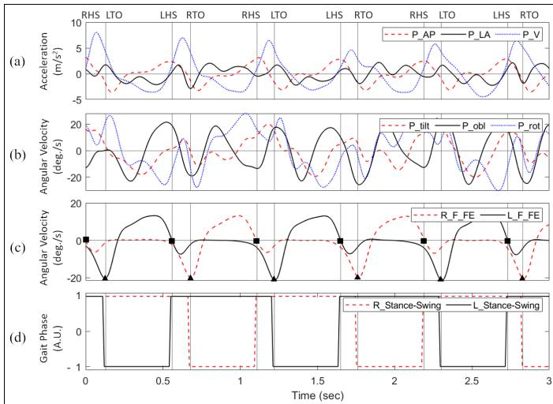
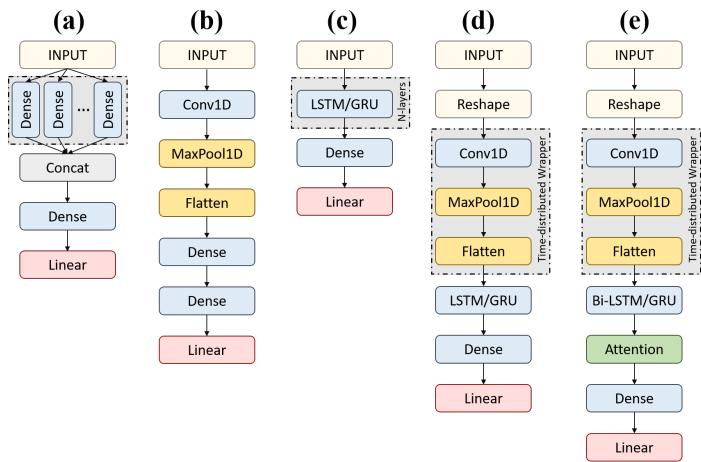
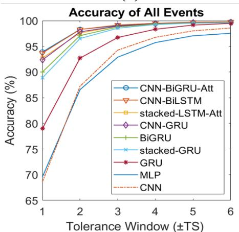
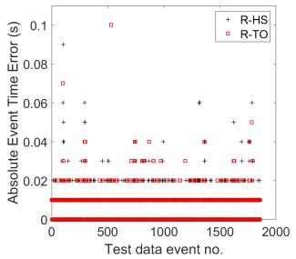
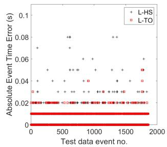
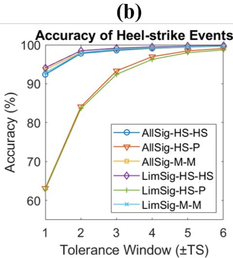

# 使用混合 CNN-RNN 深度学习模型通过单一腰部可穿戴传感器预测步态事件

Muhammad Zeeshan Arshad, Ankhzaya Jamsrandorj, Jinwook Kim, and Kyung-Ryoul Mun

摘要——老年人步态是反映其身心健康状况的丰富信息来源。作为下肢多个传感器的替代方案，置于骨盆处的单一传感器具有位置优势，且可获取大量信息。本研究旨在探索一种通过单一腰部传感器和深度学习模型提高老年人步态事件检测准确率的方法。研究对象为佩戴上三块 IMU 传感器行走的老年受试者。仅使用腰部传感器的输入数据训练了 16 个深度学习模型，包括 CNN、RNN 以及带或不带双向（Bidirectional）和注意力（Attention）机制的 CNN-RNN 混合模型。基准真值（groundtruth）来自足部 IMU 传感器。在 ±6TS（±6 毫秒）和 ±1TS（±1 毫秒）的容差窗口下，CNN-BiGRU-Att 模型分别取得了 99.73% 和 93.89% 的较高准确率。在先前步态事件检测研究的基础上，该模型在预测误差方面有了显著改善，在 ±1TS 容差窗口下，HS 和 TO 事件的平均绝对误差（MAE）分别为 6.239 毫秒和 5.24 毫秒。结果表明，使用结合注意力和双向机制的 CNN-RNN 混合模型，对于利用单一腰部传感器进行精确步态事件检测具有广阔前景。本研究有助于减轻步态检测的负担，并提高其在未来可穿戴设备中的适用性，这些设备可用于远程健康监测（RHM）或相关诊断。

索引词——步态分析，可穿戴设备，深度学习

## I. 引言

健康风险 [1]。除身体状况外，即使是认知障碍和痴呆等心理状况，也可在其步态中得到反映 [2, 3, 4, 5]。对老年人步态的精确测量使我们能够在早期预测和发现其健康危机，并制定积极的策略以防止不必要的疾病进展。

人体步态测量这一困难任务经历了重大演变 [6]——从传统的视觉观察，发展到如今使用阈值法、峰值检测、手工特征和基于规则的方法 [7, 8, 9]。惯性测量单元（IMU）等更小、更轻、更廉价传感器的出现，使人们得以摆脱使用动作捕捉系统和测力台的繁琐且昂贵的方式，这些方式曾仅限于严格的临床环境 [10, 11]。基于机器学习的方法，如隐马尔可夫模型（HMM）[12, 13, 14]、支持向量机（SVM）[15]、深度 CNN [16] 和循环神经网络（RNN）[17]，进一步减轻了步态测量的负担，并开启了精确步态评估的新视野。

测量步态时，可以通过时间特征对其进行量化，其中精确检测每只脚的脚跟着地（heel-strike, HS）和脚尖离地（toe-off, TO）至关重要。根据检测到的脚跟着地和脚尖离地可以计算出步态相位。尽管现有方法在检测方面已取得相当不错的性能，但使用多个传感器以及复杂的特征提取预处理过程被认为是主要障碍。此外，传感器大多放置在下肢部位，会干扰自然行走，并限制其在个人日常生活中的应用。

作为在下肢部位放置多个传感器的替代方案，可以建议在骨盆上使用单个传感器，因为它具有位置优势且可获取丰富的信息。骨盆可能是任何可穿戴传感器的理想放置位置，因为它是系腰带的常见部位，且对日常活动的妨碍最小。骨盆是宝贵的信息来源，因为单个传感器即可检测左右脚的运动，并且它与步态六个决定因素中的三个相关，即骨盆旋转（pelvis rotation）、骨盆倾斜（pelvic tilt）和骨盆横向位移（lateral displacement of the pelvis）[18]。它还与身体质心（center of mass, COM）处的垂直中线对齐，本质上连接下肢与上半身，使力能够在两者之间传递并控制全身平衡。利用骨盆的信号，可以识别活动，甚至可以估计姿势，如坐姿和卧姿。骨盆的信号富含有关日常活动模式的信息，并携有关于步态和运动的全面信息。然而，由于使用骨盆信号的准确性不及使用下肢部位信号的准确性[19, 20]，因此采用骨盆信号的尝试很少。

因此，本研究旨在探索一种使用骨盆上的单个传感器结合深度学习模型来提高老年人步态事件检测准确性的方法。本研究招募了健康或存在健康问题的老年人，并测量了他们的步态。各种深度学习模型学习了骨盆信号中存在的步态事件信息之间的相互关系，并预测步态事件。然后，将预测结果与脚部传感器的真值进行对比。本研究提出了一种使用骨盆上单个传感器进行步态检测的可靠方法，预期将有助于减轻步态检测的负担，并提高其在未来可穿戴设备中的适用性，这些设备可用于远程健康监测（remote health monitoring, RHM）或基于此的诊断。

  

图 1：所提出的相位检测方法概述及用于数据采集的实验

## II. 方法（METHODS）

## A. 数据采集（Data-collection）

169名年龄在60至80岁之间的社区居住老年人被招募参加本研究。

本研究经庆熙大学医学中心（Kyung Hee University Medical Center）机构审查委员会批准（IRB编号：2017-04-001）。

所有参与者在参加研究之前均获得了书面知情同意。

根据参与时的健康状况，受试者被分为健康组和患者组。

患者组包括衰弱（frailty）受试者（n=47）、认知障碍（cognitive impairment）受试者（n=8）、跌倒史（fall history）受试者（n=11），以及上述情况合并存在的受试者（n=9）。

衰弱被定义为5项FRAIL量表测试结果为1分或更高[21]，认知障碍被定义为简易精神状态检查表（MMSE）[22]得分低于24分。

在问卷中回答过去一年内有过跌倒史并因此接受过医院治疗的受试者被纳入患者组。

根据这些标准，75名受试者被纳入患者组，其余94名被纳入健康组。

在数据采集时，所有受试者均能够在无需他人帮助或设备辅助的情况下行走。

表I总结了受试者的人口统计学详情。

本研究使用了三个商用IMU传感器：一个置于骨盆处，两个置于脚部（Xsens MVN，Enschede，荷兰）。

如图1所示，一个IMU传感器固定在受试者腰部佩戴的腰带上，另外两个传感器分别绑在每只脚上。

在佩戴传感器后，要求受试者以其偏好速度（preferred speed）和比平时更快的速度各行走3次10米路径，这样每位受试者总共行走6次路径。

以100 Hz的采样率采集三轴平移和三轴旋转惯性数据，并通过0.5–6 Hz带通滤波器以去除高频噪声。

图2(a)和(b)显示了一名健康受试者骨盆处的加速度和角速度信号。

为了检测实际的足跟着地（HS）和足尖离地（TO），使用了矢状面上左右脚屈伸的角速度信号（图2(c)）。

足尖离地事件被检测为倒置的高幅峰值（以方块标记），足跟着地事件被检测为同一图中倒置低幅峰值之前的过零点（以三角形标记）[33]。

利用每只脚的HS和TO这四个事件，生成了真值数据（图2(d)）。

步态周期中脚在地面上的时期（HS到TO）被称为支撑期（stance phase），而脚在空中的时期（TO到HS）被称为摆动期（swing phase）[11]。

图2(d)显示了右脚相位信号（以红色虚线表示）和左脚信号（以黑色实线表示）。

支撑期赋值为1，摆动期赋值为-1。

图3说明了如何为训练一步超前预测生成输入-输出数据对，其中输入 x 指滑动窗口内的骨盆 IMU 数据，输出 y 指滑动窗口下一个时间步的左右相位信号值。第一对从 $x _ { 1 } , x _ { 2 } , . . . , x _ { w }$ 这样的输入开始，其中 w 是窗口长度，对应的输出为 $y _ { w + 1 }$ 。然后将窗口向后移动一个时间步。因此，对于时间步 t 处的每一对数据，输入为 $x _ { t - w } , x _ { t - w + 1 } , . . . , X _ { t - 1 }$，输出为 $y _ { t }$。对于时间步 n 的输入数据，总共生成了 $n - w$ 个输入-输出数据对。

表 I：受试者的人口统计学信息

<table><tr><td>Characteristic</td><td>All subjects n=169</td><td>Healthy subjects n=94</td><td>Patients n=75</td></tr><tr><td>Age (years),  $\mathrm { M e a n } \pm \mathrm { S D } ( \mathrm { R a n g e } )$ </td><td> $7 4 . 8 9 \pm 5 . 0 8 ( 6 0 - 8 7 )$ </td><td> $7 4 . 6 6 \pm 4 . 7 5 ( 6 4 - 8 7 )$ </td><td> $7 5 . 1 7 \pm 5 . 4 8 ( 6 0 - 8 7 )$ </td></tr><tr><td>Height (cm),  $\mathrm { M e a n } \pm \mathrm { S D } ( \mathrm { R a n g e } )$ </td><td> $1 5 9 . 6 7 \pm 7 . 2 3 ( 1 4 1 . 9 \mathrm { { - } } 1 7 1 )$ </td><td> $1 6 0 . 5 \pm 7 . 0 1 ( 1 4 1 . 9 – 1 7 1 )$ </td><td> $1 5 5 . 6 5 \pm 7 . 5 5 ( 1 5 1 . 3 \ – 1 7 0 . 4 )$ </td></tr><tr><td>Weight (kg),  $\mathrm { M e a n } \pm \mathrm { S D } ( \mathrm { R a n g e } )$ </td><td> $6 1 . 1 \pm 9 . 3 4 ( 4 2 . 3 - 9 1 )$ </td><td> $6 2 . 0 1 \pm 9 . 6 9 ( 4 2 . 3 - 9 1 )$ </td><td> $5 9 . 9 2 \pm 8 . 7 9 ( 4 2 . 5 { - } 8 0 )$ </td></tr><tr><td colspan="4">Gender</td></tr><tr><td>- Male n (%)</td><td>68 (40.24%)</td><td>42 (44.68%)</td><td>26 (34.67%)</td></tr><tr><td>- Female n (%)</td><td>101 (59.77%)</td><td>52 (55.32%)</td><td>49 (65.34%)</td></tr></table>

  

图 2：输入信号包括 (a) 加速度信号，(b) 来自骨盆的角速度信号。(c) 真值标签通过识别来自脚部的角速度信号中的事件来提取。(d) 为左脚和右脚生成的站立相与摆动相信号，作为两条连续的真值标签信号，用于基于回归的模型。

## B. 深度学习模型

共计训练并测试了 16 个深度学习模型。这些模型包括经典模型、卷积神经网络（Convolutional Neural Network, CNN）、循环神经网络（Recurrent Neural Networks, RNN）模型（可附带或不附带双向机制或注意力机制），以及一些将 CNN 与 RNN 模型相组合的混合模型（可附带或不附带双向机制或注意力机制）。经典模型包括卷积神经网络（Convolutional Neural Networks, CNN）和多层感知器（Multi-Layer Perceptron, MLP）模型，而 RNN 模型包括长短期记忆网络（Long Short-term Memory, LSTM）、门控循环单元（Gated Recurrent Unit, GRU）、双向长短期记忆网络（Bidirectional LSTM, BiLSTM）、双向门控循环单元（Bidirectional GRU, BiGRU）、堆叠 LSTM（Stacked LSTM）、堆叠 GRU（Stacked GRU）、带注意力机制的堆叠 LSTM（Stacked LSTM with Attention Mechanism, stacked-LSTM-Att），以及带注意力机制的堆叠 GRU（Stacked GRU with Attention Mechanism, stacked-GRU-Att）。混合模型包括 CNN 与 LSTM 组合（CNN-LSTM）、CNN 与 GRU 组合（CNN-GRU）、CNN 与双向 LSTM 组合（CNN-BiLSTM）、CNN 与双向 GRU 组合（CNN-BiGRU）、CNN 与双向 LSTM 及注意力机制组合（CNN-BiLSTM-Att），以及 CNN 与双向 GRU 及注意力机制组合（CNN-BiGRU-Att）。

对于所有模型，训练所用的原始数据包括来自骨盆的六路 IMU 信号作为输入，以及来自双足的站立相与摆动相信号作为输出。这些模型使用了所生成的输入与输出数据样本，并进行了一步前向预测。所有模型的超参数均经过优化，以获得各自的最佳精度。最终输出采用了 Dense 层后接线性激活函数（Linear Activation Function, AF）的结构。

深度学习模型所采用的架构如图 4 所示。图 4(a) 展示了 MLP 的架构。该模型针对每路输入信号各设一个含 100 个神经元的 Dense 层，并在连接到 Dense 层之前通过 concatenate 层将它们合并。对于 CNN 模型，输入首先被重塑为 [samples, timesteps, features] 的维度，以适配一维卷积层 Conv1D（图 4(b)）。Conv1D 层之后接一个一维池化层 MaxPool1D。经过展平后，输出被送入一个含 50 个神经元的 Dense 层，最后的 Dense 层将该序列经由线性 AF 连接到最终输出。对于采用单层或堆叠 LSTM/GRU 的 RNN 模型（可附带或不附带注意力机制），单层 vanilla LSTM 与 GRU 网络均含有 100 个隐藏单元，其后接一个 Dense 层与线性 AF（图 4(C)）。堆叠 LSTM 与 GRU 由两个堆叠在一起的网络层组成，每层包含 100 个隐藏单元。首层将其隐藏状态馈送至第二层，由第二层用于输出预测。

对于结合 CNN（卷积神经网络）和 RNN（循环神经网络）的混合模型，维度为 [samples, window-length, features] 的输入通过将 window-length 维度拆分为两段进行重塑。当 window-length 为 80 个时间步时，维度为 [samples, 80, 6] 的输入被转换为 [samples, 2, 40, 6]。重塑后的输入被送入 Conv1D。MaxPooling1D 跟在卷积层之后，最后进行展平（图 4(d)）。包裹卷积块的时间分布层（TimeDistributed）能够将同一组卷积块实例应用于输入的所有时间切片 [23]。该 CNN 的输出进入具有 600 个隐藏单元的单层 LSTM 或 GRU。Dense 层随后使用与其他模型相同的 Linear 激活函数（AF）。

至于采用 Bidirectional（双向）和 Attention（注意力）机制的模型，Bidirectional 机制将输入的前向和后向序列提供给两个不同的

  

yt = 时刻 t 的相位信号值（Phase signal value at time t）
w = 窗口长度（时间步数）（Window length (timesteps)）

<table><tr><td rowspan=1 colspan=1>x1</td><td rowspan=1 colspan=1>x2</td><td></td><td rowspan=1 colspan=1> $\lfloor x _ { w - 1 }$ </td><td rowspan=1 colspan=1>xw</td><td></td><td rowspan=1 colspan=1>xt-w</td><td rowspan=1 colspan=1>xt-w+1</td><td rowspan=1 colspan=1>xt-w+2</td><td></td><td rowspan=1 colspan=1> $x _ { t - 1 }$ </td><td rowspan=1 colspan=1>xt</td><td rowspan=1 colspan=1> $x _ { t \pm 1 }$ </td><td rowspan=1 colspan=1> $x _ { t + 2 }$ </td><td rowspan=1 colspan=1></td><td rowspan=1 colspan=1> $\boxed { \begin{array} { r l } { x _ { n - w } } & {</td><td rowspan=1 colspan=1>\left| x _ { n - w + 1 } \right| } \end{array} }$ </td><td rowspan=1 colspan=1></td><td rowspan=1 colspan=1> $\underline { { x _ { n - 1 } } }$ </td><td rowspan=1 colspan=1>xn</td></tr><tr><td rowspan=1 colspan=1>y1</td><td rowspan=1 colspan=1>y2</td><td></td><td rowspan=1 colspan=1>yw-1</td><td rowspan=1 colspan=1>yw</td><td></td><td rowspan=1 colspan=1>yt-w</td><td rowspan=1 colspan=1>yt-w+1 y</td><td rowspan=1 colspan=1>t-w+2</td><td></td><td rowspan=1 colspan=1> $\mathcal { X } t { - } 1$ </td><td rowspan=1 colspan=1>yt</td><td rowspan=1 colspan=1> $y _ { t + 1 }$ </td><td rowspan=1 colspan=1>yt+2</td><td rowspan=1 colspan=1></td><td rowspan=1 colspan=1>yn−w</td><td rowspan=1 colspan=1>Yn-w+1</td><td rowspan=1 colspan=1></td><td rowspan=1 colspan=1>yn-1</td><td rowspan=1 colspan=1>yn</td></tr><tr><td rowspan=1 colspan=1>**</td><td rowspan=1 colspan=1></td><td></td><td rowspan=1 colspan=1></td><td rowspan=1 colspan=1></td><td></td><td rowspan=1 colspan=4>:</td><td rowspan=1 colspan=2>:</td><td rowspan=1 colspan=2></td><td rowspan=1 colspan=1></td><td rowspan=1 colspan=1>:</td><td rowspan=1 colspan=1></td><td rowspan=1 colspan=1></td><td rowspan=1 colspan=1>:</td><td rowspan=1 colspan=1></td></tr><tr><td rowspan=1 colspan=1>x1</td><td rowspan=1 colspan=1>x2</td><td></td><td rowspan=1 colspan=1>xw-1</td><td rowspan=1 colspan=1>xw</td><td></td><td rowspan=1 colspan=1>xt-w</td><td rowspan=1 colspan=1>xt-w+1</td><td rowspan=1 colspan=1>xt-w+2</td><td rowspan=1 colspan=1>.</td><td rowspan=1 colspan=1>xt-1</td><td rowspan=1 colspan=1>xt</td><td rowspan=1 colspan=1> $x _ { t \pm 1 }$ </td><td rowspan=1 colspan=1>xt+2</td><td rowspan=1 colspan=1>…</td><td rowspan=1 colspan=1>xn−wx</td><td rowspan=1 colspan=1>n-w+1</td><td rowspan=1 colspan=1>…</td><td rowspan=1 colspan=1>xn-1</td><td rowspan=1 colspan=1>xn</td></tr><tr><td rowspan=1 colspan=1>y1</td><td rowspan=1 colspan=1>y2</td><td></td><td rowspan=1 colspan=1>yw-1</td><td rowspan=1 colspan=1>yw</td><td></td><td rowspan=1 colspan=1>yt-w</td><td rowspan=1 colspan=1>yt-w+1 y</td><td rowspan=1 colspan=1>t-w+2</td><td rowspan=1 colspan=1></td><td rowspan=1 colspan=1>yt-1</td><td rowspan=1 colspan=1>yt</td><td rowspan=1 colspan=1>yt+1</td><td rowspan=1 colspan=1>yt+2</td><td rowspan=1 colspan=1></td><td rowspan=1 colspan=1>yn-wy</td><td rowspan=1 colspan=1>n-w+1</td><td rowspan=1 colspan=1>…</td><td rowspan=1 colspan=1>yn-1</td><td rowspan=1 colspan=1>yn</td></tr><tr><td rowspan=1 colspan=1>x1</td><td rowspan=1 colspan=1>x2</td><td></td><td rowspan=1 colspan=1>xw-1</td><td rowspan=1 colspan=1>xw</td><td></td><td rowspan=1 colspan=1>xt-w</td><td rowspan=1 colspan=1>xt-w+1</td><td rowspan=1 colspan=1>xt-w+2</td><td rowspan=1 colspan=1></td><td rowspan=1 colspan=1>xt-1</td><td rowspan=1 colspan=1>xt</td><td rowspan=1 colspan=1> $x _ { t + 1 }$ </td><td rowspan=1 colspan=1>xt+2</td><td rowspan=1 colspan=1></td><td rowspan=1 colspan=1>xn−w</td><td rowspan=1 colspan=1>xn-w+1</td><td rowspan=1 colspan=1></td><td rowspan=1 colspan=1>xn−1</td><td rowspan=1 colspan=1>xn</td></tr><tr><td rowspan=1 colspan=1>y1</td><td rowspan=1 colspan=1>y2</td><td></td><td rowspan=1 colspan=1>yw-1</td><td rowspan=1 colspan=1>yw</td><td></td><td rowspan=1 colspan=1>yt-w</td><td rowspan=1 colspan=1>yt-w+1 y</td><td rowspan=1 colspan=1>t-w+2</td><td rowspan=1 colspan=1></td><td rowspan=1 colspan=1>yt-1</td><td rowspan=1 colspan=1>yt</td><td rowspan=1 colspan=1>yt+1</td><td rowspan=1 colspan=1>yt+2</td><td rowspan=1 colspan=1></td><td rowspan=1 colspan=1>yn-w</td><td rowspan=1 colspan=1>yn-w+1</td><td rowspan=1 colspan=1></td><td rowspan=1 colspan=1>yn-1</td><td rowspan=1 colspan=1>yn</td></tr><tr><td rowspan=1 colspan=1></td><td rowspan=1 colspan=1></td><td></td><td rowspan=1 colspan=1></td><td rowspan=1 colspan=1></td><td></td><td rowspan=1 colspan=1></td><td rowspan=1 colspan=1>:</td><td rowspan=1 colspan=1></td><td rowspan=1 colspan=1></td><td rowspan=1 colspan=1></td><td rowspan=1 colspan=1>…</td><td rowspan=1 colspan=1></td><td rowspan=1 colspan=1></td><td rowspan=1 colspan=1></td><td rowspan=1 colspan=1>:</td><td rowspan=1 colspan=1></td><td rowspan=1 colspan=1></td><td rowspan=1 colspan=1>:</td><td rowspan=1 colspan=1></td></tr><tr><td rowspan=1 colspan=1>x1</td><td rowspan=1 colspan=1>x2</td><td></td><td rowspan=1 colspan=1>xw-1</td><td rowspan=1 colspan=1>xw</td><td></td><td rowspan=1 colspan=1>xt-w</td><td rowspan=1 colspan=1>xt-w+1</td><td rowspan=1 colspan=1>xt-w+2</td><td rowspan=1 colspan=1></td><td rowspan=1 colspan=1> $\underline { { x _ { t - 1 } } }$ </td><td rowspan=1 colspan=1>xt</td><td rowspan=1 colspan=1> $\underline { { \boldsymbol { x } } } _ { t + 1 }$ </td><td rowspan=1 colspan=1>xt+2</td><td rowspan=1 colspan=1></td><td rowspan=1 colspan=1>x</td><td rowspan=1 colspan=1></td><td rowspan=1 colspan=1></td><td rowspan=1 colspan=1>xn-1</td><td rowspan=1 colspan=1>xn</td></tr><tr><td rowspan=1 colspan=1>y1</td><td rowspan=1 colspan=1>y2</td><td></td><td rowspan=1 colspan=1>yw-1</td><td rowspan=1 colspan=1>yw</td><td></td><td rowspan=1 colspan=1>yt-w</td><td rowspan=1 colspan=1>yt-w+1 y</td><td rowspan=1 colspan=1>t-w+2</td><td rowspan=1 colspan=1></td><td rowspan=1 colspan=1>yt-1</td><td rowspan=1 colspan=1>yt</td><td rowspan=1 colspan=1>yt+1</td><td rowspan=1 colspan=1>yt+2</td><td rowspan=1 colspan=1></td><td rowspan=1 colspan=1>yn-w</td><td rowspan=1 colspan=1>yn-w+1</td><td rowspan=1 colspan=1></td><td rowspan=1 colspan=1>yn-1</td><td rowspan=1 colspan=1>yn</td></tr></table>

$x_t$ = 时刻 $t$ 的 IMU 数据  
$n$ = 数据中的时间步数

图 3：训练数据以输入-输出对的形式准备，其中输入由滑动窗口内骨盆 IMU 信号的先前值组成，输出为窗口之后下一个时刻的真值相位信号。

RNN 层允许网络利用输入中每个点的过去和未来上下文进行预测 [24]。自注意力（Self-attention）机制使模型能够对输入序列的特定部分赋予更大的权重 [25]。在此背景下，注意力机制使模型能够在滑动窗口的某些时段中发现时间依赖关系，而不是依赖所有时刻来做出更准确的预测。图 4(e) 展示了在 RNN 中融合双向（Bidirectional）机制的 CNN-RNN 混合模型，以及连接在 RNN 网络输出端的注意力机制。对于最终输出，与其他模型一样，注意力层之后连接了全连接层（Dense layer）和线性激活函数（Linear AF）。

所有模型均使用 Adam 优化器和均方误差作为损失函数进行训练。采用了早停（Early stopping）准则，以在验证集损失最小时获取最佳模型，耐心值（patience）设为 10 个 epoch。

## C. 输出后处理

对输出信号进行后处理以去除原始输出中的噪声尖峰，并提升预测精度（图 5）。作为第一步，从输出信号中提取所有穿越零线的过渡点。随后，对这些过渡点进行滤波处理，以去除可能与相位过渡相混淆的干扰。由于输出信号本质上是一个脉冲序列，因此通过区分噪声尖峰与真实脉冲来识别有效的相位过渡。识别一个脉冲为有效需满足三个条件：(1) 脉冲的峰值必须高于 0.5；(2) 脉冲的均值必须高于 0.6；(3) 脉冲宽度必须大于三个时间步。处理后的输出与真值匹配得更好（图 5(b)）。

  

图 4：各模型的简要架构细节：(a) MLP (b) CNN (c) 基于 LSTM 和 GRU 的模型 (d) 基于 CNN-RNN 的混合模型 (e) 带有双向机制与注意力机制的 CNN-RNN 混合模型

  

图 5：真实值（Groundtruth）与（a）预处理后的输出信号以及（b）后处理后的输出信号对比。

## D. 精度测量（Accuracy measurement）

通过不同的容差窗口来测量精度，以验证检测的精确度。当输出跳变发生在容差窗口 W 内时（图 6），即认为该事件被成功检出。使用 ±1TS、±2TS、……、±6TS 的容差窗口对每个模型进行评估，其中 1TS 表示 1 毫秒（ms）的一个时间步长。总体精度定义为正确检出的事件数占事件总数的百分比。

为了进一步探究，对纳入患者组数据时各模型的精度进行了研究。模型分别在以下三种情况下进行训练与测试：使用健康组进行训练与测试；使用健康组训练但使用患者组进行测试；以及同时使用两组进行训练与测试。

  

图 6：在不同的精度水平（即容差窗口 ±1TS、±2TS、……、±6TS）下测量准确率，其中 1TS 表示一个长度为 1 毫秒的单一时间步。

表 II：所有模型的准确率结果

<table><tr><td>Model</td><td>±1TS</td><td>±2TS</td><td>±3TS</td><td>±TS</td><td>±5TS</td><td>±6TS</td></tr><tr><td>CNN-BiGRU-Att</td><td>93.89</td><td>98.29</td><td>99.02</td><td>99.46</td><td>99.64</td><td>99.73</td></tr><tr><td>CNN-BiLSTM</td><td>93.68</td><td>98.28</td><td>99.14</td><td>99.48</td><td>99.68</td><td>99.76</td></tr><tr><td>CNN-BiLSTM-Att</td><td>93.52</td><td>98.21</td><td>99.02</td><td>99.46</td><td>99.64</td><td>99.70</td></tr><tr><td>CNN-BiGRU</td><td>93.27</td><td>98.19</td><td>99.10</td><td>99.41</td><td>99.56</td><td>99.73</td></tr><tr><td>stacked-LSTM-Att</td><td>92.71</td><td>97.60</td><td>98.91</td><td>99.31</td><td>99.49</td><td>99.59</td></tr><tr><td>CNN-GRU</td><td>92.33</td><td>97.82</td><td>98.93</td><td>99.40</td><td>99.57</td><td>99.65</td></tr><tr><td>CNN-LSTM</td><td>91.77</td><td>97.89</td><td>98.94</td><td>99.44</td><td>99.61</td><td>99.76</td></tr><tr><td>stacked-GRU-Att</td><td>91.67</td><td>97.54</td><td>98.68</td><td>99.30</td><td>99.59</td><td>99.65</td></tr><tr><td>BiGRU</td><td>89.99</td><td>97.08</td><td>98.76</td><td>99.35</td><td>99.55</td><td>99.64</td></tr><tr><td>stacked-GRU</td><td>88.86</td><td>96.51</td><td>98.53</td><td>99.24</td><td>99.51</td><td>99.60</td></tr><tr><td>stacked-LSTM</td><td>88.04</td><td>96.64</td><td>98.53</td><td>99.18</td><td>99.47</td><td>99.59</td></tr><tr><td>BiLSTM</td><td>86.54</td><td>95.98</td><td>98.17</td><td>99.02</td><td>99.35</td><td>99.51</td></tr><tr><td>GRU</td><td>78.98</td><td>92.70</td><td>96.72</td><td>98.32</td><td>99.13</td><td>99.47</td></tr><tr><td>LSTM</td><td>76.83</td><td>91.61</td><td>96.21</td><td>98.18</td><td>98.89</td><td>99.24</td></tr><tr><td>MLP</td><td>69.55</td><td>86.57</td><td>92.88</td><td>95.73</td><td>97.05</td><td>97.53</td></tr><tr><td>CNN</td><td>68.58</td><td>87.23</td><td>94.25</td><td>96.76</td><td>98.01</td><td>98.56</td></tr></table>

## III. 结果（RESULTS）

表 II 总结了使用不同大小容差窗口在健康组数据上进行训练和测试的模型的平均准确率。采用 ±6TS 容差窗口的 CNN-BiGRU-Att 模型取得了最高的准确率 99.73。所有带有双向机制（无论是否带有注意力机制）的混合模型，其准确率与表现最佳的 CNN-BiGRU-Att 模型的准确率相当。

随着容差窗口尺寸的增大，准确率有所提高。容差窗口越宽，检测率越高，但精确率下降。每个模型在 ±6TS 容差窗口下达到了最佳准确率。由于所有模型在大于 ±3TS 的容差窗口上偏差较小，因此模型间的比较是基于 ±1TS 容差窗口下的准确率进行的，这意味着最为精确的检测。

图 7 展示了所有事件（图 7(a)）、HS 事件（图 7(b)）和 TO 事件（图 7(c)）的准确率曲线。每种类型选择了九个表现最佳的模型。所有三幅图中均对左脚和右脚的事件进行了平均。在所有三类事件中，准确率均随着容差窗口的增大而提高。在大多数模型中，TO 事件的准确率高于 HS 事件。

为了观察左右脚事件在性能上的差异，计算了预测事件与真实事件之间以时间步为单位的绝对误差。图 8 展示了 CNN-BiGRU-Att 模型的事件预测误差。所有事件的平均绝对误差（MAE）为 5.77 ms，其中 HS 事件和 TO 事件的 MAE 分别为 6.239 ms 和 5.24 ms。TO 事件的误差少于 HS 事件。使用右脚事件与使用左脚事件之间未发现显著差异。

对 6 个输入信号的子集进行了消融研究，以考察输入信号数量对预测准确率的影响。表 III 列出了 CNN-BiGRU-Att 模型表现最佳的输入组合列表。无论单独使用 ML 或 ROT，还是同时使用二者，准确率均有所提升。当使用两个输入信号时，AP+ML 与 AP+ROT 这两种组合在 ±1TS 容差窗口下达到了约 88% 的准确率。通过使用 AP、ML、V 和 ROT 四个输入信号，达到了超过 94% 的最高准确率。当使用全部六个输入信号时，准确率为 93.89%。

表IV展示了使用相同或不同受试者组训练和测试的CNN-BiGRU-Att模型的准确度。当使用全部六个输入信号时，使用健康组训练并测试的模型在±1TS容差窗口下达到了93.89%的准确度。当使用健康组训练而用患者组测试时，准确度为63.10%。当使用两组共同训练并测试时，模型达到了93.63%的准确度。当使用AP、ML、V和ROT四个输入信号时，使用健康组训练并测试的模型在±1TS容差窗口下达到了94.11%的最高准确度，高于使用全部六个信号的准确度。当使用两组共同训练模型时，使用全部六个输入在±1TS和±2TS容差窗口下达到了更高的准确度。为观察这些结果中足跟着地（HS）和足尖离地（TO）事件的准确度，准确度图如图9所示。正如之前所观察到的，足尖离地事件的识别准确度高于足跟着地事件。

## IV. 讨论

本研究旨在探索一种利用放置于骨盆上的单个传感器和深度学习技术提高老年人步态事件检测准确度的方法。共训练并测试了16个模型以预测老年人的步态事件，并将其预测结果与从足部获取的真值进行比较。CNN-BiGRU-Att模型在±6TS容差窗口下达到了99.73%的最高准确度，该准确度与在下肢多个部位使用多个传感器的准确度相当。消融研究表明，使用AP、ML、V和ROT四组信号在±1TS容差窗口下达到了超过94%的准确度。本研究开创了在基于骨盆数据的步态事件预测中使用深度学习技术的先河，并提出了一种使用骨盆上单个传感器可靠地检测老年人步态事件的方法。这些发现有望减轻步态测量的负担，并增加各种未来技术与…

您只提供了"(a)"，这看起来像是论文中某个图表的子图标签（如 Figure 1(a)），单独没有可翻译的散文内容。

如果您需要翻译完整的图题，例如：

> **Figure 1.** (a) Description of the first subfigure... (b) Description of the second subfigure...

请把整段图题（caption）以及需要翻译的正文段落一起发过来，我会按照学术翻译规范完整输出。

(b)

  

（c）  
图 7：关键模型的精度图，分别对应 (a) 所有事件、(b) HS 事件 和 (c) TO 事件

表 III：使用输入信号子集的消融研究结果

<table><tr><td>No of input signals</td><td>Input</td><td>±1TS</td><td>±2TS</td><td>±3TS</td><td>±4TS</td><td>±5TS</td><td>±6TS</td></tr><tr><td></td><td>[AP]</td><td>20.57</td><td>27.75</td><td>32.12</td><td>34.65</td><td>36.26</td><td>37.52</td></tr><tr><td></td><td>[ML]</td><td>60.12</td><td>79.12</td><td>88.20</td><td>92.57</td><td>94.80</td><td>96.14</td></tr><tr><td>1</td><td>[V]</td><td>15.37</td><td>21.60</td><td>25.12</td><td>27.47</td><td>28.83</td><td>29.74</td></tr><tr><td></td><td>[TIL]</td><td>24.52</td><td>33.52</td><td>38.65</td><td>41.89</td><td>44.03</td><td>45.42</td></tr><tr><td></td><td>[OBL]</td><td>15.52</td><td>24.05</td><td>31.13</td><td>36.47</td><td>40.53</td><td>43.18</td></tr><tr><td></td><td>[ROT]</td><td>58.00</td><td>75.96</td><td>84.42</td><td>88.45</td><td>90.72</td><td>92.09</td></tr><tr><td>2</td><td>[AP, ML]</td><td>88.16</td><td>97.12</td><td>98.66</td><td>99.14</td><td>99.45</td><td>99.65</td></tr><tr><td></td><td>[AP, ROT]</td><td>87.23</td><td>95.45</td><td>97.61</td><td>98.66</td><td>99.27</td><td>99.45</td></tr><tr><td>3</td><td>[AP, ML, TIL]</td><td>90.15</td><td>97.28</td><td>98.68</td><td>99.21</td><td>99.60</td><td>99.70</td></tr><tr><td></td><td>[AP, ML, ROT]</td><td>90.28</td><td>97.34</td><td>98.86</td><td>99.18</td><td>99.50</td><td>99.68</td></tr><tr><td>4</td><td>[AP, ML, V, TIL]</td><td>93.40</td><td>98.25</td><td>98.95</td><td>99.30</td><td>99.60</td><td>99.68</td></tr><tr><td></td><td>[AP, ML, V, ROT]</td><td>94.11</td><td>98.48</td><td>99.13</td><td>99.46</td><td>99.68</td><td>99.79</td></tr><tr><td></td><td>[AP, ML, V, TIL, OBL]</td><td>87.97</td><td>96.57</td><td>98.31</td><td>99.14</td><td>99.49</td><td>99.62</td></tr><tr><td>5</td><td>[AP, ML, V, TIL, ROT]</td><td>93.89</td><td>98.04</td><td>98.97</td><td>99.53</td><td>99.73</td><td>99.84</td></tr><tr><td></td><td>[AP, ML, V, OBL, ROT]</td><td>93.99</td><td>98.28</td><td>98.94</td><td>99.38</td><td>99.68</td><td>99.81</td></tr><tr><td>6</td><td>[AP, ML, V, TIL, OBL, ROT]</td><td>93.89</td><td>98.29</td><td>99.02</td><td>99.46</td><td>99.64</td><td>99.73</td></tr></table>

表 IV：使用患者数据时的准确率结果

<table><tr><td>Input signals</td><td>Training</td><td>Testing</td><td>±1TS</td><td>±2TS</td><td>±3TS</td><td>±4TS</td><td>±5TS</td><td>±6TS</td></tr><tr><td rowspan="3">[AP, ML, V, TIL, OBL, ROT]</td><td>HS</td><td>HS</td><td>93.89</td><td>98.29</td><td>99.02</td><td>99.46</td><td>99.64</td><td>99.73</td></tr><tr><td>HS</td><td>P</td><td>63.10</td><td>84.09</td><td>93.30</td><td>96.94</td><td>98.44</td><td>99.05</td></tr><tr><td>Mixed</td><td>Mixed</td><td>93.63</td><td>98.04</td><td>98.85</td><td>99.21</td><td>99.44</td><td>99.59</td></tr><tr><td rowspan="3">[AP, ML, V, ROT]</td><td>HS</td><td>HS</td><td>94.11</td><td>98.48</td><td>99.13</td><td>99.46</td><td>99.68</td><td>99.79</td></tr><tr><td>HS</td><td>P</td><td>62.78</td><td>83.63</td><td>92.40</td><td>96.25</td><td>97.97</td><td>98.69</td></tr><tr><td>Mixed</td><td>Mixed</td><td>92.80</td><td>97.91</td><td>98.95</td><td>99.30</td><td>99.52</td><td>99.66</td></tr></table>

提议的方法（suggested method）。

由于 CNN 首先提取了有效特征，随后 RNN 模型能够按时间顺序处理这些特征，因此将 CNN 与 RNN 模型结合使用提高了预测精度。增加的 Bidirectional（双向）机制兼顾了前向和后向的时间视角，进一步改善了精度。在 CNN-BiGRU 中加入 Attention（注意力）机制后精度进一步提高，因为 Attention 机制能够聚焦于与输出预测更为相关的时间步。由于无法利用滑动窗口中信息的时间特性，MLP 和 CNN 在容差达到 ±4TS 之前都无法准确预测输出信号中的相位转换，尽管随着容差窗口大小的增大，它们的精度有所提升。

  

图 8：右脚与左脚脚跟着地及脚尖离地事件的事件预测误差

许多先前的研究已探讨使用多个传感器来分析步态事件。Lin 等人 [17] 使用了基于 LSTM 的回归模型，该模型采用五个 IMU，两个放置于大腿，两个放置于小腿，一个放置于左脚。他们对足跟着地（HS）事件达到了 2 ms 的平均误差（ME），但对脚尖离地（TO）事件报告了较大的误差，ME 为 -18 ms。在 [16] 中，Hannink 等人使用了一种基于深度 CNN 的网络，输入来自两个放置于脚部的惯性传感器，并预测了不同的步态参数，包括 HS 和 TO 事件作为输出，其报告的误差分别为 ±70 ms 和 ±120 ms。Sarshar 等人 [26] 也使用 RNN 训练了两个附着于小腿的 IMU 传感器，对 HS 和 TO 事件都报告了 0.9977 的准确率，不过他们没有计算预测延迟的误差。Fadillioglu 等人 [27] 利用基于规则的算法，提出了一种使用附着于右小腿的陀螺仪进行的自动步态事件检测方法，他们报告的 HS 和 TO 事件的平均绝对误差（MAE）分别为 7 ms 和 19 ms。最近，Yu 等人 [28] 也使用了放置于右脚的单个传感器，并采用 LSTM-HMM 混合模型进行步态事件检测，仅报告了准确率而未提及延迟。他们报告的 HS 和 TO 事件的准确率分别为 0.9679 和 0.9846。但是由于这两项工作都仅使用了一个放置于右侧的单个传感器，因此无法获得左侧的事件。作为对比，所提出的方法仅在准确度相对较差的腰部位置使用了一个单一传感器，却展示了更为优越的整体性能。使用多个传感器的研究不仅会妨碍自然步态，而且离这些方法在日常生活中的实际应用也相距甚远。如果将单个传感器附着于肢体的一侧，则无法从另一侧提取步态事件，因此除了腰部以外，下肢任何位置都需要两个传感器才能获得完整的步态事件信息。尽管与下肢相比，腰部是一个准确度较低的位置，但本研究中所提出的方法仍然使用单一传感器实现了更为准确的步态事件检测。

与以往仅通过佩戴于腰部的单一传感器检测步态事件的方法相比，所提出的 CNN-BiGRU-Att 模型取得了远高于以往方法的精度。根据一项针对佩戴于腰部的 IMU 传感器的步态事件检测方法的近期综述，Gonzalez 等人 [29] 采用基于规则的方法，分别对 HS 和 TO 事件取得了 15 ms 和 9 ms 的最低 MAE。McCamley 等人 [30] 提出了一种基于高斯连续小波变换（CWT）的步态事件估计方法，仅使用腰部单一惯性传感器，报告的 HS 和 TO 事件 MAE 分别为 19 ms 和 32 ms。Soaz 等人 [31] 同样使用基于规则的方法结合单一腰部传感器来评估老年人步态，其实验报告的 HS 事件误差为 20 ms。除了误差高于本文所提方法之外，这些研究还存在受试者数量不足的问题，难以证明其方法的泛化能力。

研究发现，TO 事件的误差小于 HS 事件。这些事件周围骨盆信号中极值点的出现可以为这一现象提供可能的解释。如图 2 所示，TO 事件与骨盆信号（如 V、TIL 和 ROT）中的峰值更为吻合，而这些峰值之后紧接着发生 TO 事件。这些特征可能正是 TO 事件的检测性能优于 HS 事件的原因。

至于所使用的单一输入信号，ML 和 ROT 表现突出，因为它们包含了丰富的左右方向信息。信号 AP 和 V 最为清晰，但缺乏左右方向信息，因此当仅基于其中之一进行预测时，二者的性能最差。将 AP 与 ML 或 ROT 中任意一个相结合，可能融合了前后方向与左右方向的运动信息，从而显著提高了精度。仅使用 AP、ML、V 和 ROT 四个信号的整体精度高于使用全部六个信号的精度，这可能是由于在老年人群中 TILT 和 OBL 信号存在较大的变异 [32]。此外，AP、ML 和 V 均为加速度信号，这可能也是原因之一，因为与陀螺仪相比，加速度计输出通常更不易受到传感器位置误差的影响。

当模型分别在相同组和不同组上进行训练和测试时，使用健康组训练、患者组测试的模型，在使用全部六个输入信号的情况下，于 ±1TS 处达到了 63.10 的准确率。由于是用健康组训练的，模型并不熟悉患者组所表现出的变异和异常，但随着容差窗口大小的增大，其准确率有所提升。在健康组中加入 TILT 和 OBL 并未显著提升模型准确率，而在患者组中加入这两个信号则提升了准确率，原因可能是患者组中所有信号的变异都更大。建议对那些即使在相对清晰的信号上也表现出较大变异的患者，考虑使用全部六个信号。

为了探究在使用全部六个输入信号与仅使用四个输入信号时注意力权重的变化，使用 stacked-LSTM-Att 模型绘制了每个时间步的平均注意力权重（图 10）。当模型使用全部六个输入信号时，对 HS 与 TO 事件之间的双肢支撑（DLS）相的关注远高于对单肢支撑（SLS）相的关注。当使用四个信号时，对 SLS 相的关注略有增加，而 DLS 相的峰值注意力低于使用全部六个信号时的峰值。

  

图 9：在使用患者数据时，(a) 所有事件、(b) 足跟着地事件和 (c) 足尖离地事件的准确率图。这些图包含了使用全部 6 个骨盆信号（AllSig）以及仅 4 个信号（LimSig）训练的模型结果。训练与测试的组合包括健康人训练-患者测试（HS-P）、健康人训练-健康人测试（HS-HS）以及混合训练-混合测试（M-M）。

  

图 10：针对使用全部 6 个输入骨盆信号与仅使用 4 个输入信号的堆叠 LSTM（stacked-LSTM）模型绘制的平均注意力分布。与右脚尖离地（right TO）到右脚跟着地（right HS）之间的单足支撑期（SLS）相比，模型将更多注意力放在了右脚跟着地（right HS）到左脚尖离地（left TO）之间的双足支撑期（DLS）阶段。

本研究的局限之一在于，所提出的方法尚未在其他身体障碍上进行评估，例如骨关节炎、骨骨骼畸形以及诸如偏瘫、帕金森病、亨廷顿病和阿尔茨海默病等神经系统疾病。此外，步态数据并非通过在自然环境和日常生活中对受试者进行长期或连续监测采集得到。因此，我们未来的工作将包括针对非传统环境下、非受控和非约束条件下真实世界行走的步态事件检测。

## V. 结论

本研究提出了基于深度学习的步态检测方法，作为利用骨盆单传感器检测老年人步态的一种新颖且可靠的方法。研究共训练并测试了 16 个模型，包括 CNN、RNN 以及带或不带双向和注意力机制的 CNN-RNN 混合模型，其中 CNN-BiGRU-Att 模型在 ±6TS 和 ±1TS 容差窗口下分别取得了 99.73% 和 93.89% 的较高准确率。在先前步态事件检测研究的基础上，该模型在预测误差方面取得了显著改进，对 HS 和 TO 事件的 MAE 分别为 6.239 ms 和 5.24 ms。对于健康受试者，使用全部三个加速度信号并附加 ROT 作为输入信号比使用全部六个信号表现更佳，而对于患者，使用全部六个信号的性能更好。该研究表明，基于骨盆单传感器可以实现可靠的步态检测，预期将有助于降低步态检测的负担，并拓展步态检测在未来可穿戴设备中的适用性。

## 致谢

本研究由韩国科学技术研究院机构计划（项目编号 2E31051）以及由韩国政府（科学技术信息通信部、贸易工业能源部、卫生福利部、食品医药品安全部）资助的韩国医疗器械开发基金资助（项目编号 1711139131）。

## 参考文献

[1] Stephanie Studenski 等. 《Gait speed and survival in older adults》（老年人步速与生存率）. 发表于: Jama 305.1 (2011), 第 50–58 页.

[2] Muhammad Zeeshan Arshad 等. 《Gait-based Frailty Assessment using Image Representation of IMU Signals and Deep CNN》（基于 IMU 信号图像表示与深度 CNN 的步态虚弱评估）. 发表于: 2021 年第 43 届 IEEE 医学与生物工程学会国际年会 (EMBC). IEEE. 2021, 第 1874–1879 页.

[3] Dawoon Jung 等. 《Classifying the Risk of Cognitive Impairment Using Sequential Gait Characteristics and Long Short-Term Memory Networks》（基于序列步态特征与长短期记忆网络的认知障碍风险分类）. 发表于: IEEE Journal of Biomedical and Health Informatics (2021).

[4] Joe Verghese 等. 《Gait dysfunction in mild cognitive impairment syndromes》（轻度认知障碍综合征中的步态功能障碍）. 发表于: Journal of the American Geriatrics Society 56.7 (2008), 第 1244–1251 页.

[5] Michelle M Mielke et al. "评估认知与步态之间的时间关系：慢步态可预测梅奥诊所老龄化研究中的认知衰退". 载于：Journals of Gerontology Series A: Biomedical Sciences and Medical Sciences 68.8 (2013), pp. 929–937.

[6] David E Krebs, Joan E Edelstein, and Sidney Fishman. "观察性运动学步态分析的可靠性". 载于：Physical Therapy 65.7 (1985), pp. 1027–1033.

[7] Myeongkyu Kim and Donghun Lee. "基于 IMU 的足地接触检测（FGCD）算法开发". 载于：Ergonomics 60.3 (2017), pp. 384–403.

[8] Laurent Oudre et al. "基于模板与惯性测量单元的步检测". 载于：Sensors 18.11 (2018), p. 4033.

[9] Hyo-Ki Lee et al. "使用单个三轴加速度计的偏瘫步态评估新算法". 载于：2009 Annual International Conference of the IEEE Engineering in Medicine and Biology Society. IEEE. 2009, pp. 3964–3966.

[10] Susan Barker et al. "时空步态分析系统的准确性、可靠性与效度". 载于：Medical Engineering & Physics 28.5 (2006), pp. 460–467.

[11] David A Winter. 《人体运动的生物力学与运动控制》. John Wiley & Sons, 2009.

[12] Andrea Mannini and Angelo Maria Sabatini. "基于隐马尔可夫模型与陀螺仪足部运动数据的步态相位检测及行走–慢跑活动区分". 载于：Gait & Posture 36.4 (2012), pp. 657–661.

[13] Juri Taborri et al. "一种基于可穿戴惯性传感器网络的新型 HMM 分布式步态相位检测分类器". 载于：Sensors 14.9 (2014), pp. 16212–16234.

[14] Joonbum Bae and Masayoshi Tomizuka. "基于隐马尔可夫模型的步态相位分析". 载于：Mechatronics 21.6 (2011), pp. 961–970.

[15] Andrea Mannini et al. "基于惯性传感器的步态分类机器学习框架：应用于老年人、脑卒中后及亨廷顿病患者". 载于：Sensors 16.1 (2016), p. 134.

[16] Julius Hannink et al. "基于深度卷积神经网络的传感器步态参数提取". 载于：IEEE Journal of Biomedical and Health Informatics 21.1 (2016), pp. 85–93.

[17] Po-Hsin Lin et al. "基于腿部和鞋载 IMU 与深度学习的步态参数分析". 载于：2021 International Symposium on VLSI Design, Automation and Test (VLSI-DAT). IEEE. 2021, pp. 1–4.

[18] Verne T Inman, Howard D Eberhart, et al. "正常与病理步态的主要决定因素". 载于：JBJS 35.3 (1953), pp. 543–558.

[19] Wiebren Zijlstra and At L Hof. "通过人体行走时躯干加速度评估时空步态参数". 载于：Gait & Posture 18.2 (2003), pp. 1–10.

[20] Roel De Ridder et al. "一种用于步态分析的商业无线躯干三轴加速度计系统的同期效度". 载于：Journal of Sport Rehabilitation 28.6 (2019).

[21] John E Morley、 TK Malmstrom 与 DK Miller。 "A simple frailty questionnaire (FRAIL) predicts outcomes in middle aged African Americans"。发表于：*The journal of nutrition, health & aging* 16.7（2012），第 601–608 页。

[22] Marshal F Folstein、 Susan E Folstein 与 Paul R McHugh。"'Mini-mental state'：a practical method for grading the cognitive state of patients for the clinician"。发表于：*Journal of psychiatric research* 12.3（1975），第 189–198 页。

[23] Martín Abadi 等。"Tensorflow：A system for large-scale machine learning"。发表于：第 12 届 {USENIX} 操作系统设计与实现研讨会（{OSDI} 16）。2016 年，第 265–283 页。

[24] Alex Graves。"Supervised sequence labelling"。发表于：*Supervised sequence labelling with recurrent neural networks*。Springer，2012 年，第 5–13 页。

[25] Ashish Vaswani 等。"Attention is all you need"。发表于：*Advances in neural information processing systems*。2017 年，第 5998–6008 页。

[26] Mustafa Sarshar、 Sasanka Polturi 与 Lutz Schega。"Gait phase estimation by using LSTM in IMU-based gait analysis—Proof of concept"。发表于：*Sensors* 21.17（2021），第 5749 页。

[27] Cagla Fadillioglu 等。"Automated gait event detection for a variety of locomotion tasks using a novel gyroscope-based algorithm"。发表于：*Gait & Posture* 81（2020），第 102–108 页。

[28] Zhipeng Yu 等。"Gait Phase Detection Based on a Foot-Mounted Inertial Sensor Using Long Short-Term Memory Enhanced by Hidden Markov Model"。发表于：2021 年第 26 届国际自动化与计算会议（ICAC）。IEEE，2021 年，第 1–5 页。

[29] Rafael C Gonzalez 等。"Real-time gait event detection for normal subjects from lower trunk accelerations"。发表于：*Gait & posture* 31.3（2010），第 322–325 页。

[30] John McCamley 等。"An enhanced estimate of initial contact and final contact instants of time using lower trunk inertial sensor data"。发表于：*Gait & posture* 36.2（2012），第 316–318 页。

[31] Cristina Soaz 与 Klaus Diepold。"Step detection and parameterization for gait assessment using a single waist-worn accelerometer"。发表于：*IEEE Transactions on Biomedical Engineering* 63.5（2015），第 933–942 页。

[32] Jacquelin Perry 与 Judith M Burnfield。"Gait analysis. Normal and pathological function 2nd ed"。发表于：*California：Slack*（2010）。