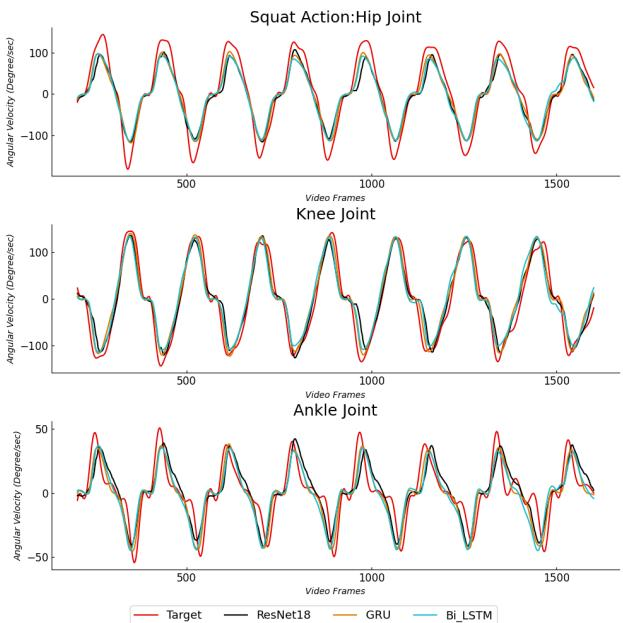

基于视觉系统与深度学习方法的下肢运动学预测

Konki Sravan Kumar1，Ankhzaya Jamsrandorj2，Jinwook Kim1，Kyung-Ryoul Mun1

摘要—日常锻炼中的关节角速度是损伤风险指数、康复进展监测以及运动员表现评估的重要临床指标。近年来，可穿戴传感器已被广泛用于监测下肢运动学。然而，这些传感器在日常生活中使用起来既困难又不便。为缓解这些局限性，本研究提出了一种基于视觉的下肢关节运动学估计系统，该系统采用深度卷积神经网络结合双向长短期记忆（bi-directional long-short term memory）网络与门控循环单元（gated recurrent unit）网络。计算了从光学运动捕捉系统获得的真值与所提模型估计的关节角速度之间的归一化相关系数和平均绝对误差。估计结果显示，深蹲动作中的最高相关系数为 0.93，跑步机行走动作中为 0.92。此外，还对髋、膝、踝各关节角速度的独立模型进行了分析与比较。在三种关节角速度中，膝关节具有最佳的估计精度（深蹲中为 0.96，跑步机行走中为 0.96）。无论相机位置与角度如何，所提模型在侧视图与前视图下均表现出较高的估计精度。本研究证明了使用无传感器的基于视觉的系统在家庭锻炼中监测下肢运动学以用于医疗保健和康复的可行性。

## 一、引言

人体步态是四肢运动的模式，步态参数可以反映人体的功能能力和健康状况[1]。在若干步态参数中，下肢关节角速度是日常运动中的重要临床指标，用于评估损伤风险指数、判断患者的康复进展、诊断早期人体关节运动障碍以及提升运动员的运动表现[2, 3]。此外，近期研究[4, 5]已确定关节角速度是监测下肢关节功率变化的有力候选指标，因为关节功率是关节角速度与关节运动的乘积，而关节功率是步态病理临床诊断和下肢假肢控制的重要参数[6, 7]。基于惯性传感器的系统通常用于捕捉下肢运动学。基于惯性测量单元（Inertial Measurement Unit, IMU）传感器的系统被设计用于在人体肢体动态运动过程中测量膝关节角度[8]。基于 IMU 传感器的三维运动捕捉系统由加速度计、地磁传感器和陀螺仪组成，是在日常生活动作中记录下肢关节（膝、髋和脊柱）运动的有效测量工具[9]。在过去几年中，基于 IMU 传感器的系统已引起研究者的关注，并在关节运动学测量方面表现出显著的准确性[10, 11]。然而，单个 IMU 传感器无法用于跟踪多于一个身体段的运动。因此，仅为了跟踪一个下肢运动（例如每侧下肢的骨盆、踝、膝和髋），通常就需要七个 IMU 传感器。随着所佩戴 IMU 传感器数量的增加，必须考虑若干缺点，包括复杂的预处理过程（传感器到身体段的标定和受试者标定）、对日常生活的不便以及人体运动链，以准确监测下肢运动学[12]。此外，使用像 IMU 传感器这样的运动追踪系统会由于紧绑的固定带而妨碍受试者的自然运动，而且该类系统仍然存在成本高、功耗大、设备操作复杂、需要参与者配合、需要受控的实验室环境以及放置标记（耗时费力）等不足。为了克服可穿戴传感器式捕捉系统的局限性以监测人体下肢运动，研究人员开发了基于摄像头的系统。深度学习框架的兴起和摄像头技术的发展为从视频帧信息预测下肢角速度创造了新的机会。最近的研究[13, 14]引入了使用 OpenPose 库的基于摄像头的系统，该系统以良好的精度记录下肢关节角度。然而，基于 OpenPose 库的系统的估计精度依赖于真值二维关键点数据集；关键点是手工标注的，并且并不位于关节中心位置。因此，可能无法可靠地估计下肢角速度

ty。此外，这些方法仅在侧视（lateral view）下监测受试者的关节角度，无法在受试者的前视（front view）和背视（back view）下跟踪关节角度。在我们之前的研究中，已经提出了深度卷积神经网络（deep convolution neural network，CNN）架构来测量髋关节、膝关节和踝关节的下肢角速度，在不同的相机视角下均能取得良好的估计精度 [15]。然而，这些预训练的深度 CNN 框架在估计结果中由于时间延迟仍然表现出较大的误差。

在本研究中，我们提出了一种基于视觉的下肢关节运动学估计系统，该系统采用带有双向长短期记忆递归网络（bi-directional long-short term memory recurrent, LSTM）/门控循环单元（gated recurrent unit, GRU）的深度卷积神经网络（DeepConvLSTM/DeepConvGRU）。所提出的方法基于一个 RGB 相机系统，可在受试者执行深蹲（squat）和在跑步机上行走（walking on treadmill）动作时，检测其髋关节、膝关节和踝关节（左右两侧）的角速度。我们对 DeepConvGRU 模型的估计性能进行了量化，并与由运动捕捉系统（motion capture system）采集的真实关节角速度（ground truth）进行了比较。

## II. 方法

## A. 实验设备与方案

为了构建视频数据集，我们招募了 33 名健康成年人（25 名男性和 8 名女性）作为受试者。实验在配备光学运动捕捉系统和 Xiaomi Mijia 4K 数码相机系统的实验室内进行。图 1 展示了我们在实验过程中用于获取视频数据集的相机布置。作为记录人体关节角度的金标准（gold standard），采用了分辨率为 1280×1024（约 130 万像素）、采样频率为 120 Hz 的六相机光学运动捕捉系统。根据 Plug-in-gait 标记方案，在人体的骨盆（pelvis）、髋部（hip）、膝部（knee）、大腿（thigh）、小腿（shank）、脚趾（toe）、踝部（ankle）和足跟（heel）等部位粘贴了 15 个反光标记点。光学运动捕捉系统跟踪粘贴在人体上的反光标记点，并计算所有关节的精确 3D 角度和 3D 位置。关节角速度通过对关节角度求导计算得到。地面捕捉区域为 2.000 米 × 3.685 米。使用了一套由 6 台相机组成的数码相机系统，其分辨率为 1920×1080，帧率为 60 Hz。这 6 台相机分别放置在受试者的前方、后方和侧面，以在 30 秒内采集深蹲和在跑步机上行走的动作视频。我们设计了一个数字电路来同步光学运动捕捉相机系统和数码相机系统。光学运动捕捉相机系统的采样率为每秒 120 帧（是数码相机帧率的两倍）。因此，将标注数据（Annotations）的采样频率从 120 Hz 下采样至 60 Hz。

  

图 1：实验设置。光学运动捕捉系统（optical motion capture system）追踪标记点并记录关节的角速度，同时数字摄像机（digital cameras）在参与者进行深蹲与跑步机上行走动作时采集其视频信息。

B. 基于深度学习的下肢关节角速度估计框架

我们提出了一种基于卷积神经网络（CNN）与长短期记忆网络（LSTM）的深度学习模型（DeepConvLSTM），用于估计下肢关节（包括双侧髋关节、膝关节和踝关节）的角速度。其中，卷积神经网络用于从动作视频中提取特征（空间域），循环神经网络用于提供时间序列预测（时域）。作为一种监督学习方式，DeepConvLSTM 架构学习以 RGB 图像信息作为输入、关节角速度作为输出之间的时间依赖关系。首先，采用基于深度学习的特征选择技术（YOLO4）来检测人体并去除动作视频中无信息的背景 [16]。然后，根据生成的人体边界框对视频帧进行裁剪，并将分辨率调整为 448 × 448。接下来，将 27 个视频帧的信息作为所提出的 DeepConvLSTM 网络的输入。随后，对网络进行训练，使其输出相应的六个关节角速度。在本研究中，我们采用结合双向长短期记忆网络（Bi-LSTM）/门控循环单元（GRU）的卷积神经网络（ResNet18）来预测关节角速度。在每个时间步，从 CNN 层提取的空间特征被连接到 LSTM/GRU 网络。最后，全连接（FC）层在每个时间步输出六个关节角速度的预测值（左/右髋关节屈/伸、左/右膝关节屈/伸、左/右踝关节背屈/跖屈），如图 2 所示。

  

图 2：DeepConvLSTM 架构。深度 CNN 从动作视频中提取特征（空间域），LSTM 用于提供时间序列（时间域）的关节角速度预测。

## C. DeepConvLSTM 模型实现

DeepConvLSTM 采用 Python 中的 PyTorch 库实现。模型训练使用自适应矩估计（Adaptive Moment Estimation，Adam）进行优化，以平均绝对误差（MAE）作为损失函数，PC 端配置 CUDA 10.2 库，搭载 GTX 2080Ti 显卡，运行 Ubuntu 18.04.5 LTS 系统。训练网络的学习率选定为 0.0001。批量大小（batch size）为 8，模型使用长度为 27 的图像序列及对应的关节角速度进行训练，共训练 20 个 epoch（迭代轮次）。为了训练所提出的模型，使用了七名参与者在深蹲和跑步机上行走过程中的动作视频作为训练集，三名参与者的动作视频作为验证集，另外三名参与者的动作视频作为测试集。

## III. 实验结果（EXPERIMENTAL RESULTS）

本节展示所提出的 DeepConvLSTM/DeepConvGRU 网络在深蹲和跑步机行走动作中预测下肢关节角速度的结果。光学运动捕捉系统获得的角速度与 DeepConvLSTM 和 DeepConvGRU 网络估计的角速度之间的差异采用归一化相关系数（r）和平均绝对误差（MAE）进行评估。为了展示所提模型的估计性能，图 3 给出了深蹲动作中下肢关节的估计角速度与真实角速度（ground-truth）。与真实角速度相比，DeepConvGRU 估计的角速度优于 ResNet18 和 DeepConvLSTM 估计的角速度。跑步机行走过程中的预测角速度如图 4 所示。GRU、BI-LSTM 和 ResNet18 三种网络在深蹲和跑步机行走过程中三个关节的平均 r 值详细列于表 I。GRU 网络的平均 r 值在三种模型中表现出强相关性（深蹲时为 0.93，跑步机行走时为 0.92）。表 II 给出了三种模型预测深蹲过程中髋关节、膝关节和踝关节各关节角速度的平均 r 值和 MAE。在髋关节、膝关节和踝关节中，使用 GRU 模型估计的膝关节角速度在平均 r 值上表现出更高的精度。在深蹲动作的所有关节估计中，GRU 网络的 MAE 误差均小于 BI-LSTM 和 ResNet18 网络。

  

图 3：受试者在下蹲动作中髋关节、膝关节和踝关节的估计角速度示例。比较由光学运动捕捉系统采集的关节真实角速度（ground truth，红线）与由 ResNet18（黑线）、GRU（橙线）和 Bi-LSTM（青色线）估计的关节角速度。

  

图 4：图中展示了受试者在跑步机上行走时髋关节、膝关节和踝关节的估计角速度。对比了由光学运动捕捉系统采集的真实值（红线）与由 ResNet18（黑线）、GRU（橙线）和 Bi-LSTM（青线）估计的关节角速度。

表 I：所提出模型在深蹲和跑步机行走动作中预测关节角速度的平均 r 值。

<table><tr><td>Model</td><td>Squat</td><td>Walking on treadmill</td></tr><tr><td>ResNet18</td><td>0.87</td><td>0.90</td></tr><tr><td>Bi-LSTM</td><td>0.92</td><td>0.91</td></tr><tr><td>GRU</td><td>0.93</td><td>0.92</td></tr></table>

表 II：使用 GRU、BI-LSTM 和 ResNet18 模型在下蹲（squat）动作中髋关节、膝关节和踝关节角速度的平均 r 值（平均绝对误差 MAE）。

<table><tr><td>Model</td><td>Hip Joint</td><td>Knee Joint</td><td>Ankle Joint</td></tr><tr><td>ResNet18</td><td>0.87(44.18)</td><td>0.94(30.92)</td><td>0.90(6.09)</td></tr><tr><td>Bi-LSTM</td><td>0.91(18.48)</td><td>0.96(21.56)</td><td>0.89(6.23)</td></tr><tr><td>GRU</td><td>0.94(15.13)</td><td>0.96(18.09)</td><td>0.92(5.83)</td></tr></table>

表 III：在跑步机行走动作中，使用 GRU、BI-LSTM 和 ResNet18 模型时髋关节、膝关节和踝关节角速度的平均 r 值（平均绝对误差，MAE）。

<table><tr><td>Model</td><td>Hip Joint</td><td>Knee Joint</td><td>Ankle Joint</td></tr><tr><td>ResNet18</td><td>0.80(27.20)</td><td>0.94(37.48)</td><td>0.84(6.05)</td></tr><tr><td>Bi-LSTM</td><td>0.89(21.05)</td><td>0.95(24.80)</td><td>0.85(5.70)</td></tr><tr><td>GRU</td><td>0.91(15.97)</td><td>0.96(20.47)</td><td>0.89(4.15)</td></tr></table>

表 IV：三位受试者在侧向和正向相机视角下角速度的平均 r 值。

<table><tr><td>Subject</td><td>Side view</td><td>Front view</td></tr><tr><td>S18</td><td>0.92</td><td>0.92</td></tr><tr><td>S30</td><td>0.91</td><td>0.87</td></tr><tr><td>S31</td><td>0.93</td><td>0.92</td></tr><tr><td>Average</td><td>0.92</td><td>0.89</td></tr></table>

表 III 给出了在跑步机上行走动作中髋关节、膝关节和踝关节角速度的平均 r 值与平均 MAE。在下蹲和跑步机上行走动作中，GRU 网络的平均 MAE 低于 BI-LSTM 和 ResNet18 网络。表 IV 展示了三位受试者在侧视和正视摄像机视角下角速度的平均 r 值。侧视和正视视角下的平均 r 值分别为 0.92 和 0.89。结果表明，无论摄像机位置和角度如何，所提出的模型在两种视角下均具有更高的估计精度。

## IV. 讨论

本研究提出了一种基于视觉的系统，采用 Deep-ConvLSTM/DeepConvGRU 网络来估计下蹲和跑步机上行走动作中的下肢关节角速度。我们开展了实验研究，使用光学运动捕捉系统记录角速度，并使用小米米家 4K 数码相机系统采集动作视频。所提出的架构以动作视频信息作为输入、以对应的关节角速度作为输出进行训练。为了训练所提出的模型，使用了七位受试者在下蹲和跑步机上行走时的动作视频作为训练集，三位受试者的动作视频作为验证集，三位受试者的动作视频作为测试集。通过 r 和 MAE 对光学运动捕捉系统获得的角速度与 DeepConvLSTM 和 DeepConvGRU 网络估计得到的角速度之间的差异进行了评估。r 用于衡量估计角速度与真实角速度之间的相关性。使用 DeepConvLSTM/DeepConvGRU 网络预测的关节角速度与在下蹲和跑步机上行走动作中使用光学运动捕捉系统获得的角速度表现出相当良好的一致性。

如表 I 所示，DeepConvGRU 模型在三种深度学习架构中准确度最高，在深蹲（squat）动作中为 0.93，在跑步机（treadmill）上行走动作中为 0.92。在深蹲与跑步机上行走动作中，分别独立评估了 DeepConvLSTM/ DeepConvGRU 模型对髋、膝和踝关节角速度的估计性能。DeepConvGRU 网络在两种动作中均提供了更高的 r。在三种关节角速度中，估计的膝关节准确度高于估计的髋、踝关节角速度（深蹲中为 0.96，跑步机行走中为 0.96）。膝关节在矢状面内的运动在不同参与者之间更为稳定，而踝关节具有更高的自由度；髋关节估计准确度可能受参与者身体测量差异以及髋关节标记点波动所引起的运动伪影影响。三位参与者在侧视与前视相机视角下的平均 r 如表 IV 所示。侧视与前视两种视角下的平均 r 均大于 0.90，表明无论相机位置与角度如何，DeepConvGRU 网络在两种相机视角下均可提供相对较高的预测准确度。深蹲与跑步机行走动作中髋、膝、踝关节角速度的平均 MAE 如下所示。GRU 网络的平均 MAE 比

BI-LSTM 与 ResNet18 网络在深蹲与跑步机行走中提供更小的误差，如表 II 与表 III 所示。然而，所提出的模型仍呈现出较高的 MAE 误差，原因在于运动捕捉系统所捕获真实角速度的准确度不足，且由于人体上标记点位置不精确可能产生偏移值误差，以及参与者身体测量存在差异。所提出的 DeepConvGRU 模型显示出 15 至 20 rad/s 的角速度误差。尽管通过应用序列网络在一定程度上克服了 MAE 误差较大的局限。

在未来的工作中，实验应在更大规模的参与者群体、不同年龄组、不同速度下的更多日常动作以及患有步态异常的患者中开展。所提出的 DeepConvGRU 模型将扩展采用 Transformer 与多头注意力（multi-head attention）网络，以实现更高的角速度估计精度。必须使用其他更为精确的运动捕捉系统进行真值标注的确认。我们的工作将扩展用于估计其他步态参数（步频（cadence）、速度、步幅长度和步宽）。

## V. 结论

本文提出了一种基于视觉（vision-based）的系统，采用 Bi-LSTM 与 GRU 循环神经网络，在深蹲和跑步机行走动作中估计下肢关节角速度。所提出的网络结构以动作视频信息作为输入，以对应的关节角速度作为输出进行训练。利用 DeepConvGRU 网络估计得到的关节角速度与运动捕捉系统（motion capture system）所测量的关节角速度高度相关，并且在不同的摄像头视角下表现出更高的估计精度。这些估计结果展示了在不使用可穿戴传感器的情况下，仅依靠视频信息即可监测关节角速度的潜力。然而，由于运动捕捉系统所采集的真值（ground truth）角速度精度不足，所提出的模型仍存在 15 至 20 rad/s 的角速度误差。为了获得更高的角速度估计精度，我们的工作将进一步扩展到采用基于 Transformer（变换器）和多头注意力（Multi-Head Attention）的网络。所提出的基于视觉的方法也可用于估计其他步态参数（步频、速度、步幅和步宽）。

## 致谢

本研究由 Korea Institute of Science and Technology Institutional Program（项目编号：2E31051）以及 Korea Medical Device Development Fund 资助支持，该基金由韩国政府（Ministry of Science and ICT、Ministry of Trade, Industry and Energy、Ministry of Health & Welfare、Ministry of Food and Drug Safety）资助（项目编号：1711139131）。

## 参考文献

[1] P. Messier, C. Legault, C. Schoenlank, J. Newman, D. Martin, and P. Devita, "跑步者膝关节损伤的危险因素与机制（Risk factors and mechanisms of knee injury in runners），" *Medicine Science in Sports Exercise*, vol. 40, no. 11, pp. 1873–1879, Nov. 2008.

[2] R. Ibrahim, I. Kingma, V. de Boode, G. S. Faber, and J. H. van Dieën, "足球守门员鱼跃扑救动作中踝、膝、髋关节的角速度、力矩及功率分析（Angular velocity, moment, and power analysis of the ankle, knee, and hip joints in the goalkeeper's diving save in football），" *Frontiers in Sports and Active Living*, vol. 2, Feb. 2020.

[3] J. Dicharry, "步态的运动学与动力学：从实验室到临床（Kinematics and kinetics of gait: From lab to clinic），" *Clinics in Sports Medicine*, vol. 29, no. 3, pp. 347–364, Jul. 2010.

[4] M. G. Browne and J. R. Franz, "踝关节功率生物反馈可减弱老年人由远端到近端的功率再分配现象（Ankle power biofeedback attenuates the distal-to-proximal redistribution in older adults），" *Gait Posture*, vol. 71, pp. 44–49, Jun. 2019.

[5] N. L. Pieper, M. D. Lewek, and J. R. Franz, "小腿加速度能否为步行过程中单侧肢体推进力提供临床可行的替代指标（Can shank acceleration provide a clinically feasible surrogate for individual limb propulsion during walking），" *Journal of Biomechanics*, vol. 98, p. 109449, Jan. 2020.

[6] Jiang, Gholami, Khoshnam, Eng, and Menon, "使用两个惯性传感器估计步行过程中踝关节功率（Estimation of ankle joint power during walking using two inertial sensors），" *Sensors*, vol. 19, no. 12, p. 2796, Jan. 2019.

[7] J. F. Hafer and R. F. Zernicke, "推进关节功率与基于传感器导出的角速度相吻合：一种有望用于无实验室步态再训练的潜在工具（Propulsive joint powers track with sensor-derived angular velocity: A potential tool for lab-less gait retraining），" *Journal of Biomechanics*, vol. 106, p. 109821, Jun. 2020.

[8] M. Ajdaroski, R. Tadakala, L. Nichols, and A. Esquibel, "用于动态运动中膝关节角度测量的设备验证," *Sensors*, 卷 20, 号 6, 页 1747, 2020 年 3 月.

[9] I. Tak, W. Wiertz, M. Barendrecht, 和 R. Langhout, "用于评估单腿下蹲过程中膝、髋和脊柱关节角度的新型三维运动分析工具的效度," *Sensors*, 卷 20, 号 16, 页 4539, 2020 年 8 月.

[10] V. Hernandez, D. Dadkhah, V. Babakeshizadeh, 和 D. Kulic, "基于可穿戴传感器通过深度学习方法估计行走与跑步时的下肢运动学," *Gait Posture*, 卷 83, 2021 年 1 月.

[11] J. S. 等, "基于 LSTM 循环神经网络使用低频单 IMU 预测地面行走过程中的下肢多关节角度," *Sensors*, 卷 22, 号 1, 页 53, 2021 年 12 月.

[12] Lim, Kim, 和 Park, "使用机器学习通过腰部单 IMU 预测行走过程中的下肢动力学与运动学," *Sensors*, 卷 20, 号 1, 页 130, 2019 年 12 月.

[13] A. Schmitz, M. Ye, R. Shapiro, R. Yang, 和 B. Noehren, "使用单摄像头无标记运动捕捉系统测量关节角度的准确性与可重复性," *Journal of Biomechanics*, 卷 47, 号 2, 页 587–591, 2014 年 11 月.

[14] E. D'Antonio, J. Taborri, E. Palermo, S. Rossi, 和 F. Patane, "基于 OpenPose 库的无标记步态分析系统," 载于 2020 年 IEEE 国际仪器与测量技术会议 (I2MTC), 2020 年, 第 1–6 页.

[15] K. S. Kumar, A. Jamsarndorj, D. Jung, D. Lee, J. Kim, 和 K. R. Mun, "在跑步机上下蹲与行走动作中基于视觉的人体关节角速度估计," 载于 2021 年第 43 届 IEEE 医学与生物工程学会 (EMBC) 会议, 2021 年, 第 2186–2190 页.

[16] A. Bochkovskiy, C. Wang, 和 H. Liao, "YOLOv4：目标检测的最优速度与精度," *ArXiv*, 卷 abs/2004.10934, 2020 年.