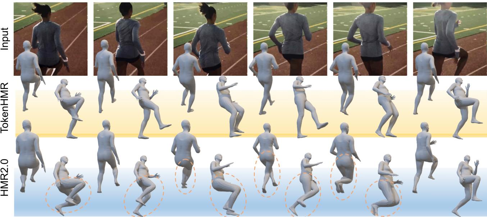
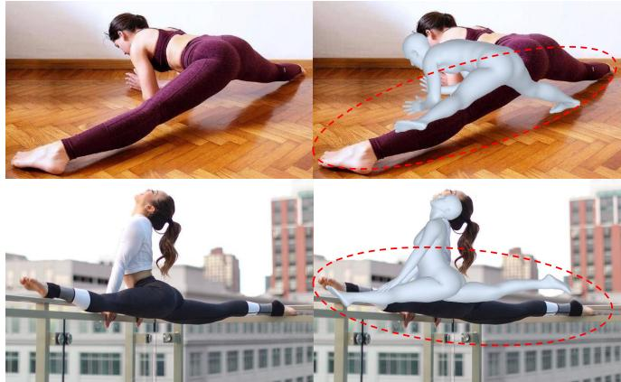

# TokenHMR：利用标记化的姿态表示推进人体网格恢复

Sai Kumar Dwivedi1,\* Yu Sun2,∗ Priyanka Patel1 Yao Feng1,2,3 Michael J. Black1

1马克斯·普朗克智能系统研究所（Max Planck Institute for Intelligent Systems），德国图宾根
2Meshcapade
3苏黎世联邦理工学院（ETH Zurich）

  

图 1. 从图像回归三维人体姿态与形状（Human Pose and Shape, HPS）的现有方法（例如 HMR2.0 [12]），估计出的身体要么与图像对齐，要么具有准确的三维姿态，但不能两者兼得。我们表明这对现有方法而言是一个根本性的权衡。为解决该问题，我们的方法 TokenHMR 引入了一种新颖的损失——阈值自适应损失缩放（Threshold-Adaptive Loss Scaling, TALS），以及一种基于离散 token 的三维姿态表示。借助这些设计，TokenHMR 在多个野外（in-the-wild）三维基准上达到了最先进的精度。

## 摘要

我们研究从单张图像回归三维人体姿态与形状的问题，重点关注三维精度。当前最先进的方法利用大规模的三维伪真值（pseudo-ground-truth, p-GT）和二维关键点数据集，取得了稳健的性能。然而，在这些方法中，我们观察到一种矛盾现象：随着二维精度的提高，三维姿态精度反而下降。这是 p-GT 中的偏差以及近似相机投影模型的使用所导致的。我们量化了当前相机模型所引入的误差，并证明精确拟合二维关键点和 p-GT 会导致错误的三维姿态。我们的分析定义了一个无效距离区间，在此区间内最小化二维和 p-GT 损失反而是有害的。基于此，我们提出了一种新的损失函数——"阈值自适应损失缩放"（Threshold-Adaptive Loss Scaling, TALS），它惩罚显著的二维和 p-GT 误差，而不惩罚较小的误差。在这样的损失下，可能有多种三维姿态都能同样合理地解释二维证据。为了降低这种模糊性，我们需要对有效人体姿态施加先验，但此类先验可能引入不必要的偏差。为解决这一问题，我们利用人体姿态的标记化（tokenized）表示，并将该问题重新表述为标记预测。这将估计的姿态限制在有效姿态空间内，有效提升了对遮挡的鲁棒性。在 EMDB 和 3DPW 数据集上的大量实验表明，我们重新设计的损失函数与标记化方法，使我们能够在野外（in-the-wild）数据上进行训练，同时在三维精度上超越现有最先进方法。我们的模型和代码可在 https://tokenhmr.is.tue.mpg.de 获取，供研究使用。

## 1. 引言

我们研究从单张图像回归三维人体姿态与形状（Human Pose and Shape, HPS）的问题。近期方法 [3, 12, 32, 49] 在该任务上的精度不断提高。所谓"精确"，我们指的是两个层面：一个方法应当正确地回归三维姿态，同时也应当与图像中的证据相吻合。然而，现有模型无法同时满足这两点。我们观察到一个看似矛盾的现象：方法在拟合二维关键点时越精确，其三维姿态预测的精度反而越低。我们对此问题进行研究，并将常用的弱透视相机假设确定为关键原因。该相机模型与实际采集图像所用的相机不匹配，因此投影得到的三维关节点与检测到的二维关节点之间存在偏差。由于目前尚无可靠的方法能够从单张图像估计相机参数，我们研究并量化了该效应，并提出了两种解决方案。

具体而言，我们使用合成数据集 BEDLAM [3]，该数据集拥有完美的三维和二维真值（groundtruth, GT）。我们使用 [12] 中的相机模型将三维数据投影到二维，以量化最佳情况下的二维误差；该误差很大。接着，我们反向论证，表明较低的二维误差也可能导致较大的三维误差。即使采用 [32] 中那样的完整透视模型也无法解决该问题，因为我们缺乏精确的相机内外参数。

该分析凸显了用二维关键点损失监督三维姿态回归的问题。然而，这类损失让我们得以利用大规模数据集，从而获得泛化性与鲁棒性。不幸的是，伪真值（pseudo ground-truth，p-GT）训练数据也存在同样的问题，因为它是借助近似相机模型，通过优化将三维人体拟合到二维数据上生成的。我们怎样才能在缓解三维精度下降的同时，利用大规模、野外（in-the-wild）数据集中丰富的信息？我们给出的方案是 TokenHMR，一种全新的人体姿态与形态（Human Pose and Shape，HPS）回归方法，它在有效利用二维关键点与保持三维姿态精度之间取得了平衡，从而能够在相机参数未知的前提下使用现有的互联网数据。

TokenHMR 主要包含两个组件。第一个组件基于我们的关键洞见：尽管二维关键点的监督存在缺陷，但它对于防止出现严重错误的预测具有重要价值。然而，过度依赖二维线索会引入偏差。为解决此问题，我们定义了一种新损失——阈值自适应损失缩放（Threshold-Adaptive Loss Scaling，TALS），它对较大的二维与 p-GT 误差施以惩罚，而对较小的误差仅施加极少的惩罚。我们基于对 BEDLAM 的分析来定义这一损失，使得网络不会被鼓励去拟合二维关键点，精度超过在给定相机模型下合理的范围。

然而，这会带来一个新问题。从二维关键点预测三维姿态在本质上是模糊的。当放宽关键点匹配约束时，与二维数据一致的三维姿态会变得更多。为了控制这种情况，我们需要引入一个先验，使网络偏向于合理的姿态。不幸的是，现有的基于高斯混合（mixtures of Gaussians）[4] 或 VAE [42] 的姿态先验会偏向于训练数据中频繁出现的姿态。相反，我们寻求一种无偏的先验，它仅限制网络输出合理的姿态，而不使其偏向于任何特定姿态。

这引出了 TokenHMR 的第二个关键组件，也是其名称由来。具体而言，我们通过将人体姿态进行分词（tokenization），把连续姿态回归问题转化为分词预测问题。我们使用向量量化 VAE（Vector Quantized-VAE，VQ-VAE）[53] 来离散化连续的人体姿态，具体做法是先在 AMASS [37] 和 MOYO [52] 等大规模运动捕捉数据集上进行预训练。这种分词表示为回归网络提供了一个由合理姿态构成的「词表」，从而将姿态先验有效地表征为一个知识库（codebook）。由于 VQ-VAE 的设计初衷就是表示一种均匀的先验，我们据此推测它能够削弱以往姿态先验所带来的偏差。

TokenHMR 通过分类来生成分类词元（token），这与直接回归连续姿态的做法形成对比。当我们取一个当前的 SOTA HPS 方法，并将其中的连续姿态替换为本文所提出的分词姿态方案时，在其他条件不变的情况下，三维精度会获得一致的提升。

我们进行了大量实验，以评估对姿态进行不同分词（tokenization）方式及其对精度的影响。任何对姿态的离散化都会带来一定的精度损失。在我们的方案中，这导致约 2.5 毫米的 3D 精度损失，相较于现有最优（SOTA）人体姿态与形状（Human Pose and Shape, HPS）回归方法在真实数据上的精度小 20 倍；也就是说，由分词带来的精度损失可以忽略不计。

最后，我们将上述两个组件结合起来，发现它们具有协同效应。我们所提出的新损失函数不会为了过拟合关键点或 p-GT 而扭曲 3D 姿态，而分词则阻止了网络为了追求 2D 精度而扭曲 3D 姿态。通过这种组合，我们在 3D 精度方面达到了新的最优水平。我们在具有精确 3D 真值的 EMDB [23] 和 3DPW [55] 数据集上对 TokenHMR 及其他近期方法进行了全面的评估。在相同数据和骨干网络条件下，TokenHMR 在具有挑战性的 EMDB 数据集上相较于 HMR2.0 [12] 实现了 7.6% 的 3D 误差降低。定性结果表明，TokenHMR 对图像中的模糊证据具有较强的鲁棒性，并且其估计的姿态不会出现使用 p-GT 和 2D 关键点的方法所固有的"弯膝"偏差（参见图 1）。

总结而言，我们做出以下主要贡献：（1）3D 精度退化分析：我们分析并量化了现有 HPS 方法在使用 2D 损失时，在 3D 与 2D 精度之间所面临的权衡。（2）阈值自适应损失缩放（Threshold-Adaptive Loss Scaling）：为缓解这一问题，我们提出了一种新颖的损失函数，可降低小于因相机模型不准确而产生的预期误差的 2D 与 p-GT 误差的影响。（3）基于分词的姿态表示（Token-Based Pose Representation）：我们引入了基于分词的人体姿态表示，并证明其能够产生更精确的姿态估计。我们的模型和代码已公开，可供研究使用。

## 2. 相关工作

## 2.1. HPS 回归

从单张图像中估计三维人体姿态与形状这一问题已被广泛研究，方法涵盖从基于优化的方法到最新的基于 Transformer 的回归器。优化方法将参数化模型 [36, 42, 59] 拟合到二维图像线索上，这些线索包括但不限于关键点 [4, 42, 59]、轮廓（silhouettes）[41] 和部位分割（part segmentations）[30]。一些基于学习的方法直接从图像 [6, 8, 9, 21, 25, 32, 48, 49, 61] 和视频 [22, 24] 中估计参数化人体模型，另一些则以无模型（model-free）方式将人体表示为顶点 [28, 34, 46] 或隐式形状 [39, 45, 58]。近期方法 [12, 33] 使用 Transformer 来估计三维人体，目前取得了最佳精度。为了应对泛化方面的挑战，EFT [20]、NeuralAnnot [40]、HMR2.0 [12] 和 CLIFF [32] 等近期方法在训练损失中使用二维关键点和 p-GT，以使投影人体与图像之间产生良好的对齐。HuManiFlow [47] 和 POCO [9] 等方法对人体姿态与形状估计（HPS）进行概率建模，以显式地处理姿态模糊性问题。在追求更好二维对齐的过程中出现的三维精度下降问题此前已被注意到，但在我们的工作之前并未被广泛量化。我们的统计分析揭示了现有人体网格重建（HMR）方法中的这一偏差，为此问题的训练策略提供了新视角。

一些方法 [26, 32, 56] 通过从单张图像估计相机来应对三维到二维的投影误差。SPEC [26] 使用网络预测相机参数，但泛化能力较差；而 CLIFF [32] 通过向网络提供图像中人体边界框坐标信息的方式来进行近似。从单张图像估计相机是高度不适定的（ill-posed），因此这仍是一个具有挑战性且尚未解决的问题。我们的方法减小了使用错误相机模型所带来的影响，并且可应用于任何 HPS 回归方法。

## 2.2. 姿态先验

人体姿态先验在多种应用中起着关键作用，例如将二维姿态提升至三维 [4, 42] 以及从图像/视频中估计人体姿态 [20, 29]。早期的姿态先验专注于学习关节极限（joint limits）[1]，以避免出现不可能的姿态。高斯混合模型（Gaussian Mixture Models，GMMs）[4] 和生成对抗网络（Generative Adversarial Networks，GANs）[11, 21] 也被用于在训练过程中施加先验知识。一些近期方法使用 VAE [42] 和标准化流（normalizing flows）[29] 作为先验。这些方法中的许多都对常见姿态存在偏向，并且这种偏向会传递给回归器。Pose-NDF [51] 等方法学习一个由神经隐式函数的零水平集表示的合理姿态流形。从无效姿态到有效姿态的映射需要使用梯度下降（gradient descent），将其集成到 HPS 训练中时计算开销很大。与先前工作不同，我们学习了一个针对有效 SMPL 姿态的、基于离散令牌（discrete token）的先验，既降低了姿态偏差，又提升了对遮挡的鲁棒性，同时还易于集成到 HPS 训练中。

  

图 2. 相机/姿态偏差问题的可视化。(a) 缺少正确的焦距意味着像 HMR2.0 这样的方法会将透视缩短的腿部估计为弯曲的。(b) 将预测的人体姿态替换为真实值会暴露出相机偏差；(c) 在保持二维对齐的情况下，三维姿态能有多大的偏差？详见第 3 节。

我们使用 VQ-VAE [53]（它是 VAEs 的一个变体）来学习一个离散化的先验，其方法是将 3D 训练姿态进行量化，这一过程称为「Tokenization（标记化）」，由此生成一个知识库（knowledge bank），即码本（codebook）。Tokenization 广泛应用于各种任务，例如图像合成 [44, 53]、文本到图像生成 [43]、2D 人体姿态估计 [10] 以及运动先验学习 [18, 62]。在人体姿态估计的语境中，Tokenization 仍然相对未被充分探索，尽管它已广泛用于人体运动生成 [14, 62]。当然，图像和语言的 Tokenized 表示已被广泛用于许多视觉和语言问题中。我们的方法的创新之处在于，它将回归问题重新定义为姿态 token 分类问题。因此，它利用 Tokenization 来表示有效姿态，从而有效地提供一个姿态先验。

## 3. 相机/姿态偏差

估计 3D HPS 的方法通常试图满足两个目标：准确的 3D 姿态和与 2D 图像特征的对齐。然而，我们在所有实验中观察到一个趋势——方法在 2D 误差上表现越好，在 3D 上表现就越差，反之亦然。其根本原因在于，当前的方法（包括本文中测试的那些方法）并不估计相机内参（例如焦距）或相机外参（旋转和平移）。相反，当前的方法使用缩放正交投影或使用固定但不正确的相机参数的透视投影，在相机坐标系中对人体进行估计。这会导致真实 3D 关节与其 2D 投影之间的不匹配。具体来说，由于照片通常大致从人眼高度拍摄，因此腿部比上半身更远，从而产生透视缩短（foreshortening）。训练模型以最小化 2D 误差会迫使它们在 3D 中生成不正确的姿态；如图 2 (a) 所示。对于 2D 姿态数据集的伪真值（p-GT）是通过使用有问题的相机参数最小化 2D 误差而获得的。完全信任这种 p-GT 并追求对此类标注的精确学习，将使该问题更加突出。请注意透视缩短如何使腿部在图像中显得更短。使人体与之吻合的唯一办法是在 3D 中弯曲膝盖处的腿或倾斜身体，使腿部更远。这会产生不自然或不稳定的姿态。

这是所有当前方法的一个根本性问题，如果不获知相机参数，就无法同时获得较低的 3D 和 2D 误差。为了以数值方式评估这种不匹配的影响，我们采用 BEDLAM [3]，这是一个合成数据集，其中 3D 和 2D 数据以及相机参数都是精确已知的。这消除了任何可能的噪声，并使我们能够观察到使用错误的相机对 2D 投影误差的影响。具体而言，如图 2 (b) 所示，我们使用 HMR2.0 [12] 的相机将 BEDLAM 中的真值人体投影到图像中。

我们使用标准的关键点正确百分比（Percentage of Correct Keypoints, PCK）指标来评估不准确相机在 2D 中的影响，我们针对 BEDLAM 验证集中的一个序列计算该指标。由 HMR2.0b 计算的 3D 人体在 PCK0.5 上的误差为 0.78，在 PCK1.0 上的误差为 0.88。相比之下，当我们使用 HMR2.0b 的相机配合真实 3D 人体时，PCK 分数下降至 PCK0.5 上的 0.66 和 PCK1.0 上的 0.86。理想情况下，使用正确的相机模型，PCK0.5 和 PCK1.0 都应达到 1.0。HMR2.0b 所达到的误差低于真实值这一事实表明，其输出由于相机偏差而偏离了真实的 3D 姿态与形状。这说明像 HMR2.0b 这类方法虽然获得了较高的 PCK 值，但这是以牺牲 3D 精度为代价的。总之，除非拥有正确的相机模型，否则追求高 PCK 值对 3D 精度而言是有害无益的。

我们进一步设计了实验，以探索在保持良好 2D 对齐的前提下，3D 误差能够差到什么程度。我们修改了 SMPLify [4] 的损失函数，使预测 2D 关键点与真实 2D 关键点 $\scriptstyle J _ { 2 D _ { g } }$ 之间的距离保持接近，同时新增一项损失来增大预测 3D 关键点 $J _ { 3 D }$ 与真实 3D 关键点 $\ J _ { 3 D _ { g } }$ 之间的距离，如下式所示：

$$
w _ { 2 D } | | \Pi ( J _ { 3 D } , { \cal T } ) - J _ { 2 D _ { g } } | | _ { 2 } - w _ { 3 D } | | J _ { 3 D } - J _ { 3 D _ { g } } | | _ { 2 } + m\tag{1}
$$

其中 $\Pi$ 表示使用 HMR2.0 相机的 3D 到 2D 投影，$m = 20$ 是边界（margin）值，$w_{2D} = 4$ 和 $w_{3D} = 40.5$ 是标量权重。经过 100 次优化迭代后，平均关节位置误差（Mean Per Joint Position Error，MPJPE）达到 146mm。如图 2 (c) 所示，即便在深度方向存在显著误差的情况下，投影出的 3D 姿态仍能保持较高的 2D 对齐程度。当优化迭代次数增加到 200 时，MPJPE 超过 300mm，并且随着进一步优化，误差持续增大。

由于该领域目前尚无可靠的方法能够从单张图像中估计相机参数，下面我们将探索我们的新方法（TALS 与 tokenization）是否有助于缓解由近似相机模型所引发的问题。图 2 (a) 对比了 HMR2.0 和 TokenHMR 的结果。值得注意的是，TokenHMR 受到透视缩短（foreshortening）效应的影响更小。

## 4. TokenHMR

## 4.1. 预备知识

我们的方法 TokenHMR 接收输入图像 $I$，并输出身体姿态 $\theta$、体型 $\beta$ 和透视相机 $T$。我们使用 SMPL [36]，一个可微的参数化人体模型。其输入参数包括姿态，记作 $\theta \in \mathbb{R}^{72}$，以及体型，记作 $\beta \in \mathbb{R}^{10}$。作为输出，它生成人体网格 $M$ 和顶点 $V \in \mathbb{R}^{N \times 3}$，其中 $N = 6890$ 是顶点的数量。3D 关节点记作 $J_{3D}$，通过使用预训练的关节点回归器对网格顶点进行线性组合得到。

## 4.2. 阈值自适应损失缩放：TALS

在第 3 节中，我们的分析揭示了在使用伪真值（pseudo-ground-truth）和 2D 关键点进行有效学习时存在的一个显著障碍——相机/姿态偏差。尽管面临这一挑战，这类标注所提供的尺度信息对于实现最佳的泛化性和鲁棒性仍然不可或缺。我们认为，只要使用得当而不产生过拟合，这些标注将显著提升模型鲁棒地估计姿态的能力。从我们的观察中产生了一个关键的洞见：建立有效的阈值对于辨别出不产生额外训练收益的误差水平至关重要。当损失超过该阈值时，传统的学习机制引导姿态估计；反之，当损失低于该有效阈值时，我们最小化其影响，以防止对相机/姿态偏差的过拟合。

为了确定这一有效阈值，我们分析了使用真值（ground truth，GT）3D 姿态和标准（不正确的）相机模型所得到的误差。我们再次利用 3D

  

图 3. 框架概览。我们的方法包含两个阶段。(a) 在 tokenization 阶段，编码器学习将连续姿态映射为离散姿态 token，解码器则尝试重建原始姿态。(b) 为了训练 TokenHMR，我们将回归替换为基于分类的方法，使用预训练的解码器作为有效姿态的「词表」。

## 4.3. 分词（Tokenization）

BEDLAM [3] 中的真实标注（ground truth, GT），这次是为 2D 关键点和 SMPL 伪真实标注（pseudo-ground-truth, p-GT）建立有效的阈值。对于 2D 关键点，我们将预测的 SMPL 参数替换为来自 BEDLAM 的真实标注值，以获得 HMR2.0 相机下真实三维人体的 2D 关键点投影。然后我们计算这些投影与 GT 2D 关键点之间的平均 L1 范数，并将其用作 2D 关键点监督的阈值 $\varepsilon J _ { 2 D }$。我们相对于图像宽度对这些 2D 关键点进行归一化，并将数值缩放到 -0.5 到 0.5 之间，以缓解与尺度相关的方差。

类似地，为了建立 SMPL p-GT 的有效监督阈值，我们进行了额外的实验。使用 p-GT 时，我们将姿态损失表示为关节角度误差的形式。为了对这些误差设定合适的阈值，我们评估 HMR2.0 在 BEDLAM 上的预测与 SMPL 模型中每个关节真实标注值之间的关节角度差异。具体而言，我们计算 HMR2.0 预测的 SO(3) 旋转流形上的三维关节旋转与 BEDLAM 中真实标注旋转之间的平均测地距离\*。具体阈值数值请参阅补充材料 B.2 节。

在为 2D 关键点和 SMPL p-GT 建立有效阈值之后，我们引入了一种新的损失，称为阈值自适应损失缩放（Threshold-Adaptive Loss Scaling, TALS）。它仅在损失低于阈值时才对其进行缩放。具体而言，p-GT 姿态和 2D 关节的 TALS 损失项定义如下

$$
\mathcal { L } _ { \theta _ { p G T } } = \left\{ \begin{array} { l l } { \Vert \pmb { \theta } - \pmb { \theta _ { g } } \Vert ^ { 2 } } & { \mathrm { i f } \ \mathcal { L } _ { \theta _ { p G T } } > \varepsilon _ { \theta } } \\ { \alpha _ { \theta } \cdot \Vert \pmb { \theta } - \pmb { \theta _ { g } } \Vert ^ { 2 } } & { \mathrm { o t h e r w i s e } } \end{array} \right.\tag{2}
$$

$$
\mathcal { L } _ { J _ { 2 D _ { p G T } } } = \left\{ \begin{array} { l l } { | J _ { 2 D } - J _ { 2 D _ { g } } | } & { \mathrm { i f ~ } \mathcal { L } _ { J _ { 2 D _ { p G T } } } > \varepsilon _ { J _ { 2 D } } } \\ { \alpha _ { J _ { 2 D } } \cdot | J _ { 2 D } - J _ { 2 D _ { g } } | } & { \mathrm { o t h e r w i s e } } \end{array} \right.\tag{3}
$$

其中 $\alpha _ { J _ { 2 D } }$ 和 $\alpha \theta$ 是小的标量乘子，$\varepsilon _ { \theta }$ 是为每个姿态参数单独计算的阈值，$\varepsilon J _ { 2 D }$ 是 2D 关节点的阈值。

我们使用 VQ-VAE [53]，它学习 3D 姿态的离散表示编码。具体来说，我们为 SMPL 人体参数学习一种离散表示，$\theta \ =$ $[ \theta _ { 1 } , \theta _ { 2 } , \ldots , \theta _ { 2 1 } ]$ ，其中 $\theta _ { i }$ 表示每个关节点在 $\mathbb { R } ^ { 6 }$ 中的姿态参数。该过程涉及使用自编码器架构和可学习的码本对姿态参数进行编码和解码，码本记为 $C B = \{ c _ { k } \} _ { k = 1 } ^ { K } ,$ 其中每个码 $c _ { k } \ \in \ \mathbb { R } ^ { d _ { c } }$，$d _ { c }$ 为码的维度。Pose VQ-VAE 的整体架构如图 3 (a) 所示。自编码器的编码器和解码器分别由 $E$ 和 $D ,$ 表示。编码器负责生成离散的姿态 token，而解码器将这些 token 重建回 SMPL 姿态。潜在特征 $z$ 可以通过 $z = E ( \theta )$ 计算得到，结果为 $z = [ z _ { 1 } , z _ { 2 } , \dots , z _ { M } ]$ ，其中 $z _ { i } \in \mathbb { R } ^ { d _ { c } }$，$M$ 为 token 的数量。每个潜在特征 $z _ { i }$ 通过使用码本 $CB$ 寻找最相似的码元素进行量化，如下式所示：

$$
\hat { z } _ { i } = \underset { c _ { k } \in C B } { \arg \operatorname* { m i n } } \| z _ { i } - c _ { k } \| _ { 2 } .\tag{4}
$$

在训练姿态分词器（pose tokenizer）时，我们采用了与先前工作 [53] 类似的策略，其中涉及三个主要的损失函数来优化分词器：重建损失（reconstruction loss）$(\mathcal{L}_{\mathcal{RE}})$、嵌入损失（embedding loss）$(\mathcal{L}_{\mathcal{E}})$ 和承诺损失（commitment loss）$(\mathcal{L}_{\mathcal{C}})$。总体损失 $(\mathcal{L}_{\mathcal{VQ}})$ 定义如下

$$
\begin{array} { r l } & { \mathcal { L } _ { \mathcal { V } \mathcal { Q } } = \lambda _ { \mathcal { R } \mathcal { E } } \mathcal { L } _ { \mathcal { R } \mathcal { E } } + \lambda _ { \mathcal { E } } \mathcal { L } _ { \mathcal { E } } + \lambda _ { \mathcal { C } } \mathcal { L } _ { \mathcal { C } } } \\ & { \quad \quad \quad = \lambda _ { \mathcal { R } \mathcal { E } } \mathcal { L } _ { \mathcal { R } \mathcal { E } } + \lambda _ { \mathcal { E } } \vert \vert s { g } [ z ] - e \vert \vert _ { 2 } + \lambda _ { \mathcal { C } } \vert \vert z - s g [ e ] \vert \vert _ { 2 } } \end{array}\tag{5}
$$

其中 $sg$ 是停止梯度算子（stop gradient operator），$e$ 是来自码本（codebook）的嵌入向量，$\lambda_{\mathcal{RE}}, \lambda_{\mathcal{E}}, \lambda_{\mathcal{C}}$ 是每一项对应的超参数。对于重建任务，我们对真值姿态 $\theta_g$ 与预测姿态 $\theta$ 之间采用 $\mathcal{L}_1$ 损失，同时对 SMPL 真值三维关节点 $J_{3D_g}$ 与预测关节点 $J_{3D}$ 之间的误差也采用 $\mathcal{L}_1$ 损失。因此，$\mathcal{L}_{\mathcal{RE}}$ 损失定义为

$$
\begin{array} { r } { \mathcal { L } _ { \mathcal { R E } } = \mathcal { L } _ { 1 } ( \theta _ { g } , \theta ) + \mathcal { L } _ { 1 } ( J _ { 3 D _ { g } } , J _ { 3 D } ) . } \end{array}\tag{6}
$$

原始 VQ-VAE 存在 codebook collapse（码本坍缩）问题，即码本未被充分利用。参考先前工作 [62]，我们采用指数移动平均（exponential moving average, EMA）和码本重置（Code Reset）的训练策略以提升利用率。

## 4.4. 架构（Architecture）

我们的架构借鉴了 Vision Transformer（ViT）[7]，与 HMR2.0 [12] 类似。输入图像 $I$ 首先被转换为输入 token，随后由 transformer 处理以生成输出 token。这些输出 token 接着在 transformer 解码器中进行进一步处理。Transformer 解码器具有多头自注意力机制，将一个零输入 token 与图像输出 token 进行交叉注意力，从而从 transformer 块中获取特征。与采用三个线性层将 transformer 块特征映射到 SMPL 姿态 $\theta$、形状 $\beta$ 和相机参数 $T$ 的 HMR2.0 [12] 不同，我们提出了一种新方法。我们的目标是利用一个在大量运动捕捉（mocap）数据上训练的 tokenizer，特别聚焦于身体姿态。为此，我们将 SMPL 姿态参数划分为身体姿态和全局朝向，并使用独立的线性层分别从 tokenizer 预测全局朝向和身体姿态。

一种直接集成 tokenizer 的方式是直接从 ViT transformer 主干估计 code index，并根据 code index 从码本（codebook, CB）中选取嵌入（embedding）$e$。然而这存在挑战，因为从码本中选取嵌入的过程是不可微的。为应对这一问题，我们采用基于 logit 的方法。我们不直接估计 code index，而是为每个 token 输出 logits $Q$。这些 logits 与码本相乘，得到加权嵌入。因此，近似的量化特征 $\hat { z } = [ \hat { z } _ { 1 } , \hat { z } _ { 2 } , . . . , \hat { z } _ { M } ]$ 可通过下式计算：

$$
\bar { z } = \sigma ( { \cal Q } _ { { \cal M } \times { \cal K } } ) \times C B _ { { \cal K } \times { \cal D } } \approx \hat { z }\tag{7}
$$

其中，$Q$ 是由骨干网络（backbone）输出的 logits，$\sigma$ 是 softmax 操作，CB 是预训练的码本（codebook），M 是 token 的数量，K 是码本中条目的数量，D 是每个码本条目的维度。该操作使其可微。得到的近似量化特征 $\bar{z}$ 随后被送入分词器解码器（tokenizer decoder），由此生成最终的姿态。在 TokenHMR 的训练过程中，学到的分词器解码器被冻结，以利用其从 mocap 数据中学到的先验。

## 4.5. 损失函数

遵循先前的工作 [12, 25]，我们在 2D 和 3D 关节点以及 SMPL 姿态与形状参数（即 $J _ { 2 D } , J _ { 3 D } , \theta , \beta$）上定义损失。然而，根据第 4.2 节的分析，我们对来自 2D 和 3D 数据集的数据采用不同的处理方式。对于 3D 真值数据集，我们定义标准损失为

$$
\begin{array} { r } { \mathcal { L } _ { G T } = \lambda _ { \theta } \mathcal { L } _ { \theta } ( \theta , \theta _ { g } ) + \lambda _ { \beta } \mathcal { L } _ { \beta } ( \beta , \beta _ { g } ) + } \\ { \lambda _ { 3 D } \mathcal { L } _ { 3 D } ( \mathbf { J } _ { 3 D } , \mathbf { J } _ { 3 D _ { g } } ) + \lambda _ { 2 D } \mathcal { L } _ { 2 D } ( \mathbf { J } _ { 2 D } , \mathbf { J } _ { 2 D _ { g } } ) } \end{array}\tag{8}
$$

其中 $\mathcal{L}_{\beta}$ 是 SMPL 形状损失，$\mathcal{L}_{J_{3D}}$ 是三维关节损失，$\mathcal{L}_{J_{2D}}$ 是关节重投影损失。$\lambda_{\beta}$、$\lambda_{3D}$ 和 $\lambda_{2D}$ 是各项的引导权重。为了从 SMPL 伪真值中学习，我们采用阈值自适应损失缩放（Threshold-Adaptive Loss Scaling, TALS），根据 4.2 节中计算的阈值来缩放损失，如公式 2 和公式 3 所示。因此，总损失定义为

$$
\mathcal { L } _ { T o t a l } = \mathcal { L } _ { G T } + \mathcal { L } _ { \theta _ { p G T } } + \mathcal { L } _ { J _ { 2 D _ { p G T } } } .\tag{9}
$$

## 5. 实验

## 5.1. 实现细节

TokenHMR 的训练分为两个阶段：首先，我们训练一个分词器（tokenizer），利用 AMASS [37] 和 MOYO [52] 的动捕数据学习离散的姿态表示。然后，我们将分词器的预训练解码器用作回归身体姿态的额外头部（head）。在 TokenHMR 的训练过程中，分词器被冻结以利用其先验。

我们的分词器架构受 T2M-GPT [62] 启发，但我们学习的不是 3D 关节点的运动 token，而是 SMPL 姿态参数的姿态 token。我们在编码器和解码器中各使用 1 个残差网络（ResNet）[15] 块和 4 个一维卷积（1D convolutions）。引导权重 $\lambda_{\mathcal{RE}}, \lambda_{\mathcal{E}}, \lambda_{\mathcal{C}}$ 分别设为 50.0、1.0、1.0。模型训练 150K 次迭代，批量大小为 256，学习率为 $2e^{-4}$。为了训练一个鲁棒的模型，我们从 $1e^{-3}$ 开始对随机关节点加入噪声，并在每 5K 次迭代后逐步增大噪声强度。根据在验证集上的重建误差，我们为 TokenHMR 选择了包含 160 个 token、码本大小为 $2048 \times 256$ 的最佳分词器模型。

对于 TokenHMR，我们使用 ViT-H/16 [7] 作为骨干网络，并沿用 HMR2.0 [12] 中的标准 Transformer 解码器 [54]。我们使用 4 个独立的线性层，将 Transformer 解码器输出的 1024 维特征分别映射到 SMPL 的全局朝向、手部姿态和身体形状，并另设一个用于相机的线性层。然而，对于身体姿态，我们将这 1024 维特征通过 4 个线性层块进行处理，每个块包含 2 个多层感知机（MLP）和一个高斯误差线性单元（GELU）激活函数 [16]。这将得到最终的 logits $Q$，大小为 $160 \times 2048$，以便与大小为 $2048 \times 256$ 的码本相乘，从而获得近似量化后的特征 $\bar{z}$；见式 4。我们使用 ViT-Pose [60] 作为预训练骨干网络。我们在 4 块 Nvidia RTX 6000 GPU 上训练 100K 次迭代，批量大小为 256，学习率为 $1e^{-5}$，训练时长约为一天。引导权重 $\lambda_{\theta}, \lambda_{\beta}, \lambda_{J_{2D}}, \lambda_{J_{3D}}$ 分别设为 $1e^{-3}, 5e^{-4}, 1e^{-2}, \bar{5}e^{-2}$。TALS 的损失权重对姿态 $\alpha_{\theta}$ 和 2D 关键点 $\alpha_{J_{2D}}$ 均设为 1%。

<table><tr><td rowspan="2">Training Datasets</td><td rowspan="2">Method</td><td colspan="3">EMDB [23]</td><td colspan="3">3DPW [55]</td></tr><tr><td>MVE</td><td>MPJPE</td><td>PA-MPJPE</td><td>MVE</td><td>MPJPE</td><td>PA-MPJPE</td></tr><tr><td>SD</td><td>HybrIK [31]</td><td>122.2</td><td>103.0</td><td>65.6</td><td>94.5</td><td>80.0</td><td>48.8</td></tr><tr><td>SD</td><td>CLIFF [32]</td><td>122.9</td><td>103.1</td><td>68.8</td><td>81.2</td><td>69.0</td><td>43.0</td></tr><tr><td>SD</td><td>HMR2.0 [12]</td><td>120.1</td><td>97.8</td><td>61.5</td><td>84.1</td><td>70.0</td><td>44.5</td></tr><tr><td>BL</td><td>BEDLAM-CLIFF [3]</td><td>113.2</td><td>97.1</td><td>61.3</td><td>85.0</td><td>72.0</td><td>46.6</td></tr><tr><td>BL</td><td>HMR2.0</td><td>106.6</td><td>90.7</td><td>51.3</td><td>88.4</td><td>72.2</td><td>45.1</td></tr><tr><td>BL</td><td>TokenHMR</td><td>104.2</td><td>88.1</td><td>49.8</td><td>86.0</td><td>70.5</td><td>43.8</td></tr><tr><td>SD + ITW</td><td>HMR2.0 [12]</td><td>140.6</td><td>118.5</td><td>79.3</td><td>94.4</td><td>81.3</td><td>54.3</td></tr><tr><td>SD + ITW</td><td>TokenHMR</td><td>124.4</td><td>102.4</td><td>67.5</td><td>88.1</td><td>76.2</td><td>49.3</td></tr><tr><td>SD + ITW + BL</td><td>HMR2.0</td><td>120.7</td><td>99.3</td><td>62.8</td><td>88.4</td><td>77.4</td><td>47.4</td></tr><tr><td>SD + ITW + BL</td><td>HMR2.0 + TALS</td><td>115.7</td><td>96.7</td><td>58.5</td><td>89.6</td><td>73.5</td><td>46.8</td></tr><tr><td>SD + ITW + BL</td><td>HMR2.0 + Token</td><td>116.1</td><td>95.6</td><td>62.2</td><td>86.6</td><td>75.0</td><td>48.0</td></tr><tr><td>SD + ITW + BL</td><td>HMR2.0 + TALS + VPoser [42]</td><td>116.8</td><td>97.9</td><td>56.4</td><td>87.1</td><td>73.7</td><td>45.7</td></tr><tr><td>SD + ITW + BL</td><td>TokenHMR</td><td>109.4</td><td>91.7</td><td>55.6</td><td>84.6</td><td>71.0</td><td>44.3</td></tr></table>

表 1. 在 EMDB 和 3DPW 数据集上的三维人体网格与姿态误差。详见正文。

<table><tr><td rowspan="2">Method</td><td colspan="3">Crop 30%</td><td colspan="3">Crop 50%</td></tr><tr><td>MVE</td><td>MPJPE</td><td>PA-MPJPE</td><td>MVE</td><td>MPJPE</td><td>PA-MPJPE</td></tr><tr><td>HMR2.0 [12]</td><td>135.24 (+14.98)</td><td>113.39 (+14.13)</td><td>70.68 (+7.86)</td><td>166.71 (+46.45)</td><td>137.88 (+38.59)</td><td>90.30 (+27.48)</td></tr><tr><td>TokenHMR</td><td>124.09 (+14.71)</td><td>104.72 (+13.01)</td><td>62.13 (+6.52)</td><td>150.29 (+40.91)</td><td>125.99 (+34.28)</td><td>78.88 (+23.27)</td></tr></table>

表 2. 在 EMDB 数据集上，以不同比例从边界均匀裁剪图像对 3D 人体姿态与形状（HPS）精度的影响。括号中的数字表示相对于未裁剪场景的性能变化；数值越小越好。此处比较的所有模型均采用相同的骨干网络，并在相同的数据上进行训练。

<table><tr><td>1</td><td>一</td><td colspan="2">AMASS [37]</td><td colspan="2">MOYO [52]</td></tr><tr><td></td><td>Method</td><td>MVE↓|</td><td>MPJPE↓</td><td>MVE↓</td><td>MPJPE↓</td></tr><tr><td rowspan="3">CB</td><td>1024 × 256</td><td>11.5</td><td>4.6</td><td>27.1</td><td>15.7</td></tr><tr><td>2048 × 128</td><td>9.4</td><td>3.1</td><td>22.5</td><td>12.3</td></tr><tr><td>2048 × 256</td><td>8.3</td><td>2.2</td><td>19.9</td><td>10.4</td></tr><tr><td rowspan="3">Tokekens</td><td>80</td><td>12.5</td><td>4.1</td><td>24.4</td><td>16.7</td></tr><tr><td>160</td><td>8.3</td><td>2.2</td><td>19.9</td><td>10.4</td></tr><tr><td>320</td><td>8.1</td><td>1.9</td><td>19.0</td><td>10.1</td></tr><tr><td rowspan="3">Noise</td><td>Yes</td><td>8.3</td><td>2.2</td><td>19.9</td><td>10.4</td></tr><tr><td>No</td><td>7.9</td><td>1.9</td><td>21.0</td><td>11.5</td></tr><tr><td>AMASS + MOYO*</td><td>8.7</td><td>2.6</td><td>16.5</td><td>7.6</td></tr></table>

表 3. 词元化器消融实验（Tokenizer Ablation）。所有方法均在 AMASS [37] 的标准训练集上训练，并在 AMASS 的测试集和 MOYO [52] 的验证集上进行评估，最后一行⋆除外，该行使用 MOYO 训练集进行训练。最后一个模型用作 TokenHMR 中的词元化器。

训练数据（Training Data）：在训练词元化器时，我们使用 AMASS [37] 的标准训练划分和 MOYO [52] 的训练数据。有关训练数据准备的更多细节，请参阅补充材料（Sup. Mat.）。遵循先前方法 [12, 25, 27] 的做法，我们使用标准数据集（SD）进行训练，其中包括 Human3.6M [17]、MPI-INF-3DHP [38]、COCO [35] 和 MPII [2]。此外，与 HMR2.0b 类似，我们还使用了野外（in-the-wild）二维数据集（ITW），如 InstaVariety [22]、AVA [13] 和 AI Challenger [57] 数据集及其伪地面真值（p-GT）用于训练。我们还纳入了 BEDLAM（BL）[3]，这是一个具有精确地面真值三维数据的合成数据集。为了公平比较，我们使用 SD、ITW 和 BL 数据集的组合重新训练 HMR2.0b。我们选择 HMR2.0b 作为基线模型，因为其代码是开源的，并且我们可以复现其结果。

评估与指标（Evaluation and Metrics）：对于词元化器的精度，我们报告平均顶点误差（Mean Vertex Error, MVE）和平均关节位置误差（Mean Per Joint Position Error, MPJPE），并在 AMASS 的标准测试划分和 MOYO 的验证集上进行评估。对于 TokenHMR，我们报告预测结果与地面真值之间的平均顶点误差（MVE）、平均关节位置误差（MPJPE）和 Procrustes 对齐平均关节位置误差（PA-MPJPE）。我们在 3DPW [55] 和 EMDB [23] 数据集的测试集上进行评估。前者是标准的三维数据集，后者是最近发布的、更具挑战性的数据集，具有变化的相机运动和多样化的三维姿态。

## 5.2. 如何缓解三维精度退化问题？

表 1 显示了仅使用 SD 数据集训练的 HMR2.0 模型的性能，以及使用 SD 和 ITW 数据集共同训练时的性能。我们观察到，在纳入 ITW 数据后，EMDB 数据集上的三维精度显著下降（超过 17%）。与此同时，根据 HMR2.0 [12] 论文中的表 2，ITW 数据提升了该方法的二维性能。一种直观的应对方法可以是整合更多具有精确三维标注的数据，例如 BEDLAM [3]。然而，正如表 1 所示，即使纳入了 BEDLAM，HMR2.0（SD+ITW+BL）仍然遭受明显的三维指标退化。这一观察构成了我们进一步研究的基线。

  

图 4. 在 LSP [19] 数据集上对挑战性姿态的定性比较。

采用我们新颖的损失函数（TALS）后，在 EMDB 和 3DPW 数据集上都取得了显著的性能提升，表明其在防止对含噪 p-GT 数据过拟合方面的有效性。尽管 TALS 带来了一定改进，我们进一步深入探索姿态先验，以弥补弱化的监督信号。我们评估了 HPS 中常用的 VAE 先验 VPoser [42]，但仅获得了边际提升，表明需要一种更具鲁棒性的替代方案。我们基于 VQ-VAE 的姿态 token 化方法带来了更大的提升。TokenHMR 在各项指标上显著优于 HMR2.0，在 EMDB 上的 MVE、MPJPE 和 PA-MPJPE 分别提升了 9%、7.6% 和 11.5%。在 3DPW 上也观察到了一致的趋势。

## 5.3. 基于 Token 的先验为何有效？

除了我们上文讨论的促进更有效学习之外，我们还考察了所提离散 token 先验在图像信息不完整（例如截断）场景下的有效性。我们在 EMDB 数据集上以不同程度的图像裁剪评估了我们的方法。具体而言，我们从图像边界裁剪 30% 和 50%。如表 2 所示，与 HMR2.0 [12] 相比，我们的方法在具有挑战性的截断设置下（50% 对比 30%）性能下降更少。此外，图 4 中所示的定性结果凸显了嵌入在我们基于 token 的姿态表征中的先验的鲁棒性。这种鲁棒性对于处理图像截断常见的真实世界场景至关重要。

## 5.4. Tokenizer 的消融研究

表 3 展示了我们在 AMASS 标准测试集和 MOYO 验证集上针对不同 tokenizer 设计选择的消融研究。为了理解设计选择对分布外（OOD）MOYO 数据的影响，我们仅使用 AMASS 进行训练并开展各项消融实验。然而，最终的 tokenizer 模型（表 3 最后一行）在 TokenHMR 中使用，并在 AMASS 和 MOYO 两个数据集上联合训练。我们的研究发现，码本条目数量的影响比码本维度更大。尽管 token 数量对于精确表征至关重要，但我们观察到性能出现平台效应，因此在最终模型中选择了 160 个 token。该数量在 TokenHMR 的网络规模与重建精度之间取得了平衡。对姿态参数加入随机噪声增强构建了更具鲁棒性的 tokenizer，虽然略微降低了分布内数据的性能，但对 OOD 数据具有积极作用。

## 6. 结论

本文提出了一种从单张图像进行 3D 人体姿态估计的新方法。我们首先识别并量化了使用不正确的相机模型配合 2D 关键点损失所带来的问题。这导致了现有方法面临的一个根本性权衡——要么具有较高的 3D 精度，要么具有较高的 2D 精度，但无法两者兼得。我们的方法 TokenHMR 通过两项易于被其他方法采用的贡献来解决该问题。TokenHMR 采用了一种基于回归人体姿态离散化表征（tokenized representation）的新型姿态估计范式。我们将其与一种新的损失 TALS 相结合，该损失在仍可使用 in-the-wild 训练数据的同时，缓解了由相机投影误差及有偏 p-GT 所引起的部分偏差。我们在 EMDB 和 3DPW 数据集上的实验表明，即使在存在显著遮挡的情况下，TokenHMR 在 3D 精度方面也显著优于 HMR2.0 等现有模型。

## 7. 致谢

我们衷心感谢 Meshcapade GmbH 的 Perceiving Systems 部门及 ML 团队所提供的富有洞察力的讨论与反馈。我们感谢 International Max Planck Research School for Intelligent Systems（IMPRS-IS）对 Sai Kumar Dwivedi 的支持。我们感谢 Meshcapade GmbH 对 Yu Sun 的支持以及所提供的 GPU 资源。本工作部分受到德国联邦教育与研究部（BMBF）的资助：图宾根人工智能中心（Tubingen AI Center），项目编号 FKZ: 01IS18039B。¨ 利益披露：https://files.is.tue.mpg.de/black/CoI CVPR 2024.txt

## 参考文献

[1] Ijaz Akhter 和 Michael J. Black。基于姿态条件的关节角度限制用于 3D 人体姿态重建。发表于《计算机视觉与模式识别》（CVPR），2015 年。3

[2] Mykhaylo Andriluka、Leonid Pishchulin、Peter Gehler 和 Bernt Schiele。2D 人体姿态估计：新基准与最先进技术分析。发表于《计算机视觉与模式识别》（CVPR），2014 年。7, 1

[3] Michael J Black、Priyanka Patel、Joachim Tesch 和 Jinlong Yang。Bedlam：一种包含展现精细逼真动画运动的人体合成数据集。发表于 CVPR，第 8726–8737 页，2023 年。1, 2, 4, 5, 7, 8

[4] Federica Bogo、Angjoo Kanazawa、Christoph Lassner、Peter Gehler、Javier Romero 和 Michael J. Black。保持 SMPL：从单张图像自动估计 3D 人体姿态与形状。发表于《欧洲计算机视觉会议》（ECCV），2016 年。2, 3, 4

[5] Z. Cao、G. Hidalgo Martinez、T. Simon、S. Wei 和 Y. A. Sheikh。OpenPose：使用部件亲和场实现实时多人 2D 姿态估计。发表于《IEEE 模式分析与机器智能汇刊》（TPAMI），2019 年。1

[6] Hongsuk Choi、Gyeongsik Moon、JoonKyu Park 和 Kyoung Mu Lee。从野外拥挤场景中学习估计鲁棒 3D 人体网格。发表于《计算机视觉与模式识别》（CVPR），第 1475–1484 页，2022 年。3

[7] Alexey Dosovitskiy, Lucas Beyer, Alexander Kolesnikov, Dirk Weissenborn, Xiaohua Zhai, Thomas Unterthiner, Mostafa Dehghani, Matthias Minderer, Georg Heigold, Sylvain Gelly, Jakob Uszkoreit, and Neil Houlsby. 一幅图像等价于 16×16 个词：用于大规模图像识别的 Transformer。发表于国际学习表征会议（ICLR），2021年。6

[8] Sai Kumar Dwivedi, Nikos Athanasiou, Muhammed Kocabas, and Michael J. Black. 使用可微分语义渲染从图像中回归人体。发表于国际计算机视觉大会（ICCV），2021年。3

[9] Sai Kumar Dwivedi, Cordelia Schmid, Hongwei Yi, Michael J. Black, and Dimitrios Tzionas. POCO：基于置信度的三维姿态与形状估计。发表于国际三维视觉会议（3DV），2024年。3

[10] Zigang Geng, Chunyu Wang, Yixuan Wei, Ze Liu, Houqiang Li, and Han Hu. 将人体姿态视为组合令牌。发表于计算机视觉与模式识别会议（CVPR），2023年。3

[11] G. Georgakis, Ren Li, S. Karanam, Terrence Chen, J. Kosecka, and Ziyan Wu. 层次化运动学人体网格重建。发表于欧洲计算机视觉大会（ECCV），2020年。3

[12] Shubham Goel, Georgios Pavlakos, Jathushan Rajasegaran, Angjoo Kanazawa, and Jitendra Malik. 四维空间中的人：使用 Transformer 重建与跟踪人体。发表于国际计算机视觉大会（ICCV），2023年。1, 2, 3, 4, 6, 7, 8

[13] Chunhui Gu, Chen Sun, David A Ross, Carl Vondrick, Caroline Pantofaru, Yeqing Li, Sudheendra Vijayanarasimhan, George Toderici, Susanna Ricco, Rahul Sukthankar, 等. AVA：一个时空定位的原子级视觉动作视频数据集。发表于计算机视觉与模式识别会议（CVPR），第 6047–6056 页，2018年。7

[14] Chuan Guo, Xinxin Zuo, Sen Wang, and Li Cheng. Tm2T：用于三维人体动作与文本相互生成的随机化与令牌化建模。发表于欧洲计算机视觉大会（ECCV），2022年。3

[15] Kaiming He, Xiangyu Zhang, Shaoqing Ren, and Jian Sun. 用于图像识别的深度残差学习。发表于计算机视觉与模式识别会议（CVPR），2016年。6

[16] Dan Hendrycks and Kevin Gimpel. 高斯误差线性单元（GELUs）。arXiv 预印本 arXiv:1606.08415，2016年。6

[17] Catalin Ionescu, Dragos Papava, Vlad Olaru, and Cristian Sminchisescu. Human3.6M：自然环境下三维人体感知的大规模数据集与预测方法。发表于《模式分析与机器智能汇刊》（TPAMI），2014年。7, 1

[18] Biao Jiang, Xin Chen, Wen Liu, Jingyi Yu, Gang Yu, and Tao Chen. MotionGPT：将人体动作视为一种外语。arXiv 预印本 arXiv:2306.14795，2023年。3

[19] Sam Johnson and Mark Everingham. 从不精确标注中学习有效的人体姿态估计。发表于计算机视觉与模式识别会议（CVPR），2011年。8, 1

[20] Hanbyul Joo, Natalia Neverova, and Andrea Vedaldi. 面向野外3D人体姿态估计的3D人体姿态拟合示例微调. 发表于 International Conference on 3D Vision (3DV), 2020. 3

[21] Angjoo Kanazawa, Michael J. Black, David W. Jacobs, and Jitendra Malik. 人体形状与姿态的端到端恢复. 发表于 Computer Vision and Pattern Recognition (CVPR), 2018. 3

[22] Angjoo Kanazawa, Jason Y. Zhang, Panna Felsen, and Jitendra Malik. 从视频中学习3D人体动力学. 发表于 Computer Vision and Pattern Recognition (CVPR), 2019. 3, 7

[23] Manuel Kaufmann, Jie Song, Chen Guo, Kaiyue Shen, Tianjian Jiang, Chengcheng Tang, Juan Jose Zárate, and Otmar Hilliges. EMDB：野外全局3D人体姿态与形状的电磁数据库. 发表于 International Conference on Computer Vision (ICCV), 2023. 2, 7

[24] Muhammed Kocabas, Nikos Athanasiou, and Michael J. Black. VIBE：用于人体姿态与形状估计的视频推断. 发表于 Computer Vision and Pattern Recognition (CVPR), 2020. 3

[25] Muhammed Kocabas, Chun-Hao P. Huang, Otmar Hilliges, and Michael J. Black. PARE：用于3D人体估计的部分注意力回归器. 发表于 International Conference on Computer Vision (ICCV), 2021. 3, 6, 7

[26] Muhammed Kocabas, Chun-Hao P. Huang, Joachim Tesch, Lea Muller, Otmar Hilliges, and Michael J. Black. SPEC：使用估计相机在野外观察人体. 发表于 International Conference on Computer Vision (ICCV), 2021. 3

[27] Nikos Kolotouros, Georgios Pavlakos, Michael J. Black, and Kostas Daniilidis. 通过循环中模型拟合学习重建3D人体姿态与形状. 发表于 International Conference on Computer Vision (ICCV), 2019. 7

[28] Nikos Kolotouros, Georgios Pavlakos, and Kostas Daniilidis. 用于单图像人体形状重建的卷积网格回归. 发表于 Computer Vision and Pattern Recognition (CVPR), 2019. 3

[29] Nikos Kolotouros, Georgios Pavlakos, Dinesh Jayaraman, and Kostas Daniilidis. 用于人体网格恢复的概率建模. 发表于 International Conference on Computer Vision (ICCV), 2021. 3

[30] Christoph Lassner, Javier Romero, Martin Kiefel, Federica Bogo, Michael J. Black, and Peter Gehler. 团结众人：弥合3D与2D人体表征之间的闭环. 发表于 Computer Vision and Pattern Recognition (CVPR), 2017. 3

[31] Jiefeng Li, Chao Xu, Zhicun Chen, Siyuan Bian, Lixin Yang, and Cewu Lu. HybrIK：用于3D人体姿态与形状估计的混合解析-神经逆运动学方法. 发表于 Computer Vision and Pattern Recognition (CVPR), 2021. 7

[32] Zhihao Li, Jianzhuang Liu, Zhensong Zhang, Songcen Xu, and Youliang Yan. CLIFF：将完整帧中的位置信息引入人体姿态与形状估计. 发表于 European Conference on Computer Vision (ECCV), 2022. 1, 2, 3, 7

[33] Jing Lin, Ailing Zeng, Haoqian Wang, Lei Zhang, and Yu Li. 单阶段三维全身网格恢复：基于组件感知的 Transformer. 发表于 IEEE/CVF 计算机视觉与模式识别大会 (CVPR), 2023. 3

[34] Kevin Lin, Lijuan Wang, and Zicheng Liu. Mesh Graphormer：基于图 Transformer 的人体网格建模. 发表于国际计算机视觉大会 (ICCV), 2021. 3

[35] Tsung-Yi Lin, Michael Maire, Serge J. Belongie, James Hays, Pietro Perona, Deva Ramanan, Piotr Dollár, and C. Lawrence Zitnick. Microsoft COCO：上下文中的常见物体. 发表于欧洲计算机视觉大会 (ECCV), 2014. 7

[36] Matthew Loper, Naureen Mahmood, Javier Romero, Gerard Pons-Moll, and Michael J. Black. SMPL：一种蒙皮多人线性模型. 发表于《图形学汇刊》(TOG), 2015. 3, 4

[37] Naureen Mahmood, Nima Ghorbani, Nikolaus F. Troje, Gerard Pons-Moll, and Michael J. Black. AMASS：以表面形状形式归档的运动捕获数据. 发表于国际计算机视觉大会 (ICCV), 2019. 2, 6, 7, 1

[38] Dushyant Mehta, Helge Rhodin, Dan Casas, Pascal V. Fua, Oleksandr Sotnychenko, Weipeng Xu, and Christian Theobalt. 基于改进 CNN 监督的野外单目三维人体姿态估计. 发表于三维视觉国际会议 (3DV), 2017. 7

[39] Marko Mihajlovic, Shunsuke Saito, Aayush Bansal, Michael Zollhoefer, and Siyu Tang. COAP：人体的组合式关节占据表示. 发表于 IEEE/CVF 计算机视觉与模式识别大会 (CVPR), 2022. 3

[40] Gyeongsik Moon, Hongsuk Choi, and Kyoung Mu Lee. NeuralAnnot：用于三维人体网格训练集的神经标注器. 发表于 IEEE/CVF 计算机视觉与模式识别会议论文集，第 2299–2307 页，2022. 3

[41] Mohamed Omran, Christoph Lassner, Gerard Pons-Moll, Peter Gehler, and Bernt Schiele. 人体神经拟合：统一深度学习与基于模型的人体姿态与形状估计. 发表于三维视觉国际会议 (3DV), 2018. 3

[42] Georgios Pavlakos, Vasileios Choutas, Nima Ghorbani, Timo Bolkart, Ahmed A. A. Osman, Dimitrios Tzionas, and Michael J. Black. 富表情人体捕获：基于单张图像的三维手部、面部与身体重建. 发表于 IEEE/CVF 计算机视觉与模式识别大会 (CVPR), 2019. 2, 3, 7, 8, 1

[43] A. Ramesh, Mikhail Pavlov, Gabriel Goh, S. Gray, Chelsea Voss, Alec Radford, Mark Chen, and Ilya Sutskever. 零样本文本到图像生成. 发表于国际机器学习大会 (ICML), 2021. 3

[44] Ali Razavi, Aaron Van den Oord, and Oriol Vinyals. 使用 VQ-VAE-2 生成多样化高保真图像. 发表于神经信息处理系统大会 (NeurIPS), 2019. 3

[45] Shunsuke Saito, Tomas Simon, Jason Saragih, and Hanbyul Joo. PIFuHD：用于高分辨率三维人体数字化的多层级像素对齐隐式函数. 发表于 IEEE/CVF 计算机视觉与模式识别大会 (CVPR), 2020. 3

[46] István Sárándi, Timm Linder, Kai O. Arras, and Bastian Leibe. 用于三维人体姿态估计的度量尺度截断鲁棒热力图. 发表于 IEEE 自动面部与手势识别国际会议 (FG), 2020. 3

[47] Akash Sengupta, Ignas Budvytis, and Roberto Cipolla. Hu-ManiFlow: 基于 SO(3) 流形的祖先条件归一化流用于人体姿态与形状分布估计. 见: 计算机视觉与模式识别会议 (CVPR), 2023. 3

[48] Yu Sun, Qian Bao, Wu Liu, Yili Fu, Black Michael J., and Tao Mei. 单目、单阶段、多 3D 人体回归. 见: 国际计算机视觉会议 (ICCV), 2021. 3

[49] Yu Sun, Wu Liu, Qian Bao, Yili Fu, Tao Mei, and Michael J Black. 各归其位: 深度方向上的单目 3D 人体回归. 见: 计算机视觉与模式识别会议 (CVPR), 2022. 1, 3

[50] Guy Tevet, Sigal Raab, Brian Gordon, Yoni Shafir, Daniel Cohen-or, and Amit Haim Bermano. 人体运动扩散模型. 见: 第十一届国际学习表征会议 (ICLR), 2023. 2

[51] Garvita Tiwari, Dimitrije Antic, Jan Eric Lenssen, Nikolaos Sarafianos, Tony Tung, and Gerard Pons-Moll. Pose-ndf: 利用神经距离场建模人体姿态流形. 见: 欧洲计算机视觉会议 (ECCV), 2022. 3

[52] Shashank Tripathi, Lea Muller, Chun-Hao P. Huang, Taheri Omid, Michael J. Black, and Dimitrios Tzionas. 基于直觉物理的 3D 人体姿态估计. 见: 计算机视觉与模式识别会议 (CVPR), 2023. 2, 6, 7, 1

[53] Aaron Van Den Oord, Oriol Vinyals, et al. 神经离散表征学习. 神经信息处理系统大会 (NeurIPS), 2017. 2, 3, 5

[54] Ashish Vaswani, Noam M. Shazeer, Niki Parmar, Jakob Uszkoreit, Llion Jones, Aidan N. Gomez, Lukasz Kaiser, and Illia Polosukhin. 注意力即所需. 神经信息处理系统大会 (NeurIPS), 2017. 6

[55] Timo von Marcard, Roberto Henschel, Michael J. Black, Bodo Rosenhahn, and Gerard Pons-Moll. 利用 IMU 与移动相机在野外恢复精确的 3D 人体姿态. 见: 欧洲计算机视觉会议 (ECCV), 2018. 2, 7

[56] Wenjia Wang, Yongtao Ge, Haiyi Mei, Zhongang Cai, Qingping Sun, Yanjun Wang, Chunhua Shen, Lei Yang, and Taku Komura. Zolly: 为透视失真的人体网格重建正确调整焦距. 见: 国际计算机视觉会议 (ICCV), 2023. 3

[57] Jiahong Wu, He Zheng, Bo Zhao, Yixin Li, Baoming Yan, Rui Liang, Wenjia Wang, Shipei Zhou, Guosen Lin, Yanwei Fu, et al. AI Challenger: 用于深入图像理解的大规模数据集. arXiv, 2017. 7

[58] Yuliang Xiu, Jinlong Yang, Xu Cao, Dimitrios Tzionas, and Michael J. Black. ECON: 通过法向积分优化的显式着装人体模型. 见: 计算机视觉与模式识别会议 (CVPR), 2023. 3

[59] Hongyi Xu, Eduard Gabriel Bazavan, Andrei Zanfir, William T. Freeman, Rahul Sukthankar, and Cristian Sminchisescu. GHUM 与 GHUML: 生成式 3D 人体形状与关节姿态模型. 见: 计算机视觉与模式识别会议 (CVPR), 2020. 3

[60] Yufei Xu, Jing Zhang, Qiming Zhang, and Dacheng Tao. ViTPose：用于人体姿态估计的简单视觉 Transformer 基线方法。见：神经信息处理系统会议（NeurIPS），2022 年。第 6 页

[61] Hongwen Zhang, Yating Tian, Xinchi Zhou, Wanli Ouyang, Yebin Liu, Limin Wang, and Zhenan Sun. PyMAF：基于金字塔网格对齐反馈循环的 3D 人体姿态与形状回归。见：国际计算机视觉会议（ICCV），第 11446–11456 页，2021 年。第 3 页

[62] Jianrong Zhang, Yangsong Zhang, Xiaodong Cun, Shaol Huang, Yong Zhang, Hongwei Zhao, Hongtao Lu, and Xi Shen. T2M-GPT：基于离散表示从文本描述生成人体运动。见：计算机视觉与模式识别会议（CVPR），2023 年。第 3、6 页

# TokenHMR：借助分词化姿态表示推进人体网格重建

补充材料

## A. 引言

在这份补充文档中，我们提供更多实现细节，并讨论 TokenHMR 的局限性。关于本文的简要回顾以及更多定性结果，请参阅补充视频。

## B. 更多实现细节

### B.1. 分词器的数据准备

对于姿态分词，我们遵循 Vposer [42] 使用 21 个身体姿态参数。如主论文中的表 3 所示，我们在两种设定下评估分词性能：分布内与分布外。对于分布内，我们在 AMASS [37] 的训练集上训练，并在 AMASS 的测试集上评估。为了证明分词方法的有效性，我们还在一个分布外的瑜伽数据集 MOYO [52] 上进行评估。训练时，我们使用以下数据集：{CMU, KIT, BMLrub, DanceDB, BMLmovi, EyesJapan, BMLhandball, TotalCapture, EKUT, ACCAD, TCDHands, MPI-Limits}，对应的权重分别为 {0.14, 0.14, 0.14, 0.06, 0.06, 0.06, 0.06, 0.06, 0.04, 0.04, 0.04, 0.16}。

### B.2. TALS 的逐关节阈值

为了为 TALS（第 4.2 节）建立有效的逐关节阈值，我们对 BEDLAM [3] 数据集的 20221018 3- 8 250 batch01hand 6fps 验证子集进行了详细的统计分析，该子集包含超过 34k 个多样化的人体 3D 姿态、形状及相机视角样本。表 S.1 展示了 TALS 所使用的每个关节的阈值距离。

### B.3. 数据增强

数据增强在提升人体姿态与形状（HPS）回归器的鲁棒性与泛化能力方面起着关键作用。因此，遵循 HMR2.0，我们执行了多种增强操作。其中包括在 x 和 y 方向上进行因子为 0.02 的随机平移、因子为 0.3 的随机缩放以及 30 度的随机旋转。其他增强操作还包括水平翻转和颜色重缩放。我们观察到，极端裁剪——即随机裁掉人体部分肢体——也能提升对遮挡的鲁棒性。

## C. 讨论

### C.1. 姿态空间分析

我们通过评估对训练集中不存在的 OOD 姿态的重构来分析姿态空间。具体方法是，在 AMASS 上训练，并在 MOYO 上测试。定性结果为

<table><tr><td rowspan=1 colspan=1>2D Joints</td><td rowspan=1 colspan=1>Threshold</td><td rowspan=1 colspan=1>SMPL Joints</td><td rowspan=1 colspan=1>Threshold</td></tr><tr><td rowspan=1 colspan=1>OP Nose</td><td rowspan=1 colspan=1>0.00850</td><td rowspan=1 colspan=1>Pelvis</td><td rowspan=1 colspan=1>0.46</td></tr><tr><td rowspan=1 colspan=1>OP Neck</td><td rowspan=1 colspan=1>0.00649</td><td rowspan=1 colspan=1>LHip</td><td rowspan=1 colspan=1>0.22</td></tr><tr><td rowspan=1 colspan=1>OP RShoulder</td><td rowspan=1 colspan=1>0.00748</td><td rowspan=1 colspan=1>RHip</td><td rowspan=1 colspan=1>0.21</td></tr><tr><td rowspan=1 colspan=1>OP RElbow</td><td rowspan=1 colspan=1>0.01103</td><td rowspan=1 colspan=1>Spine</td><td rowspan=1 colspan=1>0.15</td></tr><tr><td rowspan=1 colspan=1>OP RWrist</td><td rowspan=1 colspan=1>0.01356</td><td rowspan=1 colspan=1>LKnee</td><td rowspan=1 colspan=1>0.33</td></tr><tr><td rowspan=1 colspan=1>OP LShoulder</td><td rowspan=1 colspan=1>0.00742</td><td rowspan=1 colspan=1>RKnee</td><td rowspan=1 colspan=1>0.30</td></tr><tr><td rowspan=1 colspan=1>OP LElbow</td><td rowspan=1 colspan=1>0.01097</td><td rowspan=1 colspan=1>Thorax</td><td rowspan=1 colspan=1>0.17</td></tr><tr><td rowspan=1 colspan=1>OP LWrist</td><td rowspan=1 colspan=1>0.01414</td><td rowspan=1 colspan=1>LAnkle</td><td rowspan=1 colspan=1>0.20</td></tr><tr><td rowspan=1 colspan=1>OP MidHip</td><td rowspan=1 colspan=1>0.00974</td><td rowspan=1 colspan=1>RAnkle</td><td rowspan=1 colspan=1>0.27</td></tr><tr><td rowspan=1 colspan=1>OP RHip</td><td rowspan=1 colspan=1>0.01127</td><td rowspan=1 colspan=1>Thorax</td><td rowspan=1 colspan=1>0.12</td></tr><tr><td rowspan=1 colspan=1>OP RKnee</td><td rowspan=1 colspan=1>0.01663</td><td rowspan=1 colspan=1>LToe</td><td rowspan=1 colspan=1>0.29</td></tr><tr><td rowspan=1 colspan=1>OP RAnkle</td><td rowspan=1 colspan=1>0.00565</td><td rowspan=1 colspan=1>RToe</td><td rowspan=1 colspan=1>0.28</td></tr><tr><td rowspan=1 colspan=1>OP LHip</td><td rowspan=1 colspan=1>0.01126</td><td rowspan=1 colspan=1>Neck</td><td rowspan=1 colspan=1>0.24</td></tr><tr><td rowspan=1 colspan=1>OP LKnee</td><td rowspan=1 colspan=1>0.01616</td><td rowspan=1 colspan=1>LCollar</td><td rowspan=1 colspan=1>0.26</td></tr><tr><td rowspan=1 colspan=1>OP LAnkle</td><td rowspan=1 colspan=1>0.00533</td><td rowspan=1 colspan=1>RCollar</td><td rowspan=1 colspan=1>0.26</td></tr><tr><td rowspan=1 colspan=1>OP REye</td><td rowspan=1 colspan=1>0.00830</td><td rowspan=1 colspan=1>Jaw</td><td rowspan=1 colspan=1>0.28</td></tr><tr><td rowspan=1 colspan=1>OP LEye</td><td rowspan=1 colspan=1>0.00831</td><td rowspan=1 colspan=1>LShoulder</td><td rowspan=1 colspan=1>0.29</td></tr><tr><td rowspan=1 colspan=1>OP REar</td><td rowspan=1 colspan=1>0.00737</td><td rowspan=1 colspan=1>RShoulder</td><td rowspan=1 colspan=1>0.32</td></tr><tr><td rowspan=1 colspan=1>OP LEar</td><td rowspan=1 colspan=1>0.00743</td><td rowspan=1 colspan=1>LElbow</td><td rowspan=1 colspan=1>0.35</td></tr><tr><td rowspan=1 colspan=1>OP LBigToe</td><td rowspan=1 colspan=1>0.00544</td><td rowspan=1 colspan=1>RElbow</td><td rowspan=1 colspan=1>0.35</td></tr><tr><td rowspan=1 colspan=1>OP LSmallToe</td><td rowspan=1 colspan=1>0.00551</td><td rowspan=1 colspan=1>LWrist</td><td rowspan=1 colspan=1>0.62</td></tr><tr><td rowspan=1 colspan=1>OP LHeel</td><td rowspan=1 colspan=1>0.00536</td><td rowspan=1 colspan=1>RWrist</td><td rowspan=1 colspan=1>0.59</td></tr><tr><td rowspan=1 colspan=1>OP RBigToe</td><td rowspan=1 colspan=1>0.00565</td><td rowspan=1 colspan=1>LHand</td><td rowspan=1 colspan=1>0.20</td></tr><tr><td rowspan=1 colspan=1>OP RSmallToe</td><td rowspan=1 colspan=1>0.00582</td><td rowspan=1 colspan=1>RHand</td><td rowspan=1 colspan=1>0.20</td></tr><tr><td rowspan=1 colspan=1>OP RHeel</td><td rowspan=1 colspan=1>0.00573</td><td rowspan=1 colspan=1></td><td rowspan=1 colspan=1></td></tr><tr><td rowspan=1 colspan=1>LSP RAnkle</td><td rowspan=1 colspan=1>0.00554</td><td rowspan=1 colspan=1></td><td rowspan=1 colspan=1></td></tr><tr><td rowspan=1 colspan=1>LSP RKnee</td><td rowspan=1 colspan=1>0.01515</td><td rowspan=1 colspan=1></td><td rowspan=1 colspan=1></td></tr><tr><td rowspan=1 colspan=1>LSP RHip</td><td rowspan=1 colspan=1>0.00986</td><td rowspan=1 colspan=1></td><td rowspan=1 colspan=1></td></tr><tr><td rowspan=1 colspan=1>LSP LHip</td><td rowspan=1 colspan=1>0.00998</td><td rowspan=1 colspan=1></td><td rowspan=1 colspan=1></td></tr><tr><td rowspan=1 colspan=1>LSP LKnee</td><td rowspan=1 colspan=1>0.01520</td><td rowspan=1 colspan=1></td><td rowspan=1 colspan=1></td></tr><tr><td rowspan=1 colspan=1>LSP LAnkle</td><td rowspan=1 colspan=1>0.00511</td><td rowspan=1 colspan=1></td><td rowspan=1 colspan=1></td></tr><tr><td rowspan=1 colspan=1>LSP RWrist</td><td rowspan=1 colspan=1>0.01288</td><td rowspan=1 colspan=1></td><td rowspan=1 colspan=1></td></tr><tr><td rowspan=2 colspan=1>LSP RElbowLSP RShoulder</td><td rowspan=1 colspan=1>0.01106</td><td rowspan=1 colspan=1></td><td rowspan=1 colspan=1></td></tr><tr><td rowspan=1 colspan=1>0.00711</td><td rowspan=1 colspan=1></td><td rowspan=1 colspan=1></td></tr><tr><td rowspan=6 colspan=1>LSP LShoulderLSP LElbowLSP LWristLSP NeckLSP Head TopMPII Pelvis</td><td rowspan=1 colspan=1>0.00710</td><td rowspan=1 colspan=1></td><td rowspan=10 colspan=1></td></tr><tr><td rowspan=1 colspan=1>0.01092</td><td rowspan=1 colspan=1></td><td rowspan=1 colspan=1></td></tr><tr><td rowspan=1 colspan=1>0.01388</td><td rowspan=1 colspan=1></td></tr><tr><td rowspan=1 colspan=1>0.00648</td><td rowspan=1 colspan=1></td><td rowspan=1 colspan=1></td></tr><tr><td rowspan=1 colspan=1>0.00766</td><td rowspan=1 colspan=1></td></tr><tr><td rowspan=1 colspan=1>0.00931</td><td rowspan=1 colspan=1></td></tr><tr><td rowspan=1 colspan=1>MPII Thorax</td><td rowspan=1 colspan=1>0.00647</td><td rowspan=4 colspan=1></td></tr><tr><td rowspan=1 colspan=1>H36M Spine</td><td rowspan=1 colspan=1>0.00677</td></tr><tr><td rowspan=1 colspan=1>H36M Jaw</td><td rowspan=1 colspan=1>0.00744</td></tr><tr><td rowspan=1 colspan=1>H36M Head</td><td rowspan=1 colspan=1>0.00752</td></tr></table>

Table S.1. 44 个 2D 关节和 24 个 SMPL 关节的阈值。2D 关节名称以骨骼起点（skeleton origin）开头，其中 OP 代表 OpenPose [5]。LSP [19]、MPII [2] 和 H36M [17] 为相关数据集。

如图 S.1 所示，该方法对来自 MOYO [52] 的分布外瑜伽姿态具有良好的泛化能力。相比之下，我们发现对带噪声的测试姿态无法实现良好的恢复。

  

图 S.1. 由仅在 AMASS 上训练的我们的分词器（tokenizer）重建的未见姿态（3D 身体关节）的 t-SNE 可视化。我们能够重建来自 MOYO 的分布外（out-of-distribution）瑜伽（Yoga）姿态。GT 表示真实姿态（ground-truth poses），PR 表示预测姿态（predicted poses）。

## C.2. TALS 损失与过滤策略

与 HMR2.0 类似，我们采用过滤策略来确保 p-GT 的高质量 2D 图像对齐。然而，过滤策略是"全有或全无"的；即数据样本要么被拒绝，要么被采纳。我们的 TALS 损失则有所不同，它使用所有经过过滤的伪真值样本，直到达到一个阈值，此后监督信号会被按比例缩小。这超越了标准的过滤和数据清洗流程。

## D. 局限性讨论

## D.1. 弱透视相机模型下较差的 2D 对齐

第 3 节中的实验分析表明，使用现有存在缺陷的相机投影模型会导致对 2D 关键点的过拟合，并进而导致学习到有偏的姿态。为避免这一问题，我们设计了一种宽松的 TALS 监督训练策略，并通过基于 token 的姿态表示来融入先验知识。如图 S.2 a) 所示，借助 TALS 宽松 2D 监督与表示中内建先验的组合，TokenHMR 能够估计出合理的 3D 姿态，但在存在透视收缩时，这些姿态并不总是能在 2D 图像中良好对齐。正如弱透视相机模型下所预期的那样，透视畸变越明显，2D 对齐效果就越差。

## D.2. 失败案例

在本文中，我们引入 TokenHMR 来降低相机/姿态偏差，并通过 token 化的姿态先验来缓解模糊性。然而，TokenHMR 仍存在一些局限性，可在未来工作中进一步探索。

如图 S.2 b) 所示，在没有更好相机模型的情况下，透视收缩仍然具有挑战性。在图 S.2 c) 这样的情形中，仅考虑人体线索时全局朝向是模糊的。我们可能需要利用来自面部和脚部的更多线索来确定正确的全局朝向。未来工作可以尝试将 TokenHMR 扩展到全身姿态估计（即 SMPL-X）以解决这一问题。

## E. 未来工作

未来工作显然应当直接解决相机投影问题，恢复更精确的相机估计。

  

a) 由于 TALS 的监督较为宽松（loose supervision），我们的预测在弱透视相机（weak-perspective camera）下无法在二维空间中实现良好对齐。

b) 深度方向的歧义性（depth-wise ambiguity）仍然极具挑战性。

  

c) 全局朝向（global orientation）估计有时会失败，因为面部和足部线索未被充分挖掘。  
图 S.2. 二维对齐问题及失败案例。

即便有了上述改进，我们预期标记（token）表示仍然具有价值，因为它在各种测试场景中持续提升性能。一个有前景的进展是将标记化扩展到时间维度。最近关于从文本生成人体动作的工作利用了人体动作的标记化表示 [50]。展望未来，一个引人入胜的研究方向是探索将我们基于标记的姿态表示应用于大语言模型（LLMs）。我们为三维人体姿态估计所设计的标记具有离散且鲁棒的特质，这为弥合计算机视觉与自然语言处理之间的鸿沟提供了契机。