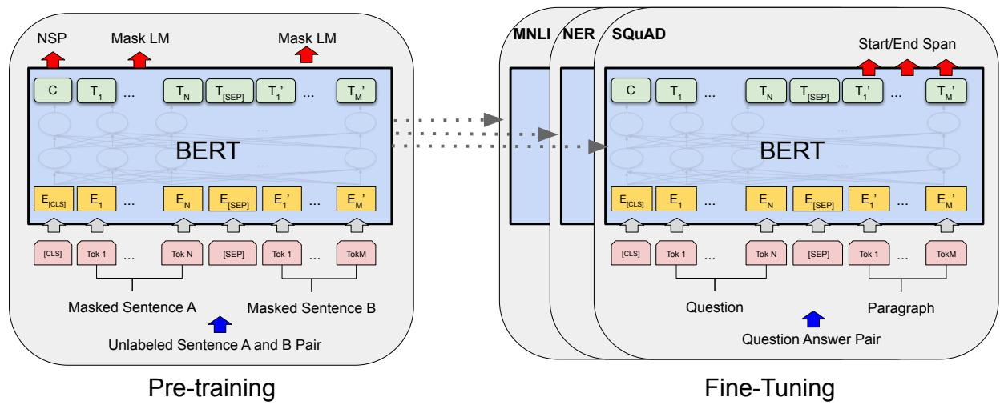
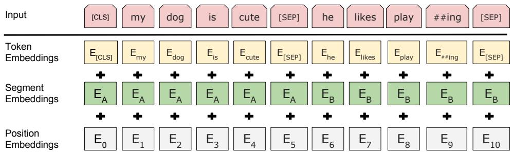
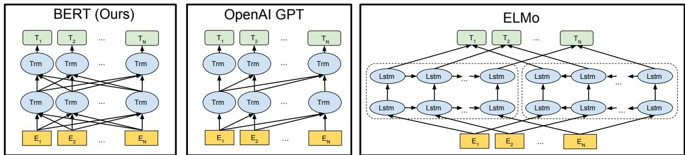
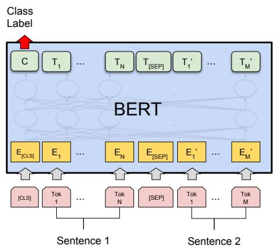
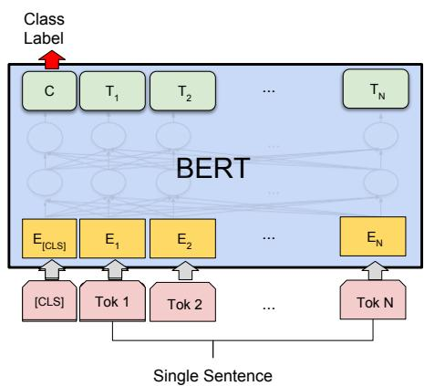
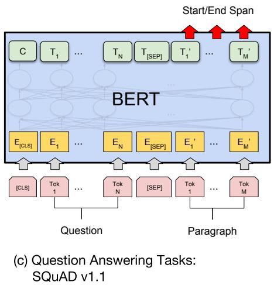
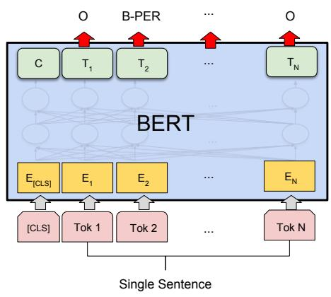
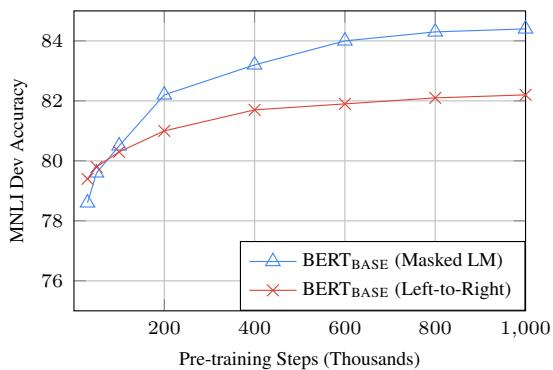

# BERT：用于语言理解的深度双向 Transformer 预训练

Jacob Devlin Ming-Wei Chang Kenton Lee Kristina Toutanova

Google AI Language

{jacobdevlin,mingweichang,kentonl,kristout}@google.com

## 摘要

我们介绍了一种名为 BERT 的新语言表示模型，它代表来自 Transformer 的双向编码器表示（Bidirectional Encoder Representations from Transformers）。与近期的语言表示模型（Peters et al., 2018a；Radford et al., 2018）不同，BERT 旨在通过在所有层中联合条件化左右双向上下文，从未标记的文本中预训练深度双向表示。因此，只需一个额外的输出层，预训练的 BERT 模型就可以进行微调，从而为诸如问答和语言推理等广泛的任务创建最先进的模型，而无需对特定任务的架构进行大量的修改。

BERT 概念简单，且实证效果强大。它在 11 项自然语言处理任务上取得了全新的最先进结果，包括将 GLUE 得分推高至 80.5%（绝对提升 7.7 个百分点），MultiNLI 准确率提升至 86.7%（绝对提升 4.6 个百分点），SQuAD v1.1 问答测试集 F1 达到 93.2（绝对提升 1.5 个百分点）以及 SQuAD v2.0 测试集 F1 达到 83.1（绝对提升 5.1 个百分点）。

## 1 引言

语言模型预训练已被证明能有效改进许多自然语言处理任务（Dai and Le, 2015；Peters et al., 2018a；Radford et al., 2018；Howard and Ruder, 2018）。其中包括句子级任务，例如自然语言推理（Bowman et al., 2015；Williams et al., 2018）和释义（paraphrasing）（Dolan and Brockett, 2005），这些任务旨在通过整体分析句子来预测句子之间的关系；此外还包括词元（token）级任务，例如命名实体识别和问答，在这些任务中模型需要在词元级别生成细粒度输出（Tjong Kim Sang and De Meulder, 2003；Rajpurkar et al., 2016）。

现有的将预训练语言表示应用于下游任务的策略有两种：基于特征（feature-based）的方法和微调（fine-tuning）的方法。基于特征的方法（如 ELMo（Peters et al., 2018a））采用特定于任务的架构，将预训练表示作为附加特征加入其中。微调方法（如生成式预训练 Transformer（OpenAI GPT）（Radford et al., 2018））引入了最少的任务特定参数，并且只需通过微调所有预训练参数即可在下游任务上进行训练。这两种方法在预训练期间具有相同的目标函数，即它们都使用单向语言模型来学习通用的语言表示。

我们认为，当前的技术限制了预训练表示的能力，特别是对于微调（fine-tuning）方法而言。主要局限在于标准语言模型是单向的，这限制了在预训练期间可以使用的架构选择。例如，在 OpenAI GPT 中，作者使用了从左到右的架构，其中每个 token 在 Transformer（Vaswani et al., 2017）的自注意力（self-attention）层中只能关注先前的 token。这种限制对于句子级任务是次优的，而在将基于微调的方法应用于像问答（question answering）这样的 token 级任务时可能会带来极大的不利影响，因为在这类任务中融合来自双向的上下文至关重要。

在本文中，我们通过提出 BERT（Bidirectional Encoder Representations from Transformers，基于 Transformer 的双向编码器表示）来改进基于微调的方法。受到完形填空任务（Cloze task，Taylor, 1953）的启发，BERT 通过使用“掩码语言模型”（masked language model，MLM）预训练目标缓解了前述的单向性约束。掩码语言模型从输入中随机掩盖一部分 token，其目标是仅根据上下文预测被掩盖词的原始词表 id。与从左到右的语言模型预训练不同，MLM 目标使表示能够融合左右两侧的上下文，从而允许我们预训练一个深层双向 Transformer。除了掩码语言模型之外，我们还使用了“下一句预测”（next sentence prediction）任务来联合预训练文本对表示。我们论文的贡献如下：

• 我们证明了双向预训练对于语言表示的重要性。与 Radford et al. (2018) 使用单向语言模型进行预训练不同，BERT 使用掩码语言模型来实现预训练的深层双向表示。这也与 Peters et al. (2018a) 形成对比，后者使用的是独立训练的从左到右和从右到左 LM 的浅层拼接。

• 我们表明，预训练表示减少了对许多经过繁重工程设计的特定任务架构的需求。BERT 是首个在大量句子级和 token 级任务上取得最先进（state-of-the-art）性能的基于微调的表示模型，超越了许多特定任务架构。

• BERT 推进了 11 项 NLP 任务的最先进水平。代码和预训练模型可在 https://github.com/ google-research/bert 获取。

## 2 相关工作

预训练通用语言表示有着悠久的历史，我们在本节简要回顾最广泛使用的方法。

## 2.1 基于无监督特征的方法

学习广泛适用的词表示（word representations）数十年来一直是一个活跃的研究领域，包括非神经网络方法（Brown et al., 1992; Ando and Zhang, 2005; Blitzer et al., 2006）和神经网络方法（Mikolov et al., 2013; Pennington et al., 2014）。预训练词嵌入是现代 NLP 系统的核心组成部分，相比于从头学习的嵌入能带来显著提升（Turian et al., 2010）。为了预训练词嵌入向量，人们使用了自左向右的语言建模目标（Mnih and Hinton, 2009），以及在左右上下文中区分正确与错误词的目标（Mikolov et al., 2013）。

这些方法已被推广到更粗的粒度，例如句子嵌入（Kiros et al., 2015; Logeswaran and Lee, 2018）或段落嵌入（Le and Mikolov, 2014）。为了训练句子表示，先前的研究使用了对候选下一句进行排序的目标（Jernite et al., 2017; Logeswaran and Lee, 2018）、在给定前一句表示的情况下自左向右生成下一句中词的目标（Kiros et al., 2015），或基于去噪自编码器的目标（Hill et al., 2016）。

ELMo 及其前身（Peters et al., 2017, 2018a）沿着另一个维度拓展了传统的词嵌入研究。它们从自左向右和自右向左的语言模型中提取上下文敏感的特征。每个 token 的上下文表示是自左向右和自右向左表示的拼接。当将上下文词嵌入与现有的任务特定架构相融合时，ELMo 刷新了若干主要 NLP 基准的最新最优结果（Peters et al., 2018a），包括问答（Rajpurkar et al., 2016）、情感分析（Socher et al., 2013）和命名实体识别（Tjong Kim Sang and De Meulder, 2003）。Melamud et al. (2016) 提出通过使用 LSTM 从左右上下文中预测单个词的任务来学习上下文表示。与 ELMo 类似，他们的模型是基于特征的，且并非深度双向的。Fedus et al. (2018) 表明完形填空任务可用于提高文本生成模型的鲁棒性。

## 2.2 无监督微调方法

与基于特征的方法一样，该方向的最早工作仅从无标签文本中预训练词嵌入参数（Collobert and Weston, 2008）。

最近，生成上下文词元表示（contextual token representations）的句子或文档编码器已从无标注文本中进行预训练，并针对有监督的下游任务进行微调（Dai and Le, 2015; Howard and Ruder, 2018; Radford et al., 2018）。这些方法的优势在于需要从头学习的参数很少。至少部分得益于这一优势，OpenAI GPT（Radford et al., 2018）在 GLUE 基准（GLUE benchmark）（Wang et al., 2018a）的许多句子级任务上取得了此前最先进的结果。自左向右的语言建模和自编码目标已被用于预训练此类模型（Howard and Ruder, 2018; Radford et al., 2018; Dai and Le, 2015）。

  
Figure 1: BERT 的整体预训练和微调过程。除输出层外，预训练和微调均采用相同的架构。相同的预训练模型参数用于初始化不同下游任务的模型。在微调期间，所有参数都会被微调。[CLS] 是添加到每个输入样本前面的特殊符号，[SEP] 是特殊的分割词元（例如用于分隔问题/答案）。

## 2.3 基于有监督数据的迁移学习

也有研究表明，从具有大型数据集的有监督任务（如自然语言推理（Conneau et al., 2017）和机器翻译（McCann et al., 2017））中进行迁移是有效的。计算机视觉研究同样证明了从大型预训练模型进行迁移学习的重要性，其中一种有效的方法是对在 ImageNet 上预训练的模型进行微调（Deng et al., 2009; Yosinski et al., 2014）。

## 3 BERT

我们在本节中介绍 BERT 及其具体实现。我们的框架包含两个步骤：预训练和微调。在预训练期间，模型在不同的预训练任务上使用无标注数据进行训练。在微调阶段，BERT 模型首先使用预训练参数进行初始化，然后使用来自下游任务的有标注数据对所有参数进行微调。每个下游任务都有独立的微调模型，即使它们是由相同的预训练参数初始化的。Figure 1 中的问答示例将作为本节的贯穿示例。

BERT 的一个显著特征是其跨不同任务的统一架构。预训练架构与最终下游架构之间的差异极小。

模型架构（Model Architecture） BERT 的模型架构是一个多层双向 Transformer 编码器，基于 Vaswani et al. (2017) 中描述并发布在 tensor2tensor 库中的原始实现。<sup>1</sup> 由于 Transformer 的使用已变得十分普遍，且我们的实现与原始版本几乎完全相同，因此我们将省略对模型架构的详尽背景描述，建议读者参考 Vaswani et al. (2017) 以及诸如“The Annotated Transformer”<sup>2</sup> 等优秀指南。

在本研究中，我们将层数（即 Transformer 块数）记为 L，隐藏层维度记为 H，自注意力头数记为 A。<sup>3</sup> 我们主要汇报两种模型规模上的结果：BERT<sub>BASE</sub> (L=12, H=768, A=12, Total Parameters=110M) 和 BERT (L=24, H=1024, A=16, Total Parameters=340M)。

选取 BERT 的模型规模是为了与 OpenAI GPT 保持一致以便于进行对比。然而至关重要的是，BERT Transformer 采用的是双向自注意力，而 GPT Transformer 采用的是受限自注意力，其中每个 token 只能关注其左侧的上下文。<sup>4</sup>

输入/输出表示（Input/Output Representations） 为了使 BERT 能够处理各种下游任务，我们的输入表示能够在一个 token 序列中明确地表示单个句子或一对句子（例如，⟨Question, Answer⟩）。在整篇论文中，“句子”（sentence）可以是连续文本的任意片段，而不一定是实际语言学意义上的句子。“序列”（sequence）是指输入到 BERT 的 token 序列，它可以是单个句子，也可以是拼接在一起的两个句子。

我们使用具有 30,000 个 token 词表的 WordPiece 嵌入（Wu et al., 2016）。每个序列的第一个 token 始终是一个特殊的分类 token（[CLS]）。与该 token 对应的最终隐藏状态被用作分类任务的聚合序列表示。句子对被打包合并为一个单一序列。我们通过两种方式来区分不同的句子：首先，我们用一个特殊的 token（[SEP]）将它们隔开；其次，我们为每个 token 添加一个可学习的嵌入，用以指示它属于句子 A 还是句子 B。如图 1 所示，我们将输入嵌入记为 E，特殊 [CLS] token 的最终隐藏向量记为 $C \in \mathbb { R } ^ { H }$，第 $i$ 个输入 token 的最终隐藏向量记为 $T _ { i } \in \mathbb { R } ^ { H }$。

对于给定的 token，其输入表示是通过将对应的 token 嵌入、分段嵌入（segment embedding）和位置嵌入（position embedding）相加构建而成的。该构建过程的可视化如图 2 所示。

## 3.1 预训练 BERT (Pre-training BERT)

与 Peters et al. (2018a) 和 Radford et al. (2018) 不同，我们不使用传统的从左到右或从右到左的语言模型来预训练 BERT。相反，我们使用本节中介绍的两个无监督任务来预训练 BERT。该步骤展示在图 1 的左半部分。

任务 1：掩码语言模型（Masked LM） 直观上，有理由相信深度双向模型严格强于从左到右模型，或者从左到右和从右到左模型的浅层拼接。不幸的是，标准条件语言模型只能从左到右或从右到左进行训练，因为双向条件化会使每个词间接地“看到自己”，从而导致模型在多层上下文中可以轻而易举地预测出目标词。

为了训练深度双向表征，我们仅随机掩码输入标记（token）的一定比例，然后预测这些被掩码的标记。我们将该过程称为“掩码语言模型”（Masked LM，MLM），尽管在文献中它常被称为完形填空任务（Cloze task）（Taylor, 1953）。在此情况下，与掩码标记对应的最终隐藏向量被输入到词表上的输出 Softmax 层中，如同在标准语言模型中一样。在我们所有的实验中，我们随机掩码每个序列中 15% 的 WordPiece 标记。与去噪自编码器（Vincent et al., 2008）不同的是，我们只预测被掩码的词，而不是重构整个输入。

尽管这使我们能够获得双向预训练模型，但缺点在于我们在预训练和微调之间造成了不匹配，因为 [MASK] 标记在微调期间不会出现。为了缓解这一问题，我们并不总是用实际的 [MASK] 标记替换“被掩码”的词。训练数据生成器随机选择 15% 的标记位置用于预测。如果第 i 个标记被选中，我们会在 (1) 80% 的情况下用 [MASK] 标记替换第 i 个标记 (2) 10% 的情况下用一个随机标记替换 (3) 10% 的情况下保持第 i 个标记不变。然后，将使用 $T _ { i }$ 通过交叉熵损失来预测原始标记。我们在 Appendix C.2 中对比了该过程的不同变体。

任务 2：下一句预测（Next Sentence Prediction，NSP） 诸如问答（Question Answering，QA）和自然语言推理（Natural Language Inference，NLI）等许多重要的下游任务都建立在理解两个句子之间关系的基础之上，而这并不能被语言建模直接捕获。为了训练一个理解句子关系的模型，我们针对一个二元化的下一句预测任务进行预训练，该任务可以轻而易举地从任何单语语料库中生成。具体而言，在为每个预训练样本选择句子 A 和 B 时，50% 的情况下 B 是紧随 A 之后的实际下一句（标记为 IsNext），而 50% 的情况下它是来自语料库的随机句子（标记为 NotNext）。正如我们在 Figure 1 中所示，C 被用于下一句预测（NSP）。<sup>5</sup> 尽管该方法十分简单，但我们在 Section 5.1 中证明，针对该任务的预训练对 QA 和 NLI 都非常有益。 6

  
Figure 2: BERT 输入表示。输入嵌入是词元嵌入（token embeddings）、分段嵌入（segmentation embeddings）和位置嵌入（position embeddings）之和。

NSP 任务与 Jernite et al. (2017) 以及 Logeswaran and Lee (2018) 中使用的表征学习目标密切相关。然而，在先前的研究中，只有句子嵌入被迁移到下游任务中，而 BERT 则会迁移所有参数来初始化最终任务模型的参数。

预训练数据 预训练过程在很大程度上遵循了现有的语言模型预训练文献。对于预训练语料库，我们使用了 BooksCorpus（8 亿词）（Zhu et al., 2015）和英文 Wikipedia（25 亿词）。对于 Wikipedia，我们仅提取文本段落，忽略列表、表格和标题。使用文档级别的语料库而不是像 Billion Word Benchmark（Chelba et al., 2013）这样打乱的句子级语料库是至关重要的，这样才能提取出较长的连续序列。

## 3.2 微调 BERT

微调是非常直接的，因为 Transformer 中的自注意力机制允许 BERT 通过替换适当的输入和输出，来为许多下游任务建模——无论这些任务涉及单文本还是文本对。对于涉及文本对的应用，一种常见的模式是在应用双向交叉注意力之前分别对文本对进行独立编码，例如 Parikh et al. (2016)；Seo et al. (2017)。BERT 则使用自注意力机制统一了这两个阶段，因为使用自注意力对拼接后的文本对进行编码，实际上已经包含了两个句子之间的双向交叉注意力。

对于每个任务，我们只需将特定于任务的输入和输出接入 BERT，并端到端地微调所有参数。在输入端，预训练中的句子 A 和句子 B 分别类似于：(1) 复述中的句子对，(2) 蕴涵中的假设-前提对，(3) 问答中的问题-段落对，以及 (4) 文本分类或序列标注中退化的文本-$\emptyset$ 对。在输出端，词元级表示会被送入输出层用于词元级别的任务（如序列标注或问答），而 [CLS] 表示会被送入输出层用于分类（如蕴涵或情感分析）。

与预训练相比，微调的成本相对较低。论文中的所有结果，从完全相同的预训练模型出发，在单个 Cloud TPU 上最多只需 1 小时即可复现，在 GPU 上也只需几个小时。<sup>7</sup> 我们在第 4 节的相应子节中描述了各个特定任务的细节。更多细节参见附录 A.5。

## 4 实验

在本节中，我们展示了 BERT 在 11 项 NLP 任务上的微调结果。

## 4.1 GLUE

通用语言理解评估（GLUE，General Language Understanding Evaluation）基准（Wang et al., 2018a）是多样化自然语言理解任务的集合。关于 GLUE 数据集的详细描述见附录 B.1。

为了在 GLUE 上进行微调，我们按照第 3 节所述的方式表示输入序列（针对单句或句对），并使用对应于第一个输入标记（[CLS]）的最终隐藏向量 $C ~ \in ~ \mathbb { R } ^ { H }$ 作为聚合表示。微调期间引入的唯一新参数是分类层权重 W ∈ $\mathbb { R } ^ { K \times H }$，其中 K 是标签的数量。我们使用 C 和 W 计算标准分类损失，即 log(softmax(CW<sup>T</sup>))。

<table><tr><td>系统</td><td>MNLI-(m/mm)392k</td><td>QQP363k</td><td>QNLI108k</td><td>SST-267k</td><td>CoLA8.5k</td><td>STS-B5.7k</td><td>MRPC3.5k</td><td>RTE2.5k</td><td>平均值-</td></tr><tr><td>Pre-OpenAI SOTA</td><td>80.6/80.1</td><td>66.1</td><td>82.3</td><td>93.2</td><td>35.0</td><td>81.0</td><td>86.0</td><td>61.7</td><td>74.0</td></tr><tr><td>BiLSTM+ELMo+Attn</td><td>76.4/76.1</td><td>64.8</td><td>79.8</td><td>90.4</td><td>36.0</td><td>73.3</td><td>84.9</td><td>56.8</td><td>71.0</td></tr><tr><td>OpenAI GPT</td><td>82.1/81.4</td><td>70.3</td><td>87.4</td><td>91.3</td><td>45.4</td><td>80.0</td><td>82.3</td><td>56.0</td><td>75.1</td></tr><tr><td>BERTBASE</td><td>84.6/83.4</td><td>71.2</td><td>90.5</td><td>93.5</td><td>52.1</td><td>85.8</td><td>88.9</td><td>66.4</td><td>79.6</td></tr><tr><td>BERTLARGE</td><td>86.7/85.9</td><td>72.1</td><td>92.7</td><td>94.9</td><td>60.5</td><td>86.5</td><td>89.3</td><td>70.1</td><td>82.1</td></tr></table>

Table 1: GLUE 测试结果，由评估服务器评分（https://gluebenchmark.com/leaderboard）。每个任务下方的数字表示训练样本的数量。“平均值”列与官方 GLUE 分数略有不同，因为我们排除了存在问题的 WNLI 数据集。<sup>8</sup> BERT 和 OpenAI GPT 是单模型、单任务的。QQP 和 MRPC 报告 F1 分数，STS-B 报告 Spearman 相关系数，其他任务报告准确率得分。我们排除了使用 BERT 作为其组件之一的条目。

对于所有 GLUE 任务，我们使用的批次大小（batch size）为 32，并在数据上微调 3 个轮次（epochs）。对于每个任务，我们在开发集（Dev set）上选择了最佳微调学习率（在 5e-5、4e-5、3e-5 和 2e-5 之间）。此外，对于 $\mathbf { B E R T _ { L A R G E } }$，我们发现微调在小型数据集上有时不稳定，因此我们进行了多次随机重启（random restarts）并在开发集上选择了最佳模型。在随机重启中，我们使用相同的预训练检查点，但执行不同的微调数据混洗和分类层初始化。<sup>9</sup>

结果如 Table 1 所示。BERT 和 BERT 在所有任务上均大幅优于所有现有系统，相比先前的最先进水平（state of the art）分别取得了 4.5% 和 7.0% 的平均准确率提升。请注意，除了注意力掩码（attention masking）之外，$\mathbf { B E R T _ { B A S E } }$ 和 OpenAI GPT 在模型架构方面几乎完全相同。对于最大且报道最广泛的 GLUE 任务 MNLI，BERT 取得了 4.6% 的绝对准确率提升。在官方 GLUE 排行榜<sup>10</sup>上，截至撰写本文时，BERT 获得了 80.5 分，而 OpenAI GPT 获得了 72.8 分。

我们发现 $\mathbf { B E R T _ { L A R G E } }$ 在所有任务上都显著优于 BERT，尤其是在训练数据极少的任务上。模型大小的影响在 Section 5.2 中进行了更深入的探讨。

## 4.2 SQuAD v1.1

斯坦福问答数据集（Stanford Question Answering Dataset, SQuAD v1.1）是一个包含 10 万个众包问答对的集合 (Rajpurkar et al., 2016)。给定一个问题和一段来自

Wikipedia 且包含答案的篇章，该任务的目标是预测篇章中的答案文本跨度（span）。

如 Figure 1 所示，在问答任务中，我们将输入的问题和篇章表示为一个单一的打包序列，其中问题使用 A 嵌入，篇章使用 B 嵌入。在微调期间，我们仅引入了一个起始向量 $S \in \mathbb { R } ^ { H }$ 和一个结束向量 $E \in \mathbb { R } ^ { H }$。词 i 作为答案跨度起始位置的概率计算为 $T _ { i }$ 与 S 的点积，随后在段落中的所有词上进行 softmax 操作：$\begin{array} { r } { P _ { i } = \frac { e ^ { S \cdot T _ { i } } } { \sum _ { j } e ^ { S \cdot T _ { j } } } . } \end{array}$ 答案跨度的结束位置使用类似的公式。从位置 i 到位置 $j$ 的候选跨度的得分定义为 $S { \cdot } T _ { i } + E { \cdot } T _ { j }$，并将 $j \geq i$ 的最高得分跨度作为预测结果。训练目标是正确起始和结束位置的对数似然之和。我们使用 5e-5 的学习率和 32 的批次大小微调 3 个轮次。

Table 2 展示了排行榜顶尖模型以及顶尖已发表系统的结果 (Seo et al., 2017; Clark and Gardner, 2018; Peters et al., 2018a; Hu et al., 2018)。SQuAD 排行榜上的顶尖结果没有可用的最新公开系统描述，<sup>11</sup> 并且允许在训练其系统时使用任何公开数据。因此，我们在系统中使用了适度的数据增强，在 SQuAD 上微调之前先在 TriviaQA (Joshi et al., 2017) 上进行了微调。

我们表现最好的系统在集成模型上比榜首系统高出 +1.5 F1，单模型系统高出 +1.3 F1。事实上，我们的单个 BERT 模型在 F1 分数上就超越了排名第一的集成系统。在没有 TriviaQA 微调数据的情况下，我们仅损失了 0.1-0.4 F1，依然大幅领先所有现有系统。<sup>12</sup>

<table><tr><td rowspan="2">系统</td><td colspan="2">Dev</td><td colspan="2">Test</td></tr><tr><td>EM</td><td>F1</td><td>EM</td><td>F1</td></tr><tr><td colspan="5">榜单顶尖系统 (2018年12月10日)</td></tr><tr><td>Human</td><td>-</td><td>-</td><td>82.3</td><td>91.2</td></tr><tr><td>#1 Ensemble - nlnet</td><td>-</td><td>-</td><td>86.0</td><td>91.7</td></tr><tr><td>#2 Ensemble - QANet</td><td>-</td><td>-</td><td>84.5</td><td>90.5</td></tr><tr><td colspan="5">已发表</td></tr><tr><td>BiDAF+ELMo (Single)</td><td>-</td><td>85.6</td><td>-</td><td>85.8</td></tr><tr><td>R.M. Reader (Ensemble)</td><td>81.2</td><td>87.9</td><td>82.3</td><td>88.5</td></tr><tr><td colspan="5">我们的方法</td></tr><tr><td>BERTBASE(Single)</td><td>80.8</td><td>88.5</td><td>-</td><td>-</td></tr><tr><td>BERTLARGE(Single)</td><td>84.1</td><td>90.9</td><td>-</td><td>-</td></tr><tr><td>BERTLARGE(Ensemble)</td><td>85.8</td><td>91.8</td><td>-</td><td>-</td></tr><tr><td>BERTLARGE(Sgl.+TriviaQA)</td><td>84.2</td><td>91.1</td><td>85.1</td><td>91.8</td></tr><tr><td>BERTLARGE(Ens.+TriviaQA)</td><td>86.2</td><td>92.2</td><td>87.4</td><td>93.2</td></tr></table>

Table 2: SQuAD 1.1 结果。BERT 集成模型由 7 个使用不同预训练检查点（checkpoint）和微调随机种子的系统组成。

<table><tr><td rowspan="2">系统</td><td colspan="2">Dev</td><td colspan="2">Test</td></tr><tr><td>EM</td><td>F1</td><td>EM</td><td>F1</td></tr><tr><td colspan="5">榜单顶尖系统 (2018年12月10日)</td></tr><tr><td>Human</td><td>86.3</td><td>89.0</td><td>86.9</td><td>89.5</td></tr><tr><td>#1 Single - MIR-MRC (F-Net)</td><td>-</td><td>-</td><td>74.8</td><td>78.0</td></tr><tr><td>#2 Single - nlnet</td><td>-</td><td>-</td><td>74.2</td><td>77.1</td></tr><tr><td colspan="5">已发表</td></tr><tr><td>unet (Ensemble)</td><td>-</td><td>-</td><td>71.4</td><td>74.9</td></tr><tr><td>SLQA+ (Single)</td><td>-</td><td></td><td>71.4</td><td>74.4</td></tr><tr><td colspan="5">我们的方法</td></tr><tr><td>BERTLARGE(Single)</td><td>78.7</td><td>81.9</td><td>80.0</td><td>83.1</td></tr></table>

Table 3: SQuAD 2.0 结果。我们排除了使用 BERT 作为其组件之一的条目。

## 4.3 SQuAD v2.0

SQuAD 2.0 任务扩展了 SQuAD 1.1 的问题定义，允许所提供的段落中不存在简短答案的可能性，从而使问题更加贴近现实。

我们采用了一种简单的方法将 SQuAD v1.1 的 BERT 模型扩展到该任务中。我们将没有答案的问题视为其答案跨度（answer span）的起始和结束位置均位于 [CLS] 标记处。起始和结束答案跨度位置的概率空间被扩展为包含 [CLS] 标记的位置。在预测时，我们将无答案跨度的得分：$s _ { \mathrm { n u l 1 } } =$ $S { \cdot } C + E { \cdot } C$ 与最佳非空跨度的得分 $\begin{array} { r } { s _ { i , j } = \operatorname* { m a x } _ { j \geq i } S { \cdot } T _ { i } + E { \cdot } T _ { j } } \end{array}$ 进行比较。当 $s _ { i , j } > s _ { \mathrm { n u l l } } + \tau$ 时，我们预测为非空答案，其中阈值 $\tau$ 是在开发集上选择以最大化 F1 值的。该模型没有使用 TriviaQA 数据。我们以 5e-5 的学习率和 48 的批次大小微调了 2 个 epoch。

<table><tr><td>系统</td><td>Dev</td><td>Test</td></tr><tr><td>ESIM+GloVe</td><td>51.9</td><td>52.7</td></tr><tr><td>ESIM+ELMo</td><td>59.1</td><td>59.2</td></tr><tr><td>OpenAI GPT</td><td>-</td><td>78.0</td></tr><tr><td>BERTBASE</td><td>81.6</td><td>-</td></tr><tr><td>BERTLARGE</td><td>86.6</td><td>86.3</td></tr><tr><td>人类（专家） $^{\dagger}$ </td><td>-</td><td>85.0</td></tr><tr><td>人类（5次标注） $^{\dagger}$ </td><td>-</td><td>88.0</td></tr></table>

Table 4: SWAG 开发集与测试集准确率。<sup>†</sup>正如 SWAG 论文中所报告的，人类表现是在 100 个样本上测量的。

与先前的排行榜记录及顶尖已发表工作（Sun et al., 2018; Wang et al., 2018b）相比的结果如 Table 3 所示（排除了将 BERT 作为其组件之一的系统）。我们观察到相较于先前的最佳系统，F1 值提升了 +5.1。

## 4.4 SWAG

Situations With Adversarial Generations（SWAG）数据集包含 11.3 万个用于评估扎根常识推理（grounded commonsense inference）的句子对补全样本（Zellers et al., 2018）。给定一个句子，该任务是从四个选项中选出最合理的发展延续。

在 SWAG 数据集上进行微调时，我们构建了四个输入序列，每个序列都包含给定句子（句子 A）与一个可能的发展延续（句子 B）的拼接。引入的唯一特定于任务的参数是一个向量，该向量与 [CLS] 标记表示 C 的点积表示每个选项的分数，并通过 softmax 层进行归一化。

我们以 2e-5 的学习率和 16 的批次大小微调模型 3 个 epoch。结果展示在 Table 4 中。$\mathbf { B E R T _ { L A R G E } }$ 比作者的基线系统 ESIM+ELMo 高出 +27.1%，比 OpenAI GPT 高出 8.3%。

## 5 消融实验

在本节中，我们针对 BERT 的若干个方面进行消融实验，以便更好地理解它们的相对重要性。额外的消融研究可以在附录 C 中找到。

<table><tr><td rowspan="2">任务</td><td colspan="5">开发集</td></tr><tr><td>MNLI-m (Acc)</td><td>QNLI (Acc)</td><td>MRPC (Acc)</td><td>SST-2 (Acc)</td><td>SQuAD (F1)</td></tr><tr><td> $BERT_{BASE}$ </td><td>84.4</td><td>88.4</td><td>86.7</td><td>92.7</td><td>88.5</td></tr><tr><td>No NSP</td><td>83.9</td><td>84.9</td><td>86.5</td><td>92.6</td><td>87.9</td></tr><tr><td>LTR &amp; No NSP</td><td>82.1</td><td>84.3</td><td>77.5</td><td>92.1</td><td>77.8</td></tr><tr><td>+ BiLSTM</td><td>82.1</td><td>84.1</td><td>75.7</td><td>91.6</td><td>84.9</td></tr></table>

Table 5: 使用 $\mathbf { B E R T _ { B A S E } }$ 架构对预训练任务进行的消融实验。“No NSP”在训练时不包含下一句预测任务。“LTR & No NSP”像 OpenAI GPT 一样，作为从左到右的 LM 训练，且没有下一句预测。“+ BiLSTM”在微调期间于“$\mathrm { \Sigma ^ { 6 } L T R } + \mathrm { N o }$ NSP”模型之上添加了一个随机初始化的 BiLSTM。

## 5.1 预训练任务的影响

我们通过在与 $\mathbf { B E R T _ { B A S E } }$ 完全相同的预训练数据、微调方案和超参数下评估两个预训练目标，来证明 BERT 深度双向性的重要性：

No NSP：一种双向模型，使用“掩码语言模型”（MLM）进行训练，但没有“下一句预测”（NSP）任务。

LTR & No NSP：一种仅使用左侧上下文的模型，使用标准的从左到右（Left-to-Right, LTR）LM 而非 MLM 进行训练。仅左侧的约束也应用于微调阶段，因为去除该约束会引入预训练/微调不匹配，从而降低下游性能。此外，该模型在预训练时没有加入 NSP 任务。这可以直接与 OpenAI GPT 进行对比，但使用了我们更大的训练数据集、我们的输入表示以及我们的微调方案。

我们首先考察 NSP 任务带来的影响。在 Table 5 中，我们表明移除 NSP 会显著降低 QNLI、MNLI 和 SQuAD 1.1 的性能。接下来，我们通过对比“No NSP”与“LTR & No NSP”来评估训练双向表示的影响。LTR 模型在所有任务上的表现均不如 MLM 模型，并在 MRPC 和 SQuAD 上出现大幅下降。

对于 SQuAD 而言，直观上很明显 LTR 模型在词元预测方面会表现较差，因为词元级的隐藏状态没有右侧上下文。为了尽力尝试增强 LTR 系统，我们在其顶部添加了一个随机初始化的 BiLSTM。这确实显著提升了 SQuAD 上的结果，但其结果仍远差于预训练双向模型的结果。BiLSTM 还损害了在 GLUE 任务上的性能。

我们认识到，也可以像 ELMo 那样，分别训练独立的 LTR（从左到右）和 RTL（从右到左）模型，并将每个 token 表示为两个模型的拼接。然而：(a) 其计算开销是单个双向模型的两倍；(b) 这对于 QA（问答）等任务并不直观，因为 RTL 模型无法根据问题来限定答案的条件；(c) 它的能力严格弱于深度双向模型，因为深度双向模型可以在每一层都同时利用左右两侧的上下文。

## 5.2 模型大小的影响

在本节中，我们探讨模型大小对微调任务准确率的影响。我们训练了多个具有不同层数、隐藏单元数和注意力头数的 BERT 模型，同时保持前文所述的其他超参数和训练过程一致。

选定 GLUE 任务上的结果如 Table 6 所示。在该表中，我们报告了 5 次微调随机重启的平均开发集（Dev Set）准确率。我们可以看到，在所有四个数据集上，更大的模型都带来了明确的准确率提升，即使对于仅有 3,600 个标注训练样本且与预训练任务存在实质差异的 MRPC 也是如此。或许同样令人惊讶的是，在相对于现有文献已经相当庞大的模型基础之上，我们仍能取得如此显著的提升。例如，Vaswani et al. (2017) 中探索的最大 Transformer 结构为 (L=6, H=1024, A=16)，编码器参数量为 100M；我们在文献中找到的最大 Transformer 结构为 (L=64, H=512, A=2)，参数量为 235M（Al-Rfou et al., 2018）。相比之下，$\mathbf { B E R T _ { B A S E } }$ 包含 110M 参数，而 $\mathbf { B E R T _ { L A R G E } }$ 包含 340M 参数。

长期以来众所周知的是，增大模型大小会在机器翻译和语言建模等大规模任务上带来持续的提升，这可由 Table 6 中所展示的保留训练数据上的 LM 困惑度（perplexity）得到证明。然而，我们认为本工作首次令人信服地证明了：只要模型经过了充分的预训练，将模型扩展至极大尺寸也能在极小规模的任务上带来巨大的提升。Peters et al. (2018b) 在将预训练 bi-LM 大小从两层增加到四层对下游任务的影响方面给出了不一的结果，而 Melamud et al. (2016) 顺带提及将隐藏层维度从 200 增加到 600 有所帮助，但进一步增加到 1,000 并没有带来进一步的提升。这两项先前的研究都采用了基于特征的方法（feature-based approach）——我们推测，当模型直接在下游任务上进行微调且仅使用极少量的随机初始化附加参数时，即使下游任务数据规模非常小，特定任务的模型也能够从更大、更具表现力的预训练表征中获益。

## 5.3 基于特征的 BERT 方法

到目前为止所展示的所有 BERT 结果都采用了微调（fine-tuning）方法，即在预训练模型上添加一个简单的分类层，并在下游任务上联合微调所有参数。然而，从预训练模型中提取固定特征的基于特征（feature-based）的方法具有一定的优势。首先，并非所有任务都能轻易地由 Transformer 编码器架构来表示，因此需要添加针对特定任务的模型架构。其次，预先一次性计算出训练数据的高开销表示，然后在此表示之上使用开销更低的模型运行多次实验，具有显著的计算效益。

在本节中，我们通过将 BERT 应用于 CoNLL-2003 命名实体识别（Named Entity Recognition，NER）任务（Tjong Kim Sang and De Meulder, 2003）来对比这两种方法。在 BERT 的输入中，我们使用了保留大小写的 WordPiece 模型，并包含了数据所能提供的最大文档上下文。按照标准做法，我们将其表述为一个序列标注任务，但在输出端不使用 CRF 层。我们使用第一个子词（sub-token）的表示作为 NER 标签集上词元级（token-level）分类器的输入。

<table><tr><td colspan="4">超参数</td><td colspan="3">开发集准确率</td></tr><tr><td>#L</td><td>#H</td><td>#A</td><td>LM (ppl)</td><td>MNLI-m</td><td>MRPC</td><td>SST-2</td></tr><tr><td>3</td><td>768</td><td>12</td><td>5.84</td><td>77.9</td><td>79.8</td><td>88.4</td></tr><tr><td>6</td><td>768</td><td>3</td><td>5.24</td><td>80.6</td><td>82.2</td><td>90.7</td></tr><tr><td>6</td><td>768</td><td>12</td><td>4.68</td><td>81.9</td><td>84.8</td><td>91.3</td></tr><tr><td>12</td><td>768</td><td>12</td><td>3.99</td><td>84.4</td><td>86.7</td><td>92.9</td></tr><tr><td>12</td><td>1024</td><td>16</td><td>3.54</td><td>85.7</td><td>86.9</td><td>93.3</td></tr><tr><td>24</td><td>1024</td><td>16</td><td>3.23</td><td>86.6</td><td>87.8</td><td>93.7</td></tr></table>

Table 6: BERT 模型尺寸的消融实验。#L = 层数；#H = 隐藏层维度；#A = 注意力头数。“LM (ppl)”是保留训练数据上的掩码语言模型（masked LM）困惑度。

<table><tr><td>系统</td><td>Dev F1</td><td>Test F1</td></tr><tr><td>ELMo (Peters et al., 2018a)</td><td>95.7</td><td>92.2</td></tr><tr><td>CVT (Clark et al., 2018)</td><td>-</td><td>92.6</td></tr><tr><td>CSE (Akbik et al., 2018)</td><td>-</td><td>93.1</td></tr><tr><td colspan="3">微调方法</td></tr><tr><td> $BERT_{LARGE}$ </td><td>96.6</td><td>92.8</td></tr><tr><td> $BERT_{BASE}$ </td><td>96.4</td><td>92.4</td></tr><tr><td colspan="3">基于特征的方法 ( $BERT_{BASE}$ )</td></tr><tr><td>嵌入</td><td>91.0</td><td>-</td></tr><tr><td>倒数第二层隐藏状态</td><td>95.6</td><td>-</td></tr><tr><td>最后一层隐藏状态</td><td>94.9</td><td>-</td></tr><tr><td>最后四层隐藏状态加权和</td><td>95.9</td><td>-</td></tr><tr><td>拼接最后四层隐藏状态</td><td>96.1</td><td>-</td></tr><tr><td>全部 12 层加权和</td><td>95.5</td><td>-</td></tr></table>

Table 7: CoNLL-2003 命名实体识别结果。超参数通过验证集（Dev 集）进行选择。所汇报的 Dev 和 Test 得分是在采用这些超参数下进行 5 次随机重启后的平均值。

为了对微调方法进行消融研究，我们采用了基于特征的方法：在不微调 BERT 任何参数的情况下，提取一层或多层的激活值。这些上下文嵌入在送入分类层之前，被用作一个随机初始化的两层 768 维 BiLSTM 的输入。

结果如 Table 7 所示。BERT<sub>LARGE</sub> 的性能与当前最优（state-of-the-art）方法相比极具竞争力。表现最好的方法是拼接预训练 Transformer 顶端最后四层的隐藏层 token 表示，其 F1 值仅比微调整个模型低 0.3。这表明 BERT 对于微调方法和基于特征的方法都是有效的。

## 6 结论

近期得益于语言模型迁移学习的经验性进展表明，丰富的无监督预训练是许多语言理解系统中不可或缺的组成部分。特别是，这些成果使得即便是低资源任务也能从深度单向架构中获益。我们的主要贡献在于将这些发现进一步推广到深度双向架构，使得同一个预训练模型能够成功应对广泛的 NLP 任务。

## 参考文献

Alan Akbik, Duncan Blythe, and Roland Vollgraf. 2018. Contextual string embeddings for sequence labeling. In Proceedings of the 27th International Conference on Computational Linguistics, pages 1638–1649.

Rami Al-Rfou, Dokook Choe, Noah Constant, Mandy Guo, and Llion Jones. 2018. Character-level language modeling with deeper self-attention. arXiv preprint arXiv:1808.04444.

Rie Kubota Ando and Tong Zhang. 2005. A framework for learning predictive structures from multiple tasks and unlabeled data. Journal of Machine Learning Research, 6(Nov):1817–1853.

Luisa Bentivogli, Bernardo Magnini, Ido Dagan, Hoa Trang Dang, and Danilo Giampiccolo. 2009. The fifth PASCAL recognizing textual entailment challenge. In TAC. NIST.

John Blitzer, Ryan McDonald, and Fernando Pereira. 2006. Domain adaptation with structural correspondence learning. In Proceedings of the 2006 conference on empirical methods in natural language processing, pages 120–128. Association for Computational Linguistics.

Samuel R. Bowman, Gabor Angeli, Christopher Potts, and Christopher D. Manning. 2015. A large annotated corpus for learning natural language inference. In EMNLP. Association for Computational Linguistics.

Peter F Brown, Peter V Desouza, Robert L Mercer, Vincent J Della Pietra, and Jenifer C Lai. 1992. Class-based n-gram models of natural language. Computational linguistics, 18(4):467–479.

Daniel Cer, Mona Diab, Eneko Agirre, Inigo Lopez-Gazpio, and Lucia Specia. 2017. Semeval-2017 task 1: Semantic textual similarity multilingual and crosslingual focused evaluation. In Proceedings of the 11th International Workshop on Semantic Evaluation (SemEval-2017), pages 1–14, Vancouver, Canada. Association for Computational Linguistics.

Ciprian Chelba, Tomas Mikolov, Mike Schuster, Qi Ge, Thorsten Brants, Phillipp Koehn, and Tony Robinson. 2013. One billion word benchmark for measuring progress in statistical language modeling. arXiv preprint arXiv:1312.3005.

Z. Chen, H. Zhang, X. Zhang, and L. Zhao. 2018. Quora question pairs.

Christopher Clark and Matt Gardner. 2018. Simple and effective multi-paragraph reading comprehension. In ACL.

Kevin Clark, Minh-Thang Luong, Christopher D Manning, and Quoc Le. 2018. Semi-supervised sequence modeling with cross-view training. In Proceedings ofthe 2018 Conference on Empirical Methods in Natural Language Processing, pages 1914– 1925.

Ronan Collobert and Jason Weston. 2008. A unified architecture for natural language processing: Deep neural networks with multitask learning. In Proceedings of the 25th international conference on Machine learning, pages 160–167. ACM.

Alexis Conneau, Douwe Kiela, Holger Schwenk, Lo¨ıc Barrault, and Antoine Bordes. 2017. Supervised learning of universal sentence representations from natural language inference data. In Proceedings of the 2017 Conference on Empirical Methods in Natural Language Processing, pages 670–680, Copenhagen, Denmark. Association for Computational Linguistics.

Andrew M Dai and Quoc V Le. 2015. Semi-supervised sequence learning. In Advances in neural information processing systems, pages 3079–3087.

J. Deng, W. Dong, R. Socher, L.-J. Li, K. Li, and L. Fei-Fei. 2009. ImageNet: A Large-Scale Hierarchical Image Database. In CVPR09.

William B Dolan and Chris Brockett. 2005. Automatically constructing a corpus of sentential paraphrases. In Proceedings ofthe Third International Workshop on Paraphrasing (IWP2005).

William Fedus, Ian Goodfellow, and Andrew M Dai. 2018. Maskgan: Better text generation via filling in the . arXiv preprint arXiv:1801.07736.

Dan Hendrycks and Kevin Gimpel. 2016. Bridging nonlinearities and stochastic regularizers with gaussian error linear units. CoRR, abs/1606.08415.

Felix Hill, Kyunghyun Cho, and Anna Korhonen. 2016. Learning distributed representations of sentences from unlabelled data. In Proceedings of the 2016 Conference of the North American Chapter of the Association for Computational Linguistics: Human Language Technologies. Association for Computational Linguistics.

Jeremy Howard and Sebastian Ruder. 2018. Universal language model fine-tuning for text classification. In ACL. Association for Computational Linguistics.

Minghao Hu, Yuxing Peng, Zhen Huang, Xipeng Qiu, Furu Wei, and Ming Zhou. 2018. Reinforced mnemonic reader for machine reading comprehension. In IJCAI.

Yacine Jernite Samuel R Bowman and David Sontag. 2017. Discourse-based objectives for fast unsupervised sentence representation learning. CoRR, abs/1705.00557.

Mandar Joshi, Eunsol Choi, Daniel S Weld, and Luke Zettlemoyer. 2017. Triviaqa: A large scale distantly supervised challenge dataset for reading comprehension. In ACL.

Ryan Kiros, Yukun Zhu, Ruslan R Salakhutdinov, Richard Zemel, Raquel Urtasun, Antonio Torralba, and Sanja Fidler. 2015. Skip-thought vectors. In Advances in neural information processing systems, pages 3294–3302.

Quoc Le and Tomas Mikolov. 2014. Distributed representations of sentences and documents. In International Conference on Machine Learning, pages 1188–1196.

Hector J Levesque, Ernest Davis, and Leora Morgenstern. 2011. The winograd schema challenge. In Aaai spring symposium: Logical formalizations of commonsense reasoning, volume 46, page 47.

Lajanugen Logeswaran and Honglak Lee. 2018. An efficient framework for learning sentence representations. In International Conference on Learning Representations.

Bryan McCann, James Bradbury, Caiming Xiong, and Richard Socher. 2017. Learned in translation: Contextualized word vectors. In NIPS.

Oren Melamud, Jacob Goldberger, and Ido Dagan. 2016. context2vec: Learning generic context embedding with bidirectional LSTM. In CoNLL.

Tomas Mikolov, Ilya Sutskever, Kai Chen, Greg S Corrado, and Jeff Dean. 2013. Distributed representations of words and phrases and their compositionality. In Advances in Neural Information Processing Systems 26, pages 3111–3119. Curran Associates, Inc.

Andriy Mnih and Geoffrey E Hinton. 2009. A scalable hierarchical distributed language model. In D. Koller, D. Schuurmans, Y. Bengio, and L. Bottou, editors, Advances in Neural Information Processing Systems 21, pages 1081–1088. Curran Associates, Inc.

Ankur P Parikh, Oscar Tackstr¨ om, Dipanjan Das, and¨ Jakob Uszkoreit. 2016. A decomposable attention model for natural language inference. In EMNLP.

Jeffrey Pennington, Richard Socher, and Christopher D. Manning. 2014. Glove: 用于词表示的全局向量（Global vectors for word representation）. In Empirical Methods in Natural Language Processing (EMNLP), pages 1532– 1543.

Matthew Peters, Waleed Ammar, Chandra Bhagavatula, and Russell Power. 2017. 基于双向语言模型的半监督序列标注（Semi-supervised sequence tagging with bidirectional language models）. In ACL.

Matthew Peters, Mark Neumann, Mohit Iyyer, Matt Gardner, Christopher Clark, Kenton Lee, and Luke Zettlemoyer. 2018a. 深度上下文词表示（Deep contextualized word representations）. In NAACL.

Matthew Peters, Mark Neumann, Luke Zettlemoyer, and Wen-tau Yih. 2018b. 剖析上下文词嵌入：架构与表示（Dissecting contextual word embeddings: Architecture and representation）. In Proceedings of the 2018 Conference on Empirical Methods in Natural Language Processing, pages 1499–1509.

Alec Radford, Karthik Narasimhan, Tim Salimans, and Ilya Sutskever. 2018. 利用无监督学习改善语言理解能力（Improving language understanding with unsupervised learning）. 技术报告, OpenAI.

Pranav Rajpurkar, Jian Zhang, Konstantin Lopyrev, and Percy Liang. 2016. SQuAD: 用于文本机器理解的 100,000+ 个问题（100,000+ questions for machine comprehension of text）. In Proceedings of the 2016 Conference on Empirical Methods in Natural Language Processing, pages 2383–2392.

Minjoon Seo, Aniruddha Kembhavi, Ali Farhadi, and Hannaneh Hajishirzi. 2017. 用于机器理解的双向注意力流（Bidirectional attention flow for machine comprehension）. In ICLR.

Richard Socher, Alex Perelygin, Jean Wu, Jason Chuang, Christopher D Manning, Andrew Ng, and Christopher Potts. 2013. 情感树库上用于语义组合性的递归深度模型（Recursive deep models for semantic compositionality over a sentiment treebank）. In Proceedings of the 2013 conference on empirical methods in natural language processing, pages 1631–1642.

Fu Sun, Linyang Li, Xipeng Qiu, and Yang Liu. 2018. U-net: 包含无法回答问题的机器阅读理解（Machine reading comprehension with unanswerable questions）. arXiv preprint 1810 06638.

Wilson L Taylor. 1953. 完形填空程序：一种衡量可读性的新工具（Cloze procedure: A new tool for measuring readability）. Journalism Bulletin, 30(4):415–433.

Erik F Tjong Kim Sang and Fien De Meulder. 2003. CoNLL-2003 共享任务介绍：独立于语言的命名实体识别（Introduction to the conll-2003 shared task: Language-independent named entity recognition）. In CoNLL.

Joseph Turian, Lev Ratinov, and Yoshua Bengio. 2010. 词表示：一种用于半监督学习的简单通用方法（Word representations: A simple and general method for semi-supervised learning）. In Proceedings of the 48th Annual Meeting ofthe Associationfor Computational Linguistics, ACL ’10, pages 384–394.

Ashish Vaswani, Noam Shazeer, Niki Parmar, Jakob Uszkoreit, Llion Jones, Aidan N Gomez, Lukasz Kaiser, and Illia Polosukhin. 2017. 注意力即你所需要的一切（Attention is all you need）. In Advances in Neural Information Processing Systems, pages 6000–6010.

Pascal Vincent, Hugo Larochelle, Yoshua Bengio, and Pierre-Antoine Manzagol. 2008. 利用去噪自编码器提取和构建鲁棒特征（Extracting and composing robust features with denoising autoencoders）. In Proceedings of the 25th international conference on Machine learning, pages 1096–1103. ACM.

Alex Wang, Amanpreet Singh, Julian Michael, Felix Hill. Omer Levy, and Samuel Bowman, 2018a Glue: 多任务基准与分析平台（A multi-task benchmark and analysis platform）

for natural language understanding. In Proceedings of the 2018 EMNLP Workshop BlackboxNLP: Analyzing and Interpreting Neural Networks for NLP, pages 353–355.

Wei Wang, Ming Yan, and Chen Wu. 2018b. Multigranularity hierarchical attention fusion networks for reading comprehension and question answering. In Proceedings ofthe 56th Annual Meeting ofthe Association for Computational Linguistics (Volume 1: Long Papers). Association for Computational Linguistics.

Alex Warstadt, Amanpreet Singh, and Samuel R Bowman. 2018. Neural network acceptability judgments. arXiv preprint arXiv:1805.12471.

Adina Williams, Nikita Nangia, and Samuel R Bowman. 2018. A broad-coverage challenge corpus for sentence understanding through inference. In NAACL.

Yonghui Wu, Mike Schuster, Zhifeng Chen, Quoc V Le, Mohammad Norouzi, Wolfgang Macherey, Maxim Krikun, Yuan Cao, Qin Gao, Klaus Macherey, et al. 2016. Google’s neural machine translation system: Bridging the gap between human and machine translation. arXiv preprint arXiv:1609.08144.

Jason Yosinski, Jeff Clune, Yoshua Bengio, and Hod Lipson. 2014. How transferable are features in deep neural networks? In Advances in neural information processing systems, pages 3320–3328.

Adams Wei Yu, David Dohan, Minh-Thang Luong, Rui Zhao, Kai Chen, Mohammad Norouzi, and Quoc V Le. 2018. QANet: Combining local convolution with global self-attention for reading comprehension. In ICLR.

Rowan Zellers, Yonatan Bisk, Roy Schwartz, and Yejin Choi. 2018. Swag: A large-scale adversarial dataset for grounded commonsense inference. In Proceedings of the 2018 Conference on Empirical Methods in Natural Language Processing (EMNLP).

Yukun Zhu, Ryan Kiros, Rich Zemel, Ruslan Salakhutdinov, Raquel Urtasun, Antonio Torralba, and Sanja Fidler. 2015. Aligning books and movies: Towards story-like visual explanations by watching movies and reading books. In Proceedings of the IEEE international conference on computer vision, pages 19–27.

## “BERT: Pre-training of Deep Bidirectional Transformers for Language Understanding” 附录

我们将附录分为三个部分：

• BERT 的补充实现细节见附录 A；

• 我们实验的补充细节见附录 B；以及

• 补充消融研究见附录 C。

我们展示了 BERT 的补充消融研究，包括：

– 训练步数的影响；以及

– 不同掩码流程的消融研究。

## A BERT 的补充细节

## A.1 预训练任务说明

我们在下文中提供了预训练任务的示例。

掩码语言模型（Masked LM）与掩码流程 假设无标签句子为 my dog is hairy，并且在随机掩码流程中我们选择了第 4 个 token（对应于 hairy），我们的掩码流程可以进一步说明为：

• 80% 的情况：用 [MASK] token 替换该词，例如，my dog is hairy → my dog is [MASK]

• 10% 的概率：用随机词替换该词，例如，my dog is hairy → my dog is apple

• 10% 的概率：保持该词不变，例如，my dog is hairy → my dog is hairy。这样做的目的是使表征偏向实际观察到的词。

这种做法的优势在于，Transformer 编码器不知道它将被要求预测哪些词，或者哪些词已被随机词替换，因此它被迫保留每个输入 token 的分布式上下文表征。此外，由于随机替换仅发生在所有 token 的 1.5%（即 15% 中的 10%），这似乎并不会损害模型的语言理解能力。在 C.2 节中，我们评估了该过程的影响。

与标准的语言模型训练相比，掩码语言模型（masked LM）在每个批次中仅对 15% 的 token 进行预测，这意味着模型收敛可能需要更多的预训练步数。在 C.1 节中，我们证明了 MLM 的收敛速度确实略慢于从左到右的模型（预测每个 token），但 MLM 模型在实证上的提升远超所增加的训练成本。

  
Figure 3: 预训练模型架构的差异。BERT 使用双向 Transformer。OpenAI GPT 使用从左到右的 Transformer。ELMo 使用独立训练的从左到右和从右到左 LSTM 的拼接来为下游任务生成特征。在这三者中，只有 BERT 表征在所有层中都同时联合依赖于左右两侧的上下文。除了架构差异之外，BERT 和 OpenAI GPT 属于微调方法，而 ELMo 属于基于特征的方法。

下一句预测（Next Sentence Prediction） 下一句预测任务可以通过以下示例进行说明。

```txt
Input = [CLS] the man went to [MASK] store [SEP]
    he bought a gallon [MASK] milk [SEP]
Label = IsNext
Input = [CLS] the man [MASK] to the store [SEP]
    penguin [MASK] are flight ##less birds [SEP]
Label = NotNext
```

## A.2 预训练过程

为了生成每个训练输入序列，我们从语料库中采样两个文本跨度，我们将其称为“句子”，尽管它们通常比单个句子长得多（但也可能更短）。第一个句子接收 A 嵌入（embedding），第二个句子接收 B 嵌入。50% 的情况下 B 是紧随 A 之后的实际下一句，50% 的情况下它是一个随机句子，这是为了“下一句预测”任务。对它们的采样使得两者的组合长度 ≤ 512 个 token。LM 掩码在 WordPiece 分词之后应用，统一掩码率为 15%，且不对部分子词（partial word pieces）做特殊处理。

我们使用 256 个序列的批大小（256 个序列 \* 512 个 token = 128,000 个 token/批）训练 1,000,000 步，这在 33 亿词的语料库上大约相当于 40 个 epoch。我们使用 Adam 优化器，学习率为 1e-4，$\beta _ { 1 } = 0 . 9 { } .$ $\beta _ { 2 } ~ = ~ 0 . 9 9 9 , \mathrm { L } 2$ 权重衰减为 0.01，在前 10,000 步进行学习率预热（warmup），并采用学习率线性衰减。我们在所有层上均使用 0.1 的 dropout 概率。遵循 OpenAI GPT，我们使用 gelu 激活函数（Hendrycks and Gimpel, 2016）而不是标准的 relu。训练损失是平均掩码语言模型（masked LM）似然与平均下一句预测（next sentence prediction）似然之和。

$\mathbf { B E R T _ { B A S E } }$ 的训练在 Pod 配置下的 4 个 Cloud TPU（共 16 个 TPU 芯片）上进行。<sup>13</sup> BERT<sub>LARGE</sub> 的训练在 16 个 Cloud TPU（共 64 个 TPU 芯片）上进行。每次预训练耗时 4 天完成。

较长的序列计算成本极高，因为注意力计算与序列长度成二次方关系。为了在实验中加快预训练速度，我们在前 90% 的步数中使用长度为 128 的序列对模型进行预训练。随后，在剩余 10% 的步数中使用长度为 512 的序列进行训练，以学习位置嵌入（positional embeddings）。

## A.3 微调过程

对于微调，除了批大小、学习率和训练 epoch 数之外，大多数模型超参数与预训练时相同。dropout 概率始终保持为 0.1。最佳超参数值取决于具体任务，但我们发现以下取值范围在所有任务中均表现良好：

• 批大小：16, 32

<sup>13</sup>https://cloudplatform.googleblog.com/2018/06/Cloud-TPU-now-offers-preemptible-pricing-and-global availability.html

• 学习率（Adam）：5e-5, 3e-5, 2e-5

• Epoch 数量：2, 3, 4

我们还观察到，大型数据集（例如 10 万以上标注训练样本）对超参数选择的敏感度远低于小型数据集。微调通常非常迅速，因此对上述参数进行穷举搜索并选择在开发集上表现最佳的模型是合理的做法。

## A.4 BERT、ELMo 和 OpenAI GPT 的比较

在此，我们研究了近期流行的表征学习模型之间的差异，包括 ELMo、OpenAI GPT 和 BERT。模型架构之间的比较直观地展示在 Figure 3 中。请注意，除了架构差异之外，BERT 和 OpenAI GPT 属于微调方法，而 ELMo 则是一种基于特征的方法。

与 BERT 最具可比性的现有预训练方法是 OpenAI GPT，它在大型文本语料库上训练从左到右的 Transformer LM。事实上，BERT 中的许多设计决策都是有意做出的，以便使其尽可能接近 GPT，从而使这两种方法之间的比较差异最小化。本研究的核心论点在于，双向性以及第 3.1 节中介绍的两个预训练任务解释了绝大部分的实证改进，但我们确实注意到 BERT 和 GPT 的训练方式之间还存在其他一些差异：

• GPT 在 BooksCorpus（8 亿词）上进行训练；BERT 在 BooksCorpus（8 亿词）和 Wikipedia（25 亿词）上进行训练。

• GPT 使用仅在微调时引入的句子分隔符（[SEP]）和分类器标记（[CLS]）；BERT 则在预训练期间学习 [SEP]、[CLS] 和句子 A/B 的嵌入表示。

• GPT 训练了 100 万步，批大小（batch size）为 32,000 词；BERT 训练了 100 万步，批大小为 128,000 词。

• GPT 在所有微调实验中均使用相同的 5e-5 学习率；BERT 则选择在开发集上表现最佳的特定任务微调学习率。

为了隔离这些差异的影响，我们在第 5.1 节中进行了消融实验，结果表明大部分改进实际上来自于这两个预训练任务以及它们所实现的双向性。

## A.5 不同任务微调图解

在不同任务上微调 BERT 的图解如图 4 所示。我们的特定任务模型是通过将 BERT 与一个额外的输出层相结合而构建的，因此只需从头学习极少量的参数。在这些任务中，(a) 和 (b) 是序列级任务，而 (c) 和 (d) 是标记（token）级任务。在图中，$E$ 表示输入嵌入，$T_i$ 表示标记 $i$ 的上下文表示，[CLS] 是用于分类输出的特殊符号，[SEP] 是用于分隔非连续标记序列的特殊符号。

## B 详细实验设置

## B.1 GLUE 基准实验的详细描述

我们在表 1 中的 GLUE 结果来自 https://gluebenchmark.com/ 排行榜以及 https://blog.openai.com/language-unsupervised。GLUE 基准包含以下数据集，其描述最初总结在 Wang et al. (2018a) 中：

MNLI 多领域自然语言推理（Multi-Genre Natural Language Inference）是一项大规模众包蕴涵分类任务（Williams et al., 2018）。给定一对句子，目标是预测第二个句子相对于第一个句子是蕴涵、矛盾还是中立。

QQP Quora 问题对（Quora Question Pairs）是一项二分类任务，目标是确定 Quora 上提出的两个问题在语义上是否等价（Chen et al., 2018）。

QNLI（Question Natural Language Inference，问题自然语言推理）是 Stanford Question Answering Dataset（Rajpurkar et al., 2016）转换而来的二分类任务版本（Wang et al., 2018a）。正例是确实包含正确答案的（问题，句子）对，负例则是来自同一段落但不包含答案的（问题，句子）对。

  
(a) 句对分类任务：MNLI, QQP, QNLI, STS-B, MRPC, RTE, SWAG

  
(b) 单句分类任务：SST-2, CoLA



  
(d) 单句标注任务：CoNLL-2003 NER  
Figure 4: BERT 在不同任务上进行微调的示意图。

SST-2（Stanford Sentiment Treebank，斯坦福情感树库）是一个单句二分类任务，由从电影评论中提取的句子组成，并带有对其情感的人工标注（Socher et al., 2013）。

CoLA（Corpus of Linguistic Acceptability，语言可接受性语料库）是一个单句二分类任务，其目标是预测一个英语句子在语言学上是否“可接受”（Warstadt et al., 2018）。

STS-B（Semantic Textual Similarity Benchmark，语义文本相似度基准）是从新闻标题和其他来源提取的句对集合（Cer et al., 2017）。它们被标注了 1 到 5 分的分数，用于表示两个句子在语义上的相似程度。

MRPC（Microsoft Research Paraphrase Corpus，微软研究院释义语料库）由从在线新闻源中自动提取的句对组成，并带有关于句对中的句子在语义上是否等价的人工标注（Dolan and Brockett, 2005）。

RTE（Recognizing Textual Entailment，文本蕴涵识别）是一个类似于 MNLI 的二分类蕴涵任务，但训练数据要少得多（Bentivogli et al., 2009）。<sup>14</sup>

WNLI（Winograd NLI）是一个小型的自然语言推理数据集（Levesque et al., 2011）。GLUE 网页指出该数据集的构建存在问题，<sup>15</sup> 并且提交到 GLUE 的每个训练系统表现都差于预测多数类的 65.1 基线准确率。因此，为了对 OpenAI GPT 保持公平，我们排除了该集合。对于我们的 GLUE 提交，我们始终预测多数类。

## C 附加消融研究

## C.1 训练步数的影响

Figure 5 展示了从预训练了 $k$ 步的检查点进行微调后的 MNLI 验证集准确率。这使我们能够回答以下问题：

1. 问题：BERT 真的需要如此大量的预训练（128,000 词/批次 \* 1,000,000 步）才能获得较高的微调准确率吗？
回答：是的，与训练 500k 步相比，当训练 1M 步时，$\mathbf { B E R T _ { B A S E } }$ 在 MNLI 上的准确率提高了近 1.0%。

2. 问题：鉴于在每个批次中仅预测 15% 的词而不是所有词，MLM 预训练的收敛速度是否慢于 LTR 预训练？

回答：MLM 模型的收敛速度确实略慢于 LTR 模型。然而，在绝对准确率方面，MLM 模型几乎立即开始超越 LTR 模型。

## C.2 不同掩码策略的消融实验

在第 3.1 节中，我们提到 BERT 在使用掩码语言模型（MLM）目标进行预训练时，采用了混合策略来掩码目标标记（tokens）。以下是用于评估不同掩码策略效果的消融实验。

  
Figure 5: 训练步数的消融实验。本图显示了从预训练了 k 步的模型参数出发，微调后的 MNLI 准确率。横轴为 k 的值。

需要注意的是，掩码策略的目的是为了减少预训练与微调之间的不匹配，因为 [MASK] 符号在微调阶段绝不会出现。我们汇报了 MNLI 和 NER 的验证集结果。对于 NER，我们同时报告了微调方法和基于特征的方法，因为我们预期这种不匹配在基于特征的方法中会被放大，因为此时模型将没有机会调整表示。

<table><tr><td colspan="3">掩码比例</td><td colspan="3">验证集结果</td></tr><tr><td>MASK</td><td>SAME</td><td>RND</td><td>MNLI 微调</td><td>NER 微调</td><td>基于特征</td></tr><tr><td>80%</td><td>10%</td><td>10%</td><td>84.2</td><td>95.4</td><td>94.9</td></tr><tr><td>100%</td><td>0%</td><td>0%</td><td>84.3</td><td>94.9</td><td>94.0</td></tr><tr><td>80%</td><td>0%</td><td>20%</td><td>84.1</td><td>95.2</td><td>94.6</td></tr><tr><td>80%</td><td>20%</td><td>0%</td><td>84.4</td><td>95.2</td><td>94.7</td></tr><tr><td>0%</td><td>20%</td><td>80%</td><td>83.7</td><td>94.8</td><td>94.6</td></tr><tr><td>0%</td><td>0%</td><td>100%</td><td>83.6</td><td>94.9</td><td>94.6</td></tr></table>

Table 8: 不同掩码策略的消融实验。

结果展示在 Table 8 中。在表中，MASK 表示在 MLM 中我们将目标标记替换为 [MASK] 符号；SAME 表示我们保持目标标记不变；RND 表示我们用另一个随机标记替换目标标记。

表格左侧部分的数字代表 MLM 预训练期间使用的特定策略的概率（BERT 使用 80%、10%、10%）。右侧部分代表验证集（Dev set）结果。对于基于特征（feature-based）的方法，我们将 BERT 的最后 4 层拼接作为特征，这在第 5.3 节中被证明是最佳方法。

从表中可以看出，微调对不同的掩码策略展现出了惊人的鲁棒性。然而正如预期的那样，当将基于特征的方法应用于 NER 时，仅使用 MASK 策略会出现问题。有趣的是，仅使用 RND 策略的表现也远差于我们的策略。