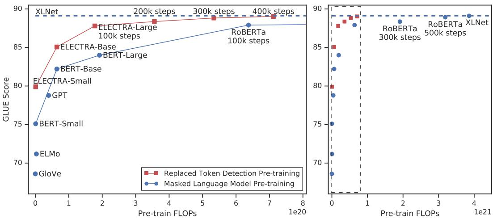
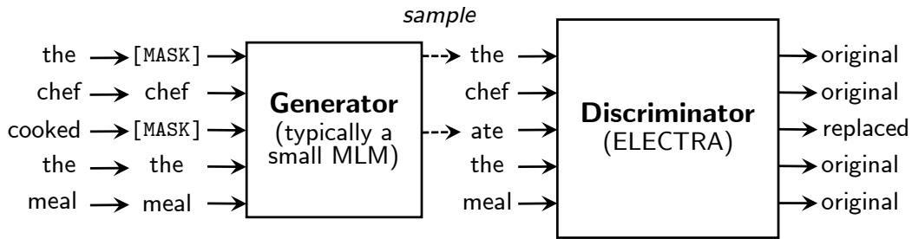
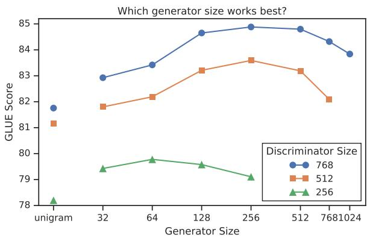
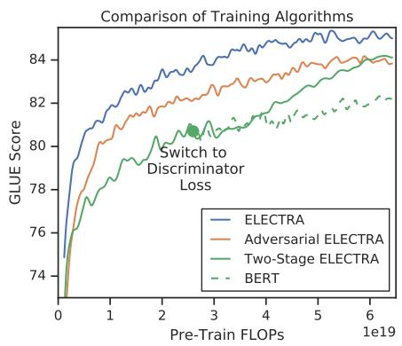
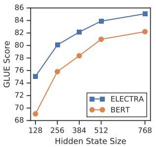
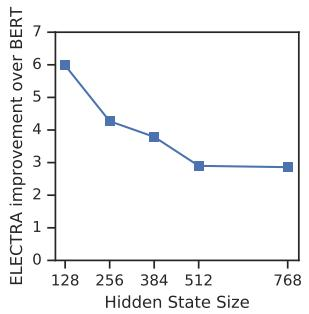
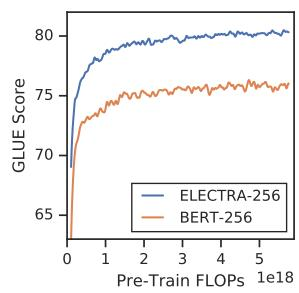

# ELECTRA：将文本编码器预训练为判别器而非生成器

Kevin Clark Stanford University kevclark@cs.stanford.edu

Minh-Thang Luong Google Brain thangluong@google.com

Quoc V. Le Google Brain qvl@google.com

Christopher D. Manning Stanford University & CIFAR Fellow manning@cs.stanford.edu

## 摘要

掩码语言建模（Masked language modeling, MLM）预训练方法（如 BERT）通过将部分词元（token）替换为 [MASK] 来损坏输入，然后训练模型以重构原始词元。虽然它们在迁移到下游 NLP 任务时取得了良好的效果，但通常需要大量的计算资源才能发挥作用。作为替代方案，我们提出了一种样本效率更高的预训练任务，称为替换词元检测（replaced token detection）。我们的方法不是对输入进行掩码，而是通过将某些词元替换为从小型生成器网络中采样出的合理替代项来损坏输入。然后，我们不再训练模型去预测受损词元的原始身份，而是训练一个判别模型，用于预测受损输入中的每个词元是否被生成器样本所替换。详尽的实验表明，这种新的预训练任务比 MLM 更高效，因为该任务是定义在所有输入词元上，而不仅仅是被掩码掉的一小部分子集上。因此，在相同的模型大小、数据和计算量下，我们的方法所学习到的上下文表示显著优于 BERT 所学习到的表示。这种提升对于小型模型尤为显著；例如，我们在单个 GPU 上训练 4 天的模型，在 GLUE 自然语言理解基准上的表现就超越了 GPT（其训练使用的计算量是前者的 30 倍）。我们的方法在扩展到大规模时同样表现良好，在使用的计算量不足 1/4 的情况下，达到了与 RoBERTa 和 XLNet 相当的性能，并在使用相同计算量时超越了它们。

## 1 引言

当前最先进的语言表示学习方法可以被视为学习去噪自编码器（Vincent et al., 2008）。它们选择未标记输入序列的一小部分子集（通常为 15%），掩码这些词元的身份（例如 BERT；Devlin et al. (2019)）或对这些词元的注意力（例如 XLNet；Yang et al. (2019)），然后训练网络以恢复原始输入。虽然由于学习了双向表示，这些掩码语言建模（MLM）方法比传统的语言模型预训练更有效，但它们会产生巨大的计算成本，因为网络在每个样本中仅从 15% 的词元中进行学习。

作为替代方案，我们提出了替换词元检测（replaced token detection），这是一种预训练任务，其中模型学习区分真实的输入词元（token）与看似合理但由合成生成的替换词元。与掩码（masking）不同，我们的方法通过用来自提议分布（proposal distribution）的样本替换某些词元来破坏输入，该提议分布通常是一个小型掩码语言模型（masked language model）的输出。这种破坏过程解决了 BERT 中存在的不匹配问题（尽管 XLNet 中不存在该问题），即网络在预训练期间会看到人工构造的 [MASK] 词元，但在下游任务微调时却看不到。然后，我们将网络预训练为一个判别器（discriminator），用于预测每个词元是原始词元还是替换词元。相比之下，MLM 将网络训练为一个生成器（generator），用于预测被破坏词元的原始身份。我们这种判别式任务的一个关键优势在于，模型可以从所有输入词元中学习，而不仅仅是从被掩码的一小部分子集中学习，从而具有更高的计算效率。尽管我们的方法让人联想到训练 GAN 的判别器，但由于将 GAN 应用于文本存在困难（Caccia et al., 2018），生成被破坏词元的生成器是使用最大似然估计进行训练的，因此我们的方法并不是对抗性的。

  
Figure 1: 在相同的计算预算下，替换词元检测预训练始终优于掩码语言模型预训练。左图为虚线框的放大视图。

我们将该方法命名为 ELECTRA1，代表“Efficiently Learning an Encoder that Classifies Token Replacements Accurately”（高效学习准确分类词元替换的编码器）。与先前的研究类似，我们将其应用于预训练 Transformer 文本编码器（Vaswani et al., 2017），这些编码器可以在下游任务上进行微调。通过一系列消融实验，我们证明了从所有输入位置进行学习使得 ELECTRA 的训练速度明显快于 BERT。我们还表明，在充分训练后，ELECTRA 在下游任务上取得了更高的准确率。

当前大多数预训练方法都需要大量的计算量才能起效，这引发了人们对其成本和可及性的担忧。由于使用更多的计算量进行预训练几乎总能带来更好的下游准确率，因此我们认为预训练方法的一个重要考量标准应当是计算效率以及绝对的下游性能。基于这一视角，我们训练了不同规模的 ELECTRA 模型，并评估了它们的下游性能与计算需求之间的关系。具体而言，我们在 GLUE 自然语言理解基准测试（Wang et al., 2019）和 SQuAD 问答基准测试（Rajpurkar et al., 2016）上进行了实验。在相同的模型大小、数据和计算量条件下，ELECTRA 的性能显著优于基于 MLM 的方法，例如 BERT 和 XLNet（见 Figure 1）。例如，我们构建了一个 ELECTRA-Small 模型，该模型可以在 1 块 GPU 上训练 4 天。2 ELECTRA-Small 在 GLUE 上的表现比同等小规模的 BERT 模型高出 5 个点，甚至超过了规模大得多的 GPT 模型（Radford et al., 2018）。我们的方法在大规模场景下也表现良好，我们训练的 ELECTRA-Large 模型性能与 RoBERTa（Liu et al., 2019）和 XLNet（Yang et al., 2019）相当，但参数量更少，且仅使用了 1/4 的训练计算量。进一步训练 ELECTRA-Large 得到了一个更强大的模型，它在 GLUE 上的表现超越了 ALBERT（Lan et al., 2019），并在 SQuAD 2.0 上创造了新的前沿水平（state-of-the-art）。综合来看，我们的结果表明，相比于现有的语言表征学习生成式方法，区分真实数据与具有挑战性的负样本这一判别式任务具有更高的计算效率和参数效率。

## 2 方法

我们首先描述被替换标记检测（replaced token detection）预训练任务；概览见 Figure 2。我们在第 3.2 节中针对该方法提出并评估了几项建模改进。

  
Figure 2: 被替换标记检测（replaced token detection）概述。生成器可以是任何能够产生标记（token）输出分布的模型，但我们通常使用一个与判别器联合训练的小型掩码语言模型（masked language model）。尽管模型的结构类似于 GAN，但由于将 GAN 应用于文本存在困难，我们使用极大似然法而非对抗方式来训练生成器。预训练完成后，我们舍弃生成器，仅在下游任务上微调判别器（即 ELECTRA 模型）。

我们的方法训练了两个神经网络：一个生成器（generator）$G$ 和一个判别器（discriminator）$D .$。每一个网络主要由一个编码器（例如 Transformer 网络）组成，该编码器将输入 token 序列 ${ \textbf { \em x } } =$ $[ x _ { 1 } , . . . , x _ { n } ]$ 映射为一个上下文向量表示序列 $h ( \bar { \pmb { x } } ) = [ h _ { 1 } , . . . , \bar { h } _ { n } ]$。对于给定的位置 t（在我们的情况下仅针对 $x _ { t } = \mathrm { [ M A S K ] } )$ 的位置），生成器通过 softmax 层输出生成特定 token $x _ { t }$ 的概率：

$$
p _ {G} (x _ {t} | \boldsymbol {x}) = \exp \left(e (x _ {t}) ^ {T} h _ {G} (\boldsymbol {x}) _ {t}\right) / \sum_ {x ^ {\prime}} \exp \left(e (x ^ {\prime}) ^ {T} h _ {G} (\boldsymbol {x}) _ {t}\right)
$$

其中 e 表示 token 嵌入。对于给定的位置 t，判别器通过 sigmoid 输出层预测该 token $x _ { t }$ 是否是 $\mathrm { \bf \ddot { r e a l } } , \mathrm { \bf \ddot { i } . e . }$（即来自数据本身而非生成器分布）：

$$
D (\boldsymbol {x}, t) = \operatorname{sigmoid} (w ^ {T} h _ {D} (\boldsymbol {x}) _ {t})
$$

生成器被训练用于执行掩码语言建模（Masked Language Modeling, MLM）。给定输入 ${ \textbf { \em x } } =$ $[ x _ { 1 } , x _ { 2 } , . . . , x _ { n } ]$，MLM 首先选择一组随机位置（1 到 n 之间的整数）进行掩码 $m = [ \widehat { m _ { 1 } } , . . . , m _ { k } ] . ^ { 3 }$。所选位置处的 token 会被替换为 [MASK] token：我们将其表示为 ${ \pmb x } ^ { \mathrm { m a s k e d } } = \mathrm { R E P L A C E } ( { \pmb x } , m$ , [MASK])。随后，生成器学习预测被掩码 token 的原始标识。判别器则被训练来区分数据中的原始 token 与被生成器样本替换掉的 token。更具体地说，我们通过将掩码位置的 token 替换为生成器采样出的 token 来构建一个损坏的样本 $\pmb { x } ^ { \mathrm { c o r r u p t } }$，并训练判别器预测 $\pmb { x } ^ { \mathrm { c o r r u p t } }$ 中的哪些 token 与原始输入 x 相匹配。形式化地，模型输入的构建方式如下

$$
\begin{array}{l l} m _ {i} \sim \text { unif } \{1, n \} \text { for } i = 1 \text { to } k & \quad \boldsymbol {x} ^ {\text { masked }} = \text { REPLACE } (\boldsymbol {x}, \boldsymbol {m}, [ \text { MASK } ]) \\ \hat {x} _ {i} \sim p _ {G} (x _ {i} | \boldsymbol {x} ^ {\text { masked }}) \text { for } i \in \boldsymbol {m} & \quad \boldsymbol {x} ^ {\text { corrupt }} = \text { REPLACE } (\boldsymbol {x}, \boldsymbol {m}, \hat {\boldsymbol {x}}) \end{array}
$$

损失函数为

$$
\begin{array}{l} \mathcal {L} _ {\mathrm{MLM}} (\boldsymbol {x}, \theta_ {G}) = \mathbb {E} \left(\sum_ {i \in \boldsymbol {m}} - \log p _ {G} (x _ {i} | \boldsymbol {x} ^ {\text { masked }})\right) \\ \mathcal {L} _ {\mathrm{Disc}} (\boldsymbol {x}, \theta_ {D}) = \mathbb {E} \left(\sum_ {t = 1} ^ {n} - \mathbb {1} (x _ {t} ^ {\text { corrupt }} = x _ {t}) \log D (\boldsymbol {x} ^ {\text { corrupt }}, t) - \mathbb {1} (x _ {t} ^ {\text { corrupt }} \neq x _ {t}) \log (1 - D (\boldsymbol {x} ^ {\text { corrupt }}, t))\right) \end{array}
$$

虽然与 GAN 的训练目标相似，但存在几个关键差异。首先，如果生成器恰好生成了正确的 token，该 token 会被视为“真实（real）”而不是 $0 \mathrm { f } \ ^ { \mathrm { 6 4 } } \mathrm { f a k e } ^ { \mathrm { 7 } } ;$；我们发现这种设定能够适度提升下游任务的表现。更重要的是，生成器采用极大似然进行训练，而不是通过对抗训练来欺骗判别器。对抗性地训练生成器极具挑战性，因为无法通过对生成器的采样过程进行反向传播。尽管我们曾尝试通过强化学习来训练生成器以规避这一问题（见附录 F），但其表现不如极大似然训练。最后，与典型的 GAN 不同，我们不向生成器提供噪声向量作为输入。

我们最小化联合损失

$$
\min _ {\theta_ {G}, \theta_ {D}} \sum_ {\boldsymbol {x} \in \mathcal {X}} \mathcal {L} _ {\mathrm{MLM}} (\boldsymbol {x}, \theta_ {G}) + \lambda \mathcal {L} _ {\mathrm{Disc}} (\boldsymbol {x}, \theta_ {D})
$$

该损失作用于海量原始文本语料库 X 之上。我们使用单个样本来近似损失中的期望。我们不会将判别器损失反向传播通过生成器（事实上，由于采样步骤的存在，我们也无法做到）。在预训练之后，我们舍弃生成器，并在下游任务上对判别器进行微调。

## 3 实验

## 3.1 实验设置

我们在通用语言理解评估（GLUE）基准（Wang et al., 2019）和斯坦福问答（SQuAD）数据集（Rajpurkar et al., 2016）上进行评估。GLUE 包含多种任务，涵盖文本蕴含（RTE 和 MNLI）、问答蕴含（QNLI）、复述（MRPC）、问题复述（QQP）、文本相似度（STS）、情感分析（SST）以及语言可接受度（CoLA）。有关 GLUE 任务的更多详细信息，请参见附录 C。我们的评估指标为：STS 采用斯皮尔曼相关系数（Spearman correlation），CoLA 采用马修斯相关系数（Matthews correlation），其他 GLUE 任务采用准确率；我们通常报告所有任务的平均分。对于 SQuAD，我们在 1.1 版本（模型选取回答问题的文本片段）和 2.0 版本（其中一些问题无法根据文章内容回答）上进行评估。我们使用精确匹配（Exact-Match, EM）和 F1 分数作为标准评估指标。在大多数实验中，我们在与 BERT 相同的数据上进行预训练，该数据集由来自 Wikipedia 和 BooksCorpus（Zhu et al., 2015）的 33 亿（3.3B）个 token 组成。然而，对于我们的 Large 模型，我们使用了 XLNet（Yang et al., 2019）所用的数据进行预训练，该数据通过纳入来自 ClueWeb（Callan et al., 2009）、CommonCrawl 和 Gigaword（Parker et al., 2011）的数据，将 BERT 数据集扩展到了 330 亿（33B）个 token。所有的预训练和评估均在英文数据上进行，不过我们认为未来将我们的方法应用于多语言数据将会很有意义。

我们的模型架构和大多数超参数与 BERT 相同。在 GLUE 上进行微调时，我们在 ELECTRA 之上添加了简单的线性分类器。对于 SQuAD，我们在 ELECTRA 之上添加了来自 XLNet 的问答模块，该模块比 BERT 的略微复杂，因为它联合预测起始和终止位置，而不是独立预测，并且针对 SQuAD 2.0 添加了“可回答性”分类器。我们的一些评估数据集规模较小，这意味着微调后模型的准确率会因随机种子的不同而产生很大波动。因此，对于每个结果，我们报告来自同一预训练检查点（checkpoint）的 10 次微调运行的中位数。除非另有说明，结果均在开发集（dev set）上测得。更多训练细节和超参数取值请参见附录。

## 3.2 模型扩展

我们通过提出并评估该模型的若干扩展来改进我们的方法。除非另有说明，这些实验均采用与 BERT-Base 相同的模型大小和训练数据。

权重共享（Weight Sharing）我们提出通过在生成器和判别器之间共享权重来提升预训练的效率。如果生成器和判别器的尺寸相同，则所有的 transformer 权重都可以绑定（tie）。然而，我们发现使用较小的生成器更为高效，在这种情况下，我们仅共享生成器和判别器的嵌入（包括 token 嵌入和位置嵌入）。此时，我们采用与判别器隐藏状态维度大小相同的嵌入。4 生成器的“输入”和“输出” token 嵌入始终如 BERT 中那样进行绑定。

我们在生成器与判别器尺寸相同的情况下比较了不同的权重绑定策略。我们将这些模型训练了 500k 步。GLUE 得分分别为：不进行权重绑定为 83.6，绑定 token 嵌入为 84.3，绑定所有权重为 84.4。我们推测 ELECTRA 从绑定的 token 嵌入中获益，是因为掩码语言模型（masked language modeling）在学习这些表征方面特别有效：判别器仅更新输入中存在或由生成器采样的 token，而生成器在词表上的 softmax 则会密集地更新所有 token 嵌入。另一方面，绑定所有编码器权重几乎没有带来提升，同时还会带来要求生成器和判别器必须尺寸相同的显著劣势。基于这些发现，我们在本文后续的实验中均使用绑定的嵌入。

  
Figure 3: 左图：不同生成器/判别器尺寸（隐藏单元数）下的 GLUE 得分。有趣的是，生成器小于判别器反而提升了效果。右图：不同训练算法的比较。由于我们的关注点在于效率，x 轴显示的是 FLOPs 而非训练步数（例如，ELECTRA 训练的步数少于 BERT，因为其计算量包含了生成器）。

更小的生成器 如果生成器和判别器大小相同，训练 ELECTRA 每步所需的计算量大约是仅使用掩码语言模型（masked language modeling）训练的两倍。我们建议使用较小的生成器来降低这一倍数。具体来说，我们在保持其他超参数不变的情况下，通过减小层维度（layer sizes）来使模型变小。我们还探索了使用一种极其简单的“一元语法（unigram）”生成器，该生成器根据训练语料库中的词频来采样伪造词元（fake tokens）。不同大小的生成器和判别器的 GLUE 分数显示在 Figure 3 左侧。所有模型均训练了 500k 步，这在计算量方面使较小的生成器处于劣势，因为它们每一步训练所需的计算量更少。尽管如此，我们发现当生成器的大小为判别器大小的 1/4 到 1/2 时，模型效果最好。我们推测，过于强大的生成器可能会给判别器带来过大的挑战，阻碍其有效学习。特别是，判别器可能不得不将其许多参数用于建模生成器，而不是实际的数据分布。本文后续的实验均针对给定的判别器大小采用所找到的最佳生成器大小。

训练算法 最后，我们探索了 ELECTRA 的其他训练算法，尽管这些算法最终并未提升效果。所提出的训练目标是联合训练生成器和判别器。我们尝试改为使用以下两阶段训练流程：

1. 仅使用 ${ \mathcal { L } } _ { \mathrm { M L M } }$ 训练生成器 n 步。

2. 用生成器的权重初始化判别器的权重。然后保持生成器的权重冻结，使用 $\mathcal { L } _ { \mathrm { D i s c } }$ 训练判别器 n 步。

请注意，该流程中的权重初始化要求生成器和判别器具有相同的大小。我们发现，如果没有权重初始化，判别器有时会完全无法学到除多数类（majority class）以外的任何内容，这可能是因为生成器的起步水平远超判别器。另一方面，联合训练自然地为判别器提供了一个课程学习（curriculum），生成器起初较弱，但在整个训练过程中逐渐变强。我们还探索了像 GAN 一样对抗性地训练生成器，使用强化学习（reinforcement learning）来处理从生成器中采样的离散操作。详见 Appendix F。

结果如 Figure 3 右侧所示。在两阶段训练过程中，从生成式目标切换到判别式目标后，下游任务的性能显著提升，但最终并未超过联合训练。尽管仍优于 BERT，我们发现对抗训练的性能不及极大似然训练。进一步分析表明，这一差距是由对抗训练存在的两个问题导致的。首先，对抗生成器在掩码语言建模（masked language modeling）方面的表现就是更差；它在掩码语言建模上的准确率仅达到 58%，而通过极大似然估计（MLE）训练的生成器准确率可达 65%。我们认为较差的准确率主要是由于强化学习在生成文本这一庞大的动作空间中工作时样本效率较低所致。其次，经过对抗训练的生成器会产生一个低熵的输出分布，其中大部分概率质量都集中在单个词元（token）上，这意味着生成器样本缺乏多样性。这两个问题在以往关于文本 GAN 的研究中均已被观察到（Caccia et al., 2018）。

<table><tr><td>模型</td><td>训练 / 推理 FLOPs</td><td>加速比</td><td>参数量</td><td>训练时间 + 硬件</td><td>GLUE</td></tr><tr><td>ELMo</td><td>3.3e18 / 2.6e10</td><td>19x / 1.2x</td><td>96M</td><td>3 块 GTX 1080 GPU 上 14 天</td><td>71.2</td></tr><tr><td>GPT</td><td>4.0e19 / 3.0e10</td><td>1.6x / 0.97x</td><td>117M</td><td>8 块 P6000 GPU 上 25 天</td><td>78.8</td></tr><tr><td>BERT-Small</td><td>1.4e18 / 3.7e9</td><td>45x / 8x</td><td>14M</td><td>1 块 V100 GPU 上 4 天</td><td>75.1</td></tr><tr><td>BERT-Base</td><td>6.4e19 / 2.9e10</td><td>1x / 1x</td><td>110M</td><td>16 个 TPUv3 上 4 天</td><td>82.2</td></tr><tr><td>ELECTRA-Small</td><td>1.4e18 / 3.7e9</td><td>45x / 8x</td><td>14M</td><td>1 块 V100 GPU 上 4 天</td><td>79.9</td></tr><tr><td>训练 50%</td><td>7.1e17 / 3.7e9</td><td>90x / 8x</td><td>14M</td><td>1 块 V100 GPU 上 2 天</td><td>79.0</td></tr><tr><td>训练 25%</td><td>3.6e17 / 3.7e9</td><td>181x / 8x</td><td>14M</td><td>1 块 V100 GPU 上 1 天</td><td>77.7</td></tr><tr><td>训练 12.5%</td><td>1.8e17 / 3.7e9</td><td>361x / 8x</td><td>14M</td><td>1 块 V100 GPU 上 12 小时</td><td>76.0</td></tr><tr><td>训练 6.25%</td><td>8.9e16 / 3.7e9</td><td>722x / 8x</td><td>14M</td><td>1 块 V100 GPU 上 6 小时</td><td>74.1</td></tr><tr><td>ELECTRA-Base</td><td>6.4e19 / 2.9e10</td><td>1x / 1x</td><td>110M</td><td>16 个 TPUv3 上 4 天</td><td>85.1</td></tr></table>

Table 1: 在 GLUE 开发集上小模型的比较。BERT-Small/Base 是我们的实现版本，并使用了与 ELECTRA-Small/Base 相同的超参数。推理 FLOPs 假设单个长度为 128 的输入。由于训练时间基于不同的硬件且有时代码未经优化，因此应辩证看待。ELECTRA 即使在单块 GPU 上训练也能表现良好，比同等的 BERT 模型高出 5 个 GLUE 分数点，甚至超过了规模大得多的 GPT 模型。

## 3.3 小型模型

鉴于本研究的目标之一是提高预训练的效率，我们开发了一个可以在单个 GPU 上快速训练的小型模型。从 BERT-Base 的超参数出发，我们缩短了序列长度（从 512 缩短至 128），减小了批次大小（从 256 减至 128），减小了模型的隐藏维度大小（从 768 减至 256），并使用了较小的词元嵌入（token embedding，从 768 减至 128）。为了进行公平比较，我们还使用相同的超参数训练了一个 BERT-Small 模型。我们将 BERT-Small 训练了 1.5M 步，因此它与训练了 1M 步的 ELECTRA-Small 使用了相同的训练 FLOPs。5 除了 BERT，我们还与两种基于语言建模且资源消耗较少的预训练方法进行了比较：ELMo (Peters et al., 2018) 和 GPT (Radford et al., 2018)。6 我们还展示了与 BERT-Base 相当的基础尺寸 ELECTRA 模型的结果。

结果如 Table 1 所示。更多结果请参见附录 D（Appendix D），包括使用更多计算量训练的更强的小型和基础尺寸模型。鉴于其模型尺寸，ELECTRA-Small 的表现非常出色，获得了比其他使用大量更多计算和参数的方法更高的 GLUE 分数。例如，它的得分比具有可比性的 BERT-Small 模型高出 5 分，甚至优于规模大得多的 GPT 模型。ELECTRA-Small 基本训练至收敛，即使训练时间更短（短至 6 小时）的模型仍能获得可观的性能。尽管从较大的预训练 Transformer 中蒸馏出的小型模型也可以取得不错的 GLUE 分数 (Sun et al., 2019b; Jiao et al., 2019)，但这些模型需要首先耗费大量的计算资源来预训练更大的教师模型。结果还展示了 ELECTRA 在中等尺寸下的实力；我们的基础尺寸 ELECTRA 模型大幅优于 BERT-Base，甚至优于 BERT-Large（其 GLUE 分数为 84.0）。我们希望 ELECTRA 凭借相对较少的计算量取得出色结果的能力，能够扩大在 NLP 中开发和应用预训练模型的可及性。

<table><tr><td>模型</td><td>训练 FLOPs</td><td>参数量</td><td>CoLA</td><td>SST</td><td>MRPC</td><td>STS</td><td>QQP</td><td>MNLI</td><td>QNLI</td><td>RTE</td><td>平均</td></tr><tr><td>BERT</td><td>1.9e20 (0.27x)</td><td>335M</td><td>60.6</td><td>93.2</td><td>88.0</td><td>90.0</td><td>91.3</td><td>86.6</td><td>92.3</td><td>70.4</td><td>84.0</td></tr><tr><td>RoBERTa-100K</td><td>6.4e20 (0.90x)</td><td>356M</td><td>66.1</td><td>95.6</td><td>91.4</td><td>92.2</td><td>92.0</td><td>89.3</td><td>94.0</td><td>82.7</td><td>87.9</td></tr><tr><td>RoBERTa-500K</td><td>3.2e21 (4.5x)</td><td>356M</td><td>68.0</td><td>96.4</td><td>90.9</td><td>92.1</td><td>92.2</td><td>90.2</td><td>94.7</td><td>86.6</td><td>88.9</td></tr><tr><td>XLNet</td><td>3.9e21 (5.4x)</td><td>360M</td><td>69.0</td><td>97.0</td><td>90.8</td><td>92.2</td><td>92.3</td><td>90.8</td><td>94.9</td><td>85.9</td><td>89.1</td></tr><tr><td>BERT（本文）</td><td>7.1e20 (1x)</td><td>335M</td><td>67.0</td><td>95.9</td><td>89.1</td><td>91.2</td><td>91.5</td><td>89.6</td><td>93.5</td><td>79.5</td><td>87.2</td></tr><tr><td>ELECTRA-400K</td><td>7.1e20 (1x)</td><td>335M</td><td>69.3</td><td>96.0</td><td>90.6</td><td>92.1</td><td>92.4</td><td>90.5</td><td>94.5</td><td>86.8</td><td>89.0</td></tr><tr><td>ELECTRA-1.75M</td><td>3.1e21 (4.4x)</td><td>335M</td><td>69.1</td><td>96.9</td><td>90.8</td><td>92.6</td><td>92.4</td><td>90.9</td><td>95.0</td><td>88.0</td><td>89.5</td></tr></table>

Table 2: 大型模型在 GLUE 开发集上的比较。展示了不同预训练步数下的 ELECTRA 和 RoBERTa，步数由破折号后的数字标明。在使用的预训练计算量不到 XLNet 和 RoBERTa 的 1/4 时，ELECTRA 的表现与它们相当；而在预训练计算量相当时，ELECTRA 则超越了它们。BERT 的开发集结果来自 Clark et al. (2019)。

<table><tr><td>模型</td><td>训练 FLOPs</td><td>CoLA</td><td>SST</td><td>MRPC</td><td>STS</td><td>QQP</td><td>MNLI</td><td>QNLI</td><td>RTE</td><td>WNLI</td><td>平均*</td><td>得分</td></tr><tr><td>BERT</td><td>1.9e20 (0.06x)</td><td>60.5</td><td>94.9</td><td>85.4</td><td>86.5</td><td>89.3</td><td>86.7</td><td>92.7</td><td>70.1</td><td>65.1</td><td>79.8</td><td>80.5</td></tr><tr><td>RoBERTa</td><td>3.2e21 (1.02x)</td><td>67.8</td><td>96.7</td><td>89.8</td><td>91.9</td><td>90.2</td><td>90.8</td><td>95.4</td><td>88.2</td><td>89.0</td><td>88.1</td><td>88.1</td></tr><tr><td>ALBERT</td><td>3.1e22 (10x)</td><td>69.1</td><td>97.1</td><td>91.2</td><td>92.0</td><td>90.5</td><td>91.3</td><td>-</td><td>89.2</td><td>91.8</td><td>89.0</td><td>-</td></tr><tr><td>XLNet</td><td>3.9e21 (1.26x)</td><td>70.2</td><td>97.1</td><td>90.5</td><td>92.6</td><td>90.4</td><td>90.9</td><td>-</td><td>88.5</td><td>92.5</td><td>89.1</td><td>-</td></tr><tr><td>ELECTRA</td><td>3.1e21 (1x)</td><td>71.7</td><td>97.1</td><td>90.7</td><td>92.5</td><td>90.8</td><td>91.3</td><td>95.8</td><td>89.8</td><td>92.5</td><td>89.5</td><td>89.4</td></tr></table>

Table 3：大型模型的 GLUE 测试集结果。本表中的模型结合了额外的技巧（例如模型集成）来提高分数（详见 Appendix B）。某些模型没有 QNLI 分数，因为它们将 QNLI 视为排序任务，而这最近已被 GLUE 基准所禁止。为了与这些模型进行对比，除了 GLUE 排行榜分数（Score）外，我们还报告了不包括 QNLI 的平均分数（Avg.\*）。“ELECTRA”和“RoBERTa”分别指代完全训练的 ELECTRA-1.75M 和 RoBERTa-500K 模型。

## 3.4 大型模型

我们训练了大型 ELECTRA 模型，以评估替换词元检测（replaced token detection）预训练任务在当前最先进预训练 Transformer 的大规模场景下的有效性。我们的 ELECTRA-Large 模型与 BERT-Large 规模相同，但训练时间要长得多。具体而言，我们训练了一个训练 400k 步的模型（ELECTRA-400K；大约为 RoBERTa 预训练计算量的 1/4）和一个训练 1.75M 步的模型（ELECTRA-1.75M；计算量与 RoBERTa 相当）。我们使用的 batch size 为 2048，并使用了 XLNet 的预训练数据。我们注意到，尽管 XLNet 的数据与用于训练 RoBERTa 的数据相似，但这种比较并不完全是对等的。作为基线，我们使用与 ELECTRA-400K 相同的超参数和训练时间训练了自己的 BERT-Large 模型。

GLUE 开发集上的结果如 Table 2 所示。ELECTRA-400K 的表现与 RoBERTa 和 XLNet 相当。然而，训练 ELECTRA-400K 所需的计算量不到训练 RoBERTa 和 XLNet 的 1/4，这表明 ELECTRA 在样本效率上的优势在大规模下依然成立。对 ELECTRA 进行更长时间的训练（ELECTRA-1.75M）所得到的模型在大多数 GLUE 任务上的得分均超过了它们，同时所需的预训练计算量仍然更少。令人惊讶的是，我们的基线 BERT 模型得分明显低于 RoBERTa-100K，这表明我们的模型可能会从更多的超参数调优或使用 RoBERTa 训练数据中受益。ELECTRA 的优势在 GLUE 测试集上也同样成立（参见 Table 3），尽管由于各模型采用了额外的技巧（参见 Appendix B），这些比较并非完全严格的同等条件对比。

SQuAD 上的结果如 Table 4 所示。与 GLUE 结果一致，在给定相同计算资源的情况下，ELECTRA 的得分优于基于掩码语言模型（masked-language-modeling）的方法。例如，ELECTRA-400K 的表现优于使用相近预训练计算量的 RoBERTa-100k 和我们的 BERT 基线。尽管 ELECTRA-400K 使用的计算量不到 RoBERTa-500K 的 1/4，但其表现与 RoBERTa-500K 相当。不出所料，对 ELECTRA 进行更长时间的训练可以进一步提升结果：ELECTRA-1.75M 在 SQuAD 2.0 基准测试中的得分高于先前的模型。ELECTRA-Base 也取得了优异的结果，其得分显著优于 BERT-Base 和 XLNet-Base，甚至在大多数指标上超越了 BERT-Large。ELECTRA 在 SQuAD 2.0 上的表现总体上优于在 SQuAD 1.1 上的表现。这可能是因为被替换标记检测（replaced token detection，模型在其中区分真实标记与合理的虚假标记）特别适合迁移到 SQuAD 2.0 的可回答性分类任务中（模型必须在其中区分可回答的问题与虚假的不可回答问题）。

<table><tr><td rowspan="2">模型</td><td rowspan="2">训练 FLOPs</td><td rowspan="2">参数量</td><td colspan="2">SQuAD 1.1 dev</td><td colspan="2">SQuAD 2.0 dev</td><td colspan="2">SQuAD 2.0 test</td></tr><tr><td>EM</td><td>F1</td><td>EM</td><td>F1</td><td>EM</td><td>F1</td></tr><tr><td>BERT-Base</td><td>6.4e19 (0.09x)</td><td>110M</td><td>80.8</td><td>88.5</td><td>-</td><td>-</td><td>-</td><td>-</td></tr><tr><td>BERT</td><td>1.9e20 (0.27x)</td><td>335M</td><td>84.1</td><td>90.9</td><td>79.0</td><td>81.8</td><td>80.0</td><td>83.0</td></tr><tr><td>SpanBERT</td><td>7.1e20 (1x)</td><td>335M</td><td>88.8</td><td>94.6</td><td>85.7</td><td>88.7</td><td>85.7</td><td>88.7</td></tr><tr><td>XLNet-Base</td><td>6.6e19 (0.09x)</td><td>117M</td><td>81.3</td><td>-</td><td>78.5</td><td>-</td><td>-</td><td>-</td></tr><tr><td>XLNet</td><td>3.9e21 (5.4x)</td><td>360M</td><td>89.7</td><td>95.1</td><td>87.9</td><td>90.6</td><td>87.9</td><td>90.7</td></tr><tr><td>RoBERTa-100K</td><td>6.4e20 (0.90x)</td><td>356M</td><td>-</td><td>94.0</td><td>-</td><td>87.7</td><td>-</td><td>-</td></tr><tr><td>RoBERTa-500K</td><td>3.2e21 (4.5x)</td><td>356M</td><td>88.9</td><td>94.6</td><td>86.5</td><td>89.4</td><td>86.8</td><td>89.8</td></tr><tr><td>ALBERT</td><td>3.1e22 (44x)</td><td>235M</td><td>89.3</td><td>94.8</td><td>87.4</td><td>90.2</td><td>88.1</td><td>90.9</td></tr><tr><td>BERT (ours)</td><td>7.1e20 (1x)</td><td>335M</td><td>88.0</td><td>93.7</td><td>84.7</td><td>87.5</td><td>-</td><td>-</td></tr><tr><td>ELECTRA-Base</td><td>6.4e19 (0.09x)</td><td>110M</td><td>84.5</td><td>90.8</td><td>80.5</td><td>83.3</td><td>-</td><td>-</td></tr><tr><td>ELECTRA-400K</td><td>7.1e20 (1x)</td><td>335M</td><td>88.7</td><td>94.2</td><td>86.9</td><td>89.6</td><td>-</td><td>-</td></tr><tr><td>ELECTRA-1.75M</td><td>3.1e21 (4.4x)</td><td>335M</td><td>89.7</td><td>94.9</td><td>88.0</td><td>90.6</td><td>88.7</td><td>91.4</td></tr></table>

Table 4: 非集成模型在 SQuAD 上的结果。

## 3.5 效率分析

我们曾指出，将训练目标仅设定在较小的一部分 token 子集上，会导致掩码语言建模（masked language modeling）效率低下。然而，这一推断并非完全显而易见。毕竟，即便模型仅预测少量的被掩码 token，它仍然接收了大量的输入 token。为了更好地理解 ELECTRA 带来的收益究竟源自何处，我们对比了一系列其他预训练目标，这些目标被设计为 BERT 与 ELECTRA 之间的一组“垫脚石”。

• ELECTRA 15%: 该模型与 ELECTRA 完全相同，区别在于判别器损失仅来自输入中被掩码的 15% 的 token。换句话说，判别器损失 $\mathcal { L } _ { \mathrm { D i s c } }$ 中的求和是针对 i ∈ m 进行的，而不是从 1 到 n。7

• Replace MLM: 该目标与掩码语言建模相同，区别在于并非用 [MASK] 替换被掩码的 token，而是用来自生成器模型的 token 进行替换。该目标用于测试 ELECTRA 的收益在多大程度上来自于解决了在预训练期间使模型接触 [MASK] token 而在微调时却不接触这一不一致性问题。

• All-Tokens MLM: 与 Replace MLM 类似，被掩码的 token 被替换为生成器采样的 token。此外，模型预测输入中所有 token 的具体内容，而不仅是被掩码的 token。我们发现，使用显式复制机制（copy mechanism）训练该模型可以提升效果，该机制通过 sigmoid 层为每个 token 输出一个复制概率 D。模型的输出分布为输入 token 赋予权重 D，加上 1 − D 乘以 MLM softmax 的输出。该模型本质上是 BERT 与 ELECTRA 的结合。需要注意的是，如果没有生成器替换，模型将轻而易举地学会为 [MASK] token 从词表中进行预测，并对其他 token 直接复制输入。

结果如 Table 5 所示。首先，我们发现 ELECTRA 极大地受益于在所有输入 token 上定义损失，而不仅是在一个子集上：ELECTRA 15% 的表现远逊于 ELECTRA。其次，我们发现 BERT 的性能因 [MASK] token 带来的预训练与微调不匹配（pre-train fine-tune mismatch）而略受影响，因为 Replace MLM 的表现略优于 BERT。我们注意到 BERT（包括我们的实现）已经包含了一个技巧来帮助缓解预训练/微调的不一致性：有 10% 的概率将被掩码 token 替换为随机 token，还有 10% 的概率保持不变。然而，我们的结果表明这些简单的启发式规则不足以完全解决这一问题。最后，我们发现 All-Tokens MLM——这一对所有 token 而非子集进行预测的生成模型——弥合了 BERT 与 ELECTRA 之间的大部分差距。总的来说，这些结果表明 ELECTRA 的很大一部分提升归因于从所有 token 中学习，较小的一部分提升归因于缓解了预训练与微调的不匹配。

<table><tr><td>模型</td><td>ELECTRA</td><td>All-Tokens MLM</td><td>Replace MLM</td><td>ELECTRA 15%</td><td>BERT</td></tr><tr><td>GLUE 得分</td><td>85.0</td><td>84.3</td><td>82.4</td><td>82.4</td><td>82.2</td></tr></table>

Table 5: 计算效率实验（详见正文）。

  
Figure 4: 左图与中图：不同模型规模下 BERT 和 ELECTRA 的对比。右图：小型 ELECTRA 模型的收敛下游准确率高于 BERT，表明其提升不仅仅源于更快的训练速度。

ELECTRA 相比于 All-Tokens MLM 的提升表明，ELECTRA 的优势不仅仅来自于更快的训练速度。我们通过比较不同模型规模下的 BERT 和 ELECTRA 对此进行了进一步研究（见 Figure 4 左图）。我们发现，随着模型变小，ELECTRA 带来的增益变得更大。小型模型经过了充分训练直至收敛（见 Figure 4 右图），这表明在充分训练的情况下，ELECTRA 能够取得比 BERT 更高的下游准确率。我们推测 ELECTRA 比 BERT 具有更高的参数效率，是因为它无需在每个位置对所有可能词元（token）的完整分布进行建模，但我们认为仍需要更多分析来完全解释 ELECTRA 的参数效率。

## 4 相关工作

用于 NLP 的自监督预训练（Self-Supervised Pre-training for NLP） 自监督学习已被用于学习词表征（Collobert et al., 2011; Pennington et al., 2014），并且最近通过语言建模等目标来学习词的上下文表征（Dai & Le, 2015; Peters et al., 2018; Howard & Ruder, 2018）。BERT（Devlin et al., 2019）在掩码语言建模任务上预训练了一个大型 Transformer（Vaswani et al., 2017）。目前已有许多对 BERT 的扩展。例如，MASS（Song et al., 2019）和 UniLM（Dong et al., 2019）通过添加自回归生成训练目标，将 BERT 扩展到生成任务。ERNIE（Sun et al., 2019a）和 SpanBERT（Joshi et al., 2019）掩蔽连续的 token 序列，以改进片段（span）表征。这一构想可能与 ELECTRA 形成互补；我们认为使 ELECTRA 的生成器具备自回归特性并添加“替换片段检测”任务将会很有趣。XLNet（Yang et al., 2019）不是掩蔽输入 token，而是掩蔽注意力权重，从而使输入序列以随机顺序自回归生成。然而，该方法与 BERT 存在相同的效率问题，因为 XLNet 也仅以这种方式生成 15% 的输入 token。与 ELECTRA 类似，XLNet 由于不需要 [MASK] token，可能缓解了 BERT 的预训练-微调不一致性问题，尽管这一点尚不完全明确，因为 XLNet 在预训练期间使用了两种注意力“流”（streams），但在微调时仅使用一种。最近，TinyBERT（Jiao et al., 2019）和 MobileBERT（Sun et al., 2019b）等模型表明，BERT 可以有效地被蒸馏为一个更小的模型。相比之下，我们更关注预训练速度而非推理速度，因此我们从零开始训练了 ELECTRA-Small。

生成对抗网络（Generative Adversarial Networks） GAN（Goodfellow et al., 2014）在生成高质量合成数据方面非常有效。Radford et al. (2016) 提出在下游任务中使用 GAN 的判别器，这与我们的方法类似。GAN 已被应用于文本数据（Yu et al., 2017; Zhang et al., 2017），尽管最先进的方法仍落后于标准的最大似然训练（Caccia et al., 2018; Tevet et al., 2018）。尽管我们没有使用对抗学习，但我们的生成器尤其让人联想到 MaskGAN（Fedus et al., 2018），后者训练生成器以填补从输入中删除的 token。

对比学习（Contrastive Learning） 广义而言，对比学习方法用于区分观测到的真实数据点与虚构的负样本。它们已被应用于包括文本（Smith & Eisner, 2005）、图像（Chopra et al., 2005）和视频（Wang & Gupta, 2015; Sermanet et al., 2017）在内的多种模态数据中。常见的方法包括学习相关数据点彼此相似的嵌入空间（Saunshi et al., 2019），或训练将真实数据点的排序置于负样本之上的模型（Collobert et al., 2011; Bordes et al., 2013）。ELECTRA 与噪声对比估计（Noise-Contrastive Estimation, NCE）（Gutmann & Hyvarinen, 2010）尤为相关，后者同样训练一个二分类器来区分真实和虚假的数据点。

Word2Vec（Mikolov et al., 2013）作为自然语言处理（NLP）最早的预训练方法之一，便使用了对比学习。事实上，ELECTRA 可以被视为带有负采样（Negative Sampling）的连续词袋模型（Continuous Bag-of-Words, CBOW）的大规模扩展版本。CBOW 同样在给定周围上下文的情况下预测输入 token，而负采样将该学习任务重新表述为一个二分类任务，即判断输入 token 是来自真实数据分布还是提议分布（proposal distribution）。然而，CBOW 使用的是词袋向量编码器而非 Transformer，并且采用基于一元词频（unigram token frequencies）的简单提议分布，而非经过学习得到的生成器。

## 5 结论

我们提出了替换 token 检测（replaced token detection），这是一种用于语言表征学习的新型自监督任务。其核心思想是训练一个文本编码器，用以区分输入 token 与由小型生成器网络产生的高质量负样本。与掩码语言建模（masked language modeling）相比，我们的预训练目标计算效率更高，并在下游任务上取得了更好的性能。即使在使用相对较少计算量的情况下，该方法依然表现出色，我们希望这将使算力资源较为有限的研究人员和从业人员能够更轻松地开发和应用预训练文本编码器。我们也希望未来更多关于 NLP 预训练的研究工作在关注绝对性能的同时，也能兼顾计算效率，并仿照我们的做法，在汇报评估指标的同时报告算力消耗与参数量。

## 致谢

我们感谢 Allen Nie、Prajit Ramachandran、CIFAR LMB 会议及 U. de Montreal 的与会听众，以及匿名审稿人提出的深刻意见和建议。我们感谢 Matt Peters 解答了我们关于 ELMo 的问题，感谢 Alec Radford 解答了关于 GPT 的问题，感谢 Naman Goyal 和 Myle Ott 解答了关于 RoBERTa 的问题，感谢 Zihang Dai 解答了关于 XLNet 的问题，感谢 Zhenzhong Lan 解答了关于 ALBERT 的问题，感谢 Danqi Chen 和 Mandar Joshi 解答了关于 SpanBERT 的问题。Kevin 获得了 Google PhD Fellowship 的资助。

## 参考文献

Antoine Bordes, Nicolas Usunier, Alberto Garc´ıa-Duran, Jason Weston, and Oksana Yakhnenko.´ Translating embeddings for modeling multi-relational data. In NeurIPS, 2013.

Avishek Joey Bose, Huan Ling, and Yanshuai Cao. Adversarial contrastive estimation. In ACL, 2018.

Massimo Caccia, Lucas Caccia, William Fedus, Hugo Larochelle, Joelle Pineau, and Laurent Charlin. Language GANs falling short. arXiv preprint arXiv:1811.02549, 2018.

Jamie Callan, Mark Hoy, Changkuk Yoo, and Le Zhao. Clueweb09 data set, 2009. URL https://lemurproject.org/clueweb09.php/.

Daniel M. Cer, Mona T. Diab, Eneko Agirre, Inigo Lopez-Gazpio, and Lucia Specia. Semeval-2017 task 1: Semantic textual similarity multilingual and crosslingual focused evaluation. In SemEval@ACL, 2017.

Sumit Chopra, Raia Hadsell, and Yann LeCun. Learning a similarity metric discriminatively, with application to face verification. CVPR, 2005.

Kevin Clark, Minh-Thang Luong, Urvashi Khandelwal, Christopher D. Manning, and Quoc V. Le. BAM! Born-again multi-task networks for natural language understanding. In ACL, 2019.

Ronan Collobert, Jason Weston, Leon Bottou, Michael Karlen, Koray Kavukcuoglu, and Pavel P. Kuksa. Natural language processing (almost) from scratch. JMLR, 2011.

Andrew M Dai and Quoc V Le. Semi-supervised sequence learning. In NeurIPS, 2015.

Jacob Devlin, Ming-Wei Chang, Kenton Lee, and Kristina Toutanova. BERT: Pre-training of deep bidirectional transformers for language understanding. In NAACL-HLT, 2019.

William B. Dolan and Chris Brockett. Automatically constructing a corpus of sentential paraphrases. In IWP@IJCNLP, 2005.

Li Dong, Nan Yang, Wenhui Wang, Furu Wei, Xiaodong Liu, Yu Wang, Jianfeng Gao, Ming Zhou, and Hsiao-Wuen Hon. Unified language model pre-training for natural language understanding and generation. In NeurIPS, 2019.

William Fedus, Ian J. Goodfellow, and Andrew M. Dai. MaskGAN: Better text generation via filling in the _______. In ICLR, 2018.

Danilo Giampiccolo, Bernardo Magnini, Ido Dagan, and William B. Dolan. The third pascal recognizing textual entailment challenge. In ACL-PASCAL@ACL, 2007.

Ian J. Goodfellow, Jean Pouget-Abadie, Mehdi Mirza, Bing Xu, David Warde-Farley, Sherjil Ozair, Aaron C. Courville, and Yoshua Bengio. Generative adversarial nets. In NeurIPS, 2014.

Michael Gutmann and Aapo Hyvarinen. Noise-contrastive estimation: A new estimation principle for unnormalized statistical models. In AISTATS, 2010.

Jeremy Howard and Sebastian Ruder. Universal language model fine-tuning for text classification. In ACL, 2018.

Shankar Iyer, Nikhil Dandekar, and Kornl Csernai. First Quora dataset release: Question pairs, 2017. URL https://data.quora.com/First-Quora-Dataset-Release-Question-Pairs.

Xiaoqi Jiao, Yichun Yin, Lifeng Shang, Xin Jiang, Xiao Chen, Linlin Li, Fang Wang, and Qun Liu. Tinybert: Distilling bert for natural language understanding. arXiv preprint arXiv:1909.10351, 2019.

Mandar Joshi, Danqi Chen, Yinhan Liu, Daniel S Weld, Luke Zettlemoyer, and Omer Levy. SpanBERT: Improving pre-training by representing and predicting spans. arXiv preprint arXiv:1907.10529, 2019.

Zhenzhong Lan, Mingda Chen, Sebastian Goodman, Kevin Gimpel, Piyush Sharma, and Radu Soricut. ALBERT: A lite bert for self-supervised learning of language representations. arXiv preprint arXiv:1909.11942, 2019.

Yinhan Liu, Myle Ott, Naman Goyal, Jingfei Du, Mandar Joshi, Danqi Chen, Omer Levy, Mike Lewis, Luke Zettlemoyer, and Veselin Stoyanov. RoBERTa: A robustly optimized BERT pretraining approach. arXiv preprint arXiv:1907.11692, 2019.

Tomas Mikolov, Kai Chen, Gregory S. Corrado, and Jeffrey Dean. Efficient estimation of word representations in vector space. In ICLR Workshop Papers, 2013.

Robert Parker, David Graff, Junbo Kong, Ke Chen, and Kazuaki Maeda. English gigaword, fifth edition. Technical report, Linguistic Data Consortium, Philadelphia, 2011.

Jeffrey Pennington, Richard Socher, and Christopher Manning. Glove: Global vectors for word representation. In EMNLP, 2014.

Matthew E Peters, Mark Neumann, Mohit Iyyer, Matt Gardner, Christopher Clark, Kenton Lee, and Luke Zettlemoyer. Deep contextualized word representations. In NAACL-HLT, 2018.

Jason Phang, Thibault Fevry, and Samuel R Bowman. Sentence encoders on STILTs: Supplementary training on intermediate labeled-data tasks. arXiv preprint arXiv:1811.01088, 2018.

Alec Radford, Luke Metz, and Soumith Chintala. Unsupervised representation learning with deep convolutional generative adversarial networks. In ICLR, 2016.

Alec Radford, Karthik Narasimhan, Tim Salimans, and Ilya Sutskever. Improving language understanding by generative pre-training. https://blog.openai.com/language-unsupervised, 2018.

Pranav Rajpurkar, Jian Zhang, Konstantin Lopyrev, and Percy S. Liang. Squad: 100, 000+ questions for machine comprehension of text. In EMNLP, 2016.

Nikunj Saunshi, Orestis Plevrakis, Sanjeev Arora, Mikhail Khodak, and Hrishikesh Khandeparkar. A theoretical analysis of contrastive unsupervised representation learning. In ICML, 2019.

Pierre Sermanet, Corey Lynch, Yevgen Chebotar, Jasmine Hsu, Eric Jang, Stefan Schaal, and Sergey Levine. Time-contrastive networks: Self-supervised learning from video. ICRA, 2017.

Noah A. Smith and Jason Eisner. Contrastive estimation: Training log-linear models on unlabeled data. In ACL, 2005.

Richard Socher, Alex Perelygin, Jean Wu, Jason Chuang, Christopher D. Manning, Andrew Y. Ng, and Christopher Potts. Recursive deep models for semantic compositionality over a sentiment treebank. In EMNLP, 2013.

Kaitao Song, Xu Tan, Tao Qin, Jianfeng Lu, and Tie-Yan Liu. MASS: Masked sequence to sequence pre-training for language generation. In ICML, 2019.

Yu Sun, Shuohuan Wang, Yukun Li, Shikun Feng, Xuyi Chen, Han Zhang, Xin Tian, Danxiang Zhu, Hao Tian, and Hua Wu. Ernie: Enhanced representation through knowledge integration. arXiv preprint arXiv:1904.09223, 2019a.

Zhiqing Sun, Hongkun Yu, Xiaodan Song, Renjie Liu, Yiming Yang, and Denny Zhou. Mobile-BERT: Task-agnostic compression of bert for resource limited devices, 2019b. URL https: //openreview.net/forum?id=SJxjVaNKwB.

Guy Tevet, Gavriel Habib, Vered Shwartz, and Jonathan Berant. Evaluating text gans as language models. In NAACL-HLT, 2018.

Ashish Vaswani, Noam Shazeer, Niki Parmar, Jakob Uszkoreit, Llion Jones, Aidan N. Gomez, Lukasz Kaiser, and Illia Polosukhin. Attention is all you need. In NeurIPS, 2017.

Pascal Vincent, Hugo Larochelle, Yoshua Bengio, and Pierre-Antoine Manzagol. Extracting and composing robust features with denoising autoencoders. In ICML, 2008.

Alex Wang, Amapreet Singh, Julian Michael, Felix Hill, Omer Levy, and Samuel R Bowman. GLUE: A multi-task benchmark and analysis platform for natural language understanding. In ICLR, 2019.

Xiaolong Wang and Abhinav Gupta. Unsupervised learning of visual representations using videos. ICCV, 2015.

Alex Warstadt, Amanpreet Singh, and Samuel R. Bowman. Neural network acceptability judgments. arXiv preprint arXiv:1805.12471, 2018.

Adina Williams, Nikita Nangia, and Samuel R. Bowman. A broad-coverage challenge corpus for sentence understanding through inference. In NAACL-HLT, 2018.

Ronald J. Williams. Simple statistical gradient-following algorithms for connectionist reinforcement learning. Machine Learning, 8(3-4):229–256, 1992.

Zhilin Yang, Zihang Dai, Yiming Yang, Jaime Carbonell, Ruslan Salakhutdinov, and Quoc V Le. XLNet: Generalized autoregressive pretraining for language understanding. In NeurIPS, 2019.

Lantao Yu, Weinan Zhang, Jun Wang, and Yingrui Yu. SeqGAN: Sequence generative adversarial nets with policy gradient. In AAAI, 2017.

Yizhe Zhang, Zhe Gan, Kai Fan, Zhi Chen, Ricardo Henao, Dinghan Shen, and Lawrence Carin. Adversarial feature matching for text generation. In ICML, 2017.

Yukun Zhu, Ryan Kiros, Richard S. Zemel, Ruslan Salakhutdinov, Raquel Urtasun, Antonio Torralba, and Sanja Fidler. Aligning books and movies: Towards story-like visual explanations by watching movies and reading books. ICCV, 2015.

## A 预训练细节

以下细节同时适用于我们的 ELECTRA 模型和 BERT 基线模型。我们大部分使用了与 BERT 相同的超参数。我们将损失函数中判别器目标的权重 λ 设为 50。8我们使用动态 token 掩码，在训练过程中即时（on-the-fly）决定被掩码的位置，而不是在预处理期间。此外，我们没有使用原始 BERT 论文中提出的下一句预测（next sentence prediction）目标，因为近期的研究表明它并不能提升得分（Yang et al., 2019; Liu et al., 2019）。对于我们的 ELECTRA-Large 模型，我们使用了更高的掩码比例（25% 而非 15%），因为我们注意到生成器在 15% 掩码比例下达到了很高的准确率，导致被替换的 token 非常少。我们在 [1e-4, 2e-4, 3e-4, 5e-4] 中为 Base 和 Small 模型搜索了最佳学习率，并在早期实验中从 [1, 10, 20, 50, 100] 中选择了 λ。除此之外，除了第 3.2 节中的实验之外，我们没有进行任何超参数调优。完整的超参数集列于 Table 6 中。

## B 微调细节

对于 Large 尺寸的模型，我们大部分沿用了 Clark et al. (2019) 的超参数。然而，在注意到 RoBERTa (Liu et al., 2019) 使用了更多的训练轮数（最多 10 轮而非 3 轮）后，我们为每个任务在 [10, 3] 中搜索了最佳训练轮数（train epochs）。对于 SQuAD，我们将训练轮数减少到 2，以与 BERT 和 RoBERTa 保持一致。对于 Base 尺寸的模型，我们在 [3e-5, 5e-5, 1e-4, 1.5e-4] 中搜索了学习率，并在 [0.9, 0.8, 0.7] 中搜索了逐层学习率衰减（layer-wise learning-rate decay），但其他超参数与 Large 模型相同。我们发现 Small 模型受益于更大的学习率，并在 [1e-4, 2e-4, 3e-4, 5e-3] 中搜索了最佳学习率。除了训练轮数外，我们对所有任务都使用了相同的超参数。相比之下，以往在 GLUE 上的研究（如 BERT、XLNet 和 RoBERTa）都会针对每个任务分别搜索最佳超参数。我们预计如果我们进行同样的额外超参数搜索，结果会有轻微提升。完整的超参数集列于 Table 7 中。

遵循 BERT 的做法，我们没有展示验证集结果中的 WNLI GLUE 任务结果，因为使用标准的微调分类器方法甚至很难击败多数类分类器。对于 GLUE 测试集结果，我们应用了包括 RoBERTa (Liu et al., 2019)、XLNet (Yang et al., 2019) 和 ALBERT (Lan et al., 2019) 在内的许多 GLUE 排行榜提交作品所采用的标准技巧。具体来说：

• 对于 RTE 和 STS，我们使用中间任务训练（intermediate task training）（Phang et al., 2018），从已在 MNLI 上微调过的 ELECTRA 检查点（checkpoint）开始。对于 RTE，我们发现将其与较低的学习率 2e-5 结合会有所帮助。

<table><tr><td>超参数</td><td>Small</td><td>Base</td><td>Large</td></tr><tr><td>层数</td><td>12</td><td>12</td><td>24</td></tr><tr><td>隐藏层大小</td><td>256</td><td>768</td><td>1024</td></tr><tr><td>FFN 内部隐藏层大小</td><td>1024</td><td>3072</td><td>4096</td></tr><tr><td>注意力头数</td><td>4</td><td>12</td><td>16</td></tr><tr><td>注意力头大小</td><td>64</td><td>64</td><td>64</td></tr><tr><td>嵌入大小</td><td>128</td><td>768</td><td>1024</td></tr><tr><td>生成器大小（隐藏层大小、FFN 大小和注意力头数的倍率）</td><td>1/4</td><td>1/3</td><td>1/4</td></tr><tr><td>掩码比例</td><td>15</td><td>15</td><td>25</td></tr><tr><td>学习率衰减</td><td>Linear</td><td>Linear</td><td>Linear</td></tr><tr><td>预热步数</td><td>10000</td><td>10000</td><td>10000</td></tr><tr><td>学习率</td><td>5e-4</td><td>2e-4</td><td>2e-4</td></tr><tr><td>Adam  $\epsilon$ </td><td>1e-6</td><td>1e-6</td><td>1e-6</td></tr><tr><td>Adam  $\beta_1$ </td><td>0.9</td><td>0.9</td><td>0.9</td></tr><tr><td>Adam  $\beta_2$ </td><td>0.999</td><td>0.999</td><td>0.999</td></tr><tr><td>注意力 Dropout</td><td>0.1</td><td>0.1</td><td>0.1</td></tr><tr><td>Dropout</td><td>0.1</td><td>0.1</td><td>0.1</td></tr><tr><td>权重衰减</td><td>0.01</td><td>0.01</td><td>0.01</td></tr><tr><td>批次大小</td><td>128</td><td>256</td><td>2048</td></tr><tr><td>训练步数 (BERT/ELECTRA)</td><td>1.45M/1M</td><td>1M/766K</td><td>464K/400K</td></tr></table>

Table 6: 预训练超参数。我们还训练了一个步数为 1.75M 的 ELECTRA-Large 模型（其他超参数完全相同）。

<table><tr><td>超参数</td><td>GLUE 取值</td></tr><tr><td>学习率</td><td>Small 为 3e-4，Base 为 1e-4，Large 为 5e-5</td></tr><tr><td>Adam ε</td><td>1e-6</td></tr><tr><td>Adam β1</td><td>0.9</td></tr><tr><td>Adam β2</td><td>0.999</td></tr><tr><td>逐层学习率衰减</td><td>Base/Small 为 0.8，Large 为 0.9</td></tr><tr><td>学习率衰减</td><td>Linear</td></tr><tr><td>预热比例</td><td>0.1</td></tr><tr><td>注意力 Dropout</td><td>0.1</td></tr><tr><td>Dropout</td><td>0.1</td></tr><tr><td>权重衰减</td><td>0</td></tr><tr><td>批次大小</td><td>32</td></tr><tr><td>训练轮数</td><td>RTE 和 STS 为 10，SQuAD 为 2，其他任务为 3</td></tr></table>

Table 7: 微调超参数

• 对于 WNLI，我们遵循 Liu et al. (2019) 中描述的技巧，使用规则提取代词的候选先行词，并训练模型为正确的先行词打出高分。然而，与 Liu et al. (2019) 不同的是，评分函数并非基于 MLM 概率。相反，我们微调 ELECTRA 的判别器，使其在正确的先行词替换代词时，为正确先行词的 token 分配高分。例如，若 Winograd 模式为“the trophy could not fit in the suitcase because it was too big（奖杯放不进手提箱，因为它太大了）”，我们训练判别器，使其在“the trophy could not fit in the suitcase because the trophy was too big”中为“trophy”打出高分，而在“the trophy could not fit in the suitcase because the suitcase was too big”中为“suitcase”打出低分。

• 对于每个任务，我们使用不同的随机种子微调 30 个模型（均从相同的预训练检查点初始化），并集成其中表现最好的 10 个模型。

尽管这些技巧确实提高了分数，但它们让进行清晰的科学比较变得更加困难，因为它们需要额外的工作来实现，消耗大量的计算资源，并且由于不同论文实现这些技巧的方式不同，导致结果难以进行公平比较（apples-to-apples）。因此，在表 8（Table 8）中，我们还报告了 ELECTRA-1.75M 仅使用开发集模型选择（10 个模型中取最优）这一技巧时的结果，这也是 BERT 用于报告结果时的设置。

对于我们的 SQuAD 2.0 测试集提交，我们从相同的预训练检查点微调了 20 个模型，并提交了在开发集上得分最高的那一个。

## C DETAILS ABOUT GLUE

我们在下方提供了关于 GLUE 基准任务的更多详细信息

• CoLA：语言可接受性语料库（Corpus of Linguistic Acceptability，Warstadt et al., 2018）。该任务旨在确定给定句子是否符合语法规则。数据集包含 8.5k 个来自语言学理论书籍和期刊文章的训练样本。

• SST：斯坦福情感树库（Stanford Sentiment Treebank，Socher et al., 2013）。该任务旨在判断句子的情感是积极的还是消极的。数据集包含 67k 个来自电影评论的训练样本。

• MRPC：微软研究院释义语料库（Microsoft Research Paraphrase Corpus，Dolan & Brockett, 2005）。该任务旨在预测两个句子在语义上是否等价。数据集包含 3.7k 个来自在线新闻源的训练样本。

• STS：语义文本相似度（Semantic Textual Similarity，Cer et al., 2017）。该任务旨在以 1-5 分的评分等级预测两个句子的语义相似程度。数据集包含 5.8k 个来自新闻标题、视频和图像描述以及自然语言推理数据的训练样本。

• QQP：Quora 问题对（Quora Question Pairs，Iyer et al., 2017）。该任务旨在确定一对问题在语义上是否等价。数据集包含 364k 个来自社区问答网站 Quora 的训练样本。

• MNLI：多领域自然语言推理（Multi-genre Natural Language Inference，Williams et al., 2018）。给定一个前提句和一个假设句，任务是预测前提是蕴含假设、与假设矛盾还是两者皆非。该数据集包含来自十个不同来源的 393k 个训练样本。

• QNLI：问答自然语言推理（Question Natural Language Inference）；基于 SQuAD 构建（Rajpurkar et al., 2016）。任务是预测上下文句子是否包含问句的答案。该数据集包含来自 Wikipedia 的 108k 个训练样本。

• RTE：文本蕴含识别（Recognizing Textual Entailment，Giampiccolo et al., 2007）。给定一个前提句和一个假设句，任务是预测前提是否蕴含假设。该数据集包含来自一系列年度文本蕴含挑战赛的 2.5k 个训练样本。

## D GLUE 上的进一步结果

我们在 Table 8 中报告了 ELECTRA-Base 和 ELECTRA-Small 在 GLUE 测试集上的结果。此外，我们通过在 XLNet 数据（而非 wikibooks）上训练基础规模（base-sized）和小规模（small-sized）模型更长时间（4e6 个训练步）来探索其性能极限；在表格中这些模型被称为 ELECTRA-Base++ 和 ELECTRA-Small++。对于 ELECTRA-Small++，我们还将序列长度增加到了 512；其余超参数与 Table 6 中列出的相同。最后，该表还包含了不使用 Appendix B 中所描述技巧的 ELECTRA-1.75M 的结果。与论文中的开发集结果一致，从平均分来看，ELECTRA-Base 优于 BERT-Large，而 ELECTRA-Small 优于 GPT。不出所料，++ 模型的表现更为优异。小模型的得分甚至接近于 TinyBERT（Jiao et al., 2019）和 MobileBERT（Sun et al., 2019b）。这些模型是通过复杂的蒸馏流程从 BERT-Base 中学习的。相比之下，我们的 ELECTRA 模型则是从头开始训练的。鉴于蒸馏 BERT 的成功，我们相信通过蒸馏 ELECTRA 有可能构建出更强大的小型预训练模型。ELECTRA 在 CoLA 上似乎特别有效。在 CoLA 中，目标是区分符合语言学规范的句子和不合语法的句子，这与 ELECTRA 识别伪造 token 的预训练任务非常契合，这或许解释了 ELECTRA 在该任务上的优势。

<table><tr><td>模型</td><td>训练 FLOPs</td><td>参数量</td><td>CoLA</td><td>SST</td><td>MRPC</td><td>STS</td><td>QQP</td><td>MNLI</td><td>QNLI</td><td>RTE</td><td>平均值</td></tr><tr><td>TinyBERT</td><td>6.4e19+ (45x+)</td><td>14.5M</td><td>51.1</td><td>93.1</td><td>82.6</td><td>83.7</td><td>89.1</td><td>84.6</td><td>90.4</td><td>70.0</td><td>80.6</td></tr><tr><td>MobileBERT</td><td>6.4e19+ (45x+)</td><td>25.3M</td><td>51.1</td><td>92.6</td><td>84.5</td><td>84.8</td><td>88.3</td><td>84.3</td><td>91.6</td><td>70.4</td><td>81.0</td></tr><tr><td>GPT</td><td>4.0e19 (29x)</td><td>117M</td><td>45.4</td><td>91.3</td><td>75.7</td><td>80.0</td><td>88.5</td><td>82.1</td><td>88.1</td><td>56.0</td><td>75.9</td></tr><tr><td>BERT-Base</td><td>6.4e19 (45x)</td><td>110M</td><td>52.1</td><td>93.5</td><td>84.8</td><td>85.8</td><td>89.2</td><td>84.6</td><td>90.5</td><td>66.4</td><td>80.9</td></tr><tr><td>BERT-Large</td><td>1.9e20 (135x)</td><td>335M</td><td>60.5</td><td>94.9</td><td>85.4</td><td>86.5</td><td>89.3</td><td>86.7</td><td>92.7</td><td>70.1</td><td>83.3</td></tr><tr><td>SpanBERT</td><td>7.1e20 (507x)</td><td>335M</td><td>64.3</td><td>94.8</td><td>87.9</td><td>89.9</td><td>89.5</td><td>87.7</td><td>94.3</td><td>79.0</td><td>85.9</td></tr><tr><td>ELECTRA-Small</td><td>1.4e18 (1x)</td><td>14M</td><td>54.6</td><td>89.1</td><td>83.7</td><td>80.3</td><td>88.0</td><td>79.7</td><td>87.7</td><td>60.8</td><td>78.0</td></tr><tr><td>ELECTRA-Small++</td><td>3.3e19 (18x)</td><td>14M</td><td>55.6</td><td>91.1</td><td>84.9</td><td>84.6</td><td>88.0</td><td>81.6</td><td>88.3</td><td>63.6</td><td>79.7</td></tr><tr><td>ELECTRA-Base</td><td>6.4e19 (45x)</td><td>110M</td><td>59.7</td><td>93.4</td><td>86.7</td><td>87.7</td><td>89.1</td><td>85.8</td><td>92.7</td><td>73.1</td><td>83.5</td></tr><tr><td>ELECTRA-Base++</td><td>3.3e20 (182x)</td><td>110M</td><td>64.6</td><td>96.0</td><td>88.1</td><td>90.2</td><td>89.5</td><td>88.5</td><td>93.1</td><td>75.2</td><td>85.7</td></tr><tr><td>ELECTRA-1.75M</td><td>3.1e21 (2200x)</td><td>330M</td><td>68.1</td><td>96.7</td><td>89.2</td><td>91.7</td><td>90.4</td><td>90.7</td><td>95.5</td><td>86.1</td><td>88.6</td></tr></table>

Table 8: 各模型在 GLUE 测试集上的结果。仅展示了采用单任务微调（无模型集成、无特定任务技巧等）的模型。

## E 计算 FLOPS

我们选择以浮点运算次数（FLOPs）来衡量计算量，因为该指标独立于具体硬件、底层优化等因素。然而，值得注意的是，在某些情况下忽略硬件细节是一个缺点，因为以硬件为中心的优化可能是模型设计的关键部分，例如 ALBERT（Lan et al., 2019）通过共享权重从而减少 TPU worker 之间的通信开销所获得的加速。我们使用了 TensorFlow 的 FLOPs 计算功能9，并通过手动计算核对了结果。我们做出了以下假设：

• “操作（operation）”是指数学运算，而非机器指令。例如，一个 exp 算作一次操作，如同加法一样，尽管在实践中 exp 可能会更慢。我们认为这一假设不会实质性地改变计算量估算，因为对于大多数模型而言，矩阵乘法在计算中占据主导地位。类似地，我们将矩阵乘法计为 $2 * m * n$ FLOPs，而不是像考虑融合乘加（fused multiply-add）运算时那样计为 m ∗ n。

• 反向传播所消耗的 FLOPs 与前向传播相同。这一假设并不完全准确（例如，对于 Softmax 交叉熵损失，反向传播更快），但重要的是，对于矩阵乘法而言，前向/反向传播的 FLOPs 确实是相同的，而这占据了大部分计算量。

• 我们假设采用“稠密（dense）”嵌入查找（即乘以一个 one-hot 向量）。在实践中，稀疏嵌入查找要比常数时间慢得多；在某些硬件加速器上，稠密操作实际上比稀疏查找更快。

## F 对抗训练（ADVERSARIAL TRAINING）

在此，我们详细介绍了尝试对生成器进行对抗训练而非使用极大似然估计的过程。具体而言，我们训练生成器 G 以最大化判别器损失 $\mathcal { L } _ { \mathrm { D i s c } }$ 。由于我们的判别器并不完全等同于 GAN（生成对抗网络）的判别器（参见第 2 节中的讨论），因此该方法实际上是对抗对比估计（Adversarial Contrastive Estimation，Bose et al., 2018）的一个实例，而非生成对抗训练（Generative Adversarial Training）。由于生成器存在离散采样，无法通过判别器反向传播来对抗训练生成器（例如在图像上训练 GAN 的做法），因此我们转而采用强化学习。

我们的生成器与大多数文本生成模型不同，因为它是非自回归的（non-autoregressive）：各个预测是独立进行的。换句话说，生成器并不是执行一系列动作（其中每个动作生成一个 token），而是采取单个宏大动作来同时生成所有 token，其中该动作的概率分解为每个 token 的生成器概率的乘积。为了处理这种极其庞大的动作空间，我们做出了以下简化假设：判别器的预测 $D ( { \boldsymbol x } ^ { \mathrm { c o r r u p t } } , t )$ 仅取决于 token $x _ { t }$ 以及未被替换的 token $\{ x _ { i } : i \notin m \}$，即它不依赖于其他生成的 token $\{ \hat { x } _ { i } : i \in m \land i \neq t \}$。这一假设是合理的，因为被替换的 token 数量相对较少，并且它在使用强化学习时极大地简化了信用分配（credit assignment）。在符号表示上，我们通过（在略微滥用符号的情况下）将判别器在给定掩码上下文 $\mathbf { \dot { \Phi } } _ { \mathbf { \Phi } } ^ { \mathrm { m a s k e d } } . \mathbf { \tilde { A } }$ 下预测生成的 token $\hat { x } _ { t }$ 是否等于原始 token $x _ { t }$ 记作 $D ( \hat { x } _ { t } | \pmb { x } ^ { \mathrm { m a s \breve { k } e d } } )$ 来体现这一假设。该假设的一个有用的推论是，未被替换 token 的判别器得分（对于 $t \not \in m$ 的 $( D ( x _ { t } | x ^ { \mathrm { m a s k e d } } )$）与 $p _ { G }$ 独立，因为我们假设它不依赖于任何被替换的 token。因此，在训练 $\overrightharpoon { G }$ 以最大化 $\dot { \mathcal { L } } _ { \mathrm { D i s c } } .$ 时，可以忽略这些 token。在训练期间，我们力求求解

$$
\begin{array}{c} \underset {\theta_ {G}} {\arg \max} \mathcal {L} _ {\text {Disc}} = \underset {\theta_ {G}} {\arg \max} \underset {\boldsymbol {x}, \boldsymbol {m}, \hat {\boldsymbol {x}}} {\mathbb {E}} \left(\sum_ {t = 1} ^ {n} - \mathbb {1} (x _ {t} ^ {\text {corrupt}} = x _ {t}) \log D (\boldsymbol {x} ^ {\text {corrupt}}, t) - \right. \\ \left. \mathbb {1} (x _ {t} ^ {\text {corrupt}} \neq x _ {t}) \log (1 - D (\boldsymbol {x} ^ {\text {corrupt}}, t))\right) \end{array}
$$

利用该简化假设，我们通过求解以下式子的 argmax 来近似上式：

$$
\begin{array}{l} \underset {\boldsymbol {x}, \boldsymbol {m}, \hat {\boldsymbol {x}}} {\mathbb {E}} \left(\sum_ {t \in \boldsymbol {m}} - \mathbb {1} (\hat {x} _ {t} = x _ {t}) \log D (\hat {x} | \boldsymbol {x} ^ {\text {masked}}) - \mathbb {1} (\hat {x} _ {t} \neq x _ {t}) \log (1 - D (\hat {x} | \boldsymbol {x} ^ {\text {masked}}))\right) \\ = \underset {\boldsymbol {x}, \boldsymbol {m}} {\mathbb {E}} \sum_ {t \in \boldsymbol {m}} \underset {\hat {x} _ {t} \sim p _ {G}} {\mathbb {E}} R (\hat {x} _ {t}, \boldsymbol {x}) \\ \text {where} R (\hat {x} _ {t}, \boldsymbol {x}) = \left\{ \begin{array}{l l} - \log D (\hat {x} _ {t} | \boldsymbol {x} ^ {\text {masked}}) & \text {if} \hat {x} _ {t} = x _ {t} \\ - \log (1 - D (\hat {x} _ {t} | \boldsymbol {x} ^ {\text {masked}})) & \text {otherwise} \end{array} \right. \end{array}
$$

简而言之，该简化假设使我们能够将损失分解到各个生成的 token 上。我们不能直接使用梯度上升来求解 arg ma $\boldsymbol { \zeta } _ { \boldsymbol { \theta } _ { G } }$，因为无法通过对 ${ \hat { x } }$ 的离散采样进行反向传播。相反，我们使用策略梯度强化学习（Williams, 1992）。具体而言，我们使用 REINFORCE 梯度

$$
\nabla_ {\theta_ {G}} \mathcal {L} _ {\mathrm{Disc}} \approx \underset {\boldsymbol {x}, \boldsymbol {m}} {\mathbb {E}} \sum_ {t \in \boldsymbol {m}} \underset {\hat {x} _ {t} \sim p _ {G}} {\mathbb {E}} \nabla_ {\theta_ {g}} \log p _ {G} (\hat {x} _ {t} | \boldsymbol {x} ^ {\mathrm{masked}}) [ R (\hat {x} _ {t}, \boldsymbol {x}) - b (\boldsymbol {x} ^ {\mathrm{masked}}, t) ]
$$

其中 $b$ 是一个可学习的基线（baseline），实现为 $b ( \pmb { x } ^ { \mathrm { m a s k e d } } , t ) ~ = ~ - \log \mathrm { s i g }$ moid $( w ^ { T } h _ { G } ( \pmb { x } ^ { \mathrm { m a s k e d } } ) _ { t } )$，这里 $h _ { G } ( \pmb { x } ^ { \mathrm { m a s k e d } } )$ 是生成器的 Transformer 编码器的输出。该基线使用交叉熵损失进行训练，以匹配对应位置的奖励。我们使用单个样本来近似期望，并通过梯度上升学习 $\theta _ { G }$。尽管没有收到关于哪些生成的 token 是正确的显式反馈，我们发现对抗训练仍然产生了一个相当准确的生成器（对于隐藏层大小为 256 的生成器，对抗训练的生成器在掩码语言建模上的准确率达到 58%，而相同大小的 MLE 生成器达到 65%）。然而，在下游任务中，使用该生成器相比于 MLE 训练的生成器并未带来提升（参见正文中的 Figure 3 右图）。

## G 将 ELECTRA 作为掩码语言模型进行评估

本节详细介绍了将 ELECTRA 作为掩码语言模型进行评估的一些初步实验。使用与正文略有不同的符号表示，给定由一个 token $x$ 被掩码的文本序列组成的上下文 $c$，判别器损失可以写为

$$
\mathcal {L} _ {\text {Disc}} = - \sum_ {x \in \text {vocab}} \left( \begin{array}{l l} (1 - p _ {\text {mask}}) p _ {\text {data}} (x | c) \log D (x, c) + & / / \text {unmasked token} \\ p _ {\text {mask}} p _ {\text {data}} (x | c) p _ {G} (x | c) \log D (x, c) + & / / \text {generator samples correct token} \\ p _ {\text {mask}} (1 - p _ {\text {data}} (x | c)) p _ {G} (x | c) \log (1 - D (x, c)) \end{array} \right)   / / \text {generator samples incorrect token}
$$

求该损失关于 $D$ 的临界点表明，对于固定的生成器，最优判别器为

$$
D (x, c) = p _ {\text { data }} (x | c) \left(a + p _ {G} (x | c)\right) / \left(a p _ {\text { data }} (x | c) + p _ {G} (x | c)\right)
$$

这意味着

$$
p _ {\mathrm{data}} (x | c) = D (x, c) p _ {G} (x | c) / (a (1 - D (x, c)) + p _ {G} (x | c))
$$

其中 $a ~ = ~ ( 1 ~ - ~ p _ { \mathrm { m a s k } } ) / p _ { \mathrm { m a s k } }$ 表示每个被掩码的 token 所对应的未掩码 token 数量。我们可以利用该表达式，通过选取 $\mathrm { a r g m a x } _ { x \in \mathrm { v o c a b } } D ( x , c ) p _ { G } ( x | c ) / ( a ( 1 - D ( x , c ) ) + p _ { G } ( x | c ) )$ 作为模型对给定上下文的预测，从而将 ELECTRA 作为掩码语言模型进行评估。在实践中，在整个词表上进行选取计算开销极大，因此我们改为在生成器预测的前 100 个结果中取 argmax。10 利用该方法，我们在 Wikipedia+BooksCorpus 数据集上比较了 ELECTRA-Base 与 BERT-Base。我们发现 BERT 在掩码语言建模方面的表现略优于 ELECTRA（准确率为 77.9% 对 75.5%）。关于最优判别器的假设显然远非正确，这有可能在该评估方案下损害了 ELECTRA 的准确率。然而，像 BERT 这样专门针对生成进行训练的模型在生成方面表现更佳，而像 ELECTRA 这样采用判别式目标函数的模型在判别式任务上微调效果更好，这或许并不令人感到意外。我们认为，在未来的工作中，对比 BERT 和 ELECTRA 的 MLM 预测可能是一种进一步揭示 ELECTRA 与 BERT 编码器之间差异的有趣途径。

## H 负面结果

我们简要描述在初步实验中看起来前景不佳的几个想法：

• 我们最初尝试通过策略性地掩码 token 来提高 BERT 的效率（例如，更频繁地掩码较罕见的 token，或者训练一个模型来猜测若哪些 token 被掩码，BERT 将难以预测）。相比常规 BERT，这仅带来了相当微弱的加速。

• 鉴于 ELECTRA 似乎能（在一定程度上）从较弱的生成器中获益（参见第 3.2 节），我们探索了提高生成器输出 softmax 的温度，或禁止生成器采样出正确的 token。但这两种方法均未改善结果。

• 我们尝试添加句子级的对比目标（sentence-level contrastive objective）。对于该任务，我们保持 20% 的输入句子不变，而不是使用生成器对其添加噪声。随后，我们在模型中添加了一个预测头，用于预测整个输入是否被损坏。令人惊讶的是，这反而略微降低了下游任务的得分。