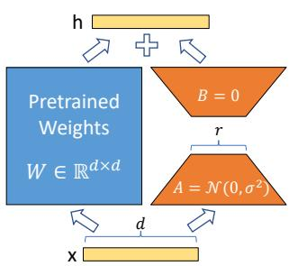
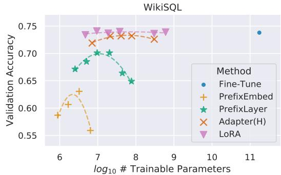
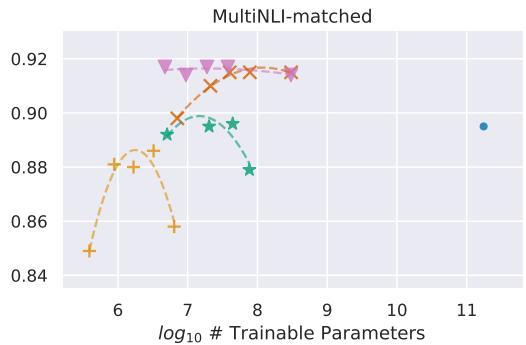
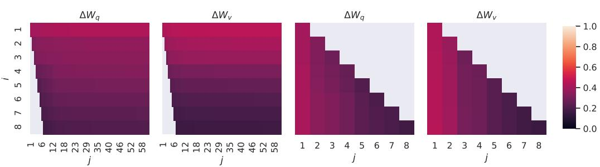
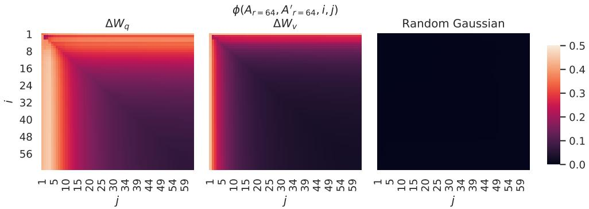
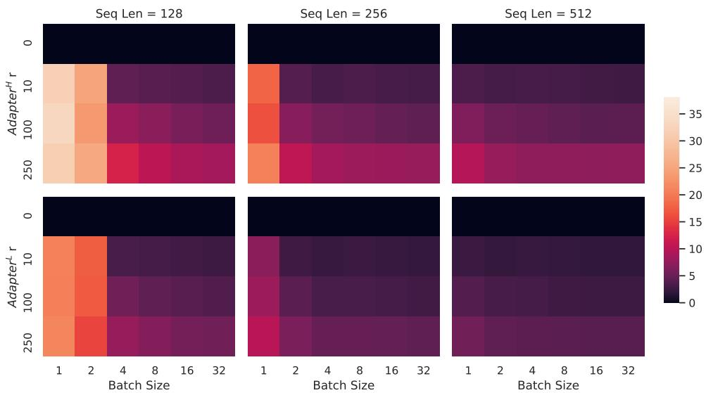
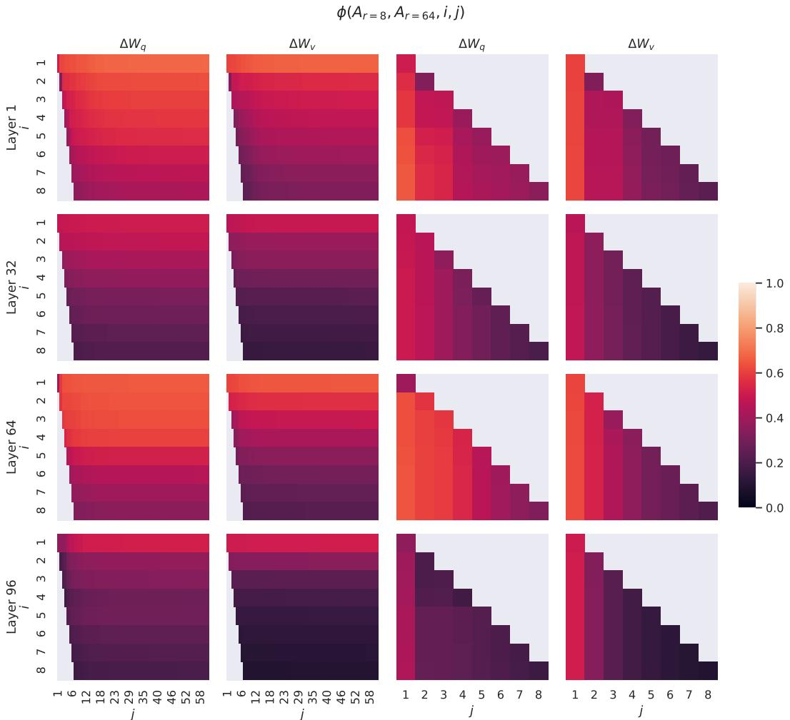
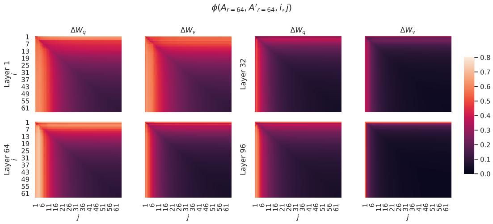
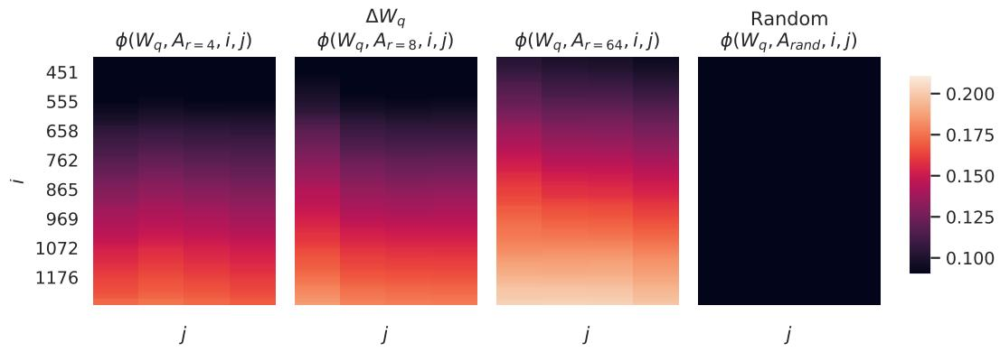

# LORA：大语言模型的低秩自适应（LORA: LOW-RANK ADAPTATION OF LARGE LAN-GUAGE MODELS）

Edward Hu∗ Yelong Shen∗ Phillip Wallis Zeyuan Allen-Zhu Yuanzhi Li Shean Wang Lu Wang Weizhu Chen

{edwardhu, yeshe, phwallis, zeyuana, yuanzhil, swang, luw, wzchen}@microsoft.com yuanzhil@andrew.cmu.edu (Version 2)

## 摘要

自然语言处理的一个重要范式是对通用领域数据进行大规模预训练，并针对特定任务或领域进行自适应。随着预训练模型规模的不断增大，重新训练所有模型参数的全量微调（full fine-tuning）变得越来越不可行。以 GPT-3 175B 为例——部署每个都包含 1750 亿参数的独立微调模型实例成本极其昂贵。我们提出了低秩自适应（Low-Rank Adaptation，简称 LoRA），它冻结预训练模型的权重，并将可训练的秩分解矩阵注入到 Transformer 架构的每一层中，从而大幅减少了下游任务的可训练参数量。与使用 Adam 微调的 GPT-3 175B 相比，LoRA 可以将可训练参数量减少 10,000 倍，并将 GPU 显存需求降低 3 倍。尽管可训练参数更少、训练吞吐量更高，且与适配器（adapters）不同，没有任何额外的推理延迟，LoRA 在 RoBERTa、DeBERTa、GPT-2 和 GPT-3 上的模型质量表现仍与微调相当甚至更好。我们还对语言模型自适应中的秩亏缺（rank-deficiency）进行了实证研究，这阐明了 LoRA 的有效性。我们发布了一个便于将 LoRA 与 PyTorch 模型集成的软件包，并在 https://github.com/microsoft/LoRA 提供了 RoBERTa、DeBERTa 和 GPT-2 的实现与模型检查点。

## 1 引言

自然语言处理中的许多应用都依赖于将一个大规模预训练语言模型适配到多个下游应用中。这种自适应通常通过微调（fine-tuning）来完成，即更新预训练模型的所有参数。微调的主要缺点在于新模型包含与原始模型同样多的参数。随着每隔几个月就会训练出更大的模型，这已经从对 GPT-2 (Radford et al., b) 或 RoBERTa large (Liu et al., 2019) 而言的单纯“不便”，演变为了对拥有 1750 亿可训练参数的 GPT-3 (Brown et al., 2020) 而言极其关键的部署挑战。1

许多研究试图通过仅微调部分参数或为新任务学习外部模块来缓解这一问题。这样一来，对于每个任务，除了预训练模型之外，我们只需要存储和加载少量的任务专属参数，从而显著提升了部署时的运行效率。然而，现有的技术往往通过增加模型深度引入了推理延迟（Houlsby et al., 2019; Rebuffi et al., 2017），或者减少了模型的可用序列长度（Li & Liang, 2021; Lester et al., 2021; Hambardzumyan et al., 2020; Liu et al., 2021）（第 3 节）。更重要的是，这些方法通常难以达到全参数微调基线的表现，在效率与模型质量之间形成了权衡。

  
Figure 1: 我们的重参数化方案。我们仅训练 A 和 B。

我们的灵感来自于 Li et al. (2018a) 以及 Aghajanyan et al. (2020)，它们表明学习得到的过参数化模型实际上存在于一个较低的内在维度上。我们假设模型自适应过程中的权重变化也具有较低的“内在秩”，从而提出了低秩自适应（Low-Rank Adaptation, LoRA）方法。如图 1 所示，LoRA 允许我们在保持预训练权重冻结的同时，通过优化稠密层在自适应过程中的秩分解矩阵，间接地训练神经网络中的某些稠密层。以 GPT-3 175B 为例，我们证明了即使全秩（即 Figure 1 中的 d）高达 12,288，极低的秩（即 Figure 1 中的 r 可以为 1 或 2）也已足够，这使得 LoRA 在存储和计算上都非常高效。

LoRA 具有几个关键优势：

• 一个预训练模型可以被共享，并用于为不同任务构建多个小型 LoRA 模块。我们可以冻结该共享模型，并通过替换 Figure 1 中的矩阵 A 和 B 来高效地切换任务，从而大幅降低存储需求和任务切换开销。

• 在使用自适应优化器时，LoRA 使得训练更加高效，并将硬件准入门槛降低了多达 3 倍，因为我们不需要为大多数参数计算梯度或维护优化器状态。相反，我们只需优化注入的、小得多的低秩矩阵。

• 我们简洁的线性设计允许我们在部署时将可训练矩阵与冻结权重合并，从构造上讲，与完全微调的模型相比不会引入任何推理延迟。

• LoRA 与许多先前的方法正交，并且可以与它们中的许多方法相结合，例如 prefix-tuning。我们在附录 E 中提供了一个示例。

术语与约定 我们频繁引用 Transformer 架构，并采用其维度的常规术语。我们将 Transformer 层的输入和输出维度大小记为 $d _ { m o d e l } .$。我们使用 $W _ { q } , \ W _ { k } , \ W _ { v } ,$ 和 $\bar { W } _ { o }$ 来指代自注意力（self-attention）模块中的查询/键/值/输出投影矩阵。$W$ 或 $W _ { 0 }$ 指代预训练权重矩阵，$\Delta W$ 指代其在自适应过程中的累积梯度更新。我们使用 r 表示 LoRA 模块的秩。我们遵循 (Vaswani et al., 2017; Brown et al., 2020) 设定的约定，使用 Adam (Loshchilov & Hutter, 2019; Kingma & Ba, 2017) 进行模型优化，并采用 Transformer MLP 前馈维度 $d _ { f f n } = 4 \times d _ { m o d e l }$。

## 2 问题陈述

虽然我们的方案与训练目标无关，但我们重点关注作为驱动用例的语言建模。以下是语言建模问题的简要描述，特别是给定任务特定提示（prompt）下条件概率的最大化。

假设给定一个由 Φ 参数化的预训练自回归语言模型 $P _ { \Phi } ( y | x )$。例如，$P _ { \Phi } ( y | x )$ 可以是基于 Transformer 架构 (Vaswani et al., 2017) 的通用多任务学习器，如 GPT (Radford et al., b; Brown et al., 2020)。考虑将此预训练模型适配到下游条件文本生成任务，如文本摘要（summarization）、机器阅读理解（MRC）和自然语言转 SQL（NL2SQL）。每个下游任务由一个上下文-目标对的训练数据集表示：$\mathcal { Z } = \{ ( x _ { i } , y _ { i } ) \} _ { i = 1 , \dots , N }$，其中 $x _ { i }$ 和 $y _ { i }$ 均为 token 序列。例如，在 $\mathrm { N L } 2 \mathrm { S Q L } , x _ { i }$ 中，$x _ { i }$ 是自然语言查询，$y _ { i }$ 是其对应的 SQL 命令；对于文本摘要，$x _ { i }$ 是一篇文章的内容，$y _ { i }$ 是其摘要。

在全量微调（full fine-tuning）期间，模型被初始化为预训练权重 $\Phi _ { 0 }$，并通过不断沿着梯度更新至 $\Phi _ { 0 } + \Delta \Phi$，以最大化条件语言建模目标：

$$
\max _ {\Phi} \sum_ {(x, y) \in \mathcal {Z}} \sum_ {t = 1} ^ {| y |} \log \left(P _ {\Phi} (y _ {t} | x, y _ {<   t})\right)\tag{1}
$$

全量微调的主要缺点之一是，对于每个下游任务，我们都会学习一组不同的参数 ∆Φ，其维度 $| \Delta \bar { \Phi | }$ 等于 $| \Phi _ { 0 } |$。因此，如果预训练模型很大（例如 $| \Phi _ { 0 } | \approx 1 7 5$ 亿的 GPT-3），存储和部署许多独立的微调模型实例即使可行，也会非常具有挑战性。

在本文中，我们采用了一种更具参数效率的方法，其中特定于任务的参数增量 $\Delta \Phi = \Delta \Phi ( \Theta )$ 由一个规模小得多的参数集 Θ 进一步编码，满足 $| \Theta | \ll | \Phi _ { 0 } |$。因此，寻找 $\Delta \Phi$ 的任务就转变为对 Θ 进行优化：

$$
\max _ {\Theta} \sum_ {(x, y) \in \mathcal {Z}} \sum_ {t = 1} ^ {| y |} \log \left(p _ {\Phi_ {0} + \Delta \Phi (\Theta)} (y _ {t} | x, y _ {<   t})\right)\tag{2}
$$

在接下来的章节中，我们提出使用一种在计算和显存上均十分高效的低秩表示来编码 ∆Φ。当预训练模型为 GPT-3 175B 时，可训练参数量 |Θ| 可以小至 $| \Phi _ { 0 } |$ 的 0.01%。

## 3 现有的解决方案还不够好吗？

我们着手解决的问题绝非全新。自迁移学习（transfer learning）诞生以来，已有数十项工作致力于使模型适配在参数和计算上更加高效。有关部分知名工作的综述，请参见 Section 6。以语言建模为例，在高效适配方面主要有两种策略：添加 Adapter 层（Houlsby et al., 2019; Rebuffi et al., 2017; Pfeiffer et al., 2021; Ruckl¨ e et al., 2020）或优化输入层激活值的某种形式（Li & Liang, 2021; Lester et al., 2021; Hambardzumyan et al., 2020; Liu et al., 2021）。然而，这两种策略都存在局限性，尤其是在大规模且对延迟敏感的生产场景中。

Adapter 层引入推理延迟 Adapter 有许多变体。我们重点关注 Houlsby et al. (2019) 的原始设计（每个 Transformer 块包含两个 Adapter 层）以及 Lin et al. (2020) 最近提出的一种设计（每个块仅包含一个 Adapter 层，但增加了一个 LayerNorm (Ba et al., 2016)）。尽管可以通过剪枝层或利用多任务设定来降低整体延迟（Ruckl¨ e et al., 2020; Pfeiffer et al., 2021），但没有直接的方法可以绕过 Adapter 层中的额外计算。这看似不成问题，因为 Adapter 层通过采用较小的瓶颈维度被设计为仅拥有极少量的参数（有时小于原始模型的 1%），从而限制了它们增加的 FLOPs。然而，大型神经网络依赖硬件并行性来保持低延迟，而 Adapter 层必须串行处理。这在批大小通常小至 1 的在线推理场景中会产生明显影响。在没有模型并行的通用场景中，例如在单张 GPU 上对 GPT-2 (Radford et al., b) medium 进行推理，即使瓶颈维度非常小，使用 Adapter 时我们也能观察到延迟的显著增加（Table 1）。

当我们需要像 Shoeybi et al. (2020); Lepikhin et al. (2020) 那样对模型进行分片（shard）时，这个问题会变得更加严重，因为除非我们多次冗余存储 Adapter 参数，否则增加的网络深度需要更多诸如 AllReduce 和 Broadcast 等同步 GPU 操作。

直接优化 Prompt 很困难（Directly Optimizing the Prompt is Hard） 另一个方向，以 prefix tuning (Li & Liang, 2021) 为代表，面临着不同的挑战。我们观察到 prefix tuning 难以优化，且其性能随可训练参数量的变化呈现非单调性，这印证了原论文中的类似观察。更根本的是，保留一部分序列长度用于适配必然会减少可用于处理下游任务的序列长度，我们怀疑这导致与其他方法相比，微调 prompt 的性能较差。我们将关于任务性能的研究推迟到第 5 节。

<table><tr><td>批大小（Batch Size） 序列长度（Sequence Length） $|\Theta|$ </td><td>32 512 0.5M</td><td>16 256 11M</td><td>1 128 11M</td></tr><tr><td>Fine-Tune/LoRA</td><td> $1449.4 \pm 0.8$ </td><td> $338.0 \pm 0.6$ </td><td> $19.8 \pm 2.7$ </td></tr><tr><td>Adapter $^{\text{L}}$ </td><td> $1482.0 \pm 1.0 (+2.2\%)$ </td><td> $354.8 \pm 0.5 (+5.0\%)$ </td><td> $23.9 \pm 2.1 (+20.7\%)$ </td></tr><tr><td>Adapter $^{\text{H}}$ </td><td> $1492.2 \pm 1.0 (+3.0\%)$ </td><td> $366.3 \pm 0.5 (+8.4\%)$ </td><td> $25.8 \pm 2.2 (+30.3\%)$ </td></tr></table>

Table 1: GPT-2 medium 单次前向传播的推理延迟（以毫秒为单位），取 100 次试验的平均值。我们使用了一张 NVIDIA Quadro RTX8000。“|Θ|”表示 Adapter 层中的可训练参数量。$\mathrm { A d a p t e r } ^ { \mathrm { L } }$ 和 $\mathrm { A d a p t e r } ^ { \mathrm { H } }$ 是 Adapter 微调的两种变体，我们在第 5.1 节中对其进行了描述。在在线、短序列长度的场景下，Adapter 层引入的推理延迟可能会非常显著。完整研究见附录 B（Appendix B）。

## 4 我们的方法

我们介绍了 LoRA 的简洁设计及其在实际应用中的优势。此处概述的原理适用于深度学习模型中的任何稠密层（dense layers），尽管在我们的实验中，作为切入用例，我们仅关注 Transformer 语言模型中的特定权重。

## 4.1 低秩参数化更新矩阵

神经网络包含许多执行矩阵乘法的密集层（dense layers）。这些层中的权重矩阵通常具有满秩。当适应特定任务时，Aghajanyan et al. (2020) 表明预训练语言模型具有较低的“内在维度”（intrinsic dimension），即使随机投影到较小的子空间中，仍能高效学习。受此启发，我们假设在自适应过程中，权重的更新也具有较低的“内在秩”（intrinsic rank）。对于预训练权重矩阵 $W _ { 0 } \in \mathbb { R } ^ { d \times k }$，我们通过用低秩分解 $W _ { 0 } + \Delta W = W _ { 0 } + B A$ 表示其更新来对其进行约束，其中 $\bar { \boldsymbol { B } } \in \mathbb { R } ^ { \bar { d } \times r } , \dot { \boldsymbol { A } } \in \mathbb { R } ^ { r \times \overline { { \boldsymbol { k } } } }$，且秩 $r \ll \operatorname* { m i n } ( d , k )$。在训练期间，$W _ { 0 }$ 被冻结且不接收梯度更新，而 A 和 B 包含可训练参数。注意，$W _ { 0 }$ 和 $\Delta W = B A$ 都与相同的输入相乘，它们各自的输出向量按坐标逐元素相加。对于 $h = W _ { 0 } x ,$，我们修改后的前向传播为：

$$
h = W _ {0} x + \Delta W x = W _ {0} x + B A x\tag{3}
$$

我们在 Figure 1 中说明了我们的重参数化方法。我们对 A 使用随机高斯初始化，对 B 使用零初始化，因此在训练开始时 $\Delta \bar { W _ { { \mathrm { ~ } = } } } B A$ 为零。然后我们将 ∆W x 缩放 $\frac { \alpha } { r }$，其中 α 是关于 r 的常数。当使用 Adam 进行优化时，如果我们适当地缩放初始化，调整 α 大致等同于调整学习率。因此，我们只需将 α 设置为我们尝试的第一个 r，而不对其进行调整。这种缩放有助于在改变 r 时减少重新调整超参数的需求 (Yang & Hu, 2021)。

全量微调的泛化。微调的一种更通用形式是允许训练预训练参数的一个子集。LoRA 则更进一步，在自适应过程中不要求权重矩阵的累积梯度更新具有满秩。这意味着，当对所有权重矩阵应用 LoRA 并训练所有偏置（biases）2时，通过将 LoRA 秩 r 设置为预训练权重矩阵的秩，我们大致可以恢复全量微调的表达能力。换句话说，随着我们增加可训练参数的数量3，训练 LoRA 大致会收敛于训练原始模型，而基于适配器（adapter）的方法则收敛于 MLP，基于前缀（prefix）的方法则收敛于无法接受长输入序列的模型。

无额外推理延迟。在生产环境中部署时，我们可以显式计算并存储 $W = W _ { 0 } + B A$，并照常进行推理。注意，$W _ { 0 }$ 和 $B \dot { A }$ 都在 $\mathbb { R } ^ { d \times k }$ 中。当我们需要切换到另一个下游任务时，我们可以通过减去 $BA$ 然后加上一个不同的 $B ^ { \prime } A ^ { \prime } ,$ 来恢复 $W _ { 0 }$，这是一个耗时极短且内存开销极小的操作。关键在于，基于这种构造，它保证了与微调模型相比，我们在推理期间不会引入任何额外的延迟。

## 4.2 将 LORA 应用于 TRANSFORMER

原则上，我们可以将 LoRA 应用于神经网络中权重矩阵的任意子集，以减少可训练参数的数量。在 Transformer 架构中，自注意力（self-attention）模块中有四个权重矩阵 $( W _ { q } , W _ { k } , W _ { v } , W _ { o } )$，MLP 模块中有两个。尽管输出维度通常会被切分为注意力头，我们仍将 $W _ { q } \left( \mathrm { o r } W _ { k } , W _ { v } \right)$ 视为维度为 $d _ { m o d e l } \times d _ { m o d e l }$ 的单个矩阵。出于简单性和参数效率的考虑，我们将研究限制为仅对下游任务适配注意力权重，并冻结 MLP 模块（因此它们在下游任务中不参与训练）。我们在第 7.1 节中进一步研究了在 Transformer 中适配不同类型的注意力权重矩阵的影响。我们将对适配 MLP 层、LayerNorm 层和偏置（biases）的实证研究留给未来的工作。

实际效益与局限性。最显著的效益来自于内存和存储占用的减少。对于使用 Adam 训练的大型 Transformer，如果 $2 / 3 \ \mathrm { i f } \ r \ll \ d _ { m o d e l }$，我们可以将显存（VRAM）占用降低多达 2/3，因为我们不需要为冻结的参数存储优化器状态。在 GPT-3 175B 上，我们将训练期间的显存消耗从 1.2TB 降低到了 350GB。在 $r = 4$ 且仅对 query 和 value 投影矩阵进行适配的情况下，检查点（checkpoint）大小减少了大约 10,000 倍（从 350GB 降至 35MB）4。这使我们能够使用显著更少的 GPU 进行训练，并避免 I/O 瓶颈。另一个好处是，在部署时我们可以以低得多的成本在不同任务之间切换，只需交换 LoRA 权重，而不需要更换所有参数。这使得在将预训练权重存储在显存中的机器上，可以创建许多定制化模型并进行实时快速换入换出。我们还观察到，与全量微调相比，在 GPT-3 175B 上的训练速度提升了 25%5，因为我们不需要为绝大多数参数计算梯度。

LoRA 也有其局限性。例如，如果选择将 $A$ 和 $B$ 合并到 $W$ 中以消除额外的推理延迟，那么在单次前向传播中对具有不同 $A$ 和 $B$ 的不同任务输入进行批处理（batch）就不是一件轻而易举的事。尽管在延迟不敏感的场景下，可以不合并权重，并为一个批次中的样本动态选择所使用的 LoRA 模块。

## 5 实证实验

在扩展到 GPT-3 175B (Brown et al., 2020) 之前，我们评估了 LoRA 在 RoBERTa (Liu et al., 2019)、De-BERTa (He et al., 2021) 和 GPT-2 (Radford et al., b) 上的下游任务性能。我们的实验涵盖了从自然语言理解（NLU）到自然语言生成（NLG）的广泛任务。具体而言，我们在 RoBERTa 和 DeBERTa 上针对 GLUE (Wang et al., 2019) 基准进行了评估。我们在 GPT-2 上遵循 Li & Liang (2021) 的设置以便进行直接对比，并在 GPT-3 上增加了 WikiSQL (Zhong et al., 2017)（自然语言到 SQL 查询）和 SAMSum (Gliwa et al., 2019)（对话摘要）的大规模实验。有关我们使用的数据集的更多细节，请参见附录 C。我们在所有实验中均使用 NVIDIA Tesla V100。

## 5.1 基线模型

为了广泛地与其他基线模型进行对比，我们复现了先前工作所采用的设置，并在可能的情况下直接复用其报告的数据。然而，这也意味着某些基线可能仅出现在特定的实验中。

微调（Fine-Tuning, FT）是一种常见的自适应方法。在微调过程中，模型使用预训练的权重和偏置进行初始化，且所有模型参数都接受梯度更新。一种简单的变体是仅更新部分层，同时冻结其他层。我们纳入了先前工作 (Li & Liang, 2021) 在 GPT-2 上报告的这样一种基线，该基线仅对最后两层进行自适应 $( \mathbf { F T } ^ { \mathbf { T o p 2 } } )$。

<table><tr><td>模型与方法</td><td>可训练参数量</td><td>MNLI</td><td>SST-2</td><td>MRPC</td><td>CoLA</td><td>QNLI</td><td>QQP</td><td>RTE</td><td>STS-B</td><td>平均值</td></tr><tr><td> $RoB_{base} (FT)^*$ </td><td>125.0M</td><td>87.6</td><td>94.8</td><td>90.2</td><td>63.6</td><td>92.8</td><td>91.9</td><td>78.7</td><td>91.2</td><td>86.4</td></tr><tr><td> $RoB_{base} (BitFit)^*$ </td><td>0.1M</td><td>84.7</td><td>93.7</td><td>92.7</td><td>62.0</td><td>91.8</td><td>84.0</td><td>81.5</td><td>90.8</td><td>85.2</td></tr><tr><td> $RoB_{base} (Adpt^D)^*$ </td><td>0.3M</td><td>87.1±.0</td><td>94.2±.1</td><td>88.5±1.1</td><td>60.8±.4</td><td>93.1±.1</td><td>90.2±.0</td><td>71.5±2.7</td><td>89.7±.3</td><td>84.4</td></tr><tr><td> $RoB_{base} (Adpt^D)^*$ </td><td>0.9M</td><td>87.3±.1</td><td>94.7±.3</td><td>88.4±.1</td><td>62.6±.9</td><td>93.0±.2</td><td>90.6±.0</td><td>75.9±2.2</td><td>90.3±.1</td><td>85.4</td></tr><tr><td> $RoB_{base} (LoRA)$ </td><td>0.3M</td><td>87.5±.3</td><td>95.1±.2</td><td>89.7±.7</td><td>63.4±1.2</td><td>93.3±.3</td><td>90.8±.1</td><td>86.6±.7</td><td>91.5±.2</td><td>87.2</td></tr><tr><td> $RoB_{large} (FT)^*$ </td><td>355.0M</td><td>90.2</td><td>96.4</td><td>90.9</td><td>68.0</td><td>94.7</td><td>92.2</td><td>86.6</td><td>92.4</td><td>88.9</td></tr><tr><td> $RoB_{large} (LoRA)$ </td><td>0.8M</td><td>90.6±.2</td><td>96.2±.5</td><td>90.9±1.2</td><td>68.2±1.9</td><td>94.9±.3</td><td>91.6±.1</td><td>87.4±2.5</td><td>92.6±.2</td><td>89.0</td></tr><tr><td> $RoB_{large} (Adpt^P)†$ </td><td>3.0M</td><td>90.2±.3</td><td>96.1±.3</td><td>90.2±.7</td><td>68.3±1.0</td><td>94.8±.2</td><td>91.9±.1</td><td>83.8±2.9</td><td>92.1±.7</td><td>88.4</td></tr><tr><td> $RoB_{large} (Adpt^P)†$ </td><td>0.8M</td><td>90.5±.3</td><td>96.6±.2</td><td>89.7±1.2</td><td>67.8±2.5</td><td>94.8±.3</td><td>91.7±.2</td><td>80.1±2.9</td><td>91.9±.4</td><td>87.9</td></tr><tr><td> $RoB_{large} (Adpt^H)†$ </td><td>6.0M</td><td>89.9±.5</td><td>96.2±.3</td><td>88.7±2.9</td><td>66.5±4.4</td><td>94.7±.2</td><td>92.1±.1</td><td>83.4±1.1</td><td>91.0±1.7</td><td>87.8</td></tr><tr><td> $RoB_{large} (Adpt^H)†$ </td><td>0.8M</td><td>90.3±.3</td><td>96.3±.5</td><td>87.7±1.7</td><td>66.3±2.0</td><td>94.7±.2</td><td>91.5±.1</td><td>72.9±2.9</td><td>91.5±.5</td><td>86.4</td></tr><tr><td> $RoB_{large} (LoRA)†$ </td><td>0.8M</td><td>90.6±.2</td><td>96.2±.5</td><td>90.2±1.0</td><td>68.2±1.9</td><td>94.8±.3</td><td>91.6±.2</td><td>85.2±1.1</td><td>92.3±.5</td><td>88.6</td></tr><tr><td> $DeB_{XXL} (FT)^*$ </td><td>1500.0M</td><td>91.8</td><td>97.2</td><td>92.0</td><td>72.0</td><td>96.0</td><td>92.7</td><td>93.9</td><td>92.9</td><td>91.1</td></tr><tr><td> $DeB_{XXL} (LoRA)$ </td><td>4.7M</td><td>91.9±.2</td><td>96.9±.2</td><td>92.6±.6</td><td>72.4±1.1</td><td>96.0±.1</td><td>92.9±.1</td><td>94.9±.4</td><td>93.0±.2</td><td>91.3</td></tr></table>

Table 2: 不同适配方法下的 ${ \mathrm { R o B E R T a } } _ { \mathrm { b a s e } } ,$ $\mathrm { R o B E R T a _ { l a r g e } , }$ 和 DeBERTa 在 GLUE 基准上的表现。我们报告了 MNLI 的总体（匹配和不匹配）准确率、CoLA 的 Matthew 相关系数、STS-B 的 Pearson 相关系数以及其他任务的准确率。所有指标均是数值越高越好。\* 表示先前工作中已发表的数值。† 表示为了进行公平比较，采用了与 Houlsby et al. (2019) 类似的实验设置。

仅偏置（Bias-only）或 BitFit 是一种基线方法，我们在冻结其他所有参数的同时仅训练偏置向量。同期，BitFit（Zaken et al., 2021）也对该基线进行了研究。

前缀嵌入微调（Prefix-embedding tuning，简称 PreEmbed）在输入词元（token）中插入特殊词元。这些特殊词元具有可训练的词嵌入，且通常不在模型的词表中。放置这些词元的位置可能会对性能产生影响。我们重点关注“前缀（prefixing）”（将此类词元置于提示（prompt）之前）和“中缀（infixing）”（将此类词元追加至提示之后）；这两种方法均在 Li & Liang (2021) 中有所讨论。我们用 $l _ { p }$（分别对应 $l _ { i }$）表示前缀（分别对应中缀）词元的数量。可训练参数的数量为 $| \Theta | = d _ { m o d e l } \times ( l _ { p } + l _ { i } )$。

前缀层微调（Prefix-layer tuning，简称 PreLayer）是前缀嵌入微调的扩展。我们不仅为某些特殊词元学习词嵌入（或等价地，嵌入层之后的激活值），还在每个 Transformer 层之后学习激活值。由前序层计算得到的激活值被简单地替换为可训练的激活值。最终的可训练参数数量为 $| \Theta | = \bar { L } \times d _ { m o d e l } \times \bar { ( l _ { p } + l _ { i } ) }$，其中 $L$ 是 Transformer 层的数量。

Houlsby et al. (2019) 提出的 Adapter 微调（Adapter tuning）在自注意力（self-attention）模块（以及 MLP 模块）与随后的残差连接之间插入 adapter 层。一个 adapter 层包含两个带有偏置的全连接层，中间夹有一个非线性激活函数。我们将这种原始设计称为 AdapterH。最近，Lin et al. (2020) 提出了一种更高效的设计，仅在 MLP 模块之后且在 LayerNorm 之后应用 adapter 层。我们称其为 $\mathbf { A d a p t e r } ^ { \mathbf { L } }$。这与 Pfeiffer et al. (2021) 提出的另一种设计非常相似，我们称之为 $\mathbf { A d a p t e r } ^ { \mathbf { P } }$。我们还纳入了另一个名为 AdapterDrop (Ruckl¨ e et al., 2020) 的基准，它丢弃了部分 adapter 层以实现更高的效率 $( \mathbf { A d a p t e r } ^ { \mathbf { D } } )$。只要可能，我们都会引用以往工作中的数值，以最大化我们与之比较的基准数量；这些数值位于第一列带有星号（\*）的行中。在所有情况下，均有 $| \Theta | = \hat { L } _ { A d p t } \times ( 2 \times d _ { m o d e l } \times r + r + d _ { m o d e l } ) + 2 \times \hat { L } _ { L N } \times d _ { m o d e l }$，其中 $\hat { L } _ { A d p t }$ 是 adapter 层的数量，$\hat { L } _ { L N }$ 是可训练 LayerNorm 的数量（例如在 $\mathrm { A d a p t e r } ^ { \mathrm { L } } )$ 中）。

LoRA 在现有权重矩阵旁并行添加可训练的秩分解矩阵对。如第 4.2 节所述，为简便起见，我们在大多数实验中仅将 LoRA 应用于 $W _ { q }$ 和 $\hat { W _ { v } }$。可训练参数的数量由秩 r 和原始权重的形状决定：$| \Theta | = 2 \times \hat { L } _ { L o R A } \times d _ { m o d e l } \times r .$，其中 $\hat { L } _ { L o R A }$ 是我们应用 LoRA 的权重矩阵的数量。

<table><tr><td rowspan="2">模型与方法</td><td rowspan="2"># 可训练参数量</td><td colspan="5">E2E NLG Challenge</td></tr><tr><td>BLEU</td><td>NIST</td><td>MET</td><td>ROUGE-L</td><td>CIDEr</td></tr><tr><td>GPT-2 M (FT)*</td><td>354.92M</td><td>68.2</td><td>8.62</td><td>46.2</td><td>71.0</td><td>2.47</td></tr><tr><td>GPT-2 M (Adapter $^L$ )*</td><td>0.37M</td><td>66.3</td><td>8.41</td><td>45.0</td><td>69.8</td><td>2.40</td></tr><tr><td>GPT-2 M (Adapter $^L$ )*</td><td>11.09M</td><td>68.9</td><td>8.71</td><td>46.1</td><td>71.3</td><td>2.47</td></tr><tr><td>GPT-2 M (Adapter $^H$ )</td><td>11.09M</td><td>67.3±.6</td><td>8.50±.07</td><td>46.0±.2</td><td>70.7±.2</td><td>2.44±.01</td></tr><tr><td>GPT-2 M (FT $^{Top2}$ )*</td><td>25.19M</td><td>68.1</td><td>8.59</td><td>46.0</td><td>70.8</td><td>2.41</td></tr><tr><td>GPT-2 M (PreLayer)*</td><td>0.35M</td><td>69.7</td><td>8.81</td><td>46.1</td><td>71.4</td><td>2.49</td></tr><tr><td>GPT-2 M (LoRA)</td><td>0.35M</td><td>70.4±.1</td><td>8.85±.02</td><td>46.8±.2</td><td>71.8±.1</td><td>2.53±.02</td></tr><tr><td>GPT-2 L (FT)*</td><td>774.03M</td><td>68.5</td><td>8.78</td><td>46.0</td><td>69.9</td><td>2.45</td></tr><tr><td>GPT-2 L (Adapter $^L$ )</td><td>0.88M</td><td>69.1±.1</td><td>8.68±.03</td><td>46.3±.0</td><td>71.4±.2</td><td>2.49±.0</td></tr><tr><td>GPT-2 L (Adapter $^L$ )</td><td>23.00M</td><td>68.9±.3</td><td>8.70±.04</td><td>46.1±.1</td><td>71.3±.2</td><td>2.45±.02</td></tr><tr><td>GPT-2 L (PreLayer)*</td><td>0.77M</td><td>70.3</td><td>8.85</td><td>46.2</td><td>71.7</td><td>2.47</td></tr><tr><td>GPT-2 L (LoRA)</td><td>0.77M</td><td>70.4±.1</td><td>8.89±.02</td><td>46.8±.2</td><td>72.0±.2</td><td>2.47±.02</td></tr></table>

Table 3: 在 E2E NLG Challenge 上采用不同自适应方法的 GPT-2 中型（M）和大型（L）模型。对于所有指标，数值越高越好。LoRA 在具有相当或更少可训练参数的情况下优于多个基线方法。置信区间展示了我们运行的实验结果。\* 表示先前提出的工作中发表的数据。

## 5.2 ROBERTA BASE/LARGE

RoBERTa（Liu et al., 2019）优化了 BERT（Devlin et al., 2019a）最初提出的预训练方案，并在不引入更多可训练参数的情况下提升了后者的任务表现。尽管近年来在诸如 GLUE 基准（Wang et al., 2019）等 NLP 排行榜上，RoBERTa 已被大得多的模型所超越，但就其模型规模而言，它在从业者中仍然是一个具有竞争力且广受欢迎的预训练模型。我们从 HuggingFace Transformers 库（Wolf et al., 2020）中获取预训练的 RoBERTa base（125M）和 RoBERTa large（355M），并在 GLUE 基准的任务上评估不同高效自适应方法的表现。我们还根据 Houlsby et al. (2019) 和 Pfeiffer et al. (2021) 的设置对其进行了复现。为了确保公平比较，在与 adapter 进行对比时，我们对评估 LoRA 的方式做出了两项关键改动。首先，我们在所有任务中使用相同的批次大小（batch size），并使用 128 的序列长度以匹配 adapter 基线。其次，对于 MRPC、RTE 和 STS-B，我们将模型初始化为预训练模型，而不是像微调基线那样使用已经在 MNLI 上适配过的模型。遵循 Houlsby et al. (2019) 这一更严格设置的运行均标记为 †。结果展示在 Table 2（前三个部分）中。所用超参数的详细信息请参见 Section D.1。

## 5.3 DEBERTA XXL

DeBERTa（He et al., 2021）是 BERT 的一个较新的变体，它在更大规模的数据上进行了训练，并在 GLUE（Wang et al., 2019）和 SuperGLUE（Wang et al., 2020）等基准上表现出极强的竞争力。我们评估了 LoRA 是否仍能在 GLUE 上达到完全微调的 DeBERTa XXL（1.5B）的性能。结果展示在 Table 2（底部部分）中。所用超参数的详细信息请参见 Section D.2。

## 5.4 GPT-2 MEDIUM/LARGE

在证明了 LoRA 在 NLU（自然语言理解）上可以成为完全微调的一个有竞争力的替代方案后，我们希望探究 LoRA 在 NLG（自然语言生成）模型（如 GPT-2 medium 和 large，Radford et al., b）上是否仍然具有优势。为了进行直接比较，我们使我们的设置尽可能接近 Li & Liang (2021)。由于篇幅限制，我们在本节中仅展示了在 E2E NLG Challenge（Table 3）上的结果。有关 WebNLG（Gardent et al., 2017）和 DART（Nan et al., 2020）的结果请参见 Section F.1。我们在 Section D.3 中列出了所使用的超参数列表。

<table><tr><td>模型与方法</td><td>可训练参数量</td><td>WikiSQL 准确率 (%)</td><td>MNLI-m 准确率 (%)</td><td>SAMSum R1/R2/RL</td></tr><tr><td>GPT-3 (FT)</td><td>175,255.8M</td><td>73.8</td><td>89.5</td><td>52.0/28.0/44.5</td></tr><tr><td>GPT-3 (BitFit)</td><td>14.2M</td><td>71.3</td><td>91.0</td><td>51.3/27.4/43.5</td></tr><tr><td>GPT-3 (PreEmbed)</td><td>3.2M</td><td>63.1</td><td>88.6</td><td>48.3/24.2/40.5</td></tr><tr><td>GPT-3 (PreLayer)</td><td>20.2M</td><td>70.1</td><td>89.5</td><td>50.8/27.3/43.5</td></tr><tr><td>GPT-3 (Adapter $^{\text{H}}$ )</td><td>7.1M</td><td>71.9</td><td>89.8</td><td>53.0/28.9/44.8</td></tr><tr><td>GPT-3 (Adapter $^{\text{H}}$ )</td><td>40.1M</td><td>73.2</td><td>91.5</td><td>53.2/29.0/45.1</td></tr><tr><td>GPT-3 (LoRA)</td><td>4.7M</td><td>73.4</td><td>91.7</td><td>53.8/29.8/45.9</td></tr><tr><td>GPT-3 (LoRA)</td><td>37.7M</td><td>74.0</td><td>91.6</td><td>53.4/29.2/45.1</td></tr></table>

Table 4：不同适配方法在 GPT-3 175B 上的表现。我们报告了 WikiSQL 上的逻辑形式验证准确率、MultiNLI-matched 上的验证准确率，以及 SAMSum 上的 Rouge-1/2/L。LoRA 的表现优于以往的方法，包括全量微调。WikiSQL 上的结果波动约为 ±0.5%，MNLI-m 约为 ±0.1%，SAMSum 的三个指标波动分别约为 $\pm 0 . 2 / \pm 0 . 2 / \pm 0 . 1$。

## 5.5 扩展至 GPT-3 175B

作为 LoRA 的最终压力测试，我们将其扩展到具有 1750 亿参数的 GPT-3。由于训练成本高昂，我们仅报告给定任务在随机种子下的典型标准差，而不是为每个条目都提供标准差。有关所用超参数的详细信息，请参见 D.4 节。

如 Table 4 所示，LoRA 在所有三个数据集上都达到或超过了微调基线。注意，并非所有方法都能从拥有更多可训练参数中单调获益，如图 Figure 2 所示。我们观察到，当前缀嵌入调优（prefix-embedding tuning）使用超过 256 个特殊词元（token），或前缀层调优（prefix-layer tuning）使用超过 32 个特殊词元时，性能会出现显著下降。这印证了 Li & Liang (2021) 中的类似观察。尽管对这一现象的深入研究超出了本研究的范围，但我们推测，拥有更多的特殊词元会导致输入分布与预训练数据分布的偏差进一步扩大。另外，我们在 F.3 节中研究了不同适配方法在低数据机制下的表现。

  
Figure 2：在 WikiSQL 和 MNLI-matched 上，几种适配方法的 GPT-3 175B 验证准确率与可训练参数量的关系。LoRA 表现出更好的可扩展性和任务性能。有关绘制数据点的更多详细信息，请参见 F.2 节。

## 6 相关工作

Transformer 语言模型。Transformer（Vaswani et al., 2017）是一种大量使用自注意力机制（self-attention）的序列到序列（sequence-to-sequence）架构。Radford et al. (a) 通过使用堆叠的 Transformer 解码器将其应用于自回归语言建模。自此，基于 Transformer 的语言模型主导了 NLP 领域，在许多任务中取得了最先进的水平（SOTA）。随着 BERT（Devlin et al., 2019b）和 GPT-2（Radford et al., b）的出现，一种新的范式诞生了——两者都是在海量文本上训练的大型 Transformer 语言模型——其中，在通用领域数据上进行预训练后再在特定任务数据上进行微调，相比于直接在特定任务数据上训练能够带来显著的性能提升。训练更大的 Transformer 通常会带来更好的性能，并且这仍然是一个活跃的研究方向。GPT-3（Brown et al., 2020）是迄今为止训练的最大的单个 Transformer 语言模型，拥有 175B（1750亿）参数。

提示工程与微调。虽然 GPT-3 175B 仅需少量额外的训练样本就能调整其行为，但其结果在很大程度上取决于输入的提示词（prompt）（Brown et al., 2020）。这催生了一种撰写和格式化提示词的经验性艺术，以最大化模型在目标任务上的性能，这被称为提示工程（prompt engineering）或提示破解（prompt hacking）。微调则是在特定任务上重新训练在通用领域预训练的模型 Devlin et al. (2019b); Radford et al. (a)。其变体包括仅学习参数的一个子集 Devlin et al. (2019b); Collobert & Weston (2008)，然而从业者通常会重新训练所有参数以最大化下游任务的性能。然而，GPT-3 175B 的庞大规模使得按常规方式进行微调极具挑战性，这是由于其生成的检查点（checkpoint）巨大，且由于其内存占用与预训练相同，因而具有极高的硬件准入门槛。

参数高效适配（Parameter-Efficient Adaptation）。许多研究提议在神经网络的现有层之间插入适配器层（adapter layers）（Houlsby et al., 2019; Rebuffi et al., 2017; Lin et al., 2020）。我们的方法使用类似的瓶颈结构来对权重更新施加低秩约束。关键的功能差异在于，我们在推理期间可以将学习到的权重与主权重合并，从而不会引入任何延迟，而适配器层则并非如此（第 3 节）。适配器的一个同期扩展是 COMPACTER（Mahabadi et al., 2021），它本质上使用带有预定权重共享方案的克罗内克积（Kronecker products）对适配器层进行参数化。同样，将 LoRA 与其他基于张量积的方法相结合可能会提高其参数效率，我们将此留待未来的工作。最近，许多研究提出优化输入词嵌入来代替微调，这类似于提示工程（prompt engineering）的连续且可微的推广（Li & Liang, 2021; Lester et al., 2021; Hambardzumyan et al., 2020; Liu et al., 2021）。我们在实验部分包含了与 Li & Liang (2021) 的对比。然而，这类工作只能通过在提示中使用更多特殊 token 来扩大规模，这在学习位置嵌入时会占用可用于任务 token 的序列长度。

深度学习中的低秩结构（Low-Rank Structures in Deep Learning）。低秩结构在机器学习中非常普遍。许多机器学习问题都具有一定的内在低秩结构（Li et al., 2016; Cai et al., 2010; Li et al., 2018b; Grasedyck et al., 2013）。此外，众所周知，对于许多深度学习任务，特别是那些具有严重过参数化神经网络的任务，学习到的神经网络在训练后将具有低秩特性（Oymak et al., 2019）。一些先前的研究甚至在训练原始神经网络时显式地施加低秩约束（Sainath et al., 2013; Povey et al., 2018; Zhang et al., 2014; Jaderberg et al., 2014; Zhao et al., 2016; Khodak et al., 2021; Denil et al., 2014）；然而，据我们所知，这些工作中没有一个考虑对冻结模型进行低秩更新以适配下游任务。在理论文献中，已知当潜在概念类具有某种低秩结构时，神经网络的表现优于其他经典学习方法，包括相应的（有限宽度）神经正切核（neural tangent kernels）（Allen-Zhu et al., 2019; Li & Liang, 2018）（Ghorbani et al., 2020; Allen-Zhu & Li, 2019; Allen-Zhu & Li, 2020a）。Allen-Zhu & Li (2020b) 中的另一个理论结果表明，低秩自适应对对抗训练可能是有用的。总之，我们认为我们提出的低秩自适应更新在文献中有充分的动机支持。

## 7 理解低秩更新

鉴于 LoRA 的经验优势，我们希望进一步解释从下游任务中学到的低秩自适应的性质。需要注意的是，低秩结构不仅降低了硬件门槛，使我们能够并行运行多个实验，而且还对更新权重与预训练权重的相关性提供了更好的可解释性。我们将研究重点放在 GPT-3 175B 上，在该模型上我们在不对任务性能产生不利影响的情况下，实现了最大程度的可训练参数缩减（高达 10,000 倍）。

我们进行了一系列经验研究来回答以下问题：1）在给定的参数预算约束下，我们应该调整预训练 Transformer 中的哪种权重矩阵子集，以使下游性能最大化？2）“最优”自适应矩阵 $\Delta W$ 是否真的是秩亏（rank-deficient）的？如果是，实践中使用的合适秩是多少？3）$\Delta W$ 与 W 之间有什么联系？$\Delta W$ 与 W 高度相关吗？与 W 相比，$\Delta W$ 有多大？

我们认为，我们对问题 (2) 和 (3) 的回答阐明了将预训练语言模型用于下游任务的基本原理，这是 NLP 中的一个关键课题。

## 7.1 我们应该对 TRANSFORMER 中的哪些权重矩阵应用 LORA？

在有限的参数预算下，我们应该使用 LoRA 调整哪些类型的权重以在下游任务上获得最佳性能？如第 4.2 节所述，我们仅考虑自注意力模块中的权重矩阵。我们在 GPT-3 175B 上设置了 18M 的参数预算（如果以 FP16 存储大约为 35MB），对于所有 96 层，如果我们调整一种类型的注意力权重，则对应于 $r = 8$；如果我们调整两种类型，则对应于 $r = 4$。结果如 Table 5 所示。

<table><tr><td></td><td colspan="7">可训练参数量 = 18M</td></tr><tr><td>权重类型</td><td> $W_q$ </td><td> $W_k$ </td><td> $W_v$ </td><td> $W_o$ </td><td> $W_q, W_k$ </td><td> $W_q, W_v$ </td><td> $W_q, W_k, W_v, W_o$ </td></tr><tr><td>秩 r</td><td>8</td><td>8</td><td>8</td><td>8</td><td>4</td><td>4</td><td>2</td></tr><tr><td>WikiSQL (±0.5%)</td><td>70.4</td><td>70.0</td><td>73.0</td><td>73.2</td><td>71.4</td><td>73.7</td><td>73.7</td></tr><tr><td>MultiNLI (±0.1%)</td><td>91.0</td><td>90.8</td><td>91.0</td><td>91.3</td><td>91.3</td><td>91.3</td><td>91.7</td></tr></table>

Table 5: 在相同可训练参数量的情况下，将 LoRA 应用于 GPT-3 中不同类型的注意力权重后，在 WikiSQL 和 MultiNLI 上的验证准确率。同时调整 $\bar { W } _ { q }$ 和 $W _ { v }$ 总体性能最佳。我们发现对于给定数据集，跨随机种子的标准差是一致的，我们在第一列中报告了该数值。

请注意，将所有参数都放在 $\Delta W _ { q }$ 或 $\Delta W _ { k }$ 中会导致性能显著下降，而同时自适应调整 $W _ { q }$ 和 $W _ { v }$ 能够获得最佳效果。这表明，即使秩为四，也能在 $\Delta \dot { W }$ 中捕获足够的信息，因此自适应调整更多类型的权重矩阵要优于使用更大秩去自适应调整单一类型的权重。

## 7.2 LoRA 的最佳秩 r 是多少？

我们将注意力转向秩 r 对模型性能的影响。我们自适应调整 $\{ W _ { q } , W _ { v } \}$、$\{ W _ { q } , W _ { k } , W _ { v } , W _ { c } \}$，以及仅自适应调整 $W _ { q }$ 来进行比较。

<table><tr><td></td><td>权重类型</td><td>r=1</td><td>r=2</td><td>r=4</td><td>r=8</td><td>r=64</td></tr><tr><td rowspan="3">WikiSQL(±0.5%)</td><td> $W_q$ </td><td>68.8</td><td>69.6</td><td>70.5</td><td>70.4</td><td>70.0</td></tr><tr><td> $W_q, W_v$ </td><td>73.4</td><td>73.3</td><td>73.7</td><td>73.8</td><td>73.5</td></tr><tr><td> $W_q, W_k, W_v, W_o$ </td><td>74.1</td><td>73.7</td><td>74.0</td><td>74.0</td><td>73.9</td></tr><tr><td rowspan="3">MultiNLI (±0.1%)</td><td> $W_q$ </td><td>90.7</td><td>90.9</td><td>91.1</td><td>90.7</td><td>90.7</td></tr><tr><td> $W_q, W_v$ </td><td>91.3</td><td>91.4</td><td>91.3</td><td>91.6</td><td>91.4</td></tr><tr><td> $W_q, W_k, W_v, W_o$ </td><td>91.2</td><td>91.7</td><td>91.7</td><td>91.5</td><td>91.4</td></tr></table>

Table 6: 不同秩 r 下在 WikiSQL 和 MultiNLI 上的验证准确率。令人惊讶的是，在这些数据集上，小至 1 的秩就足以同时自适应调整 $W _ { q }$ 和 $W _ { v }$，而仅训练 $W _ { q }$ 则需要更大的 r。我们在第 H.2 节中对 GPT-2 进行了类似的实验。

Table 6 表明，令人惊讶的是，LoRA 在 r 非常小时就已经表现出极具竞争力的性能（对于 $\{ W _ { q } , W _ { v } \}$ 而言比仅调整 $\check { W _ { q } }$ 更是如此）。这表明更新矩阵 $\Delta \dot { W }$ 可能具有非常小的“本征秩”6。为了进一步支持这一发现，我们检查了通过不同 r 的选择以及不同随机种子所学习到的子空间的重叠程度。我们认为，增加 r 并不能覆盖更有意义的子空间，这表明低秩自适应矩阵已经足够。

不同 $r$ 之间的子空间相似度。给定使用相同预训练模型学习到的秩为 $r = 8$ 和 64 的自适应矩阵 $A _ { r = 8 }$ 和 $A _ { r = 6 4 }$，我们进行奇异值分解（singular value decomposition）并得到右奇异酉矩阵 $U _ { A _ { r = 8 } }$ 和 ${ U _ { A _ { r = 6 4 } } } ^ { \star } 7$。我们希望回答：由 $U _ { A _ { r = 8 } }$ 中前 $i$ 个奇异向量张成的子空间（针对 $1 \leq i \leq 8 )$ 有多少包含在由 $U _ { A _ { r = 6 4 } }$ 中前 $j$ 个奇异向量张成的子空间（针对 $1 \leq j \leq 6 4 )$ 中？我们通过基于格拉斯曼距离（Grassmann distance）的归一化子空间相似度来衡量这一量（更形式化的讨论见附录 G）：

$$
\phi (A _ {r = 8}, A _ {r = 6 4}, i, j) = \frac {| | U _ {A _ {r = 8}} ^ {i \top} U _ {A _ {r = 6 4}} ^ {j} | | _ {F} ^ {2}}{\min (i , j)} \in [ 0, 1 ]\tag{4}
$$

其中 $U _ { A _ { r = 8 } } ^ { i }$ 表示 $U _ { A _ { r = 8 } }$ 中对应于前 $i$ 个奇异向量的列。

$\phi ( \cdot )$ 的取值范围为 [0, 1]，其中 1 表示子空间完全重叠，0 表示完全分离。关于 $\phi$ 随 $i$ 和 $j$ 的变化情况见 Figure 3。由于篇幅限制，我们仅展示第 48 层（共 96 层），但正如第 H.1 节所示，该结论同样适用于其他层。

$$
\phi (A _ {r = 6 4}, A _ {r = 8}, i, j)
$$

  
Figure 3: 对于 $\Delta W _ { q }$ 和 $\Delta W _ { v }$，$A _ { r = 8 }$ 与 $A _ { r = 6 4 }$ 列向量之间的子空间相似度。第三和第四幅图对前两幅图左下角的三角形区域进行了放大。$r = 8$ 中的主要方向包含在 $r = 6 4$ 中，反之亦然。

我们从 Figure 3 中得出了一个重要观察结果。

对应于最高奇异向量的方向在 $A _ { r = 8 }$ 和 $A _ { r = 6 4 }$ 之间重叠显著，而其他方向则不然。具体而言，$A _ { r = 8 }$ 的 $\Delta W _ { v }$（分别对应 $\Delta \dot { W _ { q } } )$ 与 $A _ { r = 6 4 }$ 的 $\Delta W _ { \tau }$（分别对应 $\Delta W _ { q } )$ 共享一个维度为 1 且归一化相似度 $> 0 . 5$ 的子空间，这解释了为什么 $r = 1$ 在我们针对 GPT-3 的下游任务中表现得相当出色。

由于 $A _ { r = 8 }$ 和 $A _ { r = 6 4 }$ 均是使用相同的预训练模型学习得到的，Figure 3 表明 $A _ { r = 8 }$ 和 $A _ { r = 6 4 }$ 的前几个奇异向量方向是最有用的，而其他方向可能主要包含训练过程中累积的随机噪声。因此，自适应矩阵确实可以具有非常低的秩。

不同随机种子之间的子空间相似度。我们通过绘制两个采用不同随机种子且 $r = 6 4 .$ 的运行之间的归一化子空间相似度（如图 4 所示）进一步证实了这一点。$\Delta W _ { q }$ 似乎比 $\Delta W _ { v }$ 具有更高的“内在秩”（intrinsic rank），因为在两次运行中，$\Delta W _ { q }$ 学习到了更多相同的奇异值方向，这与我们在表 6 中的实证观察一致。作为对比，我们还绘制了两个随机高斯矩阵的图像，它们之间没有共享任何共同的奇异值方向。

## 7.3 自适应矩阵 $\Delta W$ 与 $W$ 相比如何？

我们进一步研究 $\Delta W$ 与 $W$ 之间的关系。特别是，$\Delta W$ 是否与 $W$ 高度相关？（或者在数学上，$\Delta \dot { W }$ 是否大部分包含在 $W$ 的主要奇异方向中？）此外，与 $W$ 中的相应方向相比，$\Delta W$ 有多“大”？这可以揭示自适应预训练语言模型的潜在机制。

  
Figure 4: 左图和中图：在第 48 层中，来自两个随机种子的 $A _ { r = 6 4 }$ 列向量之间的归一化子空间相似度，分别对应 $\Delta W _ { q }$ 和 $\Delta W _ { v }$。右图：两个随机高斯矩阵列向量之间的相同热力图。其他层请参见 H.1 节。

为了回答这些问题，我们通过计算 $U ^ { \top } W V ^ { \top }$ 将 $W$ 投影到 $\Delta W$ 的 $r$ 维子空间上，其中 $U / V$ 是 $\Delta W$ 的左/右奇异向量矩阵。然后，我们比较 $\| U ^ { \top } W V ^ { \top } \| _ { F }$ 与 $\| W \| _ { F }$ 之间的 Frobenius 范数。作为对比，我们还通过将 $U, V$ 替换为 $W$ 或随机矩阵的前 $r$ 个奇异向量来计算 $\| U ^ { \top } W V ^ { \top } \| _ { F }$。

<table><tr><td rowspan="2"></td><td colspan="3"> $r = 4$ </td><td colspan="3"> $r = 64$ </td></tr><tr><td> $\Delta W_{q}$ </td><td> $W_{q}$ </td><td>随机</td><td> $\Delta W_{q}$ </td><td> $W_{q}$ </td><td>随机</td></tr><tr><td> $||U^{\top}W_{q}V^{\top}||_{F}=$ </td><td>0.32</td><td>21.67</td><td>0.02</td><td>1.90</td><td>37.71</td><td>0.33</td></tr><tr><td> $||W_{q}||_{F}=61.95$ </td><td colspan="3"> $||\Delta W_{q}||_{F}=6.91$ </td><td colspan="3"> $||\Delta W_{q}||_{F}=3.57$ </td></tr></table>

Table 7: $U ^ { \top } W _ { q } V ^ { \top }$ 的 Frobenius 范数，其中 $U$ 和 $V$ 是 (1) $\Delta W _ { q }$、(2) $W _ { q }$ 或 (3) 随机矩阵的左/右前 $r$ 个奇异向量方向。权重矩阵取自 GPT-3 的第 48 层。

从 Table 7 中我们可以得出几个结论。首先，与随机矩阵相比，$\Delta W$ 与 W 具有更强的相关性，这表明 $\Delta W$ 放大了 W 中已经存在的一些特征。其次，∆W 并没有重复 W 的前几个主要奇异方向，而是仅仅放大了 W 中未被强调的方向。第三，放大倍数相当巨大：对于 $r \ = \ 4$，放大倍数为 $2 \bar { 1 } . 5 \approx 6 . 9 1 / 0 . 3 2$。关于为何 $r = 6 4$ 的放大倍数较小，请参见 H.4 节。我们还在 H.3 节中提供了一个可视化图，展示了当我们包含来自 $W _ { q } .$ 的更多前几个奇异方向时相关性是如何变化的。这表明低秩自适应矩阵潜在地放大了针对特定下游任务的重要特征，这些特征在通用预训练模型中已被学习但未被强调。

## 8 结论与未来工作

鉴于所需的硬件以及为不同任务托管独立实例的存储/切换成本，对庞大的语言模型进行全量微调（fine-tuning）是非常昂贵的。我们提出了 LoRA，这是一种高效的自适应策略，它既不会引入推理延迟，也不会缩短输入序列长度，同时还能保持高模型质量。重要的是，当作为服务部署时，它通过共享绝大多数模型参数，实现了快速的任务切换。虽然我们重点关注 Transformer 语言模型，但所提出的原理通常适用于任何具有稠密层的神经网络。

未来的工作有许多方向：1) LoRA 可以与其他高效自适应方法相结合，从而可能提供正交的改进。2) 微调或 LoRA 背后的机制尚不明确——预训练期间学到的特征是如何转化为在下游任务上表现良好的？我们认为，相比全量微调，LoRA 使回答这个问题变得更容易处理。3) 我们主要依靠启发式方法来选择应用 LoRA 的权重矩阵。是否有更有原则（principled）的方法来做到这一点？4) 最后，∆W 的秩不足表明 W 可能也是秩不足的，这也可以成为未来工作的灵感来源。

## REFERENCES

Armen Aghajanyan, Luke Zettlemoyer, and Sonal Gupta. Intrinsic Dimensionality Explains the Effectiveness of Language Model Fine-Tuning. arXiv:2012.13255 [cs], December 2020. URL http://arxiv.org/abs/2012.13255.

Zeyuan Allen-Zhu and Yuanzhi Li. What Can ResNet Learn Efficiently, Going Beyond Kernels? In NeurIPS, 2019. Full version available at http://arxiv.org/abs/1905.10337.

Zeyuan Allen-Zhu and Yuanzhi Li. Backward feature correction: How deep learning performs deep learning. arXiv preprint arXiv:2001.04413, 2020a.

Zeyuan Allen-Zhu and Yuanzhi Li. Feature purification: How adversarial training performs robust deep learning. arXiv preprint arXiv:2005.10190, 2020b.

Zeyuan Allen-Zhu, Yuanzhi Li, and Zhao Song. A convergence theory for deep learning via overparameterization. In ICML, 2019. Full version available at http://arxiv.org/abs/1811. 03962.

Jimmy Lei Ba, Jamie Ryan Kiros, and Geoffrey E. Hinton. Layer normalization, 2016.

Tom B. Brown, Benjamin Mann, Nick Ryder, Melanie Subbiah, Jared Kaplan, Prafulla Dhariwal, Arvind Neelakantan, Pranav Shyam, Girish Sastry, Amanda Askell, Sandhini Agarwal, Ariel Herbert-Voss, Gretchen Krueger, Tom Henighan, Rewon Child, Aditya Ramesh, Daniel M. Ziegler, Jeffrey Wu, Clemens Winter, Christopher Hesse, Mark Chen, Eric Sigler, Mateusz Litwin, Scott Gray, Benjamin Chess, Jack Clark, Christopher Berner, Sam McCandlish, Alec Radford, Ilya Sutskever, and Dario Amodei. Language Models are Few-Shot Learners. arXiv:2005.14165 [cs], July 2020. URL http://arxiv.org/abs/2005.14165.

Jian-Feng Cai, Emmanuel J Candes, and Zuowei Shen. A singular value thresholding algorithm for matrix completion. SIAM Journal on optimization, 20(4):1956–1982, 2010.

Daniel Cer, Mona Diab, Eneko Agirre, Inigo Lopez-Gazpio, and Lucia Specia. Semeval-2017 task 1: Semantic textual similarity multilingual and crosslingual focused evaluation. Proceedings of the 11th International Workshop on Semantic Evaluation (SemEval-2017), 2017. doi: 10.18653/ v1/s17-2001. URL http://dx.doi.org/10.18653/v1/S17-2001.

Ronan Collobert and Jason Weston. A unified architecture for natural language processing: deep neural networks with multitask learning. In Proceedings of the 25th international conference on Machine learning, ICML ’08, pp. 160–167, New York, NY, USA, July 2008. Association for Computing Machinery. ISBN 978-1-60558-205-4. doi: 10.1145/1390156.1390177. URL https://doi.org/10.1145/1390156.1390177.

Misha Denil, Babak Shakibi, Laurent Dinh, Marc’Aurelio Ranzato, and Nando de Freitas. Predicting parameters in deep learning, 2014.

Jacob Devlin, Ming-Wei Chang, Kenton Lee, and Kristina Toutanova. Bert: Pre-training of deep bidirectional transformers for language understanding, 2019a.

Jacob Devlin, Ming-Wei Chang, Kenton Lee, and Kristina Toutanova. BERT: Pre-training of Deep Bidirectional Transformers for Language Understanding. arXiv:1810.04805 [cs], May 2019b. URL http://arxiv.org/abs/1810.04805. arXiv: 1810.04805.

William B. Dolan and Chris Brockett. Automatically constructing a corpus of sentential paraphrases. In Proceedings of the Third International Workshop on Paraphrasing (IWP2005), 2005. URL https://aclanthology.org/I05-5002.

Claire Gardent, Anastasia Shimorina, Shashi Narayan, and Laura Perez-Beltrachini. The webnlg challenge: Generating text from rdf data. In Proceedings of the 10th International Conference on Natural Language Generation, pp. 124–133, 2017.

Behrooz Ghorbani, Song Mei, Theodor Misiakiewicz, and Andrea Montanari. When do neural networks outperform kernel methods? arXiv preprint arXiv:2006.13409, 2020.

Bogdan Gliwa, Iwona Mochol, Maciej Biesek, and Aleksander Wawer. Samsum 语料库：用于生成式摘要的人工标注对话数据集（Samsum corpus: A humanannotated dialogue dataset for abstractive summarization）. CoRR, abs/1911.12237, 2019. URL http://arxiv.org/abs/1911.12237.

Lars Grasedyck, Daniel Kressner, and Christine Tobler. 低秩张量逼近技术的文献综述（A literature survey of low-rank tensor approximation techniques）. GAMM-Mitteilungen, 36(1):53–78, 2013.

Jihun Ham and Daniel D. Lee. 格拉斯曼判别分析：基于子空间学习的统一视角（Grassmann discriminant analysis: a unifying view on subspace-based learning）. In ICML, pp. 376–383, 2008. URL https://doi.org/10.1145/1390156. 1390204.

Karen Hambardzumyan, Hrant Khachatrian, and Jonathan May. WARP：词级对抗重编程（WARP: Word-level Adversarial ReProgramming）. arXiv:2101.00121 [cs], December 2020. URL http://arxiv.org/abs/ 2101.00121. arXiv: 2101.00121.

Pengcheng He, Xiaodong Liu, Jianfeng Gao, and Weizhu Chen. Deberta：基于解耦注意力的解码增强型 BERT（Deberta: Decoding-enhanced bert with disentangled attention）, 2021.

Neil Houlsby, Andrei Giurgiu, Stanislaw Jastrzebski, Bruna Morrone, Quentin de Laroussilhe, Andrea Gesmundo, Mona Attariyan, and Sylvain Gelly. 用于 NLP 的参数高效迁移学习（Parameter-Efficient Transfer Learning for NLP）. arXiv:1902.00751 [cs, stat], June 2019. URL http://arxiv.org/abs/1902. 00751.

Max Jaderberg, Andrea Vedaldi, and Andrew Zisserman. 利用低秩展开加速卷积神经网络（Speeding up convolutional neural networks with low rank expansions）. arXiv preprint arXiv:1405.3866, 2014.

Mikhail Khodak, Neil Tenenholtz, Lester Mackey, and Nicolo Fusi. 分解神经层的初始化与正则化（Initialization and regularization of factorized neural layers）, 2021.

Diederik P. Kingma and Jimmy Ba. Adam：一种随机优化方法（Adam: A method for stochastic optimization）, 2017.

Dmitry Lepikhin, HyoukJoong Lee, Yuanzhong Xu, Dehao Chen, Orhan Firat, Yanping Huang, Maxim Krikun, Noam Shazeer, and Zhifeng Chen. Gshard：通过条件计算和自动分片扩展超大模型（Gshard: Scaling giant models with conditional computation and automatic sharding）, 2020.

Brian Lester, Rami Al-Rfou, and Noah Constant. 规模对于参数高效提示微调的效力（The Power of Scale for Parameter-Efficient Prompt Tuning）. arXiv:2104.08691 [cs], April 2021. URL http://arxiv.org/abs/2104.08691. arXiv: 2104.08691.

Chunyuan Li, Heerad Farkhoor, Rosanne Liu, and Jason Yosinski. 测量目标景观的内在维度（Measuring the Intrinsic Dimension of Objective Landscapes）. arXiv:1804.08838 [cs, stat], April 2018a. URL http: //arxiv.org/abs/1804.08838. arXiv: 1804.08838.

Xiang Lisa Li and Percy Liang. 前缀微调：为生成优化连续提示（Prefix-Tuning: Optimizing Continuous Prompts for Generation）. arXiv:2101.00190 [cs], January 2021. URL http://arxiv.org/abs/2101.00190.

Yuanzhi Li and Yingyu Liang. 通过结构化数据上的随机梯度下降学习超参数化神经网络（Learning overparameterized neural networks via stochastic gradient descent on structured data）. In Advances in Neural Information Processing Systems, 2018.

Yuanzhi Li, Yingyu Liang, and Andrej Risteski. 通过交替最小化实现加权低秩逼近的恢复保证（Recovery guarantee of weighted low-rank approximation via alternating minimization）. In International Conference on Machine Learning, pp. 2358–2367. PMLR, 2016.

Yuanzhi Li, Tengyu Ma, and Hongyang Zhang. 超参数化矩阵感知和具有二次激活的神经网络中的算法正则化（Algorithmic regularization in over-parameterized matrix sensing and neural networks with quadratic activations）. In Conference On Learning Theory, pp. 2–47. PMLR, 2018b.

Zhaojiang Lin, Andrea Madotto, and Pascale Fung. Exploring versatile generative language model via parameter-efficient transfer learning. In Findings of the Association for Computational Linguistics: EMNLP 2020, pp. 441–459, Online, November 2020. Association for Computational Linguistics. doi: 10.18653/v1/2020.findings-emnlp.41. URL https://aclanthology.org/2020.findings-emnlp.41.

Xiao Liu, Yanan Zheng, Zhengxiao Du, Ming Ding, Yujie Qian, Zhilin Yang, and Jie Tang. GPT Understands, Too. arXiv:2103.10385 [cs], March 2021. URL http://arxiv.org/abs/2103.10385. arXiv: 2103.10385.

Yinhan Liu, Myle Ott, Naman Goyal, Jingfei Du, Mandar Joshi, Danqi Chen, Omer Levy, Mike Lewis, Luke Zettlemoyer, and Veselin Stoyanov. Roberta: A robustly optimized bert pretraining approach, 2019.

Ilya Loshchilov and Frank Hutter. Decoupled weight decay regularization. arXiv preprint arXiv:1711.05101, 2017.

Ilya Loshchilov and Frank Hutter. Decoupled weight decay regularization, 2019.

Rabeeh Karimi Mahabadi, James Henderson, and Sebastian Ruder. Compacter: Efficient low-rank hypercomplex adapter layers, 2021.

Linyong Nan, Dragomir Radev, Rui Zhang, Amrit Rau, Abhinand Sivaprasad, Chiachun Hsieh, Xiangru Tang, Aadit Vyas, Neha Verma, Pranav Krishna, et al. Dart: Open-domain structured data record to text generation. arXiv preprint arXiv:2007.02871, 2020.

Jekaterina Novikova, Ondˇrej Dusek, and Verena Rieser. The e2e dataset: New challenges for end-to-end generation. arXiv preprint arXiv:1706.09254, 2017.

Samet Oymak, Zalan Fabian, Mingchen Li, and Mahdi Soltanolkotabi. Generalization guarantees for neural networks via harnessing the low-rank structure of the jacobian. arXiv preprint arXiv:1906.05392, 2019.

Jonas Pfeiffer, Aishwarya Kamath, Andreas Ruckl¨e, Kyunghyun Cho, and Iryna Gurevych. Adapter-fusion: Non-destructive task composition for transfer learning, 2021.

Daniel Povey, Gaofeng Cheng, Yiming Wang, Ke Li, Hainan Xu, Mahsa Yarmohammadi, and Sanjeev Khudanpur. Semi-orthogonal low-rank matrix factorization for deep neural networks. In Interspeech, pp. 3743–3747, 2018.

Alec Radford, Karthik Narasimhan, Tim Salimans, and Ilya Sutskever. Improving Language Understanding by Generative Pre-Training. pp. 12, a.

Alec Radford, Jeffrey Wu, Rewon Child, David Luan, Dario Amodei, and Ilya Sutskever. Language Models are Unsupervised Multitask Learners. pp. 24, b.

Pranav Rajpurkar, Robin Jia, and Percy Liang. Know what you don’t know: Unanswerable questions for squad. CoRR, abs/1806.03822, 2018. URL http://arxiv.org/abs/1806.03822.

Sylvestre-Alvise Rebuffi, Hakan Bilen, and Andrea Vedaldi. Learning multiple visual domains with residual adapters. arXiv:1705.08045 [cs, stat], November 2017. URL http://arxiv.org/abs/1705.08045. arXiv: 1705.08045.

Andreas Ruckl¨e, Gregor Geigle, Max Glockner, Tilman Beck, Jonas Pfeiffer, Nils Reimers, and Iryna Gurevych. Adapterdrop: On the efficiency of adapters in transformers, 2020.

Tara N Sainath, Brian Kingsbury, Vikas Sindhwani, Ebru Arisoy, and Bhuvana Ramabhadran. Lowrank matrix factorization for deep neural network training with high-dimensional output targets. In 2013 IEEE international conference on acoustics, speech and signal processing, pp. 6655– 6659. IEEE, 2013.

Mohammad Shoeybi, Mostofa Patwary, Raul Puri, Patrick LeGresley, Jared Casper, and Bryan Catanzaro. Megatron-lm: Training multi-billion parameter language models using model parallelism, 2020.

Richard Socher, Alex Perelygin, Jean Wu, Jason Chuang, Christopher D. Manning, Andrew Ng, and Christopher Potts. Recursive deep models for semantic compositionality over a sentiment treebank. In Proceedings of the 2013 Conference on Empirical Methods in Natural Language Processing, pp. 1631–1642, Seattle, Washington, USA, October 2013. Association for Computational Linguistics. URL https://aclanthology.org/D13-1170.

Ashish Vaswani, Noam Shazeer, Niki Parmar, Jakob Uszkoreit, Llion Jones, Aidan N Gomez, Łukasz Kaiser, and Illia Polosukhin. Attention is all you need. In Proceedings of the 31st International Conference on Neural Information Processing Systems, pp. 6000–6010, 2017.

Alex Wang, Amanpreet Singh, Julian Michael, Felix Hill, Omer Levy, and Samuel R. Bowman. Glue: A multi-task benchmark and analysis platform for natural language understanding, 2019.

Alex Wang, Yada Pruksachatkun, Nikita Nangia, Amanpreet Singh, Julian Michael, Felix Hill, Omer Levy, and Samuel R. Bowman. Superglue: A stickier benchmark for general-purpose language understanding systems, 2020.

Alex Warstadt, Amanpreet Singh, and Samuel R Bowman. Neural network acceptability judgments. arXiv preprint arXiv:1805.12471, 2018.

Adina Williams, Nikita Nangia, and Samuel Bowman. A broad-coverage challenge corpus for sentence understanding through inference. In Proceedings of the 2018 Conference of the North American Chapter ofthe Associationfor Computational Linguistics: Human Language Technologies, Volume 1 (Long Papers), pp. 1112–1122, New Orleans, Louisiana, June 2018. Association for Computational Linguistics. doi: 10.18653/v1/N18-1101. URL https://www.aclweb. org/anthology/N18-1101.

Thomas Wolf, Lysandre Debut, Victor Sanh, Julien Chaumond, Clement Delangue, Anthony Moi, Pierric Cistac, Tim Rault, Remi Louf, Morgan Funtowicz, Joe Davison, Sam Shleifer, Patrick´ von Platen, Clara Ma, Yacine Jernite, Julien Plu, Canwen Xu, Teven Le Scao, Sylvain Gugger, Mariama Drame, Quentin Lhoest, and Alexander M. Rush. Transformers: State-of-the-art natural language processing. In Proceedings of the 2020 Conference on Empirical Methods in Natural Language Processing: System Demonstrations, pp. 38–45, Online, October 2020. Association for Computational Linguistics. URL https://www.aclweb.org/anthology/ 2020.emnlp-demos.6.

Greg Yang and Edward J. Hu. Feature Learning in Infinite-Width Neural Networks. arXiv:2011.14522 [cond-mat], May 2021. URL http://arxiv.org/abs/2011.14522. arXiv: 2011.14522.

Elad Ben Zaken, Shauli Ravfogel, and Yoav Goldberg. Bitfit: Simple parameter-efficient fine-tuning for transformer-based masked language-models, 2021.

Yu Zhang, Ekapol Chuangsuwanich, and James Glass. Extracting deep neural network bottleneck features using low-rank matrix factorization. In 2014 IEEE international conference on acoustics, speech and signal processing (ICASSP), pp. 185–189. IEEE, 2014.

Yong Zhao, Jinyu Li, and Yifan Gong. Low-rank plus diagonal adaptation for deep neural networks. In 2016 IEEE International Conference on Acoustics, Speech and Signal Processing (ICASSP), pp. 5005–5009. IEEE, 2016.

Victor Zhong, Caiming Xiong, and Richard Socher. Seq2sql: Generating structured queries from natural language using reinforcement learning. CoRR, abs/1709.00103, 2017. URL http:// arxiv.org/abs/1709.00103.

## A 大语言模型仍需参数更新

少样本学习（Few-shot learning）或提示工程（prompt engineering）在我们仅有少量训练样本时非常有优势。然而，在实际应用中，对于性能敏感的任务，我们通常有能力整理数千甚至更多的训练样本。如 Table 8 所示，无论是在大型还是小型数据集上，与少样本学习相比，微调都能大幅提升模型性能。我们从 GPT-3 论文（Brown et al., 2020）中获取了 GPT-3 在 RTE 上的少样本结果。对于 MNLI-matched，我们每个类别使用两个示例（demonstration），上下文示例总计六个。

<table><tr><td>方法</td><td>MNLI-m (Val. Acc./%)</td><td>RTE (Val. Acc./%)</td></tr><tr><td>GPT-3 Few-Shot</td><td>40.6</td><td>69.0</td></tr><tr><td>GPT-3 Fine-Tuned</td><td>89.5</td><td>85.4</td></tr></table>

Table 8: 在 GPT-3 上微调的效果显著优于少样本学习 (Brown et al., 2020)。

## B 适配器层引入的推理延迟

适配器层（Adapter layers）是以串行方式添加到预训练模型中的外部模块，而我们提出的 LoRA 则可以被视为以并行方式添加的外部模块。因此，除了基础模型之外，适配器层还必须进行额外计算，这不可避免地会引入额外的延迟。尽管正如 Rücklé et al. (2020) 所指出的，当模型批处理大小（batch size）和/或序列长度足够大以充分利用硬件并行性时，适配器层引入的延迟可以得到缓解。但我们通过在 GPT-2 medium 上进行类似的延迟研究证实了他们的观察，并指出在某些场景下（特别是在批处理大小较小的在线推理中），增加的延迟可能会非常显著。

我们通过对 100 次试验取平均值，在 NVIDIA Quadro RTX8000 上测量了单次前向传播的延迟。我们改变了输入批大小（batch size）、序列长度以及 adapter 瓶颈维度 r。我们测试了两种 adapter 设计：Houlsby et al. (2019) 提出的原始设计，我们称之为 AdapterH；以及 Lin et al. (2020) 提出的一种较新的、更高效的变体，我们称之为 AdapterL。有关设计的更多细节请参见第 5.1 节。我们在图 5 中绘制了与无 adapter 基线相比的减速百分比。

  
Figure 5: 与无 adapter（r = 0）基线相比推理延迟的减速百分比。顶行显示了 $\mathrm { A d a p t e r } ^ { \mathrm { H } }$ 的结果，底行显示了 $\mathrm { A d a p t e r } ^ { \mathrm { L } }$ 的结果。更大的批大小和序列长度有助于缓解延迟，但在在线、短序列长度的场景中，减速可能高达 30% 以上。为了获得更好的可视性，我们微调了色彩映射（colormap）。

## C 数据集详情

GLUE Benchmark 涵盖了广泛的自然语言理解任务。它包括 MNLI（推理，Williams et al. (2018)）、SST-2（情感分析，Socher et al. (2013)）、MRPC（复述检测，Dolan & Brockett (2005)）、CoLA（语言可接受性，Warstadt et al. (2018)）、QNLI（推理，Rajpurkar et al. (2018)）、$\mathrm { Q Q P ^ { 8 } }$（问答）、RTE（推理）以及 STS-B（文本相似度，Cer et al. (2017)）。广泛的覆盖面使得 GLUE benchmark 成为评估 RoBERTa 和 DeBERTa 等 NLU 模型的标准度量。各个数据集均在不同的宽松许可证下发布。

WikiSQL 在 Zhong et al. (2017) 中提出，包含 56, 355/8, 421 条训练/验证样本。该任务是从自然语言问题和表格模式（table schemata）生成 SQL 查询。我们将上下文编码为 $x =$ {table schema, query}，目标编码为 $y = \{ \mathrm { S Q L } \}$。该数据集在 BSD 3-Clause License 下发布。

SAMSum 在 Gliwa et al. (2019) 中提出，包含 14, 732/819 条训练/测试样本。它由两人之间模拟的聊天对话以及语言学家撰写的相应生成式摘要组成。我们将上下文编码为由 $" \mathrm { \backslash n " }$ 连接的话语并在其后附加 $\mathrm { ~ a ~ } ^ { \prime \prime } \backslash \backslash \backslash \backslash \backslash \backslash $，目标编码为 $y = \{ \mathrm { s u m m a r y } \}$。该数据集在非商业许可证下发布：Creative Commons $\mathrm { \bf B Y - N C - N D } 4 . 0 .$

E2E NLG Challenge 首次在 Novikova et al. (2017) 中被提出，作为一个用于训练端到端、数据驱动的自然语言生成系统的数据集，常用于数据到文本（data-to-text）评估。E2E 数据集包含来自餐馆领域的约 42,000 个训练样本、4,600 个验证样本和 4,600 个测试样本。用作输入的每个源表格可以有多个参考文本。每个输入样本 $( x , y )$ 由一系列槽值对（slot-value pairs）以及对应的自然语言参考文本组成。该数据集基于 Creative Commons BY-NC-SA 4.0 协议发布。

DART 是 Nan et al. (2020) 中描述的一个开放领域数据到文本数据集。DART 的输入被结构化为 ENTITY — RELATION — ENTITY（实体—关系—实体）三元组序列。DART 总共包含 82K 个样本，与 E2E 相比是一个规模明显更大、更复杂的数据到文本任务。该数据集基于 MIT 许可证发布。

WebNLG 是另一个常用于数据到文本评估的数据集 (Gardent et al., 2017)。WebNLG 总共包含 22K 个样本，涵盖 14 个不同的类别，其中 9 个在训练期间可见。由于全部 14 个类别中有 5 个在训练期间不可见，但出现在测试集中，因此评估通常按“已见”类别 (S)、“未见”类别 (U) 和“全部” (A) 分别进行。每个输入样本由一系列 SUBJECT — PROPERTY — OBJECT（主语—属性—宾语）三元组表示。该数据集基于 Creative Commons BY-NC-SA 4.0 协议发布。

## D 实验中使用的超参数

## D.1 ROBERTA

我们使用带有线性学习率衰减调度的 AdamW 进行训练。我们对 LoRA 的学习率、训练轮数（epochs）和批次大小（batch size）进行了参数搜索。遵循 Liu et al. (2019)，在适配到 MRPC、RTE 和 STS-B 时，我们将 LoRA 模块初始化为表现最佳的 MNLI 检查点，而不是使用常规初始化；预训练模型在所有任务中均保持冻结。我们报告了 5 个随机种子的中位数结果；每次运行的结果取自最佳轮次。为了与 Houlsby et al. (2019) 和 Pfeiffer et al. (2021) 中的设置进行公平比较，我们将模型序列长度限制为 128，并在所有任务中使用固定的批次大小。重要的是，在适配到 MRPC、RTE 和 STS-B 时，我们从预训练的 RoBERTa large 模型开始，而不是使用已经适配到 MNLI 的模型。采用这种受限设置的运行实验用 † 标记。我们在实验中使用的超参数见 Table 9。

## D.2 DEBERTA

我们再次使用带有线性学习率衰减策略的 AdamW 进行训练。遵循 He et al. (2021) 的做法，我们调整了学习率、dropout 概率、预热步数（warm-up steps）以及批次大小（batch size）。为了保持比较的公平性，我们采用了与 (He et al., 2021) 相同的模型序列长度。同样遵循 He et al. (2021)，在适应到 MRPC、RTE 和 STS-B 时，我们将 LoRA 模块初始化为我们最佳的 MNLI 检查点（checkpoint），而非采用常规的初始化；预训练模型在所有任务中均保持冻结。我们报告了 5 个随机种子的中位数；每次运行的结果均取自最佳轮次（epoch）。我们运行中使用的超参数见 Table 10。

<table><tr><td>方法</td><td>数据集</td><td>MNLI</td><td>SST-2</td><td>MRPC</td><td>CoLA</td><td>QNLI</td><td>QQP</td><td>RTE</td><td>STS-B</td><td></td></tr><tr><td></td><td>优化器预热比例学习率调度</td><td></td><td></td><td></td><td colspan="2">AdamW0.06线性</td><td></td><td></td><td></td><td></td></tr><tr><td rowspan="6">RoBERTa base LoRA</td><td>批大小</td><td>16</td><td>16</td><td>16</td><td>32</td><td>32</td><td>16</td><td>32</td><td>16</td><td></td></tr><tr><td>Epoch 轮数</td><td>30</td><td>60</td><td>30</td><td>80</td><td>25</td><td>25</td><td>80</td><td>40</td><td></td></tr><tr><td>学习率</td><td>5E-04</td><td>5E-04</td><td>4E-04</td><td>4E-04</td><td>4E-04</td><td>5E-04</td><td>5E-04</td><td>4E-04</td><td></td></tr><tr><td>LoRA 配置</td><td></td><td></td><td></td><td colspan="2"> $r_q = r_v = 8$ </td><td></td><td></td><td></td><td></td></tr><tr><td>LoRA α</td><td></td><td></td><td></td><td colspan="2">8</td><td></td><td></td><td></td><td></td></tr><tr><td>最大序列长度</td><td></td><td></td><td></td><td colspan="2">512</td><td></td><td></td><td></td><td></td></tr><tr><td rowspan="6">RoBERTa large LoRA</td><td>批大小</td><td>4</td><td>4</td><td>4</td><td>4</td><td>4</td><td>4</td><td>8</td><td>8</td><td></td></tr><tr><td>Epoch 轮数</td><td>10</td><td>10</td><td>20</td><td>20</td><td>10</td><td>20</td><td>20</td><td>30</td><td></td></tr><tr><td>学习率</td><td>3E-04</td><td>4E-04</td><td>3E-04</td><td>2E-04</td><td>2E-04</td><td>3E-04</td><td>4E-04</td><td>2E-04</td><td></td></tr><tr><td>LoRA 配置</td><td></td><td></td><td></td><td colspan="2"> $r_q = r_v = 8$ </td><td></td><td></td><td></td><td></td></tr><tr><td>LoRA α</td><td></td><td></td><td></td><td colspan="2">16</td><td></td><td></td><td></td><td></td></tr><tr><td>最大序列长度</td><td>128</td><td>128</td><td>512</td><td>128</td><td>512</td><td>512</td><td>512</td><td>512</td><td></td></tr><tr><td rowspan="6">RoBERTa large LoRA†</td><td>批大小</td><td></td><td></td><td></td><td colspan="2">4</td><td></td><td></td><td></td><td></td></tr><tr><td>Epoch 轮数</td><td>10</td><td>10</td><td>20</td><td>20</td><td>10</td><td>20</td><td>20</td><td>10</td><td></td></tr><tr><td>学习率</td><td>3E-04</td><td>4E-04</td><td>3E-04</td><td>2E-04</td><td>2E-04</td><td>3E-04</td><td>4E-04</td><td>2E-04</td><td></td></tr><tr><td>LoRA 配置</td><td></td><td></td><td></td><td colspan="2"> $r_q = r_v = 8$ </td><td></td><td></td><td></td><td></td></tr><tr><td>LoRA α</td><td></td><td></td><td></td><td colspan="2">16</td><td></td><td></td><td></td><td></td></tr><tr><td>最大序列长度</td><td></td><td></td><td></td><td colspan="2">128</td><td></td><td></td><td></td><td></td></tr><tr><td rowspan="5">RoBERTa large Adpt $^{\mathrm{P}}$ (3M)†</td><td>批大小</td><td></td><td></td><td></td><td colspan="2">32</td><td></td><td></td><td></td><td></td></tr><tr><td>Epoch 轮数</td><td>10</td><td>20</td><td>20</td><td>20</td><td>10</td><td>20</td><td>20</td><td>20</td><td></td></tr><tr><td>学习率</td><td>3E-05</td><td>3E-05</td><td>3E-04</td><td>3E-04</td><td>3E-04</td><td>3E-04</td><td>3E-04</td><td>3E-04</td><td></td></tr><tr><td>瓶颈维度 r</td><td></td><td></td><td></td><td colspan="2">64</td><td></td><td></td><td></td><td></td></tr><tr><td>最大序列长度</td><td></td><td></td><td></td><td colspan="2">128</td><td></td><td></td><td></td><td></td></tr><tr><td rowspan="5">RoBERTa large Adpt $^{\mathrm{P}}$ (0.8M)†</td><td>批大小</td><td></td><td></td><td></td><td colspan="2">32</td><td></td><td></td><td></td><td></td></tr><tr><td>Epoch 轮数</td><td>5</td><td>20</td><td>20</td><td>20</td><td>10</td><td>20</td><td>20</td><td>20</td><td></td></tr><tr><td>学习率</td><td>3E-04</td><td>3E-04</td><td>3E-04</td><td>3E-04</td><td>3E-04</td><td>3E-04</td><td>3E-04</td><td>3E-04</td><td></td></tr><tr><td>瓶颈维度 r</td><td></td><td></td><td></td><td colspan="2">16</td><td></td><td></td><td></td><td></td></tr><tr><td>最大序列长度</td><td></td><td></td><td></td><td colspan="2">128</td><td></td><td></td><td></td><td></td></tr><tr><td rowspan="5">RoBERTa large Adpt $^{\mathrm{H}}$ (6M)†</td><td>批大小</td><td></td><td></td><td></td><td colspan="2">32</td><td></td><td></td><td></td><td></td></tr><tr><td>Epoch 轮数</td><td>10</td><td>5</td><td>10</td><td>10</td><td>5</td><td>20</td><td>20</td><td>10</td><td></td></tr><tr><td>学习率</td><td>3E-05</td><td>3E-04</td><td>3E-04</td><td>3E-04</td><td>3E-04</td><td>3E-04</td><td>3E-04</td><td>3E-04</td><td></td></tr><tr><td>瓶颈维度 r</td><td></td><td></td><td></td><td colspan="2">64</td><td></td><td></td><td></td><td></td></tr><tr><td>最大序列长度</td><td></td><td></td><td></td><td colspan="2">128</td><td></td><td></td><td></td><td></td></tr><tr><td rowspan="5">RoBERTa large Adpt $^{\mathrm{H}}$ (0.8M)†</td><td>批大小</td><td></td><td></td><td></td><td colspan="2">32</td><td></td><td></td><td></td><td></td></tr><tr><td>Epoch 轮数</td><td>10</td><td>5</td><td>10</td><td>10</td><td>5</td><td>20</td><td>20</td><td>10</td><td></td></tr><tr><td>学习率</td><td>3E-04</td><td>3E-04</td><td>3E-04</td><td>3E-04</td><td>3E-04</td><td>3E-04</td><td>3E-04</td><td>3E-04</td><td></td></tr><tr><td>瓶颈维度 r</td><td></td><td></td><td></td><td colspan="2">8</td><td></td><td></td><td></td><td></td></tr><tr><td>最大序列长度</td><td></td><td></td><td></td><td colspan="2">128</td><td></td><td></td><td></td><td></td></tr></table>

Table 9：我们在 GLUE 基准上用于 RoBERTa 的超参数。

## D.3 GPT-2

我们使用 AdamW (Loshchilov & Hutter, 2017) 以及线性学习率调度对所有 GPT-2 模型训练 5 个 epoch。我们采用 Li & Liang (2021) 中描述的批大小（batch size）、学习率和束搜索束大小（beam search beam size）。相应地，我们也为 LoRA 调整了上述超参数。我们报告了 3 个随机种子的均值；每次运行的结果均取自最佳 epoch。用于 GPT-2 中 LoRA 的超参数列于 Table 11。关于其他基线所使用的超参数，请参见 Li & Liang (2021)。

## D.4 GPT-3

对于所有 GPT-3 实验，我们使用 AdamW (Loshchilov & Hutter, 2017) 训练 2 个 epoch，批大小为 128 个样本，权重衰减系数为 0.1。我们使用的序列长度为 384，用于

<table><tr><td>方法</td><td>数据集</td><td>MNLI</td><td>SST-2</td><td>MRPC</td><td>CoLA</td><td>QNLI</td><td>QQP</td><td>RTE</td><td>STS-B</td></tr><tr><td></td><td>优化器 预热比例 学习率调度</td><td></td><td></td><td></td><td colspan="2">AdamW 0.1 线性</td><td></td><td></td><td></td></tr><tr><td rowspan="8">DeBERTa XXL LoRA</td><td>批大小</td><td>8</td><td>8</td><td>32</td><td>4</td><td>6</td><td>8</td><td>4</td><td>4</td></tr><tr><td>Epoch 数</td><td>5</td><td>16</td><td>30</td><td>10</td><td>8</td><td>11</td><td>11</td><td>10</td></tr><tr><td>学习率</td><td>1E-04</td><td>6E-05</td><td>2E-04</td><td>1E-04</td><td>1E-04</td><td>1E-04</td><td>2E-04</td><td>2E-04</td></tr><tr><td>权重衰减</td><td>0</td><td>0.01</td><td>0.01</td><td>0</td><td>0.01</td><td>0.01</td><td>0.01</td><td>0.1</td></tr><tr><td>CLS Dropout</td><td>0.15</td><td>0</td><td>0</td><td>0.1</td><td>0.1</td><td>0.2</td><td>0.2</td><td>0.2</td></tr><tr><td>LoRA 配置</td><td></td><td></td><td></td><td colspan="2"> $r_q = r_v = 8$ </td><td></td><td></td><td></td></tr><tr><td>LoRA α</td><td></td><td></td><td></td><td colspan="2">8</td><td></td><td></td><td></td></tr><tr><td>最大序列长度</td><td>256</td><td>128</td><td>128</td><td>64</td><td>512</td><td>320</td><td>320</td><td>128</td></tr></table>

Table 10：DeBERTa XXL 在 GLUE 基准所包含任务上的超参数。

<table><tr><td>数据集</td><td>E2E</td><td>WebNLG</td><td>DART</td></tr><tr><td></td><td colspan="3">训练</td></tr><tr><td>优化器</td><td></td><td>AdamW</td><td></td></tr><tr><td>权重衰减</td><td>0.01</td><td>0.01</td><td>0.0</td></tr><tr><td>Dropout 概率</td><td>0.1</td><td>0.1</td><td>0.0</td></tr><tr><td>批大小</td><td></td><td>8</td><td></td></tr><tr><td>Epoch 数</td><td></td><td>5</td><td></td></tr><tr><td>预热步数</td><td></td><td>500</td><td></td></tr><tr><td>学习率调度</td><td></td><td>Linear</td><td></td></tr><tr><td>标签平滑</td><td>0.1</td><td>0.1</td><td>0.0</td></tr><tr><td>学习率</td><td></td><td>0.0002</td><td></td></tr><tr><td>适配</td><td></td><td> $r_q = r_v = 4$ </td><td></td></tr><tr><td>LoRA α</td><td></td><td>32</td><td></td></tr><tr><td></td><td colspan="3">推理</td></tr><tr><td>束搜索大小</td><td></td><td>10</td><td></td></tr><tr><td>长度惩罚</td><td>0.9</td><td>0.8</td><td>0.8</td></tr><tr><td>不重复 n-gram 大小</td><td></td><td>4</td><td></td></tr></table>

Table 11：GPT-2 LoRA 在 E2E、WebNLG 和 DART 上的超参数。

WikiSQL (Zhong et al., 2017)，MNLI (Williams et al., 2018) 为 768，SAMSum (Gliwa et al., 2019) 为 2048。我们针对所有方法与数据集的组合都调整了学习率。有关所用超参数的更多详细信息，请参见附录 D.4 节。对于前缀嵌入微调（prefix-embedding tuning），我们发现最佳的 $l _ { p }$ 和 $l _ { i }$ 分别为 256 和 8，共计 3.2M 个可训练参数。对于前缀层微调（prefix-layer tuning），我们使用 $l _ { p } = 8$ 和 $l _ { i } = 8$，对应 20.2M 个可训练参数，以获得整体最佳性能。我们为 LoRA 提供了两种参数预算：4.7M $( r _ { q } = r _ { v } = 1 \mathrm { o r } r _ { v } = 2 )$ 和 37.7M $( r _ { q } = r _ { v } = 8$ 或 $r _ { q } = r _ { k } = r _ { v } = r _ { o } = 2 )$。我们报告了每次运行的最佳验证性能。GPT-3 实验中使用的训练超参数列于 Table 12 中。

## E 将 LORA 与前缀微调相结合

LoRA 可以自然地与现有的基于前缀的方法相结合。在本节中，我们在 WikiSQL 和 MNLI 上评估了 LoRA 与前缀微调变体的两种组合。

LoRA+PrefixEmbed (LoRA+PE) 将 LoRA 与前缀嵌入微调相结合，我们在其中插入 $l _ { p } + l _ { i }$ 个特殊 token，并将其嵌入视为可训练参数。有关前缀嵌入微调的更多信息，请参见第 5.1 节。

LoRA+PrefixLayer (LoRA+PL) 将 LoRA 与前缀层微调相结合。我们同样插入 $l _ { p } + l _ { i }$ 个特殊 token；然而，我们并不是让这些 token 的隐藏表示自然演变，而是在每个 Transformer 块之后将其替换为与输入无关的向量。因此，嵌入和随后的 Transformer 块激活都被视为可训练参数。有关前缀层微调的更多信息，请参见第 5.1 节。

<table><tr><td>超参数</td><td>Fine-Tune</td><td>PreEmbed</td><td>PreLayer</td><td>BitFit</td><td> $Adapter^H$ </td><td>LoRA</td></tr><tr><td>优化器</td><td></td><td></td><td colspan="2">AdamW</td><td></td><td></td></tr><tr><td>批大小</td><td></td><td></td><td colspan="2">128</td><td></td><td></td></tr><tr><td>轮数</td><td></td><td></td><td colspan="2">2</td><td></td><td></td></tr><tr><td>预热 Token 数</td><td></td><td></td><td colspan="2">250,000</td><td></td><td></td></tr><tr><td>学习率调度</td><td></td><td></td><td colspan="2">Linear</td><td></td><td></td></tr><tr><td>学习率</td><td>5.00E-06</td><td>5.00E-04</td><td>1.00E-04</td><td>1.6E-03</td><td>1.00E-04</td><td>2.00E-04</td></tr></table>

Table 12: 用于不同 GPT-3 自适应方法的训练超参数。在调整学习率后，我们对所有数据集使用相同的超参数。

在 Table 15 中，我们展示了 LoRA+PE 和 LoRA+PL 在 WikiSQL 和 MultiNLI 上的评估结果。首先，LoRA+PE 在 WikiSQL 上的表现显著优于 LoRA 和前缀嵌入微调（prefix-embedding tuning），这表明 LoRA 在某种程度上与前缀嵌入微调是正交的。在 MultiNLI 上，LoRA+PE 的组合表现并没有好于 LoRA，这可能是因为 LoRA 本身就已经取得了与人类基准相当的性能。其次，我们注意到即使拥有更多的可训练参数，LoRA+PL 的表现也略差于 LoRA。我们将此归因于前缀层微调（prefix-layer tuning）对学习率的选择非常敏感，从而使得 LoRA+PL 中 LoRA 权重的优化更加困难。

## F 补充实证实验

## F.1 GPT-2 上的补充实验

我们还遵循 Li & Liang (2021) 的设置，在 DART (Nan et al., 2020) 和 WebNLG (Gardent et al., 2017) 上重复了我们的实验。结果如 Table 13 所示。与我们在第 5 节（Section 5）报告的 E2E NLG Challenge 结果类似，在可训练参数量相同的情况下，LoRA 的表现优于或至少与基于前缀的方法持平。

<table><tr><td>方法</td><td># 可训练参数量</td><td>BLEU↑</td><td>DART MET↑</td><td>TER↓</td></tr><tr><td colspan="5">GPT-2 Medium</td></tr><tr><td>Fine-Tune</td><td>354M</td><td>46.2</td><td>0.39</td><td>0.46</td></tr><tr><td>Adapter $^L$ </td><td>0.37M</td><td>42.4</td><td>0.36</td><td>0.48</td></tr><tr><td>Adapter $^L$ </td><td>11M</td><td>45.2</td><td>0.38</td><td>0.46</td></tr><tr><td>FT $^{Top2}$ </td><td>24M</td><td>41.0</td><td>0.34</td><td>0.56</td></tr><tr><td>PrefLayer</td><td>0.35M</td><td>46.4</td><td>0.38</td><td>0.46</td></tr><tr><td>LoRA</td><td>0.35M</td><td>47.1±.2</td><td>0.39</td><td>0.46</td></tr><tr><td colspan="5">GPT-2 Large</td></tr><tr><td>Fine-Tune</td><td>774M</td><td>47.0</td><td>0.39</td><td>0.46</td></tr><tr><td>Adapter $^L$ </td><td>0.88M</td><td>45.7±.1</td><td>0.38</td><td>0.46</td></tr><tr><td>Adapter $^L$ </td><td>23M</td><td>47.1±.1</td><td>0.39</td><td>0.45</td></tr><tr><td>PrefLayer</td><td>0.77M</td><td>46.7</td><td>0.38</td><td>0.45</td></tr><tr><td>LoRA</td><td>0.77M</td><td>47.5±.1</td><td>0.39</td><td>0.45</td></tr></table>

Table 13: GPT-2 在 DART 上采用不同适配方法的结果。所有适配方法的 MET 和 TER 方差均小于 0.01。

<table><tr><td rowspan="3">方法</td><td colspan="9">WebNLG</td></tr><tr><td colspan="2">BLEU↑</td><td colspan="4">MET↑</td><td colspan="3">TER↓</td></tr><tr><td>U</td><td>S</td><td>A</td><td>U</td><td>S</td><td>A</td><td>U</td><td>S</td><td>A</td></tr><tr><td></td><td colspan="9">GPT-2 Medium</td></tr><tr><td>Fine-Tune (354M)</td><td>27.7</td><td>64.2</td><td>46.5</td><td>.30</td><td>.45</td><td>.38</td><td>.76</td><td>.33</td><td>.53</td></tr><tr><td>Adapter $^L$ (0.37M)</td><td>45.1</td><td>54.5</td><td>50.2</td><td>.36</td><td>.39</td><td>.38</td><td>.46</td><td>.40</td><td>.43</td></tr><tr><td>Adapter $^L$ (11M)</td><td>48.3</td><td>60.4</td><td>54.9</td><td>.38</td><td>.43</td><td>.41</td><td>.45</td><td>.35</td><td>.39</td></tr><tr><td>FT $^{Top2}$ (24M)</td><td>18.9</td><td>53.6</td><td>36.0</td><td>.23</td><td>.38</td><td>.31</td><td>.99</td><td>.49</td><td>.72</td></tr><tr><td>Prefix (0.35M)</td><td>45.6</td><td>62.9</td><td>55.1</td><td>.38</td><td>.44</td><td>.41</td><td>.49</td><td>.35</td><td>.40</td></tr><tr><td>LoRA (0.35M)</td><td>46.7±.4</td><td>62.1±.2</td><td>55.3±.2</td><td>.38</td><td>.44</td><td>.41</td><td>.46</td><td>.33</td><td>.39</td></tr><tr><td></td><td colspan="9">GPT-2 Large</td></tr><tr><td>Fine-Tune (774M)</td><td>43.1</td><td>65.3</td><td>55.5</td><td>.38</td><td>.46</td><td>.42</td><td>.53</td><td>.33</td><td>.42</td></tr><tr><td>Adapter $^L$ (0.88M)</td><td>49.8±.0</td><td>61.1±.0</td><td>56.0±.0</td><td>.38</td><td>.43</td><td>.41</td><td>.44</td><td>.35</td><td>.39</td></tr><tr><td>Adapter $^L$ (23M)</td><td>49.2±.1</td><td>64.7±.2</td><td>57.7±.1</td><td>.39</td><td>.46</td><td>.43</td><td>.46</td><td>.33</td><td>.39</td></tr><tr><td>Prefix (0.77M)</td><td>47.7</td><td>63.4</td><td>56.3</td><td>.39</td><td>.45</td><td>.42</td><td>.48</td><td>.34</td><td>.40</td></tr><tr><td>LoRA (0.77M)</td><td>48.4±.3</td><td>64.0±.3</td><td>57.0±.1</td><td>.39</td><td>.45</td><td>.42</td><td>.45</td><td>.32</td><td>.38</td></tr></table>

Table 14: 采用不同自适应方法的 GPT-2 在 WebNLG 上的表现。在我们运行的所有实验中，MET 和 TER 的方差均小于 0.01。“U”表示未见类别，“S”表示已见类别，“A”表示 WebNLG 测试集中的所有类别。

## F.2 在 GPT-3 上的补充实验

我们在 Table 15 中给出了使用不同自适应方法在 GPT-3 上的补充实验结果。重点在于探究性能与可训练参数量之间的权衡关系。

## F.3 低数据量场景

为了评估不同自适应方法在低数据量场景（low-data regime）下的表现，我们从 MNLI 的完整训练集中随机抽取了 100、1k 和 10k 个训练样本，以构建低数据量 MNLI-n 任务。在 Table 16 中，我们展示了不同自适应方法在 MNLI-n 上的性能。令我们惊讶的是，PrefixEmbed 和 PrefixLayer 在 MNLI-100 数据集上表现非常差，其中 PrefixEmbed 的表现仅略好于随机猜测（37.6% 对比 33.3%）。PrefixLayer 的表现优于 PrefixEmbed，但在 MNLI-100 上仍显著逊色于 Fine-Tune 或 LoRA。随着我们增加训练样本的数量，基于前缀（prefix-based）的方法与 LoRA/Fine-tuning 之间的差距逐渐缩小，这可能表明基于前缀的方法并不适用于 GPT-3 的低数据量任务。考虑到随机种子导致的（±0.3）方差，LoRA 在 MNLI-100 和 MNLI-Full 上均取得了优于微调（fine-tuning）的性能，而在 MNLI-1k 和 MNLI-10K 上取得了相当的结果。

不同自适应方法在 MNLI-n 上的训练超参数报告在 Table 17 中。我们在 MNLI-100 数据集上对 PrefixLayer 使用了较小的学习率，因为使用较大的学习率时训练损失不会下降。

## G 测量子空间之间的相似度

在本文中，我们使用度量指标 $\begin{array} { r } { \phi ( A , B , i , j ) = \psi ( U _ { A } ^ { i } , U _ { B } ^ { j } ) = \frac { \| U _ { A } ^ { i \top } U _ { B } \| _ { F } ^ { 2 } } { \operatorname* { m i n } \{ i , j \} } } \end{array}$ 来衡量两个列正交矩阵 $U _ { A } ^ { i } \in \mathbb { R } ^ { d \times i }$ 和 $U _ { B } ^ { j } \in \mathbb { R } ^ { d \times j }$ 之间的子空间相似度，这两个矩阵是通过取 A 和 B 的左奇异矩阵的列得到的。我们指出，该相似度实际上就是用于衡量子空间之间距离的标准投影度量（Projection Metric）的反向形式 Ham & Lee (2008)。

<table><tr><td>方法</td><td>超参数</td><td>可训练参数量</td><td>WikiSQL</td><td>MNLI-m</td></tr><tr><td>Fine-Tune</td><td>-</td><td>175B</td><td>73.8</td><td>89.5</td></tr><tr><td rowspan="5">PrefixEmbed</td><td> $l_p = 32, l_i = 8$ </td><td>0.4 M</td><td>55.9</td><td>84.9</td></tr><tr><td> $l_p = 64, l_i = 8$ </td><td>0.9 M</td><td>58.7</td><td>88.1</td></tr><tr><td> $l_p = 128, l_i = 8$ </td><td>1.7 M</td><td>60.6</td><td>88.0</td></tr><tr><td> $l_p = 256, l_i = 8$ </td><td>3.2 M</td><td>63.1</td><td>88.6</td></tr><tr><td> $l_p = 512, l_i = 8$ </td><td>6.4 M</td><td>55.9</td><td>85.8</td></tr><tr><td rowspan="5">PrefixLayer</td><td> $l_p = 2, l_i = 2$ </td><td>5.1 M</td><td>68.5</td><td>89.2</td></tr><tr><td> $l_p = 8, l_i = 0$ </td><td>10.1 M</td><td>69.8</td><td>88.2</td></tr><tr><td> $l_p = 8, l_i = 8$ </td><td>20.2 M</td><td>70.1</td><td>89.5</td></tr><tr><td> $l_p = 32, l_i = 4$ </td><td>44.1 M</td><td>66.4</td><td>89.6</td></tr><tr><td> $l_p = 64, l_i = 0$ </td><td>76.1 M</td><td>64.9</td><td>87.9</td></tr><tr><td rowspan="5">AdapterH</td><td>r=1</td><td>7.1 M</td><td>71.9</td><td>89.8</td></tr><tr><td>r=4</td><td>21.2 M</td><td>73.2</td><td>91.0</td></tr><tr><td>r=8</td><td>40.1 M</td><td>73.2</td><td>91.5</td></tr><tr><td>r=16</td><td>77.9 M</td><td>73.2</td><td>91.5</td></tr><tr><td>r=64</td><td>304.4 M</td><td>72.6</td><td>91.5</td></tr><tr><td rowspan="10">LoRA</td><td> $r_v = 2$ </td><td>4.7 M</td><td>73.4</td><td>91.7</td></tr><tr><td> $r_q = r_v = 1$ </td><td>4.7 M</td><td>73.4</td><td>91.3</td></tr><tr><td> $r_q = r_v = 2$ </td><td>9.4 M</td><td>73.3</td><td>91.4</td></tr><tr><td> $r_q = r_k = r_v = r_o = 1$ </td><td>9.4 M</td><td>74.1</td><td>91.2</td></tr><tr><td> $r_q = r_v = 4$ </td><td>18.8 M</td><td>73.7</td><td>91.3</td></tr><tr><td> $r_q = r_k = r_v = r_o = 2$ </td><td>18.8 M</td><td>73.7</td><td>91.7</td></tr><tr><td> $r_q = r_v = 8$ </td><td>37.7 M</td><td>73.8</td><td>91.6</td></tr><tr><td> $r_q = r_k = r_v = r_o = 4$ </td><td>37.7 M</td><td>74.0</td><td>91.7</td></tr><tr><td> $r_q = r_v = 64$ </td><td>301.9 M</td><td>73.6</td><td>91.4</td></tr><tr><td> $r_q = r_k = r_v = r_o = 64$ </td><td>603.8 M</td><td>73.9</td><td>91.4</td></tr><tr><td rowspan="3">LoRA+PE</td><td> $r_q = r_v = 8, l_p = 8, l_i = 4$ </td><td>37.8 M</td><td>75.0</td><td>91.4</td></tr><tr><td> $r_q = r_v = 32, l_p = 8, l_i = 4$ </td><td>151.1 M</td><td>75.9</td><td>91.1</td></tr><tr><td> $r_q = r_v = 64, l_p = 8, l_i = 4$ </td><td>302.1 M</td><td>76.2</td><td>91.3</td></tr><tr><td>LoRA+PL</td><td> $r_q = r_v = 8, l_p = 8, l_i = 4$ </td><td>52.8 M</td><td>72.9</td><td>90.2</td></tr></table>

Table 15: 不同自适应方法在 WikiSQL 和 MNLI 上的超参数分析。随着可训练参数量的增加，前缀嵌入微调（PrefixEmbed）和前缀层微调（PrefixLayer）的表现均有所变差，而 LoRA 的性能则保持稳定。性能以验证集准确率衡量。

<table><tr><td>方法</td><td>MNLI(m)-100</td><td>MNLI(m)-1k</td><td>MNLI(m)-10k</td><td>MNLI(m)-392K</td></tr><tr><td>GPT-3 (Fine-Tune)</td><td>60.2</td><td>85.8</td><td>88.9</td><td>89.5</td></tr><tr><td>GPT-3 (PrefixEmbed)</td><td>37.6</td><td>75.2</td><td>79.5</td><td>88.6</td></tr><tr><td>GPT-3 (PrefixLayer)</td><td>48.3</td><td>82.5</td><td>85.9</td><td>89.6</td></tr><tr><td>GPT-3 (LoRA)</td><td>63.8</td><td>85.6</td><td>89.2</td><td>91.7</td></tr></table>

Table 16: 使用 GPT-3 175B 在 MNLI 子集上不同方法的验证集准确率。MNLIn 表示包含 n 个训练样本的子集。我们在完整验证集上进行评估。与其他方法（包括微调）相比，LoRA 展现出良好的样本效率。

具体来说，设 $U _ { A } ^ { i \top } U _ { B } ^ { j }$ 的奇异值为 $\sigma _ { 1 } , \sigma _ { 2 } , \cdots , \sigma _ { p }$，其中 $p = \operatorname* { m i n } \{ i , j \}$。我们已知投影度量（Projection Metric）Ham & Lee (2008) 定义为：

$$
d (U _ {A} ^ {i}, U _ {B} ^ {j}) = \sqrt {p - \sum_ {i = 1} ^ {p} \sigma_ {i} ^ {2}} \in [ 0, \sqrt {p} ]
$$

<table><tr><td>超参数</td><td>适配方法</td><td>MNLI-100</td><td>MNLI-1k</td><td>MNLI-10K</td><td>MNLI-392K</td></tr><tr><td>优化器</td><td>-</td><td></td><td colspan="3">AdamW</td></tr><tr><td>预热 Token 数</td><td>-</td><td></td><td colspan="3">250,000</td></tr><tr><td>学习率调度</td><td>-</td><td></td><td colspan="3">Linear</td></tr><tr><td>批大小</td><td>-</td><td>20</td><td>20</td><td>100</td><td>128</td></tr><tr><td>轮数 (# Epoch)</td><td>-</td><td>40</td><td>40</td><td>4</td><td>2</td></tr><tr><td rowspan="4">学习率</td><td>FineTune</td><td></td><td colspan="3">5.00E-6</td></tr><tr><td>PrefixEmbed</td><td>2.00E-04</td><td>2.00E-04</td><td>4.00E-04</td><td>5.00E-04</td></tr><tr><td>PrefixLayer</td><td>5.00E-05</td><td>5.00E-05</td><td>5.00E-05</td><td>1.00E-04</td></tr><tr><td>LoRA</td><td></td><td colspan="3">2.00E-4</td></tr><tr><td rowspan="4">适配特定参数</td><td>PrefixEmbed  $l_p$ </td><td>16</td><td>32</td><td>64</td><td>256</td></tr><tr><td>PrefixEmbed  $l_i$ </td><td></td><td colspan="3">8</td></tr><tr><td>PrefixTune</td><td></td><td colspan="3"> $l_p = l_i = 8$ </td></tr><tr><td>LoRA</td><td></td><td colspan="3"> $r_q = r_v = 8$ </td></tr></table>

Table 17: 在 MNLI(m)-n 上不同 GPT-3 适配方法所使用的超参数。

其中我们的相似度定义为：

$$
\phi (A, B, i, j) = \psi (U _ {A} ^ {i}, U _ {B} ^ {j}) = \frac {\sum_ {i = 1} ^ {p} \sigma_ {i} ^ {2}}{p} = \frac {1}{p} \left(1 - d (U _ {A} ^ {i}, U _ {B} ^ {j}) ^ {2}\right)
$$

该相似度满足：如果 $U _ { A } ^ { i }$ 与 $U _ { B } ^ { j }$ 具有相同的列空间张成，则 $\phi ( A , B , i , j ) = 1$。如果它们完全正交，则 $\phi ( \tilde { A , { B , i , j } } ) = 0$。否则，$\bar { \phi } ( A , B , i , j ) \in ( 0 , 1 )$。

## H 低秩矩阵的额外实验

我们展示了对低秩更新矩阵研究的额外结果。

## H.1 LoRA 模块之间的相关性

参见 Figure 6 和 Figure 7，了解 Figure 3 和 Figure 4 中呈现的结果如何泛化到其他层。

## H.2 r 对 GPT-2 的影响

我们在 GPT-2 上重复了关于 r 的影响的实验（Section 7.2）。以 E2E NLG Challenge 数据集为例，我们报告了在训练 26,000 步后，不同 r 的选择所达到的验证损失和测试指标。我们在 Table 18 中展示了结果。根据所使用的指标不同，GPT-2 Medium 的最佳秩在 4 到 16 之间，这与 GPT-3 175B 的情况相似。请注意，模型大小与自适应最佳秩之间的关系仍是一个悬而未决的问题。

## H.3 W 与 ∆W 之间的相关性

不同 r 下 W 与 $\Delta W$ 之间的归一化子空间相似度见 Figure 8。

再次注意，$\Delta W$ 并不包含 W 的主要奇异方向，因为 $\Delta W$ 中前 4 个方向与 W 中前 10% 方向之间的相似度勉强超过 0.2。这证明了 $\Delta W$ 包含那些在 W 中未被强调的“任务特定”方向。

接下来一个有趣且需要回答的问题是，为了使模型自适应效果良好，我们需要以多大的“强度”来放大这些任务特定方向？

  
Figure 6：在 96 层 Transformer 中，第 1 层、第 32 层、第 64 层和第 96 层 $\Delta W _ { q }$ 和 $\Delta W _ { v }$ 的 $A _ { r = 8 }$ 与 $A _ { r = 6 4 }$ 列向量之间的归一化子空间相似度。

## H.4 放大系数

人们可以自然地将特征放大系数视为比率 $\frac { \| \Delta W \| _ { F } } { \| U ^ { \top } W V ^ { \top } \| _ { F } }$，其中 U 和 V 是 $\Delta W$ 的 SVD 分解的左奇异矩阵和右奇异矩阵。（回想一下，$U U ^ { \top } W V ^ { \top } V$ 给出了 W 在 $\bar { \Delta } W$ 所张成子空间上的“投影”。）

直观地说，当 ∆W 主要包含任务特定方向时，该量度衡量了它们被 ∆W 放大了多少。如 Section 7.3 所示，对于 $r = 4$，该放大系数高达 20。换句话说，（通常而言）在每一层中（在来自预训练模型 W 的整个特征空间中）有四个特征方向需要被放大一个非常大的倍数 20，才能达到我们针对下游特定任务所报告的准确率。而且，人们应该预料到对于每个不同的下游任务，需要放大的特征方向集合会大不相同。

然而可以注意到，对于 $r \ = \ 6 4$ ，该放大因子仅约为 2，这意味着在 r = 64 的情况下，$\Delta W$ 中学到的大多数方向并没有被大幅放大。这并不令人意外，实际上（再次）提供了证据，表明表示“任务特定方向”（进而用于模型适应）所需的内在秩（intrinsic rank）很低。相比之下，$\Delta W$ 的 4 秩版本（对应于 r = 4）中的那些方向被放大了更大的倍数，达到 20。

  
Figure 7: 在 96 层 Transformer 的第 1、32、64 和 96 层中，两次不同随机种子运行下 $A _ { r = 6 4 }$ 列向量之间的归一化子空间相似度（涵盖 $\Delta W _ { q } ^ { - }$ 和 $\Delta W _ { v }$）。

<table><tr><td>秩 r</td><td>val_loss</td><td>BLEU</td><td>NIST</td><td>METEOR</td><td>ROUGE_L</td><td>CIDEr</td></tr><tr><td>1</td><td>1.23</td><td>68.72</td><td>8.7215</td><td>0.4565</td><td>0.7052</td><td>2.4329</td></tr><tr><td>2</td><td>1.21</td><td>69.17</td><td>8.7413</td><td>0.4590</td><td>0.7052</td><td>2.4639</td></tr><tr><td>4</td><td>1.18</td><td>70.38</td><td>8.8439</td><td>0.4689</td><td>0.7186</td><td>2.5349</td></tr><tr><td>8</td><td>1.17</td><td>69.57</td><td>8.7457</td><td>0.4636</td><td>0.7196</td><td>2.5196</td></tr><tr><td>16</td><td>1.16</td><td>69.61</td><td>8.7483</td><td>0.4629</td><td>0.7177</td><td>2.4985</td></tr><tr><td>32</td><td>1.16</td><td>69.33</td><td>8.7736</td><td>0.4642</td><td>0.7105</td><td>2.5255</td></tr><tr><td>64</td><td>1.16</td><td>69.24</td><td>8.7174</td><td>0.4651</td><td>0.7180</td><td>2.5070</td></tr><tr><td>128</td><td>1.16</td><td>68.73</td><td>8.6718</td><td>0.4628</td><td>0.7127</td><td>2.5030</td></tr><tr><td>256</td><td>1.16</td><td>68.92</td><td>8.6982</td><td>0.4629</td><td>0.7128</td><td>2.5012</td></tr><tr><td>512</td><td>1.16</td><td>68.78</td><td>8.6857</td><td>0.4637</td><td>0.7128</td><td>2.5025</td></tr><tr><td>1024</td><td>1.17</td><td>69.37</td><td>8.7495</td><td>0.4659</td><td>0.7149</td><td>2.5090</td></tr></table>

Table 18: 使用 GPT-2 Medium 的 LoRA 在不同秩 $r$ 下在 E2E NLG Challenge 上取得的验证集损失和测试集指标。与 GPT-3 上许多任务中 $r = 1$ 便已足够不同，这里的性能在验证集损失上于 $r = 1 6$ 达到峰值，在 BLEU 上于 $r = 4$ 达到峰值，这表明与 GPT-3 175B 相比，GPT-2 Medium 用于适应的本征秩相似。请注意，我们的一些超参数是在 $r = 4 .$ 下调优的，这与另一个基线的参数量相匹配，因此对于其他 $r$ 的选择可能并非最优。  
  
Figure 8: 在不同 $r$ 以及随机基线情况下，$W _ { q }$ 的奇异方向与 $\Delta W _ { q }$ 的奇异方向之间的归一化子空间相似度。$\Delta W _ { q }$ 放大了重要但未在 $\mathbf { \bar {  { W . } } } \Delta W$ 中被强调的方向；较大 $r$ 的情况往往会捕获更多已在 $W$ 中被强调的方向。