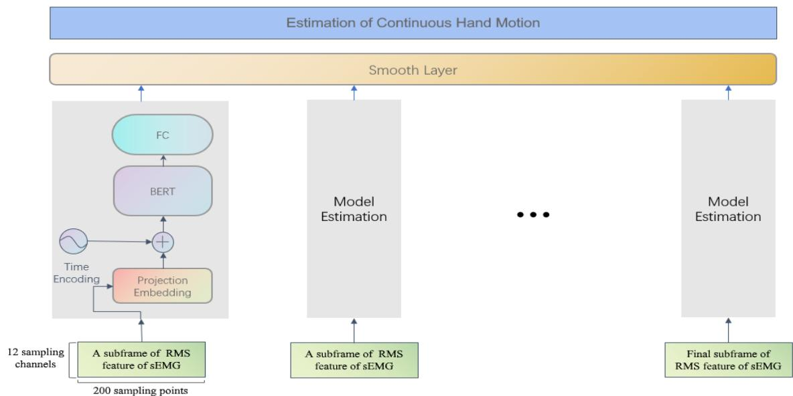
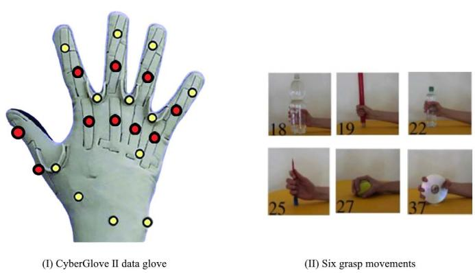
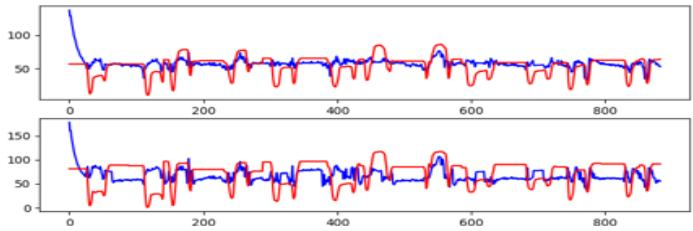
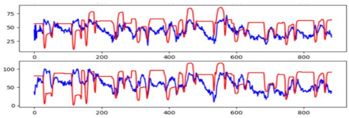
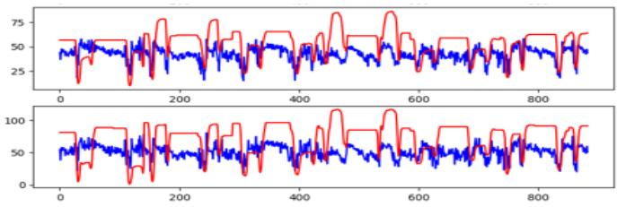
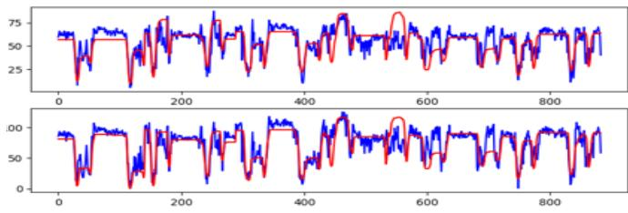
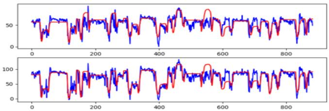
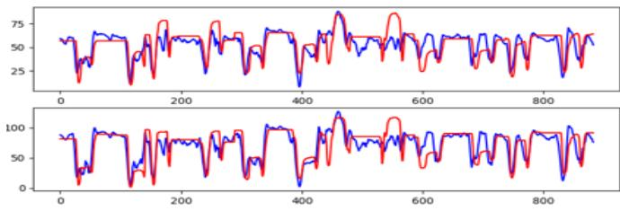
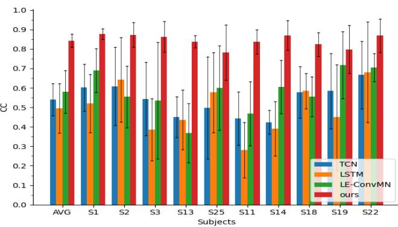
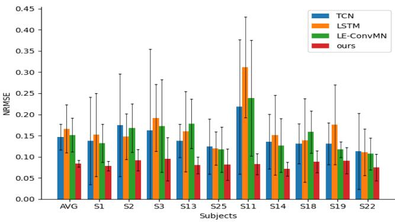

# A BERT Based Method for Continuous Estimation of Cross-Subject Hand Kinematics From Surface Electromyographic Signals

Chuang Lin, Xingjian Chen, Graduate Student Member IEEE, Weiyu Guo, Ning Jiang, Dario Farina , Fellow, IEEE, and Jingyong Su

— Estimation of hand kinematics from surface electromyographic (sEMG) signals provides a non-invasive human-machine interface. This approach is usually subjectspecific, so that the training on one individual does not generalise to different subjects. In this paper, we propose a method based on Bidirectional Encoder Representation from Transformers (BERT) structure to predict the movement of hands from the root mean square (RMS) feature of the sEMG signal following µ-law normalization. The method was tested for within-subject and cross-subject conditions. We trained the model with two hard sample mining methods, Gradient Harmonizing Mechanism (GHM) and Online Hard Sample Mining (OHEM). The proposed method was compared with classic approaches, including long short-term memory (LSTM) and Temporal ConvolutionalNetwork (TCN) as well as a recent method called Long Exposure Convolutional Memory Network (LE-ConvMN). Correlation coefficient (CC), normalized root mean square error (NRMSE) and time costs were used as performance metrics. Our method (sBERT-OHEM) achieved state-of-the-art performance in cross-subject evaluation as well as high performance in subject-specific tests on the Ninapro dataset. The above tests are based on the same randomly selected 10 subjects. Generally, in the cross-subject situation, with the increasing of the subjects’ number, it unavoidably leads to the decline of the performance. While the performance of our method on 38 subjects was significantly higher than the other methods on 10 subjects in cross-subject conditions, which further verified the advantage of our methods.

— sEMG, hands kinematics, BERT, hard sample mining, cross-subjects.

## I. INTRODUCTION

the Internet, and the growing need of improving the quality of life of the aging population, interactions between intelligent devices and humans are becoming an important part of our society. As a result, there is a demand for technologies that allow this interaction in a natural, accurate and robust way. For example, human-robot interaction is needed in active prostheses, robot-assisted surgery, drone reconnaissance, and so on. Further, efficient, precise, and user-friendly human-computer interaction (HCI), as well as human-machine collaboration (HMC), has also attracted much attention. To achieve high accuracy and efficiency, the technique of extracting precise features from biological signals and translating them into control commands is playing an important role in HCI and HMC fields. The surface electromyographic (sEMG) signal can be easily recorded with wearable devices and has been used as for decoding human movement intentions for decades [1], [2].

The hand allows humans to perform their most complex movements by a complex structure that provides >20 degrees of freedom [3]. Decoding hand movements by wearable systems would provide a high-information transfer interface.

Recently, deep learning methods have been widely used to select features of sEMG automatically, with excellent performance in classification [4], [5], [6]. Currently, efforts are mainly devoted to continuous movement regression rather than classification.

Current approaches for continuous motion estimation can be roughly divided into two categories, model-based and modelfree [7]. Model-based methods are based on physical models including kinematics models [8], musculoskeletal models [9], [10], and dynamic models in general. These models, however, may be very complex and therefore the identification of their parameters may be challenging. Therefore, researchers are currently more inclined to use model-free methods. For instance, a simultaneous and continuous kinematics estimation method was proposed in [11] and used a single ANN for four DoFs across shoulder and elbow joints. In [12], a method was proposed to estimate hand pose from sEMG with recurrent neural networks (RNN) structure. However, to the best of our knowledge, no method can be applied to cross-subject situations.

EMG signals vary from person to person and are even different for the same person at different recording times. Transfer learning methods [13] can be used to adapt a subject-specific model to work on a different subject. For example, Fan et al. [14] proposed a hand gesture recognition method based on transfer learning to learn from models on intact hands to fit amputees. However, transfer learning can add an additional structure that occupies the memory [15] and the output model can only transfer from one subject to another, while it is still difficult to generate a model to be applied on two or more subjects concurrently.

As another challenge, normalization is widely used in deep learning methods. Min-max normalization is the most widely used normalization method in the field of estimation from sEMG. However, sEMG signals of different subjects lie in different ranges with different distributions, in which min-max normalization can disturb their own features when multiple subjects are analysed together. In addition, a large amount of useful information of sEMG in the time domain lie near zero [16] and cannot be identified by linear method.

Finally, the existing regression approaches always ignore studying hard samples containing useful information, which can be continuously concentrated in several time periods [17].

Here, we propose a method based on the Bidirectional Encoder Representation from Transformers (BERT) structure with μ-law normalization, a nonlinear normalization, which can better magnify the low magnitude and keep the scale of larger values. Gradient Harmonizing Mechanism (GHM) and Online Hard Samples Mining (OHEM) are applied to make the models better learn from hard samples, and a smooth layer is applied to reduce the fluctuations caused by BERT. Our methods were validated on the Ninapro dataset and compared with two classical methods, LSTM [18] and TCN [19], as well as a recent novel method called Long Exposure Convolutional Memory Network (LE-ConvMN) [17], which should reach state-of-the-art performance in continuous hand kinematic estimation. In summary, the main contributions of this paper are:

• The BERT-based method was proposed for continuous hand movement regression for the first time.

• A strategy of hard sample mining was applied for better and stable estimation from sEMG.

• Our method can be applied in cross-subject situations, which is not solved by previous works to the best of our knowledge, and the experimental results show that our method reaches state-of-the-art performance.

## II. RELATED WORK

In this section, two classical models including LSTM and TCN as well as a recent method named LE-ConvMN for continuous motion estimation will be introduced. Only model-free methods are considered as they are more commonly utilized in practice.

## A. Long Short-Term Memory (LSTM)

LSTM [18] is developed from the RNN structure, which has a high capability to solve temporal series problems. RNN allows retaining contextual information gathered at previous iterations to benefit future iterations. However, as the complexity of data and sequence length increases, the short recurrent circles perform weak on long-time series processing. LSTM was designed to solve this problem by a combination of remembering and forgetting. LSTM can naturally remember due to the basic RNN structure and it achieves the forgetting ability by applying the forget gate structure. LSTM is widely used in continuous motion estimation as a classical model-free method because of its long-time memory feature.

## B. Temporal Convolutional Network (TCN)

TCN [19] is a neural network that is widely used to extract features of temporal information without RNN structure. The classical convolution network is not suitable for temporal series handling problems due to the limitation of the kernel size.

TCN is established on two basic principles:(1) The network produces an output of the same length as the input. (2) There can be no leakage from the future into the past. For principle (1), the TCN designs a 1D fully-convolutional network (FCN) [20] architecture, whose length of each hidden layer is the same as that of the input layer. For principle (2), the TCN utilizes causal convolution, which only uses the information before the time point the network is predicting.

TCN applies the dilated convolutions [21] to enlarge the receptive field to deal with the long-history temporal series, thus we can avoid stacking too many CNN layers. TCN is another widely used model in continuous motion estimation as a classical model-free method.

## C. LE-ConvMN

Long Exposure Convolutional Memory Network (LE-ConvMN) is proposed by Guo et al. [17] to better utilize spatiotemporal information in sEMG data, which is a novel method for continuous hands motion estimation.

Long exposure is a sEMG data processing method. Traditionally, the RMS feature is extracted by a sliding window stepping in window size. The long exposure method extracts features by decreasing the step size, which can be a unique method to increase the quantity of data. The stepping size in this paper is fixed at 1.

ConvLSTM model [22] is then applied to the long exposure data. ConvLSTM is an RNN structure model derived from LSTM. To tackle high-dimensional data, the model develops the fully connected matrix operation of the gates into a convolution operation. LE-ConvMN is claimed to reach stateof-the-art result in this field in [17].

## III. SMOOTHED BERT WITH HARD SAMPLE MINING A. BERT

Although all of the models mentioned above are feasible in our field, there are still some flaws. As for the previous deep learning methods, LSTM, due to its RNN structure, which makes the training rely on the previous data, so we must keep the order of the data, which leads to time-consuming. TCN does not rely on RNN structure, but on CNN structure, which can lead to instability and fluctuation in the estimation. Although LE-ConvMN can make better use of spatiotemporal information, it is more time-consuming and requires too much memory from the GPU. The cost of training such a model is huge and the hardware requirements are relatively high. Additionally, these methods are all derived from unidirectional structure, which can omit the context information of sEMG.

  
Fig. 1. Model structure of BERT-based method for continuous hand kinematic estimation from sEMG signals. The raw sEMG signals are extracted to the long-exposure RMS features, which can be seen as a method to augment the data. Consequently, the features are divided into slices with 100ms (200 sampling points) length. Model estimates from every slice of RMS feature after embedding. Finally, all estimated results are smoothed by the smooth layer.

Bidirectional Encoder Representation from Transformers (BERT) neural network [23] is a novel method in recent years based on transformer [24] structure. BERT has attracted much attention since it was once proposed. Different from RNN and TCN structures, BERT extracts and learns features from series bidirectionally and makes BERT extract features from small-scale temporal and spatial series information, which makes it outperform other models.

BERT is also feasible on multiple subjects due to its strong capability of extracting features from small-scale sequence data brought by attention mechanism and residual skip connections. BERT can recept the future signals and previous signals at the same time, so it can extract features from the whole sequence but not the previous signals only, which makes BERT excelled classical TCN and RNN models on multiple subjects. The performance of BERT on sEMG is shown in the experiments section.

In addition, BERT is an excellent pre-trained method. A well-trained BERT model is claimed to achieve state-of-theart performance in downstream tasks after fine-tuning in [23], which can contribute to transfer learning in the field.

Transformer is a novel language model to solve the language sequence. The strong ability to extract features of the transformer depends on its attention mechanism. BERT can be viewed as a complicated stack of transformer encoders. Several modifications are designed to BERT to make it more suitable for the estimation problem of hand kinematic series from sEMG. The whole procedure is shown in Figure 1 and described as follows.

A transformer encoder consists of two parts, a Multihead Self-Attention Mechanism (MSA) and a multilayer perceptron (MLP) module. To better describe the structure, we denote the 1-D input as $X = [ x _ { 0 } , x _ { 1 } , \cdot \cdot \cdot , x _ { t } ] .$ the output series of the i-th encoder layer as $Z _ { i } ( i = 1 , \cdots , L )$ L is the numbers of encoder layers. Before feeding input into these encoder layers, we perform embedding on it and designate it as $Z _ { 0 } { \mathrm { : } }$

$$
Z _ {0} = [ x _ {0} ^ {p}, x _ {1} ^ {p}, \dots , x _ {t} ^ {p}, \dots ] + E _ {t i m e}\tag{1}
$$

where $x _ { i } ^ { p }$ represents the results of input X after a projection embedding, $E _ { t i m e }$ is the time embedding vector, which makes the model has the ability to capture the temporal information of sEMG. A trainable one-dimensional vector is utilized as the time embedding, and we use a linear layer (LL) as linear projection. Thus,

$$
X ^ {p} = [ x _ {0} ^ {p}, x _ {1} ^ {p}, \dots , x _ {t} ^ {p}, \dots ] = L L _ {(s \times c _ {i}, s \times d _ {h})} (X)\tag{2}
$$

where $d _ { h }$ is the embedding size, and naturally, $E _ { t i m e } \in \mathcal { R } ^ { s \times h }$ Layer normalization as well as residual skip connections are applied in encoder module, to address the degradation problem, thus, an encoder layer can be described as follows:

$$
\begin{array}{l} Z _ {l} ^ {\prime} = M S A (L a y e r N o r m (Z _ {l - 1})) + Z _ {l - 1} \\ Z _ {l} = M L P (L a y e r N o r m (Z _ {l} ^ {\prime})) + Z _ {l} ^ {\prime} \end{array}\tag{3}
$$

where $l \in \{ 1 , 2 , \cdots , L \}$ , finally, we apply a LL to extract results from $Z _ { L } \mathrm { : }$ :

$$
Z = L L _ {(s \times h, 1 \times c _ {o})} (Z _ {L})\tag{4}
$$

Then we introduce the MSA module and the MLP module as follows.

SA can be seen as a process that finds the relation between different sampling points in input $Z _ { i }$ , which is achieved by three matrices named respectively Queries matrix denoted as $Q ;$ key matrix denoted as $K \colon$ ; values matrix denoted as $V .$ They are calculated by linear transformation:

$$
[ Q _ {i}, K _ {i}, V _ {i} ] = Z _ {i - 1} W _ {i} ^ {Q K V}\tag{5}
$$

where the subscript i means the parameters are computed in encoder layer i, $\dot { W } _ { i } ^ { Q K V }$ is a learnable weight matrix in each layer. Q, K will be scaled and then compute the weight of $V$ and finally take the weighted sum of all values of $V$ to get the result:

$$
S A (Z _ {i - 1}) = \mathrm{softmax} (\frac {Q _ {i} K _ {i} ^ {T}}{\sqrt {d _ {h}}}) V\tag{6}
$$

where $S A ( Z _ { i - 1 } ) ~ \in ~ \mathcal { R } ^ { s \times d _ { h } }$ . This method makes the model focus on the important parts of a sEMG input series.

We apply h attention heads to compute Q, K, V in MSA, which means that MSA allows the model to attend to parts of the input sEMG series differently with the different attention heads. MSA concatenates all the outputs of SA computed by different attention heads and then projects it to the result. The MSA can be depicted as follows:

$$
\begin{array}{l} M S A (Z _ {i - 1}) \\ = [ S A _ {1} (Z _ {i - 1}), S A _ {2} (Z _ {i - 1}), \dots , S A _ {h} (Z _ {i - 1}) ] W _ {i} ^ {M S A} \end{array}\tag{7}
$$

where each SA has its unique Q, K, V, $W _ { i } ^ { M S A }$ is a learnable weight matrix in each encoder layer.

Moreover, the MLP module can be expressed as follows:

$$
\begin{array}{l} Z _ {1} ^ {\prime} = L L _ {(s \times d _ {h}, s \times d _ {f h})} (Z ^ {\prime}) \\ Z _ {2} ^ {\prime} = \operatorname{GELU} (Z _ {2} ^ {\prime}) \\ Z _ {o} ^ {\prime} = L L _ {(s \times d _ {f h}, s \times d _ {h})} \end{array}\tag{8}
$$

where $d _ { f h }$ is the hidden size of MLP module, and GELU is the Gaussian Error Linear Unit activation function.

BERT is proposed for dealing with language sequence problems, which produces discrete tensors as output. However, joint angles in movements should be successive values. As a result, BERT can cause severe fluctuations in predicted values, although it performs well in the two measure criteria. Therefore, we apply a smoothing method after BERT prediction to get more smooth results to solve this problem.

The results are smoothed by applying a sliding window. For each sliding step, we calculate the average value of all the sampling points in the window:

$$
\operatorname{AvgSmooth} (Y) = \left[ \sum_ {i = 1} ^ {w} y _ {i} / w, \sum_ {i = 2} ^ {w + 1} y _ {i} / w, \dots , \sum_ {i = k} ^ {w + k - 1} y _ {i} / w, \dots \right]\tag{9}
$$

where w stands for the size of sliding window, and $Y \ =$ $[ y _ { 0 } , y _ { 1 } , \cdot \cdot \cdot , y _ { k } , \cdot \cdot \cdot ]$ is the input series.

## B. μ-Law Normalization

The μ-law normalization [16], [25] are applied to the RMS feature of sEMG before feeding into models, which is proved that improved performance could be achieved using normalization of the sEMG signals with the μ-law approach [6], [16], [26]. The μ-law normalization is given as:

$$
F (x _ {t}) = \operatorname{sign} (x _ {t}) \frac {\ln (1 + \mu | x _ {t} |)}{\ln (1 + \mu)}\tag{10}
$$

where $x _ { t }$ means the input at the t-th sampling point, the hyperparameter $\mu$ decides the range after normalization.

sEMG signals have the characteristic that many useful information lies near zero, μ-law normalization can magnify the outputs of sensors with small magnitude in a logarithmic fashion, which nonlinear normalization could perform better than linear normalization. The improvement of regression by μ-law normalization is shown in the experiments section.

## C. Hard Sample Mining

Hard sample mining is an important problem in data mining. Hard samples are those whose loss is moderately large between estimated values and true values, which can contribute more to model training than easy samples. Comparatively, there is little deviation between the estimated value and the true value of easy samples. In addition, there will inevitably be some bad data, called outliers. The errors that occur when collecting data can also affect the results. Equipment error inevitably leads to outliers in sEMG collecting, and hard samples always occur in datasets. GHM makes models benefit more from these hard samples, but as little as possible from simple samples and outliers, strengthening the robustness and stability of the model.

There are several popular methods for handling hard samples. The simplest way is to increase the size of dataset, but continuous motion data of people is difficult to collect in our field, even though the NinaPro database has a limited amount of data. There are also some low-priced methods, such as clipping, flipping and rotating. Due to the distinctive personal characteristics, these methods cannot effectively augment the sEMG signal. Online Hard example mining (OHEM) [27] is another related method. Hard examples are selected by sorting the input features by loss and taking the several examples for which the current network performs worst in [27] with OHEM. The network is only updated by the selected hard samples.

Hard examples are selected by sorting the output sampling points by MSE loss and taking the several examples for which the current network performs worst with OHEM in this paper. We only update our models with the selected hard samples.

Taking outliers into account, loss computing tactics that focus on hard sample mining are applied. Gradient Harmonizing Mechanism (GHM) is a loss calculating mechanism [28], which can assign larger weight to hard samples to make models benefit as much as possible from them. GHM defines gradient norm to measure the deviation between true values and estimated values. We denote the gradient norm as g. g ranges from 0 to 1, when g approximates to $0 ,$ the estimated value is almost the same as the true value, while $g$ approximates to 1 means that the two values have a huge deviation.

GHM defines gradient density (GD) to describe the distribution of data by gradient norm g. The relationship can be expressed as follows:

$$
G D (g) = \frac {1}{l _ {\epsilon} (g)} \sum_ {k = 1} ^ {N} \delta_ {\epsilon} (g _ {k}, g)\tag{11}
$$

where GD of $g$ means that the number of sampling points lying in the region centered at $g$ with a length $\epsilon .$ We denote the gradient norm of the k-th sampling points in a subframe as gk. $l _ { \epsilon } ( g )$ means the length of actual region, which can be defined as follows:

$$
l _ {\epsilon} (g) = \min (g + \epsilon , 1) - \max (g - \epsilon , 0)\tag{12}
$$

$\delta _ { \epsilon } ( g _ { k } , g )$ is a judging function used for counting, which counts all the sampling points whose gradient norm within the range $l _ { \epsilon } ( g )$ . The formula is as follows:

$$
\delta_ {\epsilon} (g _ {k}, g) = \left\{ \begin{array}{l l} 1 & \text { if } g _ {k} - \frac {\epsilon}{2} \leq g \leq g _ {k} + \frac {\epsilon}{2} \\ 0 & \text { otherwise } \end{array} \right.\tag{13}
$$

Then the gradient density harmonizing parameter is defined as:

$$
\beta_ {i} = \frac {N}{G D (g _ {i})}\tag{14}
$$

where N is the total number of sampling points in a subframe, $\beta _ { i }$ is the gradient density harmonizing parameter of the i-th sampling point in the subframe.

We use MSE loss as the base loss in this study, which is defined as follows:

$$
L _ {M S E} = \frac {\sum_ {i = 1} ^ {N} (\theta_ {i} - \hat {\theta} _ {i}) ^ {2}}{N}\tag{15}
$$

$g _ { i }$ is defined as follows in GHM-MSE loss to make loss distribute sparse respectively because of the lack of data in this field:

$$
g _ {i} = \sigma (\frac {2 (\theta_ {i} - \hat {\theta} _ {i})}{N})\tag{16}
$$

where $\sigma$ is the sigmoid activation function. Then we define $L _ { G H M - M S E }$ as:

$$
L _ {G H M - M S E} = \frac {\sum_ {i = 1} ^ {N} \beta_ {i} (\theta_ {i} - \hat {\theta} _ {i}) ^ {2}}{N}\tag{17}
$$

## IV. EXPERIMENTS

## A. Dataset

Ninapro [29] is a widely used dataset that represents the largest data collection effort with hands intact or amputated in the sEMG field. In the Ninapro dataset, the raw signal of sEMG is sampled with the Delsys Trigno Wireless System, which contains 12 electrodes. Hand kinematics are measured by 22 joint angles and sampled with CyberGlove II data gloves. The sampling rate of sEMG is 2 kHz. The hand kinematics are sampled at a rate of 20 Hz and then resampled to 2 kHz.

  
Fig. 2. CyberGlove channels are shown on the left of the figure, where the red dots represent the ten joints to be estimated. Six hand movements were selected and shown on the right of the figure.

Ninapro includes over 300 data acquisitions divided into 10 datasets that provide electromyography, kinematics and so on. Experiments proceed with selected 10 representative subjects from Ninapro DB2, which includes six repetitions of 49 different movements performed by 40 intact subjects. Our selection makes sure that gender and laterality distribution are relatively uniform to ensure that the method is universal efficacious on different subjects, and their height ranges from 150-187cm, and weight ranges from 52-87kg. Six movements for grasping different objects are chosen for each subject, which have relatively better data quality. Moreover, we concentrate our estimation on 10 finger joints. Our selection is shown in Figure 2.

We compute Root Mean Square (RMS) with a sliding window of 100 ms at the step of 0.5 ms as the feature. RMS can decrease the noise caused by collecting data. The feature are normalized by μ-law normalization with $\mu = 2 ^ { 2 0 }$ after a briefly hyperparameter search experiments for a better performance.

After processing the sEMG, $\begin{array} { r l r l } { X } & { { } \in } & { \mathcal { R } ^ { s \times c _ { i } } , X } & { { } = } \end{array}$ $[ x _ { 0 } , x _ { 1 } , \cdots , x _ { s } ]$ denotes the result, where s is the number of sampling points of an input subframe and $c _ { i }$ stands for the number of sEMG channels. Here, $s = 2 0 0 , c _ { i } = 1 2$ . Similarly, $Z \in \mathcal { R } ^ { 1 \times c _ { o } }$ denotes the final output, where $c _ { o }$ is the number of hand kinematic channels. Ten joints of fingers are selected as 10 typical kinematic channels, so $c _ { o } = 1 0$

In all subject-specific and cross-subject cases, 7/10 of each subject was used for training and 3/10 for testing. Specifically, each subject was trained and tested individually in subject-specific cases. While in cross-subject cases, we trained the model based on the training data from 10 individuals simultaneously but evaluated the test data from each subject individually for an average performance.

## B. Evaluation of Parameters

To evaluate our method and compare it with other methods, two criteria are introduced as follows.

Pearson correlation coefficient (CC) is a commonly used standard to measure how two variables relate to each other linearly. The value of CC ranges from −1 to 1. The larger the CC value, the more similar the predicted movement is to the estimated movement, which means that we get a better estimation.

TABLE I  
AVERAGE PERFORMANCE OF DIFFERENT MODELS ON 10 JOINTS AND 6 MOVEMENTS OF 10 DIFFERENT SUBJECTS WITH MIN-MAX NORMALIZATION

<table><tr><td>Model</td><td>CC</td><td>NRMSE</td><td> $\kappa$ </td><td>Time Cost/epoch(s)</td></tr><tr><td>LE-LSTM</td><td>0.8428</td><td>0.0835</td><td>1.1456</td><td>25.779</td></tr><tr><td>LE-TCN</td><td>0.8021</td><td>0.0934</td><td>1.4033</td><td>15.469</td></tr><tr><td>LE-ConvMN</td><td>0.8872</td><td>0.0705</td><td>0.6345</td><td>13.446</td></tr><tr><td>BERT</td><td>0.8523</td><td>0.0813</td><td>1.5133</td><td>4.915</td></tr><tr><td>sBERT</td><td>0.8522</td><td>0.0811</td><td>0.5385</td><td>4.918</td></tr><tr><td>BERT-GHM</td><td>0.8532</td><td>0.0807</td><td>1.5480</td><td>4.922</td></tr><tr><td>BERT-OHEM</td><td>0.8531</td><td>0.0806</td><td>1.5282</td><td>4.924</td></tr><tr><td>sBERT-GHM</td><td>0.8533</td><td>0.0804</td><td>0.5382</td><td>4.929</td></tr><tr><td>sBERT-OHEM</td><td>0.8536</td><td>0.0802</td><td>0.5438</td><td>4.931</td></tr><tr><td>LE-LSTM*</td><td>0.4950</td><td>0.1661</td><td>-</td><td>255.057</td></tr><tr><td>LE-TCN*</td><td>0.5398</td><td>0.1467</td><td>-</td><td>152.045</td></tr><tr><td>LE-ConvMN*</td><td>0.5797</td><td>0.1517</td><td>-</td><td>130.467</td></tr><tr><td>BERT*</td><td>0.4504</td><td>0.1927</td><td>-</td><td>44.019</td></tr><tr><td>sBERT*</td><td>0.4574</td><td>0.1866</td><td>-</td><td>44.017</td></tr><tr><td>BERT-GHM*</td><td>0.4195</td><td>0.1966</td><td>-</td><td>45.646</td></tr><tr><td>BERT-OHEM*</td><td>0.5275</td><td>0.1899</td><td>-</td><td>44.111</td></tr><tr><td>sBERT-GHM*</td><td>0.4297</td><td>0.1912</td><td>-</td><td>45.933</td></tr><tr><td>sBERT-OHEM*</td><td>0.4539</td><td>0.1751</td><td>-</td><td>44.192</td></tr></table>

1. '\*’ represents the model is trained on all the selected subjects.

Root Mean Square Error (RMSE) is a typical measure of the deviation between predicted values and the values actually observed. For the same joint angle, the smaller the RMSE, the better our estimation is. However, we cannot compare the RMSE of different joint angles. Min-max normalization on RMSE is used to solve this problem. Hence, the Normalized RMSE (NRMSE) is defined as:

$$
N R M S E = \frac {R M S E}{\theta_ {m a x} - \theta_ {m i n}}\tag{18}
$$

where $\theta _ { m a x } , \theta _ { m i n }$ represent the maximum and minimum true value of angles of a certain joint.

Unbiased Standard Deviation (denoted as σ ) is a frequently used criterion to measure the dispersion degree of a group of data. The σ of 10 joints of each subject is produced to measure the stability of each model. The value is smaller, the dispersion degree is lower, and the stability of estimation is better. This criterion is adopted in our work based on the results of 10 predicted joints for each subject.

The mean curvature (denoted as κ) of all points of each joint is adopted to measure the smoothness of an estimated curve. The smaller the curvature is, the smoother the curve is.

## C. Experimental Results

The efficiency and accuracy of our method were validated and compared with previous models on continuous hand movement estimation tasks. All the models were applied on Pytorch framework [30].

All the models were trained on the same GPU (NVIDIA GeForce RTX 3090), and every model was trained for 400 epochs except LE-ConvMN trained for 1000 epochs for more epochs to convergence. Long exposure method [17] was utilized for every model to exclude the influence of data processing. Experiments were carried out in two types of situations: subject-specific and cross-subject situations. The models were trained and verified on data from a single subject in subject-specific situations. In contrast, models were simultaneously trained on data from multiple subjects and verified on every single subject. The NRMSE and CC of each model were calculated on each subject to show the performance of the model in detail. Likewise, we counted the average training time per epoch and estimated the convergence time in each training operation. Inference time is the time cost of estimation in practice, the process was simulated on the same CPU (Intel i7-10875H) to compare the performance of different models. For these criteria, the Friedman test and Wilcoxon signed-rank test were applied to evaluate the significance of our method, and the results were corrected by Bonferroni correction.

TABLE II  
AVERAGE PERFORMANCE ON DIFFERENT MODELS ON 10 JOINTS AND 6 MOVEMENTS OF 10 DIFFERENT SUBJECTS ON 10 JOINTS AND 6 MOVEMENTS OF 10 DIFFERENT SUBJECTSWITH µ-LAW NORMALIZATION

<table><tr><td>Model</td><td>CC</td><td>NRMSE</td><td> $\kappa$ </td><td>Time Cost/epoch(s)</td></tr><tr><td>LE-LSTM</td><td>0.7685</td><td>0.0960</td><td>0.5812</td><td>26.360</td></tr><tr><td>LE-TCN</td><td>0.8329</td><td>0.0875</td><td>1.5332</td><td>15.623</td></tr><tr><td>LE-ConvMN</td><td>0.9017</td><td>0.0648</td><td>0.6883</td><td>13.468</td></tr><tr><td>BERT</td><td>0.8678</td><td>0.0773</td><td>1.5708</td><td>4.948</td></tr><tr><td>sBERT</td><td>0.8675</td><td>0.0772</td><td>0.5348</td><td>4.951</td></tr><tr><td>BERT-GHM</td><td>0.8679</td><td>0.0770</td><td>1.5272</td><td>4.956</td></tr><tr><td>BERT-OHEM</td><td>0.8683</td><td>0.0768</td><td>1.5857</td><td>4.957</td></tr><tr><td>sBERT-GHM</td><td>0.8689</td><td>0.0766</td><td>0.5435</td><td>4.962</td></tr><tr><td>sBERT-OHEM</td><td>0.8693</td><td>0.0764</td><td>0.5323</td><td>4.960</td></tr><tr><td>LE-LSTM*</td><td>0.5536</td><td>0.1495</td><td>-</td><td>252.660</td></tr><tr><td>LE-TCN*</td><td>0.6695</td><td>0.1292</td><td>-</td><td>151.598</td></tr><tr><td>LE-ConvMN*</td><td>0.7410</td><td>0.1229</td><td>-</td><td>130.060</td></tr><tr><td>BERT*</td><td>0.8346</td><td>0.0881</td><td>1.6098</td><td>44.001</td></tr><tr><td>sBERT*</td><td>0.8427</td><td>0.0850</td><td>0.6011</td><td>44.426</td></tr><tr><td>BERT-GHM*</td><td>0.8308</td><td>0.0877</td><td>1.5815</td><td>46.386</td></tr><tr><td>BERT-OHEM*</td><td>0.8299</td><td>0.0878</td><td>1.6019</td><td>44.039</td></tr><tr><td>sBERT-GHM*</td><td>0.8441</td><td>0.0846</td><td>0.6012</td><td>45.569</td></tr><tr><td>sBERT-OHEM*</td><td>0.8430</td><td>0.0835</td><td>0.6263</td><td>44.449</td></tr><tr><td>sBERT-OHEM**</td><td>0.8065</td><td>0.0911</td><td>-</td><td>165.454</td></tr></table>

1. '\*’ represents the model is trained on all the 10 selected subjects 2. Further, sBERT-OHEM, as our method, was verified on all the 38 subjects in Ninapro DB2 dataset in cross-subject situation, except for two possibly corrupted subject data, denoted with a superscript \*\*.

After trying several groups of parameters, we selected a relatively better group of parameters to proceed with our experiments. All models were trained at a learning rate of 0.0001 and cut in half after 200 epochs or after every 300 epochs for LE-ConvMN only.

To validate the superiority of BERT, we conducted training on both RNN and TCN models for 10 subjects and 10 channels. And the results are as Table I shows. Prefix $\bf \dot { s } - \bf \dot { \theta }$ of the model name means that a smooth layer was applied, and the suffix ‘-GHM’ or ‘-OHEM’ after the model name means that this model trained with GHM or OHEM in current and following experiments. Prefix ’LE-’ is used to distinguish our models from bare classical models.

  
(a) LSTM

  
(c) LE-ConvMN

  
(b) TCN

  
(d) BERT

  
(e) BERT-OHEM

  
(f) sBERT-OHEM  
Fig. 3. Estimation results of BERT-based method and other methods in cross-subject situations. Our method was trained with µ-law normalization while others were trained with classical Min-Max normalization. Red curves are the ground truth and blue curves are the estimation. Only two joints are shown in the figure to better show the detail of the estimation, which can represent the quality of the estimation of all 10 joints.

Among the 10 subjects, subject S3 had the best performance. We show the results of two representative joint angles of S3 in Figure 3, as representations of our method, BERT, BERT-OHEM, and sBERT-OHEM with μ-law normalization are shown in Figure 3.

The average CC and NRMSE of our method (The best performance $0 . 8 7 \ : \pm \ : 0 . 0 5 ; \ : 0 . 0 7 \ : \pm \ : 0 . 0 1 )$ of single subject was significantly better than LE-TCN $( 0 . 8 0 ~ \pm ~ 0 . 0 6 ,$ $p \ =$ $0 . 0 0 5 ; 0 . 0 9 \pm 0 . 0 2 , p = 0 . 0 0 5 )$ , mildly better than LE-LSTM $( 0 . 8 4 ~ \pm ~ 0 . 1 1$ , p = 0.262; 0.08 ± 0.03, $p \ = \ 0 . 2 4 1 )$ , but slightly worse than LE-ConvMN $( 0 . 8 9 \pm 0 . 1 2 , \ p = 0 . 0 7 4$ $0 . 0 7 \pm 0 . 0 3 , p = 0 . 0 5 9 )$ . The average training time cost of our method is significantly lower than that of others due to its special structure, which makes it impossible to train in parallel. BERT needs less average time to reach convergence (about 0.5h) than LE-LSTM (about 2.5h), LE-TCN (about 1.5h), LE-ConvMN (about 1.8h). In addition, the strong capability of extracting features of BERT-based method from sEMG series was verified.

To compare the μ-law Normalization and Min-Max Normalization, they were applied to the every model for each subject we chose, respectively. μ was set as $2 ^ { 2 0 }$ in our study. The result is in Table I and Table II, which shows that μ-law Normalization performs better than Min-Max Normalization in our study, leading to significant improvement.

Based on the BERT training with μ-law Normalization, we applied both GHM or OHEM and smooth layer on models, thus designing some variants, whose results are shown in Table II. Besides, LE-ConvMN, LE-LSTM and LE-TCN with μ-law normalization were validated in the cross-subjects experiments to exclude the influence caused by normalization.

As the result shows, both GHM, OHEM, and smooth layer led to a slight improvement in both single and multiple subjects. Although there were few improvements in criteria, OHEM and smooth layer improved the stability of estimation and reduced the fluctuation of the predicted motion curve, which is shown in Figure 3. OHEM with a smooth layer performed the best in the variants of BERT-based models. GHM led to descending on stability. LE-ConvMN still has state-of-the-art performance on a single subject, but our method can reach better stability in estimation, which is shown in the following paragraph. Figures of two criteria are shown in Figure 4 to show the performance of estimation on every single subject. Additionally, when increasing the number of subjects in cross-subject situations, there was an acceptable decline in the criteria. Although BERT-based methods sufferred more from fluctuation, the smooth layer could effectively preclude it as shown in the Table I, Table II and Figure 3. The performance of our method on even 38 subjects was better than that of other methods on only 10 subjects, which shows the strong capability of extracting features in cross-subject situations.

As shown in Figure 4, unbiased standard deviation of estimation on 10 joints was introduced to evaluate the stability of estimation of these methods and was denoted as σ $( \sigma _ { c } , \sigma _ { n }$ for CC and NRMSE, respectively). Our method in subject-specific situations, sBERT-OHEM $( \sigma _ { c } = 0 . 0 6 1 4 ;$ $\sigma _ { n } = 0 . 0 2 4 2 ; )$ as the represent, had the significant better performance than TCN $( \sigma _ { c } = 0 . 0 8 5 6$ $p = 0 . 0 4 7 ;$ $\sigma _ { n } = 0 . 0 2 6 8$ $p = 0 . 7 6 6 )$ in $\sigma _ { c } ,$ mildly better in $\sigma _ { n } ;$ mildly lower than LSTM $( \sigma _ { c } = 0 . 0 7 1 8 .$ $p \ = \ 0 . 3 8 4 ;$ $\sigma _ { n } ~ = ~ 0 . 0 2 5 4 .$ $p = 0 . 8 5 9 )$ in both two criteria and mildly lower than LE-ConvMN $( \sigma _ { c } = 0 . 0 8 0 2$ $p = 0 . 6 8 3 \mathrm { ; }$ $\sigma _ { n } = 0 . 0 3 0 1$ $p = 0 . 5 7 4 )$ in $\sigma _ { c }$ and $\sigma _ { n } .$ . Our method in crosssubjects situations, sBERT-OHEM $( \sigma _ { c } = 0 . 0 7 5 3 ;$ $\sigma _ { n } = 0 . 0 2 6 5 )$ as the represent, had the significant lower σ in both two criteria than TCN $( \sigma _ { c } = 0 . 1 5 7 0$ $p = 0 . 0 0 7 ;$ $\sigma _ { n } = 0 . 0 9 2 9$ $p = 0 . 0 0 5 )$ ), LSTM $( \sigma _ { c } ~ = ~ 0 . 1 7 8 5$ $p = 0 . 0 0 5 ;$ $\sigma _ { n } = 0 . 0 8 2 6 .$ $p = 0 . 0 0 5 )$ and LE-ConvMN $( \sigma _ { c } = 0 . 1 5 8 8$ $p = 0 . 0 0 7 ;$ $\sigma _ { n } = 0 . 0 6 2 8$ $p =$ 0.009). And the average unbiased standard deviations of each model in both situations are shown in Table III. The results indicate that our method has better stability than other models.

  
(a) CC

  
(b) NRMSE  
Fig. 4. Summary of performance criteria of 10 healthy subjects with intact hands in cross-subject situations. The results show that our method outperforms other model-free methods in all subjects. CC and NRMSE of our method are significantly higher than other models. In addition, one can see from the deviation bar that our method is more stable than others.

Since different subjects have different features, EMG signals have subject-specific and non-stationary characteristics, which has always been difficult for previous methods to discover a universal method to fit cross-subject situations. Thus, researchers always train and customize a unique set of model parameters for a certain subject. However, since the strong capability of extracting features from small-scale data of BERT, it can perform better than other methods on multiple subjects. In the following experiment, sEMG signals of all ten selected subjects were concatenated together. We compared our method with LE-LSTM, LE-TCN and LE-ConvMN methods on the combination of subjects to validate the performance of different models on multiple subjects. The result is shown in Table I and Table II.

TABLE III  
UNBIASED STANDARD DEVIATION AMONG 10 JOINTS OF DIFFERENT MODELS

<table><tr><td>Model</td><td> $\sigma_c$ </td><td> $\sigma_n$ </td><td> $\sigma_{c}^{*}$ </td><td> $\sigma_{n}^{*}$ </td></tr><tr><td>LE-LSTM</td><td>0.0718</td><td>0.0254</td><td>0.1785</td><td>0.0826</td></tr><tr><td>LE-TCN</td><td>0.0856</td><td>0.0268</td><td>0.1570</td><td>0.0929</td></tr><tr><td>LE-ConvMN</td><td>0.0802</td><td>0.0301</td><td>0.1588</td><td>0.0628</td></tr><tr><td>sBERT-OHEM</td><td>0.0614</td><td>0.0242</td><td>0.0753</td><td>0.0265</td></tr></table>

1. BERT-based models utilized the µ-law normalization while min-max normalization was applied on TCN, LSTM and LE-ConvMN.  
$2 , \ ^ { 6 } \ast ^ { 9 }$ represents the results are verified in cross-subjects situations.

TABLE IV  
INFERENCE TIME (IT) OF DIFFERENT MODELS ON THE INTEL I7-10875H CPU

<table><tr><td>Model</td><td>TCN</td><td>LSTM</td><td>LE-ConvMN</td><td>BERT-based</td><td>sBERT-based</td></tr><tr><td>IT(ms)</td><td>3.99</td><td>48.54</td><td>18.23</td><td>31.78</td><td>32.22</td></tr></table>

1. OHEM and GHM don't affect the inference while smooth layer leads to additional consumption of time. We divided the variants of BERT into two parts as BERT-based and sBERT-based in the table by whether applying smooth layer.

The results in Table I and II indicated that our method significantly outperformed the other models in crosssubject situations. When Min-Max normalization was applied, BERT-based models and LE-ConvMN performed equally. However, while μ-law normalization brought significant improvement to BERT-based models, it had nearly no effect on the performance of LE-ConvMN. As a result, our method significantly outperformed all other models and achieved stateof-the-art performance in cross-subject situations. GHM and OHEM performed near equally on multiple subjects with mild improvement, while they led to an unstable effect on the performance of different single subjects. The more sampling points there are, the higher the possibility that GHM works better. Compared to subject-specific models, cross-subject models inevitably lead to a decline in performance, but it is acceptable. However, the cross-subject model still does not work well on more subjects except those for training.

Inference time is the time for the model to estimate the motion from sEMG. We perform all methods on the test dataset of subject S1 on the same CPU (Intel i7-10875H). Average values were adopted to evaluate performance. The results are shown in Table IV.

TCN is the most efficient method due to the results, while BERT-based method only outperformed LSTM because inference operations cannot be performed in parallel, which made BERT lose its superiority in the time cost. LE-ConvMN has fewer parameters than LSTM, which makes it faster than LSTM and BERT-based method.

In conclusion, BERT with smooth layer and trained with OHEM mechanism has the best performance among

BERT-based variants. Our method not only outperforms the TCN in quality but also stability in both subject-specific situations and cross-subject situations. Although TCN infers faster, it is absent in quality. Additionally, our method outperforms LSTM in all the criteria, including quality, efficiency and stability in both quality and efficiency in both subject-specific situations and cross-subject situations. Our method performs equally to LE-ConvMN in quality in subject-specific situations, while having lower efficiency in inference. However, BERT-based method can train in parallel, which allows us to get a subject-specific model faster and have higher estimation stability. Our method and LE-ConvMN both have their own merits. However, when it comes to cross-subject situations, our method outperforms LE-ConvMN in all respects except inference. Our method have excellent performance in subject-specific situations and achieve state-of-the-art performance in cross-subject situations.

## V. DISCUSSION

BERT-based models were proposed to estimate finger joints from the sEMG signal and compared with LSTM, TCN and LE-ConvMN. CC and NRMSE were applied to measure the quality of estimation and average time cost per epoch, convergence time, and inference time were used to measure the efficiency. The results indicated that BERT-based models outperformed classical models among the 10 selected single subjects, but LE-ConvMN was still the state-of-theart model in subject-specific situations. However, the new proposed method significantly outperformed all other models on multiple subjects simultaneously, that is, our method has stronger generalization ability.

In addition, BERT-based models are more efficient to train and faster to converge, as their structure allows models to train in parallel. But from the unique self-attention mechanism, models can seldom benefit in the inference efficiency of practical application. The strategy of hard sample mining and smooth layer lead to mild improvement. There is no further improvement on the Ninapro dataset, which may be due to the small amount of data in Ninapro DB2 being already well processed, including little noise and the feature is homogeneous in a single individual. However, when we applied GHM or OHEM to multiple subjects, due to the increase in the number of features of subjects, the number of hard samples increases, hard sample mining can lead to improvement in performance and the time cost is affordable. The smooth layer makes the estimation smoother and more stable, which is closer to reality.

Although there are methods based on transfer learning that allow models to adapt to different subjects, it is still difficult to find a model that can fit multiple subjects simultaneously. However, the proposed trained model cannot be applied to new subjects directly, unless the new subjects are involved in the training stage. That is, when we need the trained model to work on new subjects, the training data of the new subjects should be put together with that of the former subjects, and sometimes, it is time consuming. The more efficient way to extend our method to new subject is still transfer learning. As BERT is a high-quality pre-trained model itself [24], the BERT-based method can potentially contribute to transfer learning methods, and it would be our future work. At present, it is still a challenge to design a universal method to adapt to general individuals, our method is an important advance in this aspect.

There are several limits to our work. Only subjects with intact hands are selected in this paper, which leads to the lack of sufficient validation of the generality of our method. When choosing subjects, channels and movements, we deliberately avoided unreasonable or bad data caused by collecting errors in Ninapro and thus missing validation of model robustness. Inference time should be shortened to meet the need for practical applications. As for BERT-based structures, they are based on transformers and benefit from attention mechanisms, which leads to a higher delay in inference. Recently there has been lots of research about efficient transformers [31] to improve the efficiency of transformer-based structures, which can be the direction of subsequent improvement.

## VI. CONCLUSION AND FUTURE WORK

In this paper, we introduced a BERT-based method to estimate the continuous motions of the hands. To extract spatial and temporal information from sEMG signals, a BERTbased structure was designed to better meet the requirements in cross-subject situations in clinical use. μ-law normalization was also introduced to better utilize the hidden information of the small magnitude of sEMG. GHM and OHEM were applied in the training stage to better estimate hand motion from sEMG stably. Subsequently, two classical and a recent algorithms in continuous motion estimation from the sEMG signal were compared with our BERT-based method. The results showed that our method achieves considerable accuracy and stability on single subjects. For the first time, additionally, the proposed method can be applied to multiple different subjects simultaneously and outperformed the other models in this scenario and reached state-of-the-art results.

In future work, more subjects, movements and channels can be considered to evaluate the robustness and stability of the model. Although BERT is more efficient in training, the calculation of the full attention mechanism is time consuming in inferring. Since continuous motion estimation requires high efficiency, one can also improve the method with efficient transformers. Although GHM and OHEM were verified as mildly helpful in our work, as the unique mechanism of GHM and OHEM, there is potential for hard sample mining to work well when amounts of data increase in the future. It is expected that transformer-based, attention-based models and hard sample mining strategies contribute more and more to human-computer interaction and collaboration.

## REFERENCES

[1] P. D. Lawrence and W.-C. Lin, “Statistical decision making in the realtime control of an arm aid for the disabled,” IEEE Trans. Syst., Man, Cybern., vols. SMC-2, no. 1, pp. 35–42, Jan. 1972.

[2] M. Ahsan, M. I. Ibrahimy, and O. O. Khalifa, “EMG signal classification for human computer interaction: A review,” Eur. J. Sci. Res., vol. 33, no. 3, pp. 480–501, 2009.

[3] I. Kapandji, “The physiology of the joints, volume I, upper limb,” Amer. J. Phys. Med. Rehabil., vol. 50, no. 2, p. 96, 1971.

[4] M. Längkvist, L. Karlsson, and A. Loutfi, “A review of unsupervised feature learning and deep learning for time-series modeling,” Pattern Recognit. Lett., vol. 42, pp. 11–24, Jun. 2014.

[5] M. Zanghieri, S. Benatti, A. Burrello, V. Kartsch, F. Conti, and L. Benini, “Robust real-time embedded EMG recognition framework using temporal convolutional networks on a multicore IoT processor,” IEEE Trans. Biomed. Circuits Syst., vol. 14, no. 2, pp. 244–256, Apr. 2020.

[6] E. Rahimian, S. Zabihi, A. Asif, D. Farina, S. F. Atashzar, and A. Mohammadi, “TEMGNET: Deep transformer-based decoding of upperlimb sEMG for hand gestures recognition,” 2021, arXiv:2109.12379.

[7] L. Bi, A. G. Feleke, and C. Guan, “A review on EMG-based motor intention prediction of continuous human upper limb motion for human–robot collaboration,” Biomed. Signal Process. Control, vol. 51, pp. 113–127, May 2019.

[8] S. Duprey, A. Naaim, F. Moissenet, M. Begon, and L. Chèze, “Kinematic models of the upper limb joints for multibody kinematics optimisation: An overview,” J. Biomech., vol. 62, pp. 87–94, Sep. 2017.

[9] M. Sartori, G. Durandau, S. Došen, and D. Farina, “Robust simultaneous myoelectric control of multiple degrees of freedom in wrist-hand prostheses by real-time neuromusculoskeletal modeling,” J. Neural Eng., vol. 15, no. 6, Dec. 2018, Art. no. 066026.

[10] L. Pan, D. L. Crouch, and H. Huang, “Myoelectric control based on a generic musculoskeletal model: Toward a multi-user neural-machine interface,” IEEE Trans. Neural Syst. Rehabil. Eng., vol. 26, no. 7, pp. 1435–1442, Jul. 2018.

[11] Q. Zhang, R. Liu, W. Chen, and C. Xiong, “Simultaneous and continuous estimation of shoulder and elbow kinematics from surface EMG signals,” Frontiers Neurosci., vol. 11, p. 280, May 2017.

[12] F. Quivira, T. Koike-Akino, Y. Wang, and D. Erdogmus, “Translating sEMG signals to continuous hand poses using recurrent neural networks,” in Proc. IEEE EMBS Int. Conf. Biomed. Health Informat. (BHI), Mar. 2018, pp. 166–169.

[13] S. J. Pan and Q. Yang, “A survey on transfer learning,” IEEE Trans. Knowl. Data Eng., vol. 22, no. 10, pp. 1345–1359, Oct. 2009.

[14] J. Fan et al., “Improving semg-based motion intention recognition for upper-limb amputees using transfer learning,” Neural Comput. Appl., early access, pp. 1–11, Jul. 2021.

[15] U. Côté-Allard et al., “Deep learning for electromyographic hand gesture signal classification using transfer learning,” IEEE Trans. Neural Syst. Rehabil. Eng., vol. 27, no. 4, pp. 760–771, Apr. 2019.

[16] E. Rahimian, S. Zabihi, S. F. Atashzar, A. Asif, and A. Mohammadi, “XceptionTime: Independent time-window xceptiontime architecture for hand gesture classification,” in Proc. IEEE Int. Conf. Acoust., Speech Signal Process. (ICASSP), May 2020, pp. 1304–1308.

[17] W. Guo et al., “Long exposure convolutional memory network for accurate estimation of finger kinematics from surface electromyographic signals,” J. Neural Eng., vol. 18, no. 2, 2021, Art. no. 026027.

[18] S. Hochreiter and J. Schmidhuber, “Long short-term memory,” Neural Comput., vol. 9, no. 8, pp. 1735–1780, 1997.

[19] S. Bai, J. Z. Kolter, and V. Koltun, “An empirical evaluation of generic convolutional and recurrent networks for sequence modeling,” CoRR, vol. abs/1803.01271, pp. 1–14, Mar. 2018.

[20] J. Long, E. Shelhamer, and T. Darrell, “Fully convolutional networks for semantic segmentation,” in Proc. IEEE Conf. Comput. Vis. Pattern Recognit. (CVPR), Jun. 2015, pp. 3431–3440.

[21] F. Yu and V. Koltun, “Multi-scale context aggregation by dilated convolutions,” in Proc. 4th Int. Conf. Learn. Represent. (ICLR), Y. Bengio and Y. LeCun, Eds., San Juan, PR, USA, May 2016, pp. 1–10.

[22] X. Shi, Z. Chen, H. Wang, D.-Y. Yeung, W.-K. Wong, and W.-C. Woo, “Convolutional LSTM network: A machine learning approach for precipitation nowcasting,” in Proc. Adv. Neural Inf. Process. Syst., vol. 28, 2015, pp. 1–9.

[23] J. Devlin, M.-W. Chang, K. Lee, and K. Toutanova, “BERT: Pre-training of deep bidirectional transformers for language understanding,” in Proc. Conf. North Amer. Chapter Assoc. Comput. Linguistics, Hum. Lang. Technol., vol. 1. Stroudsburg, PA, USA: Association for Computational Linguistics, Jun. 2019, pp. 4171–4186.

[24] A. Vaswani et al., “Attention is all you need,” in Proc. Adv. Neural Inf. Process. Syst., vol. 30, 2017, pp. 1–11.

[25] Pulse Code Modulation (PCM) of Voice Frequencies, ITU, Geneva, Switzerland, 1988.

[26] E. Rahimian, S. Zabihi, A. Asif, D. Farina, S. F. Atashzar, and A. Mohammadi, “FS-HGR: Few-shot learning for hand gesture recognition via electromyography,” IEEE Trans. Neural Syst. Rehabil. Eng., vol. 29, pp. 1004–1015, 2021.

[27] A. Shrivastava, A. Gupta, and R. Girshick, “Training region-based object detectors with online hard example mining,” in Proc. IEEE Conf. Comput. Vis. Pattern Recognit. (CVPR), Jun. 2016, pp. 761–769.

[28] B. Li, Y. Liu, and X. Wang, “Gradient harmonized single-stage detector,” in Proc. AAAI Conf. Artif. Intell., 2019, vol. 33, no. 1, pp. 8577–8584.

[29] M. Atzori et al., “Electromyography data for non-invasive naturallycontrolled robotic hand prostheses,” Sci. Data, vol. 1, no. 1, pp. 1–13, 2014.

[30] N. Ketkar and J. Moolayil, “Introduction to PyTorch,” in Deep Learning With Python. Berkeley, CA, USA: Apress, 2021, pp. 27–91.

[31] Y. Tay, M. Dehghani, D. Bahri, and D. Metzler, “Efficient transformers: A survey,” ACM Comput. Surv., Apr. 2022.