# 层归一化（Layer Normalization）

Jimmy Lei Ba University of Toronto jimmy@psi.toronto.edu

Jamie Ryan Kiros University of Toronto rkiros@cs.toronto.edu

Geoffrey E. Hinton University of Toronto and Google Inc. hinton@cs.toronto.edu

## 摘要

训练最先进的深度神经网络在计算上非常昂贵。减少训练时间的一种方法是对神经元的激活值进行归一化。最近提出的一种称为批归一化（batch normalization）的技术，利用一个 mini-batch 的训练样本中某个神经元的加权求和输入的分布来计算均值和方差，进而用于对每个训练样本中该神经元的加权求和输入进行归一化。这显著缩短了前馈神经网络的训练时间。然而，批归一化的效果依赖于 mini-batch 的大小，并且尚不清楚如何将其有效地应用于循环神经网络（recurrent neural networks）。在本文中，我们通过利用单个训练样本中某一层内所有神经元的加权求和输入来计算归一化所需的均值和方差，将批归一化转置为层归一化（layer normalization）。与批归一化类似，我们还为每个神经元赋予了自适应的偏置（bias）和增益（gain），它们在归一化之后、非线性激活之前应用。与批归一化不同的是，层归一化在训练和测试阶段执行完全相同的计算。通过在每个时间步分别计算归一化统计量，层归一化也很容易直接应用于循环神经网络。层归一化在稳定循环网络中的隐藏状态动力学方面非常有效。实验表明，与先前发表的技术相比，层归一化可以大幅减少训练时间。

## 1 引言

使用某种随机梯度下降（Stochastic Gradient Descent）变体训练的深度神经网络已被证明在计算机视觉 [Krizhevsky et al., 2012] 和语音处理 [Hinton et al., 2012] 的各种监督学习任务中大幅优于以往的方法。但最先进的深度神经网络往往需要数天的训练时间。虽然可以通过在不同机器上为训练样本的不同子集计算梯度，或将神经网络本身拆分到多台机器上来加速学习 [Dean et al., 2012]，但这可能需要大量的通信和复杂的软件。并且随着并行度的增加，往往会导致收益迅速递减。另一种正交的方法是修改神经网络前向传播中执行的计算，以使学习更容易。最近，有人提出了批归一化（batch normalization）[Ioffe and Szegedy, 2015]，通过在深度神经网络中加入额外的归一化阶段来减少训练时间。该归一化利用各求和输入在训练数据上的均值和标准差对其进行标准化。即使使用简单的 SGD，采用批归一化训练的前馈神经网络也能更快收敛。除了改善训练时间外，来自批次统计量的随机性还在训练期间起到了正则化器的作用。

尽管批归一化非常简单，但它需要求和输入统计量的运行平均值。在固定深度的前馈网络中，为每个隐藏层单独存储统计量是很直接的。然而，循环神经网络（RNN）中循环神经元的求和输入通常随序列长度而变化，因此将批归一化应用于 RNN 似乎需要为不同的时间步使用不同的统计量。此外，批归一化无法应用于在线学习任务，也无法应用于小批量（minibatch）必须很小的超大型分布式模型。

本文介绍了层归一化（layer normalization），这是一种用于提高各种神经网络模型训练速度的简单归一化方法。与批归一化不同，所提出的方法直接根据隐藏层内神经元的求和输入来估计归一化统计量，因此该归一化不会在训练样本之间引入任何新的依赖关系。我们证明了层归一化对 RNN 非常有效，并且提高了若干现有 RNN 模型的训练时间与泛化性能。

## 2 背景

前馈神经网络是从输入模式 x 到输出向量 $y .$ 的非线性映射。考虑深度前馈神经网络中的第 $l ^ { t h }$ 个隐藏层，令 $a ^ { l }$ 为该层神经元求和输入的向量表示。求和输入通过权重矩阵 $W ^ { l }$ 与自底向上输入 $h ^ { \mathit { \hat { l } } }$ 的线性投影计算得出，如下所示：

$$
a _ {i} ^ {l} = w _ {i} ^ {l ^ {\top}} h ^ {l} \qquad h _ {i} ^ {l + 1} = f (a _ {i} ^ {l} + b _ {i} ^ {l})\tag{1}
$$

其中 $f ( \cdot )$ 是逐元素的非线性函数，$w _ { i } ^ { l }$ 是进入第 $i$ 个隐藏单元的输入权重，$b _ { i } ^ { l }$ 是标量偏置参数。神经网络中的参数使用基于梯度的优化算法进行学习，其中梯度通过反向传播计算。

深度学习的挑战之一在于，某一层的权重梯度高度依赖于前一层神经元的输出，特别是当这些输出以高度相关的方式变化时。批量归一化（Batch normalization）[Ioffe and Szegedy, 2015] 被提出以减少这种不良的“协变量偏移”（covariate shift）。该方法在所有训练样本上对每个隐藏单元的求和输入进行归一化。具体而言，对于第 $l$ 层中的第 $i$ 个求和输入，批量归一化方法根据其在数据分布下的方差对求和输入进行重新缩放

$$
\bar {a} _ {i} ^ {l} = \frac {g _ {i} ^ {l}}{\sigma_ {i} ^ {l}} \left(a _ {i} ^ {l} - \mu_ {i} ^ {l}\right) \qquad \mu_ {i} ^ {l} = \underset {\mathbf {x} \sim P (\mathbf {x})} {\mathbb {E}} \left[ a _ {i} ^ {l} \right] \qquad \sigma_ {i} ^ {l} = \sqrt {\underset {\mathbf {x} \sim P (\mathbf {x})} {\mathbb {E}} \left[ \left(a _ {i} ^ {l} - \mu_ {i} ^ {l}\right) ^ {2} \right]}\tag{2}
$$

其中 $\bar { a } _ { i } ^ { l }$ 是第 $l$ 层中第 $i$ 个隐藏单元的归一化求和输入，$g _ { i }$ 是在非线性激活函数之前用于缩放归一化激活值的增益参数。请注意，这里的期望是在整个训练数据分布下计算的。精确计算式 (2) 中的期望通常是不切实际的，因为这需要使用当前的权重对整个训练数据集进行前向传播。相反，$\mu$ 和 $\sigma$ 是使用来自当前小批量（mini-batch）的经验样本进行估计的。这对小批量的大小施加了限制，并且难以应用于循环神经网络（recurrent neural networks）。

## 3 层归一化（Layer normalization）

现在我们考虑旨在克服批量归一化缺点的层归一化方法。

请注意，某一层输出的变化往往会导致下一层求和输入发生高度相关的变化，特别是在输出可能大幅变化的 ReLU 单元中。这表明可以通过固定每一层内求和输入的均值和方差来减少“协变量偏移”问题。因此，我们对同一层中的所有隐藏单元计算层归一化统计量，如下所示：

$$
\mu^ {l} = \frac {1}{H} \sum_ {i = 1} ^ {H} a _ {i} ^ {l} \quad \sigma^ {l} = \sqrt {\frac {1}{H} \sum_ {i = 1} ^ {H} \left(a _ {i} ^ {l} - \mu^ {l}\right) ^ {2}}\tag{3}
$$

其中 $H$ 表示某一层中隐藏单元的数量。式 (2) 与式 (3) 之间的区别在于，在层归一化（layer normalization）下，同一层中的所有隐藏单元共享相同的归一化项 $\mu$ 和 $\sigma$ ，但不同的训练样本具有不同的归一化项。与批归一化（batch normalization）不同，层归一化不对小批量（mini-batch）的大小施加任何限制，并且可以用于批量大小为 1 的纯在线学习模式。

## 3.1 层归一化循环神经网络

近期的 sequence to sequence 模型 [Sutskever et al., 2014] 利用紧凑的循环神经网络来解决自然语言处理（NLP）中的序列预测问题。在 NLP 任务中，不同的训练样本具有不同的句子长度是很常见的。这在 RNN 中很容易处理，因为在每个时间步都使用相同的权重。但是，当我们以显而易见的方式将批归一化应用于 RNN 时，我们需要为序列中的每个时间步计算并存储单独的统计量。如果测试序列比任何训练序列都要长，这就会产生问题。层归一化则不存在这样的问题，因为它的归一化项仅依赖于当前时间步某一层的求和输入。它也只有一组在所有时间步共享的增益和偏置参数。

在标准 RNN 中，循环层中的求和输入由当前输入 $\mathbf { x } ^ { t }$ 和前一个隐藏状态向量 $\mathbf { h } ^ { t - 1 }$ 计算得到，其计算公式为 $\mathbf { a } ^ { t } = W _ { h h } h ^ { t - 1 } + W _ { x h } \mathbf { x } ^ { t }$。层归一化循环层使用类似于式 (3) 的额外归一化项对其激活值进行重新中心化和重新缩放：

$$
\mathbf {h} ^ {t} = f \left[ \frac {\mathbf {g}}{\sigma^ {t}} \odot (\mathbf {a} ^ {t} - \mu^ {t}) + \mathbf {b} \right] \quad \mu^ {t} = \frac {1}{H} \sum_ {i = 1} ^ {H} a _ {i} ^ {t} \quad \sigma^ {t} = \sqrt {\frac {1}{H} \sum_ {i = 1} ^ {H} (a _ {i} ^ {t} - \mu^ {t}) ^ {2}}\tag{4}
$$

其中 $W _ { h h }$ 是循环隐藏层到隐藏层的权重，$W _ { x h }$ 是自底向上的输入到隐藏层的权重。$\odot$ 是两个向量之间的逐元素乘法。$\mathbf{b}$ 和 $\mathbf{g}$ 被定义为与 $\mathbf { h } ^ { t }$ 具有相同维度的偏置和增益参数。

在标准 RNN 中，循环单元求和输入的平均量级往往在每个时间步要么增大要么缩小，从而导致梯度爆炸或梯度消失。在层归一化 RNN 中，归一化项使其对某一层所有求和输入的重新缩放具有不变性，从而产生更加稳定的隐藏层到隐藏层动态特性。

## 4 相关工作

批归一化（Batch normalization）此前已被扩展到循环神经网络 [Laurent et al., 2015, Amodei et al., 2015, Cooijmans et al., 2016]。先前的研究 [Cooijmans et al., 2016] 表明，循环批归一化的最佳性能是通过为每个时间步保持独立的归一化统计量来获得的。作者表明，将循环批归一化层中的增益参数初始化为 0.1 会对模型的最终性能产生显著影响。我们的工作还与权重归一化（Weight normalization）[Salimans and Kingma, 2016] 相关。在权重归一化中，使用的是输入权重的 L2 范数而不是方差来归一化神经元的求和输入。使用期望统计量应用权重归一化或批归一化，等价于对原始前馈神经网络进行了不同的参数化。ReLU 网络中的重参数化在 Pathnormalized SGD [Neyshabur et al., 2015] 中得到了研究。然而，我们提出的层归一化方法并不是原始神经网络的重参数化。因此，层归一化模型与其他方法相比具有不同的不变性特性，我们将在下一节对此进行研究。

## 5 分析

在本节中，我们研究不同归一化方案的不变性特性。

## 5.1 权重和数据变换下的不变性

所提出的层归一化与批归一化及权重归一化密切相关。尽管它们的归一化标量计算方式不同，但这些方法都可以总结为通过两个标量 $\mu$ 和 $\sigma$ 来归一化神经元的求和输入 $a _ { i }$。它们还在归一化之后为每个神经元学习一个自适应偏置 $b$ 和增益 $g$。

$$
h _ {i} = f \left(\frac {g _ {i}}{\sigma_ {i}} \left(a _ {i} - \mu_ {i}\right) + b _ {i}\right)\tag{5}
$$

注意，对于层归一化和批归一化，$\mu$ 和 $\sigma$ 是根据式 2 和 3 计算的。在权重归一化中，$\mu$ 为 $0$，且 $\sigma = \| w \| _ { 2 }$。

<table><tr><td></td><td>权重矩阵重缩放</td><td>权重矩阵重中心化</td><td>权重向量重缩放</td><td>数据集重缩放</td><td>数据集重中心化</td><td>单个训练样本重缩放</td></tr><tr><td>Batch norm</td><td>不变</td><td>否</td><td>不变</td><td>不变</td><td>不变</td><td>否</td></tr><tr><td>Weight norm</td><td>不变</td><td>否</td><td>不变</td><td>否</td><td>否</td><td>否</td></tr><tr><td>Layer norm</td><td>不变</td><td>不变</td><td>否</td><td>不变</td><td>否</td><td>不变</td></tr></table>

Table 1: 归一化方法下的不变性特性。

## Table 1 强调了三种归一化方法的以下不变性结果。

权重重新缩放与重新中心化：首先，可以观察到在批量归一化（batch normalization）和权重归一化（weight normalization）下，对单个神经元的输入权重 $w _ { i }$ 进行任何重新缩放，都不会对该神经元归一化后的求和输入产生影响。准确地说，在批量和权重归一化下，如果权重向量被缩放了 $\delta$，那么两个标量 $\mu$ 和 $\sigma$ 也会被缩放 $\delta$。归一化后的求和输入在缩放前后保持不变。因此，批量和权重归一化对权重的重新缩放具有不变性。另一方面，层归一化（layer normalization）对单个权重向量的独立缩放并不具有不变性。相反，层归一化对整个权重矩阵的缩放具有不变性，并且对权重矩阵中所有输入权重的平移也具有不变性。设存在两组模型参数 $\theta , \theta ^ { \prime }$，其权重矩阵 $\breve { W }$ 和 $W ^ { \prime }$ 相差一个缩放因子 $\delta$，且 $W ^ { \prime }$ 中的所有输入权重还平移了一个常数向量 $\gamma$，即 $\breve { W } ^ { \prime } = \delta W + \mathbf { 1 } \gamma ^ { \top }$。在层归一化下，这两个模型实际上计算出相同的输出：

$$
\begin{array}{r l} & {\mathbf {h} ^ {\prime} = f (\frac {\mathbf {g}}{\sigma^ {\prime}} (W ^ {\prime} \mathbf {x} - \mu^ {\prime}) + \mathbf {b}) = f (\frac {\mathbf {g}}{\sigma^ {\prime}} ((\delta W + \mathbf {1} \pmb {\gamma} ^ {\top}) \mathbf {x} - \mu^ {\prime}) + \mathbf {b})} \\ & {\quad = f (\frac {\mathbf {g}}{\sigma} (W \mathbf {x} - \mu) + \mathbf {b}) = \mathbf {h}.} \end{array}\tag{6}
$$

注意，如果仅在权重之前对输入应用归一化，则模型将不会对权重的重新缩放和重新中心化具有不变性。

数据重新缩放与重新中心化：我们可以通过验证神经元的求和输入在这些变换下保持恒定，来证明所有的归一化方法对数据集的重新缩放都具有不变性。此外，层归一化对单个训练样本的重新缩放具有不变性，因为公式 (3) 中的归一化标量 $\mu$ 和 $\sigma$ 仅取决于当前的输入数据。设 $\mathbf { x } ^ { \prime }$ 是将 $\mathbf{x}$ 缩放 $\delta$ 后得到的新数据点。则有：

$$
h _ {i} ^ {\prime} = f (\frac {g _ {i}}{\sigma^ {\prime}} \left(w _ {i} ^ {\top} \mathbf {x} ^ {\prime} - \mu^ {\prime}\right) + b _ {i}) = f (\frac {g _ {i}}{\delta \sigma} \left(\delta w _ {i} ^ {\top} \mathbf {x} - \delta \mu\right) + b _ {i}) = h _ {i}.\tag{7}
$$

很容易看出，在层归一化下重新缩放单个数据点不会改变模型的预测。与层归一化中权重矩阵的重新中心化类似，我们也可以证明批量归一化对数据集的重新中心化具有不变性。

## 5.2 学习期间参数空间的几何结构

我们已经研究了模型预测在参数重新中心化和重新缩放下的不变性。然而，即使模型表达的是相同的潜在函数，学习过程在不同的参数化方式下的表现也可能会大相径庭。在本节中，我们通过参数空间的几何结构和流形来分析学习行为。我们表明归一化标量 $\sigma$ 可以隐式地降低学习率，并使学习更加稳定。

## 5.2.1 黎曼度量

统计模型中的可学习参数构成了一个平滑流形，该流形由模型所有可能的输入-输出关系组成。对于输出为概率分布的模型，衡量该流形上两点之间分离程度的一种自然方法是计算它们模型输出分布之间的 Kullback-Leibler 散度（KL 散度）。在 KL 散度度量下，参数空间是一个黎曼流形。

黎曼流形的曲率完全由其黎曼度量捕获，其二次型表示为 $d s ^ { 2 }$。即参数空间中某一点处切空间中的无穷小距离。直观上，它衡量了从参数空间出发沿切线方向的模型输出变化。KL 散度下的黎曼度量此前已有研究 [Amari, 1998]，并被证明可以在二阶泰勒展开下使用 Fisher 信息矩阵（Fisher information matrix）很好地近似：

$$
d s ^ {2} = \mathrm{D} _ {\mathrm{KL}} \left[ P (y | \mathbf {x}; \theta) \| P (y | \mathbf {x}; \theta + \delta) \right] \approx \frac {1}{2} \delta^ {\top} F (\theta) \delta ,\tag{8}
$$

$$
F (\theta) = \underset {\mathbf {x} \sim P (\mathbf {x}), y \sim P (y \mid \mathbf {x})} {\mathbb {E}} \left[ \frac {\partial \log P (y \mid \mathbf {x} ; \theta)}{\partial \theta} \frac {\partial \log P (y \mid \mathbf {x} ; \theta)}{\partial \theta} ^ {\top} \right],\tag{9}
$$

其中，$\delta$ 是参数的微小变化。上述黎曼度量呈现了参数空间的几何视角。接下来对黎曼度量的分析为归一化方法如何帮助训练神经网络提供了一些见解。

## 5.2.2 归一化广义线性模型的几何结构

我们将几何分析聚焦于广义线性模型。以下分析的结果可以很容易地应用于理解采用 Fisher 信息矩阵块对角近似的深度神经网络，其中每个块对应单个神经元的参数。

广义线性模型（GLM）可以看作是使用权重向量 $w$ 和偏置标量 $b$ 来参数化指数族中的输出分布。为了与前面的章节保持一致，可以使用求和输入 $a$ 将 GLM 的对数似然写为如下形式：

$$
\log P (y \mid \mathbf {x}; w, b) = \frac {(a + b) y - \eta (a + b)}{\phi} + c (y, \phi),\tag{10}
$$

$$
\mathbb {E} [ y \mid \mathbf {x} ] = f (a + b) = f (w ^ {\top} \mathbf {x} + b), \mathrm{Var} [ y \mid \mathbf {x} ] = \phi f ^ {\prime} (a + b),\tag{11}
$$

其中，$f ( \cdot )$ 是类似于神经网络中非线性函数的传递函数，$f ^ { \prime } ( \cdot )$ 是传递函数的导数，$\eta ( \cdot )$ 是实值函数，$c ( \cdot )$ 是对数配分函数。$\phi$ 是缩放输出方差的常数。假设使用 $H$ 个独立的 GLM 对 $H$ 维输出向量 $\mathbf { y } = [ y _ { 1 } , y _ { 2 } , \cdots , y _ { H } ]$ 建模，且 $\log P ( \mathbf { y } \mid \mathbf { x } ; \ W , \mathbf { b } ) =$ $\textstyle \sum _ { i = 1 } ^ { H } \log P ( y _ { i } \mid \mathbf { x } ; \ w _ { i } , b _ { i } )$。令 $W$ 为权重矩阵，其各行为单个 GLM 的权重向量，$\mathbf{b}$ 表示长度为 $H$ 的偏置向量，$\mathrm{vec}(\cdot)$ 表示 Kronecker 向量算子。多维 GLM 关于其参数 $\boldsymbol { \theta } = [ w _ { 1 } ^ { \top } , b _ { 1 } , \cdot \cdot \cdot , w _ { H } ^ { \top } , b _ { H } ] ^ { \top } = \mathrm { v e c } ( [ W , \mathbf { b } ] ^ { \top } )$ 的 Fisher 信息矩阵即为数据特征与输出协方差矩阵的期望 Kronecker 积：

$$
F (\theta) = \underset {\mathbf {x} \sim P (\mathbf {x})} {\mathbb {E}} \left[ \frac {\operatorname{Cov} [ \mathbf {y} \mid \mathbf {x} ]}{\phi^ {2}} \otimes \left[ \begin{array}{c c} \mathbf {x x} ^ {\top} & \mathbf {x} \\ \mathbf {x} ^ {\top} & 1 \end{array} \right] \right].\tag{12}
$$

我们通过 $\mu$ 和 $\sigma$ 将归一化方法应用于原始模型中的求和输入 $a$，从而获得归一化 GLM。不失一般性，我们将带有额外增益参数 $\theta = \mathrm { v e c } ( [ W , \mathbf { b } , \mathbf { g } ] ^ { \top } )$ 的归一化多维 GLM 下的 Fisher 信息矩阵记为 $\bar { F }$

$$
\bar {F} (\theta) = \left[ \begin{array}{c c c} \bar {F} _ {1 1} & \dots & \bar {F} _ {1 H} \\ \vdots & \ddots & \vdots \\ \bar {F} _ {H 1} & \dots & \bar {F} _ {H H} \end{array} \right], \quad \bar {F} _ {i j} = \underset {\mathbf {x} \sim P (\mathbf {x})} {\mathbb {E}} \left[ \frac {\mathrm{Cov} [ y _ {i} , y _ {j} | \mathbf {x} ]}{\phi^ {2}} \left[ \begin{array}{c c c} \frac {g _ {i} g _ {j}}{\sigma_ {i} \sigma_ {j}} \chi_ {i} \chi_ {j} ^ {\top} & \chi_ {i} \frac {g _ {i}}{\sigma_ {i}} & \chi_ {i} \frac {g _ {i} (a _ {j} - \mu_ {j})}{\sigma_ {i} \sigma_ {j}} \\ \chi_ {j} ^ {\top} \frac {g _ {j}}{\sigma_ {j}} & 1 & \frac {a _ {j} - \mu_ {j}}{\sigma_ {j}} \\ \chi_ {j} ^ {\top} \frac {g _ {j} (a _ {i} - \mu_ {i})}{\sigma_ {i} \sigma_ {j}} & \frac {a _ {i} - \mu_ {i}}{\sigma_ {i}} & \frac {(a _ {i} - \mu_ {i}) (a _ {j} - \mu_ {j})}{\sigma_ {i} \sigma_ {j}} \end{array} \right] \right]\tag{13}
$$

$$
\chi_ {i} = \mathbf {x} - \frac {\partial \mu_ {i}}{\partial w _ {i}} - \frac {a _ {i} - \mu_ {i}}{\sigma_ {i}} \frac {\partial \sigma_ {i}}{\partial w _ {i}}.\tag{14}
$$

通过权重向量的增长隐式降低学习率：注意，与标准 GLM 相比，沿权重向量 $w _ { i }$ 方向的块 $\bar { F } _ { i j }$ 会被增益参数和归一化标量 $\sigma _ { i }$ 所缩放。如果权重向量 $w _ { i }$ 的范数增长到原来的两倍，即使模型的输出保持不变，Fisher 信息矩阵（Fisher information matrix）也会发生改变。沿 $w _ { i }$ 方向的曲率将改变 $\frac { 1 } { 2 }$ 倍，因为 $\sigma _ { i }$ 也会变为原来的两倍。因此，对于归一化模型中相同的参数更新，权重向量的范数有效地控制了该权重向量的学习率。在学习过程中，范数较大的权重向量的方向更难改变。因此，归一化方法对权重向量具有隐式的“早停”（early stopping）效应，并有助于稳定学习以促成收敛。

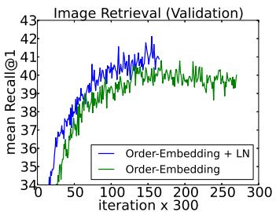  
(a) Recall@1

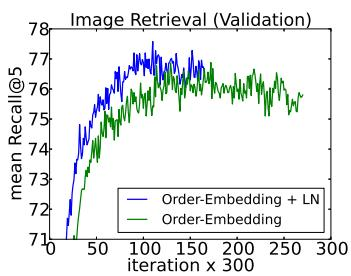  
(b) Recall@5

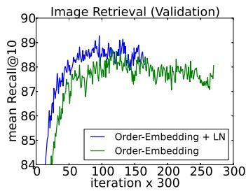  
(c) Recall@10

Figure 1: 使用与不使用层归一化（layer normalization）的序嵌入（order-embeddings）Recall@K 曲线。

<table><tr><td colspan="9">MSCOCO</td></tr><tr><td rowspan="2">模型</td><td colspan="4">文本检索 (Caption Retrieval)</td><td colspan="4">图像检索 (Image Retrieval)</td></tr><tr><td>R@1</td><td>R@5</td><td>R@10</td><td>Mean r</td><td>R@1</td><td>R@5</td><td>R@10</td><td>Mean r</td></tr><tr><td>Sym [Vendrov et al., 2016]</td><td>45.4</td><td></td><td>88.7</td><td>5.8</td><td>36.3</td><td></td><td>85.8</td><td>9.0</td></tr><tr><td>OE [Vendrov et al., 2016]</td><td>46.7</td><td></td><td>88.9</td><td>5.7</td><td>37.9</td><td></td><td>85.9</td><td>8.1</td></tr><tr><td>OE (本文)</td><td>46.6</td><td>79.3</td><td>89.1</td><td>5.2</td><td>37.8</td><td>73.6</td><td>85.7</td><td>7.9</td></tr><tr><td>OE + LN</td><td>48.5</td><td>80.6</td><td>89.8</td><td>5.1</td><td>38.9</td><td>74.3</td><td>86.3</td><td>7.6</td></tr></table>

Table 2: 文本与图像检索在 5 个测试划分上的平均结果。R@K 即 Recall@K（越高越好）。Mean r 为平均排名（越低越好）。Sym 对应对称基线模型，OE 表示序嵌入（order-embeddings）。

学习输入权重的幅度：在归一化模型中，输入权重的幅度由增益（gain）参数显式参数化。我们对比了在学习过程中，归一化 GLM 中更新增益参数与在原始参数化下更新等价权重的幅度时模型输出发生的变化。F¯ 中沿增益参数的方向捕获了输入权重幅度的几何特征。我们表明，标准 GLM 沿输入权重幅度的黎曼度量（Riemannian metric）受其输入范数的缩放影响，而在批量归一化（batch normalized）和层归一化（layer normalized）模型中学习增益参数仅取决于预测误差的幅度。因此，与标准模型相比，归一化模型中输入权重幅度的学习对输入及其参数的缩放更加鲁棒。详细推导见附录。

## 6 实验结果

我们在 6 个任务上对层归一化进行了实验，重点关注循环神经网络：图像-句子排序、问答、上下文语言建模、生成建模、手写序列生成以及 MNIST 分类。除非另有说明，实验中层归一化的默认初始化是将自适应增益设置为 1，偏置设置为 0。

## 6.1 图像和语言的序嵌入

在本实验中，我们将层归一化应用于 Vendrov et al. [2016] 最近提出的序嵌入（order-embeddings）模型，以学习图像和句子的联合嵌入空间。我们遵循与 Vendrov et al. [2016] 相同的实验方案，并修改了他们使用 Theano [Team et al., 2016] 的公开代码以引入层归一化 1。来自 Microsoft COCO 数据集 [Lin et al., 2014] 的图像和句子被嵌入到一个公共向量空间中，其中 GRU [Cho et al., 2014] 用于对句子进行编码，预训练的 VGG ConvNet [Simonyan and Zisserman, 2015]（10-crop）的输出用于对图像进行编码。序嵌入模型将图像和句子表示为两级偏序，并用非对称打分函数替换了 Kiros et al. [2014] 中使用的余弦相似度打分函数。

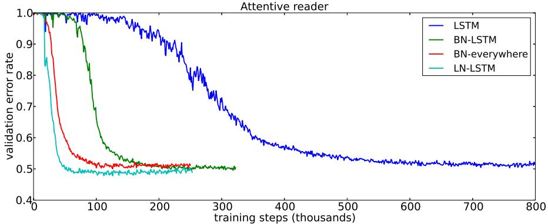  
Figure 2: 注意力读取器（attentive reader）模型的验证曲线。BN 结果取自 [Cooijmans et al., 2016]。

我们训练了两个模型：基线序嵌入（order-embedding）模型，以及对 GRU 应用了层归一化的相同模型。每经过 300 次迭代，我们在留出验证集上计算 Recall@K (R@K) 值，并在 R@K 提升时保存模型。然后，在 5 个独立的测试集（每个测试集包含 1000 张图像和 5000 个图题）上评估性能最好的模型，并报告其平均结果。两个模型均使用具有相同初始超参数的 Adam [Kingma and Ba, 2014]，且均采用与 Vendrov et al. [2016] 相同的架构选择进行训练。关于如何将层归一化应用于 GRU 的描述，请读者参阅附录。

Figure 1 展示了使用和未使用层归一化的模型的验证曲线。我们绘制了图像检索任务的 R@1、R@5 和 R@10 曲线。我们观察到，层归一化在所有指标上都带来了单次迭代的速度提升，并且达到其最佳验证模型所需的时间仅为基线模型的 60%。Table 2 报告了测试集结果，从中我们可以观察到，层归一化相比于原始模型还带来了泛化能力的提升。我们报告的结果在 RNN 嵌入模型中达到了最先进水平（state-of-the-art），在这一任务上仅有 Wang et al. [2016] 的保结构模型报告了更好的结果。然而，他们的评估条件不同（使用 1 个测试集而非 5 个测试集的均值），因此无法直接进行比较。

## 6.2 教机器阅读与理解

为了将层归一化与近期提出的循环批归一化（recurrent batch normalization）[Cooijmans et al., 2016] 进行比较，我们在 Hermann et al. [2015] 引入的 CNN 语料库上训练了一个同样由其提出的单向注意力阅读器（unidirectional attentive reader）模型。这是一个问答任务，必须通过填空来回答关于某段落的查询描述。数据经过了匿名化处理，实体被赋予随机标记以防止退化解，并且在训练和评估期间这些标记会被持续置换。我们遵循与 Cooijmans et al. [2016] 相同的实验方案，并修改了他们基于 Theano [Team et al., 2016] 的公开代码以纳入层归一化 2。我们获取了 Cooijmans et al. [2016] 所使用的预处理数据集，该数据集与 Hermann et al. [2015] 的原始实验不同之处在于每个段落被限制为 4 个句子。在 Cooijmans et al. [2016] 中，使用了循环批归一化的两种变体：一种仅将 BN 应用于 LSTM，另一种则在整个模型中处处应用 BN。在我们的实验中，我们仅在 LSTM 内部应用层归一化。

该实验的结果如 Figure 2 所示。我们观察到，层归一化（layer normalization）不仅训练速度更快，而且相比基线模型和 BN 变体均收敛到了更好的验证结果。在 Cooijmans et al. [2016] 中，作者认为 BN 中的缩放参数必须经过精心挑选，并在其实验中将其设置为 0.1。我们对缩放初始化为 1.0 和 0.1 的层归一化模型分别进行了实验，发现前者的表现明显更好。这表明层归一化并不像循环 BN 那样对初始缩放敏感。3

## 6.3 Skip-thought 向量

Skip-thoughts [Kiros et al., 2015] 是 skip-gram 模型 [Mikolov et al., 2013] 用于学习无监督分布式句子表示的一种推广。给定连续的文本，句子通过一个编码器 RNN 进行编码，并使用解码器 RNN 来预测周围的句子。Kiros et al. [2015] 表明，该模型可以生成通用的句子表示，无需微调即可在多个任务上表现良好。然而，训练该模型非常耗时，需要数天的训练才能产生有意义的结果。

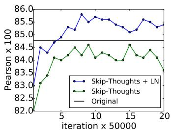  
(a) SICK(r)

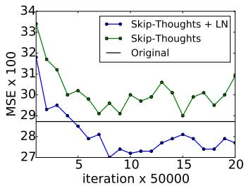  
(b) SICK(MSE)

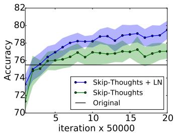  
(c) MR

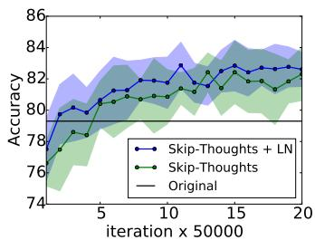  
(d) CR

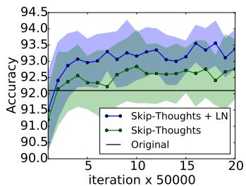  
(e) SUBJ

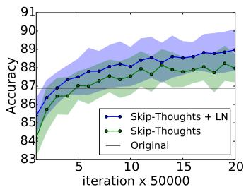  
(f) MPQA

Figure 3: 带有和不带有层归一化的 skip-thought 向量在下游任务上的性能随训练迭代次数的变化。原始折线为 [Kiros et al., 2015] 中报告的结果。带有误差范围的图表采用 10 折交叉验证。彩色显示效果最佳。

<table><tr><td>方法</td><td>SICK(r)</td><td>SICK(ρ)</td><td>SICK(MSE)</td><td>MR</td><td>CR</td><td>SUBJ</td><td>MPQA</td></tr><tr><td>Original [Kiros et al., 2015]</td><td>0.848</td><td>0.778</td><td>0.287</td><td>75.5</td><td>79.3</td><td>92.1</td><td>86.9</td></tr><tr><td>Ours</td><td>0.842</td><td>0.767</td><td>0.298</td><td>77.3</td><td>81.8</td><td>92.6</td><td>87.9</td></tr><tr><td>Ours + LN</td><td>0.854</td><td>0.785</td><td>0.277</td><td>79.5</td><td>82.6</td><td>93.4</td><td>89.0</td></tr><tr><td>Ours + LN †</td><td>0.858</td><td>0.788</td><td>0.270</td><td>79.4</td><td>83.1</td><td>93.7</td><td>89.3</td></tr></table>

Table 3: Skip-thoughts 结果。前两列评估指标表示 Pearson 和 Spearman 相关系数，第三列是均方误差（MSE），其余列表示分类准确率。除 MSE 外，所有评估指标都是越高越好。除（†）训练了 1 个月（约 1.7M 次迭代）外，我们的模型均训练了 1M 次迭代。

在本实验中，我们测定了层归一化（layer normalization）在何种程度上能够加速训练。使用 Kiros et al. [2015] 4 的开源代码，我们在 BookCorpus 数据集 [Zhu et al., 2015] 上训练了两个模型：一个使用层归一化，另一个不使用。这些实验是在 Theano [Team et al., 2016] 上进行的。我们遵循 Kiros et al. [2015] 中使用的实验设置，使用相同的超参数训练了一个 2400 维的句子编码器。鉴于所使用的状态维度大小，可以想见使用层归一化的每次迭代更新可能会比不使用时更慢。然而，我们发现只要使用 CNMeM 5，两个模型之间就没有显著差异。我们每隔 50,000 次迭代保存两个模型的检查点（checkpoint），并在五个任务上评估其性能：语义相关性（SICK）[Marelli et al., 2014]、电影评论情感（MR）[Pang and Lee, 2005]、客户产品评论（CR）[Hu and Liu, 2004]、主观性/客观性分类（SUBJ）[Pang and Lee, 2004] 以及观点极性（MPQA）[Wiebe et al., 2005]。我们绘制了所有任务中每个检查点的两个模型性能，以确定 LN 是否能提升性能收敛速率。

实验结果如 Figure 3 所示。我们观察到，应用层归一化不仅比基线模型速度更快，而且在进行 1M 次迭代后取得了更好的最终结果，如 Table 3 所示。我们还让使用层归一化的模型总共训练了一个月，除一个任务外，在其余所有任务上都获得了进一步的性能提升。我们注意到，原始报告的结果与我们的结果之间的性能差异，可能是因为公开可用的代码并未在解码器的每个时间步进行条件化（condition），而原始模型则进行了条件化。

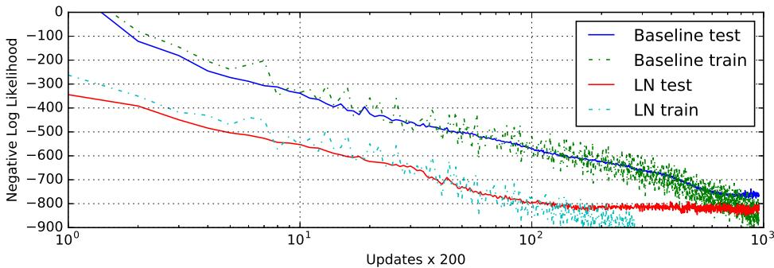  
Figure 5: 使用和不使用层归一化的手写序列生成模型的负对数似然。模型使用大小为 8 的 mini-batch 和长度为 500 的序列进行训练，

## 6.4 使用 DRAW 建模二值化 MNIST

我们还在 MNIST 数据集上进行了生成建模实验。深度循环注意力写入器（Deep Recurrent Attention Writer，DRAW）[Gregor et al., 2015] 此前在建模 MNIST 数字分布上取得了最先进的性能。该模型使用可微注意力机制和循环神经网络按顺序生成图像片段。我们在使用 64 次视线（glimpses）和 256 个 LSTM 隐藏单元的 DRAW 模型上评估了层归一化的效果。该模型使用 Adam [Kingma and Ba, 2014] 优化器的默认设置以及大小为 128 的小批量进行训练。先前关于二值化 MNIST 的出版物使用了各种训练协议来生成其数据集。在本次实验中，我们采用了 Larochelle and Murray [2011] 的固定二值化。该数据集被划分为 50,000 张训练图像、10,000 张验证图像和 10,000 张测试图像。

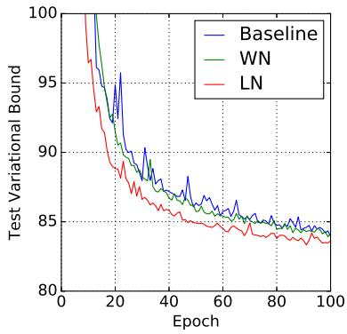  
Figure 4: 采用与未采用层归一化的 DRAW 模型测试负对数似然。

Figure 4 展示了前 100 个 epoch 的测试变分界。它突出了应用层归一-

化的加速优势，即经过层归一化的 DRAW 收敛速度几乎是基线模型的两倍。在 200 个 epoch 后，基线模型在测试数据上收敛到 82.36 nats 的变分对数似然，而层归一化模型达到了 82.09 nats。

## 6.5 手写序列生成

先前的实验大多是在长度在 10 到 40 范围内的 NLP 任务上检验 RNN。为了展示层归一化在更长序列上的有效性，我们使用 IAM 在线手写数据库（IAM Online Handwriting Database）[Liwicki and Bunke, 2005] 进行了手写生成任务。IAM-OnDB 包含从 221 位不同书写者处收集的手写行。在给定输入字符字符串时，目标是预测白板上相应手写行的一系列 x 和 y 笔画坐标。总共有 12179 个手写行序列。输入字符串通常超过 25 个字符，平均手写行的长度约为 700。

我们采用了与 Graves [2013] 第 (5.2) 节中相同的模型架构。该模型架构由 3 个包含 400 个 LSTM 单元的隐藏层组成，它们在输出层生成 20 个二元高斯混合分量，以及一个大小为 3 的输入层。字符序列采用 one-hot 向量编码，因此窗口向量的大小为 57。窗口参数采用了 10 个高斯函数的混合，需要大小为 30 的参数向量。总权重数量增加到约 3.7M。该模型使用大小为 8 的小批量和 Adam [Kingma and Ba, 2014] 优化器进行训练。

较小的 mini-batch 大小与极长序列的结合，使得保持非常稳定的隐藏状态动态特性（hidden dynamics）变得至关重要。Figure 5 表明，层归一化（layer normalization）收敛到了与基线模型相当的对数似然，但速度要快得多。

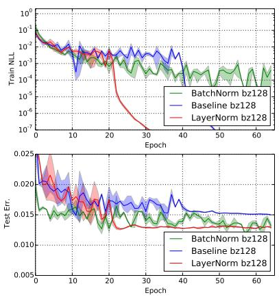

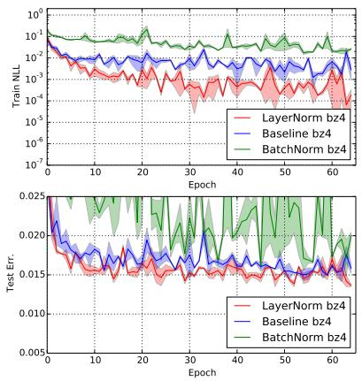  
Figure 6: 采用层归一化和批归一化（batch normalization）的置换不变 MNIST（Permutation invariant MNIST）784-1000-1000-10 模型的负对数似然与测试误差。（左）模型以 128 的 batch-size 训练。（右）模型以 4 的 batch-size 训练。

## 6.6 置换不变 MNIST

除了 RNN，我们还在前馈网络中研究了层归一化。我们展示了在经过充分研究的置换不变 MNIST 分类问题上，层归一化与批归一化的对比情况。根据先前的分析，层归一化对输入重缩放具有不变性，这对于内部隐藏层是理想的特性。但对于 logit 输出而言，这是不必要的，因为预测的置信度是由 logit 的尺度决定的。我们仅将层归一化应用于全连接隐藏层，而不包括最后的 softmax 层。

所有模型均使用 55000 个训练数据点和 Adam [Kingma and Ba, 2014] 优化器进行训练。对于较小的 batch-size，批归一化的方差项使用无偏估计量计算。Figure 6 的实验结果突显出层归一化对 batch-size 具有鲁棒性，并且与应用于所有层的批归一化相比，展现出了更快的训练收敛速度。

## 6.7 卷积网络

我们还在卷积神经网络中进行了实验。在初步实验中，我们观察到层归一化相比于未进行归一化的基线模型有所加速，但批归一化的表现优于其他方法。在全连接层中，一层中的所有隐藏单元往往对最终预测做出相似的贡献，对一层的求和输入进行重新中心化和重新缩放效果良好。然而，这种相似贡献的假设在卷积神经网络中不再成立。大量感受野位于图像边界附近的隐藏单元很少被激活，因此与同一层内的其他隐藏单元具有截然不同的统计特性。我们认为需要进一步的研究来使层归一化在 ConvNets 中良好工作。

## 7 结论

在本文中，我们引入了层归一化来加速神经网络的训练。我们提供了理论分析，对比了层归一化与批归一化以及权重归一化（weight normalization）的不变性性质。我们证明了层归一化对单个训练样本的特征平移和缩放具有不变性。

在实证研究中，我们表明循环神经网络从所提出的方法中获益最大，特别是在长序列和小 mini-batch 的情况下。

## 致谢

本研究得到了来自 NSERC、CFI 和 Google 的资助。

## 参考文献

Alex Krizhevsky, Ilya Sutskever, and Geoffrey E Hinton. Imagenet classification with deep convolutional neural networks. In NIPS, 2012.

Geoffrey Hinton, Li Deng, Dong Yu, George E Dahl, Abdel-rahman Mohamed, Navdeep Jaitly, Andrew Senior, Vincent Vanhoucke, Patrick Nguyen, Tara N Sainath, et al. Deep neural networks for acoustic modeling in speech recognition: The shared views of four research groups. IEEE, 2012.

Jeffrey Dean, Greg Corrado, Rajat Monga, Kai Chen, Matthieu Devin, Mark Mao, Andrew Senior, Paul Tucker, Ke Yang, Quoc V Le, et al. Large scale distributed deep networks. In NIPS, 2012.

Sergey Ioffe and Christian Szegedy. Batch normalization: Accelerating deep network training by reducing internal covariate shift. ICML, 2015.

Ilya Sutskever, Oriol Vinyals, and Quoc V Le. Sequence to sequence learning with neural networks. In Advances in neural information processing systems, pages 3104–3112, 2014.

Cesar Laurent, Gabriel Pereyra, Phil´ emon Brakel, Ying Zhang, and Yoshua Bengio. Batch normalized recurrent´ neural networks. arXiv preprint arXiv:1510.01378, 2015.

Dario Amodei, Rishita Anubhai, Eric Battenberg, Carl Case, Jared Casper, Bryan Catanzaro, Jingdong Chen, Mike Chrzanowski, Adam Coates, Greg Diamos, et al. Deep speech 2: End-to-end speech recognition in english and mandarin. arXiv preprint arXiv:1512.02595, 2015.

Tim Cooijmans, Nicolas Ballas, Cesar Laurent, and Aaron Courville. Recurrent batch normalization.´ arXiv preprint arXiv:1603.09025, 2016.

Tim Salimans and Diederik P Kingma. Weight normalization: A simple reparameterization to accelerate training of deep neural networks. arXiv preprint arXiv:1602.07868, 2016.

Behnam Neyshabur, Ruslan R Salakhutdinov, and Nati Srebro. Path-sgd: Path-normalized optimization in deep neural networks. In Advances in Neural Information Processing Systems, pages 2413–2421, 2015.

Shun-Ichi Amari. Natural gradient works efficiently in learning. Neural computation, 1998.

Ivan Vendrov, Ryan Kiros, Sanja Fidler, and Raquel Urtasun. Order-embeddings of images and language. ICLR, 2016.

The Theano Development Team, Rami Al-Rfou, Guillaume Alain, Amjad Almahairi, Christof Angermueller, Dzmitry Bahdanau, Nicolas Ballas, Fred´ eric Bastien, Justin Bayer, Anatoly Belikov, et al. Theano: A python´ framework for fast computation of mathematical expressions. arXiv preprint arXiv:1605.02688, 2016.

Tsung-Yi Lin, Michael Maire, Serge Belongie, James Hays, Pietro Perona, Deva Ramanan, Piotr Dollar, and ´ C Lawrence Zitnick. Microsoft coco: Common objects in context. ECCV, 2014.

Kyunghyun Cho, Bart Van Merrienboer, Caglar Gulcehre, Dzmitry Bahdanau, Fethi Bougares, Holger¨ Schwenk, and Yoshua Bengio. Learning phrase representations using rnn encoder-decoder for statistical machine translation. EMNLP, 2014.

Karen Simonyan and Andrew Zisserman. Very deep convolutional networks for large-scale image recognition. ICLR, 2015.

Ryan Kiros, Ruslan Salakhutdinov, and Richard S Zemel. Unifying visual-semantic embeddings with multimodal neural language models. arXiv preprint arXiv:1411.2539, 2014.

D. Kingma and J. L. Ba. Adam: a method for stochastic optimization. ICLR, 2014. arXiv:1412.6980.

Liwei Wang, Yin Li, and Svetlana Lazebnik. Learning deep structure-preserving image-text embeddings. CVPR, 2016.

Karl Moritz Hermann, Tomas Kocisky, Edward Grefenstette, Lasse Espeholt, Will Kay, Mustafa Suleyman, and Phil Blunsom. Teaching machines to read and comprehend. In NIPS, 2015.

Ryan Kiros, Yukun Zhu, Ruslan R Salakhutdinov, Richard Zemel, Raquel Urtasun, Antonio Torralba, and Sanja Fidler. Skip-thought vectors. In NIPS, 2015.

Tomas Mikolov, Kai Chen, Greg Corrado, and Jeffrey Dean. Efficient estimation of word representations in vector space. arXiv preprint arXiv:1301.3781, 2013.

Yukun Zhu, Ryan Kiros, Rich Zemel, Ruslan Salakhutdinov, Raquel Urtasun, Antonio Torralba, and Sanja Fidler. Aligning books and movies: Towards story-like visual explanations by watching movies and reading books. In ICCV, 2015.

Marco Marelli, Luisa Bentivogli, Marco Baroni, Raffaella Bernardi, Stefano Menini, and Roberto Zamparelli. Semeval-2014 task 1: Evaluation of compositional distributional semantic models on full sentences through semantic relatedness and textual entailment. SemEval-2014, 2014.

Bo Pang and Lillian Lee. Seeing stars: Exploiting class relationships for sentiment categorization with respect to rating scales. In ACL, pages 115–124, 2005.

Minqing Hu and Bing Liu. Mining and summarizing customer reviews. In Proceedings of the tenth ACM SIGKDD international conference on Knowledge discovery and data mining, 2004.

Bo Pang and Lillian Lee. A sentimental education: Sentiment analysis using subjectivity summarization based on minimum cuts. In ACL, 2004.

Janyce Wiebe, Theresa Wilson, and Claire Cardie. Annotating expressions of opinions and emotions in language. Language resources and evaluation, 2005.

K. Gregor, I. Danihelka, A. Graves, and D. Wierstra. DRAW: a recurrent neural network for image generation. arXiv:1502.04623, 2015.

Hugo Larochelle and Iain Murray. The neural autoregressive distribution estimator. In AISTATS, volume 6, page 622, 2011.

Marcus Liwicki and Horst Bunke. Iam-ondb-an on-line english sentence database acquired from handwritten text on a whiteboard. In ICDAR, 2005.

Alex Graves. Generating sequences with recurrent neural networks. arXiv preprint arXiv:1308.0850, 2013.

## 补充材料

## 层归一化（Layer Normalization）在各实验中的应用

本节描述如何将层归一化（layer normalization）应用于本文的各项实验中。为了符号表示的简便，我们将层归一化定义为一个具有两组自适应参数——增益 $\alpha$ 和偏置 $\beta$ 的函数映射 $\dot { L } N : \mathbb { R } ^ { \dot { D } }  \mathbb { R } ^ { D }\colon$

$$
L N (\mathbf {z}; \pmb {\alpha}, \pmb {\beta}) = \frac {(\mathbf {z} - \mu)}{\sigma} \odot \pmb {\alpha} + \pmb {\beta},\tag{15}
$$

$$
\mu = \frac {1}{D} \sum_ {i = 1} ^ {D} z _ {i}, \quad \sigma = \sqrt {\frac {1}{D} \sum_ {i = 1} ^ {D} (z _ {i} - \mu) ^ {2}},\tag{16}
$$

其中，$z _ { i }$ 是向量 $\mathbf{z}$ 的第 $i$ 个元素。

## 机器阅读理解与手写序列生成

这些实验中使用的基础 LSTM（长短期记忆网络）方程如下：

$$
\left( \begin{array}{c} \mathbf {f} _ {t} \\ \mathbf {i} _ {t} \\ \mathbf {o} _ {t} \\ \mathbf {g} _ {t} \end{array} \right) = \mathbf {W} _ {h} \mathbf {h} _ {t - 1} + \mathbf {W} _ {x} \mathbf {x} _ {t} + b\tag{17}
$$

$$
\mathbf {c} _ {t} = \sigma (\mathbf {f} _ {t}) \odot \mathbf {c} _ {t - 1} + \sigma (\mathbf {i} _ {t}) \odot \tanh (\mathbf {g} _ {t})\tag{18}
$$

$$
{\mathbf {h} _ {t}} = {\sigma (\mathbf {o} _ {t}) \odot \tanh (\mathbf {c} _ {t})}\tag{19}
$$

引入层归一化的版本修改如下：

$$
\left( \begin{array}{c} \mathbf {f} _ {t} \\ \mathbf {i} _ {t} \\ \mathbf {o} _ {t} \\ \mathbf {g} _ {t} \end{array} \right) = L N (\mathbf {W} _ {h} \mathbf {h} _ {t - 1}; \boldsymbol {\alpha} _ {1}, \boldsymbol {\beta} _ {1}) + L N (\mathbf {W} _ {x} \mathbf {x} _ {t}; \boldsymbol {\alpha} _ {2}, \boldsymbol {\beta} _ {2}) + b\tag{20}
$$

$$
\mathbf {c} _ {t} = \sigma (\mathbf {f} _ {t}) \odot \mathbf {c} _ {t - 1} + \sigma (\mathbf {i} _ {t}) \odot \tanh (\mathbf {g} _ {t})\tag{21}
$$

$$
\mathbf {h} _ {t} = \sigma (\mathbf {o} _ {t}) \odot \tanh (L N (\mathbf {c} _ {t}; \boldsymbol {\alpha} _ {3}, \boldsymbol {\beta} _ {3}))\tag{22}
$$

其中 $\alpha _ { i } , \beta _ { i }$ 分别为加法和乘法参数。每个 $\alpha _ { i }$ 均初始化为全零向量，每个 $\beta _ { i }$ 均初始化为全一向量。

## 序嵌入（Order embeddings）与 skip-thoughts

这些实验采用了一种门控循环单元（gated recurrent unit，GRU）的变体，其定义如下：

$$
\binom{\mathbf {z} _ {t}}{\mathbf {r} _ {t}} = \mathbf {W} _ {h} \mathbf {h} _ {t - 1} + \mathbf {W} _ {x} \mathbf {x} _ {t}\tag{23}
$$

$$
{\hat {\mathbf {h}} _ {t}} = {\tanh (\mathbf {W} \mathbf {x} _ {t} + \sigma (\mathbf {r} _ {t}) \odot (\mathbf {U h} _ {t - 1}))}\tag{24}
$$

$$
{\mathbf {h} _ {t}} = {(1 - \sigma (\mathbf {z} _ {t})) \mathbf {h} _ {t - 1} + \sigma (\mathbf {z} _ {t}) \hat {\mathbf {h}} _ {t}}\tag{25}
$$

层归一化的应用方式如下：

$$
\binom{\mathbf {z} _ {t}}{\mathbf {r} _ {t}} = L N (\mathbf {W} _ {h} \mathbf {h} _ {t - 1}; \boldsymbol {\alpha} _ {1}, \boldsymbol {\beta} _ {1}) + L N (\mathbf {W} _ {x} \mathbf {x} _ {t}; \boldsymbol {\alpha} _ {2}, \boldsymbol {\beta} _ {2})\tag{26}
$$

$$
\hat {\mathbf {h}} _ {t} = \tanh (L N (\mathbf {W x} _ {t}; \boldsymbol {\alpha} _ {3}, \boldsymbol {\beta} _ {3}) + \sigma (\mathbf {r} _ {t}) \odot L N (\mathbf {U h} _ {t - 1}; \boldsymbol {\alpha} _ {4}, \boldsymbol {\beta} _ {4}))\tag{27}
$$

$$
{\mathbf {h} _ {t}} = {(1 - \sigma (\mathbf {z} _ {t})) \mathbf {h} _ {t - 1} + \sigma (\mathbf {z} _ {t}) \hat {\mathbf {h}} _ {t}}\tag{28}
$$

与之前一样，$\alpha _ { i }$ 初始化为全零向量，每个 $\beta _ { i }$ 初始化为全一向量。

## 使用 DRAW 对二值化 MNIST 进行建模

在本实验中，层归一化（layer norm）仅应用于 LSTM 隐藏状态的输出：

结合了层归一化的版本修改如下：

$$
\left( \begin{array}{c} \mathbf {f} _ {t} \\ \mathbf {i} _ {t} \\ \mathbf {o} _ {t} \\ \mathbf {g} _ {t} \end{array} \right) = \mathbf {W} _ {h} \mathbf {h} _ {t - 1} + \mathbf {W} _ {x} \mathbf {x} _ {t} + b\tag{29}
$$

$$
{\mathbf {c} _ {t}} = {\sigma (\mathbf {f} _ {t}) \odot \mathbf {c} _ {t - 1} + \sigma (\mathbf {i} _ {t}) \odot \tanh (\mathbf {g} _ {t})}\tag{30}
$$

$$
\mathbf {h} _ {t} = \sigma (\mathbf {o} _ {t}) \odot \tanh (L N (\mathbf {c} _ {t}; \boldsymbol {\alpha}, \boldsymbol {\beta}))\tag{31}
$$

其中 $\alpha , \beta$ 分别为加法和乘法参数。$\alpha$ 初始化为全零向量，$\beta$ 初始化为全一向量。

## 学习输入权重的幅值

我们现在比较归一化 GLM 与原始参数化之间，梯度下降更新如何改变等效权重的幅值。在归一化模型中，权重的幅值使用增益参数进行显式参数化。假设存在一个梯度更新，使权重向量的范数改变了 $\delta _ { g }$。我们可以将梯度更新投影到普通 GLM 的权重向量上。归一化模型的 KL 度量（即梯度更新对模型预测改变的程度）仅取决于预测误差的幅值。具体而言，

在批归一化（batch normalization）下：

$$
d s ^ {2} = \frac {1}{2} \operatorname{vec} ([ 0, 0, \delta_ {g} ] ^ {\top}) ^ {\top} \bar {F} (\operatorname{vec} ([ W, \mathbf {b}, \mathbf {g} ] ^ {\top}) \operatorname{vec} ([ 0, 0, \delta_ {g} ] ^ {\top}) = \frac {1}{2} \delta_ {g} ^ {\top} \underset {\mathbf {x} \sim P (\mathbf {x})} {\mathbb {E}} \left[ \frac {\operatorname{Cov} [ \mathbf {y} | \mathbf {x} ]}{\phi^ {2}} \right] \delta_ {g}.\tag{32}
$$

在层归一化下：

$$
\begin{array}{r l} & {d s ^ {2} = \frac {1}{2} \operatorname{vec} ([ 0, 0, \delta_ {g} ] ^ {\top}) ^ {\top} \bar {F} (\operatorname{vec} ([ W, \mathbf {b}, \mathbf {g} ] ^ {\top}) \operatorname{vec} ([ 0, 0, \delta_ {g} ] ^ {\top})} \\ & {\qquad = \frac {1}{2} \delta_ {g} ^ {\top} \frac {1}{\phi^ {2}} \underset {\mathbf {x} \sim P (\mathbf {x})} {\mathbb {E}} \left[ \begin{array}{c c c} \operatorname{Cov} (y _ {1}, y _ {1} \mid \mathbf {x}) \frac {(a _ {1} - \mu) ^ {2}}{\sigma^ {2}} & \dots & \operatorname{Cov} (y _ {1}, y _ {H} \mid \mathbf {x}) \frac {(a _ {1} - \mu) (a _ {H} - \mu)}{\sigma^ {2}} \\ \vdots & \ddots & \vdots \\ \operatorname{Cov} (y _ {H}, y _ {1} \mid \mathbf {x}) \frac {(a _ {H} - \mu) (a _ {1} - \mu)}{\sigma^ {2}} & \dots & \operatorname{Cov} (y _ {H}, y _ {H} \mid \mathbf {x}) \frac {(a _ {H} - \mu) ^ {2}}{\sigma^ {2}} \end{array} \right] \delta_ {g}} \end{array}\tag{33}
$$

在权重归一化（weight normalization）下：

$$
\begin{array}{c} d s ^ {2} = \frac {1}{2} \operatorname{vec} ([ 0, 0, \delta_ {g} ] ^ {\top}) ^ {\top} \bar {F} (\operatorname{vec} ([ W, \mathbf {b}, \mathbf {g} ] ^ {\top}) \operatorname{vec} ([ 0, 0, \delta_ {g} ] ^ {\top}) \\ = \frac {1}{2} \delta_ {g} ^ {\top} \frac {1}{\phi^ {2}} \underset {\mathbf {x} \sim P (\mathbf {x})} {\mathbb {E}} \left[ \begin{array}{c c c} \operatorname{Cov} (y _ {1}, y _ {1}   |   \mathbf {x}) \frac {a _ {1} ^ {2}}{\| w _ {1} \| _ {2} ^ {2}} & \dots & \operatorname{Cov} (y _ {1}, y _ {H}   |   \mathbf {x}) \frac {a _ {1} a _ {H}}{\| w _ {1} \| _ {2} \| w _ {H} \| _ {2}} \\ \vdots & \ddots & \vdots \\ \operatorname{Cov} (y _ {H}, y _ {1}   |   \mathbf {x}) \frac {a _ {H} a _ {1}}{\| w _ {H} \| _ {2} \| w _ {1} \| _ {2}} & \dots & \operatorname{Cov} (y _ {H}, y _ {H}   |   \mathbf {x}) \frac {a _ {H} ^ {2}}{\| w _ {H} \| _ {2} ^ {2}} \end{array} \right] \delta_ {g}. \end{array}\tag{34}
$$

然而，标准 GLM 中的 KL 度量与其激活值 $a _ { i } = w _ { i } ^ { \top } { \bf x } .$ 相关，而激活值又取决于其当前权重和输入数据。在标准 GLM 模型中，我们将第 $i$ 个神经元的增益参数梯度更新 $\delta _ { g } i$ 投影到其权重向量上，形式为 $\delta _ { g i } \frac { w _ { i } } { \lVert w _ { i } \rVert _ { 2 } }$：

$$
\begin{array}{l} \frac {1}{2} \operatorname{vec} \left(\left[ \delta_ {g i} \frac {w _ {i}}{\| w _ {i} \| _ {2}}, 0, \delta_ {g j} \frac {w _ {j}}{\| w _ {i} \| _ {2}}, 0 \right] ^ {\top}\right) ^ {\top} F \left(\left[ w _ {i} ^ {\top}, b _ {i}, w _ {j} ^ {\top}, b _ {j} \right] ^ {\top}\right) \operatorname{vec} \left(\left[ \delta_ {g i} \frac {w _ {i}}{\| w _ {i} \| _ {2}}, 0, \delta_ {g j} \frac {w _ {j}}{\| w _ {j} \| _ {2}}, 0 \right] ^ {\top}\right) \\ = \frac {\delta_ {g i} \delta_ {g j}}{2 \phi^ {2}} \underset {\mathbf {x} \sim P (\mathbf {x})} {\mathbb {E}} \left[ \operatorname{Cov} \left(y _ {i}, y _ {j} \mid \mathbf {x}\right) \frac {a _ {i} a _ {j}}{\| w _ {i} \| _ {2} \| w _ {j} \| _ {2}} \right] \end{array} \tag {35}
$$

因此，相比于标准模型，批归一化（Batch Normalized）和层归一化（Layer Normalized）模型对输入及其参数的尺度缩放具有更强的鲁棒性。